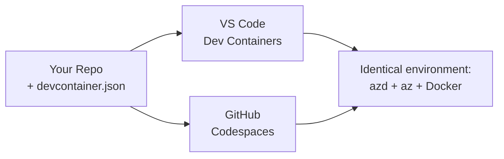

# azd साठी Dev Containers & GitHub Codespaces

**प्रकरण नेव्हिगेशन:**
- **📚 कोर्स होम**: [AZD For Beginners](../../README.md)
- **📖 चालू प्रकरण**: प्रकरण 1 - फाउंडेशन & क्विक स्टार्ट
- **⬅️ मागील**: [Bring Your Own App](bring-your-own-app.md)
- **🚀 पुढील प्रकरण**: [प्रकरण 2: AI-फर्स्ट डेव्हलपमेंट](../chapter-02-ai-development/README.md)

> कमांड आणि कॉन्फिगरेशन पुनरावलोकन लक्ष्य: `azd 1.37.2` (नोव्हेंबर 2026). कंटेनर बिल्ड्स आणि Azure डिप्लॉयमेंट्स या पुनरावलोकनाचा भाग नव्हते.

## परिचय

azd, योग्य भाषा रनटाइम, Docker, आणि Azure CLI प्रत्येक संगणकावर इन्स्टॉल करणे एक त्रास आहे—आणि हेच मुख्य कारण आहे की "माझ्या संगणकावर चालते" असलेले ट्यूटोरियल दुसऱ्या कोणासाठी अपयशी ठरते. एक **dev container** तुमचा संपूर्ण टूलचेन एका फाईलमध्ये वर्णन करून हे सोडवतो. जो कोणी VS Code किंवा GitHub Codespaces मध्ये प्रकल्प उघडतो त्याला अगोदरपासून azd इंस्टॉल केलेलं अगदी सारखं वातावरण मिळतं. हा धडा तुम्हाला ते कसं जोडायचं ते दाखवतो.

## शिक्षणाचे उद्दिष्टे

या धड्याच्या अखेरीस, तुम्ही:
- dev container काय आहे आणि azd मध्ये तो का मदत करतो ते समजून घ्याल
- प्रकल्पात एक लहानसे `.devcontainer/devcontainer.json` जोडाल
- Dev Container *फीचर्स* मध्ये azd, Azure CLI, आणि Docker समाविष्ट कराल
- GitHub Codespaces किंवा VS Code मध्ये प्रकल्प उघडाल

## शिकून मिळणारे परिणाम

धडा पूर्ण केल्यानंतर, तुम्ही सक्षम असाल:
- azd प्रकल्पासाठी `devcontainer.json` तयार करण्यास
- मॅन्युअल इंस्टॉलेशन्स न करता azd आणि Azure टूलिंग जोडण्यास
- कंटेनर किंवा Codespace मधून `azd up` चालवण्यास

---

## Dev Container म्हणजे काय?

dev container हा तुमच्या रेपॉझिटरीतील `.devcontainer/devcontainer.json` फाईलद्वारे परिभाषित केलेला Docker-आधारित डेव्हलपमेंट वातावरण आहे. जेव्हा तुम्ही प्रकल्प उघडता:

- **VS Code** (Dev Containers विस्तारासह) कंटेनर बनवतो आणि त्याला जोडतो.
- **GitHub Codespaces** मध्ये तोच कंटेनर क्लाउडमध्ये बनवला जातो आणि तुम्हाला ब्राऊजर-आधारित संपादक दिला जातो.

दोन्ही प्रकारे, प्रत्येक योगदानकर्त्याला सारखेच टूल्स मिळतात—"तुम्ही azd इंस्टॉल केलं का?" असा प्रश्न येत नाही.



---

## टप्पा 1: devcontainer फाईल तयार करा

तुमच्या प्रकल्पाच्या मूळ फोल्डरमध्ये `.devcontainer/devcontainer.json` फाईल तयार करा:

```json
{
  "name": "azd-project",
  "image": "mcr.microsoft.com/devcontainers/base:bookworm",
  "features": {
    "ghcr.io/devcontainers/features/azure-cli:1": {},
    "ghcr.io/azure/azure-dev/azd:0": { "version": "1.37.2" },
    "ghcr.io/devcontainers/features/docker-in-docker:2": {},
    "ghcr.io/devcontainers/features/node:1": {}
  },
  "customizations": {
    "vscode": {
      "extensions": [
        "ms-azuretools.azure-dev",
        "ms-azuretools.vscode-bicep"
      ]
    }
  },
  "forwardPorts": [3000],
  "postCreateCommand": "azd version"
}
```

त्यातील प्रत्येक भाग काय करतो:

| की | उद्दिष्ट |
|-----|---------|
| `image` | कंटेनरसाठी बेस OS |
| `features` | आधीपासून इंस्टॉलर्स—येथे: Azure CLI, **azd**, Docker, आणि Node.js |
| `customizations.vscode.extensions` | azd आणि Bicep VS Code एक्स्टेंशन्स आपोआप इंस्टॉल करतो |
| `forwardPorts` | तुमच्या अॅपचा पोर्ट ब्राउजरला उघडतो |
| `postCreateCommand` | कंटेनर बिल्ड झाल्यानंतर एकदांफिपर्यंत चालतो (येथे, एक सॅनिटी चेक) |

> फीचर आवृत्ती (`azd:0`) आणि इंस्टॉल केलेली CLI आवृत्ती वेगळी आहेत. CLI पिन करण्यासाठी फीचरचा `version` पर्याय `"1.37.2"` करा; CLI आवृत्ती फीचर टॅग म्हणून वापरू नका.

---

## टप्पा 2: फीचरला तुमच्या अॅपच्या भाषेशी जुळवा

तुमच्या अॅपसाठी जे काही वापरता ते बिगर केलीली `node` फीचर बदला:

```jsonc
// Python project
"ghcr.io/devcontainers/features/python:1": {},

// .NET project
"ghcr.io/devcontainers/features/dotnet:2": {},

// Java project
"ghcr.io/devcontainers/features/java:1": {},

// Go project
"ghcr.io/devcontainers/features/go:1": {}
```

स्थानिक पद्धतीने इमेज तयार करताना `docker-in-docker` ठेवा. रिमोट ACR बिल्ड (`docker.remoteBuild: true`) ही आणखी एक पर्याय आहे; फक्त होस्ट प्रकारावर अवलंबून नेहमी स्थानिक Docker आवश्यक नाही.

---

## टप्पा 3: ते उघडा

**VS Code मध्ये:**
1. **Dev Containers** विस्तार इंस्टॉल करा.
2. प्रकल्प फोल्डर उघडा.
3. विचारल्यावर **Reopen in Container** क्लिक करा (किंवा *Dev Containers: Reopen in Container* चालवा).

**GitHub Codespaces मध्ये:**
1. रेपो GitHub वर पुश करा.
2. **Code → Codespaces → Create codespace on main** क्लिक करा.
3. कंटेनर बिल्ड होण्याची वाट पहा—टर्मिनलमध्ये azd तयार आहे.

---

## टप्पा 4: कंटेनरमधून डिप्लॉय करा

कंटेनरमध्ये azd पूर्वइंस्टॉल केलेले आहे, त्यामुळे सामान्य कार्यप्रवाह थेट काम करतो:

```bash
azd auth login --use-device-code   # device code is handy inside Codespaces
azd up
```

> **का `--use-device-code`?** रिमोट कंटेनर किंवा Codespace मध्ये स्थानिक ब्राउजर नसतो, त्यामुळे डिव्हाइस-कोड लॉगिन विश्वसनीय मार्ग आहे. तुम्हाला साइन-इन पूर्ण करण्यासाठी ब्राउजर टॅबमध्ये कोड पेस्ट करावा लागेल.

---

## सामान्य अडचणी

| अडचण | निराकरण |
|---------|-----|
| `azd up` इमेज बिल्ड करू शकत नाही | `docker-in-docker` फीचर जोडा |
| Codespaces मध्ये ब्राउजर लॉगिन हँग होतो | `azd auth login --use-device-code` वापरा |
| टीममेट्समध्ये टूल्स वेगळे आहेत | azd फीचरच्या `version` पर्यायाद्वारे CLI पिन करा आणि भाषा रनटाइम पिन करा |
| ब्राउजरमध्ये अॅप पोहोचत नाही | पोर्ट `forwardPorts` मध्ये जोडा |

---

## सारांश

- एक dev container तुमचा azd टूलचेन सर्वांसाठी पुनरुत्पादक बनवतो.
- Dev Container *फीचर्स* द्वारे azd, Azure CLI, आणि Docker जोडा.
- तुमच्या अॅपसाठी भाषा फीचर जुळवा आणि कंटेनर होस्टसाठी `docker-in-docker` ठेवा.
- Codespaces मध्ये चालवताना डिव्हाइस-कोड लॉगिन वापरा.

---

## 🔗 नेव्हिगेशन

| दिशा | संसाधन |
|-----------|----------|
| **मागील** | [Bring Your Own App](bring-your-own-app.md) |
| **प्रकरण होम** | [प्रकरण 1: फाउंडेशन & क्विक स्टार्ट](README.md) |
| **पुढील प्रकरण** | [प्रकरण 2: AI-फर्स्ट डेव्हलपमेंट](../chapter-02-ai-development/README.md) |

## 📖 संबंधित स्रोत

- [इंस्टॉलेशन & सेटअप](installation.md)
- [कमांड चीट शीट](../../resources/cheat-sheet.md)
- [ऑफिशियल डेव कंटेनर्स स्पेसिफिकेशन](https://containers.dev/)
- [azd डेव कंटेनर फीचर](https://github.com/Azure/azure-dev/tree/main/ext/devcontainer)

---

<!-- CO-OP TRANSLATOR DISCLAIMER START -->
**अस्वीकरण**:
हा दस्तऐवज AI भाषांतर सेवा [Co-op Translator](https://github.com/Azure/co-op-translator) चा वापर करून अनुवादित केला आहे. जरी आम्ही अचूकतेसाठी प्रयत्न करतो, तरी कृपया लक्षात घ्या की स्वयंचलित भाषांतरांमध्ये त्रुटी किंवा अचूकतेची कमतरता असू शकते. मूळ दस्तऐवज त्याच्या मूळ भाषेत अधिकृत स्रोत मानला पाहिजे. महत्त्वाची माहिती असल्यास, व्यावसायिक मानवी भाषांतराची शिफारस केली जाते. या भाषांतराच्या वापरामुळे उद्भवणाऱ्या कोणत्याही गैरसमज किंवा चुकीच्या अर्थलावणीसाठी आम्ही जबाबदार नाही.
<!-- CO-OP TRANSLATOR DISCLAIMER END -->