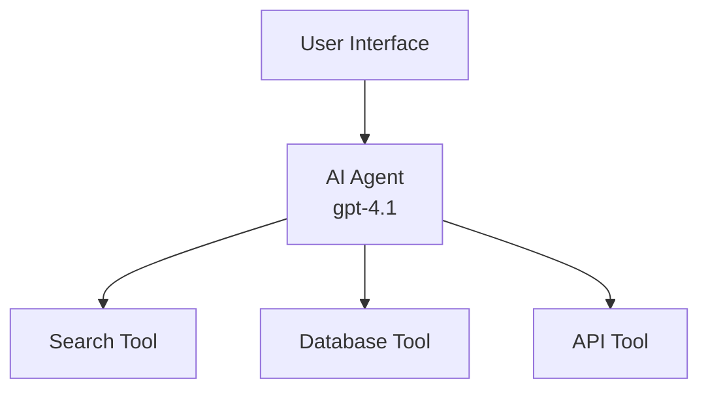
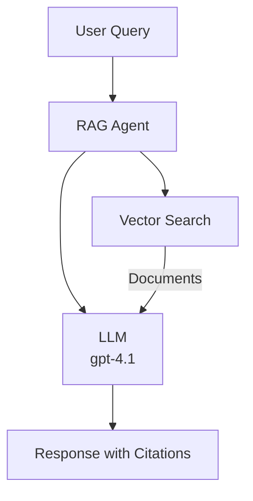
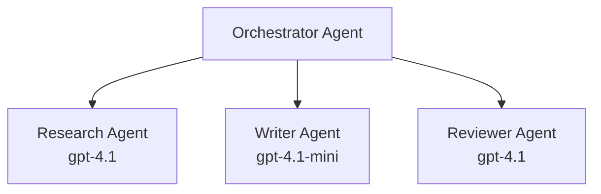

# Azure Developer CLI सह AI एजंट

**अध्याय नेव्हिगेशन:**
- **📚 कोर्स होम**: [AZD For Beginners](../../README.md)
- **📖 चालू अध्याय**: अध्याय 2 - AI-फर्स्ट विकास
- **⬅️ मागील**: [Microsoft Foundry Integration](microsoft-foundry-integration.md)
- **➡️ पुढील**: [AI Model Deployment](ai-model-deployment.md)
- **🚀 प्रगत**: [Multi-Agent Solutions](../../examples/retail-scenario.md)

---

## परिचय

AI एजंट म्हणजे स्वायत्त प्रोग्राम जे त्यांच्या पर्यावरणाची जाणीव ठेवू शकतात, निर्णय घेऊ शकतात, आणि विशिष्ट उद्दिष्टे साध्य करण्यासाठी कृती करतात. साध्या चॅटबॉट्सपासून वेगळे, जे फक्त सूचनांना प्रतिसाद देतात, एजंट्स:

- **साधने वापरतात** - API कॉल करणे, डेटाबेस शोधणे, कोड चालविणे
- **योजना आखतात आणि विचार करतात** - गुंतागुंतीच्या कार्यांना टप्प्याटप्प्याने विभागणे
- **संदर्भातून शिकतात** - मेमरी ठेवणे आणि वर्तन अनुकूल करणे
- **सहकार्य करतात** - इतर एजंट्ससह काम करणे (मल्टी-एजंट सिस्टम्स)

या मार्गदर्शिकेत Azure Developer CLI (azd) चा वापर करून Azure वर AI एजंट कसे तैनात करायचे ते दाखवले आहे.

संभाषण संदर्भ वापरणे म्हणजे मॉडेल प्रशिक्षण नाही: कायमस्वरूपी मेमरी, प्रवेश नियंत्रण, आणि धारणा अंमलात आणणे किंवा संचयित करणे हे अर्जाद्वारे करावे लागते.

> **Foundry GA अपडेट (2026-11-09):** सहसा उपलब्ध असलेल्या `microsoft.foundry` 1.0 बंडल, `azd >= 1.37.0` वापरून स्थापित करा. मूल्यमापन वेगळे स्थापित केले जातात; ऐच्छिक प्रिव्ह्यू वैशिष्ट्ये आणि खालील क्लासिक SDK तुकडा बंडल घोषणेद्वारे GA मध्ये प्रोत्साहित केले जात नाही. हे मार्गदर्शन [GA घोषणा](https://devblogs.microsoft.com/azure-sdk/microsoft-foundry-azure-developer-cli-ga/) आणि दस्तऐवजांवर आधारित आहे, थेट Azure तैनातीवर नाही.

## शिकण्याचे उद्दिष्ट

या मार्गदर्शिका पूर्ण केल्यावर, तुम्ही:
- AI एजंट म्हणजे काय आणि ते चॅटबॉट्सपासून कसे वेगळे आहेत हे समजून घेणार आहात
- AZD वापरून पूर्वनिर्मित AI एजंट टेम्पलेट तैनात करणार आहात
- सानुकूल एजंटसाठी Foundry Agents कॉन्फिगर करणार आहात
- मूलभूत एजंट पॅटर्न (साधने वापरणे, RAG, मल्टी-एजंट) अंमलात आणणार आहात
- तैनात एजंट्सची देखभाल आणि डिबगिंग करणार आहात

## शिकण्याचे परिणाम

पूर्ण केल्यावर, तुम्ही सक्षम असाल:
- एका कमांडने Azure वर AI एजंट अनुप्रयोग तैनात करणे
- एजंट साधने आणि क्षमता कॉन्फिगर करणे
- एजंटसह पुनर्प्राप्ती-प्रेरित निर्मिती (RAG) अंमलात आणणे
- गुंतागुंतीच्या कार्यप्रवाहांसाठी मल्टी-एजंट आर्किटेक्चर डिझाइन करणे
- सामान्य एजंट तैनाती समस्या त्रुटी सोडवणे

---

## 🤖 एजंट आणि चॅटबॉट मधील फरक काय आहे?

| वैशिष्ट्य | चॅटबॉट | AI एजंट |
|---------|---------|----------|
| **वर्तन** | सूचनांना प्रतिसाद देतो | स्वायत्त कृती करतो |
| **साधने** | कदाचित पुनर्प्राप्ती किंवा साधने वापरतो | सामान्यतः उद्दिष्टाभिमुख लूपमध्ये साधने वापरतो |
| **स्मृती** | अर्जानुसार | कायमस्वरूपी स्मृती फक्त स्पष्टपणे अंमलात आणल्यास |
| **योजना** | एकल प्रतिसाद | बहु-टप्प्यांचे विचार |
| **सहकार्य** | एकल घटक | इतर एजंट्ससह काम करू शकतो |

### सोपी संज्ञा

- **चॅटबॉट** = माहिती डेस्कवर प्रश्नांची उत्तरे देणारा मदतनीस व्यक्ती
- **AI एजंट** = एक वैयक्तिक सहाय्यक जो कॉल करु शकतो, अपॉइंटमेंट बुक करू शकतो आणि तुमचे काम पूर्ण करतो

---

## 🚀 त्वरित प्रारंभ: तुमचा पहिला एजंट तैनात करा

एका **नवीन रिकाम्या कामाच्या निर्देशिकेत** एक पर्याय निवडा. शेवटी असलेला `.` तिथे सुरू होतो; स्पष्ट गंतव्याशिवाय, वर्तमान AZD कदाचित टेम्प्लेट-नामित उपनिर्देशिका तयार करेल आणि तुमच्या शेलची निर्देशिका बदलत नाही. वेगवेगळ्या टेम्प्लेट/परिसरांना वेगवेगळ्या निर्देशिकांत ठेवा.

खालील वेळ/खर्चांचे श्रेणी केवळ उदाहरणार्थ आहेत, सत्यापित कोट्स नाहीत. प्रत्येक नमुन्याच्या वर्तमान पूर्वअटी, किमती, मॉडेल कोट्या आणि ऐच्छिक सेवा परिनियोजनापूर्वी तपासा.

### पर्याय 1: Foundry Agents टेम्प्लेट (शिफारस केलेले)

```bash
# Initialize the AI agents template
azd init --template get-started-with-ai-agents .

# Deploy to Azure
azd up
```

**काय परिनियोजित होते:** नमुन्याच्या वर्तमान पायाभूत सुविधा आणि निवडलेले पर्याय मॉडेल, साधने, होस्टिंग आणि निरीक्षण संसाधने निश्चित करतात. त्याचा README आणि `infra/` देखील पाहा; प्रत्येक एजंट टेम्प्लेटमध्ये शोध किंवा वेब इंटरफेस असण्याची खात्री करू नका.

**वेळ:** ~१५-२० मिनिटे
**खर्च:** ~$१००-१५०/महिना (विकास)

### पर्याय 2: Prompty सह सर्जनशील लेखन एजंट्स

```bash
# Initialize the Prompty-based agent template
azd init --template https://github.com/Azure-Samples/contoso-creative-writer .

# Deploy to Azure
azd up
```

**काय परिनियोजित होते:** Azure OpenAI, Bing Grounding, आणि Azure AI Search वापरून FastAPI/Prompty बहु-एजंट लेखन नमुना. पूर्वीचा `agent-openai-python-prompty` रेपॉजिटरी येथे पुनर्निर्देशित केला जातो; तो एक किमान Azure Functions हवामान-एजंट टेम्प्लेट नाही. होस्टिंग, मॉडेल कोटा, आणि Bing Grounding पूर्वअटींसाठी त्याचा वर्तमान README फॉलो करा.

**वेळ:** ~१०-१५ मिनिटे
**खर्च:** ~$५०-१००/महिना (विकास)

### पर्याय 3: RAG Chat एजंट

```bash
# Initialize RAG chat template
azd init --template azure-search-openai-demo .

# Deploy to Azure
azd up
```

**काय परिनियोजित होते:**
- ✅ Microsoft Foundry मॉडेल्स
- ✅ नमुना डेटासह Azure AI Search
- ✅ दस्तऐवज प्रक्रिया पाइपलाइन
- ✅ उद्धृतांसह चॅट इंटरफेस

**वेळ:** ~१५-२५ मिनिटे
**खर्च:** ~$80-150/महिना (विकासासाठी)

### पर्याय 4: GA Foundry बंडलसह होस्टेड एजंट

मूलभूत Python Agent Framework Responses API नमुना साठी [पूर्ण होस्टेड-एजंट वॉकथ्रू](microsoft-foundry-integration.md#hosted-agent-walkthrough-ga) वापरा. या कोड-डिप्लॉयमेंट मार्गासाठी Python 3.13+, चालू uv, Foundry परवानग्या आणि प्रादेशिक मॉडेल कोटा आवश्यक आहे. Azure CLI क्रेडेन्शियल्स वापरताना स्थानिक SDK कॉल्स स्वतंत्रपणे प्रमाणीकरण करा.

```bash
azd auth login
azd ext install microsoft.foundry
```

रिकाम्या निर्देशिकेत, नमुना प्रारंभ करा:

```text
azd ai agent init --template https://github.com/microsoft-foundry/foundry-samples/blob/main/samples/python/hosted-agents/agent-framework/responses/01-basic/azure.yaml --deploy-mode code --src .
```

नवीन किंवा विद्यमान प्रकल्प निवडा, `azure.yaml` तपासा, आणि `azd provision` चालवा. Agent Inspector उघडण्यासाठी `azd ai agent run` वापरा आणि त्या निर्देशिकेतील दुसऱ्या टर्मिनलमधून `azd ai agent invoke --local "Explain how this agent is hosted."` वापरा. स्थानिक पडताळणी नंतर, तैनात प्रतिसादाची तुलना करण्यासाठी `azd deploy` आणि `azd ai agent invoke "Explain how this agent is hosted."` वापरा. Foundry अपलोड केलेल्या स्रोताचा रिमोटवर बिल्ड बनवतो; स्थानिक कंटेनर बिल्ड आवश्यक नाही.

**कधी `azd ai agent init` विरुद्ध `azd init --template` वापरायचे:**

| पद्धत | सर्वोत्तम | ते कसे कार्य करते |
|----------|----------|------|
| `azd init --template` | काम करणाऱ्या नमुना अॅपपासून सुरू करणे | कोड + इन्फ्रा सह पूर्ण टेम्प्लेट रेपो क्लोन करते |
| `azd ai agent init --template` | विद्यमान Foundry एजंट प्रकल्प स्वीकारणे | `azure.yaml` प्रकल्प दस्तऐवज आणि त्याच्या व्याख्यांचा वापर करते |

> **टीप:** पर्याय 1-3 पूर्ण अनुप्रयोग टेम्पलेट्सपासून सुरू होतात; पर्याय 4 GA होस्टेड-एजंट वर्कफ्लो शिकवतो. कोणतीही प्रारंभिक आज्ञा वारसा एजंट घोषणपत्रे आपोआप स्थलांतरित करत नाही. विद्यमान प्रकल्पात थेट एजंट व्याख्या जोडण्यासाठी, [प्रारंभ आणि स्थलांतर मार्गदर्शन](../chapter-08-production/production-ai-practices.md#initializing-agent-projects-with-azd-ai-agent-init) पहा.

वेगळे `azure.ai.evaluations` स्थापित करा जेणेकरुन चाचणी डेटा/रुब्रिक्स तयार आणि पुनरावलोकन करता येईल, मूल्यमापन कॉन्फिगर करावे आणि `azd ai eval` वापरून चालवावे. ऑप्टिमायझेशन अनुरूप मूल्यमापन पुन्हा वापरू शकते; विशेषतः एक तैनात करण्यापूर्वी उमेदवारांची पुनरावलोकन करा. जुन्या उदाहरणांपुर्वी [मूल्यमापन वर्कफ्लो](../chapter-08-production/production-ai-practices.md#evaluation-migration-and-quality-checks) आणि [ऑप्टिमायझेशन स्थलांतर](../chapter-08-production/production-ai-practices.md#optimization-configuration-migration) अनुसरा. स्वच्छतेसाठी, पुनर्वापरलेला Foundry प्रकल्प संसाधने `azd down` नंतरही राहतात; नव्याने तयार केलेल्या प्रकल्पाचे संसाधन समूह हटवले जाते. [वॉकथ्रू स्वच्छता मार्गदर्शन](microsoft-foundry-integration.md#7-clean-up-deliberately) पहा.

---

## 🏗️ एजंट आर्किटेक्चर नमुने

### नमुना 1: साधनांसह एकल एजंट

सर्वात सोपा एजंट नमुना - एक एजंट जो अनेक साधने वापरू शकतो.



**सर्वोत्तम आहे:**
- ग्राहक समर्थन बॉट्स
- संशोधन सहाय्यक
- डेटा विश्लेषण एजंट्स

**संबंधित अनुप्रयोग नमुना:** `azure-search-openai-demo` RAG दाखवतो, एक सामान्य मनमाना-साधन एजंट लूप नाही.

### नमुना 2: RAG एजंट (रेकव्हरी-ऑगमेंटेड जनरेशन)

प्रतिसाद तयार करण्यापूर्वी संबंधित दस्तऐवज पुनर्प्राप्त करणारा एजंट.



**सर्वोत्तम आहे:**
- एंटरप्राइझ ज्ञान भांडार
- दस्तऐवज प्रश्नोत्तरे प्रणाली
- अनुपालन आणि कायदेशीर संशोधन

**AZD टेम्पलेट:** `azure-search-openai-demo`

### नमुना 3: मल्टि-एजंट सिस्टम

जटिल कार्यांवर एकत्र काम करणारे अनेक विशेष एजंट.



**सर्वोत्तम आहे:**
- जटिल सामग्री निर्मिती
- बहु-टप्प्यांचे वर्कफ्लोज
- वेगवेगळ्या कौशल्यांची आवश्यकता असलेली कामे

**अधिक माहिती:** [मल्टि-एजंट समन्वय नमुने](../chapter-06-pre-deployment/coordination-patterns.md)

---

## ⚙️ एजंट साधने कॉन्फिगर करणे

एजंट शक्तिशाली होतात जेव्हा ते साधने वापरू शकतात. सामान्य साधने कशी कॉन्फिगर करायची ते येथे आहे:

### Foundry एजंट्समधील साधन कॉन्फिगरेशन

हे **पारंपारिक एजंट सेवा SDK तुकडा** `azure-ai-projects==1.0.0` आणि `azure-ai-agents==1.1.0` सह `azure-identity` वर लक्ष केंद्रित करतो. हे काही सध्याच्या Foundry टेम्पलेट्सद्वारे वापरल्या जाणार्‍या नवीन आवृत्तीचे एजंट/प्रतिसाद API नाही, तसेच `azure.ai.agents` AZD विस्तार (वेगळा पॅकेज) नाही. या API पिढ्या एकत्र करू नका. `PROJECT_ENDPOINT` क्लासिक Foundry प्रकल्प टोकणावर सेट करा आणि `MODEL_DEPLOYMENT_NAME` विद्यमान समर्थित मॉडेल तैनातीवर सेट करा; स्थानिक पध्दतीने `az login` सह प्रमाणीकरण करा आणि आवश्यक प्रकल्प परवानग्या द्या.

```python
# agent_config.py
import os
from azure.ai.projects import AIProjectClient
from azure.ai.agents.models import FunctionTool
from azure.identity import DefaultAzureCredential

def search_knowledge_base(query: str) -> str:
    """Search the demonstration knowledge base.

    :param query: Search text.
    :return: Matching demonstration information.
    """
    # Local fixture only, not a production search implementation.
    return "Demo policy: returns are accepted within 30 days."

project_client = AIProjectClient(
    endpoint=os.environ["PROJECT_ENDPOINT"],
    credential=DefaultAzureCredential(),
)
search_tool = FunctionTool(functions={search_knowledge_base})
project_client.agents.enable_auto_function_calls(search_tool)
agent = project_client.agents.create_agent(
    model=os.environ["MODEL_DEPLOYMENT_NAME"],
    name="Support Agent",
    instructions="Use search_knowledge_base for policy questions. Label results as demo data.",
    tools=search_tool.definitions,
)
```

फंक्शन स्कीमा नोंदणी केल्याने सेवा वर Python चालत नाही. या SDK मध्ये, `enable_auto_function_calls` आणि `agents.runs.create_and_process(...)` नोंदणीकृत कॉलबॅक आपल्या क्लायंट प्रक्रियेत चालवतात. [प्रकाशीत SDK उदाहरण](https://github.com/Azure/azure-sdk-for-python/blob/azure-ai-agents_1.1.0/sdk/ai/azure-ai-agents/samples/agents_tools/sample_agents_auto_function_call.py) पाहा. पूर्ण झाल्यावर क्लायंट बंद करा आणि प्रदर्शन एजंट/थ्रेड्स हटवा.

### पर्यावरण कॉन्फिगरेशन

पुढील नावे **सांकेतिक सानुकूल-टेम्पलेट इनपुट्स** आहेत, अंगभूत AZD स्विचेस नाहीत. प्रथम प्रत्येक मूल्य `infra/main.parameters.json`, इन्फ्रास्ट्रक्चर, आणि अनुप्रयोग कोडद्वारे तार करा. `azd env set` एकटे एजंटची साधने किंवा सूचना बदलत नाही.

```bash
# Set up agent-specific environment variables
azd env set AZURE_OPENAI_MODEL "gpt-4.1"
azd env set AGENT_INSTRUCTIONS "You are a helpful assistant..."
azd env set ENABLE_CODE_INTERPRETER "true"
azd env set ENABLE_FILE_SEARCH "true"

# Apply wired infrastructure and application changes
azd up
```

---

## 📊 मॉनिटरिंग एजंट्स

### अॅप्लिकेशन इनसाइट्स इंटिग्रेशन

जर तुमच्या निवडलेल्या टेम्प्लेटमध्ये अॅप्लिकेशन इनसाइट्स सेटअप केलेले असेल आणि इंस्ट्रुमेंटेशन कॉन्फिगर केलेले असेल:

```bash
# Open monitoring dashboard
azd monitor --overview

# Open the Application Insights logs view (not a streaming log tail)
azd monitor --logs

# View live metrics
azd monitor --live
```

### ट्रॅक करण्यासाठी प्रमुख मेट्रिक्स

| मेट्रिक | वर्णन | लक्ष्य |
|--------|-------------|--------|
| प्रतिसाद विलंब | प्रतिसाद तयार होण्यासाठी लागणारा वेळ | < ५ सेकंद |
| टोकन वापर | प्रति विनंती टोकन्स | खर्चासाठी मॉनिटर करा |
| टूल कॉल यशस्वी दर | यशस्वी टूल अंमलबजावणींची टक्केवारी | > ९५% |
| त्रुटी दर | अयशस्वी एजंट विनंत्या | < १% |
| वापरकर्ता समाधान | अभिप्राय गुणांकन | > ४.०/५.० |

### एजंट्ससाठी सानुकूल लॉगिंग

```python
import os
from azure.monitor.opentelemetry import configure_azure_monitor
from opentelemetry import trace

# Configure Azure Monitor with OpenTelemetry
configure_azure_monitor(
    connection_string=os.environ["APPLICATIONINSIGHTS_CONNECTION_STRING"]
)

tracer = trace.get_tracer(__name__)

def log_agent_interaction(user_query, agent_response, tools_used, latency_ms):
    with tracer.start_as_current_span("agent_interaction") as span:
        span.set_attributes({
            "query_length": len(user_query),  # Do not log raw prompts or personal data
            "response_length": len(agent_response),
            "tools_used": tools_used,
            "latency_ms": latency_ms
        })
```

> **टीप:** आवश्यक पॅकेज इन्स्टॉल करा: `pip install azure-monitor-opentelemetry`. हे OpenTelemetry अवलंबित्वे आणते; आयmport namespace ही `opentelemetry` नावाच्या पॅकेजला इन्स्टॉल करण्यासाठी आवश्यक नाही.

---

## 💰 खर्च विचार

### नमुन्यांनुसार अंदाजित मासिक खर्च

हे केवळ दृष्टांतात्मक नियोजन श्रेण्या आहेत, ह्या कोट्स किंवा खर्च मर्यादा नाहीत. प्रदेश, मॉडेल टोकन्स, शोध/प्रक्रिया SKUs, टूल सत्र, संचयन आणि ट्रॅफिक यापेक्षा जास्त असू शकतात. नमुन्याच्या खर्च मार्गदर्शन आणि Azure किंमती तपासा before `azd up`.

| नमुना | डेव्ह एन्व्हायर्नमेंट | उत्पादन |
|---------|-----------------|------------|
| सिंगल एजंट | $५०-१०० | $२००-५०० |
| RAG एजंट | $८०-१५० | $३००-८०० |
| मल्टी-एजंट (२-३ एजंट्स) | $१५०-३०० | $५००-१,५०० |
| एंटरप्राइज मल्टी-एजंट | $३००-५०० | $१,५००-५,०००+ |

### खर्च ऑप्टिमायझेशन टिपा

१. **सोप्या कामांसाठी gpt-4.1-mini वापरा** (फक्त जर तुमचा टेम्प्लेट हा इनपुट वापरतो तर)
   ```bash
   azd env set AZURE_OPENAI_MODEL "gpt-4.1-mini"
   ```

२. **सुरक्षित, वारंवार प्रश्नांसाठी स्कोप्ड कॅशिंग अमलात आणा.** कॅश कीमध्ये टेनंट/वापरकर्ता अधिकृतता, मॉडेल डिप्लॉयमेंट, सूचना आणि पुनर्प्राप्ती व्हर्जन समाविष्ट करा; कालबाह्यता सेट करा. खाजगी संभाषण प्रतिसाद प्रक्रियेद्वारे फक्त प्रश्न कॅश शेअर करू नका. SDK एजंट ऑब्जेक्टमध्ये कोणताही सामान्य `agent.run()` पद्धत नाही.

३. **प्रत्येक रनसाठी टोकन मर्यादा सेट करा**
   ```python
   # Set max_completion_tokens when running the agent, not during creation
   run = project_client.agents.runs.create_and_process(
       thread_id=thread.id,
       agent_id=agent.id,
       max_completion_tokens=1000  # Budget across the run; may finish as incomplete
   )
   ```

४. **वापरात नसताना पात्र कंटेनर अॅप्सना शून्यावर स्केल करा**
   ```bash
   # Custom-template input: must map to template.scale.minReplicas
   azd env set MIN_REPLICAS "0"
   ```
   हा इन्फ्रास्ट्रक्चर बदल `azd provision` किंवा `azd up` वापरून लागू करा. शून्यावर स्केलिंगसाठी योग्य ट्रिगर आवश्यक आहे आणि यामुळे शोध, संचयन किंवा मॉडेल/टूल शुल्क थांबत नाही.

---

## 🔧 एजंट्ससाठी समस्या निवारण

### सामान्य समस्या आणि उपाय

<details>
<summary><strong>❌ एजंट टूल कॉलला प्रतिसाद देत नाही</strong></summary>

```bash
# Inspect the application deployment (not the agent's registered tools)
azd show

# Verify OpenAI deployment
az cognitiveservices account deployment list \
  --name $AZURE_OPENAI_NAME \
  --resource-group $RG_NAME

# Check agent logs
azd monitor --logs
```

**सामान्य कारणे:**
- टूल फंक्शन सिग्नेचर जुळत नाही
- आवश्यक परवानग्या गहाळ
- API एंडपॉइंट ऍक्सेसिबल नाही
</details>

<details>
<summary><strong>❌ एजंट प्रतिसादांमध्ये जास्त विलंब</strong></summary>

```bash
# Check Application Insights for bottlenecks
azd monitor --live

# Consider using a faster model
azd env set AZURE_OPENAI_MODEL "gpt-4.1-mini"
azd up
```

**ऑप्टिमायझेशन टिपा:**
- स्ट्रीमिंग प्रतिसाद वापरा
- प्रतिसाद कॅशिंग लागू करा
- संदर्भ विंडो आकार कमी करा
</details>

<details>
<summary><strong>❌ एजंट चुकीची किंवा भ्रमात्मक माहिती परत करत आहे</strong></summary>

```python
# Improve with better system prompts
instructions = """
You are a helpful assistant. IMPORTANT:
- Only answer based on provided context
- If you don't know, say "I don't know"
- Always cite your sources
- Never make up information
"""

# Use these instructions in the agent definition.
# For classic file search, first upload/index documents in a vector store,
# then use FileSearchTool(vector_store_ids=[...]) and pass both its
# .definitions and .resources when creating the agent.
```
सूचना आणि पुनर्प्राप्ती धोका कमी करतात; कोणतेही खात्रीशीर तथ्ये देत नाहीत. आधारभूत आणि परिधीय प्रश्नांना ज्ञात उत्तरांच्या विरुद्ध मूल्यांकन करा.
</details>

<details>
<summary><strong>❌ टोकन मर्यादा ओलांडली चुका</strong></summary>

```python
# Implement context window management
def truncate_context(messages, max_tokens=8000, model="gpt-4.1"):
    """Approximate content-only budget for objects with .content strings."""
    import tiktoken
    encoding = tiktoken.encoding_for_model(model)
    total_tokens = 0
    truncated = []
    
    for msg in reversed(messages):
        msg_tokens = len(encoding.encode(msg.content))
        if total_tokens + msg_tokens > max_tokens:
            break
        truncated.insert(0, msg)
        total_tokens += msg_tokens
    
    return truncated
```
हा सहाय्यक भूमिका/साधन योजनाक्रम, प्रणाली सूचना, प्रतिमा टोकन आणि प्रोटोकॉल ओव्हरहेड यांना वगळतो. त्यासाठी आणि पूर्णतेसाठी जागा राखून ठेवा; साधन-कॉल/परिणाम जोड्या विभाजित करू नका किंवा आवश्यक प्रणाली सूचना टाकू नका. `tiktoken` स्वतंत्रपणे स्थापित करा. हा एक सामान्य संदर्भ-विंडो प्रमाणक नाही.
</details>

---

## 🎓 हाताळणीचे व्यायाम

### व्यायाम १: मूलभूत एजंट तैनात करा (२० मिनिटे)

**उद्दिष्ट:** AZD वापरून तुमचा पहिला AI एजंट तैनात करा

```bash
# Step 1: Initialize template
azd init --template get-started-with-ai-agents .

# Step 2: Login to Azure
azd auth login
# If you work across tenants, add --tenant-id <tenant-id>

# Step 3: Deploy
azd up

# Step 4: Test the agent
# Expected output after deployment:
#   Deployment Complete!
#   Endpoint: https://<app-name>.<region>.azurecontainerapps.io
# Open the URL shown in the output and try asking a question

# Step 5: View monitoring
azd monitor --overview

# Step 6: Review the listed resources and confirm cleanup
azd down
```

**यशाच्या निकष:**
- [ ] एजंट प्रश्नांना प्रतिसाद देतो
- [ ] `azd monitor` द्वारे मॉनिटरिंग डॅशबोर्डवर प्रवेश करू शकतो
- [ ] संसाधने यशस्वीरित्या स्वच्छ करण्यात आली

### सराव २: सानुकूल साधन जोडा (३० मिनिटे)

**ध्येय:** एजंटमध्ये सानुकूल साधन वाढवा

**प्रारंभ बिंदू:** वेगळ्या SDK निर्मितीसह मनमानी टेम्पलेटऐवजी [टूल कॉन्फिगरेशन](#tool-configuration-in-foundry-agents) मधील क्लासिक SDK क्लायंट वापरा.

1. हे निश्चित फिक्स्चर `agent_config.py` मध्ये जोडा:
   ```python
   def get_weather(location: str) -> str:
       """Return demonstration weather, not live conditions.

       :param location: City name.
       :return: A clearly labelled fixture.
       """
       print(f"TOOL_CALLED: {location}")
       return f"Demo weather in {location}: Sunny, 72°F (fixture, not live)"
   ```
2. खोज-टूल नोंदणी आणि निर्मिती ब्लॉक खालीलप्रमाणे बदलाः
   ```python
   weather_tool = FunctionTool(functions={get_weather})
   project_client.agents.enable_auto_function_calls(weather_tool)
   agent = project_client.agents.create_agent(
       model=os.environ["MODEL_DEPLOYMENT_NAME"],
       name="Weather Agent",
       instructions="Call get_weather for weather questions; explain that it returns demo data.",
       tools=weather_tool.definitions,
   )
   thread = project_client.agents.threads.create()
   try:
       project_client.agents.messages.create(
           thread_id=thread.id, role="user", content="Use get_weather for Seattle."
       )
       run = project_client.agents.runs.create_and_process(
           thread_id=thread.id, agent_id=agent.id
       )
       if run.status != "completed":
           raise RuntimeError(f"Run status: {run.status}; error: {run.last_error}")
       for message in project_client.agents.messages.list(thread_id=thread.id):
           for text in message.text_messages:
               print(text.text.value)
   finally:
       project_client.agents.threads.delete(thread.id)
       project_client.agents.delete_agent(agent.id)
       project_client.close()
   ```
3. स्थानिकपणे चालवा (हे विद्यमान Azure प्रकल्पाला कॉल करते आणि मॉडेल चार्जेस येतात):
   ```bash
   python agent_config.py
   # Expected: TOOL_CALLED: Seattle, then a completed answer labelled demo data.
   ```

**यशस्वी निकष:**
- [ ] एजंट हवामान-संबंधित प्रश्न ओळखतो
- [ ] टूल योग्यरित्या कॉल केले जाते
- [ ] प्रतिसादात हवामानाची माहिती असते

### व्यायाम 3: RAG एजंट तयार करा (45 मिनिटे)

**उद्दिष्ट:** तुमच्या दस्तऐवजांमधून प्रश्नांची उत्तरे देणारा एजंट तयार करा

```bash
# Step 1: Deploy RAG template
azd init --template azure-search-openai-demo .
azd up

# Step 2: Upload your documents
# For the sample's local ingestion path, place supported files in data/.
# Run from the sample root after following its Python environment setup:
./scripts/prepdocs.sh
# Windows PowerShell equivalent: .\\scripts\\prepdocs.ps1

# Step 3: Test with domain-specific questions
# Open the web app URL from the azd up output
# Ask questions about your uploaded documents
# Responses should include citation references like [doc.pdf]
```

**यशस्वी निकष:**
- [ ] एजंट अपलोड केलेल्या दस्तऐवजांमधून उत्तर देतो
- [ ] उत्तरांमध्ये संदर्भ दिलेले असतात
- [ ] स्कोपबाहेरच्या चाचणी प्रश्नांची हाताळणी केलेली असते ज्यामध्ये आधार नसलेले दावा नसतात (प्रत्येक भविष्यातील प्रश्नासाठी हमी नाही)

जर `USE_CLOUD_INGESTION=true` असेल, तर नमुन्याचा क्लाउड इन्गेस्टिंग/अपलोड वर्कफ्लो वापरा; स्थानिक रॅपर जानबूजून इन्गेस्टिंग सोडून देतो. चाचणी केल्यानंतर, RAG वातावरणात `azd down` चालवा आणि काढून टाकण्यात येणाऱ्या साधनांची पुनरावलोकन करा.

---

## 📚 पुढील पावले

आता जेव्हा तुम्हाला AI एजंट्सची समज झाली आहे, तर या प्रगत विषयांचा अभ्यास करा:

| विषय | वर्णन | लिंक |
|-------|-------------|------|
| **अनेक एजंट प्रणाली** | अनेक सहकार्य करणाऱ्या एजंट्ससह प्रणाली तयार करा | [Retail Multi-Agent Example](../../examples/retail-scenario.md) |
| **संबंध व्यवस्थापन नमुने** | संघटन आणि संवाद नमुने शिका | [Coordination Patterns](../chapter-06-pre-deployment/coordination-patterns.md) |
| **उत्पादन परिनियोजन** | एंटरप्राइझसाठी तयार एजंट परिनियोजन | [उत्पादन AI प्रॅक्टिसेस](../chapter-08-production/production-ai-practices.md) |
| **एजंट मूल्यांकन** | एजंट कार्यप्रदर्शनाची चाचणी आणि मूल्यांकन करा | [AI समस्या निवारण](../chapter-07-troubleshooting/ai-troubleshooting.md) |
| **AI वर्कशॉप लॅब** | प्रत्यक्ष अंमलबजावणी: आपले AI समाधान AZD-तयार करा | [AI वर्कशॉप लॅब](ai-workshop-lab.md) |

---

## 📖 अतिरिक्त साधने

### अधिकृत दस्तऐवज
- [Microsoft Foundry Agent Service](https://learn.microsoft.com/azure/ai-services/agents/)
- [Microsoft Foundry Agent Service Quickstart](https://learn.microsoft.com/azure/ai-services/agents/quickstart)
- [Semantic Kernel Agent Framework](https://learn.microsoft.com/semantic-kernel/)

### AZD टेम्पलेट्स एजंटसाठी
- [AI एजंटसह सुरुवात करा](https://github.com/Azure-Samples/get-started-with-ai-agents)
- [Prompty सह क्रिएटिव्ह लेखन एजंट](https://github.com/Azure-Samples/contoso-creative-writer)
- [Azure Search OpenAI डेमो](https://github.com/Azure-Samples/azure-search-openai-demo)

### समुदाय साधने
- [Awesome AZD - एजंट टेम्पलेट्स](https://azure.github.io/awesome-azd/?tags=ai-agents)
- [Azure AI डिस्कॉर्ड](https://discord.gg/microsoft-azure)
- [Microsoft Foundry डिस्कॉर्ड](https://discord.gg/nTYy5BXMWG)

### आपल्या संपादकासाठी एजंट कौशल्ये
- [**Microsoft Azure एजंट कौशल्ये**](https://skills.sh/microsoft/github-copilot-for-azure) - GitHub Copilot, Cursor, किंवा कोणत्याही समर्थित एजंटसाठी Azure विकासासाठी पुनर्नवीनीकरणीय AI एजंट कौशल्ये स्थापित करा. यात [Azure AI](https://skills.sh/microsoft/github-copilot-for-azure/azure-ai), [Microsoft Foundry](https://skills.sh/microsoft/github-copilot-for-azure/microsoft-foundry), [डिप्लॉयमेंट](https://skills.sh/microsoft/github-copilot-for-azure/azure-deploy), आणि [डायग्नोस्टिक्स](https://skills.sh/microsoft/github-copilot-for-azure/azure-diagnostics) साठी कौशल्ये समाविष्ट आहेत:
  ```bash
  npx skills add microsoft/github-copilot-for-azure
  ```

---

**नेव्हिगेशन**
- **मागील धडा**: [Microsoft Foundry इंटिग्रेशन](microsoft-foundry-integration.md)
- **पुढील धडा**: [AI मॉडेल डिप्लॉयमेंट](ai-model-deployment.md)

---

<!-- CO-OP TRANSLATOR DISCLAIMER START -->
**अस्वीकरण**:
हा दस्तऐवज AI भाषांतर सेवा [Co-op Translator](https://github.com/Azure/co-op-translator) चा वापर करून अनुवादित केला आहे. जरी आम्ही अचूकतेसाठी प्रयत्न करतो, तरी कृपया लक्षात घ्या की स्वयंचलित भाषांतरांमध्ये त्रुटी किंवा अचूकतेची कमतरता असू शकते. मूळ दस्तऐवज त्याच्या मूळ भाषेत अधिकृत स्रोत मानला पाहिजे. महत्त्वाची माहिती असल्यास, व्यावसायिक मानवी भाषांतराची शिफारस केली जाते. या भाषांतराच्या वापरामुळे उद्भवणाऱ्या कोणत्याही गैरसमज किंवा चुकीच्या अर्थलावणीसाठी आम्ही जबाबदार नाही.
<!-- CO-OP TRANSLATOR DISCLAIMER END -->