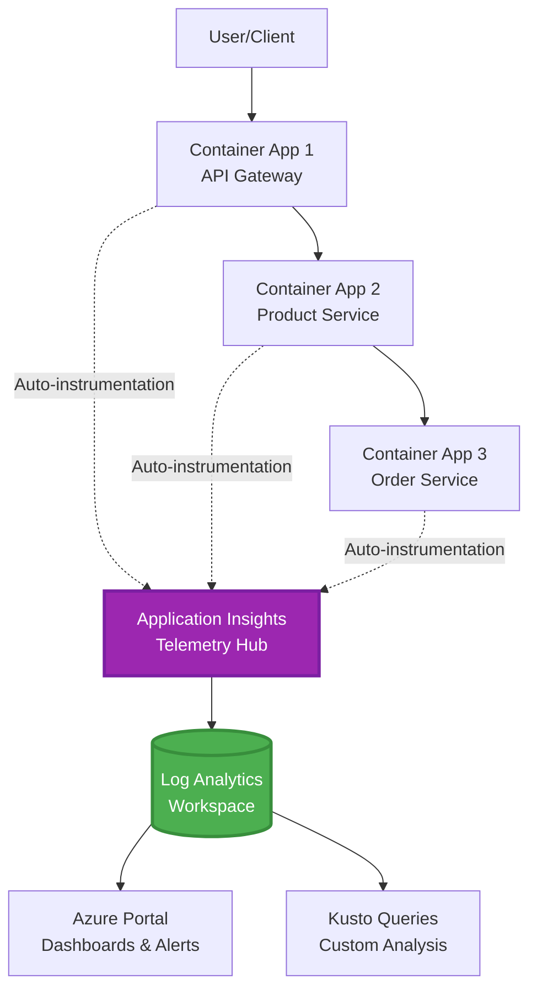
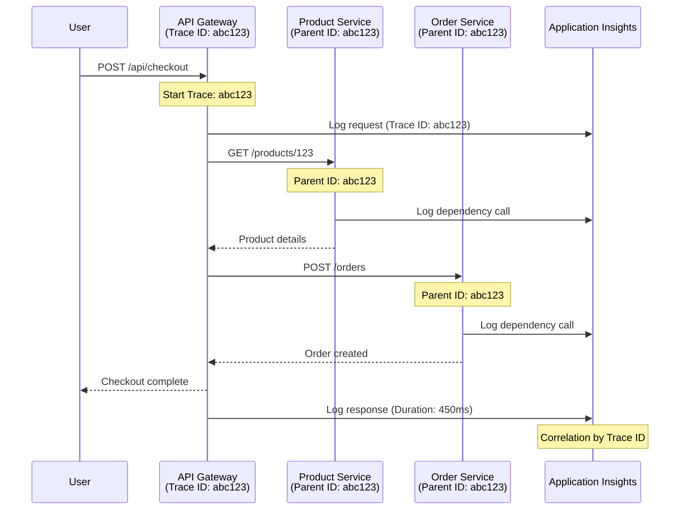

# AZD सह Application Insights एकत्रीकरण

⏱️ **अंदाजे वेळ**: 40-50 मिनिटे | 💰 **खर्च परिणाम**: ~₹5-15/महिना | ⭐ **गुंतागुंत**: मध्यम

**📚 शिकण्याचा मार्ग:**
- ← मागील: [Preflight Checks](preflight-checks.md) - प्री-डिप्लॉयमेंट व्हॅलिडेशन
- 🎯 **तुम्ही येथे आहात**: Application Insights एकत्रीकरण (मॉनिटरिंग, टेलिमेट्री, डिबगिंग)
- → पुढे: [Deployment Guide](../chapter-04-infrastructure/deployment-guide.md) - Azure मध्ये डिप्लॉय करा
- 🏠 [कोर्स होम](../../README.md)

---

## तुम्ही काय शिकाल

हा धडा पूर्ण केल्यावर, आपण:
- AZD इन्फ्रास्ट्रक्चरमध्ये **Application Insights** घोषित कराल आणि SDK इंस्ट्रुमेंटेशन कॉन्फिगर कराल
- मायक्रोसर्व्हिसेससाठी **वितरित ट्रेसिंग** कॉन्फिगर कराल
- **कस्टम टेलिमेट्री** (मेट्रिक्स, इव्हेंट्स, अवलंबित्वे) अंमलात आणाल
- रिअल-टाइम मॉनिटरिंगसाठी **लाइव्ह मेट्रिक्स** सेट कराल
- AZD डिप्लॉयमेंटमधून **अलर्ट्स आणि डॅशबोर्ड्स** तयार कराल
- **टेलिमेट्री क्वेरीज** वापरून उत्पादनातील समस्या डिबग कराल
- **खर्च आणि सॅम्पलिंग** धोरणे ऑप्टिमाइझ कराल
- **AI/LLM अॅप्लिकेशन्स** (टोकन्स, लेटन्सी, खर्च) मॉनिटर कराल

## AZD सह Application Insights का महत्वाचे आहे

### आव्हान: उत्पादन निरीक्षण

**Application Insights शिवाय:**
```
❌ No visibility into production behavior
❌ Manual log aggregation across services
❌ Reactive debugging (wait for customer complaints)
❌ No performance metrics
❌ Cannot trace requests across services
❌ Unknown failure rates and bottlenecks
```

**Application Insights + AZD सह:**
```
✅ Automatic telemetry collection
✅ Centralized logs from all services
✅ Proactive issue detection
✅ End-to-end request tracing
✅ Performance metrics and insights
✅ Real-time dashboards
✅ AZD provisions the monitoring declared in your templates
```

**सादृश्य**: Application Insights म्हणजे तुमच्या अॅप्लिकेशनसाठी "ब्लॅक बॉक्स" फ्लाइट रेकॉर्डर + कॉकपिट डॅशबोर्डसारखे आहे. तुम्हाला रिअल-टाइममध्ये होणारं सर्व काही दिसते आणि कोणतीही घटना पुन्हा पाहू शकता.

---

## आर्किटेक्चर आढावा

### AZD आर्किटेक्चरमध्ये Application Insights



### काय स्वयंचलितपणे मॉनिटर केले जाते

समर्थित ऑटो-इन्स्ट्रुमेंटेशन अनुरोध/अवलंबित्वे साधने ज्या लायब्ररींसाठी इन्स्ट्रुमेंटेशन केले आहे त्यांचे टिपते. कस्टम इव्हेंट्स आणि मेट्रिक्ससाठी अॅप्लिकेशन कोड आवश्यक आहे; उपलब्धता तपासणी स्वतंत्रपणे कॉन्फिगर करावी लागते. तो प्रत्येक खालील रेकॉर्ड कलेक्ट करत नाही फक्त स्रोत अस्तित्वात असल्यामुळे.

| टेलिमेट्री प्रकार | काय टिपते | उपयोग केस |
|----------------|------------------|----------|
| **रिक्वेस्ट्स** | HTTP विनंत्या, स्थिती कोड, कालावधी | API कार्यक्षमता मॉनिटरिंग |
| **अवलंबित्वे** | बाह्य कॉल (डेटाबेस, API, स्टोरेज) | बॉटलनेक्स ओळखणे |
| **अपवाद** | हाताळलेले नसलेले त्रुटी आणि स्टॅक ट्रेसेस | अडचणी डीबगिंग |
| **कस्टम इव्हेंट्स** | व्यवसाय इव्हेंट्स (साइनअप, खरेदी) | विश्लेषण आणि फनेल्स |
| **मेट्रिक्स** | कार्यक्षमता काउंटर, कस्टम मेट्रिक्स | क्षमतेची योजना |
| **ट्रेसस** | गंभीरतेसह लॉग संदेश | डिबगिंग आणि ऑडिटिंग |
| **उपलब्धता** | टाइम आणि प्रतिसाद वेळ चाचण्या | SLA मॉनिटरिंग |

---

## आवश्यक पूर्वतयारी

### आवश्यक साधने

```bash
# Verify Azure Developer CLI
azd version
# Command reference baseline: azd 1.37.2

# Verify Azure CLI
az --version
# ✅ Expected: azure-cli 2.50.0 or higher
```

### Azure आवश्यकता

- सक्रिय Azure सदस्यता
- तयार करण्याचे परवानग्या:
  - Application Insights संसाधने
  - Log Analytics वर्कस्पेसेस
  - कंटेनर अॅप्स
  - रेसोर्स ग्रुप्स

### ज्ञान पूर्वतयारी

आपण पूर्ण केलेले असले पाहिजे:
- [AZD बेसिक्स](../chapter-01-foundation/azd-basics.md) - कोर AZD संकल्पना
- [कॉन्फिगरेशन](../chapter-03-configuration/configuration.md) - पर्यावरण सेटअप
- [पहिला प्रोजेक्ट](../chapter-01-foundation/first-project.md) - मूलभूत डिप्लॉयमेंट

---

## धडा 1: AZD सह स्वयंचलित Application Insights

### AZD कसे Application Insights प्रद provisioning करतो

AZD तरतूद Application Insights **केवळ जेव्हा प्रकल्पाच्या पायाभूत सुविधेने ते घोषित केले आहे** तेव्हाच करते. `azure.yaml` तोपर्यंत एकटा देखरेख किंवा अनुप्रयोग कोडासाठी उपकरण तयार करत नाही.

> **उदाहरण श्रेणी:** या धड्यात समाकलन तुकडे आहेत, या संग्रहात संपूर्ण `monitored-app` प्रकल्प नाही. मुख्य टेम्पलेट आणि पॅरामीटर मॅपिंग, कंटेनर अॅप्स वातावरण, नोंदणीकृत/प्रतिमा आणि ओळख संरचना, Dockerfile, आणि सेवा टॅग पुरवा, त्यानंतर तैनात करा. नंतरचे धडे पर्यायी/विस्तृती तुकडे दाखवतात, एकत्र अंशतः चिकटवले जाऊ शकणारे संपूर्ण फायली नाहीत. जर तुम्हाला चालणारा मूलभूत स्तर हवा असेल तर [माइक्रोसर्व्हिसेस उदाहरण](../../../../examples/microservices) पासून सुरुवात करा.

### प्रकल्प रचना

```
monitored-app/
├── azure.yaml                     # AZD configuration
├── infra/
│   ├── main.bicep                # Main infrastructure
│   ├── core/
│   │   └── monitoring.bicep      # Application Insights + Log Analytics
│   └── app/
│       └── api.bicep             # Container App with monitoring
└── src/
    ├── app.py                    # Application with telemetry
    ├── requirements.txt
    └── Dockerfile
```

---

### चरण 1: AZD कॉन्फिगर करा (azure.yaml)

**फाइल: `azure.yaml`**

```yaml
name: monitored-app
metadata:
  template: monitored-app@1.0.0

services:
  api:
    project: ./src
    language: python
    host: containerapp

# Monitoring must be declared in infra/ and enabled in application code.
```

हे तैनात करण्यायोग्य सेवा घोषित करते. पुढील Bicep आणि SDK कॉन्फिगरेशन देखरेख पुरवतात; azd त्यांना अंतर्निहितरित्या जोडत नाही.

---

### चरण 2: देखरेख पायाभूत सुविधा (Bicep)

**फाइल: `infra/core/monitoring.bicep`**

```bicep
param logAnalyticsName string
param applicationInsightsName string
param location string = resourceGroup().location
param tags object = {}

// Log Analytics Workspace (required for Application Insights)
resource logAnalytics 'Microsoft.OperationalInsights/workspaces@2022-10-01' = {
  name: logAnalyticsName
  location: location
  tags: tags
  properties: {
    sku: {
      name: 'PerGB2018'  // Pay-as-you-go pricing
    }
    retentionInDays: 30  // Keep logs for 30 days
    features: {
      enableLogAccessUsingOnlyResourcePermissions: true
    }
  }
}

// Application Insights
resource applicationInsights 'Microsoft.Insights/components@2020-02-02' = {
  name: applicationInsightsName
  location: location
  tags: tags
  kind: 'web'
  properties: {
    Application_Type: 'web'
    WorkspaceResourceId: logAnalytics.id
    IngestionMode: 'LogAnalytics'
    publicNetworkAccessForIngestion: 'Enabled'
    publicNetworkAccessForQuery: 'Enabled'
  }
}

// Outputs for Container Apps
output logAnalyticsWorkspaceId string = logAnalytics.id
output logAnalyticsWorkspaceName string = logAnalytics.name
output applicationInsightsConnectionString string = applicationInsights.properties.ConnectionString
output applicationInsightsInstrumentationKey string = applicationInsights.properties.InstrumentationKey
output applicationInsightsName string = applicationInsights.name
output applicationInsightsId string = applicationInsights.id
```

---

### चरण 3: कंटेनर अॅप Application Insights शी कनेक्ट करा

**फाइल: `infra/app/api.bicep`**

```bicep
param name string
param location string
param tags object = {}
param containerAppsEnvironmentId string
param containerImage string
param applicationInsightsConnectionString string

resource containerApp 'Microsoft.App/containerApps@2023-05-01' = {
  name: name
  location: location
  tags: tags
  properties: {
    managedEnvironmentId: containerAppsEnvironmentId
    configuration: {
      ingress: {
        external: true
        targetPort: 8000
      }
      secrets: [
        {
          name: 'appinsights-connection-string'
          value: applicationInsightsConnectionString
        }
      ]
    }
    template: {
      containers: [
        {
          name: 'api'
          image: containerImage // Supply an accessible image and registry authentication
          resources: {
            cpu: json('0.5')
            memory: '1Gi'
          }
          env: [
            {
              name: 'APPLICATIONINSIGHTS_CONNECTION_STRING'
              secretRef: 'appinsights-connection-string'
            }
            {
              name: 'APPLICATIONINSIGHTS_ENABLED'
              value: 'true'
            }
          ]
        }
      ]
    }
  }
}

output uri string = 'https://${containerApp.properties.configuration.ingress.fqdn}'
```

---

### चरण 4: टेलीमेट्रीसह अनुप्रयोग कोड

**फाइल: `src/app.py`**

```python
from flask import Flask, request, jsonify
from azure.monitor.opentelemetry import configure_azure_monitor
import logging
import os

app = Flask(__name__)

# Get Application Insights connection string
connection_string = os.environ.get('APPLICATIONINSIGHTS_CONNECTION_STRING')

if connection_string:
    # Azure Monitor OpenTelemetry instruments supported libraries, including Flask.
    configure_azure_monitor(
        connection_string=connection_string,
        logger_name=__name__,
        enable_live_metrics=True
    )
    logger = logging.getLogger(__name__)
    logger.setLevel(logging.INFO)
    
    print("✅ Application Insights enabled")
else:
    logger = logging.getLogger(__name__)
    logger.setLevel(logging.INFO)
    print("⚠️ Application Insights not configured")

@app.route('/health')
def health():
    logger.info('Health check endpoint called')
    return jsonify({'status': 'healthy', 'monitoring': 'enabled' if connection_string else 'disabled'})

@app.route('/api/products')
def get_products():
    logger.info('Fetching products')
    
    # In-memory fixture: this is not a database dependency call.
    products = [
        {'id': 1, 'name': 'Laptop', 'price': 999.99},
        {'id': 2, 'name': 'Mouse', 'price': 29.99},
        {'id': 3, 'name': 'Keyboard', 'price': 79.99}
    ]
    
    logger.info(f'Returned {len(products)} products')
    return jsonify(products)

@app.route('/api/error-test')
def error_test():
    """Test error tracking"""
    logger.error('Testing error tracking')
    try:
        raise ValueError('This is a test exception')
    except Exception as e:
        logger.exception('Exception occurred in error-test endpoint')
        return jsonify({'error': str(e)}), 500

@app.route('/api/slow')
def slow_endpoint():
    """Test performance tracking"""
    import time
    logger.info('Slow endpoint called')
    time.sleep(3)  # Simulate slow operation
    logger.warning('Endpoint took 3 seconds to respond')
    return jsonify({'message': 'Slow operation completed'})

if __name__ == '__main__':
    app.run(host='0.0.0.0', port=8000)
```

**फाइल: `src/requirements.txt`**

```txt
Flask
azure-monitor-opentelemetry
gunicorn
requests
openai
```

आपल्या प्रकल्पातील या अवलंबनांचा निराकरण करा, एकत्र चाचणी करा, आणि परिणामी आवृत्त्या लॉक करा. नवीन प्रकल्पांनी Azure Monitor OpenTelemetry वापरावा, बंद झालेल्या OpenCensus Python निर्यात करणाऱ्यांना नाही.

---

### चरण 5: तैनात करा आणि सत्यापित करा

```bash
# Deploy only after completing and wiring the infrastructure fragments above
azd up

# Get app URL
APP_URL=$(azd env get-value API_URL) # Requires this output in main.bicep

# Generate telemetry
curl $APP_URL/health
curl $APP_URL/api/products
curl $APP_URL/api/error-test
curl $APP_URL/api/slow
```

**✅ अपेक्षित परिणाम:**
```json
{
  "status": "healthy",
  "monitoring": "enabled"
}
```

---

### चरण 6: Azure Portal मध्ये टेलीमेट्री पहा

```bash
# Get Application Insights details
azd env get-values | grep APPLICATIONINSIGHTS

# Open in Azure Portal
az monitor app-insights component show \
  --app $(azd env get-values | grep APPLICATIONINSIGHTS_NAME | cut -d '=' -f2 | tr -d '"') \
  --resource-group $(azd env get-values | grep AZURE_RESOURCE_GROUP | cut -d '=' -f2 | tr -d '"') \
  --query "appId" -o tsv
```

**Azure Portal → Application Insights → Transaction Search वर जा**

तुम्हाला पाहायला मिळेल:
- ✅ स्थिती कोडसह HTTP विनंत्या
- ✅ विनंती कालावधी (`/api/slow` साठी 3+ सेकंद)
- ✅ `/api/error-test` मधील अपवाद तपशील
- ✅ सानुकूल लॉग संदेश

---

## धडा 2: सानुकूल टेलीमेट्री आणि कार्यक्रम

### व्यवसाय कार्यक्रम ट्रॅक करा

चल तर व्यवसाय-महत्त्वाच्या कार्यक्रमांसाठी सानुकूल टेलीमेट्री जोडा.

**फाइल: `src/telemetry.py`**

```python
from contextlib import contextmanager
from azure.monitor.opentelemetry import configure_azure_monitor
from opentelemetry import metrics, trace
from opentelemetry.trace import SpanKind
import logging
import os

class TelemetryClient:
    """Custom telemetry client for Application Insights"""
    
    def __init__(self, connection_string=None):
        self.connection_string = connection_string or os.environ.get('APPLICATIONINSIGHTS_CONNECTION_STRING')
        
        # Configure once per process. If app.py already calls this, keep only
        # one configure_azure_monitor call and use logger_name='telemetry'.
        if self.connection_string:
            configure_azure_monitor(
                connection_string=self.connection_string,
                logger_name=__name__,
                enable_live_metrics=True
            )
        self.logger = logging.getLogger(__name__)
        self.logger.setLevel(logging.INFO)
        self.tracer = trace.get_tracer(__name__)
        self.meter = metrics.get_meter(__name__)
        self.instruments = {}
    
    def track_event(self, event_name: str, properties: dict = None):
        """Track custom business event"""
        properties = properties or {}
        self.logger.info(
            f"CustomEvent: {event_name}",
            extra={
                # OTel log attributes become customDimensions in App Insights.
                    'event_name': event_name,
                    **properties
            }
        )
    
    def track_metric(self, metric_name: str, value: float, properties: dict = None):
        """Track custom metric"""
        properties = properties or {}
        if metric_name not in self.instruments:
            self.instruments[metric_name] = self.meter.create_histogram(metric_name)
        self.instruments[metric_name].record(value, attributes=properties)
    
    @contextmanager
    def track_dependency(self, name: str):
        """Time the real operation inside a client span; exceptions mark failure."""
        with self.tracer.start_as_current_span(name, kind=SpanKind.CLIENT) as span:
            yield span

# Global telemetry client
telemetry = TelemetryClient()
```

### अनुप्रयोग सानुकूल कार्यक्रमांसह अद्यतनित करा

**फाइल: `src/app.py` (सुधारित)**

विद्यमान Flask अनुप्रयोगात हे मार्ग जोडा; अगोदरचे आरोग्य/चाचणी मार्ग ठेवा. खालील संक्षिप्त ब्लॉक स्पष्टतेसाठी स्वतंत्र अॅप दाखवतो. टेलीमेट्रीची सुरुवात आता `telemetry.py` मध्ये आहे — निर्यातकांनी दुहेरी तत्त्व लागू नका.

```python
from flask import Flask, request, jsonify
from telemetry import telemetry
import time
import random
import os

app = Flask(__name__)

@app.route('/api/purchase', methods=['POST'])
def purchase():
    """Track purchase event with custom telemetry"""
    data = request.get_json(silent=True) or {}
    product_id = data.get('product_id')
    quantity = data.get('quantity', 1)
    price = data.get('price', 0)
    if not isinstance(quantity, int) or quantity < 1 or \
       not isinstance(price, (int, float)) or price < 0:
        return jsonify({'error': 'quantity and price must be non-negative numbers; quantity >= 1'}), 400
    
    # Track business event
    telemetry.track_event('Purchase', {
        'product_id': product_id,
        'quantity': quantity,
        'total_amount': price * quantity,
        'user_id': request.headers.get('X-User-Id', 'anonymous')
    })
    
    # Track revenue metric
    telemetry.track_metric('Revenue', price * quantity, {
        'product_id': product_id,
        'currency': 'USD'
    })
    
    return jsonify({
        'order_id': f'ORD-{random.randint(1000, 9999)}',
        'status': 'confirmed',
        'total': price * quantity
    })

@app.route('/api/search')
def search():
    """Track search queries"""
    query = request.args.get('q', '')
    
    start_time = time.time()
    
    # Simulate search (would be real database query)
    results = [{'id': 1, 'name': f'Result for {query}'}]
    
    duration = (time.time() - start_time) * 1000  # Convert to ms
    
    # Track search event
    telemetry.track_event('Search', {
        'query': query,
        'results_count': len(results),
        'duration_ms': duration
    })
    
    # Track search performance metric
    telemetry.track_metric('SearchDuration', duration, {
        'query_length': len(query)
    })
    
    return jsonify({'results': results, 'count': len(results)})

@app.route('/api/external-call')
def external_call():
    """Track external API dependency"""
    import requests
    
    try:
        # Set an actual test endpoint; api.example.com is not a working API.
        with telemetry.track_dependency('ExternalAPI'):
            response = requests.get(os.environ['EXTERNAL_API_URL'], timeout=5)
            response.raise_for_status()
            result = response.json()
    except Exception as e:
        return jsonify({'error': 'External dependency failed'}), 502
    
    return jsonify(result)

if __name__ == '__main__':
    app.run(host='0.0.0.0', port=8000)
```

### सानुकूल टेलीमेट्रीची चाचणी करा

```bash
# Track purchase event
curl -X POST $APP_URL/api/purchase \
  -H "Content-Type: application/json" \
  -H "X-User-Id: user123" \
  -d '{"product_id": 1, "quantity": 2, "price": 29.99}'

# Track search event
curl "$APP_URL/api/search?q=laptop"

# Track external dependency
curl $APP_URL/api/external-call
```

**Azure Portal मध्ये पहा:**

Application Insights → Logs मध्ये जा आणि मग चालवा:

```kusto
// View purchase events
traces
| where customDimensions.event_name == "Purchase"
| project 
    timestamp,
    product_id = tostring(customDimensions.product_id),
    total_amount = todouble(customDimensions.total_amount),
    user_id = tostring(customDimensions.user_id)
| order by timestamp desc

// Revenue recorded in Purchase events (not a billing ledger)
traces
| where customDimensions.event_name == "Purchase"
| summarize TotalRevenue = sum(todouble(customDimensions.total_amount)) by bin(timestamp, 1h)
| render timechart

// View search performance
traces
| where customDimensions.event_name == "Search"
| summarize 
    AvgDuration = avg(todouble(customDimensions.duration_ms)),
    SearchCount = count()
  by bin(timestamp, 5m)
| render timechart
```

---

## धडा 3: माइक्रोसर्व्हिसेससाठी वितरित ट्रेसिंग

### क्रॉस-सर्व्हिस ट्रेसिंग सक्षम करा

सुसंगत साधने आणि W3C trace-context प्रसारणासह, Application Insights सेवा ओलांडून विनंत्यांना जोडते. फक्त कनेक्शन स्ट्रिंग सामायिक करणे पालक-बाळ स्पॅन स्थापत नाही. खालील आर्किटेक्चर तुकडा तुम्हाला अंमलात आणायच्या मॉड्यूल्स संदर्भित करतो.

**फाइल: `infra/main.bicep`**

```bicep
targetScope = 'subscription'

param environmentName string
param location string = 'eastus'

var tags = { 'azd-env-name': environmentName }

resource rg 'Microsoft.Resources/resourceGroups@2021-04-01' = {
  name: 'rg-${environmentName}'
  location: location
  tags: tags
}

// Monitoring (shared by all services)
module monitoring './core/monitoring.bicep' = {
  name: 'monitoring'
  scope: rg
  params: {
    logAnalyticsName: 'log-${environmentName}'
    applicationInsightsName: 'appi-${environmentName}'
    location: location
    tags: tags
  }
}

// API Gateway
module apiGateway './app/api-gateway.bicep' = {
  name: 'api-gateway'
  scope: rg
  params: {
    name: 'ca-gateway-${environmentName}'
    location: location
    tags: union(tags, { 'azd-service-name': 'gateway' })
    applicationInsightsConnectionString: monitoring.outputs.applicationInsightsConnectionString
  }
}

// Product Service
module productService './app/product-service.bicep' = {
  name: 'product-service'
  scope: rg
  params: {
    name: 'ca-products-${environmentName}'
    location: location
    tags: union(tags, { 'azd-service-name': 'products' })
    applicationInsightsConnectionString: monitoring.outputs.applicationInsightsConnectionString
  }
}

// Order Service
module orderService './app/order-service.bicep' = {
  name: 'order-service'
  scope: rg
  params: {
    name: 'ca-orders-${environmentName}'
    location: location
    tags: union(tags, { 'azd-service-name': 'orders' })
    applicationInsightsConnectionString: monitoring.outputs.applicationInsightsConnectionString
  }
}

output APPLICATIONINSIGHTS_CONNECTION_STRING string = monitoring.outputs.applicationInsightsConnectionString
output GATEWAY_URL string = apiGateway.outputs.uri
```

### एन्ड-टू-एन्ड ट्रान्झॅक्शन पहा



**एन्ड-टू-एन्ड ट्रेस क्वेरी करा:**

```kusto
// Find complete request flow
let traceId = "abc123...";  // Copy operation_Id from a request in Application Insights
dependencies
| union requests
| where operation_Id == traceId
| project 
    timestamp,
    type = itemType,
    name,
    duration,
    success,
    cloud_RoleName
| order by timestamp asc
```

---

## धडा 4: थेट मेट्रिक्स आणि वास्तविक वेळेची देखरेख

### थेट मेट्रिक्स प्रवाह सक्षम करा

थेट मेट्रिक्स SDK ने समर्थित आणि सक्रिय केल्यावर जवळजवळ वास्तविक वेळेचे टेलीमेट्री प्रदान करतात. हे लॅटन्सी SLA नाही. वर दिलेल्या Python OpenTelemetry सेटअपमध्ये `enable_live_metrics=True` सह याचा पर्याय निवडला आहे.

**थेट मेट्रिक्स मध्ये प्रवेश:**

```bash
# Get Application Insights resource
APPI_NAME=$(azd env get-values | grep APPLICATIONINSIGHTS_NAME | cut -d '=' -f2 | tr -d '"')

# Get resource group
RG_NAME=$(azd env get-values | grep AZURE_RESOURCE_GROUP | cut -d '=' -f2 | tr -d '"')

echo "Navigate to: Azure Portal → Resource Groups → $RG_NAME → $APPI_NAME → Live Metrics"
```

**तुम्ही वास्तविक वेळेत काय पाहता:**
- ✅ येणाऱ्या विनंती दर (विनंती/सेकंद)
- ✅ बाह्य अवलंबित्व कॉल
- ✅ अपवाद संख्या
- ✅ CPU आणि मेमरी वापर
- ✅ सक्रिय सर्व्हर संख्या
- ✅ नमुना टेलीमेट्री

### चाचणीसाठी लोड तयार करा

```bash
# Generate load to see live metrics
for i in {1..100}; do
  curl --silent --max-time 10 "$APP_URL/api/products"
  curl --silent --max-time 10 "$APP_URL/api/search?q=test$i"
done

# Watch live metrics in Azure Portal
# You should see request rate spike
```

---

## व्यावहारिक सराव

### सराव 1: अलर्ट सेटअप करा ⭐⭐ (मध्यम)

**हेतू**: उच्च त्रुटी दर आणि मंद प्रतिसादांसाठी अलर्ट तयार करा.

**चरणे:**

1. **त्रुटी दरासाठी अलर्ट तयार करा:**

```bash
# Get Application Insights resource ID
APPI_ID=$(az monitor app-insights component show \
  --app $APPI_NAME \
  --resource-group $RG_NAME \
  --query "id" -o tsv)

# Create metric alert for failed requests
az monitor metrics alert create \
  --name "High-Error-Rate" \
  --resource-group $RG_NAME \
  --scopes $APPI_ID \
  --condition "count requests/failed > 10" \
  --window-size 5m \
  --evaluation-frequency 1m \
  --description "Alert when failed request count exceeds 10 per 5 minutes"
```

2. **मंद प्रतिसादांसाठी अलर्ट तयार करा:**

```bash
az monitor metrics alert create \
  --name "Slow-Responses" \
  --resource-group $RG_NAME \
  --scopes $APPI_ID \
  --condition "avg requests/duration > 3000" \
  --window-size 5m \
  --evaluation-frequency 1m \
  --description "Alert when average response time exceeds 3 seconds"
```

3. **Bicep द्वारे अलर्ट तयार करा (AZD करिता प्राधान्य):**

**फाइल: `infra/core/alerts.bicep`**

```bicep
param applicationInsightsId string
param actionGroupId string = ''
param location string = resourceGroup().location

// High error rate alert
resource errorRateAlert 'Microsoft.Insights/metricAlerts@2018-03-01' = {
  name: 'high-error-rate'
  location: 'global'
  properties: {
    description: 'Alert when error rate exceeds threshold'
    severity: 2
    enabled: true
    scopes: [
      applicationInsightsId
    ]
    evaluationFrequency: 'PT1M'
    windowSize: 'PT5M'
    criteria: {
      'odata.type': 'Microsoft.Azure.Monitor.SingleResourceMultipleMetricCriteria'
      allOf: [
        {
          name: 'Error rate'
          metricName: 'requests/failed'
          operator: 'GreaterThan'
          threshold: 10
          timeAggregation: 'Count'
        }
      ]
    }
    actions: actionGroupId != '' ? [
      {
        actionGroupId: actionGroupId
      }
    ] : []
  }
}

// Slow response alert
resource slowResponseAlert 'Microsoft.Insights/metricAlerts@2018-03-01' = {
  name: 'slow-responses'
  location: 'global'
  properties: {
    description: 'Alert when response time is too high'
    severity: 3
    enabled: true
    scopes: [
      applicationInsightsId
    ]
    evaluationFrequency: 'PT1M'
    windowSize: 'PT5M'
    criteria: {
      'odata.type': 'Microsoft.Azure.Monitor.SingleResourceMultipleMetricCriteria'
      allOf: [
        {
          name: 'Response duration'
          metricName: 'requests/duration'
          operator: 'GreaterThan'
          threshold: 3000
          timeAggregation: 'Average'
        }
      ]
    }
  }
}

output errorAlertId string = errorRateAlert.id
output slowResponseAlertId string = slowResponseAlert.id
```

4. **अलर्ट्सची चाचणी करा:**

```bash
# Generate errors
for i in {1..20}; do
  curl $APP_URL/api/error-test
done

# Generate slow responses
for i in {1..10}; do
  curl $APP_URL/api/slow
done

# Check rule configuration (not fired/resolved alert-instance history)
az monitor metrics alert list \
  --resource-group $RG_NAME \
  --query "[].{Name:name, Enabled:enabled}" \
  --output table
```

**✅ यशाचे निकष:**
- ✅ अलर्ट्स यशस्वीरित्या तयार झाले आहेत
- ✅ थ्रेशोल्ड्सची उलाढाल झाल्यावर अलर्ट्स सुरू होतात
- ✅ अलर्ट इतिहास Azure Portal मध्ये पाहता येतो
- ✅ AZD तैनातीशी एकत्रित

**कालावधी**: 20-25 मिनिटे

---

### सराव 2: सानुकूल डॅशबोर्ड तयार करा ⭐⭐ (मध्यम)

**हेतू**: मुख्य अनुप्रयोग मेट्रिक्स प्रदर्शित करणारा डॅशबोर्ड बनवा.

**चरणे:**

1. **Azure Portal द्वारे डॅशबोर्ड तयार करा:**

Azure Portal → Dashboards → New Dashboard वर जा

2. **मुख्य मेट्रिक्ससाठी टाइल्स जोडा:**

- मागील 24 तासातील विनंती संख्या
- सरासरी प्रतिसाद वेळा
- त्रुटी दर
- शीर्ष 5 सर्वात मंद ऑपरेशन्स
- वापरकर्त्यांचे भौगोलिक वितरण

3. **Bicep द्वारे डॅशबोर्ड तयार करा:**

**फाइल: `infra/core/dashboard.bicep`**

```bicep
param dashboardName string
param applicationInsightsId string
param location string = resourceGroup().location

resource dashboard 'Microsoft.Portal/dashboards@2020-09-01-preview' = {
  name: dashboardName
  location: location
  properties: {
    lenses: [
      {
        order: 0
        parts: [
          // Request count
          {
            position: {
              x: 0
              y: 0
              rowSpan: 4
              colSpan: 6
            }
            metadata: {
              type: 'Extension/Microsoft_OperationsManagementSuite_Workspace/PartType/LogsDashboardPart'
              inputs: [
                {
                  name: 'resourceId'
                  value: applicationInsightsId
                }
                {
                  name: 'query'
                  value: '''
                    requests
                    | summarize RequestCount = count() by bin(timestamp, 1h)
                    | render timechart
                  '''
                }
              ]
            }
          }
          // Error rate
          {
            position: {
              x: 6
              y: 0
              rowSpan: 4
              colSpan: 6
            }
            metadata: {
              type: 'Extension/Microsoft_OperationsManagementSuite_Workspace/PartType/LogsDashboardPart'
              inputs: [
                {
                  name: 'resourceId'
                  value: applicationInsightsId
                }
                {
                  name: 'query'
                  value: '''
                    requests
                    | summarize 
                        Total = count(),
                        Failed = countif(success == false)
                    | extend ErrorRate = (Failed * 100.0) / Total
                    | project ErrorRate
                  '''
                }
              ]
            }
          }
        ]
      }
    ]
  }
}

output dashboardId string = dashboard.id
```

4. **डॅशबोर्ड तैनात करा:**

```bicep
// Add to a subscription-scoped main.bicep with rg and monitoring declared
module dashboard './core/dashboard.bicep' = {
  name: 'dashboard'
  scope: rg
  params: {
    dashboardName: 'dashboard-${environmentName}'
    applicationInsightsId: monitoring.outputs.applicationInsightsId
    location: location
  }
}
```

```bash
# Deploy
azd up
```

**✅ यशाचे निकष:**
- ✅ डॅशबोर्ड मुख्य मेट्रिक्स दाखवतो
- ✅ Azure Portal मुख्य पृष्ठावर पिन करू शकता
- ✅ वास्तविक वेळेत अद्यतने
- ✅ AZD मार्फत तैनातयोग्य

**कालावधी**: 25-30 मिनिटे

---

### सराव 3: AI/LLM अनुप्रयोगाचे निरीक्षण ⭐⭐⭐ (प्रगत)

**हेतू**: Microsoft Foundry Models वापर (टोकन, खर्च, विलंब) ट्रॅक करा.

**चरणे:**

1. **AI निरीक्षण रॅपर तयार करा:**

**फाइल: `src/ai_telemetry.py`**

```python
from telemetry import telemetry
from openai import AzureOpenAI
import time

class MonitoredAzureOpenAI:
    """Microsoft Foundry Models client with automatic telemetry"""
    
    def __init__(self, api_key, endpoint, input_usd_per_million,
                 output_usd_per_million, api_version="2024-10-21"):
        self.client = AzureOpenAI(
            api_key=api_key,
            api_version=api_version,
            azure_endpoint=endpoint
        )
        self.input_rate = input_usd_per_million
        self.output_rate = output_usd_per_million
    
    def chat_completion(self, model: str, messages: list, **kwargs):
        """Track chat completion with telemetry"""
        start_time = time.time()
        
        try:
            # Call Microsoft Foundry Models
            response = self.client.chat.completions.create(
                model=model,
                messages=messages,
                **kwargs
            )
            
            duration = (time.time() - start_time) * 1000  # ms
            
            # Extract usage
            usage = response.usage
            prompt_tokens = usage.prompt_tokens
            completion_tokens = usage.completion_tokens
            total_tokens = usage.total_tokens
            
            # Approximation: supply actual deployment/region/contract rates.
            # Cached input, batch, provisioned and other charges need separate accounting.
            prompt_cost = (prompt_tokens / 1_000_000) * self.input_rate
            completion_cost = (completion_tokens / 1_000_000) * self.output_rate
            total_cost = prompt_cost + completion_cost
            
            # Track custom event
            telemetry.track_event('OpenAI_Request', {
                'model': model,
                'prompt_tokens': prompt_tokens,
                'completion_tokens': completion_tokens,
                'total_tokens': total_tokens,
                'duration_ms': duration,
                'cost_usd': total_cost,
                'success': True
            })
            
            # Track metrics
            telemetry.track_metric('OpenAI_Tokens', total_tokens, {
                'model': model,
                'type': 'total'
            })
            
            telemetry.track_metric('OpenAI_Cost', total_cost, {
                'model': model,
                'currency': 'USD'
            })
            
            telemetry.track_metric('OpenAI_Duration', duration, {
                'model': model
            })
            
            return response
            
        except Exception as e:
            duration = (time.time() - start_time) * 1000
            
            telemetry.track_event('OpenAI_Request', {
                'model': model,
                'duration_ms': duration,
                'success': False,
                'error': str(e)
            })
            
            raise
```

2. **निरीक्षण केलेला क्लायंट वापरा:**

```python
from flask import Flask, request, jsonify
from ai_telemetry import MonitoredAzureOpenAI
import os

app = Flask(__name__)

# Initialize monitored OpenAI client
openai_client = MonitoredAzureOpenAI(
    api_key=os.environ['AZURE_OPENAI_API_KEY'],
    endpoint=os.environ['AZURE_OPENAI_ENDPOINT'],
    input_usd_per_million=float(os.environ['INPUT_USD_PER_MILLION']),
    output_usd_per_million=float(os.environ['OUTPUT_USD_PER_MILLION'])
)

@app.route('/api/chat', methods=['POST'])
def chat():
    data = request.json
    user_message = data.get('message')
    
    # Call with automatic monitoring
    response = openai_client.chat_completion(
        model=os.environ['AZURE_OPENAI_DEPLOYMENT'], # Deployment name, not catalog ID
        messages=[
            {'role': 'user', 'content': user_message}
        ]
    )
    
    return jsonify({
        'response': response.choices[0].message.content,
        'tokens': response.usage.total_tokens
    })
```

3. **AI मेट्रिक्स क्वेरी करा:**

```kusto
// Total AI spend over time
traces
| where customDimensions.event_name == "OpenAI_Request"
| where tobool(customDimensions.success) == true
| summarize TotalCost = sum(todouble(customDimensions.cost_usd)) by bin(timestamp, 1h)
| render timechart

// Token usage by model
traces
| where customDimensions.event_name == "OpenAI_Request"
| summarize 
    TotalTokens = sum(toint(customDimensions.total_tokens)),
    RequestCount = count()
  by Model = tostring(customDimensions.model)

// Average latency
traces
| where customDimensions.event_name == "OpenAI_Request"
| summarize AvgDuration = avg(todouble(customDimensions.duration_ms))
| project AvgDurationSeconds = AvgDuration / 1000

// Cost per request
traces
| where customDimensions.event_name == "OpenAI_Request"
| extend Cost = todouble(customDimensions.cost_usd)
| summarize 
    TotalCost = sum(Cost),
    RequestCount = count(),
    AvgCostPerRequest = avg(Cost)
```

**✅ यशाचे निकष:**
- ✅ प्रत्येक OpenAI कॉल आपोआप ट्रॅक होतो
- ✅ टोकन वापर आणि खर्च दिसतात
- ✅ विलंब निरीक्षक
- ✅ बजेट अलर्ट सेट करू शकता

**कालावधी**: 35-45 मिनिटे

---

## खर्च अनुकूलन

### नमुना धोरणे

टेलीमेट्री नमुना घेऊन खर्च नियंत्रित करा:

```python
import os

# Configure before the one configure_azure_monitor() call in your process.
os.environ["OTEL_TRACES_SAMPLER"] = "microsoft.fixed_percentage"
os.environ["OTEL_TRACES_SAMPLER_ARG"] = "0.1" # 10% trace sampling
```

ट्रेस नमुना घेणे प्रत्येक टेलीमेट्री प्रकार 90% ने कमी करत नाही. मेट्रिक्स आणि स्वतंत्र निघालेले लॉग्ससाठी स्वतःचे व्हॉल्यूम नियंत्रण आवश्यक आहे. पर्यवेक्षण गरजांनुसार दर निवडा, उत्पादनावर सर्वसाधारण बंदी नव्हे.

SDK नमुना स्पष्टपणे सेट करा; घटकाचा `SamplingPercentage` गुणधर्म Python OpenTelemetry सॅम्पलर कॉन्फिगर करण्याचा पर्याय नाही.

### डेटा राखण

```bicep
resource logAnalytics 'Microsoft.OperationalInsights/workspaces@2022-10-01' = {
  name: logAnalyticsName
  properties: {
    retentionInDays: 30  // Minimum (cheapest)
    // Options: 30, 31, 60, 90, 120, 180, 270, 365, 550, 730
  }
}
```

### मासिक खर्च अंदाज

| डेटा व्हॉल्यूम | राखण | मासिक खर्च |
|-------------|-----------|--------------|
| 1 GB/महिना | 30 दिवस | ~$2-5 |
| 5 GB/महिना | 30 दिवस | ~$10-15 |
| 10 GB/महिना | 90 दिवस | ~$25-40 |
| 50 GB/महिना | 90 दिवस | ~$100-150 |

हे आकडे केवळ उदाहरणार्थ आहेत, किंमत नाहीत. तुमच्या प्रदेशात आणि करारात उपाययोजना, राखण, अलर्ट, आणि चाचणी किंमती सत्यापित करा; मोफत परवानग्या Azure Monitor किंमतीप्रमाणे सामायिक/मर्यादित आहेत, Application Insights संसाधनासाठी सुनिश्चित मोफत SKU नाही.

---

## ज्ञान तपासणी बिंदू

### 1. मूलभूत समाकलन ✓

तुमचे समज तपासा:

- [ ] **प्र1**: AZD कसे Application Insights तरतूद करते?
  - **उत्तर**: तो प्रकल्पाच्या Bicep/Terraform टेम्पलेट्स मध्ये स्पष्टपणे घोषित केलेल्या देखरेख संसाधनांची तैनाती करतो.

- [ ] **प्र2**: Application Insights सक्षम करणारे पर्यावरण चल कोणते आहे?
  - **उत्तर**: `APPLICATIONINSIGHTS_CONNECTION_STRING`

- [ ] **प्र3**: तीन मुख्य टेलीमेट्री प्रकार कोणते आहेत?
  - **उत्तर**: विनंत्या (HTTP कॉल), अवलंबित्व (बाह्य कॉल), अपवाद (त्रुटी)

**प्रायोगिक सत्यापन:**
```bash
# Check if Application Insights is configured
azd env get-values | grep APPLICATIONINSIGHTS

# Verify telemetry is flowing
az monitor app-insights metrics show \
  --app $APPI_NAME \
  --resource-group $RG_NAME \
  --metric "requests/count"
```

---

### 2. सानुकूल टेलीमेट्री ✓

तुमचे समज तपासा:

- [ ] **प्र1**: तुम्ही सानुकूल व्यवसाय कार्यक्रम कसे ट्रॅक करता?
  - **उत्तर**: या धड्यातील रॅपर `event_name` गुणधर्मांसह संरचित OTel लॉग लिहितो, जे `traces` मध्ये प्रश्नयोग्य आहेत; हे आपोआप `customEvents` नाहीत.

- [ ] **प्र2**: कार्यक्रम आणि मेट्रिक्समधील फरक काय आहे?
  - **उत्तर**: कार्यक्रम वेगळ्या घटना आहेत, मेट्रिक्स संख्यात्मक मोजमापे आहेत

- [ ] **प्र3**: तुम्ही सेवा ओलांडून टेलीमेट्री कशी संबंधित करता?
  - **उत्तर**: Application Insights आपोआप `operation_Id` वापरते संबंधिततेसाठी

**प्रायोगिक सत्यापन:**
```kusto
// Verify custom events
traces
| where customDimensions.event_name != ""
| summarize count() by tostring(customDimensions.event_name)
```

---

### 3. उत्पादन देखरेख ✓

तुमचे समज तपासा:

- [ ] **प्र1**: नमुना घेणे काय आहे आणि त्याचा उपयोग का करावा?
  - **उत्तर**: नमुना घेणे टेलीमेट्रीचा डेटा प्रमाण (आणि खर्च) कमी करते, फक्त काही टक्केवारी टिपते

- [ ] **प्र2**: अलर्ट्स तुम्ही कसे सेट करता?
  - **उत्तर**: Application Insights मेट्रिक्सवर आधारित Bicep किंवा Azure Portal मध्ये मेट्रिक अलर्ट वापरा

- [ ] **प्र3**: Log Analytics आणि Application Insights यामध्ये फरक काय आहे?
  - **उत्तर**: Application Insights Log Analytics वर्कस्पेसमध्ये डेटा संग्रह करतो; App Insights अनुप्रयोग-विशिष्ट दृश्ये प्रदान करतो

**प्रायोगिक सत्यापन:**
```bash
# Check the sampler configured for the running application, not only the ARM component.
az containerapp show --name "$APP_NAME" --resource-group "$RG_NAME" \
  --query "properties.template.containers[].env[?starts_with(name, 'OTEL_TRACES_SAMPLER')]"
```

---

## उत्तम पद्धती

### ✅ करा:

1. **संबंधित आयडी वापरा**
   ```python
   logger.info('Processing order', extra={
           'order_id': order_id,
           'user_id': user_id
   })
   ```

2. **महत्त्वाच्या मेट्रिक्ससाठी अलर्ट सेट करा**
   ```bicep
   // Error rate, slow responses, availability
   ```

3. **संरचित लॉगिंग वापरा**
   ```python
   # ✅ GOOD: Structured
   logger.info('User signup', extra={'user_id': 'pseudonymous-id'})
   
   # ❌ BAD: Unstructured
   logger.info(f'User 123 signed up')
   ```

4. **अवलंबित्वांचे निरीक्षण करा**
   ```python
   # Automatically track database calls, HTTP requests, etc.
   ```

5. **तैनाती दरम्यान थेट मेट्रिक्स वापरा**

### ❌ करू नका:

1. **संवेदनशील डेटा लॉग करू नका**
   ```python
   # ❌ BAD
   logger.info(f'Login: {username}:{password}')
   
   # ✅ GOOD
   logger.info('Login attempt', extra={'result': 'failed'})
   ```

2. **खंडावर व डायग्नोस्टिक गरजा मोजता येईपर्यंत सॅम्पलिंग निवडू नका**
   ```python
   # ❌ Expensive
   # 100% traces may be appropriate for a small workload or investigation.
   
   # ✅ Cost-effective
   # A lower trace rate reduces visibility; validate coverage before enabling.
   ```

3. **मृत पत्र क्रमवारींकडे दुर्लक्ष करू नका**

4. **डेटा संचयनाची मर्यादा सेट करायला विसरू नका**

---

## अडचणी सोडवणे

### समस्या: टेलिमेट्री दिसत नाही

**निदान:**
```bash
# Check connection string is set
azd env get-values | grep APPLICATIONINSIGHTS

# Check application logs via Azure Monitor
azd monitor --logs

# Or use Azure CLI for Container Apps:
az containerapp logs show --name $APP_NAME --resource-group $RG_NAME --tail 50
```

**उपाय:**
```bash
# Verify connection string in Container App
az containerapp show \
  --name $APP_NAME \
  --resource-group $RG_NAME \
  --query "properties.template.containers[0].env" \
  | grep -i applicationinsights
```

---

### समस्या: जास्त खर्च

**निदान:**
```bash
# Query ingestion volume in the linked Log Analytics workspace.
# WORKSPACE_ID is the workspace customer ID (GUID), not its ARM resource ID.
az monitor log-analytics query --workspace "$WORKSPACE_ID" \
  --analytics-query "Usage | where TimeGenerated > ago(30d) | where IsBillable == true | summarize IngestedMB=sum(Quantity) by DataType"
```

**उपाय:**
- सॅम्पलिंग दर कमी करा
- संचयन कालावधी कमी करा
- मोठे लॉगिंग काढून टाका

---

## अधिक जाणून घ्या

### अधिकृत दस्तऐवजीकरण
- [Application Insights Overview](https://learn.microsoft.com/azure/azure-monitor/app/app-insights-overview)
- [Azure Monitor OpenTelemetry setup](https://learn.microsoft.com/azure/azure-monitor/app/opentelemetry-enable?tabs=python)
- [Kusto Query Language](https://learn.microsoft.com/azure/data-explorer/kusto/query/)
- [AZD Monitoring](https://learn.microsoft.com/azure/developer/azure-developer-cli/monitor-your-app)

### या कोर्समधील पुढील टप्पे
- ← मागील: [Preflight Checks](preflight-checks.md)
- → पुढील: [Deployment Guide](../chapter-04-infrastructure/deployment-guide.md)
- 🏠 [कोर्स मुख्यपृष्ठ](../../README.md)

### संबंधित उदाहरणे
- [Microsoft Foundry Models Example](../../../../examples/azure-openai-chat) - AI टेलिमेट्री
- [Microservices Example](../../../../examples/microservices) - वितरित ट्रेसिंग

---

## सारांश

**तुम्ही शिकले:**
- ✅ AZD सह स्वयंचलित Application Insights प्रदान करणे
- ✅ सानुकूल टेलिमेट्री (इव्हेंट, मेट्रिक्स, अवलंबित्व)
- ✅ मायक्रोसर्व्हिसेसमध्ये वितरित ट्रेसिंग
- ✅ थेट मेट्रिक्स आणि रिअल-टाइम मॉनिटरिंग
- ✅ अलर्ट्स आणि डॅशबोर्ड्स
- ✅ AI/LLM अर्ज मॉनिटरिंग
- ✅ खर्च अनुकूलन धोरणे

**मुख्य मुद्दे:**
1. **मॉनिटरिंग स्पष्टपणे जाहीर करा** - AZD तुमच्या टेम्पलेट्सची तैनात करतो; SDK इन्स्ट्रुमेंटेशन टेलिमेट्री पाठवते
2. **रूपरेषित लॉगिंग वापरा** - क्वेरी सुलभ होतो
3. **व्यावसायिक इव्हेंट्स ट्रॅक करा** - फक्त तांत्रिक मेट्रिक्स नव्हे
4. **AI खर्चांचे निरीक्षण करा** - टोकन्स आणि खर्च ट्रॅक करा
5. **अलर्ट्स सेट करा** - प्रतिक्रियाशील नसून पूर्वसूचना म्हणून रहा
6. **खर्च अनुकूल करा** - सॅम्पलिंग आणि संचयन मर्यादा वापरा

**पुढील टप्पे:**
1. व्यावहारिक सराव पूर्ण करा
2. तुमच्या AZD प्रोजेक्टमध्ये Application Insights जोडा
3. तुमच्या टीमसाठी सानुकूल डॅशबोर्ड तयार करा
4. शिका [Deployment Guide](../chapter-04-infrastructure/deployment-guide.md)

---

<!-- CO-OP TRANSLATOR DISCLAIMER START -->
**अस्वीकरण**:
हा दस्तऐवज AI भाषांतर सेवा [Co-op Translator](https://github.com/Azure/co-op-translator) चा वापर करून अनुवादित केला आहे. जरी आम्ही अचूकतेसाठी प्रयत्न करतो, तरी कृपया लक्षात घ्या की स्वयंचलित भाषांतरांमध्ये त्रुटी किंवा अचूकतेची कमतरता असू शकते. मूळ दस्तऐवज त्याच्या मूळ भाषेत अधिकृत स्रोत मानला पाहिजे. महत्त्वाची माहिती असल्यास, व्यावसायिक मानवी भाषांतराची शिफारस केली जाते. या भाषांतराच्या वापरामुळे उद्भवणाऱ्या कोणत्याही गैरसमज किंवा चुकीच्या अर्थलावणीसाठी आम्ही जबाबदार नाही.
<!-- CO-OP TRANSLATOR DISCLAIMER END -->