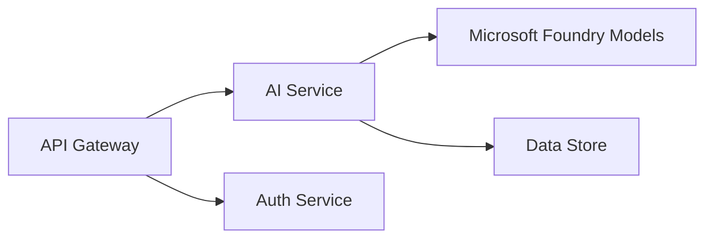

# अध्याय ८: उत्पादन आणि एंटरप्राइज़ पॅटर्न

**📚 कोर्स**: [AZD फॉर बिगिनर्स](../../README.md) | **⏱️ कालावधी**: २-३ तास | **⭐ गुंतागुंतीचा स्तर**: प्रगत

---

## आढावा

हा अध्याय एंटरप्राइज़-तयार डिप्लॉयमेंट पॅटर्न, सुरक्षा मजबूत करणे, मॉनिटरिंग, आणि उत्पादन AI कामकाजासाठी खर्च ऑप्टिमायझेशन या विषयांवर केंद्रित आहे.

हा एक आर्किटेक्चरल संदर्भ आहे, पूर्ण डिप्लॉय करण्यायोग्य उत्पादन टेम्पलेट नाही. उदाहरणांमध्ये एकत्रीकरण तपशील समाविष्ट नाहीत जे तुमच्या स्वतःच्या अनुप्रयोगात प्रदान करणे आणि चाचणी करणे आवश्यक आहे; चेकलिस्ट वाचल्याने उत्पादन तयार असल्याचा प्रमाणपत्र मिळत नाही.

> **रिलीज पुनरावलोकन (२०२६-११-०४):** AI CLI मार्गदर्शन `azd 1.37.2`, एजंट्स `1.0.0-beta.23` आणि मूल्यमापन `1.0.0-beta.2` दस्तऐवज/स्रोत यांच्याशी तपासले गेले. संगतता आवश्यकता आणि स्थलांतरण तपशीलासाठी [रिलीज बदल आणि दुरुस्त्या](production-ai-practices.md#recent-release-changes-and-fixes) पहा; ही थेट डिप्लॉयमेंट पडताळणी नाही.

## शिकण्याचे उद्दिष्टे

हा अध्याय पूर्ण केल्यावर, तुम्ही:
- बहु-प्रांत सहनशील अनुप्रयोग डिप्लॉय करू शकता
- एंटरप्राइज़ सुरक्षा पॅटर्न अंमलात आणू शकता
- सर्वसमावेशक मॉनिटरिंग कॉन्फिगर करू शकता
- प्रमाणात खर्च ऑप्टिमाइझ करू शकता
- AZD सह CI/CD पाइपलाइन सेट करू शकता

---

## 📚 धडे

| # | धडा | वर्णन | वेळ |
|---|--------|-------------|------|
| 1 | [उत्पादन AI पद्धती](production-ai-practices.md) | एंटरप्राइज़ डिप्लॉयमेंट पॅटर्न | ९० मिनिटे |

---

## 🚀 उत्पादन चेकलिस्ट

- [ ] सहनशीलतेसाठी बहु-प्रांत डिप्लॉयमेंट
- [ ] प्रमाणीकरणासाठी मॅनेज्ड आयडेंटिटी (की नाहीत)
- [ ] मॉनिटरिंगसाठी अॅप्लिकेशन इनसाइट्स
- [ ] खर्च बजेट व अॅलर्ट कॉन्फिगर केलेले
- [ ] सुरक्षा स्कॅनिंग सक्षम केलेले
- [ ] CI/CD पाइपलाइन एकत्रीकरण
- [ ] आपत्ती पुनर्प्राप्ती योजना

---

## 🏗️ आर्किटेक्चर पॅटर्न

### पॅटर्न १: मायक्रोसर्व्हिसेस AI



### पॅटर्न २: इव्हेंट-चालित AI


---

## 🔐 सुरक्षा सर्वोत्तम पद्धती

```bicep
// Illustrative properties from different resources, NOT a standalone Bicep file.
// Attach identity to the application host:
identity: {
  type: 'SystemAssigned'
}

// AI account properties (also require private endpoints, DNS and app connectivity):
properties: {
  publicNetworkAccess: 'Disabled'
  networkAcls: {
    defaultAction: 'Deny'
  }
}
```

---

## 💰 खर्च ऑप्टिमायझेशन

| धोरण | मुख्य मर्यादा |
|----------|---------|
| शून्यावर प्रमाण वाढवा (कंटेनर अॅप्स) | योग्य ट्रिगर आवश्यक आहे; इतर सेवा खर्च वाढवत आहेत |
| विकासासाठी कंजंप्शन टियर वापरा | निवडलेल्या सेवेच्या किमती आणि कामकाजाची तुलना करा |
| नियोजित प्रमाण वाढ | समर्थित इन्फ्रास्ट्रक्चर/ऑटोमेशन द्वारे प्रमाण वाढवा |
| आरक्षणे/प्रोव्हीजन केलेली क्षमता | फक्त जेव्हा समर्थित असते; कमिटमेंट्स मोकळ्या वेळचा खर्च वाढवू शकतात |

वैध प्रारंभ तारीख, बिलिंग स्कोप, प्राप्तकर्ता आणि परवानग्यांसह [पूर्ण बजेट रिसोर्स पॅटर्न](production-ai-practices.md#2-cost-monitoring-and-budgets) वापरा. बजेट अॅलर्ट पाठवते; खर्चाला मर्यादा घालत नाही. बचत मोजलेल्या वापरावर अवलंबून असते आणि हमीशीर टक्केवारी नसते.

---

## 📊 मॉनिटरिंग सेटअप

```bash
# Open the Application Insights logs view (requires configured monitoring)
azd monitor --logs

# Check Application Insights
azd monitor --overview

# View metrics
az monitor metrics list --resource <resource-id>
```

---

## 🔗 नेव्हिगेशन

| दिशा | अध्याय |
|-----------|---------|
| **मागील** | [अध्याय ७: त्रुटी निराकरण](../chapter-07-troubleshooting/README.md) |
| **कोर्स पूर्ण** | [कोर्स होम](../../README.md) |

---

## 📖 संबंधित संसाधने

- [AI एजंट्स मार्गदर्शक](../chapter-02-ai-development/agents.md)
- [अॅप्लिकेशन इनसाइट्स](../chapter-06-pre-deployment/application-insights.md)
- [मल्टी-अॅजंट सोल्यूशन्स](../chapter-05-multi-agent/README.md)
- [मायक्रोसर्व्हिसेस उदाहरण](../../examples/microservices/README.md)

---

<!-- CO-OP TRANSLATOR DISCLAIMER START -->
**अस्वीकरण**:
हा दस्तऐवज AI भाषांतर सेवा [Co-op Translator](https://github.com/Azure/co-op-translator) चा वापर करून अनुवादित केला आहे. जरी आम्ही अचूकतेसाठी प्रयत्न करतो, तरी कृपया लक्षात घ्या की स्वयंचलित भाषांतरांमध्ये त्रुटी किंवा अचूकतेची कमतरता असू शकते. मूळ दस्तऐवज त्याच्या मूळ भाषेत अधिकृत स्रोत मानला पाहिजे. महत्त्वाची माहिती असल्यास, व्यावसायिक मानवी भाषांतराची शिफारस केली जाते. या भाषांतराच्या वापरामुळे उद्भवणाऱ्या कोणत्याही गैरसमज किंवा चुकीच्या अर्थलावणीसाठी आम्ही जबाबदार नाही.
<!-- CO-OP TRANSLATOR DISCLAIMER END -->