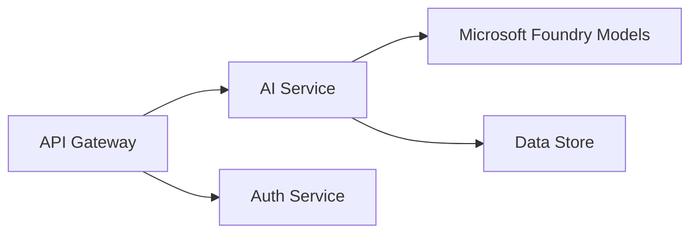

# अध्याय ८: उत्पादन आणि एंटरप्राइझ पॅटर्न्स

**📚 कोर्स**: [AZD शुरुआतसाठी](../../README.md) | **⏱️ कालावधी**: २-३ तास | **⭐ जटिलता**: प्रगत

---

## आढावा

हा अध्याय एंटरप्राइझ-तयार डिप्लॉयमेंट पॅटर्न्स, सुरक्षा कडक करणे, देखरेख, आणि उत्पादन AI वर्कलोडसाठी खर्च ऑप्टिमायझेशन यावर आहे.

हा एक आर्किटेक्चरल संदर्भ आहे, पूर्णपणे डिप्लॉय करण्यायोग्य उत्पादन टेम्प्लेट नाही. उदाहरणे आपल्या स्वत:च्या अनुप्रयोगात पुरवणे आणि चाचणी करणे आवश्यक असलेल्या एकत्रीकरण तपशील वगळतात; यादी वाचल्यावर उत्पादन तयार असल्याचे प्रमाणपत्र नाही.

> **Foundry GA अद्यतन (२०२६-११-०९):** Foundry वर्कफ्लो साठी `azd >= 1.37.0` आणि सर्वसामान्यपणे उपलब्ध `microsoft.foundry` १.० बंडल वापरा; मूल्यांकन वेगळे स्थापित केले जातात. पाहा [रिलीज स्कोप आणि माइग्रेशन](production-ai-practices.md#recent-release-changes-and-fixes) आणि [प्रमाणीकृत पाईपलाइन उदाहरण](production-ai-practices.md#cicd-pipeline-configuration). हे दस्तऐवज पुनरावलोकन आहे, थेट डिप्लॉयमेंट वैधता किंवा पर्यायी पूर्वावलोकन वैशिष्ट्यासाठी सर्वसाधारण GA स्थिती नाही.

## शिकण्याचे उद्दिष्टे

हा अध्याय पूर्ण केल्यावर, आपण:
- बहु-प्रदेश लवचिक अनुप्रयोग डिप्लॉय कराल
- एंटरप्राइझ सुरक्षा पॅटर्न्स अमलात आणाल
- सर्वसमावेशक देखरेख कॉन्फिगर कराल
- प्रमाणानुसार खर्च ऑप्टिमायझेशन कराल
- AZD सह CI/CD पाईपलाइन सेट अप कराल

---

## 📚 धडे

| # | धडा | वर्णन | वेळ |
|---|--------|-------------|------|
| 1 | [उत्पादन AI पद्धती](production-ai-practices.md) | एंटरप्राइझ डिप्लॉयमेंट पॅटर्न्स | ९० मिनिटे |

---

## 🚀 उत्पादन तपासणी यादी

- [ ] लवचिकतेसाठी बहु-प्रदेश डिप्लॉयमेंट
- [ ] प्रमाणीकरणासाठी व्यवस्थापित ओळख (की नाही)
- [ ] देखरेखीकरिता अनुप्रयोग अंतर्दृष्टी
- [ ] खर्च बजेट्स आणि अलर्ट कॉन्फिगर केलेले
- [ ] सुरक्षा तपासणी सक्षम
- [ ] CI/CD पाईपलाइन एकत्रीकरण
- [ ] आपत्ती पुनर्प्राप्ती योजना

---

## 🏗️ आर्किटेक्चर पॅटर्न्स

### पॅटर्न १: मायक्रोसर्व्हिस AI



### पॅटर्न २: ईव्हेंट-चालित AI


---

## 🔐 सुरक्षा सर्वोत्तम पद्धती

```bicep
// Illustrative properties from different resources, NOT a standalone Bicep file.
// Attach identity to the application host:
identity: {
  type: 'SystemAssigned'
}

// AI account properties (also require private endpoints, DNS and app connectivity):
properties: {
  publicNetworkAccess: 'Disabled'
  networkAcls: {
    defaultAction: 'Deny'
  }
}
```

---

## 💰 खर्च ऑप्टिमायझेशन

| धोरण | मुख्य मर्यादा |
|----------|---------|
| शून्यावर प्रमाणस्केलिंग (कंटेनर अ‍ॅप्स) | योग्य ट्रिगर आवश्यक; इतर सेवा खर्च झाला तरीही |
| विकासासाठी उपभोग स्तर वापरा | निवडलेल्या सेवेमध्ये किंमत आणि कार्यभार तुलना करा |
| नियोजित प्रमाणस्केलिंग | समर्थित इन्फ्रास्ट्रक्चर/स्वयंचलनाद्वारे प्रमाणस वृध्दी करा |
| आरक्षण/आगाऊ क्षमता | फक्त समर्थित असल्यास; बंधने मोकळा खर्च वाढवू शकतात |

वैध प्रारंभ दिनांक, बिलिंग स्कोप, प्राप्तकर्ते आणि अनुमतीसह [पूर्ण बजेट संसाधन पॅटर्न](production-ai-practices.md#2-cost-monitoring-and-budgets) वापरा. बजेट अलर्ट पाठवते; ते खर्चावर मर्यादा घालत नाही. बचत मोजलेल्या वापरावर अवलंबून आहे आणि हमी असलेले टक्के नाहीत.

---

## 📊 देखरेख सेटअप

```bash
# Open the Application Insights logs view (requires configured monitoring)
azd monitor --logs

# Check Application Insights
azd monitor --overview

# View metrics
az monitor metrics list --resource <resource-id>
```

---

## 🔗 नेव्हिगेशन

| दिशा | अध्याय |
|-----------|---------|
| **मागील** | [अध्याय ७: समस्या निराकरण](../chapter-07-troubleshooting/README.md) |
| **कोर्स पूर्ण** | [कोर्स घर](../../README.md) |

---

## 📖 संबंधित संसाधने

- [AI एजंट्स मार्गदर्शक](../chapter-02-ai-development/agents.md)
- [अनुप्रयोग अंतर्दृष्टी](../chapter-06-pre-deployment/application-insights.md)
- [बहु-एजंट सोल्यूशन्स](../chapter-05-multi-agent/README.md)
- [मायक्रोसर्व्हिस उदाहरण](../../examples/microservices/README.md)

---

<!-- CO-OP TRANSLATOR DISCLAIMER START -->
**अस्वीकरण**:
हा दस्तऐवज AI भाषांतर सेवा [Co-op Translator](https://github.com/Azure/co-op-translator) चा वापर करून अनुवादित केला आहे. जरी आम्ही अचूकतेसाठी प्रयत्न करतो, तरी कृपया लक्षात घ्या की स्वयंचलित भाषांतरांमध्ये त्रुटी किंवा अचूकतेची कमतरता असू शकते. मूळ दस्तऐवज त्याच्या मूळ भाषेत अधिकृत स्रोत मानला पाहिजे. महत्त्वाची माहिती असल्यास, व्यावसायिक मानवी भाषांतराची शिफारस केली जाते. या भाषांतराच्या वापरामुळे उद्भवणाऱ्या कोणत्याही गैरसमज किंवा चुकीच्या अर्थलावणीसाठी आम्ही जबाबदार नाही.
<!-- CO-OP TRANSLATOR DISCLAIMER END -->