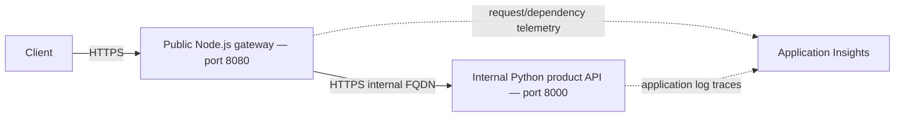

# दोन-सेवा मायक्रोसर्व्हिसेस — Azure कंटेनर अॅप्स

**पातळी:** मध्यम · **वेळ:** सेटअपसहित ४५–६० मिनिटे

हा शिक्षण नमुना **Node.js API Gateway** आणि **फक्त-वाचण्यायोग्य Python उत्पादन सेवा** अमलात आणतो.
स्रोत, Dockerfiles, Bicep, आणि azd कॉन्फिगरेशन यांचा समावेश आहे.
हा उत्पादनासाठी पूर्ण तयार प्रणाली नाही.

## आपण काय शिकाल

- दोन सेवा स्वतंत्रपणे तैनात करा.
- अंतर्गत बॅकएंड FQDN वापरा HTTPS वर.
- यशस्वी, न सापडलेले, आणि अनुपलब्ध-सेवा प्रतिक्रिया सत्यापित करा.
- टेलिमेट्री आणि स्वतंत्र स्केलिंग मर्यादा समजून घ्या.



उत्पादन कॅटलॉगमध्ये मेमरीमध्ये पाच निश्चित उत्पादने असतात. **कोणतेही POST,
PUT, किंवा DELETE हँडलर्स नाहीत**, डेटाबेस, सर्व्हिस बस, ऑर्डर/यूजर/नोटिफिकेशन सेवा,
C#, किंवा Go कोड नाही. ते भविष्यातील विकास कल्पना आहेत, समाविष्ट वैशिष्ट्ये नाहीत.
गेटवे वापरकर्त्यांचे प्रमाणीकरण करत नाही; अंतर्गत इनग्रेस हे
अनुप्रयोग अधिकृततेचे पर्याय नाही.

## पूर्वस्थिती

प्रथम [सिंगल Flask API](../../../../../examples/container-app/simple-flask-api) पूर्ण करा.
एक वर्तमान स्थिर azd स्थापित करा (पुनरावलोकन वेळेला प्रकाशित आवृत्ती: 1.37.2), Azure CLI,
आणि Docker डेमॉन चालू असणे आवश्यक आहे. आपल्याला Azure सदस्यता, संसाधन
निर्मिती परवानग्या आणि Container Apps क्षेत्रीय कोटा आवश्यक आहे.

```bash
azd version
az version
docker info
azd auth login
az login
```

दोन्ही CLI टूल्समध्ये एकसारखी सदस्यता वापरा. खालील आदेश Bash वापरतात.

## तैनाती आणि पडताळणी

रेपॉजिटरी रूटमधून:

```bash
cd examples/container-app/microservices
azd env new microservices-demo
azd up
GATEWAY_URL=$(azd env get-value API_GATEWAY_URL)
RG_NAME=$(azd env get-value AZURE_RESOURCE_GROUP)
GATEWAY_NAME=$(azd env get-value API_GATEWAY_NAME)
PRODUCT_NAME=$(azd env get-value PRODUCT_SERVICE_NAME)

curl --fail-with-body "${GATEWAY_URL}/health"
curl --fail-with-body "${GATEWAY_URL}/api/products"
curl --fail-with-body "${GATEWAY_URL}/api/products/1"
curl -i "${GATEWAY_URL}/api/products/999"
```

**यश:** health 200; list 200 सह **पाच** उत्पादने; उत्पादन 1 एक लॅपटॉप आहे
ज्याची किंमत 999.99 आहे आणि साठा 50 आहे; अज्ञात उत्पादन 404 परत करते.
वर्णने प्रतिसादांमध्ये समाविष्ट आहेत; टाइमस्टॅम्प वेगवेगळे असतात.

प्रारंभिक पुरवठा हे सार्वजनिक hello-world इमेजेस पोर्ट 80 वर वापरतो त्यामुळे ते रिकामा रजिस्ट्रीतून अस्तित्वात नसलेले इमेजेस डाउनलोड करण्याचा प्रयत्न करत नाहीत.
सेवा-विशिष्ट Bicep मॉड्यूल्स
आणि पॅरामीटर फाइल्स त्यांना तयार केलेल्या प्रतिमा आणि अ‍ॅप पोर्ट्स/प्रोब्स सह बदलतात
`azd deploy` दरम्यान. मुख्य पॅरामीटर्स प्रकाशित प्रतिमा नावे नंतरच्या पुरवठ्यासाठी टिकवून ठेवतात.

## सेवा आणि नेटवर्किंग

| सेवा | एक्सपोज केलेले एंडपॉइंट्स | डीफॉल्ट संसाधने |
|---|---|---|
| गेटवे | GET `/`, `/health`, `/api/products`, `/api/products/:id` | 1 vCPU, 2 GiB, 2–20 प्रतिकृती |
| उत्पादन | GET `/`, `/health`, `/products`, `/products/<id>` | 0.5 vCPU, 1 GiB, 1–10 प्रतिकृती |

उत्पादन प्रवेशद्वारात `external: false` आणि `allowInsecure: false` आहेत. बिसेप इंजेक्ट करतो
गेटवेमध्ये `PRODUCT_SERVICE_URL=https://<actual-internal-fqdn>`. HTTP असेल
पुनर्निर्देशित करा; HTTPS कॉन्फिगर केलेल्या इन्ग्रेसशी जुळते. एक लहान DNS नाव
**प्रत्यक्ष कंटेनर ऍप नावाशी** जुळले पाहिजे, लॉजिकल सेवा की `product-service` शी नाही.
आपल्या लॅपटॉपवरून थेट अंतर्गत URL कॉल करण्याचा प्रयत्न करू नका.

गेटवे कडे प्रॉडक्ट कॉलसाठी पाच सेकंदांची Timeout आहे. प्रॉडक्ट आयडी उपलब्ध नसल्यास
404 म्हणून प्रचार करा; ट्रान्सपोर्ट अपयशे/इतर बॅकएंड अपयशे 503 परत करतात. गेटवे
`/health` फक्त गेटवे तपासते, बॅकएंड उपलब्धता नाही.

## फायली आणि संरचना

```text
azure.yaml
infra/main.bicep
infra/main.parameters.json
infra/abbreviations.json
infra/core/container-apps-environment.bicep
infra/core/monitor.bicep
infra/app/api-gateway.bicep
infra/app/api-gateway.parameters.json
infra/app/product-service.bicep
infra/app/product-service.parameters.json
src/api-gateway/{app.js,package.json,Dockerfile}
src/product-service/{main.py,requirements.txt,Dockerfile}
```

स्केलिंग, CPU/मेमरी, पोर्ट्स, आणि प्रॉब्स `infra/app/*.bicep` मध्ये सेट केल्या जातात. त्या
फायली बदला आणि इन्फ्रास्ट्रक्चर लागू करण्यासाठी आणि पुन्हा तैनात करण्यासाठी `azd up` चालवा. तिथे नाही
या नमुन्यातील `GATEWAY_MAX_REPLICAS` पर्यावरण-चरणबिंदू पॅरामीटर.

फक्त कोड-विषयक बदलांसाठी:

```bash
azd deploy product-service
azd deploy api-gateway
```

Node प्रतिमा Node 22 वापरते; Python प्रतिमा Python 3.11 वापरते. दोन्ही बांधतात
`0.0.0.0` कडे. Ingress/probes अनुक्रमे पोर्ट 8080 (गेटवे) आणि 8000 (उत्पादन) वापरतात.

## Docker सह स्थानिक विकास

या उदाहरण डिरेक्टरीमधून चालवा. वापरकर्त्याद्वारा परिभाषित नेटवर्क वापरा, **नाही `localhost`
एका कंटेनरमधून दुसऱ्या पर्यंत पोहोचण्यासाठी**:

```bash
docker network create azd-microservices-demo
docker build -t local-product ./src/product-service
docker build -t local-gateway ./src/api-gateway
docker run -d --name azd-product --network azd-microservices-demo local-product
docker run -d --name azd-gateway --network azd-microservices-demo \
  -p 8080:8080 -e PRODUCT_SERVICE_URL=http://azd-product:8000 local-gateway
curl --fail-with-body http://localhost:8080/api/products
```

अपेक्षित: पाच उत्पादने. HTTP फक्त या स्थानिक Docker नेटवर्कसाठी वापरला जातो.

```bash
docker stop azd-product azd-gateway
docker rm azd-product azd-gateway
docker network rm azd-microservices-demo
```

## देखरेख

```bash
az containerapp logs show --name "$GATEWAY_NAME" --resource-group "$RG_NAME" --follow
# In a separate terminal:
az containerapp logs show --name "$PRODUCT_NAME" --resource-group "$RG_NAME" --tail 100
```

`azd monitor --logs` एक पोर्टल दृश्य उघडते; हे टर्मिनल लॉग्स प्रवाहित करत नाही.
Node SDK गेटवे विनंत्या/आश्रित गोळा करतो. Python चे `AzureLogHandler`
**लॉग ट्रेसेस** निर्यात करते, स्वयंचलित Flask विनंत्या, SQL आश्रित किंवा पूर्ण
वितरित ट्रेसेस नाहीत. OpenCensus हा एक जुना SDK आहे; या नमुन्याचा विस्तार करताना Azure Monitor OpenTelemetry प्राधान्य द्या.


Application Insights Logs मध्ये, विनंत्या तयार करा आणि तपासा:

```kusto
requests
| where timestamp > ago(1h)
| where name contains "products"
| summarize RequestCount=count(), AvgDuration=avg(duration) by bin(timestamp, 5m)
```

Python अनुप्रयोग संदेशांसाठी:

```kusto
traces
| where timestamp > ago(1h)
| where message contains "products"
| project timestamp, message, severityLevel
```

ग्रहण विलंब आणि नमुने घेण्याची परवानगी द्या; नेमक्या विनंतीची संख्या किंवा खात्रीशीर विलंब अपेक्षा करू नका.
कोणतीही सानुकूल संदेश किंवा डॅशबोर्ड तयार केलेले नाहीत.

## व्यावहारिक सराव

### सराव 1: कॅटलॉगमध्ये बदल करा

**प्रारंभ बिंदू:** `src/product-service/main.py`.
**उद्दिष्ट:** स्वतंत्र सेवा तैनातीची पडताळणी करा.
निश्चित `products` यादीत लैपटॉपचा साठा 50 वरून 49 मध्ये बदला,
`azd deploy product-service` चालवा, नंतर `${GATEWAY_URL}/api/products/1` अनुरोध करा.

**यशस्वी निकष / उपाय:** HTTP 200 सह `"stock":49`. 50 पुन्हा स्थापित करा आणि परत तैनात करा.
**सामान्य समस्या:** कॅटलॉगची मालकी असलेल्या सेवेऐवजी गेटवे संपादित करणे.
हे स्रोत डेटा बदलते, शाश्वत साठा डेटाबेस नाही.

### व्यायाम 2: प्रतिकृती संरचना तपासा

**सुरवातीचा बिंदू:** `infra/app/product-service.bicep`.
**उद्दिष्ट:** ऑटोस्केलिंगशिवाय पायाभूत सुविधा बदल निरीक्षण करा.
`minReplicas: 1` चे `minReplicas: 2` मध्ये बदल करा, `azd up` चालवा, नंतर:

```bash
az containerapp show --name "$PRODUCT_NAME" --resource-group "$RG_NAME" \
  --query properties.template.scale -o json
```

**यशस्वी निकषः** कॉन्फिगर केलेले किमान 2 आहे आणि कमाल 10 राहते.
किमान 1 पुनर्संचयित करा आणि `azd up` चालवा.
**सामान्य समस्या:** फक्त `azd deploy` सादृश्य न वापरलेल्या साझा
इन्फ्रास्ट्रक्चरवर बदल लागू करत नाही. अपयश सिम्युलेशन म्हणून `maxReplicas` शून्य करू नका.
हे कॉन्फिगरेशनची पडताळणी करते, लोड-टेस्ट किंवा हमी instantaneous रेप्लिका संख्या नाही.

### व्यायाम 3: उपलब्ध नसलेल्या सेवा स्थानिकरित्या हाताळणे तपासा

**सुरुवातीची अवस्था:** वरील दोन्ही स्थानिक Docker कंटेनर चालू आहेत.
**ध्येय:** मागणीत उत्पादन नसल्यामुळे होणाऱ्या बॅकएंड अपयशामध्ये फरक दाखवा.
फक्त उत्पादन कंटेनर बंद करा:

```bash
docker stop azd-product
curl -i http://localhost:8080/api/products
docker start azd-product
curl --fail-with-body http://localhost:8080/api/products
```

**यशस्वी निकषः** बंद असताना, गेटवे 503 परत करतो
`"error":"Product service unavailable"` सह; पुनःसुरू केल्यानंतर, यादी 200 परत करते.
आवश्यक असल्यास लहान स्टार्टअप विलंबानंतर पुनःप्रयत्न करा.
**सामान्य समस्या:** गेटवे थांबवणे वेगळे अपयश तपासते (कोणताही HTTP प्रतिसाद नाही).

## खर्च व उत्पादनातील तटस्थता

डीफॉल्ट किमान रेप्लिका संगणन चालू ठेवतात. नोंदणी आणि देखरेख देखील खर्च करतो.
$50/महिना एकूण प्रमाणित निश्चित नाही: प्रादेशिक CPU/मेमरी,
रेप्लिका तास, विनंत्या, नोंदणी आणि लॉग ठेवण्याचा अंदाज घ्या.
[Azure किंमत गणक](https://azure.microsoft.com/pricing/calculator/).
शिक्षण साधने तत्परतेने हटवा.

उत्पादन कार्यामध्ये प्रमाणीकरण/प्राधिकरण, स्कोप केलेल्या व्यवस्थापित ओळखींचा समावेश आहे,
सातत्य ठेवणारे डेटा, इनपुट/प्रतिक्रिया मान्यता, समर्थित निरीक्षण साधने,
लोड/अपयश चाचणी, CI/CD, सूचना, आणि पुनर्प्राप्ती प्रक्रिया. ऑर्डर सेवा,
क्यू किंवा डेटाबेस जोडणे हे स्वतंत्र अंमलबजावणीचे कार्य आहे,
जे येथे पूर्ण झालेली व्यायाम किंवा आधीपासून उपलब्ध वैशिष्ट्य नाही.

## समस्या निवारण आणि साफसफाई

- **प्रथम प्राव्हिजनदरम्यान प्रतिमा सापडली नाही:** बूटस्ट्रॅपने सार्वजनिक प्रतिमा वापरावी;
  मुख्य प्रतिमा पॅरामीटर डिफॉल्ट्स आणि डिप्लॉयमेंट मॉड्यूल नकाशा तपासा.
- **503 उत्पादने:** उत्पादन लॉग्स, प्रतिमा आवृत्ती, आणि इंजेक्ट केलेल्या आंतरिक HTTPS URL तपासा.
- **404 अनपेक्षित मार्ग:** उत्पादन API केवळ वाचण्यायोग्य आहे; मार्ग तपासा, अस्तित्वात नसलेल्या CRUD हँडलरची नाही.
- **कोणतीही टेलिमेट्री नाही:** रनटाइम कनेक्शन स्ट्रिंग्ज तपासा पण त्यांना उघडू नका आणि
  विलोपन देण्यास परवानगी द्या. Python विनंती तालिका त्याच्या लॉग हँडलरने भरण्यात येत नाही.

या नमुना डिरेक्टरीमधून:

```bash
azd down
```

हटविण्याच्या सूचना पुनरावलोकन करा आणि समर्पित संसाधन गट हटविला गेला आहे याची खात्री करा.

[मागील: Flask API](../../../../../examples/container-app/simple-flask-api) · [पुढील: डेटाबेस अॅप](../../../../../examples/database-app) ·
[AI विकास](../../../docs/chapter-02-ai-development/README.md) ·
[कोर्स होम](../../../README.md) · [समस्या नोंदवा](https://github.com/microsoft/AZD-for-beginners/issues)

---

<!-- CO-OP TRANSLATOR DISCLAIMER START -->
**अस्वीकरण**:
हा दस्तऐवज AI भाषांतर सेवा [Co-op Translator](https://github.com/Azure/co-op-translator) चा वापर करून अनुवादित केला आहे. जरी आम्ही अचूकतेसाठी प्रयत्न करतो, तरी कृपया लक्षात घ्या की स्वयंचलित भाषांतरांमध्ये त्रुटी किंवा अचूकतेची कमतरता असू शकते. मूळ दस्तऐवज त्याच्या मूळ भाषेत अधिकृत स्रोत मानला पाहिजे. महत्त्वाची माहिती असल्यास, व्यावसायिक मानवी भाषांतराची शिफारस केली जाते. या भाषांतराच्या वापरामुळे उद्भवणाऱ्या कोणत्याही गैरसमज किंवा चुकीच्या अर्थलावणीसाठी आम्ही जबाबदार नाही.
<!-- CO-OP TRANSLATOR DISCLAIMER END -->