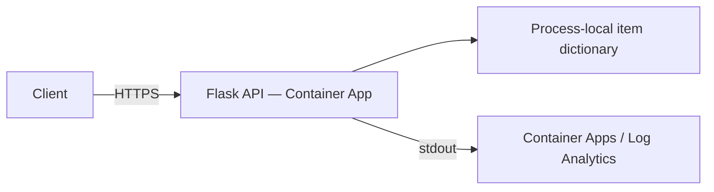

# साधी Flask API — Azure कंटेनर अॅप्स

**पातळी:** सुरुवातीसाठी · **कालावधी:** सेटअपसह 30–45 मिनिटे

Azure Developer CLI (azd) सह Python Flask CRUD API तैनात करा. स्रोत, Dockerfile,
Bicep आणि तैनातीचे परिमाण समाविष्ट आहेत. हे एक **शिकण्याचे नमुना** आहे, उत्पादनासाठी तयार API नाही.


## आपण काय शिकाल

- azd द्वारे कंटेनर तयार करा व प्रकाशित करा.
- प्रवेश मार्ग आणि लिव्हनेस/रेडिनेस प्रोब कॉन्फिगर करा.
- CRUD प्रतिसाद तपासा आणि अॅप्लिकेशन लॉग्स तपासा.
- का इन-मेमरी डेटा टिकाऊ अनुप्रयोगांसाठी अयोग्य आहे ते समजून घ्या.



**महत्त्वाचे:** वस्तू एका प्रक्रियेत ठेवलेल्या आहेत. डीफॉल्ट आहे **एक Gunicorn वर्कर,
0–1 प्रतिकृती**, जे वर्कर/रिप्लिकांतर्गत विसंगत डेटा टाळते.
वस्तू पुनःप्रारंभ, आवृत्ती बदल किंवा शून्य स्केलवर हरवतात. प्रतिकृती वाढवण्यासाठी
सामायिक स्थायी संग्रह आवश्यक आहे. API मध्ये प्रमाणीकरण किंवा प्राधिकरण नाही.

## पूर्वशर्ती

- [सध्याचा स्थिर azd](https://learn.microsoft.com/azure/developer/azure-developer-cli/install-azd)
  (पुनरावलोकनाच्या वेळी प्रकाशित आवृत्ती: 1.37.2).
- पडताळणीसाठी [Azure CLI](https://learn.microsoft.com/cli/azure/install-azure-cli).
- डॉकर ज्याचा डेमॉन चालू आहे; डीफॉल्ट स्थानिक इमेज बिल्डसाठी आवश्यक आहे.
- Azure सदस्यता, संसाधन निर्मिती परवानग्या आणि कंटेनर अॅप्स क्षेत्रीय कोटा.
- खालील आज्ञांसाठी बॅश (किंवा समतुल्य PowerShell).
- ऐच्छिक स्थानिक विकासासाठी Python 3.11.

```bash
azd version
az version
docker info
azd auth login
az login
```

CLI साधनांमध्ये स्वतंत्र लॉगिन सत्रे असतात. दोघींमध्येही एकच सदस्यता वापरा.

## जलद प्रारंभ

रिपॉझिटरीच्या मूळ निर्देशिकेतून:

```bash
cd examples/container-app/simple-flask-api
azd env new flask-demo
azd up
API_URL=$(azd env get-value API_ENDPOINT)
RG_NAME=$(azd env get-value AZURE_RESOURCE_GROUP)
API_NAME=$(azd env get-value API_NAME)
curl --fail-with-body "${API_URL}/health"
```

अपेक्षित: HTTP 200 आणि JSON सह `"status":"healthy"`,
`"service":"simple-flask-api"`, आणि सध्याचा UTC टाइमस्टॅम्प.
पुरवणी आणि इमेज बिल्डिंग सहसा काही मिनिटे घेतात; वेळा वेगळ्या असू शकतात.

प्रारंभिक पुरवणीसाठी सार्वजनिक hello-world इमेज पोर्ट 80 वर ऐकत आहे.
`azure.yaml` `infra/app/api.bicep` आणि त्याच्या जुळणाऱ्या परिमाण फाइलची निवड करते
सेवा तैनातीसाठी, ज्यामुळे इमेज, प्रवेश मार्ग आणि प्रोब पोर्ट 8000 वर स्विच होतात.
त्या तैनातीच्या परिमाणांना वगळू नका.

## CRUD प्रमाणित करा

खालील क्रमाने चालवा जेव्हा तोच प्रतिकृती सक्रिय असेल:

```bash
# Create: HTTP 201; note the returned id (1 for a fresh process).
curl -i -X POST "${API_URL}/api/items" \
  -H "Content-Type: application/json" \
  -d '{"name":"Test Item","description":"My first item"}'

# Read list: HTTP 200, total 1 in a fresh process.
curl --fail-with-body "${API_URL}/api/items"

# Replace 1 if your create response returned another id.
curl --fail-with-body "${API_URL}/api/items/1"
curl -i -X PUT "${API_URL}/api/items/1" \
  -H "Content-Type: application/json" -d '{"name":"Updated Item"}'
curl -i -X DELETE "${API_URL}/api/items/1"
curl -i "${API_URL}/api/items/1"
```

यशस्वी: POST 201, read/PUT 200, DELETE 204 बॉडीशिवाय, नंतर हरवलेली वस्तू 404.
चुकीचे/नॉन-ऑब्जेक्ट JSON किंवा रिक्त नाव 400 परत करते.
जर वस्तू विनंत्यांमध्ये गायब झाली, तर पुनःप्रारंभ किंवा शून्य-स्केल तपासा;
हे जाणूनबुजून केलेले इन-मेमरी मर्यादा आहे, टिकाऊपन नाही.

| शेवटचा बिंदू | पद्धती |
|---|---|
| `/` | GET — सेवा माहिती |
| `/health` | GET — लिव्हनेस/रेडिनेस |
| `/api/items` | GET, POST |
| `/api/items/{id}` | GET, PUT, DELETE |

## लॉग आणि कॉन्फिगरेशन

```bash
az containerapp logs show --name "$API_NAME" --resource-group "$RG_NAME" --follow
```

अपेक्षित: Gunicorn स्टार्टअप, विनंती प्रवेश लॉग्स, आणि अॅप्लिकेशन संदेश.
`azd monitor --logs` पोर्टल व्यू उघडते; ते टर्मिनलवर प्रवाहित करत नाही.
Application Insights पुरवले गेले आहे परंतु **या Flask कोडद्वारे साधने केली नाही**;
stdout लॉगसाठी कंटेनर अॅप्स/लॉग अॅनालिटिक्स वापरा.

CPU/मेमरी, प्रतिकृती मर्यादा किंवा स्केल नियमांसाठी `infra/app/api.bicep` संपादित करा,
नंतर `azd up` चालवा. डीफॉल्ट 0.5 vCPU, 1 GiB, किमान 0 / कमाल 1 प्रतिकृती आणि
50 एकाचवेळी विनंत्यांचा HTTP थ्रेशोल्ड आहे. शून्य-स्केल्साठी थोडा विलंब असू शकतो.

मनमानी `azd env set MAX_REPLICAS`, `API_KEY`, `LOG_LEVEL`, किंवा
`SCALE_TO_ZERO_TIMEOUT` मूल्ये **या टेम्प्लेट किंवा अॅपशी जोडलेली नाहीत**.
मूल्य सेट केल्याने ते स्वयंचलितपणे रनटाइम पर्यावरण बदलात रूपांतरित होत नाही.
इमेज स्पष्टपणे पोर्ट 8000 शी जोडलेले आहे; पोर्ट बदलल्यास Dockerfile, Bicep प्रवेश मार्ग आणि प्रोब एकत्रित अद्यतन करा.


## फाइल्स

```text
azure.yaml
infra/main.bicep
infra/main.parameters.json
infra/app/container-apps.bicep       # Environment, registry, monitoring
infra/app/api.bicep                  # App, ingress, probes, scale settings
infra/app/api.parameters.json        # Image and resource values for azd deploy
src/app.py
src/Dockerfile
src/requirements.txt
```

## स्थानिक विकास

या उदाहरण निर्देशिकेतून:

```bash
python -m venv .venv
source .venv/bin/activate  # PowerShell: .\.venv\Scripts\Activate.ps1
python -m pip install -r src/requirements.txt
python src/app.py
```

दुसऱ्या टर्मिनलमध्ये `http://localhost:8000/health` आणि CRUD शेवटचे बिंदू तपासा.
किंवा प्रत्यक्ष इमेज तयार करा व चालवा:

```bash
docker build -t flask-api:local ./src
docker run --rm -p 8000:8000 flask-api:local
```

प्रथम तैनाती नंतर फक्त कोड बदलांसाठी `azd deploy api` चालवा.
Bicep बदलांसाठी पुन्हा-पुरवठा व तैनातीसाठी `azd up` चालवा.

## व्यावहारिक सराव

### 1. इनपुट नाकारण्याची पडताळणी करा

**प्रारंभ बिंदू:** तैनात API, `API_URL` वर.
**लक्ष्य:** API अवैध JSON स्वरूप आणि हरवलेल्या नावांना नाकारते याची पडताळणी करा.

```bash
curl -i -X POST "${API_URL}/api/items" \
  -H "Content-Type: application/json" -d '[]'
curl -i -X POST "${API_URL}/api/items" \
  -H "Content-Type: application/json" -d '{"name":""}'
```

**यशस्वी निकष / निकाल:** दोन्ही 400 सह JSON त्रुटी परत करतात, 500 नव्हे.
**सामान्य समस्या:** JSON सामग्री-प्रकार हेडर वगळणे.

### 2. वाचण्यायोग्य आवृत्तीचा शेवटचा बिंदू जोडा

**प्रारंभ बिंदू:** `src/app.py`. **लक्ष्य:** API विस्तार करा व पुन्हा तैनात करा.
हे `if __name__ == '__main__':` ब्लॉकला आधी जोडा:

```python
@app.route('/version', methods=['GET'])
def version():
    return jsonify({'version': '1.0.0'})
```

`azd deploy api` चालवा, नंतर `curl --fail-with-body "${API_URL}/version"`.
**यशस्वी निकष:** HTTP 200 आणि `{"version":"1.0.0"}`.
**सामान्य समस्या:** ब्लॉक करणाऱ्या `app.run()` कॉल नंतर मार्ग ठेवल्यामुळे,
`python src/app.py` सह तपासताना.

### ज्ञान तपासणी

टिकाऊ डेटासाठी एक वर्कर का अपुरी आहे? कारण एक प्रक्रियाही पुनःप्रारंभी तिचे शब्दकोश गमावते.
उत्पादन आवृत्तीसाठी स्थायी सामायिक संग्रह, प्रमाणीकरण, प्राधिकरण, स्थलांतरे, चाचण्या,
आणि ऑपरेशनल देखरेख आवश्यक आहे.

## खर्च आणि समस्या निवारण

हे $0 तैनातीची हमी नाही: बेसिक रजिस्ट्री आणि लॉग संग्रहण/इनजेशन
अप्लिकेशन कम्प्युट शून्यात असताना देखील शुल्क आकारू शकतात. आपल्या प्रदेशासाठी
[किंमत कॅल्क्युलेटर](https://azure.microsoft.com/pricing/calculator/) वापरा.

- **Docker बिल्ड अयशस्वी:** `docker info`, नेटवर्क प्रवेश आणि अवलंबित्वे तपासा.
- **अस्वस्थ अॅप:** कन्सोल/सिस्टम लॉग तपासा व इमेज पोर्ट, प्रवेश मार्ग,
  आणि प्रोब्स जुळतात का ते तपासा. Flask पोर्टवर प्लेसहोल्डरची प्रोब केली पाहिजे नाही.
- **403/परवानग्या:** सदस्यता आणि संसाधन निर्मिती परवानग्या तपासा.
- **वस्तू हरवतात:** पुनःप्रारंभ/शून्य-स्केलवर इन-मेमरी स्थिती रीसेट होते; टिकाऊ वर्तनासाठी
  डेटाबेस जोडा.

## साफसफाई आणि पुढील पावले

```bash
azd down
```

विलोपन सूचना तपासा आणि समर्पित संसाधन गट काढल्याची खात्री करा.
असंबंधित डेटाचे संसाधन गटावर विनाशकारी साफसफाई करू नका.

[पुढे: डेटाबेस अॅप](../../../../../examples/database-app) · [मायक्रोसर्व्हिसेस](../../../../../examples/container-app/microservices) ·
[कंटेनर अवलोकन](../README.md) · [कोर्स मुख्यपृष्ठ](../../../README.md) ·
[समस्या नोंदवा](https://github.com/microsoft/AZD-for-beginners/issues)

---

<!-- CO-OP TRANSLATOR DISCLAIMER START -->
**अस्वीकरण**:
हा दस्तऐवज AI भाषांतर सेवा [Co-op Translator](https://github.com/Azure/co-op-translator) चा वापर करून अनुवादित केला आहे. जरी आम्ही अचूकतेसाठी प्रयत्न करतो, तरी कृपया लक्षात घ्या की स्वयंचलित भाषांतरांमध्ये त्रुटी किंवा अचूकतेची कमतरता असू शकते. मूळ दस्तऐवज त्याच्या मूळ भाषेत अधिकृत स्रोत मानला पाहिजे. महत्त्वाची माहिती असल्यास, व्यावसायिक मानवी भाषांतराची शिफारस केली जाते. या भाषांतराच्या वापरामुळे उद्भवणाऱ्या कोणत्याही गैरसमज किंवा चुकीच्या अर्थलावणीसाठी आम्ही जबाबदार नाही.
<!-- CO-OP TRANSLATOR DISCLAIMER END -->