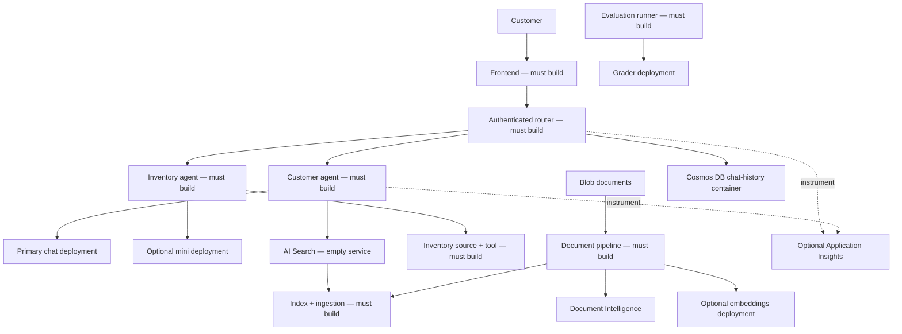

# बहु-एजंट ग्राहक समर्थन — किरकोळ आर्किटेक्चर ब्लूप्रिंट

**अध्याय ५: बहु-एजंट AI सोल्यूशन्स**

- [कोर्स होम](../README.md)
- [अध्याय ५](../docs/chapter-05-multi-agent/README.md)
- [पुरवठा: AI एकत्रीकरण](../docs/chapter-02-ai-development/microsoft-foundry-integration.md)
- [पुढे: क्षमता नियोजन](../docs/chapter-06-pre-deployment/capacity-planning.md)
- [ARM इन्फ्रास्ट्रक्चर स्कॅफोल्ड](retail-multiagent-arm-template/README.md)

> **आर्किटेक्चर मार्गदर्शक, कार्यरत अनुप्रयोग नाही.** एकमेव किरकोळ अंमलबजावणी
> फायली आहेत `azuredeploy.json`, `azuredeploy.parameters.json`, आणि `deploy.sh` मध्ये
> `retail-multiagent-arm-template/`. राउटर/फ्रंटएंड कंटेनर्स हे hello-world
> प्लेसहोल्डर आहेत. स्थानिक पातळीवर कोणताही किरकोळ एजंट, UI, इंजेशन पाईपलाईन,
> मूल्यांकन करणारा, स्कॅनर किंवा अनुप्रयोग चाचणी संच अस्तित्वात नाही.

## आढावा

**लक्ष्य:** ग्राहक एजंट आणि इन्व्हेन्टरी एजंटसह ग्राहक-समर्थन प्रणाली डिझाइन करणे,
कोणती इन्फ्रास्ट्रक्चर उपलब्ध आहे हे ओळखणे, आणि अनुप्रयोग स्थान, करार व प्रमाणीकरण
योजने करणे.

**दर्शक:** स्थानिक पूर्ण केलेले डेव्हलपर्स
[चॅट नमुना](../../../examples/azure-openai-chat) आणि [दोन-सेवा कंटेनर नमुना](../../../examples/container-app/microservices).
आर्किटेक्चरल अभ्यासासाठी २–३ तास द्या. अनुप्रयोग तयार करणे एक स्वतंत्र
प्रकल्प आहे: अनुभवी विकासकांसाठी ८०–१२० विकास तास स्वाभाविक नियोजन अंदाज आहे,
**डिलिव्हरी वचन नव्हे**; उत्पादन हार्डनिंग, चाचण्या,
सुरक्षा पुनरावलोकन, आणि ऑपरेशन्ससाठी अतिरिक्त काम आवश्यक आहे.

### शिक्षणाचे परिणाम

- राउटिंग, ग्राउंडिंग, टूल परवानग्या, आणि संभाषण मालकी यांचे स्पष्टीकरण करा.
- मॉडेल आयडेंटिफायर्स, डिप्लॉयमेंट नावे, API आवृत्त्या, आणि ARM आवृत्त्यांमध्ये फरक ओळखा.
- जुळणाऱ्या व्हेक्टर आयामांसह दस्तऐवज ग्रहण आणि पुनर्प्राप्तीची रचना करा.
- पडताळणी करता येणाऱ्या फंक्शनल, मूल्यमापन, आणि अपयश-पुनर्प्राप्ती गरजा निर्दिष्ट करा.
- पर्यायी आर्किटेक्चर उद्दिष्टे प्रत्यक्षात पुरवलेल्या संसाधनांपासून वेगळे करा.

## सोल्यूशन आर्किटेक्चर



हे एक **टार्गेट अनुप्रयोग आर्किटेक्चर** आहे, चालू एजंट
सेवांची आकृती नव्हे. ARM स्कॅफोल्ड केवळ मूलभूत सेवा आणि दोन प्लेसहोल्डर
कंटेनर्स तयार करते. फ्रंट डोअर, रजिस्ट्री, व्यवस्थापित ओळखी, भूमिका नेमणुका,
खासगी एंडपॉइंट्स, फेलओव्हर, अनुप्रयोग साधने, आणि अलर्ट यांचा समावेश नाही.

### जबाबदाऱ्या आणि करारनामे

| घटक | आवश्यक वर्तन | पूर्ण समजून घेण्याआधी पुरावा |
|---|---|---|
| फ्रंटएंड | वापरकर्त्यांना प्रमाणित करा, चॅट दाखवा, सुरक्षित दस्तऐवज अपलोड करा | UI आणि अपलोड चाचण्या, उपलब्ध त्रुटी |
| राउटर | विनंत्यांना प्राधिकारी द्या, एजंट निवडा, बाइंड केलेल्या टूल कॉल/टाइमआउट | राउटिंग चाचण्या, प्राधिकरण तपासणी, अपयश चाचण्या |
| ग्राहक एजंट | अनुमोदित स्रोतांमध्ये धोरण/उत्पादन उत्तरे मांडणी करा | योग्य संदर्भ, डेटा नसेल तर परहेज करा |
| इन्व्हेंटरी टूल | प्राधिकृत स्टॉक वाचा, मर्यादित परवानग्यांसह | निश्चित स्टॉक चाचण्या; उपलब्धतेत काल्पनिकता नाही |
| दस्तऐवज पाइपलाइन | काढा, तुकडा करा, एम्बेड करा, अनुक्रमांक करा, अद्यतन/हटवा | अनुक्रमांकित फिक्स्चर्स आणि पुन्हा प्रयत्न/डेड-लेटर वर्तन |
| संभाषण संचय | वापरकर्ते वेगळे करा, राखणी अंमलात आणा | क्रॉस-यूजर परवानगी आणि TTL चाचण्या |
| मूल्यमापन रन्नर | आउटपुटची जमीन सत्य आणि निकषाशी तुलना करा | कव्हरेज, अपयश मोजणी, पुनरुत्पादक अहवाल |

राउटरला रिसेप्शन डेस्क म्हणून आणि टूल्सना प्रतिबंधित आंतरिक प्रणाली समजून घ्या:
तज्ञ निवडणे म्हणजे प्रत्येक ग्राहकाची नोंदी पाहण्याची परवानगी नाही.
ओळख आणि परवानग्या अनुप्रयोग कोड आणि डेटा सेवांमध्ये लागू करा, प्रॉम्प्ट्समध्ये नव्हेत.

## पायाभूत सुविधा विरुद्ध अनुप्रयोग

प्राव्हिजन करण्यापूर्वी [scaffold README](retail-multiagent-arm-template/README.md) वाचा.
यात नेमके स्रोत, पद्धती, खर्च आणि मर्यादा दिलेल्या आहेत.

| लॉजिकल वापर | ARM डिप्लॉयमेंट नाव | मॉडेल / आवृत्ती | डीफॉल्ट क्षेत्र |
|---|---|---|---|
| ग्राहक चॅट | `gpt-4.1-chat` | `gpt-4.1` / `2025-04-14` | `eastus2` |
| इन्व्हेंटरी | `gpt-4.1-mini-inventory` | `gpt-4.1-mini` / `2025-04-14` | `westus2`, ऐच्छिक |
| एम्बेडिंग्ज | `text-embedding-ada-002` | `text-embedding-ada-002` / `2` | `francecentral`, ऐच्छिक |
| मूल्यांकन | `gpt-4.1-grader` | `gpt-4.1` / `2025-04-14` | प्राथमिक प्रदेश डीफॉल्टने |

मॉडेल/आवृत्ती/SKU उपलब्धता आणि कोटा **प्रत्येक प्रदेशात** तपासा. चॅट/मिनी/ग्रेडर
साठी `GlobalStandard` वापरा; एम्बेडिंग्ह साठी `Standard` वापरा. क्षमता-युनिट-टू-TPM मॅपिंग्ज
मॉडेल-विशिष्ट आहेत. सार्वत्रिक कोटा गॅरंटी म्हणून वेगळ्या क्षमता युनिट्स जोडू नका.

Azure OpenAI विनंतीचा `model` आर्ग्युमेंट हा **डिप्लॉयमेंट नाव** आहे, आवश्यक नाही की
कॅटलॉग मॉडेल आयडेंटिफायर. डेटा-प्लेन API आवृत्ती `2024-10-21`
मॉडेल आवृत्ती `2025-04-14` आणि ARM स्रोत `apiVersion` यांपेक्षा वेगळी आहे.
फक्त डेटा-प्लेन API आवृत्ती बदलून उपलब्ध नसलेले मॉडेल दुरुस्त करता येत नाही.

`--no-multi-region` द्वितीयक आणि एम्बेडिंग्ज खाते वगळतो. एक प्राथमिक चॅट आणि
स्वतंत्र ग्रेडर खाते राहते. वेगळ्या मॉडेल खाती स्वयंचलित
फेलओव्हर देत नाहीत; त्यासाठी अॅप्लिकेशन राउटिंग, सुसंगत डिप्लॉयमेंट्स, हेल्थ चेक्स,
रिट्री मर्यादा आणि डेटा-निवास पुनरावलोकन आवश्यक आहे.

## अमलबजावणी रोडमॅप

### 1. एक चाचलेले संवाद सुरू करा

मोठ्या scaffold प्राव्हिजन करण्याआधी, स्थानिक चॅट सॅम्पल वापरून
इनफरन्स कनेक्टिव्हिटी स्थापित करा. एक प्रतिनिधी ग्राहक प्रश्न, मान्यताप्राप्त
उत्तर स्रोत, अपेक्षित संदर्भ आणि त्या स्रोताचा अभाव असताना अपयशाची वर्तन निश्चित करा.

### 2. राउटिंग आणि टूल सीमारेषा ठरवा

आपला स्वतःचा राउटर स्रोत, अवलंबित्व मॅनिफेस्ट, डॉकरफाइल, आणि चाचण्या तयार करा. एक
दर्शनी करार असू शकतो `POST /chat` सह `{"message":"...","conversation_id":"..."}`.
**हाच endpoint ही डिझाइन प्रस्तावना आहे; ती ARM टेम्पलेटने अंमलात आणलेली नाही.**

बॉडी प्रकार/मर्यादा योग्य ठरवा, प्रमाणीकरणातून वापरकर्ता ओळख मिळवा, संभाषण मालकीवर नियंत्रण ठेवा,
विनंती टाइमआउट लागू करा आणि अर्थपूर्ण त्रुटी कोड परत करा.
HTTP अपयश किंवा रिकाम्या प्रतिसादाला यशस्वी एजंट निकाल समजू नका.

### 3. ग्राउंडिंग आणि इनजेशन अंमलात आणा

ARM टेम्पलेट सर्च इंडेक्स तयार करत नाही. हा **तुमच्या स्वतःच्या इंडेक्स व्याख्येत समायोजित करण्यासाठी संदर्भ JSON
तुकडा आहे**, रेपोतील आधीच असलेली फाइल नाही:

```json
{
  "name": "retail-product-index",
  "fields": [
    {"name": "id", "type": "Edm.String", "key": true},
    {"name": "title", "type": "Edm.String", "searchable": true},
    {"name": "content", "type": "Edm.String", "searchable": true},
    {"name": "category", "type": "Edm.String", "filterable": true},
    {
      "name": "content_vector",
      "type": "Collection(Edm.Single)",
      "searchable": true,
      "dimensions": 1536,
      "vectorSearchProfile": "retail-profile"
    }
  ],
  "vectorSearch": {
    "algorithms": [{"name": "retail-hnsw", "kind": "hnsw"}],
    "profiles": [{"name": "retail-profile", "algorithm": "retail-hnsw"}]
  }
}
```

प्रोफाइल वेक्टर फील्डला त्याच्या अल्गोरिदमशी लिंक करतो. परिमाण जुळणे आवश्यक आहे
प्रत्यक्ष एम्बेडिंग आउटपुट (या `ada-002` डिप्लॉयमेंटसाठी १५३६). Python पुनर्प्राप्तीसाठी,
अपूर्ण शब्दकोशाऐवजी `azure.search.documents.models.VectorizedQuery` वापरा ज्यामध्ये त्याचा व्हेक्टर क्वेरी प्रकार नाही:


```python
# Reference function only: supply an authenticated async SearchClient and an embedding.
from azure.search.documents.models import VectorizedQuery

async def retrieve(search_client, embedding):
    results = await search_client.search(
        search_text=None,
        vector_queries=[VectorizedQuery(
            vector=embedding,
            k_nearest_neighbors=5,
            fields="content_vector"
        )],
        select=["id", "title", "content"]
    )
    return [document async for document in results]
```

एक स्वतंत्र इनजेशन अंमलबजावणी तयार करा जी:

1. अपलोड प्रवेश अधिकृत करते आणि सामग्री प्रकार आणि आकाराची पडताळणी करते.
2. प्रमाणीकरण केलेल्या SDK कॉल्स वापरून खाजगी ब्लॉब्स वाचते. फक्त खाजगी ब्लॉब URL स्वतःच
   हा **वाचता येण्याजोगा** Document Intelligence इनपुट **नाही**; डाउनलोड केलेले बाइट्स
   `AnalyzeDocumentRequest(bytes_source=...)` सह पाठवा किंवा प्रवेश आवश्यकता तपासल्यानंतर योग्य प्रमाणात मर्यादित,
   अल्पकालीन SAS वापरा.
3. मजकूर काढतो, त्याला एम्बेडिंग मर्यादांमध्ये बसवण्यासाठी तुकडे करतो आणि एम्बेडिंग तयार करतो.
4. स्थिर वैध दस्तऐवज की तयार करतो आणि जुळणाऱ्या व्हेक्टरसह तुकडे अपलोड करतो.
5. प्रति-दस्तऐवज अनुक्रमणिका परिणाम तपासतो, पुनःप्रयास हाताळतो, आणि जुन्या डेटाचे अद्ययावत/काढून टाकतो.

OData फिल्टरमध्ये मनमानी वापरकर्ता की/किंमती समाविष्ट करू नका. फील्ड्सची अनुमती द्या,
किंमतींचा प्रकार सत्यापित करा, आणि स्ट्रिंग कोट्स एस्केप करा. बूलियन आणि अंक फिल्टर्ससाठी
टायप केलेले लिटरल्स लागतात, कोट केलेले स्ट्रिंग्स नव्हेत.

### 4. वेब ग्राउंडिंग

**Bing Search v7 हा ११ ऑगस्ट २०२५ रोजी सेवानिवृत्त झाला.** जुना `Microsoft.Bing/accounts`
रिसोर्स आणि `api.bing.microsoft.com/v7.0/search` उदाहरणे ही समर्थित
अंमलबजावणी मार्ग नाहीत. सध्या समर्थित ग्राउंडिंग इंटिग्रेशन Microsoft Foundry मध्ये आणि त्याच्या SDK,
परवानग्या, बिले, आणि संदर्भ आवश्यकता यांचा तपास करा;
येथे कोणतेही अंमलात आलेले नाही. ते सेवानिवृत्त एन्डपॉईंटसाठी थेट पर्याय नाही.

### 5. टेलीमेट्री आणि मूल्यांकन जोडा

Application Insights तयार करणे कोडचे इंस्ट्रुमेंटेशन करत नाही. नवीन अनुप्रयोग तयार करताना समर्थित Azure Monitor
OpenTelemetry इंस्ट्रुमेंटेशन वापरा, सेवांसाठी ट्रेस संदर्भ प्रेषित करा,
आणि ग्राहकांच्या प्रम्प्ट, दस्तऐवज, किंवा रहस्ये लॉगिंग टाळा.
क्वेरी ट्रंकेट केल्याने ती **गोपनीय होत नाही**.

विनंती कालावधी, रूटिंग/साधन अपयश, पुनर्प्राप्ती सान्निध्य, उद्धरण
अचूकता, टोकन वापर, आणि परहेज यांचे मोजमाप करा. स्थिती सत्यता/धोरण तथ्ये
मूल्यांकन घटनांसोबत संग्रहित करा: एक ग्रेडर फक्त प्रश्न आणि उत्तरावरून
विश्वसनीयपणे तथ्यात्मक अचूकता ठरवू शकत नाही.

ग्रेडर डिप्लॉयमेंट म्हणजे मूल्यांकन रनर नाही. आवृत्तीबद्ध रुब्रिक,
संरचित आउटपुट/स्कीमा प्रमाणीकरण, स्कोअर-श्रेणी तपासणी, वाहतुकीतील अपयश मोजणी,
आणि मानवी पुनरावलोकन घडामोडी अंमलात आणा. अपूर्ण/त्रुटी प्रकरणे वेगळ्या नोंदी करा;
त्यांना यशस्वी ग्रेडमध्ये रूपांतरित करू नका किंवा त्यांचा उल्लेख झिरो-क्वालिटी मॉडेल प्रतिसाद म्हणून गुप्तपणे करू नका.

तसेच, काही कीवर्ड तपासणी ही सुरक्षा प्रमाणपत्र नाही. अयशस्वी HTTP
विनंती, चाचणी धोरणाचा अभाव, किंवा रिकामा प्रतिसाद यामुळे चाचणी **निर्णायक नसावी किंवा
अयशस्वी असावी**, “100% सुरक्षित” स्कोअर देऊ नये. कोणतीही उत्पादन-तयारी दावे करण्यापूर्वी
योग्या साधने आणि मानवी पुनरावलोकनासह अधिकृत चाचणी करा.

### 6. तुमचा अनुप्रयोग डिप्लॉय करा

आपले स्वतःचे स्रोत निर्देशिका, घोषणा, चाचणी, नोंदणी, आणि इमेज-पुल
अधिकार तयार करा. प्लेइसहोल्डर जागा तयार केलेल्या इमेजेसने बदला आणि इन्ग्रेस/प्रोब्ज अद्यतनित करा जेणेकरून
प्रत्येक अ‍ॅपच्या ऐकण्याच्या पोर्टशी जुळेल. Bicep मध्ये किंवा स्पष्ट समर्थित azd पर्यावरण नकाश्यात रनटाइम पर्यावरण चल सेट करा.


azd सर्व्हिसखालील कोणतीही सामान्य `config` शब्दकोश नाही जी आपोआप
रनटाइम पर्यावरण चल तयार करते. `azd env set` फक्त त्या संसाधनांमध्ये बदल करते जे
स्पष्टपणे त्या मूल्यांचा वापर करतात. या साच्यात कोणत्याही कॅनरी, प्रदेशांची यादी, किंवा सूक्ष्म-समायोजन हुक नाही.


## व्यावहारिक डिझाइन व्यायाम

हे **आर्किटेक्चर व्यायाम** आहेत, चालवता येणाऱ्या किरकोळ स्टार्टर कोडचे दावे नाहीत.

### व्यायाम 1: सीमा तपासा

**प्रारंभिक बिंदू:** `retail-multiagent-arm-template/` मधील तीन फायली.
**लक्ष्य:** प्रोव्हिजनिंग आणि अनुप्रयोग कार्यक्षमता वेगळे करा.
`azuredeploy.json` उघडा, कंटेनर इमेजेस आणि `targetPort` मूल्ये शोधा,
नंतर रेपॉझिटरीत अनुप्रयोग घटकांची यादी करा जे मिळालेले नाहीत.

**यश निकष / उत्तर:** दोन्ही इमेजेस hello-world प्लेइसहोल्डर आहेत जे ऐकत आहेत
पोर्ट 80 वर; एजंट्स, चॅट UI, राऊटर हँडलर्स, इंडेक्स/इंजेस्टन, इव्हॅल्युएटर, आणि स्कॅनर
अनुपस्थित आहेत. यशस्वी प्लेसहोल्डर रूट विनंती `/chat` वैध करत नाही.
**सामान्य समस्या:** `retail-router` सारख्या संसाधन नावांचे कार्यरत कोड म्हणून अर्थ लावणे.

### व्यायाम 2: व्हेक्टर कॉन्फिगरेशनचा मागोवा घ्या

**सुरुवातीचा बिंदू:** वर दिलेला इंडेक्स JSON.
**ध्येय:** फील्ड → प्रोफाइल → अल्गोरिदम संबंध समजून घेणे.
वेगवेगळ्या आउटपुट डायमेंशन असलेल्या एम्बेडिंग मॉडेलकडे बदलताना कोणती मूल्ये बदलायची आहेत ओळखा,
नंतर `retrieve` फंक्शन तपासा.

**यशस्वी निकष / उत्तर:** फील्ड `dimensions` खरी व्हेक्टर लांबीसाठी बदला;
घोषित प्रोफाइल आणि त्याच्या अल्गोरिदमशी `vectorSearchProfile` जुळवून ठेवा;
क्वेरी `fields` मध्ये व्हेक्टर फील्डचे नाव असणे आवश्यक आहे. एम्बेडिंग मॉडेल बदलल्यानंतर विद्यमान दस्तऐवज व्हेक्टर पुन्हा तयार करा.
**सामान्य समस्या:** फक्त मॉडेल नाव बदलणे आणि असंयुक्त व्हेक्टर वापरणे.


**ध्येय:** खोटे यश प्रतिबंधित करणे.
अनुपलब्ध इन्व्हेंटरी API साठी अपेक्षित वर्तन लिहा, जिथे कोणतेही जुळणारे दस्तऐवज नाहीत असे शोध निर्देशांक आहे,
आणि HTTP 503 परत करणाऱ्या मूल्यांकन विनंतीसाठी.


वाढ; मूल्यांकन परिवहन अपयश दर्शवते, गुणवत्ता किंवा सुरक्षा पासऐवजी. अॅप्लिकेशन तयार करताना कार्यान्वित चाचण्या जोडा.
**सामान्य समस्या:** प्रत्येक अपवाद पकडणे आणि रिकाम्या उत्तरासह पुढे जाणे.

## खर्च, समस्या निवारण, आणि साफसफाई

## खर्च, समस्या निवारण, आणि स्वच्छता

- इन्फ्रास्ट्रक्चरमध्ये रिकाम्या शोध निर्देशांक आणि प्लेसहोल्डर
  अॅप्सच्या बाबतीतही चालू शुल्क असतात. चालू प्रादेशिक किंमती वापरा; ”किमान” किंवा बहु-प्रदेश याचा अर्थ मोफत नाही.
- टोकन खर्च मॉडेल, कॅश केलेल्या/कॅश न केलेल्या इनपुट, आउटपुट, आणि डिप्लॉयमेंट SKU वर अवलंबून असतात.
  रूटिंग केवळ मोजलेल्या कामाच्या भार आणि गुणवत्तेच्या निकालानेच पैसे वाचवू शकते;
  निश्चित 60–80% बचत हमी दिली जात नाही.
- मॉडेल उपलब्धता आणि कोटा तपासा पुनर्स्थापनेपूर्वी; परवानगी,
  डिप्लॉयमेंट-नाव, प्रदेश, मॉडेल-आवृत्ती, आणि API-आवृत्ती त्रुटी वेगळ्या करा.
- गायब `setup-data.sh`, मूल्यमापन CLI, किंवा `pytest tests/` आदेश चालवू नका.
  त्यांची अंमलबजावणी आपल्या विकास बॅकलॉगचा भाग आहे.
- स्कॅफोल्ड ARM-पुरते आहे: त्याचे अनुसरण करा
  [चाचणी आणि स्वच्छता सूचना](retail-multiagent-arm-template/README.md).
  `azd down` त्या संसाधनांचे व्यवस्थापन करत नाही.

## संबंधित संसाधने

- [कार्यरत स्थानिक चॅट नमुना](../../../examples/azure-openai-chat)
- [कार्यरत दोन-सेवा कंटेनर नमुना](../../../examples/container-app/microservices)
- [AI शोध व्हेक्टर निर्देशांक](https://learn.microsoft.com/azure/search/vector-search-how-to-create-index)
- [कंटेनर अॅप्स दस्तऐवज](https://learn.microsoft.com/azure/container-apps/)
- [समस्या निवारण](../docs/chapter-07-troubleshooting/common-issues.md)
- [एक समस्या नोंदवा](https://github.com/microsoft/AZD-for-beginners/issues)

---

<!-- CO-OP TRANSLATOR DISCLAIMER START -->
**अस्वीकरण**:
हा दस्तऐवज AI भाषांतर सेवा [Co-op Translator](https://github.com/Azure/co-op-translator) चा वापर करून अनुवादित केला आहे. जरी आम्ही अचूकतेसाठी प्रयत्न करतो, तरी कृपया लक्षात घ्या की स्वयंचलित भाषांतरांमध्ये त्रुटी किंवा अचूकतेची कमतरता असू शकते. मूळ दस्तऐवज त्याच्या मूळ भाषेत अधिकृत स्रोत मानला पाहिजे. महत्त्वाची माहिती असल्यास, व्यावसायिक मानवी भाषांतराची शिफारस केली जाते. या भाषांतराच्या वापरामुळे उद्भवणाऱ्या कोणत्याही गैरसमज किंवा चुकीच्या अर्थलावणीसाठी आम्ही जबाबदार नाही.
<!-- CO-OP TRANSLATOR DISCLAIMER END -->