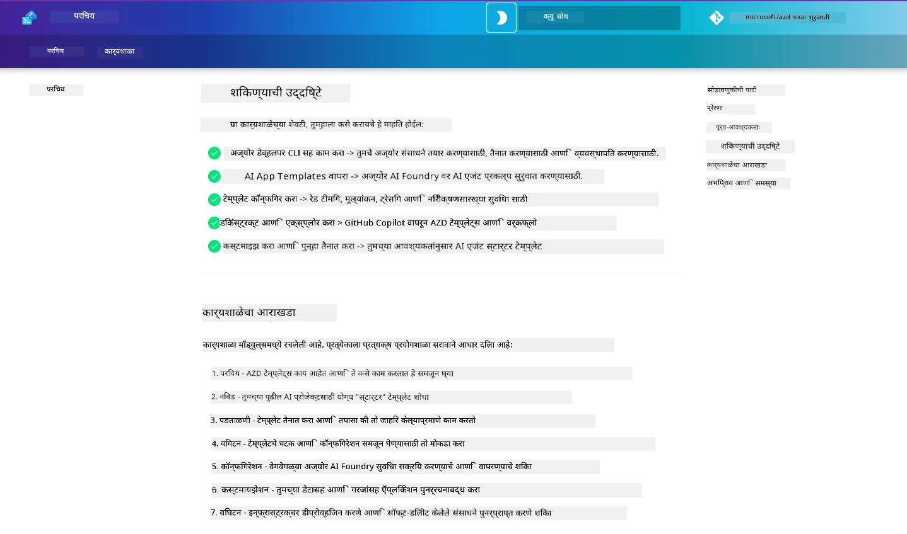

<div align="center">
  <div style="background: linear-gradient(135deg, #0078d4, #106ebe); border-radius: 10px; padding: 20px; margin: 20px 0; box-shadow: 0 4px 15px rgba(0, 120, 212, 0.3); border: 2px solid #005a9e;">
    <h2 style="color: white; margin: 0; font-size: 24px; text-shadow: 1px 1px 2px rgba(0,0,0,0.3);">
      🎯 AI विकासकांसाठी AZD कार्यशाळा
    </h2>
    <p style="color: white; margin: 10px 0 0 0; font-size: 16px; text-shadow: 1px 1px 2px rgba(0,0,0,0.3);">
      <strong>Azure Developer CLI वापरून AI अ‍ॅप्लिकेशन्स बनवण्यासाठी एक हाताळणी कार्यशाळा.</strong><br>
      AZD टेम्पलेट्स आणि AI डिप्लॉयमेंट वर्कफ्लोजमध्ये प्रावीण्य मिळवण्यासाठी 7 मॉड्युल पूर्ण करा.
    </p>
    <div style="margin-top: 15px;">
      <span style="background: rgba(255,255,255,0.2); padding: 5px 10px; border-radius: 15px; color: white; font-size: 14px;">
        📅 स्रोत मार्गदर्शन पुनरावलोकन: नोव्हेंबर 2026
      </span>
    </div>
  </div>
</div>

# AI विकासकांसाठी AZD कार्यशाळा

AI अ‍ॅप्लिकेशन डिप्लॉयमेंटवर लक्ष केंद्रित करून Azure Developer CLI (AZD) शिकण्यासाठी ही हाताळणी कार्यशाळा आपले स्वागत करते. ही कार्यशाळा AZD टेम्पलेट्सची अमलात आणलेली समज 3 टप्प्यात देण्यास मदत करते:

1. **शोध** - आपल्यासाठी योग्य टेम्पलेट शोधा.
1. **डिप्लॉयमेंट** - डिप्लॉय करा आणि ते कार्यरत आहे का ते तपासा
1. **सानुकूलन** - सुधारणा करा आणि ते आपले बनवा!

या कार्यशाळेच्या कालावधीत, आपल्याला मुख्य डेव्हलपर साधने आणि वर्कफ्लोजची ओळख देखील करून देण्यात येईल, ज्यामुळे आपले पूर्ण विकास प्रवास सुलभ होईल.

<br/>

## ब्राउझर-आधारित मार्गदर्शक

कार्यशाळेची धडे Markdown मध्ये आहेत. आपण त्यांना थेट GitHub मध्ये नेव्हिगेट करू शकता - किंवा खालील स्क्रीनशॉटप्रमाणे ब्राउझर-आधारित पूर्वावलोकन सुरू करू शकता.



हा पर्याय वापरण्यासाठी - रेपॉजिटरी आपल्या प्रोफाइलवर फोर्क करा, आणि GitHub Codespaces सुरू करा. जेव्हा VS Code टर्मिनल सक्रिय होईल, तेव्हा हा आदेश टाइप करा:

हा ब्राउझर पूर्वावलोकन GitHub Codespaces, dev कंटेनर्स किंवा Python आणि MkDocs स्थापित केलेल्या स्थानिक क्लोनमध्ये चालतो.

```bash title="" linenums="0"
python -m pip install -r requirements-dev.txt
python -m mkdocs serve --config-file workshop/mkdocs.yml
```

या आदेशांना **कोर्स रेपॉजिटरीच्या मूळ** स्थानावर चालवा, स्वतंत्ररित्या इनिशियलाइझ केलेल्या AI नमुन्यावर नाही. पूर्वावलोकन पुढील बाजूस ठेवा जेणेकरून त्रुटी दिसतील; थांबवण्यासाठी Ctrl+C दाबा. साइट सर्व्ह न करता तपासण्यासाठी, `python -m mkdocs build --strict --config-file workshop/mkdocs.yml` चालवा.

काही सेकंदांत, एक पॉप-अप डायलॉग दिसेल. त्यात `Open in browser` हा पर्याय निवडा. वेब-आधारित मार्गदर्शक आता नवीन ब्राउझर टॅबमध्ये उघडेल. या पूर्वावलोकनाचे काही फायदे:

1. **बिल्ट-इन शोध** - कीवर्ड किंवा धडे जलद शोधा.
1. **कॉपी आयकॉन** - कोडब्लॉक्सवर होभर करा ही पर्याय पहाण्यासाठी
1. **थीम टॉगल** - डार्क आणि लाइट थीममध्ये बदला
1. **मदत मिळवा** - फूटरमधील Discord आयकॉन क्लिक करून सामील व्हा!

<br/>

## कार्यशाळा आढावा

**कालावधी:** 3-4 तास  
**स्तर:** प्रारंभिक ते मध्यम  
**पूर्वअट:** Azure, AI संकल्पना, VS Code आणि कमांड-लाइन साधनांमध्ये परिचय असणे.

ही हाताळणी कार्यशाळा आहे जिथे आपण करत करत शिकता. एकदा आपण सराव पूर्ण केला की, आपण AZD For Beginners अभ्यासक्रम पुनरावलोकन करण्याची शिफारस करतो ज्यामुळे आपला सुरक्षा आणि उत्पादकता सर्वोत्तम पद्धतींचा शिकण्याचा प्रवास सुरू राहील.

| वेळ| मॉड्यूल  | उद्दिष्ट |
|:---|:---|:---|
| 15 मिनिटे | [परिचय](docs/instructions/0-Introduction.md) | प्रारंभ ठेवा, उद्दिष्टे समजून घ्या |
| 30 मिनिटे | [AI टेम्पलेट निवडा](docs/instructions/1-Select-AI-Template.md) | पर्याय तपासा आणि प्रारंभिक निवडा | 
| 30 मिनिटे | [AI टेम्पलेट तपासा](docs/instructions/2-Validate-AI-Template.md) | डीफॉल्ट सोल्यूशन Azure वर डिप्लॉय करा |
| 30 मिनिटे | [AI टेम्पलेटचा विसर्जन करा](docs/instructions/3-Deconstruct-AI-Template.md) | संरचना आणि कॉन्फिगरेशन तपासा |
| 30 मिनिटे | [AI टेम्पलेट कॉन्फिगर करा](docs/instructions/4-Configure-AI-Template.md) | उपलब्ध फिचर्स सक्रिय करा आणि प्रयत्न करा |
| 30 मिनिटे | [AI टेम्पलेट सानुकूलित करा](docs/instructions/5-Customize-AI-Template.md) | टेम्पलेट आपल्या गरजेनुसार अनुकूल करा |
| 30 मिनिटे | [इन्फ्रास्ट्रक्चर बंद करा](docs/instructions/6-Teardown-Infrastructure.md) | संसाधने क्लीनअप आणि मोकळी करा |
| 15 मिनिटे | [समारोप आणि पुढचे पाऊल](docs/instructions/7-Wrap-up.md) | शिकण्याचे स्रोत, कार्यशाळा आव्हान |

<br/>

## आपण काय शिकाल

AZD टेम्पलेट हे Microsoft Foundry वरील एंड-टू-एंड विकासासाठी विविध क्षमतांची आणि साधनांची अन्वेषण करण्यासाठी शिकण्याचे सॅंडबॉक्स समजावे. कार्यशाळेच्या शेवटी, आपल्याला या संदर्भात विविध साधने आणि संकल्पनांचा सहज समज मिळेल.

| संकल्पना  | उद्दिष्ट |
|:---|:---|
| **Azure Developer CLI** | साधन आदेश आणि वर्कफ्लोज समजून घ्या|
| **AZD टेम्पलेट्स**| प्रकल्प संरचना आणि कॉन्फिगरेशन समजावून घ्या|
| **Azure AI एजंट**| Microsoft Foundry प्रकल्पाचा प्राव्हिजन आणि डिप्लॉय करा  |
| **Azure AI शोध**| एजंट्ससह कॉन्टेक्स्ट इंजिनीअरिंग सक्षम करा |
| **ऑब्जर्व्हॅबिलिटी**| ट्रेसिंग, मॉनिटरिंग आणि मूल्यांकन तपासा |
| **रेड टीमिंग**| विरोधी चाचणी आणि प्रतिबंध तपासा |

<br/>

## कार्यशाळेची रचना

कार्यशाळा आपणास टेम्पलेट शोधणीपासून, डिप्लॉयमेंट, विसर्जन आणि सानुकूलन करण्याच्या प्रवासावर घेऊन जाते - अधिकृत [AI एजंटसह सुरुवात](https://github.com/Azure-Samples/get-started-with-ai-agents) प्रारंभिक टेम्पलेट वापरून.

### [मॉड्यूल 1: AI टेम्पलेट निवडा](docs/instructions/1-Select-AI-Template.md) (30 मिनिटे)

- AI टेम्पलेट्स काय आहेत?
- AI टेम्पलेट्स कुठे सापडतील?
- मी AI एजंट्स तयार करण्यात कसे सुरुवात करू शकतो?
- **प्रयोगशाळा**: Codespaces किंवा dev कंटेनरमध्ये जलद सुरुवात

### [मॉड्यूल 2: AI टेम्पलेट तपासा](docs/instructions/2-Validate-AI-Template.md) (30 मिनिटे)

- AI टेम्पलेट आर्किटेक्चर काय आहे?
- AZD विकास वर्कफ्लो काय आहे?
- AZD विकासासाठी मदत कशी मिळवायची?
- **प्रयोगशाळा**: AI एजंट्स टेम्पलेट डिप्लॉय & तपासा

### [मॉड्यूल 3: AI टेम्पलेट विसर्जन करा](docs/instructions/3-Deconstruct-AI-Template.md) (30 मिनिटे)

- आपले वातावरण `.azure/` मध्ये अन्वेषण करा 
- आपली संसाधन व्यवस्था `infra/` मध्ये अन्वेषण करा 
- आपली AZD कॉन्फिगरेशन `azure.yaml` मध्ये अन्वेषण करा
- **प्रयोगशाळा**: पर्यावरण बदल करा आणि पुन्हा डिप्लॉय करा

### [मॉड्यूल 4: AI टेम्पलेट कॉन्फिगर करा](docs/instructions/4-Configure-AI-Template.md) (30 मिनिटे)
- तपासा: पुनर्प्राप्ती ऑगमेंटेड जनरेशन
- तपासा: एजंट मूल्यांकन आणि रेड टीमिंग
- तपासा: ट्रेसिंग आणि मॉनिटरिंग
- **प्रयोगशाळा**: AI एजंट + ऑब्जर्व्हॅबिलिटी अन्वेषण करा 

### [मॉड्यूल 5: AI टेम्पलेट सानुकूलित करा](docs/instructions/5-Customize-AI-Template.md) (30 मिनिटे)
- परिभाषित करा: PRD सह परिदृश्य आवश्यकताः
- कॉन्फिगर करा: AZD साठी पर्यावरणीय चल
- अंमलात आणा: जोडा लाइफसायकल हुक्स
- **प्रयोगशाळा**: माझ्या परिदृश्यानुसार टेम्पलेट सानुकूलित करा

### [मॉड्यूल 6: इन्फ्रास्ट्रक्चर बंद करा](docs/instructions/6-Teardown-Infrastructure.md) (30 मिनिटे)
- पुनरावलोकन करा: AZD टेम्पलेट्स काय आहेत?
- पुनरावलोकन करा: Azure Developer CLI का वापरावे?
- पुढील पाऊल: वेगळे टेम्पलेट वापरून पाहा!
- **प्रयोगशाळा**: इन्फ्रास्ट्रक्चर डिप्रोव्हिजन आणि क्लीनअप

<br/>

## कार्यशाळा आव्हान

अधिक करण्यासाठी स्वतःला आव्हान देऊ इच्छिता? येथे काही प्रकल्प सूचना आहेत - किंवा आपले कल्पना आमच्याशी शेअर करा!!

| प्रकल्प | वर्णन |
|:---|:---|
|1. **एका क्लिष्ट AI टेम्पलेटचा विसर्जन करा** | आपण मांडलेल्या वर्कफ्लो आणि साधने वापरा आणि वेगळा AI सोल्यूशन टेम्पलेट डिप्लॉय, तपासा, आणि सानुकूलित करू शकता का ते पहा. _आपण काय शिकलात?_|
|2. **तुमच्या परिदृश्यानुसार सानुकूलित करा**  | वेगळ्या परिदृश्यासाठी PRD (उत्पादन आवश्यकतांचा दस्तऐवज) लिहिण्याचा प्रयत्न करा. नंतर GitHub Copilot वापरून आपल्या टेम्पलेट रेपॉमध्ये एजंट मॉडेलमध्ये सानुकूलन वर्कफ्लो तयार करा. _आपण काय शिकलात? या सूचनांमध्ये सुधारणा कशी करू शकता?_|
| | |

## अभिप्राय आहे का?

1. या रेपोसाठी एखादा इश्यू पोस्ट करा - सुविधा साठी त्याला `Workshop` असे टॅग करा.
1. Microsoft Foundry Discord मध्ये सहभागी व्हा - आपल्या सहकार्‍यांशी कनेक्ट व्हा!


| | | 
|:---|:---|
| **📚 कोर्स होम**| [AZD For Beginners](../README.md)|
| **📖 दस्तऐवज** | [AI टेम्पलेटसह प्रारंभ करा](https://learn.microsoft.com/en-us/azure/ai-foundry/how-to/develop/ai-template-get-started)|
| **🛠️AI टेम्पलेट्स** | [Microsoft Foundry टेम्पलेट्स](https://ai.azure.com/templates) |
|**🚀 पुढील पाऊले** | [कार्यशाळा सुरू करा](#workshop-overview) |
| | |

<br/>

---

**नेव्हिगेशन:** [मुख्य कोर्स](../README.md) | [परिचय](docs/instructions/0-Introduction.md) | [मॉड्यूल 1: टेम्पलेट निवडा](docs/instructions/1-Select-AI-Template.md)

**AZD सह AI अ‍ॅप्लिकेशन्स तयार करण्यास तयार आहात?**

[कार्यशाळा सुरू करा: परिचय →](docs/instructions/0-Introduction.md)

---

<!-- CO-OP TRANSLATOR DISCLAIMER START -->
**अस्वीकरण**:
हा दस्तऐवज AI भाषांतर सेवा [Co-op Translator](https://github.com/Azure/co-op-translator) चा वापर करून अनुवादित केला आहे. जरी आम्ही अचूकतेसाठी प्रयत्न करतो, तरी कृपया लक्षात घ्या की स्वयंचलित भाषांतरांमध्ये त्रुटी किंवा अचूकतेची कमतरता असू शकते. मूळ दस्तऐवज त्याच्या मूळ भाषेत अधिकृत स्रोत मानला पाहिजे. महत्त्वाची माहिती असल्यास, व्यावसायिक मानवी भाषांतराची शिफारस केली जाते. या भाषांतराच्या वापरामुळे उद्भवणाऱ्या कोणत्याही गैरसमज किंवा चुकीच्या अर्थलावणीसाठी आम्ही जबाबदार नाही.
<!-- CO-OP TRANSLATOR DISCLAIMER END -->