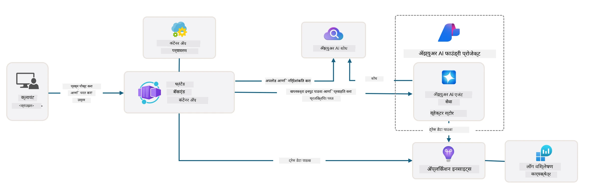

# 3. टेम्पलेट डीकोड करा

!!! tip "या मॉड्यूलच्या शेवटी तुम्ही सक्षम असाल"

    - [ ] Use GitHub Copilot and optional MCP tools for Azure documentation and read-only exploration
    - [ ] Identify the template's application, infrastructure, configuration, and test entry points
    - [ ] Verify generated explanations against actual repository files
    - [ ] **Lab 3:** Trace one request and one configuration input through the project

---

## 1. GitHub Copilot सक्रिय करा

VS Code मध्ये प्रारंभिक AI नमुना उघडा आणि [GitHub Copilot](https://code.visualstudio.com/docs/copilot/chat/chat-agent-mode) सक्षम करा. पात्र योजनासह खात्याने साइन इन करा; वापराची मर्यादा वेगवेगळी असू शकते. Copilot ला बदल अधिकृत करण्यापूर्वी रेपॉझिटरी समजावून सांगण्यास विचारा.

### ऐच्छिक MCP सर्व्हर

हे सेवा अतिरिक्त साधने प्रदान करू शकतात:

- [Azure MCP Server](https://learn.microsoft.com/azure/developer/azure-mcp-server/overview)
- [Microsoft Learn MCP Server](https://learn.microsoft.com/training/support/mcp)

VS Code मध्ये, [MCP कॉन्फिगरेशन मार्गदर्शक](https://code.visualstudio.com/docs/copilot/chat/mcp-servers) पुनरावलोकन करा आणि आवश्यक असल्यास `.vscode/mcp.json` तयार करा:

```json
{
  "servers": {
    "Azure MCP Server": {
      "type": "stdio",
      "command": "npx",
      "args": ["-y", "@azure/mcp@latest", "server", "start"]
    },
    "microsoft.docs.mcp": {
      "type": "http",
      "url": "https://learn.microsoft.com/api/mcp"
    }
  }
}
```

`npx` आदेशासाठी समर्थन करणारी Node.js/npm इन्स्टॉलेशन आवश्यक आहे आणि तो कार्यान्वित कोड डाउनलोड करतो. पॅकेज पुनरुत्पादनक्षम संघटना सेटअपसाठी तपासा आणि मान्यताप्राप्त आवृत्ती निश्चित करा. VS Code च्या MCP नियंत्रणे वापरून सर्व्हर सुरू करा आणि उपलब्ध साधने तपासा; नाव आवृत्त्यांनुसार बदलू शकते.

**प्रमाणीकरण वेगळे आहे.** AZD साठी `azd auth login` वापरा. Azure MCP च्या दस्तऐवजीकरण केलेल्या प्रमाणीकरण प्रवाहाचे अनुसरण करा; AZD लॉगिन नेहमी MCP सत्र निर्माण करत नाही. Azure CLI वापरणारे व्यायाम किंवा हुक असल्यास वेगळे `az login` वापरा.

केवळ वाचनासाठी विचारणा करा:

1. “Microsoft Learn MCP वापरून Azure Developer CLI कॉन्फिगरेशन दस्तऐवज शोधा.”
2. “या रेपॉझिटरीतील `azure.yaml` समजावून सांगा; प्रत्येक हुक कोठे राबवला आहे ते फायली नमूद करा.”
3. “उपलब्ध Azure MCP साधने वापरून, माझ्या तैनात संसाधनांची यादी सांगा, कोणताही बदल न करता.”

निवडलेली टेनेन्ट/सबस्क्रिप्शन आणि प्रत्येक प्रस्तावित साधन कॉल तपासा. फक्त आर्किटेक्चरचा अभ्यास करण्यासाठी संसाधन निर्मिती, विलोपन किंवा प्रवेश बदल मंजूर करू नका.

## 2. आर्किटेक्चर समजून घ्या

नमुन्यात Python FastAPI बॅकएंड आणि React/TypeScript फ्रंटएंड Azure कंटेनर अ‍ॅप्स मध्ये होस्ट केले आहे. बॅकएंड Microsoft Foundry प्रकल्पातील एजंटशी संवाद साधते. पुनर्प्राप्ती आणि निरीक्षण सक्षम टेम्पलेट फिचर्स आणि यशस्वी सेटअपने अवलंबून आहे; फक्त अ‍ॅप्लिकेशन तैनात केल्यामुळे हे यशस्वी होईल असे नाही.



हा आकृती [सध्याच्या अपस्ट्रीम तैनाती मार्गदर्शक](https://github.com/Azure-Samples/get-started-with-ai-agents/blob/main/docs/deployment.md) आणि तुमच्या वास्तविक संसाधनांशी तुलना करा. कॉन्फिगर केलेले मॉडेल तैनाती, एजंट साधने, व्यवस्थापित ओळख, भूमिका नियुक्ती आणि ऐच्छिक AI शोध/अ‍ॅप्लिकेशन इनसाइट्स संसाधने तपासा.

**व्यायाम:** Copilot ला फ्रंटएंडमधल्या चॅट विनंतीचे API कडून Foundry पर्यंत मागोवा मागा, संचिका आणि फंक्शन संदर्भांसह. त्या संदर्भ उघडा आणि स्पष्टीकरण सत्यापित करा. फक्त आकृतीवरून राबवलेले प्रमाणीकरण, राउटिंग किंवा अधिकृतता गृहीत धरणे करू नका.

## 3. रेपॉझिटरी संरचना

खालील निवडलेले मार्ग 4 नोव्हेंबर 2026 रोजी नमुन्याशी तपासले गेले आहेत. तुमचा सुरुवातीचा आवृत्तीनेच सत्यता आहे:

```text
get-started-with-ai-agents/
  azure.yaml
  docker-compose.yaml
  requirements-dev.txt
  .devcontainer/
  infra/
    main.bicep
    main.parameters.json
    api.bicep
    core/
  src/
    Dockerfile
    pyproject.toml
    requirements.txt
    api/
      main.py
      routes.py
      search_index_manager.py
    frontend/
      package.json
      src/
    files/
  scripts/
    validate_env_vars.sh
    validate_env_vars.ps1
    postdeploy.sh
    postdeploy.ps1
  tests/
    test_evaluation.py
    test_red_teaming.py
  docs/
    deployment.md
    deploy_customization.md
    ai_search.md
    observability.md
    local_development.md
    troubleshooting.md
```

### पायाभूत सुविधा आणि कॉन्फिगरेशन

`infra/main.bicep` संसाधने संघटित करतो; `main.parameters.json` टेम्पलेट इनपुट्सना AZD पर्यावरण मूल्यांशी जोडतो. `azure.yaml` अ‍ॅप्लिकेशन सेवा आणि जीवनचक्र हुक निवडतो. `USE_AZURE_AI_SEARCH_SERVICE` सारखा इनपुट या फायलींमधून मागोवा घ्या ज्यामुळे काय खरंच बदलते ते शोधा.

### अ‍ॅप्लिकेशन आणि ओळख

`src/api/` आणि `src/frontend/` एकत्र वाचा. एजंट कुठे तयार/प्राप्त झाला, आदेश/साधने कुठे कॉन्फिगर केली आहेत, आणि प्रत्येक Azure कॉल कोणत्या ओळखीने करते ते ओळखा. `src/files/` अंतर्गत नमुना फायलींमध्ये प्रात्यक्षिके आहेत, उत्पादक सूची किंवा अधिकृत मॉडेल नाही.

### चाचण्या आणि निरीक्षण

सध्याच्या मूल्यमापन आणि रेड-टीमिंग प्रवेश बिंदू `tests/` मध्ये आहेत; जुन्या `evals/` आणि `airedteaming/` निर्देशिका संदर्भ या नमुन्यासाठी अप्रचलित आहेत. क्लाउड चाचण्या चालवण्यापूर्वी प्रीरेक्विझिट्स आणि खर्चासाठी `docs/observability.md` वाचा. या Python चाचण्या ऐच्छिक `azure.ai.evaluations` AZD विस्तारापासून वेगळ्या आहेत.

## 4. तुमच्या शोधांची पडताळणी करा

- एका नमुना प्रश्नासाठी API मार्ग, एजंट संवाद आणि पुनर्प्राप्ती कोड ओळखा.
- Foundry कोणती ओळख वापरते आणि कोणती कॉन्फिगरेशन त्याचा अंतिम बिंदू निवडते हे विशद करा.
- प्रत्यक्ष प्री-अप आणि पोस्ट-डिप्लॉय स्क्रिप्ट कोणत्या आहेत आणि त्याचा त्रुटी हाताळणी वर्तन काय आहे ते शोधा.
- तुमच्या तैनातीमध्ये अनुपस्थित कोणतेही अवलंबित्व किंवा ऐच्छिक वैशिष्ट्ये यादी करा.

पुढे जा [टेम्पलेट कॉन्फिगर करा](4-Configure-AI-Template.md).

---

<!-- CO-OP TRANSLATOR DISCLAIMER START -->
**अस्वीकरण**:
हा दस्तऐवज AI भाषांतर सेवा [Co-op Translator](https://github.com/Azure/co-op-translator) चा वापर करून अनुवादित केला आहे. जरी आम्ही अचूकतेसाठी प्रयत्न करतो, तरी कृपया लक्षात घ्या की स्वयंचलित भाषांतरांमध्ये त्रुटी किंवा अचूकतेची कमतरता असू शकते. मूळ दस्तऐवज त्याच्या मूळ भाषेत अधिकृत स्रोत मानला पाहिजे. महत्त्वाची माहिती असल्यास, व्यावसायिक मानवी भाषांतराची शिफारस केली जाते. या भाषांतराच्या वापरामुळे उद्भवणाऱ्या कोणत्याही गैरसमज किंवा चुकीच्या अर्थलावणीसाठी आम्ही जबाबदार नाही.
<!-- CO-OP TRANSLATOR DISCLAIMER END -->