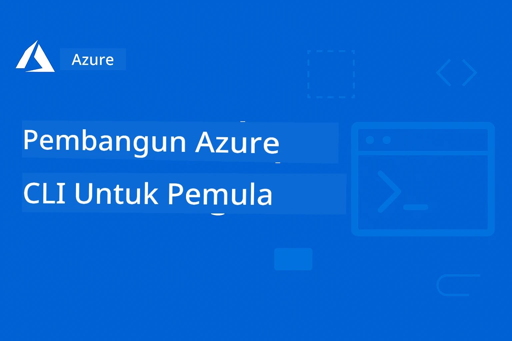

# AZD Untuk Pemula: Perjalanan Pembelajaran Berstruktur

 

[](https://github.com/microsoft/AZD-for-beginners)
[](https://GitHub.com/microsoft/azd-for-beginners/network/)
[](https://github.com/microsoft/AZD-for-beginners)

[](https://discord.com/invite/nkVh3dp)
[](https://discord.gg/nTYy5BXMWG)

---

### Terjemahan Automatik (Sentiasa Dikemaskini)

<!-- CO-OP TRANSLATOR LANGUAGES TABLE START -->
[Arab](../ar/README.md) | [Bengali](../bn/README.md) | [Bulgaria](../bg/README.md) | [Burma (Myanmar)](../my/README.md) | [Cina (Dipermudahkan)](../zh-CN/README.md) | [Cina (Tradisional, Hong Kong)](../zh-HK/README.md) | [Cina (Tradisional, Macau)](../zh-MO/README.md) | [Cina (Tradisional, Taiwan)](../zh-TW/README.md) | [Kroasia](../hr/README.md) | [Ceko](../cs/README.md) | [Denmark](../da/README.md) | [Belanda](../nl/README.md) | [Estonia](../et/README.md) | [Finland](../fi/README.md) | [Perancis](../fr/README.md) | [Jerman](../de/README.md) | [Greek](../el/README.md) | [Ibrani](../he/README.md) | [Hindi](../hi/README.md) | [Hungary](../hu/README.md) | [Indonesia](../id/README.md) | [Itali](../it/README.md) | [Jepun](../ja/README.md) | [Kannada](../kn/README.md) | [Khmer](../km/README.md) | [Korea](../ko/README.md) | [Lithuania](../lt/README.md) | [Melayu](./README.md) | [Malayalam](../ml/README.md) | [Marathi](../mr/README.md) | [Nepali](../ne/README.md) | [Pidgin Nigeria](../pcm/README.md) | [Norway](../no/README.md) | [Perzian (Farsi)](../fa/README.md) | [Poland](../pl/README.md) | [Portugal (Brazil)](../pt-BR/README.md) | [Portugal (Portugal)](../pt-PT/README.md) | [Punjabi (Gurmukhi)](../pa/README.md) | [Romania](../ro/README.md) | [Rusia](../ru/README.md) | [Serbia (Cyrillic)](../sr/README.md) | [Slovakia](../sk/README.md) | [Slovenia](../sl/README.md) | [Sepanyol](../es/README.md) | [Swahili](../sw/README.md) | [Sweden](../sv/README.md) | [Tagalog (Filipina)](../tl/README.md) | [Tamil](../ta/README.md) | [Telugu](../te/README.md) | [Thai](../th/README.md) | [Turki](../tr/README.md) | [Ukraine](../uk/README.md) | [Urdu](../ur/README.md) | [Vietnam](../vi/README.md)

> **Lebih suka Klon Secara Tempatan?**
>
> Repositori ini mengandungi lebih daripada 50 terjemahan bahasa yang secara ketara meningkatkan saiz muat turun. Untuk mengklon tanpa terjemahan, gunakan sparse checkout:
>
> **Bash / macOS / Linux:**
> ```bash
> git clone --filter=blob:none --sparse https://github.com/microsoft/AZD-for-beginners.git
> cd AZD-for-beginners
> git sparse-checkout set --no-cone '/*' '!translations' '!translated_images'
> ```
>
> **CMD (Windows):**
> ```cmd
> git clone --filter=blob:none --sparse https://github.com/microsoft/AZD-for-beginners.git
> cd AZD-for-beginners
> git sparse-checkout set --no-cone "/*" "!translations" "!translated_images"
> ```
>
> Ini memberikan anda segala yang anda perlukan untuk menyelesaikan kursus dengan muat turun yang jauh lebih cepat.
<!-- CO-OP TRANSLATOR LANGUAGES TABLE END -->

## 🆕 Apa Yang Baru dalam azd Hari Ini

> 📌 **Ulasan pelepasan AI CLI (2026-11-04):** Panduan telah diperiksa berbanding dengan dokumentasi/sumber yang diterbitkan **`azd 1.37.2`**, **agensi `1.0.0-beta.23`**, dan **penilaian `1.0.0-beta.2`**. Gunakan `azd >= 1.37.0` untuk aliran kerja gabungan. Jalankan `azd version` dan [kemaskini CLI teras](https://learn.microsoft.com/azure/developer/azure-developer-cli/install-azd) sebelum sambungan. Lihat [perubahan dan pembaikan pelepasan](docs/chapter-08-production/production-ai-practices.md#recent-release-changes-and-fixes). Ini bukan pengesahan pelaksanaan langsung untuk keseluruhan kursus.

Azure Developer CLI menyokong banyak jenis aplikasi, termasuk aplikasi web, API, dan agen AI, melalui hos, templat, dan sambungan yang disokong.

Ini bermakna untuk anda:

- **Agen AI kini menjadi beban kerja azd kelas pertama.** Anda boleh memulakan, menyebarkan, dan mengurus projek agen AI menggunakan aliran kerja `azd init` → `azd up` yang sudah anda ketahui.
- **Kitaran hayat agen merangkumi dua sambungan.** Gunakan `azure.ai.agents` untuk memulakan, memanggil, mengoptimum, dan bersara agen. Pasang **`azure.ai.evaluations`** secara berasingan untuk `azd ai eval init`, `generate`, dan `run start`. Agen beta.22 menggantikan aliran kerja penilaian lama dan mengubah konfigurasi pengoptimuman; ikuti [panduan migrasi](docs/chapter-08-production/production-ai-practices.md#evaluation-migration-and-quality-checks).
- **Lebih banyak blok pembinaan AI.** Sambungan pratonton baru—`azure.ai.skills` dan `azure.ai.connections`—membolehkan anda mengurus kemahiran agen boleh guna semula dan sambungan Foundry terus dengan azd.
- **Integrasi Microsoft Foundry** membawa pelaksanaan model, pengehosan agen, dan konfigurasi perkhidmatan AI ke dalam ekosistem templat azd secara langsung.
- **Asas harian lebih lancar.** Pelepasan terbaru membuat `azd init` idempotent (selamat untuk dijalankan semula), menjadikan `azd auth login` jelas token tidak sah secara automatik, dan menambah arahan persediaan pertama yang mesra `azd tool`.
- **Aliran kerja teras tidak berubah.** Sama ada anda menyebarkan aplikasi todo, mikroservis, atau penyelesaian AI multi-agen, arahan adalah sama.

> **Nota untuk pengguna Aspire:** Microsoft kini merujuk produk ini hanya sebagai **Aspire** (dahulu ".NET Aspire"). Sokongan Aspire azd tidak berubah—hanya nama yang dikemaskini.

Jika anda pernah menggunakan azd sebelum ini, sokongan AI adalah lanjutan semula jadi—bukan alat berasingan atau trek lanjutan. Jika anda baru bermula, anda akan belajar satu aliran kerja yang berkesan untuk segala-galanya.

---

## 🚀 Apakah Azure Developer CLI (azd)?

**Azure Developer CLI (azd)** adalah alat baris perintah mesra pembangun yang memudahkan penyebaran aplikasi ke Azure. Daripada mencipta dan menghubungkan berpuluh-puluh sumber Azure secara manual, anda boleh menyebarkan keseluruhan aplikasi dengan satu arahan.

### Keajaiban `azd up`

```bash
# This single command does everything:
# ✅ Creates all Azure resources  
# ✅ Configures networking and security
# ✅ Builds your application code
# ✅ Deploys to Azure
# ✅ Gives you a working URL
azd up
```

Templat menyediakan konfigurasi aplikasi dan infrastruktur. Penyebaran yang berjaya masih memerlukan perkhidmatan/model yang disokong, kuota dan kebenaran yang mencukupi, input yang betul, serta pengesahan aplikasi yang disebarkan. `azd up` tidak secara automatik menjadikan templat selamat, mematuhi, atau sedia produksi.

---

## ❓ Azure Developer CLI vs Azure CLI: Apa Perbezaannya?

Ini adalah soalan paling biasa yang ditanya oleh pemula. Ini jawapan mudahnya:

| Ciri | **Azure CLI (`az`)** | **Azure Developer CLI (`azd`)** |
|---------|---------------------|--------------------------------|
| **Tujuan** | Mengurus sumber Azure individu | Menyebarkan aplikasi lengkap |
| **Fikiran** | Berfokus pada infrastruktur | Berfokus pada aplikasi |
| **Contoh** | `az webapp create --name myapp...` | `azd up` |
| **Lengkungan Pembelajaran** | Mesti tahu perkhidmatan Azure | Cukup tahu aplikasi anda |
| **Terbaik Untuk** | DevOps, Infrastruktur | Pembangun, Prototip |

### Analogi Mudah

- **Azure CLI** seperti memiliki semua alat untuk membina rumah - tukul, gergaji, paku. Anda boleh bina apa saja, tetapi anda perlu tahu pembinaan.
- **Azure Developer CLI** seperti mengupah kontraktor - anda terangkan apa yang anda mahu, dan mereka uruskan pembinaan.

### Bila Menggunakan Setiap Satu

| Senario | Gunakan Ini |
|----------|----------|
| "Saya mahu menyebarkan aplikasi web saya dengan cepat" | `azd up` |
| "Saya perlu cipta akaun storan sahaja" | `az storage account create` |
| "Saya sedang membina aplikasi AI lengkap" | `azd init --template azure-search-openai-demo` |
| "Saya perlu debug sumber Azure tertentu" | `az resource show` |
| "Saya mahu menyebarkan ke persekitaran produksi yang telah dikonfigurasikan" | Semak konfigurasi, akses, kos, dan pintu operasi sebelum `azd up --environment production` |

### Mereka Berfungsi Bersama!

AZD dan Azure CLI mempunyai pengesahan dan konfigurasi yang berasingan. Gunakan `azd auth login` untuk AZD, dan `az login` apabila arahan kaitan atau diagnostik secara eksplisit memerlukan Azure CLI. Anda boleh menggunakan kedua-duanya:
```bash
# Deploy your app with AZD
azd up

# Then fine-tune specific resources with Azure CLI
az webapp config set --name myapp --always-on true
```

---

## 🌟 Cari Templat dalam Awesome AZD

Jangan mula dari kosong! **Awesome AZD** adalah koleksi komuniti templat siap deploy:

| Sumber | Penerangan |
|----------|-------------|
| 🔗 [**Galeri Awesome AZD**](https://azure.github.io/awesome-azd/) | Layari 200+ templat dengan deploy satu klik |
| 🔗 [**Hantar Templat**](https://github.com/Azure/awesome-azd/issues) | Sumbang templat anda sendiri kepada komuniti |
| 🔗 [**Repositori GitHub**](https://github.com/Azure/awesome-azd) | Tandakan bintang dan terokai sumber |

### Templat AI Popular dari Awesome AZD

Pilih satu templat dalam direktori kosong; arahan di bawah adalah alternatif. `.` akhir menginisialisasi direktori itu.

```bash
# RAG Chat with Microsoft Foundry Models + AI Search
azd init --template azure-search-openai-demo .

# Quick AI Chat Application
azd init --template openai-chat-app-quickstart .

# AI Agents with Foundry Agents
azd init --template get-started-with-ai-agents .
```

---

## 🎯 Bermula dalam 3 Langkah

Sebelum mula, pastikan mesin anda sedia untuk templat yang hendak disebarkan:

**Windows:**
```powershell
.\validate-setup.ps1
```

**macOS / Linux:**
```bash
bash ./validate-setup.sh
```

Jika mana-mana pemeriksaan yang diperlukan gagal, betulkan dulu kemudian teruskan dengan permulaan pantas.

### Langkah 1: Pasang AZD (2 minit)

**Windows:**
```powershell
winget install microsoft.azd
```

**macOS:**
```bash
brew tap azure/azd && brew install azd
```

**Linux:**
```bash
curl -fsSL https://aka.ms/install-azd.sh | bash
```

### Langkah 2: Sahkan Autentikasi untuk AZD

```bash
# Optional if you plan to use Azure CLI commands directly in this course
az login

# Required for AZD workflows
azd auth login
```

Jika anda tidak pasti yang mana perlu, ikuti aliran persediaan penuh dalam [Pemasangan & Persediaan](docs/chapter-01-foundation/installation.md#authentication-setup).

### Langkah 3: Sebarkan Aplikasi Pertama Anda

```bash
# Initialize from a template
azd init --template todo-nodejs-mongo .

# Deploy to Azure (creates everything!)
azd up
```

**🎉 Itu sahaja!** Aplikasi anda kini berjalan di Azure.

### Bersihkan (Jangan Lupa!)

```bash
# Remove all resources when done experimenting
azd down --force --purge
```

---

## 📚 Cara Menggunakan Kursus Ini

Kursus ini direka untuk **pembelajaran progresif** - mula dari tempat anda selesa dan tingkatkan secara berperingkat:

| Pengalaman Anda | Mula Di Sini |
|-----------------|------------|
| **Baru kepada Azure** | [Bab 1: Asas](#-chapter-1-foundation--quick-start) |
| **Tahu Azure, baru dalam AZD** | [Bab 1: Asas](#-chapter-1-foundation--quick-start) |
| **Mahukan penyebaran aplikasi AI** | [Bab 2: Pembangunan AI-Pertama](#-chapter-2-ai-first-development-recommended-for-ai-developers) |
| **Mahukan latihan praktikal** | [🎓 Bengkel Interaktif](workshop/README.md) - makmal berpandu selama 3-4 jam |
| **Perlukan pola produksi** | [Bab 8: Produksi & Perusahaan](#-chapter-8-production--enterprise-patterns) |

### Persediaan Pantas

1. **Fork Repositori Ini**: [](https://GitHub.com/microsoft/azd-for-beginners/fork)
2. **Klon Ia**: `git clone https://github.com/YOUR-USERNAME/azd-for-beginners.git`
3. **Dapatkan Bantuan**: [Komuniti Discord Azure](https://discord.com/invite/ByRwuEEgH4)

> **Lebih suka Klon Secara Tempatan?**

> Repositori ini mengandungi lebih daripada 50 terjemahan bahasa yang secara ketara meningkatkan saiz muat turun. Untuk mengklon tanpa terjemahan, gunakan sparse checkout:
> ```bash
> git clone --filter=blob:none --sparse https://github.com/microsoft/AZD-for-beginners.git
> cd AZD-for-beginners
> git sparse-checkout set --no-cone '/*' '!translations' '!translated_images'
> ```
> Ini memberikan anda segala yang anda perlukan untuk menyelesaikan kursus dengan muat turun yang jauh lebih cepat.


## Gambaran Keseluruhan Kursus

Kuasai Azure Developer CLI (azd) melalui bab berstruktur yang direka untuk pembelajaran progresif. **Fokus khusus pada penyebaran aplikasi AI dengan integrasi Microsoft Foundry.**

### Kenapa Kursus Ini Penting untuk Pembangun Moden

Pembangun yang menyebarkan beban kerja AI biasanya memerlukan panduan tentang:
- Seni bina AI berbilang perkhidmatan yang kompleks
- Amalan terbaik penyebaran AI dalam pengeluaran  
- Integrasi dan konfigurasi perkhidmatan Azure AI
- Pengoptimuman kos untuk beban kerja AI
- Menyelesaikan isu penyebaran khusus AI

### Objektif Pembelajaran

Dengan menamatkan kursus berstruktur ini, anda akan:
- **Menguasai Asas AZD**: Konsep teras, pemasangan, dan konfigurasi
- **Menyebarkan Aplikasi AI**: Menggunakan AZD dengan perkhidmatan Microsoft Foundry
- **Melaksanakan Infrastruktur sebagai Kod**: Mengurus sumber Azure dengan templat Bicep
- **Menyelesaikan Masalah Penyebaran**: Menyelesaikan isu biasa dan menyahpepijat masalah
- **Mengoptimumkan untuk Pengeluaran**: Keselamatan, penskalaan, pemantauan, dan pengurusan kos
- **Membina Penyelesaian Multi-Ejen**: Menyebarkan seni bina AI kompleks

## Sebelum Anda Mula: Akaun, Akses, dan Andaian

Sebelum anda mula Bab 1, pastikan anda mempunyai perkara berikut. Langkah pemasangan kemudian dalam panduan ini mengandaikan asas ini sudah ditangani.

- **Langganan Azure**: Anda boleh menggunakan langganan sedia ada dari kerja atau akaun sendiri, atau buat [percubaan percuma](https://aka.ms/azurefreetrial) untuk bermula.
- **Kebenaran untuk membuat sumber Azure**: Untuk kebanyakan latihan, anda harus mempunyai akses sekurang-kurangnya **Contributor** pada langganan atau kumpulan sumber sasaran. Sesetengah bab juga mengandaikan anda boleh membuat kumpulan sumber, identiti terurus, dan penugasan RBAC.
- [**Akaun GitHub**](https://github.com): Ini berguna untuk memfork repositori, menjejaki perubahan anda sendiri, dan menggunakan GitHub Codespaces untuk bengkel.
- **Prasyarat runtime templat**: Sesetengah templat memerlukan alat tempatan seperti Node.js, Python, Java, atau Docker. Jalankan validator pemasangan sebelum bermula supaya anda dapat menangkap alat yang hilang lebih awal.
- **Kemahiran terminal asas**: Anda tidak perlu pakar, tetapi anda harus selesa menjalankan arahan seperti `git clone`, `azd auth login`, dan `azd up`.

> **Bekerja dalam langganan perusahaan?**
> Jika persekitaran Azure anda diurus oleh pentadbir, sahkan terlebih dahulu bahawa anda boleh menyebarkan sumber dalam langganan atau kumpulan sumber yang anda rancang untuk guna. Jika tidak, minta langganan sandbox atau akses Contributor sebelum bermula.

> **Baru dengan Azure?**
> Mula dengan percubaan Azure sendiri atau langganan bayar-semasa di https://aka.ms/azurefreetrial supaya anda boleh menyelesaikan latihan dari awal hingga akhir tanpa menunggu kelulusan tahap tenant.

## 🗺️ Peta Kursus: Navigasi Pantas Mengikut Bab

Setiap bab mempunyai README khusus dengan objektif pembelajaran, permulaan pantas, dan latihan:

| Bab | Topik | Pelajaran | Tempoh | Kerumitan |
|---------|-------|---------|----------|------------|
| **[Bab 1: Asas](docs/chapter-01-foundation/README.md)** | Memulakan | [Asas AZD](docs/chapter-01-foundation/azd-basics.md) &#124; [Pemasangan](docs/chapter-01-foundation/installation.md) &#124; [Projek Pertama](docs/chapter-01-foundation/first-project.md) | 30-45 min | ⭐ |
| **[Bab 2: Pembangunan AI](docs/chapter-02-ai-development/README.md)** | Aplikasi AI-Pertama | [Integrasi Foundry](docs/chapter-02-ai-development/microsoft-foundry-integration.md) &#124; [Ejen AI](docs/chapter-02-ai-development/agents.md) &#124; [Penyebaran Model](docs/chapter-02-ai-development/ai-model-deployment.md) &#124; [Bengkel](docs/chapter-02-ai-development/ai-workshop-lab.md) | 1-2 jam | ⭐⭐ |
| **[Bab 3: Konfigurasi](docs/chapter-03-configuration/README.md)** | Pengesahan & Keselamatan | [Konfigurasi](docs/chapter-03-configuration/configuration.md) &#124; [Pengesahan & Keselamatan](docs/chapter-03-configuration/authsecurity.md) | 45-60 min | ⭐⭐ |
| **[Bab 4: Infrastruktur](docs/chapter-04-infrastructure/README.md)** | IaC & Penyebaran | [Panduan Penyebaran](docs/chapter-04-infrastructure/deployment-guide.md) &#124; [Penyediaan](docs/chapter-04-infrastructure/provisioning.md) | 1-1.5 jam | ⭐⭐⭐ |
| **[Bab 5: Multi-Ejen](docs/chapter-05-multi-agent/README.md)** | Penyelesaian Ejen AI | [Senario Runcit](examples/retail-scenario.md) &#124; [Corak Penyelaras](docs/chapter-06-pre-deployment/coordination-patterns.md) | 2-3 jam | ⭐⭐⭐⭐ |
| **[Bab 6: Pra-Penyebaran](docs/chapter-06-pre-deployment/README.md)** | Perancangan & Pengesahan | [Semakan Pra Penerbangan](docs/chapter-06-pre-deployment/preflight-checks.md) &#124; [Perancangan Kapasiti](docs/chapter-06-pre-deployment/capacity-planning.md) &#124; [Pemilihan SKU](docs/chapter-06-pre-deployment/sku-selection.md) &#124; [App Insights](docs/chapter-06-pre-deployment/application-insights.md) | 1 jam | ⭐⭐ |
| **[Bab 7: Penyelesaian Masalah](docs/chapter-07-troubleshooting/README.md)** | Nyahpepijat & Pembaikan | [Isu Biasa](docs/chapter-07-troubleshooting/common-issues.md) &#124; [Nyahpepijat](docs/chapter-07-troubleshooting/debugging.md) &#124; [Isu AI](docs/chapter-07-troubleshooting/ai-troubleshooting.md) | 1-1.5 jam | ⭐⭐ |
| **[Bab 8: Pengeluaran](docs/chapter-08-production/README.md)** | Corak Perusahaan | [Amalan Pengeluaran](docs/chapter-08-production/production-ai-practices.md) | 2-3 jam | ⭐⭐⭐⭐ |
| **[🎓 Bengkel](workshop/README.md)** | Makmal Amali | [Pengenalan](workshop/docs/instructions/0-Introduction.md) &#124; [Pemilihan](workshop/docs/instructions/1-Select-AI-Template.md) &#124; [Pengesahan](workshop/docs/instructions/2-Validate-AI-Template.md) &#124; [Pembongkaran](workshop/docs/instructions/3-Deconstruct-AI-Template.md) &#124; [Konfigurasi](workshop/docs/instructions/4-Configure-AI-Template.md) &#124; [Penyesuaian](workshop/docs/instructions/5-Customize-AI-Template.md) &#124; [Pembongkaran](workshop/docs/instructions/6-Teardown-Infrastructure.md) &#124; [Penutupan](workshop/docs/instructions/7-Wrap-up.md) | 3-4 jam | ⭐⭐ |

**Jumlah Tempoh Kursus:** ~10-14 jam | **Progres Kemahiran:** Permulaan → Sedia Produksi

---

## 📚 Bab Pembelajaran

*Pilih laluan pembelajaran mengikut tahap pengalaman dan matlamat*

### 🚀 Bab 1: Asas & Mula Pantas
**Prasyarat**: Langganan Azure, pengetahuan asas baris perintah  
**Tempoh**: 30-45 minit  
**Kerumitan**: ⭐

#### Apa Yang Akan Anda Pelajari
- Memahami asas Azure Developer CLI
- Memasang AZD pada platform anda
- Penyebaran berjaya pertama anda

#### Sumber Pembelajaran
- **🎯 Mula Di Sini**: [Apa itu Azure Developer CLI?](#-what-is-azure-developer-cli-azd)
- **📖 Teori**: [Asas AZD](docs/chapter-01-foundation/azd-basics.md) - Konsep teras dan istilah
- **⚙️ Persediaan**: [Pemasangan & Persediaan](docs/chapter-01-foundation/installation.md) - Panduan khusus platform
- **🛠️ Amali**: [Projek Pertama Anda](docs/chapter-01-foundation/first-project.md) - Tutorial langkah demi langkah
- **📋 Rujukan Pantas**: [Lembaran Cheat Arahan](resources/cheat-sheet.md)

#### Latihan Praktikal
```bash
# Quick installation check
azd version

# Deploy your first application
azd init --template todo-nodejs-mongo .
azd up
```

**💡 Hasil Bab**: Berjaya menyebarkan aplikasi web mudah ke Azure menggunakan AZD

**✅ Pengesahan Kejayaan:**
```bash
# After completing Chapter 1, you should be able to:
azd version              # Shows installed version
azd init --template todo-nodejs-mongo  # Initializes project
azd up                  # Deploys to Azure
azd show                # Displays running app URL
# Application opens in browser and works
azd down --force --purge  # Cleans up resources
```

**📊 Masa Diperlukan:** 30-45 minit  
**📈 Tahap Kemahiran Selepas:** Boleh menyebarkan aplikasi asas secara berdikari

---

### 🤖 Bab 2: Pembangunan AI-Pertama (Disyorkan untuk Pembangun AI)
**Prasyarat**: Bab 1 selesai  
**Tempoh**: 1-2 jam  
**Kerumitan**: ⭐⭐

#### Apa Yang Akan Anda Pelajari
- Integrasi Microsoft Foundry dengan AZD
- Menyebarkan aplikasi berkuasa AI
- Memahami konfigurasi perkhidmatan AI

#### Sumber Pembelajaran
- **🎯 Mula Di Sini**: [Integrasi Microsoft Foundry](docs/chapter-02-ai-development/microsoft-foundry-integration.md)
- **🤖 Ejen AI**: [Panduan Ejen AI](docs/chapter-02-ai-development/agents.md) - Menyebarkan ejen pintar dengan AZD
- **📖 Corak**: [Penyebaran Model AI](docs/chapter-02-ai-development/ai-model-deployment.md) - Menyebar dan mengurus model AI
- **🛠️ Bengkel**: [Makmal Bengkel AI](docs/chapter-02-ai-development/ai-workshop-lab.md) - Jadikan penyelesaian AI anda sedia AZD
- **🎥 Panduan Interaktif**: [Bahan Bengkel](workshop/README.md) - Pembelajaran berasaskan pelayar dengan MkDocs * Persekitaran DevContainer
- **📋 Templat**: [Templat Microsoft Foundry](#featured-microsoft-foundry-templates)
- **📝 Contoh**: [Contoh Penyebaran AZD](examples/README.md)

#### Latihan Praktikal
```bash
# Deploy your first AI application
azd init --template azure-search-openai-demo .
azd up

# Try additional AI templates
azd init --template openai-chat-app-quickstart .
azd init --template agent-openai-python-prompty .
```

**💡 Hasil Bab**: Menyebarkan dan mengkonfigurasi aplikasi chat berkuasa AI dengan keupayaan RAG

**✅ Pengesahan Kejayaan:**
```bash
# After Chapter 2, you should be able to:
azd init --template azure-search-openai-demo .
azd up
# Test the AI chat interface
# Ask questions and get AI-powered responses with sources
# Verify search integration works
azd monitor  # Check Application Insights shows telemetry
azd down --force --purge
```

**📊 Masa Diperlukan:** 1-2 jam  
**📈 Tahap Kemahiran Selepas:** Boleh menyebarkan aplikasi pembelajaran AI dan mengenal pasti keperluan kesiapan produksi tambahan
**💰 Kesedaran Kos:** Fahami kos pembangunan $80-150/bulan, kos produksi $300-3500/bulan

#### 💰 Pertimbangan Kos untuk Penyebaran AI

**Persekitaran Pembangunan (Anggaran $80-150/bulan):**
- Model Microsoft Foundry (Bayar-semasa): $0-50/bulan (berdasarkan penggunaan token)
- AI Search (peringkat asas): $75/bulan
- Container Apps (Penggunaan): $0-20/bulan
- Penyimpanan (Standard): $1-5/bulan

**Persekitaran Produksi (Anggaran $300-3,500+/bulan):**
- Model Microsoft Foundry (PTU untuk prestasi konsisten): $3,000+/bulan ATAU Bayar-semasa dengan volume tinggi
- AI Search (peringkat standard): $250/bulan
- Container Apps (Dedicated): $50-100/bulan
- Application Insights: $5-50/bulan
- Penyimpanan (Premium): $10-50/bulan

**💡 Petua Pengoptimuman Kos:**
- Semak harga inferens model dan kredit akaun spesifik; Azure OpenAI tidak termasuk elaun percuma token 50,000 bulanan universal
- Jalankan `azd down` untuk memadam sumber apabila tidak lagi diperlukan, selepas menyemak persekitaran yang dipilih
- Mula dengan bil penggunaan, naik taraf ke PTU hanya untuk produksi
- Gunakan `azd provision --preview` untuk memeriksa infrastruktur yang dirancang, kemudian harga sumber hasil dengan Kalkulator Harga Azure
- Aktifkan penyesuaian auto: bayar hanya untuk penggunaan sebenar

**Pemantauan Kos:**
```bash
# Inspect planned resources (this does not calculate prices)
azd provision --preview

# Monitor actual costs in Azure Portal
az consumption budget list --resource-group <your-rg>
```

---

### ⚙️ Bab 3: Konfigurasi & Pengesahan
**Prasyarat**: Bab 1 selesai  
**Tempoh**: 45-60 minit  
**Kerumitan**: ⭐⭐

#### Apa Yang Akan Anda Pelajari
- Konfigurasi dan pengurusan persekitaran
- Amalan terbaik pengesahan dan keselamatan
- Penamaan dan pengorganisasian sumber

#### Sumber Pembelajaran
- **📖 Konfigurasi**: [Panduan Konfigurasi](docs/chapter-03-configuration/configuration.md) - Persediaan persekitaran
- **🔐 Keselamatan**: [Corak pengesahan dan identiti terurus](docs/chapter-03-configuration/authsecurity.md) - Corak pengesahan
- **📝 Contoh**: [Contoh Aplikasi Pangkalan Data](examples/database-app/README.md) - Contoh pangkalan data AZD

#### Latihan Praktikal
- Konfigurasi pelbagai persekitaran (dev, staging, prod)
- Sediakan pengesahan identiti terurus
- Laksanakan konfigurasi khusus persekitaran

**💡 Hasil Bab**: Mengurus pelbagai persekitaran dengan pengesahan dan keselamatan yang betul

---

### 🏗️ Bab 4: Infrastruktur sebagai Kod & Penyebaran
**Prasyarat**: Bab 1-3 selesai  
**Tempoh**: 1-1.5 jam  
**Kerumitan**: ⭐⭐⭐

#### Apa Yang Akan Anda Pelajari
- Corak penyebaran lanjutan
- Infrastruktur sebagai Kod dengan Bicep
- Strategi penyediaan sumber

#### Sumber Pembelajaran
- **📖 Penyebaran**: [Panduan Penyebaran](docs/chapter-04-infrastructure/deployment-guide.md) - Aliran kerja lengkap
- **🏗️ Penyediaan**: [Menyediakan Sumber](docs/chapter-04-infrastructure/provisioning.md) - Pengurusan sumber Azure
- **📝 Contoh**: [Contoh Aplikasi Kontena](../../examples/container-app) - Penyebaran berasaskan kontena

#### Latihan Praktikal
- Cipta templat Bicep tersuai
- Menyebarkan aplikasi berbilang perkhidmatan
- Laksanakan strategi penyebaran biru-hijau

**💡 Hasil Bab**: Menyebarkan aplikasi berbilang perkhidmatan yang kompleks menggunakan templat infrastruktur tersuai

---

### 🎯 Bab 5: Penyelesaian AI Multi-Ejen (Lanjutan)
**Prasyarat**: Bab 1-2 selesai  
**Tempoh**: 2-3 jam  
**Kerumitan**: ⭐⭐⭐⭐

#### Apa Yang Akan Anda Pelajari
- Corak seni bina multi-ejen
- Orkestrasi dan penyelarasan ejen
- Penyebaran AI yang sedia produksi

#### Sumber Pembelajaran
- **🤖 Reka Bentuk Terpilih**: [Penyelesaian Multi-Ejen Runcit](examples/retail-scenario.md) - Pelan seni bina, bukan aplikasi lengkap
- **🛠️ Templat ARM**: [Pakej Templat ARM](../../examples/retail-multiagent-arm-template) - Kerangka infrastruktur; semak prasyarat dan komponen aplikasi yang hilang
- **📖 Seni Bina**: [Corak koordinasi pelbagai agen](docs/chapter-06-pre-deployment/coordination-patterns.md) - Corak

#### Latihan Praktikal
```bash
# Inspect the retail infrastructure scaffold before choosing to deploy it
cd examples/retail-multiagent-arm-template
cat README.md

# After an intentional deployment, inspect infrastructure state
az deployment group show --resource-group <rg-name> --name <deployment-name>
```

**💡 Hasil Bab**: Memahami reka bentuk pelbagai agen dan mengenal pasti kerja pelaksanaan, pengesahan, dan operasi yang diperlukan selain daripada kerangka infrastruktur

---

### 🔍 Bab 6: Pengesahan & Perancangan Pra-Penerapan
**Prasyarat**: Bab 4 diselesaikan  
**Tempoh**: 1 jam  
**Kerumitan**: ⭐⭐

#### Apa yang Akan Anda Pelajari
- Perancangan kapasiti dan pengesahan sumber
- Strategi pemilihan SKU
- Pemeriksaan pra-penerbangan dan automasi

#### Sumber Pembelajaran
- **📊 Perancangan**: [Perancangan Kapasiti](docs/chapter-06-pre-deployment/capacity-planning.md) - Pengesahan sumber
- **💰 Pemilihan**: [Pemilihan SKU](docs/chapter-06-pre-deployment/sku-selection.md) - Pilihan kos efektif
- **✅ Pengesahan**: [Pemeriksaan Pra-Penerbangan](docs/chapter-06-pre-deployment/preflight-checks.md) - Skrip automatik

#### Latihan Praktikal
- Jalankan skrip pengesahan kapasiti
- Optimumkan pemilihan SKU untuk kos
- Laksanakan pemeriksaan pra-penerapan automatik

**💡 Hasil Bab**: Sahkan dan optimumkan penerapan sebelum pelaksanaan

---

### 🚨 Bab 7: Penyelesaian Masalah & Penghuraian
**Prasyarat**: Mana-mana bab penerapan diselesaikan  
**Tempoh**: 1-1.5 jam  
**Kerumitan**: ⭐⭐

#### Apa yang Akan Anda Pelajari
- Pendekatan penghuraian sistematik
- Isu biasa dan penyelesaian
- Penyelesaian masalah khusus AI

#### Sumber Pembelajaran
- **🔧 Isu Biasa**: [Isu Biasa](docs/chapter-07-troubleshooting/common-issues.md) - Soalan Lazim dan penyelesaian
- **🕵️ Penghuraian**: [Panduan Penghuraian](docs/chapter-07-troubleshooting/debugging.md) - Strategi langkah demi langkah
- **🤖 Isu AI**: [Penyelesaian Masalah Khusus AI](docs/chapter-07-troubleshooting/ai-troubleshooting.md) - Masalah perkhidmatan AI

#### Latihan Praktikal
- Mendiagnosis kegagalan penerapan
- Menyelesaikan isu pengesahan
- Menghuraikan sambungan perkhidmatan AI

**💡 Hasil Bab**: Mendiagnosis dan menyelesaikan isu penerapan biasa secara berdikari

---

### 🏢 Bab 8: Corak Pengeluaran & Perusahaan
**Prasyarat**: Bab 1-4 diselesaikan  
**Tempoh**: 2-3 jam  
**Kerumitan**: ⭐⭐⭐⭐

#### Apa yang Akan Anda Pelajari
- Strategi penerapan pengeluaran
- Corak keselamatan perusahaan
- Pemantauan dan pengoptimuman kos

#### Sumber Pembelajaran
- **🏭 Pengeluaran**: [Amalan Terbaik AI Pengeluaran](docs/chapter-08-production/production-ai-practices.md) - Corak perusahaan
- **📝 Contoh**: [Contoh Microservices](../../examples/microservices) - Seni bina kompleks
- **📊 Pemantauan**: [Integrasi Application Insights](docs/chapter-06-pre-deployment/application-insights.md) - Pemantauan

#### Latihan Praktikal
- Laksanakan corak keselamatan perusahaan
- Atur pemantauan komprehensif
- Terapkan ke pengeluaran dengan tadbir urus yang betul

**💡 Hasil Bab**: Terapkan aplikasi bersedia perusahaan dengan keupayaan pengeluaran penuh

---

## 🎓 Gambaran Keseluruhan Bengkel: Pengalaman Pembelajaran Amali

> **⚠️ STATUS BENGKEL: Pembangunan Aktif**  
> Bahan bengkel sedang dibangunkan dan diperhalusi. Modul teras berfungsi, tetapi beberapa bahagian lanjutan belum lengkap. Kami sedang giat menyelesaikan semua kandungan. [Jejak kemajuan →](workshop/README.md)

### Bahan Bengkel Interaktif
**Pembelajaran praktikal menyeluruh dengan alat berasaskan pelayar dan latihan berpandu**

Bahan bengkel menyediakan pengalaman pembelajaran berstruktur dan interaktif yang melengkapkan kurikulum berasaskan bab di atas. Bengkel direka untuk pembelajaran kendiri dan sesi dikendalikan pengajar.

#### 🛠️ Ciri Bengkel
- **Antara Muka Berasaskan Pelayar**: Bengkel lengkap dikuasakan MkDocs dengan carian, salin, dan ciri tema
- **Integrasi GitHub Codespaces**: Persediaan persekitaran pembangunan satu klik
- **Laluan Pembelajaran Berstruktur**: 8 modul latihan berpandu (3-4 jam keseluruhan)
- **Metodologi Progresif**: Pengenalan → Pemilihan → Pengesahan → Penguraian → Konfigurasi → Penyesuaian → Pembongkaran → Penutup
- **Persekitaran DevContainer Interaktif**: Alat dan pergantungan pra-konfigurasi

#### 📚 Struktur Modul Bengkel
Bengkel mengikuti **metodologi progresif 8 modul** yang membawa anda dari penemuan ke penguasaan penerapan:

| Modul | Topik | Apa yang Akan Anda Lakukan | Tempoh |
|--------|-------|----------------|----------|
| **0. Pengenalan** | Gambaran Bengkel | Fahami objektif pembelajaran, prasyarat, dan struktur bengkel | 15 min |
| **1. Pemilihan** | Penemuan Templat | Terokai templat AZD dan pilih templat AI yang sesuai untuk senario anda | 20 min |
| **2. Pengesahan** | Terapan & Sahkan | Terapkan templat dengan `azd up` dan sahkan infrastruktur berfungsi | 30 min |
| **3. Penguraian** | Fahami Struktur | Gunakan GitHub Copilot untuk meneroka seni bina templat, fail Bicep, dan organisasi kod | 30 min |
| **4. Konfigurasi** | Pendalaman azure.yaml | Kuasai konfigurasi `azure.yaml`, kaitan kitaran hayat, dan pembolehubah persekitaran | 30 min |
| **5. Penyesuaian** | Jadikan Milik Anda | Aktifkan AI Search, penjejakan, penilaian, dan sesuaikan untuk senario anda | 45 min |
| **6. Pembongkaran** | Bersihkan | Nyahbekalkan sumber dengan selamat menggunakan `azd down --purge` | 15 min |
| **7. Penutup** | Langkah Seterusnya | Semak pencapaian, konsep utama, dan teruskan perjalanan pembelajaran anda | 15 min |

**Aliran Bengkel:**
```
Introduction → Selection → Validation → Deconstruction → Configuration → Customization → Teardown → Wrap-up
     ↓            ↓           ↓              ↓               ↓              ↓            ↓           ↓
  Overview    Find the     Deploy &      Explore        Master         Customize     Clean up    Review &
             right        verify        code &        azure.yaml      for your      resources   next steps
             template                   structure                     scenario
```

#### 🚀 Mulakan dengan Bengkel
```bash
# Option 1: GitHub Codespaces (Recommended)
# Click "Code" → "Create codespace on main" in the repository

# Option 2: Local Development
git clone https://github.com/microsoft/azd-for-beginners.git
cd azd-for-beginners/workshop
# Follow the setup instructions in workshop/README.md
```

#### 🎯 Hasil Pembelajaran Bengkel
Dengan menyelesaikan bengkel, peserta akan:
- **Terapkan Aplikasi AI Pengeluaran**: Gunakan AZD dengan perkhidmatan Microsoft Foundry
- **Kuasa Seni Bina Pelbagai Agen**: Laksanakan penyelesaian agen AI berkoordinasi
- **Laksanakan Amalan Keselamatan Terbaik**: Konfigurasi pengesahan dan kawalan akses
- **Optimumkan untuk Skala**: Reka penerapan kos efektif dan berprestasi
- **Selesaikan Masalah Penerapan**: Selesaikan isu biasa secara berdikari

#### 📖 Sumber Bengkel
- **🎥 Panduan Interaktif**: [Bahan Bengkel](workshop/README.md) - Persekitaran pembelajaran berasaskan pelayar
- **📋 Arahan Modul demi Modul**:
  - [0. Pengenalan](workshop/docs/instructions/0-Introduction.md) - Gambaran bengkel dan objektif
  - [1. Pemilihan](workshop/docs/instructions/1-Select-AI-Template.md) - Cari dan pilih templat AI
  - [2. Pengesahan](workshop/docs/instructions/2-Validate-AI-Template.md) - Terap dan sahkan templat
  - [3. Penguraian](workshop/docs/instructions/3-Deconstruct-AI-Template.md) - Terokai seni bina templat
  - [4. Konfigurasi](workshop/docs/instructions/4-Configure-AI-Template.md) - Kuasai azure.yaml
  - [5. Penyesuaian](workshop/docs/instructions/5-Customize-AI-Template.md) - Sesuaikan untuk senario anda
  - [6. Pembongkaran](workshop/docs/instructions/6-Teardown-Infrastructure.md) - Bersihkan sumber
  - [7. Penutup](workshop/docs/instructions/7-Wrap-up.md) - Semak dan langkah seterusnya
- **🛠️ Makmal Bengkel AI**: [Makmal Bengkel AI](docs/chapter-02-ai-development/ai-workshop-lab.md) - Latihan fokus AI
- **💡 Permulaan Pantas**: [Panduan Persediaan Bengkel](workshop/README.md#browser-based-guide) - Konfigurasi persekitaran

**Sesuai untuk**: Latihan korporat, kursus universiti, pembelajaran kendiri, dan kem pembangunan pembangun.

---

## 📖 Pendalaman: Kebolehan AZD

Selain asas, AZD menyediakan ciri berkuasa untuk penerapan pengeluaran:

- **Penerapan berasaskan templat** - Gunakan templat siap guna untuk corak aplikasi biasa
- **Infrastruktur sebagai Kod** - Urus sumber Azure menggunakan Bicep atau Terraform  
- **Aliran kerja bersepadu** - Lancar peruntukan, penerapan, dan pemantauan aplikasi
- **Mesra Pembangun** - Dioptimumkan untuk produktiviti dan pengalaman pembangun

### **AZD + Microsoft Foundry: Sesuai untuk Penerapan AI**

**Mengapa AZD untuk Penyelesaian AI?** AZD menangani cabaran utama yang dihadapi pembangun AI:

- **Templat Sedia AI** - Templat pra-konfigurasi untuk Model Microsoft Foundry, Perkhidmatan AI Azure, dan beban kerja ML
- **Penerapan AI Selamat** - Corak keselamatan terbina dalam untuk perkhidmatan AI, kunci API, dan titik akhir model  
- **Corak AI Pengeluaran** - Amalan terbaik untuk penerapan aplikasi AI yang boleh diskala dan kos efektif
- **Aliran Kerja AI Sepenuh** - Dari pembangunan model hingga penerapan pengeluaran dengan pemantauan betul
- **Pengoptimuman Kos** - Strategi peruntukan sumber pintar dan penskalaan untuk beban kerja AI
- **Integrasi Microsoft Foundry** - Sambungan lancar ke katalog model dan titik akhir Microsoft Foundry

---

## 🎯 Perpustakaan Templat & Contoh

### Sorotan: Templat Microsoft Foundry
**Mulakan di sini jika anda menerapkan aplikasi AI!**

> **Nota:** Templat ini menunjukkan pelbagai corak AI. Ada yang contoh Azure luar, ada pula pelaksanaan setempat.

| Templat | Bab | Kerumitan | Perkhidmatan | Jenis |
|----------|---------|------------|----------|------|
| [**Mulakan dengan chat AI**](https://github.com/Azure-Samples/get-started-with-ai-chat) | Bab 2 | ⭐⭐ | AzureOpenAI + Azure AI Model Inference API + Azure AI Search + Azure Container Apps + Application Insights | Luar |
| [**Mulakan dengan agen AI**](https://github.com/Azure-Samples/get-started-with-ai-agents) | Bab 2 | ⭐⭐ | Foundry Agents + AzureOpenAI + Azure AI Search + Azure Container Apps + Application Insights| Luar |
| [**Demo Azure Search + OpenAI**](https://github.com/Azure-Samples/azure-search-openai-demo) | Bab 2 | ⭐⭐ | Azure OpenAI + Azure AI Search + Container Apps (default) + Storage | Luar |
| [**Permulaan Pantas Aplikasi Chat OpenAI**](https://github.com/Azure-Samples/openai-chat-app-quickstart) | Bab 2 | ⭐ | AzureOpenAI + Container Apps + Application Insights | Luar |
| [**Agent OpenAI Python Prompty**](https://github.com/Azure-Samples/agent-openai-python-prompty) | Bab 5 | ⭐⭐⭐ | AzureOpenAI + Azure Functions + Prompty | Luar |
| [**Contoso Chat RAG**](https://github.com/Azure-Samples/contoso-chat) | Bab 8 | ⭐⭐⭐⭐ | AzureOpenAI + AI Search + Cosmos DB + Container Apps | Luar |
| [**Penyelesaian Multi-Agen Runcit**](examples/retail-scenario.md) | Bab 5 | ⭐⭐⭐⭐ | Cadangan seni bina dan kerangka infrastruktur; pelaksanaan aplikasi diperlukan | **Pelan tempatan** |

### Sorotan: Senario Pembelajaran Lengkap
**Templat aplikasi sedia pengeluaran dipetakan ke bab pembelajaran**

| Templat | Bab Pembelajaran | Kerumitan | Pembelajaran Utama |
|----------|------------------|------------|--------------|
| [**openai-chat-app-quickstart**](https://github.com/Azure-Samples/openai-chat-app-quickstart) | Bab 2 | ⭐ | Corak penerapan AI asas |
| [**azure-search-openai-demo**](https://github.com/Azure-Samples/azure-search-openai-demo) | Bab 2 | ⭐⭐ | Pelaksanaan RAG dengan Azure AI Search |
| [**mulakan-dengan-agen-ai**](https://github.com/Azure-Samples/get-started-with-ai-agents) | Bab 2 | ⭐⭐ | Chat sokongan agen dan ujian penilaian khusus contoh |
| [**agent-openai-python-prompty**](https://github.com/Azure-Samples/agent-openai-python-prompty) | Bab 5 | ⭐⭐⭐ | Rangka kerja agen dan panggilan fungsi |
| [**contoso-chat**](https://github.com/Azure-Samples/contoso-chat) | Bab 8 | ⭐⭐⭐ | Orkestrasi AI perusahaan |
| [**penyelesaian-multi-agen-runcit**](examples/retail-scenario.md) | Bab 5 | ⭐⭐⭐⭐ | Seni bina pelbagai agen dengan agen Pelanggan dan Inventori |

### Pembelajaran Mengikut Jenis Contoh

> **📌 Contoh Tempatan vs Luar:**  
> **Contoh Tempatan** (dalam repo ini) = Periksa README contoh untuk status pelaksanaan dan prasyarat
> **Contoh Luar** (Azure Samples) = Klon dari repositori berhubung

#### Contoh Tempatan (Sedia Digunakan)
- [**Penyelesaian Multi-Agen Runcit**](examples/retail-scenario.md) - Pelan seni bina dengan kerangka infrastruktur ARM
  - Peranan agen Pelanggan dan Inventori yang dicadangkan
  - Pemantauan, penilaian, dan kod aplikasi mesti dilaksanakan dan disahkan
  - Peruntukan sumber sahaja tidak menghasilkan aplikasi runcit yang berfungsi

#### Contoh Tempatan - Aplikasi Kontena (Bab 2-5)
**Contoh penerapan kontena menyeluruh dalam repositori ini:**
- [**Contoh Aplikasi Kontena**](examples/container-app/README.md) - Panduan lengkap penerapan berkontena
  - [API Flask Mudah](../../examples/container-app/simple-flask-api) - API REST asas dengan skala-ke-nol
  - [Seni Bina Microservices](../../examples/container-app/microservices) - Sampel pembelajaran dua perkhidmatan; peneguhan pengeluaran kerja tambahan
  - Permulaan Pantas, Pengeluaran dan corak penerapan Lanjutan
  - Panduan pemantauan, keselamatan, dan pengoptimuman kos

#### Contoh Luar - Aplikasi Mudah (Bab 1-2)
**Klon repositori Azure Samples ini untuk memulakan:**
- [Aplikasi Web Mudah - Node.js + MongoDB](https://github.com/Azure-Samples/todo-nodejs-mongo) - Corak penerapan asas
- [Laman Web Statik - React SPA](https://github.com/Azure-Samples/todo-csharp-sql-swa-func) - Penerapan kandungan statik
- [Aplikasi Kontena - Python Flask](https://github.com/Azure-Samples/container-apps-store-api-microservice) - Penerapan API REST

#### Contoh Luar - Integrasi Pangkalan Data (Bab 3-4)  
- [Apl Pangkalan Data - C# + SQL](https://github.com/Azure-Samples/todo-csharp-sql) - Corak sambungan pangkalan data
- [Fungsi + Cosmos DB](https://github.com/Azure-Samples/todo-python-mongo-swa-func) - Aliran kerja data tanpa pelayan

#### Contoh Luaran - Corak Lanjutan (Bab 4-8)
- [Mikroservis Java](https://github.com/Azure-Samples/java-microservices-aca-lab) - Seni bina pelbagai perkhidmatan
- [Pekerjaan Apl Kontena](https://github.com/Azure-Samples/container-apps-jobs) - Pemprosesan latar belakang  
- [Saluran ML Perusahaan](https://github.com/Azure/mlops-v2) - Corak rujukan MLOps; bukan templat AZD siap guna

### Koleksi Templat Luaran
- [**Galeri Templat AZD Rasmi**](https://azure.github.io/awesome-azd/) - Koleksi templat rasmi dan komuniti yang dikurasi
- [**Templat Azure Developer CLI**](https://learn.microsoft.com/en-us/azure/developer/azure-developer-cli/azd-templates) - Dokumentasi templat Microsoft Learn
- [**Direktori Contoh**](examples/README.md) - Contoh pembelajaran tempatan dengan penjelasan terperinci

---

## 📚 Sumber & Rujukan Pembelajaran

### Rujukan Cepat
- [**Lembaran Cheat Perintah**](resources/cheat-sheet.md) - Perintah azd penting diatur mengikut bab
- [**Glosari**](resources/glossary.md) - Terminologi Azure dan azd  
- [**FAQ**](resources/faq.md) - Soalan lazim diatur mengikut bab pembelajaran
- [**Panduan Belajar**](resources/study-guide.md) - Latihan amali menyeluruh

### Bengkel Amali
- [**Makmal Bengkel AI**](docs/chapter-02-ai-development/ai-workshop-lab.md) - Jadikan penyelesaian AI anda boleh dideploy oleh AZD (2-3 jam)
- [**Bengkel Interaktif**](workshop/README.md) - Latihan berpandu 8 modul dengan MkDocs dan GitHub Codespaces
  - Mengikuti: Pengenalan → Pemilihan → Pengesahan → Pemecahan → Konfigurasi → Penyesuaian → Pembongkaran → Penutup

### Sumber Pembelajaran Luaran
- [Dokumentasi Azure Developer CLI](https://learn.microsoft.com/en-us/azure/developer/azure-developer-cli/)
- [Pusat Seni Bina Azure](https://learn.microsoft.com/en-us/azure/architecture/)
- [Kalkulator Harga Azure](https://azure.microsoft.com/pricing/calculator/)
- [Status Azure](https://status.azure.com/)

### Kemahiran Ejen AI untuk Penyunting Anda
- [**Kemahiran Microsoft Azure di skills.sh**](https://skills.sh/microsoft/github-copilot-for-azure) - 37 kemahiran ejen terbuka untuk Azure AI, Foundry, penyebaran, diagnostik, pengoptimuman kos, dan banyak lagi. Pasang dalam GitHub Copilot, Cursor, Claude Code, atau mana-mana ejen yang disokong:
  ```bash
  npx skills add microsoft/github-copilot-for-azure
  ```

---

## 🔧 Panduan Penyelesaian Masalah Segera

**Isu biasa yang dihadapi pemula dan penyelesaian segera:**

<details>
<summary><strong>❌ "azd: perintah tidak dijumpai"</strong></summary>

```bash
# Install AZD first
# Windows (PowerShell):
winget install microsoft.azd

# macOS:
brew tap azure/azd && brew install azd

# Linux:
curl -fsSL https://aka.ms/install-azd.sh | bash

# Verify installation
azd version
```
</details>

<details>
<summary><strong>❌ "Langganan tidak dijumpai" atau "Langganan tidak ditetapkan"</strong></summary>

```bash
# List available subscriptions
az account list --output table

# Set default subscription
az account set --subscription "<subscription-id-or-name>"

# Set for AZD environment
azd env set AZURE_SUBSCRIPTION_ID "<subscription-id>"

# Verify
az account show
```
</details>

<details>
<summary><strong>❌ "Kuantiti Tidak Cukup" atau "Kuantiti melebihi had"</strong></summary>

```bash
# Try different Azure region
azd env set AZURE_LOCATION "westus2"
azd up

# Or use smaller SKUs in development
# Edit infra/main.parameters.json:
{
  "sku": "B1"  // Instead of "P1V2"
}
```
</details>

<details>
<summary><strong>❌ "azd up" gagal di tengah jalan</strong></summary>

```bash
# Option 1: Inspect the error and retry after correcting its cause
azd show
azd up --debug

# Option 2: Just fix infrastructure
azd provision

# Option 3: Check detailed status
azd show

# Option 4: Check logs in Azure Monitor
azd monitor --logs
```
</details>

<details>
<summary><strong>❌ "Pengesahan gagal" atau "Token tamat tempoh"</strong></summary>

```bash
# Re-authenticate for AZD
azd auth logout
azd auth login

# Optional: refresh Azure CLI too if you are running az commands
az logout
az login

# Verify authentication
az account show
```
</details>

<details>
<summary><strong>❌ "Sumber sudah wujud" atau konflik penamaan</strong></summary>

```bash
# Inspect the conflicting resource before changing or deleting anything.
# For an isolated new deployment, create a separate environment:
azd env new dev-v2
azd up
```
</details>

<details>
<summary><strong>❌ Penyebaran templat mengambil masa terlalu lama</strong></summary>

**Masa menunggu biasa:**
- Aplikasi web mudah: 5-10 minit
- Aplikasi dengan pangkalan data: 10-15 minit
- Aplikasi AI: 15-25 minit (penyediaan OpenAI perlahan)

```bash
# Check progress
azd show

# If stuck >30 minutes, check Azure Portal:
azd monitor --overview
# Look for failed deployments
```
</details>

<details>
<summary><strong>❌ "Kebenaran ditolak" atau "Dilarang"</strong></summary>

```bash
# Check your Azure role
az role assignment list --assignee $(az account show --query user.name -o tsv)

# You need at least "Contributor" role
# Ask your Azure admin to grant:
# - Contributor (for resources)
# - User Access Administrator (for role assignments)
```
</details>

<details>
<summary><strong>❌ Tidak dapat mencari URL aplikasi yang dideploy</strong></summary>

```bash
# Show all service endpoints
azd show

# Or open Azure Portal
azd monitor

# Check specific service
azd env get-values
# Look for *_URL variables
```
</details>

### 📚 Sumber Penyelesaian Masalah Lengkap

- **Panduan Isu Biasa:** [Penyelesaian Terperinci](docs/chapter-07-troubleshooting/common-issues.md)
- **Isu Khusus AI:** [Penyelesaian Masalah AI](docs/chapter-07-troubleshooting/ai-troubleshooting.md)
- **Panduan Debug:** [Debug langkah demi langkah](docs/chapter-07-troubleshooting/debugging.md)
- **Dapatkan Bantuan:** [Discord Azure](https://discord.gg/microsoft-azure) #azure-developer-cli

---

## 🎓 Penyelesaian Kursus & Pensijilan

### Penjejakan Kemajuan
Jejaki kemajuan pembelajaran anda melalui setiap bab:

- [ ] **Bab 1**: Asas & Permulaan Pantas ✅
- [ ] **Bab 2**: Pembangunan Berorientasikan AI ✅  
- [ ] **Bab 3**: Konfigurasi & Pengesahan ✅
- [ ] **Bab 4**: Infrastruktur sebagai Kod & Penyebaran ✅
- [ ] **Bab 5**: Penyelesaian AI Multi-Ejen ✅
- [ ] **Bab 6**: Pengesahan Pra-Penyebaran & Perancangan ✅
- [ ] **Bab 7**: Penyelesaian Masalah & Debugging ✅
- [ ] **Bab 8**: Corak Pengeluaran & Perusahaan ✅

### Pengesahan Pembelajaran
Selepas menyelesaikan setiap bab, sahkan pengetahuan anda dengan:
1. **Latihan Praktikal**: Lengkapkan penyebaran amali bab tersebut
2. **Semakan Pengetahuan**: Tinjau bahagian FAQ untuk bab anda
3. **Perbincangan Komuniti**: Kongsi pengalaman anda di Discord Azure
4. **Bab Seterusnya**: Bergerak ke tahap kerumitan seterusnya

### Manfaat Penyelesaian Kursus
Setelah menamatkan semua bab, anda akan mempunyai:
- **Pengalaman Pengeluaran**: Aplikasi AI sebenar telah disebarkan ke Azure
- **Kemahiran Profesional**: Keupayaan penyebaran bersedia perusahaan  
- **Pengiktirafan Komuniti**: Ahli aktif komuniti pembangun Azure
- **Kemajuan Kerjaya**: Kepakaran AZD dan penyebaran AI yang diminati

---

## 🤝 Komuniti & Sokongan

### Dapatkan Bantuan & Sokongan
- **Isu Teknikal**: [Laporkan pepijat dan minta ciri](https://github.com/microsoft/azd-for-beginners/issues)
- **Soalan Pembelajaran**: [Komuniti Discord Microsoft Azure](https://discord.gg/microsoft-azure) dan [](https://discord.gg/nTYy5BXMWG)
- **Bantuan Khusus AI**: Sertai [](https://discord.gg/nTYy5BXMWG)
- **Dokumentasi**: [Dokumentasi rasmi Azure Developer CLI](https://learn.microsoft.com/en-us/azure/developer/azure-developer-cli/)

### Pandangan Komuniti dari Discord Microsoft Foundry

**Topik yang dibincangkan oleh komuniti:**
- Penyebaran pelbagai perkhidmatan, pengurusan kelayakan, dan kesiapsiagaan pengeluaran
- Templat khusus AI, panduan penyelesaian masalah, dan amalan terbaik

**Sertai komuniti kami untuk:**
- Kongsi pengalaman AZD + AI dan dapatkan bantuan
- Akses pratonton awal templat AI baharu
- Menyumbang kepada amalan terbaik penyebaran AI
- Mempengaruhi pembangunan ciri AI + AZD masa depan

### Menyumbang kepada Kursus
Kami alu-alukan sumbangan! Sila baca [Panduan Menyumbang](CONTRIBUTING.md) untuk maklumat tentang:
- **Penambahbaikan Kandungan**: Meningkatkan bab dan contoh sedia ada
- **Contoh Baharu**: Tambah senario dan templat dunia sebenar  
- **Terjemahan**: Bantu mengekalkan sokongan berbilang bahasa
- **Laporan Pepijat**: Meningkatkan ketepatan dan kejelasan
- **Standard Komuniti**: Ikuti garis panduan komuniti inklusif kami

---

## 📄 Maklumat Kursus

### Lesen
Projek ini dilesenkan di bawah Lesen MIT - lihat fail [LICENSE](../../LICENSE) untuk maklumat lanjut.

### Sumber Pembelajaran Microsoft Berkaitan

Pasukan kami menghasilkan kursus pembelajaran komprehensif lain:

<!-- CO-OP TRANSLATOR OTHER COURSES START -->
### LangChain
[](https://aka.ms/langchain4j-for-beginners)
[](https://aka.ms/langchainjs-for-beginners?WT.mc_id=m365-94501-dwahlin)
[](https://github.com/microsoft/langchain-for-beginners?WT.mc_id=m365-94501-dwahlin)
---

### Azure / Edge / MCP / Ejen
[](https://github.com/microsoft/AZD-for-beginners?WT.mc_id=academic-105485-koreyst)
[](https://github.com/microsoft/edgeai-for-beginners?WT.mc_id=academic-105485-koreyst)
[](https://github.com/microsoft/mcp-for-beginners?WT.mc_id=academic-105485-koreyst)
[](https://github.com/microsoft/ai-agents-for-beginners?WT.mc_id=academic-105485-koreyst)

---
 
### Siri AI Generatif
[](https://github.com/microsoft/generative-ai-for-beginners?WT.mc_id=academic-105485-koreyst)
[-9333EA?style=for-the-badge&labelColor=E5E7EB&color=9333EA)](https://github.com/microsoft/Generative-AI-for-beginners-dotnet?WT.mc_id=academic-105485-koreyst)
[-C084FC?style=for-the-badge&labelColor=E5E7EB&color=C084FC)](https://github.com/microsoft/generative-ai-for-beginners-java?WT.mc_id=academic-105485-koreyst)
[-E879F9?style=for-the-badge&labelColor=E5E7EB&color=E879F9)](https://github.com/microsoft/generative-ai-with-javascript?WT.mc_id=academic-105485-koreyst)

---
 
### Pembelajaran Teras
[](https://aka.ms/ml-beginners?WT.mc_id=academic-105485-koreyst)
[](https://aka.ms/datascience-beginners?WT.mc_id=academic-105485-koreyst)
[](https://aka.ms/ai-beginners?WT.mc_id=academic-105485-koreyst)
[](https://github.com/microsoft/Security-101?WT.mc_id=academic-96948-sayoung)
[](https://aka.ms/webdev-beginners?WT.mc_id=academic-105485-koreyst)
[](https://aka.ms/iot-beginners?WT.mc_id=academic-105485-koreyst)
[](https://github.com/microsoft/xr-development-for-beginners?WT.mc_id=academic-105485-koreyst)

---
 
### Siri Copilot
[](https://aka.ms/GitHubCopilotAI?WT.mc_id=academic-105485-koreyst)
[](https://github.com/microsoft/mastering-github-copilot-for-dotnet-csharp-developers?WT.mc_id=academic-105485-koreyst)
[](https://github.com/microsoft/CopilotAdventures?WT.mc_id=academic-105485-koreyst)
<!-- CO-OP TRANSLATOR OTHER COURSES END -->

---

## 🗺️ Navigasi Kursus

**🚀 Sedia untuk Mulakan Pembelajaran?**

**Pemula**: Mula dengan [Bab 1: Asas & Permulaan Pantas](#-chapter-1-foundation--quick-start)  
**Pembangun AI**: Terus ke [Bab 2: Pembangunan Berorientasikan AI](#-chapter-2-ai-first-development-recommended-for-ai-developers)  
**Pembangun Berpengalaman**: Mulakan dengan [Bab 3: Konfigurasi & Pengesahan](#️-chapter-3-configuration--authentication)

**Langkah Seterusnya**: [Mula Bab 1 - Asas AZD](docs/chapter-01-foundation/azd-basics.md) →

---

<!-- CO-OP TRANSLATOR DISCLAIMER START -->
**Penafian**:
Dokumen ini telah diterjemahkan menggunakan perkhidmatan terjemahan AI [Co-op Translator](https://github.com/Azure/co-op-translator). Walaupun kami berusaha untuk ketepatan, sila ambil maklum bahawa terjemahan automatik mungkin mengandungi kesilapan atau ketidaktepatan. Dokumen asal dalam bahasa asalnya harus dianggap sebagai sumber yang sahih. Untuk maklumat penting, terjemahan oleh manusia profesional adalah disyorkan. Kami tidak bertanggungjawab terhadap sebarang salah faham atau salah tafsir yang timbul daripada penggunaan terjemahan ini.
<!-- CO-OP TRANSLATOR DISCLAIMER END -->