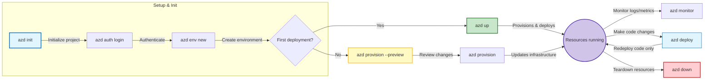
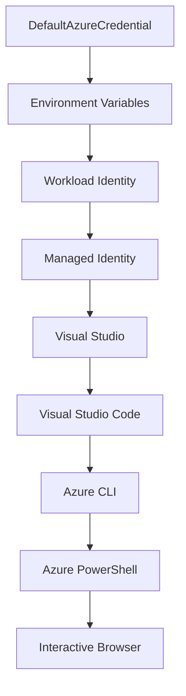

# Asas AZD - Konsep Teras dan Asas

**Navigasi Bab:**
- **📚 Laman Utama Kursus**: [AZD Untuk Pemula](../../README.md)
- **📖 Bab Semasa**: Bab 1 - Asas & Mula Cepat
- **⬅️ Sebelum**: [Gambaran Keseluruhan Kursus](../../README.md#-chapter-1-foundation--quick-start)
- **➡️ Seterusnya**: [Pemasangan & Persediaan](installation.md)
- **🚀 Bab Seterusnya**: [Bab 2: Pembangunan AI-Pertama](../chapter-02-ai-development/microsoft-foundry-integration.md)

## Pengenalan

> Disemak berdasarkan `azd 1.37.2` (November 2026). Perintah Bash menggunakan tempat letak bernilai yang perlu anda gantikan. Aliran kerja templat menggunakan `.` untuk menginisialisasi direktori semasa; tanpa argumen direktori, inisialisasi templat mencipta subdirektori dan tidak mengubah direktori kerja shell anda. Petikan lanjutan adalah ilustrasi, bukan projek lengkap.

Pelajaran ini memperkenalkan anda kepada Azure Developer CLI (azd), alat baris perintah yang kuat yang mempercepat perjalanan anda dari pembangunan setempat ke penerapan Azure. Anda akan mempelajari konsep asas, ciri utama, dan memahami bagaimana azd mempermudah penerapan aplikasi asli awan.

## Matlamat Pembelajaran

Pada akhir pelajaran ini, anda akan:
- Memahami apa itu Azure Developer CLI dan tujuan utamanya
- Mempelajari konsep teras templat, persekitaran, dan perkhidmatan
- Meneroka ciri utama termasuk pembangunan dipacu templat dan Infrastruktur sebagai Kod
- Memahami struktur projek azd dan aliran kerjanya
- Bersedia untuk memasang dan mengkonfigurasi azd untuk persekitaran pembangunan anda

## Hasil Pembelajaran

Selepas menamatkan pelajaran ini, anda akan dapat:
- Menjelaskan peranan azd dalam aliran kerja pembangunan awan moden
- Mengenal pasti komponen struktur projek azd
- Mendeskripsikan bagaimana templat, persekitaran, dan perkhidmatan bekerjasama
- Memahami manfaat Infrastruktur sebagai Kod dengan azd
- Mengenal pasti perintah azd yang berbeza dan tujuan mereka

## Apa itu Azure Developer CLI (azd)?

Azure Developer CLI (azd) adalah alat baris perintah yang direka untuk mempercepat perjalanan anda dari pembangunan setempat ke penerapan Azure. Ia mempermudah proses membina, menerapkan, dan mengurus aplikasi asli awan di Azure.

### Apa yang Boleh Anda Terapkan dengan azd?

azd menyokong pelbagai beban kerja—dan senarainya terus berkembang. Hari ini, anda boleh menggunakan azd untuk menerapkan:

| Jenis Beban Kerja | Contoh | Aliran Kerja Sama? |
|---------------|----------|----------------|
| **Aplikasi tradisional** | Aplikasi web, REST API, tapak statik | ✅ `azd up` |
| **Perkhidmatan dan mikroperkhidmatan** | Aplikasi Kontena, Aplikasi Fungsi, backend pelbagai perkhidmatan | ✅ `azd up` |
| **Aplikasi bertenaga AI** | Aplikasi sembang dengan Microsoft Foundry Models, penyelesaian RAG dengan AI Search | ✅ `azd up` |
| **Ejen pintar** | Ejen hos Foundry, orkestrasi berbilang ejen | ✅ `azd up` |

Wawasan utama ialah **kitar hayat azd kekal sama tanpa mengira apa yang anda terapkan**. Anda menginisialisasi projek, menyediakan infrastruktur, menerapkan kod anda, memantau aplikasi, dan membersihkan—sama ada ia laman web mudah atau ejen AI yang canggih.

Kesinambungan ini adalah berdasarkan reka bentuk. azd menganggap keupayaan AI sebagai satu jenis perkhidmatan yang boleh digunakan oleh aplikasi anda, bukan sesuatu yang berbeza secara asas. Titik akhir sembang yang disokong oleh Microsoft Foundry Models adalah, dari perspektif azd, hanya perkhidmatan lain untuk dikonfigurasi dan diterapkan.

### 🎯 Mengapa Gunakan AZD? Perbandingan Dunia Nyata

Mari bandingkan penerapan aplikasi web mudah dengan pangkalan data:

#### ❌ TANPA AZD: Penerapan Azure Manual (30+ minit)

**Perbandingan Bash ilustrasi, bukan pemula aplikasi yang boleh dijalankan.** Ini menganggap kod aplikasi sedia ada, nama sumber unik, pengesahan CLI Azure, dan sebarang sambungan CLI yang diperlukan. Gunakan latihan templat di bawah untuk laluan sokongan hujung ke hujung.

```bash
# Step 1: Create resource group
az group create --name myapp-rg --location eastus

# Step 2: Create App Service Plan
az appservice plan create --name myapp-plan \
  --resource-group myapp-rg \
  --sku B1 --is-linux

# Step 3: Create Web App
az webapp create --name myapp-web-unique123 \
  --resource-group myapp-rg \
  --plan myapp-plan \
  --runtime "NODE:22-lts"

# Step 4: Create Cosmos DB account (10-15 minutes)
az cosmosdb create --name myapp-cosmos-unique123 \
  --resource-group myapp-rg \
  --kind MongoDB

# Step 5: Create database
az cosmosdb mongodb database create \
  --account-name myapp-cosmos-unique123 \
  --resource-group myapp-rg \
  --name tododb

# Step 6: Create collection
az cosmosdb mongodb collection create \
  --account-name myapp-cosmos-unique123 \
  --resource-group myapp-rg \
  --database-name tododb \
  --name todos

# Step 7: Get connection string
CONN_STR=$(az cosmosdb keys list \
  --name myapp-cosmos-unique123 \
  --resource-group myapp-rg \
  --type connection-strings \
  --query "connectionStrings[0].connectionString" -o tsv)

# Step 8: Configure app settings
az webapp config appsettings set \
  --name myapp-web-unique123 \
  --resource-group myapp-rg \
  --settings MONGODB_URI="$CONN_STR"

# Step 9: Enable logging
az webapp log config --name myapp-web-unique123 \
  --resource-group myapp-rg \
  --application-logging filesystem \
  --detailed-error-messages true

# Step 10: Set up Application Insights
az monitor app-insights component create \
  --app myapp-insights \
  --location eastus \
  --resource-group myapp-rg

# Step 11: Link App Insights to Web App
INSTRUMENTATION_KEY=$(az monitor app-insights component show \
  --app myapp-insights \
  --resource-group myapp-rg \
  --query "instrumentationKey" -o tsv)

az webapp config appsettings set \
  --name myapp-web-unique123 \
  --resource-group myapp-rg \
  --settings APPINSIGHTS_INSTRUMENTATIONKEY="$INSTRUMENTATION_KEY"

# Step 12: Build application locally
npm install
npm run build

# Step 13: Create deployment package
zip -r app.zip . -x "*.git*" "node_modules/*"

# Step 14: Deploy application
az webapp deployment source config-zip \
  --resource-group myapp-rg \
  --name myapp-web-unique123 \
  --src app.zip

# Step 15: Wait and pray it works 🙏
# (No automated validation, manual testing required)
```

**Masalah:**
- ❌ Lebih 15 perintah untuk diingat dan laksanakan mengikut urutan
- ❌ 30-45 minit kerja manual
- ❌ Mudah melakukan kesilapan (salah taip, parameter salah)
- ❌ Kredensial memerlukan pengendalian eksplisit; log debug dan penjejakan shell boleh mendedahkannya
- ❌ Tiada rollback automatik jika sesuatu gagal
- ❌ Sukar untuk digandakan oleh ahli pasukan
- ❌ Berbeza setiap kali (tidak boleh diulang)

#### ✅ DENGAN AZD: Penerapan Automatik (5 perintah, 10-15 minit)

```bash
# Step 1: Initialize from template
azd init --template todo-nodejs-mongo .

# Step 2: Authenticate
azd auth login

# Step 3: Select the environment created during init
azd env select dev

# Step 4: Preview changes (optional but recommended)
azd provision --preview

# Step 5: Deploy everything
azd up

# ✨ Done! Everything is deployed, configured, and monitored
```

**Manfaat:**
- ✅ **5 perintah** berbanding 15+ langkah manual
- ✅ **10-15 minit** jumlah masa (kebanyakannya menunggu Azure)
- ✅ **Kurang kesilapan manual** - aliran kerja konsisten dipacu templat
- ✅ **Pengendalian rahsia selamat** - banyak templat menggunakan storan rahsia yang diurus Azure
- ✅ **Penerapan boleh diulang** - aliran kerja sama setiap kali
- ✅ **Definisi infrastruktur boleh diulang** - tertakluk pada kuota, ketersediaan wilayah, dan versi templat
- ✅ **Sedia untuk pasukan** - sesiapa boleh menerapkan dengan perintah yang sama
- ✅ **Infrastruktur sebagai Kod** - templat Bicep yang dikawal versi
- ✅ **Pemantauan ditakrifkan templat** - Application Insights apabila disertakan dalam templat

### Masa dan Kebolehpercayaan

Masa yang dinyatakan di atas adalah anggaran, bukan tolok banding. azd mengurangkan perintah yang perlu anda selaras, tetapi tidak menjamin tempoh penerapan, menghapuskan ralat, atau menyediakan rollback aplikasi/pangkalan data automatik. Simpan versi kerja dalam kawalan sumber dan uji prosedur pemulihan.

## Konsep Teras

### Templat
Templat adalah asas azd. Ia mengandungi:
- **Kod aplikasi** - Kod sumber dan pergantungan anda
- **Definisi infrastruktur** - Sumber Azure yang ditakrifkan dalam Bicep atau Terraform
- **Fail konfigurasi** - Tetapan dan pembolehubah persekitaran
- **Skrip penerapan** - Aliran kerja penerapan automatik

### Persekitaran
Persekitaran mewakili sasaran penerapan berbeza:
- **Pembangunan** - Untuk ujian dan pembangunan
- **Staging** - Persekitaran pra-produksi
- **Produksi** - Persekitaran produksi langsung

Setiap persekitaran mengekalkan:
- Nama dan nilai persekitaran; pengasingan sumber bergantung pada templat infrastruktur
- Tetapan konfigurasi
- Status penerapan

### Perkhidmatan
Perkhidmatan dalam `azure.yaml` menerangkan komponen aplikasi yang boleh diterapkan:
- **Antaramuka** - Aplikasi web, SPA
- **Backend** - API, mikroperkhidmatan

Pangkalan data dan penyimpanan biasanya disediakan sebagai sumber infrastruktur, bukan hos perkhidmatan ciptaan seperti `host: postgres`.

## Ciri-ciri Utama

### 1. Pembangunan Dipacu Templat
```bash
# Browse available templates
azd template list

# Initialize from a template
azd init --template "<template-name>" .
```

### 2. Infrastruktur sebagai Kod
- **Bicep** - Bahasa domain khusus Azure
- **Terraform** - Alat infrastruktur pelbagai awan
- Bicep disusun ke templat ARM; ARM JSON asli bukan `infra.provider` built-in yang berasingan.

### 3. Aliran Kerja Terpadu
```bash
# Complete deployment workflow
azd up            # Provision + Deploy this is hands off for first time setup

# 🧪 NEW: Preview infrastructure changes before deployment (SAFE)
azd provision --preview    # Simulate infrastructure deployment without making changes

azd provision     # Create Azure resources if you update the infrastructure use this
azd deploy        # Deploy application code or redeploy application code once update
azd down          # Clean up resources
```

#### 🛡️ Perancangan Infrastruktur Selamat dengan Pratonton
Perintah `azd provision --preview` adalah perubahan besar untuk penerapan yang selamat:
- **Analisis dry-run** - Menunjukkan apa yang akan dibuat, diubah, atau dipadam
- **Tiada permohonan infrastruktur** - Mengkaji perubahan penyedia; periksa cangkuk projek terlebih dahulu, kerana cangkuk boleh menjalankan perintah dengan kesan sampingan
- **Kerjasama pasukan** - Kongsi hasil pratonton sebelum penerapan
- **Input perancangan kos** - Periksa SKU yang dicadangkan, kemudian hargakan dengan Kalkulator Harga Azure; pratonton tidak mengira harga

```bash
# Example preview workflow
azd provision --preview           # See what will change
# Review the output, discuss with team
azd provision                     # Apply changes with confidence
```

### 📊 Visual: Aliran Kerja Pembangunan AZD



**Penjelasan Aliran Kerja:**
1. **Init** - Mula dengan templat atau projek baru
2. **Auth** - Autentikasi dengan Azure
3. **Environment** - Cipta persekitaran penerapan terpencil
4. **Preview** - 🆕 Sentiasa pratonton perubahan infrastruktur dahulu (amalan selamat)
5. **Provision** - Cipta/kemas kini sumber Azure
6. **Deploy** - Tolak kod aplikasi anda
7. **Monitor** - Perhatikan prestasi aplikasi
8. **Iterate** - Buat perubahan dan terapkan semula kod
9. **Cleanup** - Alih keluar sumber bila selesai

### 4. Pengurusan Persekitaran
```bash
# Create and manage environments
azd env new "<environment-name>"
azd env select "<environment-name>"
azd env list
```

### 5. Sambungan dan Perintah AI

azd menggunakan sistem sambungan untuk menambah keupayaan melebihi CLI teras. Ini sangat berguna untuk beban kerja AI:

```bash
# List available extensions
azd extension list

# Install the Foundry agents extension
azd extension install azure.ai.agents

# Initialize an AI agent project interactively
azd ai agent init

# Test a deployed agent (shows latency and time-to-first-byte)
azd ai agent invoke

# Start the MCP server for AI-assisted development (Alpha)
azd mcp start
```

**Kitar hayat ejen, hujung ke hujung.** Gunakan `azure.ai.agents` untuk operasi kitar hayat ejen dan pasang `azure.ai.evaluations` secara berasingan untuk penilaian. Gunakan `azd >= 1.37.0` untuk aliran kerja gabungan. Anda tidak perlu semua ini pada hari pertama:

| Peringkat | Perintah | Apa yang dilakukan |
|-------|---------|--------------|
| **Scaffold** | `azd ai agent init --template <path-to-azure.yaml>` | Mengambil templat projek ejen semasa |
| **Test** | `azd ai agent invoke` | Panggil ejen dan lihat masa respons |
| **Measure** | `azd ai eval init`, `generate`, `run start` | Konfigurasi, terapkan, dan jalankan penilaian menggunakan sambungan berasingan |
| **Improve** | `azd ai agent optimize --eval <evaluation-name> --optimize-model <optimizer-deployment>` | Guna semula penilaian yang sesuai untuk mengoptimumkan ejen |
| **Inspect** | `azd ai agent endpoint show` | Lihat konfigurasi titik akhir langsung |
| **Clean up** | `azd ai agent delete` | Padamkan ejen yang dihoskan dan semua versinya |

> Sambungan dibahas secara terperinci dalam [Bab 2: Pembangunan AI-Pertama](../chapter-02-ai-development/agents.md) dan rujukan [Perintah CLI AI AZD](../chapter-08-production/production-ai-practices.md#azd-ai-cli-commands-and-extensions).

## 📁 Struktur Projek

Struktur projek azd tipikal:
```
my-app/
├── .azure/                  # Local environments and selected-environment config
│   ├── config.json
│   └── dev/.env
├── .devcontainer/          # Development container config
├── .github/workflows/      # GitHub Actions
├── .vscode/               # VS Code settings
├── infra/                 # Infrastructure code
│   ├── main.bicep        # Main infrastructure template
│   ├── main.parameters.json
│   └── modules/          # Reusable modules
├── src/                  # Application source code
│   ├── api/             # Backend services
│   └── web/             # Frontend application
├── azure.yaml           # azd project configuration
└── README.md
```

## 🔧 Fail Konfigurasi

### azure.yaml
Fail konfigurasi projek utama:
```yaml
name: my-awesome-app
metadata:
  template: my-template@1.0.0

services:
  web:
    project: ./src/web
    language: js
    host: appservice
  api:
    project: ./src/api
    language: js
    host: appservice

hooks:
  preprovision:
    shell: pwsh
    run: echo "Preparing to provision..."
```

### .azure/config.json
Pemilihan persekitaran lalai setempat projek (ilustrasi; diurus oleh azd):
```json
{
  "defaultEnvironment": "dev"
}
```

## 🎪 Aliran Kerja Lazim dengan Latihan Praktikal

> **💡 Petua Pembelajaran:** Ikuti latihan ini mengikut urutan untuk membina kemahiran AZD anda secara berperingkat.

### 🎯 Latihan 1: Mulakan Projek Pertama Anda

**Matlamat:** Cipta projek AZD dan teroka strukturnya

**Langkah-langkah:**
```bash
# Use a proven template
mkdir azd-basics-practice
cd azd-basics-practice
# Choose "dev" for the environment name when prompted
azd init --template todo-nodejs-mongo .

# Explore the generated files
ls -la  # View all files including hidden ones

# Key files created:
# - azure.yaml (main config)
# - infra/ (infrastructure code)
# - src/ (application code)
```

**✅ Berjaya:** Anda memiliki azure.yaml, direktori infra/, dan src/

---

### 🎯 Latihan 2: Terapkan ke Azure

**Matlamat:** Lengkapkan penerapan hujung ke hujung

**Langkah-langkah:**
```bash
# 1. Authenticate
azd auth login

# 2. Select the dev environment created in Exercise 1
azd env select dev
azd env set AZURE_LOCATION eastus

# 3. Preview changes (RECOMMENDED)
azd provision --preview

# 4. Deploy everything
azd up

# 5. Verify deployment
azd show    # View your app URL
```

**Masa Dijangkakan:** 10-15 minit  
**✅ Berjaya:** URL aplikasi dibuka di pelayar

---

### 🎯 Latihan 3: Berbilang Persekitaran

**Matlamat:** Terapkan ke dev dan staging

**Langkah-langkah:**
```bash
# Already have dev, create staging
azd env new staging
azd env set AZURE_LOCATION westus2
azd up

# Switch between them
azd env list
azd env select dev
```

**✅ Berjaya:** Dua kumpulan sumber berasingan dalam Portal Azure

**Pembersihan:** Latihan 3 mencipta penerapan boleh bayar kedua. Padamkan kedua-duanya apabila selesai:

```bash
azd down --environment dev
azd down --environment staging
```

---

### 🛡️ Pembersihan Merosakkan: `azd down --force --purge`

Apabila anda sengaja ingin memadam sumber Azure persekitaran yang dipilih:

```bash
azd down --force --purge
```

**Apa yang dilakukan:**
- `--force`: Tiada arahan pengesahan
- `--purge`: Juga memadamkan secara kekal sumber yang dipadam lembut yang disokong (contoh Key Vaults), jika perlindungan pembersihan membenarkannya. Ia tidak memadam direktori setempat `.azure/`.

**Gunakan bila:** selesai dengan persekitaran boleh buang. Jangan anggap pembersihan merosakkan sebagai tindak balas pertama kepada ralat pengesahan, kuota, atau konfigurasi.

---

## 🎪 Rujukan Aliran Kerja Asal

### Memulakan Projek Baru
```bash
# Method 1: Use existing template
azd init --template todo-nodejs-mongo .

# Method 2: Start from scratch
azd init

# Method 3: Use current directory
azd init .
```

### Kitaran Pembangunan
```bash
# Set up development environment
azd auth login
azd env new dev
azd env select dev

# Deploy everything
azd up

# Make changes and redeploy
azd deploy

# Clean up when done
azd down --force --purge # Deletes this environment's discovered Azure resources; review before forcing deletion.
```

## Memahami `azd down --force --purge`
Perintah `azd down --force --purge` adalah cara yang kuat untuk sepenuhnya memusnahkan persekitaran azd dan semua sumber berkaitan. Berikut adalah pecahan apa yang dilakukan setiap flag:
```
--force
```
- Melangkau arahan pengesahan.
- Berguna untuk automasi atau skrip di mana input manual tidak praktikal.
- Tidak mengatasi kebenaran, perlindungan pembersihan, atau kegagalan pemadaman.

```
--purge
```
Memadam secara kekal sumber Azure yang dipadam lembut yang disokong tanpa pengesahan tambahan. Perlindungan pembersihan dan kebenaran masih terpakai. Ia **tidak** mengalih keluar persekitaran setempat atau folder `.azure/`.


### Kenapa guna kedua-dua?
Gunakan kedua-duanya hanya apabila anda berniat untuk memadam sumber Azure persekitaran yang dipilih dan membersihkan sumber boleh pulih. Ini adalah pembersihan merosakkan, bukan pembaikan umum atau tetapan semula keadaan setempat.

Ia sangat membantu selepas pemadaman sumber manual dalam portal Azure atau ketika menukar templat, persekitaran, atau konvensyen penamaan kumpulan sumber.


### Mengurus Persekitaran Berbilang
```bash
# Create staging environment
azd env new staging
azd env select staging
azd up

# Switch back to dev
azd env select dev

# Compare environments
azd env list
```

## 🔐 Pengesahan dan Kredensial

Bezakan pengesahan penerapan (`azd auth login`) daripada pengesahan SDK aplikasi (`DefaultAzureCredential`). Mereka berasingan. azd tidak menggunakan kredensial CLI Azure secara lalai.

### Pengesahan Azure CLI (`az login`)

Jalankan `azd auth login` untuk azd. Perintah Azure CLI berikut adalah pilihan dan mengesahkan perintah `az` secara berasingan:

```bash
# Interactive login (opens browser)
az login

# Login with specific tenant
az login --tenant "<tenant-id>"

# Login with service principal
az login --service-principal -u "<app-id>" -p "<password>" --tenant "<tenant-id>"

# Check current login status
az account show

# List available subscriptions
az account list --output table

# Set default subscription
az account set --subscription "<subscription-id>"
```

### Aliran Pengesahan
1. **Log masuk Interaktif**: Membuka pelayar lalai anda untuk pengesahan
2. **Aliran Kod Peranti**: Untuk persekitaran tanpa akses pelayar
3. **Prinsipal Perkhidmatan**: Untuk automasi dan senario CI/CD
4. **Identiti Terurus**: Untuk aplikasi yang dihoskan Azure

### Rantaian DefaultAzureCredential

`DefaultAzureCredential` adalah jenis kredensial yang menyediakan pengalaman pengesahan yang dipermudahkan dengan secara automatik mencuba pelbagai sumber kredensial mengikut urutan tertentu:

#### Rantaian Kredensial SDK Aplikasi

Rantai tepat bergantung pada bahasa SDK Azure Identity, versi, pemalam yang dipasang, dan pilihan. Diagram ini adalah konseptual, bukan urutan pengesahan azd yang tetap; SDK terkini juga boleh merangkumi kelayakan CLI Pembangun Azure.


#### 1. Pembolehubah Persekitaran
```bash
# Set environment variables for service principal
export AZURE_CLIENT_ID="<app-id>"
export AZURE_CLIENT_SECRET="<password>"
export AZURE_TENANT_ID="<tenant-id>"
```

#### 2. Identiti Beban Kerja (Kubernetes/Aksi GitHub)
Digunakan secara automatik dalam:
- Perkhidmatan Kubernetes Azure (AKS) dengan Identiti Beban Kerja
- Aksi GitHub dengan persekutuan OIDC
- Senario identiti persekutuan lain

#### 3. Identiti Terurus
Untuk sumber Azure seperti:
- Mesin Maya
- Perkhidmatan Aplikasi
- Fungsi Azure
- Contoh Kontena

```bash
# Inspect a deployed Container App's configured identity (requires az login)
az containerapp show --name "<app-name>" --resource-group "<rg-name>" --query identity
```

#### 4. Integrasi Alat Pembangun
- **Visual Studio**: Secara automatik menggunakan akaun yang masuk
- **VS Code**: Sokongan bergantung pada SDK dan tetapan broker/pemalam yang disokong
- **Azure CLI**: Menggunakan kelayakan `az login` (paling biasa untuk pembangunan tempatan)

### Persediaan Pengesahan AZD

```bash
# Method 1: Direct azd authentication (recommended)
azd auth login

# Method 2: Direct azd authentication
azd auth login --use-device-code  # For headless environments

# Method 3: Check authentication status
azd auth login --check-status

# Method 4: Logout and re-authenticate
azd auth logout
azd auth login
```

### Amalan Terbaik Pengesahan

#### Untuk Pembangunan Tempatan
```bash
# 1. Log in to azd
azd auth login

# 2. Select the subscription for this initialized environment
azd env set AZURE_SUBSCRIPTION_ID "<subscription-id>"

# 3. Check azd sign-in details (read the status message)
azd auth login --check-status
```

#### Untuk Saluran CI/CD
```yaml
# Partial GitHub Actions steps: assumes checkout, azd installation,
# required AZURE_* environment values, and pipeline secret configuration.
- name: Deploy with azd
  run: |
    azd auth login --client-id ${{ secrets.AZURE_CLIENT_ID }} \
                    --client-secret ${{ secrets.AZURE_CLIENT_SECRET }} \
                    --tenant-id ${{ secrets.AZURE_TENANT_ID }}
    azd up --no-prompt
```

#### Untuk Persekitaran Pengeluaran
- Gunakan **Identiti Terurus** apabila berjalan pada sumber Azure
- Gunakan **Prinsipal Perkhidmatan** untuk senario automasi
- Elakkan menyimpan kelayakan dalam kod atau fail konfigurasi
- Gunakan **Azure Key Vault** untuk konfigurasi sensitif

### Isu Pengesahan Biasa dan Penyelesaian

#### Isu: "Tiada langganan ditemui"
```bash
# Solution: Set default subscription
az account list --output table
az account set --subscription "<subscription-id>"
azd env set AZURE_SUBSCRIPTION_ID "<subscription-id>"
```

#### Isu: "Kebenaran tidak mencukupi"
```bash
# Solution: Check and assign required roles
az role assignment list --assignee $(az account show --query user.name --output tsv)

# Common required roles:
# - Contributor (for resource management)
# - User Access Administrator (for role assignments)
```

#### Isu: "Token tamat tempoh"
```bash
# Solution: Re-authenticate
az logout
az login
azd auth logout
azd auth login
```

### Pengesahan dalam Senario Berbeza

#### Pembangunan Tempatan
```bash
# Personal development account
az login
azd auth login
```

#### Pembangunan Pasukan
```bash
# Use specific tenant for organization
az login --tenant contoso.onmicrosoft.com
azd auth login --tenant-id "<tenant-id>"
```

#### Senario Pelbagai Penyewa
```bash
# Switch between tenants
az login --tenant tenant1.onmicrosoft.com
azd auth login --tenant-id "<tenant-1-id>"
# Select an environment configured with tenant 1's subscription
azd env select tenant1-dev
# Deploy to tenant 1
azd up

az login --tenant tenant2.onmicrosoft.com  
azd auth login --tenant-id "<tenant-2-id>"
azd env select tenant2-dev
# Deploy to tenant 2
azd up
```

### Pertimbangan Keselamatan

1. **Penyimpanan Kelayakan**: Jangan sesekali menyimpan kelayakan dalam kod sumber
2. **Had Skop**: Gunakan prinsip keistimewaan paling minimum untuk prinsipal perkhidmatan
3. **Putaran Token**: Putar rahsia prinsipal perkhidmatan secara berkala
4. **Jejak Audit**: Pantau aktiviti pengesahan dan penempatan
5. **Keselamatan Rangkaian**: Gunakan titik akhir peribadi bila boleh

### Penyelesaian Masalah Pengesahan

```bash
# Debug authentication issues
azd auth login --check-status
az account show
az account get-access-token

# Common diagnostic commands
whoami                          # Current user context
az ad signed-in-user show      # Microsoft Entra ID user details
az group list                  # Test resource access
```

## Penemuan Perintah

### Penemuan
```bash
azd template list              # Browse templates
azd template list --help       # Template discovery options
azd init --help               # Initialization options
```

### Pengurusan Projek
```bash
azd show                     # Project overview
azd env list                # Available environments and selected default
azd config show            # Configuration settings
```

### Pemantauan
```bash
azd monitor                  # Open Azure portal monitoring
azd monitor --logs           # View application logs
azd monitor --live           # View live metrics
azd pipeline config          # Set up CI/CD
```

## Amalan Terbaik

### 1. Gunakan Nama Bermakna
```bash
# Good
azd env new production-east
azd init --template todo-nodejs-mongo .

# Avoid
azd env new env1
azd init --template template1 .
```

### 2. Manfaatkan Templat
- Mulakan dengan templat sedia ada
- Sesuaikan mengikut keperluan anda
- Cipta templat guna semula untuk organisasi anda

### 3. Pengasingan Persekitaran
- Gunakan persekitaran berasingan untuk dev/staging/prod
- Jangan pernah melaksanakan terus ke produksi dari mesin tempatan
- Gunakan saluran CI/CD untuk pelaksanaan produksi

### 4. Pengurusan Konfigurasi
- Gunakan identiti terurus dan Key Vault untuk rahsia; nilai `azd env set` biasa adalah teks kosong tempatan
- Simpan konfigurasi dalam kawalan versi
- Dokumentasikan tetapan khusus persekitaran

## Kemajuan Pembelajaran

### Pemula (Minggu 1-2)
1. Pasang azd dan sahkan
2. Lancarkan templat mudah
3. Fahami struktur projek
4. Pelajari arahan asas (up, down, deploy)

### Pertengahan (Minggu 3-4)
1. Sesuaikan templat
2. Urus pelbagai persekitaran
3. Fahami kod infrastruktur
4. Sediakan saluran CI/CD

### Lanjutan (Minggu 5+)
1. Cipta templat tersuai
2. Corak infrastruktur lanjutan
3. Pelaksanaan pelbagai rantau
4. Konfigurasi tahap perusahaan

## Langkah Seterusnya

**📖 Teruskan Pembelajaran Bab 1:**
- [Pemasangan & Persediaan](installation.md) - Dapatkan azd dipasang dan dikonfigurasikan
- [Projek Pertama Anda](first-project.md) - Lengkapkan tutorial langsung
- [Panduan Konfigurasi](../chapter-03-configuration/configuration.md) - Pilihan konfigurasi lanjutan

**🎯 Sedia untuk Bab Seterusnya?**
- [Bab 2: Pembangunan AI-Pertama](../chapter-02-ai-development/microsoft-foundry-integration.md) - Mulakan membina aplikasi AI

## Sumber Tambahan

- [Gambaran Keseluruhan Azure Developer CLI](https://learn.microsoft.com/en-us/azure/developer/azure-developer-cli/)
- [Galeri Templat](https://azure.github.io/awesome-azd/)
- [Contoh Komuniti](https://github.com/Azure-Samples)

---

## 🙋 Soalan Lazim

### Soalan Umum

**S: Apa perbezaan antara AZD dan Azure CLI?**

J: Azure CLI (`az`) untuk menguruskan sumber Azure individu. AZD (`azd`) untuk menguruskan keseluruhan aplikasi:

```bash
# Azure CLI - Low-level resource management
az webapp create --name myapp --resource-group rg
az sql server create --name myserver --resource-group rg
# ...many more commands needed

# AZD - Application-level management
azd up  # Deploys entire app with all resources
```

**Fikirkan seperti ini:**
- `az` = Beroperasi pada bata Lego individu
- `azd` = Bekerja dengan set Lego lengkap

---

**S: Adakah saya perlu tahu Bicep atau Terraform untuk menggunakan AZD?**

J: Tidak! Mulakan dengan templat:
```bash
# Use existing template - no IaC knowledge needed
azd init --template todo-nodejs-mongo .
azd up
```

Anda boleh belajar Bicep kemudian untuk menyesuaikan infrastruktur. Templat menyediakan contoh berfungsi untuk pembelajaran.

---

**S: Berapa kos menjalankan templat AZD?**

J: Kos berbeza mengikut rantau, SKU, masa aktif, mod pangkalan data, dan penggunaan model. Persekitaran pembangunan boleh menyebabkan caj bulanan yang besar walaupun ketika tidak aktif; jangan anggap julat $50-150 adalah universal:

```bash
# Preview resource changes (not prices)
azd provision --preview

# Always cleanup when not using
azd down --force --purge  # Removes all resources
```

**Tip pro:** Gunakan lapisan percuma jika ada:
- Perkhidmatan Aplikasi: lapisan F1 (Percuma)
- Azure OpenAI: tiada token percuma bulanan dijamin umum; semak model dan harga tawaran semasa
- Cosmos DB: akaun throughput yang layak boleh pilih lapisan percuma; templat tanpa pelayan tidak layak secara automatik

---

**S: Bolehkah saya gunakan AZD dengan sumber Azure yang sedia ada?**

J: Ya, tetapi lebih mudah untuk mula baru. AZD berfungsi terbaik apabila ia mengurus kitar hayat penuh. Untuk sumber sedia ada:

```bash
# Option 1: Import existing resources (advanced)
azd init
# Then modify infra/ to reference existing resources

# Option 2: Start fresh (recommended)
azd init --template "<verified-template-name>" .
azd up  # Creates new environment
```

---

**S: Bagaimana saya berkongsi projek dengan rakan sepasukan?**

J: Komit projek AZD ke Git (tetapi TIDAK folder .azure):

```bash
# Already in .gitignore by default
.azure/        # Contains secrets and environment data
*.env          # Environment variables

# Team members then:
git clone "<your-repo>"
# Change into the cloned repository before running the remaining commands.
azd auth login
azd env new "<their-name>-dev"
azd up
```

Semua mendapat infrastruktur yang sama dari templat yang sama.

---

### Soalan Penyelesaian Masalah

**S: "azd up" gagal separuh jalan. Apa saya buat?**

J: Semak ralat, betulkan, kemudian cuba lagi:

```bash
# Capture detailed diagnostics (redact sensitive values before sharing)
azd up --debug

# Common fixes:

# 1. If quota exceeded:
azd env set AZURE_LOCATION "westus2"  # Try different region

# 2. If resource name conflict:
azd down --force --purge  # Clean slate
azd up  # Retry

# 3. If auth expired:
az login
azd auth login
azd up
```

**Isu paling biasa:** Pilih langganan Azure salah
```bash
az account list --output table
az account set --subscription "<correct-subscription>"
azd env set AZURE_SUBSCRIPTION_ID "<correct-subscription-id>"
```

---

**S: Bagaimana saya laksanakan perubahan kod sahaja tanpa pembentukan semula?**

J: Gunakan `azd deploy` bukan `azd up`:

```bash
azd up          # First time: provision + deploy (slow)

# Make code changes...

azd deploy      # Subsequent times: deploy only (fast)
```

Perbandingan kelajuan:
- `azd up`: 10-15 minit (mengadakan infrastruktur)
- `azd deploy`: 2-5 minit (kod sahaja)

---

**S: Bolehkah saya sesuaikan templat infrastruktur?**

J: Ya! Edit fail Bicep dalam `infra/`:

```bash
# After azd init
cd infra/
code main.bicep  # Edit in VS Code

# Preview changes
azd provision --preview

# Apply changes
azd provision
```

**Petua:** Mula kecil - tukar SKU dahulu:
```bicep
// infra/main.bicep
sku: {
  name: 'B1'  // Change to 'P1V2' for production
}
```

---

**S: Bagaimana saya padamkan semua yang dicipta AZD?**

J: Satu arahan membuang semua sumber:

```bash
azd down --force --purge

# This deletes:
# - Azure resources/resource groups discovered for the selected environment
# - Supported soft-deleted resources, if purge protection allows
# Local .azure files remain; shared/external resources may remain too.
```

**Sentiasa jalankan ini apabila:**
- Selesai menguji templat
- Beralih ke projek berlainan
- Mahu mula baru

**Pengesahan kos:** Sahkan penghapusan di Azure dan periksa sumber yang kekal/dikongsi. Caj yang pernah dikenakan masih terpakai.

---

**S: Apa jika saya secara tidak sengaja memadam sumber di Azure Portal?**

J: Keadaan AZD boleh tidak selari. Pendekatan papan tulis kosong:

```bash
# 1. Delete remaining resources only if that is your intent
azd down --force --purge

# 2. Start fresh
azd up

# Alternative: Let AZD detect and fix
azd provision  # Will create missing resources
```

---

### Soalan Lanjutan

**S: Bolehkah saya gunakan AZD dalam saluran CI/CD?**

J: Ya! Contoh Aksi GitHub:

```yaml
# .github/workflows/deploy.yml
name: Deploy with AZD

on:
  push:
    branches: [main]

jobs:
  deploy:
    runs-on: ubuntu-latest
    steps:
      - uses: actions/checkout@v4
      
      - name: Install azd
        run: curl -fsSL https://aka.ms/install-azd.sh | bash
      
      - name: Azure Login
        run: |
          azd auth login \
            --client-id ${{ secrets.AZURE_CLIENT_ID }} \
            --client-secret ${{ secrets.AZURE_CLIENT_SECRET }} \
            --tenant-id ${{ secrets.AZURE_TENANT_ID }}
      
      - name: Deploy
        env:
          AZURE_ENV_NAME: dev
          AZURE_LOCATION: ${{ vars.AZURE_LOCATION }}
          AZURE_SUBSCRIPTION_ID: ${{ vars.AZURE_SUBSCRIPTION_ID }}
        run: azd up --no-prompt
```

---

**S: Bagaimana saya kendalikan rahsia dan data sensitif?**

J: Gunakan Key Vault secara eksplisit. `azd env set` menulis nilai biasa ke fail persekitaran tempatan; ia tidak secara automatik mencipta vault, menetapkan peranan, atau menyuntik rahsia ke aplikasi anda.

```bash
# Interactive: create/select a Key Vault secret and save its reference
azd env set-secret DATABASE_PASSWORD
```

Anda perlu kebenaran vault yang sesuai. Infrastruktur/aplikasi anda mesti masih menyambungkan rahsia ke pengguna dan memberikan akses identiti runtime. Jangan cetak nilai rahsia yang diselesaikan dalam log.

**Jangan sesekali komit:**
- Folder `.azure/` (mengandungi data persekitaran)
- Fail `.env` (rahsia tempatan)
- Tali sambungan

---

**S: Bolehkah saya melaksanakan ke pelbagai rantau?**

J: Ya, cipta persekitaran mengikut rantau:

```bash
# East US environment
azd env new prod-eastus
azd env set AZURE_LOCATION eastus
azd up

# West Europe environment
azd env new prod-westeurope
azd env set AZURE_LOCATION westeurope
azd up

# Each environment is independent
azd env list
```

Untuk aplikasi pelbagai rantau sebenar, sesuaikan templat Bicep untuk melaksanakan ke beberapa rantau serentak.

---

**S: Di mana saya boleh dapatkan bantuan jika tersekat?**

1. **Dokumentasi AZD:** https://learn.microsoft.com/azure/developer/azure-developer-cli/
2. **Isu GitHub:** https://github.com/Azure/azure-dev/issues
3. **Discord:** [Azure Discord](https://discord.gg/microsoft-azure) - saluran #azure-developer-cli
4. **Stack Overflow:** Tag `azure-developer-cli`
5. **Kursus Ini:** [Panduan Penyelesaian Masalah](../chapter-07-troubleshooting/common-issues.md)

**Tip pro:** Sebelum bertanya, jalankan:
```bash
azd show       # Shows current state
azd version    # Shows your version
```
 Sertakan maklumat ini dalam soalan untuk bantuan lebih cepat.

---

## 🎓 Apa Seterusnya?

Anda kini faham asas AZD. Pilih laluan anda:

### 🎯 Untuk Pemula:
1. **Seterusnya:** [Pemasangan & Persediaan](installation.md) - Pasang AZD pada mesin anda
2. **Kemudian:** [Projek Pertama Anda](first-project.md) - Lancarkan aplikasi pertama anda
3. **Amalkan:** Lengkapkan semua 3 latihan dalam pelajaran ini

### 🚀 Untuk Pembangun AI:
1. **Terus ke:** [Bab 2: Pembangunan AI-Pertama](../chapter-02-ai-development/microsoft-foundry-integration.md)
2. **Laksanakan:** Dalam direktori projek kosong, mulakan dengan `azd init --template get-started-with-ai-chat .`
3. **Belajar:** Bina sambil melaksanakan

### 🏗️ Untuk Pembangun Berpengalaman:
1. **Semak:** [Panduan Konfigurasi](../chapter-03-configuration/configuration.md) - Tetapan lanjutan
2. **Terokai:** [Infrastruktur sebagai Kod](../chapter-04-infrastructure/provisioning.md) - Kajian mendalam Bicep
3. **Bina:** Cipta templat tersuai untuk tumpukan anda

---

**Navigasi Bab:**
- **📚 Laman Utama Kursus**: [AZD Untuk Pemula](../../README.md)
- **📖 Bab Semasa**: Bab 1 - Asas & Mula Pantas  
- **⬅️ Sebelum**: [Gambaran Keseluruhan Kursus](../../README.md#-chapter-1-foundation--quick-start)
- **➡️ Seterusnya**: [Pemasangan & Persediaan](installation.md)
- **🚀 Bab Seterusnya**: [Bab 2: Pembangunan AI-Pertama](../chapter-02-ai-development/microsoft-foundry-integration.md)

---

<!-- CO-OP TRANSLATOR DISCLAIMER START -->
**Penafian**:
Dokumen ini telah diterjemahkan menggunakan perkhidmatan terjemahan AI [Co-op Translator](https://github.com/Azure/co-op-translator). Walaupun kami berusaha untuk ketepatan, sila ambil maklum bahawa terjemahan automatik mungkin mengandungi kesilapan atau ketidaktepatan. Dokumen asal dalam bahasa asalnya harus dianggap sebagai sumber yang sahih. Untuk maklumat penting, terjemahan oleh manusia profesional adalah disyorkan. Kami tidak bertanggungjawab terhadap sebarang salah faham atau salah tafsir yang timbul daripada penggunaan terjemahan ini.
<!-- CO-OP TRANSLATOR DISCLAIMER END -->