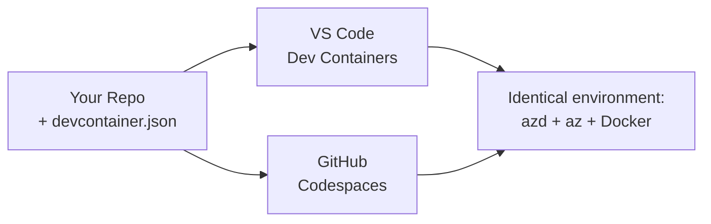

# Dev Containers & GitHub Codespaces untuk azd

**Navigasi Bab:**
- **📚 Laman Utama Kursus**: [AZD Untuk Pemula](../../README.md)
- **📖 Bab Semasa**: Bab 1 - Asas & Mula Cepat
- **⬅️ Sebelumnya**: [Bawa Aplikasi Anda Sendiri](bring-your-own-app.md)
- **🚀 Bab Seterusnya**: [Bab 2: Pembangunan Berasaskan AI](../chapter-02-ai-development/README.md)

> Sasaran semakan arahan dan konfigurasi: `azd 1.37.2` (November 2026). Pemasangan kontena dan penerapan Azure tidak dijalankan sebagai sebahagian daripada semakan ini.

## Pengenalan

Memasang azd, persekitaran runtime bahasa yang betul, Docker, dan Azure CLI pada setiap mesin adalah satu kerja berat—dan ini adalah sebab utama tutorial yang "berfungsi pada mesin saya" gagal untuk orang lain. Sebuah **dev container** menyelesaikan masalah ini dengan menggambarkan seluruh rantaian alat anda dalam satu fail. Sesiapa yang membuka projek dalam VS Code atau GitHub Codespaces akan mendapat persekitaran yang sama tepat, dengan azd sudah dipasang. Pelajaran ini menunjukkan cara menambahkannya.

## Matlamat Pembelajaran

Pada akhir pelajaran ini, anda akan:
- Memahami apa itu dev container dan mengapa ia membantu dengan azd
- Menambah `.devcontainer/devcontainer.json` minimal ke dalam projek
- Menyertakan azd, Azure CLI, dan Docker melalui *ciri* Dev Container
- Membuka projek dalam GitHub Codespaces atau VS Code

## Hasil Pembelajaran

Selepas melengkapkan pelajaran ini, anda akan dapat:
- Menulis `devcontainer.json` untuk projek azd
- Menambah azd dan alat Azure tanpa pemasangan manual
- Menjalankan `azd up` dari dalam kontena atau Codespace

---

## Apa Itu Dev Container?

Dev container adalah persekitaran pembangunan berasaskan Docker yang ditakrifkan oleh fail `.devcontainer/devcontainer.json` dalam repositori anda. Apabila anda membuka projek:

- **VS Code** (dengan sambungan Dev Containers) membina kontena dan menyambungkannya.
- **GitHub Codespaces** membina kontena yang sama di awan dan memberi anda penyunting berasaskan pelayar.

Dalam kedua-dua cara, setiap penyumbang mendapat alat yang sama — tiada lagi masalah "adakah anda sudah memasang azd?".



---

## Langkah 1: Cipta Fail devcontainer

Cipta `.devcontainer/devcontainer.json` di akar projek anda:

```json
{
  "name": "azd-project",
  "image": "mcr.microsoft.com/devcontainers/base:bookworm",
  "features": {
    "ghcr.io/devcontainers/features/azure-cli:1": {},
    "ghcr.io/azure/azure-dev/azd:0": { "version": "1.37.2" },
    "ghcr.io/devcontainers/features/docker-in-docker:2": {},
    "ghcr.io/devcontainers/features/node:1": {}
  },
  "customizations": {
    "vscode": {
      "extensions": [
        "ms-azuretools.azure-dev",
        "ms-azuretools.vscode-bicep"
      ]
    }
  },
  "forwardPorts": [3000],
  "postCreateCommand": "azd version"
}
```

Apa fungsi setiap bahagian:

| Kekunci | Tujuan |
|-----|---------|
| `image` | OS asas untuk kontena |
| `features` | Pemasang siap pakai — di sini: Azure CLI, **azd**, Docker, dan Node.js |
| `customizations.vscode.extensions` | Memasang secara automatik sambungan azd dan Bicep untuk VS Code |
| `forwardPorts` | Mendedahkan port aplikasi anda ke pelayar anda |
| `postCreateCommand` | Menjalankan sekali selepas kontena dibina (di sini, pemeriksaan kesihatan) |

> Versi ciri (`azd:0`) dan versi CLI yang dipasang adalah berbeza. Tetapkan pilihan `version` ciri kepada `"1.37.2"` untuk pin CLI; jangan gunakan versi CLI sebagai tag ciri.

---

## Langkah 2: Sesuaikan Ciri dengan Bahasa Aplikasi Anda

Tukar ciri `node` mengikut bahasa yang aplikasi anda gunakan:

```jsonc
// Python project
"ghcr.io/devcontainers/features/python:1": {},

// .NET project
"ghcr.io/devcontainers/features/dotnet:2": {},

// Java project
"ghcr.io/devcontainers/features/java:1": {},

// Go project
"ghcr.io/devcontainers/features/go:1": {}
```

Kekalkan `docker-in-docker` apabila membina imej secara tempatan. Binaan ACR jauh yang dikonfigurasi (`docker.remoteBuild: true`) adalah alternatif; jenis hos sahaja tidak semestinya memerlukan Docker tempatan.

---

## Langkah 3: Buka Ia

**Dalam VS Code:**
1. Pasang sambungan **Dev Containers**.
2. Buka folder projek.
3. Klik **Buka semula dalam Kontena** apabila dipaparkan (atau jalankan *Dev Containers: Reopen in Container*).

**Dalam GitHub Codespaces:**
1. Tolak repo ke GitHub.
2. Klik **Code → Codespaces → Create codespace on main**.
3. Tunggu kontena dibina — azd sedia dalam terminal.

---

## Langkah 4: Terapkan Dari Dalam Kontena

Kontena mempunyai azd yang sudah dipasang, jadi aliran kerja biasa hanya berfungsi:

```bash
azd auth login --use-device-code   # device code is handy inside Codespaces
azd up
```

> **Kenapa `--use-device-code`?** Dalam kontena jauh atau Codespace tiada pelayar tempatan untuk mengalihkan, jadi log masuk kod peranti adalah cara yang boleh dipercayai. Anda akan tampal kod ke tab pelayar untuk melengkapkan proses masuk.

---

## Kesilapan Biasa

| Kesilapan | Pembetulan |
|---------|-----|
| `azd up` tidak boleh bina imej | Tambah ciri `docker-in-docker` |
| Log masuk pelayar tergantung dalam Codespaces | Gunakan `azd auth login --use-device-code` |
| Alat berbeza antara rakan sepasukan | Pin CLI melalui pilihan `version` ciri azd dan pin runtime bahasa |
| Aplikasi tidak boleh diakses dalam pelayar | Tambah port ke `forwardPorts` |

---

## Ringkasan

- Dev container menjadikan rantaian alat azd anda boleh dihasilkan semula untuk semua orang.
- Tambah azd, Azure CLI, dan Docker melalui *ciri* Dev Container.
- Sesuaikan ciri bahasa dengan aplikasi anda dan kekalkan `docker-in-docker` untuk hos kontena.
- Gunakan log masuk kod peranti apabila menjalankan dalam Codespaces.

---

## 🔗 Navigasi

| Arah | Sumber |
|-----------|----------|
| **Sebelumnya** | [Bawa Aplikasi Anda Sendiri](bring-your-own-app.md) |
| **Laman Bab** | [Bab 1: Asas & Mula Cepat](README.md) |
| **Bab Seterusnya** | [Bab 2: Pembangunan Berasaskan AI](../chapter-02-ai-development/README.md) |

## 📖 Sumber Berkaitan

- [Pemasangan & Persediaan](installation.md)
- [Lembaran Cheat Arahan](../../resources/cheat-sheet.md)
- [Spesifikasi rasmi Dev Containers](https://containers.dev/)
- [ciri Dev Container azd](https://github.com/Azure/azure-dev/tree/main/ext/devcontainer)

---

<!-- CO-OP TRANSLATOR DISCLAIMER START -->
**Penafian**:
Dokumen ini telah diterjemahkan menggunakan perkhidmatan terjemahan AI [Co-op Translator](https://github.com/Azure/co-op-translator). Walaupun kami berusaha untuk ketepatan, sila ambil maklum bahawa terjemahan automatik mungkin mengandungi kesilapan atau ketidaktepatan. Dokumen asal dalam bahasa asalnya harus dianggap sebagai sumber yang sahih. Untuk maklumat penting, terjemahan oleh manusia profesional adalah disyorkan. Kami tidak bertanggungjawab terhadap sebarang salah faham atau salah tafsir yang timbul daripada penggunaan terjemahan ini.
<!-- CO-OP TRANSLATOR DISCLAIMER END -->