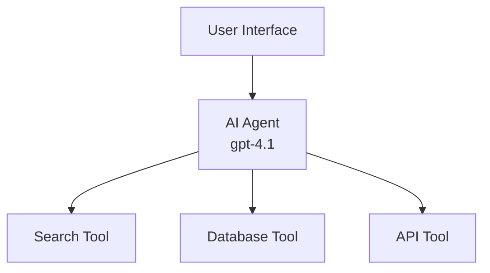
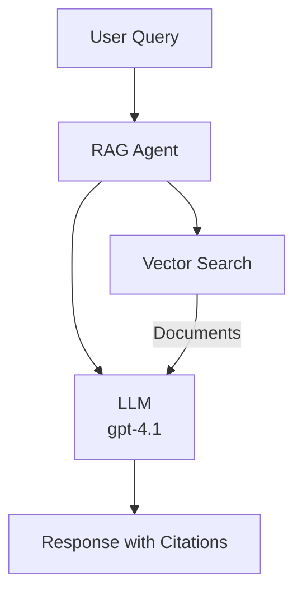
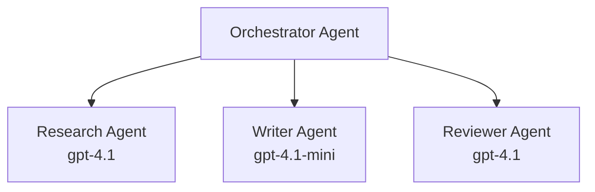

# Ejen AI dengan Azure Developer CLI

**Navigasi Bab:**
- **📚 Laman Utama Kursus**: [AZD Untuk Pemula](../../README.md)
- **📖 Bab Semasa**: Bab 2 - Pembangunan AI-Pertama
- **⬅️ Sebelum**: [Integrasi Microsoft Foundry](microsoft-foundry-integration.md)
- **➡️ Seterusnya**: [Penggunaan Model AI](ai-model-deployment.md)
- **🚀 Lanjutan**: [Penyelesaian Multi-Ejen](../../examples/retail-scenario.md)

---

## Pengenalan

Ejen AI adalah program autonomi yang boleh memahami persekitaran mereka, membuat keputusan, dan mengambil tindakan untuk mencapai matlamat tertentu. Berbeza dengan chatbot mudah yang memberi respon kepada arahan, ejen boleh:

- **Menggunakan alat** - Memanggil API, mencari dalam pangkalan data, menjalankan kod
- **Merancang dan berfikir** - Memecahkan tugasan kompleks kepada langkah-langkah
- **Belajar dari konteks** - Menyimpan memori dan menyesuaikan tingkah laku
- **Bekerjasama** - Bekerja dengan ejen lain (sistem multi-ejen)

Panduan ini menunjukkan cara menggunakan ejen AI ke Azure menggunakan Azure Developer CLI (azd).

Menggunakan konteks perbualan bukanlah latihan model: memori berterusan, kawalan capaian, dan pengekalan mesti dilaksanakan/dikonfigurasi oleh aplikasi.

> **Ulasan keluaran (2026-11-04):** Contoh CLI telah diperiksa berdasarkan dokumentasi/sumber `azd` `1.37.2`, `azure.ai.agents` `1.0.0-beta.23`, dan `azure.ai.evaluations` `1.0.0-beta.2`, bukan penerapan Azure secara langsung. Gunakan `azd >= 1.37.0` untuk aliran kerja gabungan. Lihat [perubahan dan pembetulan terkini](../chapter-08-production/production-ai-practices.md#recent-release-changes-and-fixes) sebelum menaik taraf projek lama.

## Matlamat Pembelajaran

Dengan menyiapkan panduan ini, anda akan:
- Memahami apa itu ejen AI dan bagaimana ia berbeza daripada chatbot
- Menggunakan templat ejen AI yang telah dibina dengan AZD
- Mengkonfigurasi Ejen Foundry untuk ejen tersuai
- Melaksanakan corak ejen asas (penggunaan alat, RAG, multi-ejen)
- Memantau dan membuang pepijat ejen yang telah digunakan

## Hasil Pembelajaran

Setelah selesai, anda akan boleh:
- Menggunakan aplikasi ejen AI ke Azure dengan satu arahan
- Mengkonfigurasi alat dan kebolehan ejen
- Melaksanakan penjanaan diperkaya pengambilan (RAG) dengan ejen
- Mereka bentuk seni bina multi-ejen untuk aliran kerja kompleks
- Mengesan masalah biasa dalam penggunaan ejen

---

## 🤖 Apa Yang Membezakan Ejen daripada Chatbot?

| Ciri | Chatbot | Ejen AI |
|---------|---------|----------|
| **Tingkah Laku** | Memberi respon kepada arahan | Mengambil tindakan secara autonomi |
| **Alat** | Mungkin menggunakan pengambilan atau alat | Biasa menggunakan alat dalam gelung berorientasikan matlamat |
| **Memori** | Bergantung pada aplikasi | Memori berterusan hanya jika dilaksanakan dengan jelas |
| **Perancangan** | Respon tunggal | Pemikiran berbilang langkah |
| **Kerjasama** | Entiti tunggal | Boleh bekerjasama dengan ejen lain |

### Analogi Mudah

- **Chatbot** = Seorang yang membantu menjawab soalan di kaunter maklumat
- **Ejen AI** = Pembantu peribadi yang boleh membuat panggilan, menempah janji, dan menyelesaikan tugasan untuk anda

---

## 🚀 Mula Pantas: Gunakan Ejen Pertama Anda

Pilih satu pilihan dalam **direktori kerja kosong baru**. Trailing `.` menginisialisasi di situ; tanpa destinasi eksplisit, AZD semasa mungkin mencipta subdirektori bernama template dan tidak menukar direktori shell anda. Simpan templat/persekitaran berasingan dalam direktori berasingan.

Julat masa/kos di bawah adalah ilustrasi, bukan sebut harga yang disahkan. Periksa keperluan semasa setiap sampel, harga, kuota model, dan perkhidmatan pilihan sebelum penggunaan.

### Pilihan 1: Templat Ejen Foundry (Disyorkan)

```bash
# Initialize the AI agents template
azd init --template get-started-with-ai-agents .

# Deploy to Azure
azd up
```

**Apa yang digunakan:** Infrastruktur semasa sampel dan pilihan yang dipilih menentukan model, alat, hosting, dan sumber pemantauan. Semak README dan `infra/` sebelum membekalkan; jangan menganggap setiap templat ejen termasuk Carian atau antaramuka web.

**Masa:** ~15-20 minit
**Kos:** ~$100-150/bulan (pembangunan)

### Pilihan 2: Ejen Penulisan Kreatif dengan Prompty

```bash
# Initialize the Prompty-based agent template
azd init --template https://github.com/Azure-Samples/contoso-creative-writer .

# Deploy to Azure
azd up
```

**Apa yang digunakan:** Sampel penulisan multi-ejen FastAPI/Prompty menggunakan Azure OpenAI, Bing Grounding, dan Azure AI Search. Repositori lama `agent-openai-python-prompty` mengarahkan ke sini; ia bukan templat ejen cuaca Azure Functions minimal. Ikuti README semasa untuk hosting, kuota model, dan keperluan Bing Grounding.

**Masa:** ~10-15 minit
**Kos:** ~$50-100/bulan (pembangunan)

### Pilihan 3: Ejen Sembang RAG

```bash
# Initialize RAG chat template
azd init --template azure-search-openai-demo .

# Deploy to Azure
azd up
```

**Apa yang digunakan:**
- ✅ Model Microsoft Foundry
- ✅ Azure AI Search dengan data sampel
- ✅ Rantaian pemprosesan dokumen
- ✅ Antaramuka sembang dengan rujukan

**Masa:** ~15-25 minit
**Kos:** ~$80-150/bulan (pembangunan)

### Pilihan 4: AZD AI Agent Init (Pratonton Templat Projek)

Gunakan `azd ai agent init` secara interaktif, atau guna projek ejen `azure.yaml` semasa dengan `--template`/`-t`. Pilihan lama `--manifest`/`-m` adalah alias yang tidak digunakan lagi, bukan penukar untuk manifest warisan.

```bash
# Install the AI agents extension
azd extension install azure.ai.agents

# Optional: verify the installed preview version
azd extension show azure.ai.agents

# Initialize from a current agent project template (supply your template path)
azd ai agent init --template ./templates/support-agent/azure.yaml

# Deploy to Azure
azd up

# Test the deployed agent (shows latency + time-to-first-byte)
azd ai agent invoke
```

**Bila menggunakan `azd ai agent init` vs `azd init --template`:**

| Pendekatan | Sesuai Untuk | Cara Kerjanya |
|----------|----------|------|
| `azd init --template` | Bermula dari aplikasi sampel berfungsi | Menyalin repositori templat penuh dengan kod + infrastruktur |
| `azd ai agent init --template` | Mengguna projek ejen Foundry semasa | Menggunakan dokumen projek `azure.yaml` dan definisinya |

> **Petua:** Gunakan `azd init --template` semasa belajar (Pilihan 1-3 di atas). Gunakan `azd ai agent init` untuk aliran kerja ejen Foundry. Untuk menambah definisi ejen terus ke projek sedia ada, lihat [panduan inisialisasi dan migrasi](../chapter-08-production/production-ai-practices.md#initializing-agent-projects-with-azd-ai-agent-init).

Selepas `azd up`, gunakan `azd ai agent invoke` untuk menguji, peluasan `azure.ai.evaluations` berasingan (`azd ai eval init`, `generate`, dan `run start`) untuk mengukur kualiti, dan `azd ai agent optimize` untuk meningkatkannya menggunakan konfigurasi penilaian baru. Agents beta.22 menggantikan aliran kerja penilaian legacy dan mengubah format `--config` pengoptimuman. Lihat [migrasi penilaian](../chapter-08-production/production-ai-practices.md#evaluation-migration-and-quality-checks) dan [migrasi pengoptimuman](../chapter-08-production/production-ai-practices.md#optimization-configuration-migration) sebelum menggunakan semula contoh lama.

---

## 🏗️ Corak Seni Bina Ejen

### Corak 1: Ejen Tunggal dengan Alat

Corak ejen paling mudah - satu ejen yang boleh menggunakan pelbagai alat.



**Sesuai untuk:**
- Bot sokongan pelanggan
- Pembantu penyelidikan
- Ejen analisis data

**Contoh aplikasi berkaitan:** `azure-search-openai-demo` menunjukkan RAG, bukan gelung ejen alat sewenang-wenangnya generik.

### Corak 2: Ejen RAG (Penjanaan Diperkaya Pengambilan)

Ejen yang mengambil dokumen berkaitan sebelum menjana respon.



**Sesuai untuk:**
- Pangkalan pengetahuan perusahaan
- Sistem soal jawab dokumen
- Penyelidikan pematuhan dan undang-undang

**Templat AZD:** `azure-search-openai-demo`

### Corak 3: Sistem Multi-Ejen

Beberapa ejen khusus yang bekerjasama dalam tugasan kompleks.



**Sesuai untuk:**
- Penjanaan kandungan kompleks
- Aliran kerja berbilang langkah
- Tugasan yang memerlukan kepakaran berbeza

**Ketahui Lebih Lanjut:** [Corak Penyelarasan Multi-Ejen](../chapter-06-pre-deployment/coordination-patterns.md)

---

## ⚙️ Mengkonfigurasi Alat Ejen

Ejen menjadi berkuasa apabila mereka boleh menggunakan alat. Berikut cara mengkonfigurasi alat biasa:

### Konfigurasi Alat dalam Ejen Foundry

Fragmen **SDK Perkhidmatan Ejen klasik** ini menyasarkan `azure-ai-projects==1.0.0` dan `azure-ai-agents==1.1.0` dengan `azure-identity`. Ia bukan versi API versioned-agent/Responses yang lebih baru yang digunakan oleh beberapa templat Foundry semasa, juga bukan sambungan AZD `azure.ai.agents` (pakej berbeza). Jangan campurkan generasi API ini. Tetapkan `PROJECT_ENDPOINT` ke titik akhir projek Foundry klasik dan `MODEL_DEPLOYMENT_NAME` ke penempatan model yang disokong; sahkan dengan `az login` secara tempatan dan berikan kebenaran projek yang diperlukan.

```python
# agent_config.py
import os
from azure.ai.projects import AIProjectClient
from azure.ai.agents.models import FunctionTool
from azure.identity import DefaultAzureCredential

def search_knowledge_base(query: str) -> str:
    """Search the demonstration knowledge base.

    :param query: Search text.
    :return: Matching demonstration information.
    """
    # Local fixture only, not a production search implementation.
    return "Demo policy: returns are accepted within 30 days."

project_client = AIProjectClient(
    endpoint=os.environ["PROJECT_ENDPOINT"],
    credential=DefaultAzureCredential(),
)
search_tool = FunctionTool(functions={search_knowledge_base})
project_client.agents.enable_auto_function_calls(search_tool)
agent = project_client.agents.create_agent(
    model=os.environ["MODEL_DEPLOYMENT_NAME"],
    name="Support Agent",
    instructions="Use search_knowledge_base for policy questions. Label results as demo data.",
    tools=search_tool.definitions,
)
```

Mendaftarkan skema fungsi tidak menjalankan Python pada perkhidmatan. Dalam SDK ini, `enable_auto_function_calls` ditambah `agents.runs.create_and_process(...)` menjalankan panggilan balik yang didaftarkan dalam proses klien anda. Lihat [contoh SDK yang dikeluarkan](https://github.com/Azure/azure-sdk-for-python/blob/azure-ai-agents_1.1.0/sdk/ai/azure-ai-agents/samples/agents_tools/sample_agents_auto_function_call.py). Tutup klien dan hapus agen/benang demonstrasi apabila selesai.

### Konfigurasi Persekitaran

Nama berikut adalah **input templat tersuai ilustratif**, bukan suis terbina dalam AZD. Pertama hubungkan setiap nilai melalui `infra/main.parameters.json`, infrastruktur, dan kod aplikasi. `azd env set` sahaja tidak mengubah alat atau arahan agen.

```bash
# Set up agent-specific environment variables
azd env set AZURE_OPENAI_MODEL "gpt-4.1"
azd env set AGENT_INSTRUCTIONS "You are a helpful assistant..."
azd env set ENABLE_CODE_INTERPRETER "true"
azd env set ENABLE_FILE_SEARCH "true"

# Apply wired infrastructure and application changes
azd up
```

---

## 📊 Memantau Ejen

### Integrasi Application Insights

Jika templat yang anda pilih menyediakan Application Insights dan mengkonfigurasi instrumentasi:

```bash
# Open monitoring dashboard
azd monitor --overview

# Open the Application Insights logs view (not a streaming log tail)
azd monitor --logs

# View live metrics
azd monitor --live
```

### Metrik Utama Untuk Jejak

| Metrik | Deskripsi | Sasaran |
|--------|-------------|--------|
| Purata Respons | Masa untuk menjana respons | < 5 saat |
| Penggunaan Token | Token setiap permintaan | Pantau untuk kos |
| Kadar Kejayaan Panggilan Alat | % pelaksanaan alat berjaya | > 95% |
| Kadar Ralat | Permintaan ejen gagal | < 1% |
| Kepuasan Pengguna | Skor maklum balas | > 4.0/5.0 |

### Log Tersuai untuk Ejen

```python
import os
from azure.monitor.opentelemetry import configure_azure_monitor
from opentelemetry import trace

# Configure Azure Monitor with OpenTelemetry
configure_azure_monitor(
    connection_string=os.environ["APPLICATIONINSIGHTS_CONNECTION_STRING"]
)

tracer = trace.get_tracer(__name__)

def log_agent_interaction(user_query, agent_response, tools_used, latency_ms):
    with tracer.start_as_current_span("agent_interaction") as span:
        span.set_attributes({
            "query_length": len(user_query),  # Do not log raw prompts or personal data
            "response_length": len(agent_response),
            "tools_used": tools_used,
            "latency_ms": latency_ms
        })
```

> **Nota:** Pasang pakej yang diperlukan: `pip install azure-monitor-opentelemetry`. Ia membawa kebergantungan OpenTelemetry; namespace import bukan keperluan untuk memasang pakej bernama `opentelemetry`.

---

## 💰 Pertimbangan Kos

### Anggaran Kos Bulanan Mengikut Corak

Ini adalah julat perancangan ilustratif, bukan sebut harga atau had perbelanjaan. Wilayah, token model, SKU Carian/pengkomputeran, sesi alat, penyimpanan, dan trafik boleh melebihi. Semak panduan kos contoh dan harga Azure sebelum `azd up`.

| Corak | Persekitaran Dev | Pengeluaran |
|---------|-----------------|------------|
| Ejen Tunggal | $50-100 | $200-500 |
| Ejen RAG | $80-150 | $300-800 |
| Multi-Ejen (2-3 ejen) | $150-300 | $500-1,500 |
| Multi-Ejen Perusahaan | $300-500 | $1,500-5,000+ |

### Petua Pengoptimuman Kos

1. **Guna gpt-4.1-mini untuk tugasan mudah** (hanya jika templat anda menggunakan input ini)
   ```bash
   azd env set AZURE_OPENAI_MODEL "gpt-4.1-mini"
   ```

2. **Laksanakan caching terhad untuk pertanyaan berulang yang selamat.** Sertakan kebenaran penyewa/pengguna, penempatan model, arahan, dan versi pengambilan dalam kunci cache; tetapkan tempoh luput. Jangan kongsi respons perbualan peribadi melalui cache pertanyaan sahaja seluruh proses. Objek ejen SDK tidak mempunyai kaedah generik `agent.run()`.

3. **Tetapkan had token setiap larian**
   ```python
   # Set max_completion_tokens when running the agent, not during creation
   run = project_client.agents.runs.create_and_process(
       thread_id=thread.id,
       agent_id=agent.id,
       max_completion_tokens=1000  # Budget across the run; may finish as incomplete
   )
   ```

4. **Skala Container Apps layak ke sifar apabila tidak digunakan**
   ```bash
   # Custom-template input: must map to template.scale.minReplicas
   azd env set MIN_REPLICAS "0"
   ```
   Terapkan perubahan infrastruktur dengan `azd provision` atau `azd up`. Skala ke sifar memerlukan pencetus sesuai dan tidak menghentikan caj Carian, penyimpanan, atau model/alat.

---

## 🔧 Menyelesaikan Masalah Ejen

### Isu dan Penyelesaian Biasa

<details>
<summary><strong>❌ Ejen tidak responsif terhadap panggilan alat</strong></summary>

```bash
# Inspect the application deployment (not the agent's registered tools)
azd show

# Verify OpenAI deployment
az cognitiveservices account deployment list \
  --name $AZURE_OPENAI_NAME \
  --resource-group $RG_NAME

# Check agent logs
azd monitor --logs
```

**Punca biasa:**
- Tandatangan fungsi alat tidak sepadan
- Kebenaran diperlukan hilang
- Titik akhir API tidak boleh diakses
</details>

<details>
<summary><strong>❌ Latensi tinggi dalam respons ejen</strong></summary>

```bash
# Check Application Insights for bottlenecks
azd monitor --live

# Consider using a faster model
azd env set AZURE_OPENAI_MODEL "gpt-4.1-mini"
azd up
```

**Petua pengoptimuman:**
- Guna respons penstriman
- Laksanakan caching respons
- Kurangkan saiz tetingkap konteks
</details>

<details>
<summary><strong>❌ Ejen memulangkan maklumat salah atau halusinasi</strong></summary>

```python
# Improve with better system prompts
instructions = """
You are a helpful assistant. IMPORTANT:
- Only answer based on provided context
- If you don't know, say "I don't know"
- Always cite your sources
- Never make up information
"""

# Use these instructions in the agent definition.
# For classic file search, first upload/index documents in a vector store,
# then use FileSearchTool(vector_store_ids=[...]) and pass both its
# .definitions and .resources when creating the agent.
```
Arahan dan pengambilan mengurangkan risiko; tiada jaminan jawapan fakta. Nilai soalan berasaskan dan di luar skop terhadap jawapan diketahui.
</details>

<details>
<summary><strong>❌ Ralat melebihi had token</strong></summary>

```python
# Implement context window management
def truncate_context(messages, max_tokens=8000, model="gpt-4.1"):
    """Approximate content-only budget for objects with .content strings."""
    import tiktoken
    encoding = tiktoken.encoding_for_model(model)
    total_tokens = 0
    truncated = []
    
    for msg in reversed(messages):
        msg_tokens = len(encoding.encode(msg.content))
        if total_tokens + msg_tokens > max_tokens:
            break
        truncated.insert(0, msg)
        total_tokens += msg_tokens
    
    return truncated
```
Pembantu ini mengecualikan skema peranan/alat, arahan sistem, token gambar, dan overhead protokol. Simpan ruang untuk itu dan penyelesaian; jangan pisah pasangan panggilan alat/hasil atau buang arahan sistem yang diperlukan. Pasang `tiktoken` secara berasingan. Ia bukan validator tetingkap konteks umum.
</details>

---

## 🎓 Latihan Praktikal

### Latihan 1: Lancarkan Ejen Asas (20 minit)

**Matlamat:** Lancarkan ejen AI pertama anda menggunakan AZD

```bash
# Step 1: Initialize template
azd init --template get-started-with-ai-agents .

# Step 2: Login to Azure
azd auth login
# If you work across tenants, add --tenant-id <tenant-id>

# Step 3: Deploy
azd up

# Step 4: Test the agent
# Expected output after deployment:
#   Deployment Complete!
#   Endpoint: https://<app-name>.<region>.azurecontainerapps.io
# Open the URL shown in the output and try asking a question

# Step 5: View monitoring
azd monitor --overview

# Step 6: Clean up
azd down --force --purge
```

**Kriteria Kejayaan:**
- [ ] Ejen memberi respons kepada soalan
- [ ] Boleh akses papan pemantauan melalui `azd monitor`
- [ ] Sumber dibersihkan dengan jayanya

### Latihan 2: Tambah Alat Tersuai (30 minit)

**Matlamat:** Luaskan ejen dengan alat tersuai

**Titik mula:** Gunakan klien SDK klasik dari [Konfigurasi Alat](#tool-configuration-in-foundry-agents), bukan templat sewenang-wenangnya dengan generasi SDK berbeza.

1. Tambahkan fixture deterministik ini ke `agent_config.py`:
   ```python
   def get_weather(location: str) -> str:
       """Return demonstration weather, not live conditions.

       :param location: City name.
       :return: A clearly labelled fixture.
       """
       print(f"TOOL_CALLED: {location}")
       return f"Demo weather in {location}: Sunny, 72°F (fixture, not live)"
   ```
2. Gantikan blok pendaftaran dan penciptaan alat carian dengan:
   ```python
   weather_tool = FunctionTool(functions={get_weather})
   project_client.agents.enable_auto_function_calls(weather_tool)
   agent = project_client.agents.create_agent(
       model=os.environ["MODEL_DEPLOYMENT_NAME"],
       name="Weather Agent",
       instructions="Call get_weather for weather questions; explain that it returns demo data.",
       tools=weather_tool.definitions,
   )
   thread = project_client.agents.threads.create()
   try:
       project_client.agents.messages.create(
           thread_id=thread.id, role="user", content="Use get_weather for Seattle."
       )
       run = project_client.agents.runs.create_and_process(
           thread_id=thread.id, agent_id=agent.id
       )
       if run.status != "completed":
           raise RuntimeError(f"Run status: {run.status}; error: {run.last_error}")
       for message in project_client.agents.messages.list(thread_id=thread.id):
           for text in message.text_messages:
               print(text.text.value)
   finally:
       project_client.agents.threads.delete(thread.id)
       project_client.agents.delete_agent(agent.id)
       project_client.close()
   ```
3. Jalankan secara tempatan (ini memanggil projek Azure sedia ada dan mengenakan caj model):
   ```bash
   python agent_config.py
   # Expected: TOOL_CALLED: Seattle, then a completed answer labelled demo data.
   ```

**Kriteria Kejayaan:**
- [ ] Ejen mengenal pasti pertanyaan berkaitan cuaca
- [ ] Alat dipanggil dengan betul
- [ ] Respons termasuk maklumat cuaca

### Latihan 3: Bina Ejen RAG (45 minit)

**Matlamat:** Cipta ejen yang menjawab soalan daripada dokumen anda

```bash
# Step 1: Deploy RAG template
azd init --template azure-search-openai-demo .
azd up

# Step 2: Upload your documents
# For the sample's local ingestion path, place supported files in data/.
# Run from the sample root after following its Python environment setup:
./scripts/prepdocs.sh
# Windows PowerShell equivalent: .\\scripts\\prepdocs.ps1

# Step 3: Test with domain-specific questions
# Open the web app URL from the azd up output
# Ask questions about your uploaded documents
# Responses should include citation references like [doc.pdf]
```

**Kriteria Kejayaan:**
- [ ] Ejen menjawab dari dokumen yang dimuat naik
- [ ] Respons mengandungi sitasi
- [ ] Soalan ujian di luar skop ditangani tanpa tuntutan yang tidak disokong (bukan jaminan untuk setiap soalan masa hadapan)

Jika `USE_CLOUD_INGESTION=true`, gunakan aliran kerja pengambilan/muat naik awan contoh sebaliknya; pembalut tempatan sengaja melewati pengambilan. Selepas ujian, jalankan `azd down` dalam persekitaran RAG dan semak sumber untuk dipadamkan.

---

## 📚 Langkah Seterusnya

Sekarang anda faham ejen AI, terokai topik lanjutan ini:

| Topik | Penerangan | Pautan |
|-------|-------------|------|
| **Sistem Pelbagai Ejen** | Bina sistem dengan beberapa ejen yang bekerjasama | [Contoh Runcit Pelbagai Ejen](../../examples/retail-scenario.md) |
| **Corak Penyelarasan** | Pelajari pola orchestrasi dan komunikasi | [Corak Penyelarasan](../chapter-06-pre-deployment/coordination-patterns.md) |
| **Penggunaan Produksi** | Penggunaan ejen sedia perusahaan | [Amalan AI Produksi](../chapter-08-production/production-ai-practices.md) |
| **Penilaian Ejen** | Uji dan nilai prestasi ejen | [Penyelesaian Masalah AI](../chapter-07-troubleshooting/ai-troubleshooting.md) |
| **Makmal Bengkel AI** | Hands-on: Jadikan penyelesaian AI anda sedia AZD | [Makmal Bengkel AI](ai-workshop-lab.md) |

---

## 📖 Sumber Tambahan

### Dokumentasi Rasmi
- [Perkhidmatan Ejen Microsoft Foundry](https://learn.microsoft.com/azure/ai-services/agents/)
- [Permulaan Cepat Perkhidmatan Ejen Microsoft Foundry](https://learn.microsoft.com/azure/ai-services/agents/quickstart)
- [Kerangka Ejen Semantic Kernel](https://learn.microsoft.com/semantic-kernel/)

### Templat AZD untuk Ejen
- [Mulakan dengan Ejen AI](https://github.com/Azure-Samples/get-started-with-ai-agents)
- [Ejen Penulisan Kreatif dengan Prompty](https://github.com/Azure-Samples/contoso-creative-writer)
- [Demo Azure Search OpenAI](https://github.com/Azure-Samples/azure-search-openai-demo)

### Sumber Komuniti
- [Awesome AZD - Templat Ejen](https://azure.github.io/awesome-azd/?tags=ai-agents)
- [Azure AI Discord](https://discord.gg/microsoft-azure)
- [Microsoft Foundry Discord](https://discord.gg/nTYy5BXMWG)

### Kemahiran Ejen untuk Penyunting Anda
- [**Kemahiran Ejen Microsoft Azure**](https://skills.sh/microsoft/github-copilot-for-azure) - Pasang kemahiran ejen AI boleh guna semula untuk pembangunan Azure dalam GitHub Copilot, Cursor, atau ejen yang disokong. Termasuk kemahiran untuk [Azure AI](https://skills.sh/microsoft/github-copilot-for-azure/azure-ai), [Microsoft Foundry](https://skills.sh/microsoft/github-copilot-for-azure/microsoft-foundry), [penggunaan](https://skills.sh/microsoft/github-copilot-for-azure/azure-deploy), dan [diagnostik](https://skills.sh/microsoft/github-copilot-for-azure/azure-diagnostics):
  ```bash
  npx skills add microsoft/github-copilot-for-azure
  ```

---

**Navigasi**
- **Pelajaran Sebelumnya**: [Integrasi Microsoft Foundry](microsoft-foundry-integration.md)
- **Pelajaran Seterusnya**: [Penggunaan Model AI](ai-model-deployment.md)

---

<!-- CO-OP TRANSLATOR DISCLAIMER START -->
**Penafian**:
Dokumen ini telah diterjemahkan menggunakan perkhidmatan terjemahan AI [Co-op Translator](https://github.com/Azure/co-op-translator). Walaupun kami berusaha untuk ketepatan, sila ambil maklum bahawa terjemahan automatik mungkin mengandungi kesilapan atau ketidaktepatan. Dokumen asal dalam bahasa asalnya harus dianggap sebagai sumber yang sahih. Untuk maklumat penting, terjemahan oleh manusia profesional adalah disyorkan. Kami tidak bertanggungjawab terhadap sebarang salah faham atau salah tafsir yang timbul daripada penggunaan terjemahan ini.
<!-- CO-OP TRANSLATOR DISCLAIMER END -->