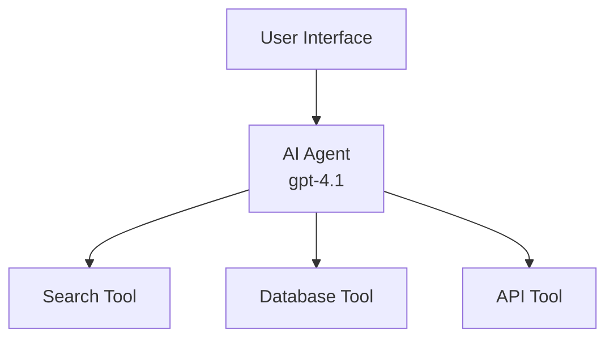
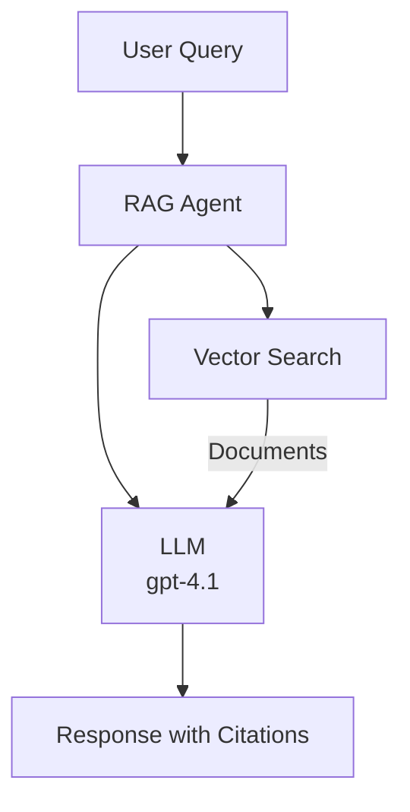
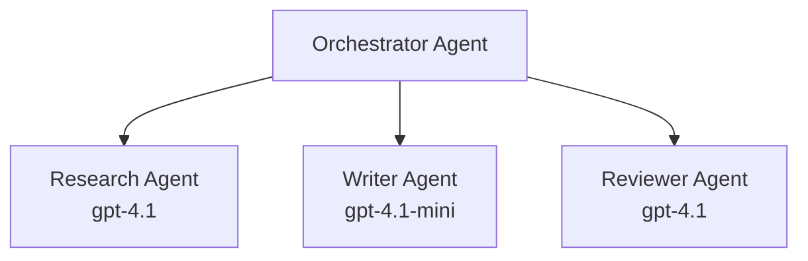

# Ejen AI dengan Azure Developer CLI

**Navigasi Bab:**
- **📚 Laman Utama Kursus**: [AZD Untuk Pemula](../../README.md)
- **📖 Bab Semasa**: Bab 2 - Pembangunan AI-Pertama
- **⬅️ Sebelumnya**: [Integrasi Microsoft Foundry](microsoft-foundry-integration.md)
- **➡️ Seterusnya**: [Penggunaan Model AI](ai-model-deployment.md)
- **🚀 Lanjutan**: [Penyelesaian Multi-Ejen](../../examples/retail-scenario.md)

---

## Pengenalan

Ejen AI adalah program autonomi yang boleh menyedari persekitaran mereka, membuat keputusan, dan mengambil tindakan untuk mencapai matlamat tertentu. Berbeza dengan chatbot ringkas yang memberi respons kepada permintaan, ejen boleh:

- **Menggunakan alat** - Panggil API, cari dalam pangkalan data, jalankan kod
- **Membuat rancangan dan berfikir** - Memecahkan tugas kompleks kepada langkah-langkah
- **Belajar daripada konteks** - Mengekalkan memori dan menyesuaikan tingkah laku
- **Bekerjasama** - Bekerja dengan ejen lain (sistem multi-ejen)

Panduan ini menunjukkan cara menggunakan ejen AI ke Azure menggunakan Azure Developer CLI (azd).

Menggunakan konteks perbualan bukan latihan model: memori berterusan, kawalan akses, dan penyimpanan mesti dilaksanakan/dikonfigurasi oleh aplikasi.

> **Kemas kini Foundry GA (2026-11-09):** Pasang bundel `microsoft.foundry` 1.0 yang tersedia umum dengan `azd >= 1.37.0`. Penilaian dipasang secara berasingan; ciri pratayang pilihan dan fragmen SDK klasik di bawah tidak dipromosikan ke GA oleh pengumuman bundel. Panduan ini berdasarkan pada [pengumuman GA](https://devblogs.microsoft.com/azure-sdk/microsoft-foundry-azure-developer-cli-ga/) dan dokumentasi, bukan pengendalian langsung Azure.

## Matlamat Pembelajaran

Dengan menyelesaikan panduan ini, anda akan:
- Memahami apa itu ejen AI dan bagaimana ia berbeza daripada chatbot
- Menyebarkan templat ejen AI pra-binaan menggunakan AZD
- Mengkonfigurasikan Ejen Foundry untuk ejen tersuai
- Melaksanakan corak asas ejen (penggunaan alat, RAG, multi-ejen)
- Memantau dan membaiki ejen yang disebarkan

## Hasil Pembelajaran

Setelah selesai, anda akan dapat:
- Menyebarkan aplikasi ejen AI ke Azure dengan satu arahan sahaja
- Mengkonfigurasikan alat dan keupayaan ejen
- Melaksanakan penghasilan dipertingkatkan pengambilan (RAG) dengan ejen
- Mereka bentuk seni bina multi-ejen untuk aliran kerja kompleks
- Menyelesaikan masalah biasa dalam penyebaran ejen

---

## 🤖 Apa Yang Membezakan Ejen daripada Chatbot?

| Ciri | Chatbot | Ejen AI |
|---------|---------|----------|
| **Tingkah Laku** | Memberi respons kepada permintaan | Mengambil tindakan secara autonomi |
| **Alat** | Mungkin menggunakan pengambilan atau alat | Biasanya menggunakan alat dalam kitaran berorientasikan matlamat |
| **Memori** | Bergantung pada aplikasi | Memori berterusan hanya jika dilaksanakan secara jelas |
| **Perancangan** | Respons tunggal | Pemikiran berbilang langkah |
| **Kerjasama** | Entiti tunggal | Boleh bekerja dengan ejen lain |

### Analogi Ringkas

- **Chatbot** = Seorang yang membantu menjawab soalan di kaunter maklumat
- **Ejen AI** = Pembantu peribadi yang boleh membuat panggilan, menempah janji, dan melaksanakan tugas untuk anda

---

## 🚀 Mula Pantas: Sebarkan Ejen Pertama Anda

Pilih satu pilihan dalam **direktori kerja baru yang kosong**. Arahan `.` di hujung memulakan di situ; tanpa destinasi jelas, AZD semasa mungkin membuat subdirektori bernama template dan tidak menukar direktori shell anda. Simpan templat/persekitaran berasingan dalam direktori berasingan.

Julat masa/kos berikut adalah ilustratif, bukan sebut harga yang disahkan. Semak prasyarat, harga, kuota model dan perkhidmatan pilihan setiap sampel sebelum penyebaran.

### Pilihan 1: Templat Ejen Foundry (Disarankan)

```bash
# Initialize the AI agents template
azd init --template get-started-with-ai-agents .

# Deploy to Azure
azd up
```

**Apa yang disebarkan:** Infrastruktur semasa sampel dan pilihan yang dipilih menentukan model, alat, hosting, dan sumber pemantauan. Semak README dan `infra/` sebelum penyediaan; jangan anggap setiap templat ejen termasuk Carian atau antara muka web.

**Masa:** ~15-20 minit
**Kos:** ~$100-150/bulan (pembangunan)

### Pilihan 2: Ejen Penulisan Kreatif dengan Prompty

```bash
# Initialize the Prompty-based agent template
azd init --template https://github.com/Azure-Samples/contoso-creative-writer .

# Deploy to Azure
azd up
```

**Apa yang disebarkan:** Sampel penulisan multi-ejen FastAPI/Prompty menggunakan Azure OpenAI, Bing Grounding, dan Azure AI Search. Repositori sebelumnya `agent-openai-python-prompty` mengalihkan ke sini; ini bukan templat ejen cuaca Azure Functions yang minimal. Ikuti README semasanya untuk hosting, kuota model, dan prasyarat Bing Grounding.

**Masa:** ~10-15 minit
**Kos:** ~$50-100/bulan (pembangunan)

### Pilihan 3: Ejen RAG Chat

```bash
# Initialize RAG chat template
azd init --template azure-search-openai-demo .

# Deploy to Azure
azd up
```

**Apa yang disebarkan:**
- ✅ Model Microsoft Foundry
- ✅ Azure AI Search dengan data sampel
- ✅ Saluran pemprosesan dokumen
- ✅ Antara muka chat dengan sitasi

**Masa:** ~15-25 minit
**Kos:** ~$80-150/bulan (pembangunan)

### Pilihan 4: Ejen Di-host dengan Bundel Foundry GA

Gunakan [panduan lengkap ejen di-host](microsoft-foundry-integration.md#hosted-agent-walkthrough-ga) untuk contoh API Respons Rangka Kerja Ejen Python asas. Laluan penyebaran kod ini memerlukan Python 3.13+, uv semasa, kebenaran Foundry, dan kuota model serantau. Sahkan panggilan SDK tempatan secara berasingan apabila menggunakan kredensial Azure CLI.

```bash
azd auth login
azd ext install microsoft.foundry
```

Dalam direktori kosong, inisialisasi sampel:

```text
azd ai agent init --template https://github.com/microsoft-foundry/foundry-samples/blob/main/samples/python/hosted-agents/agent-framework/responses/01-basic/azure.yaml --deploy-mode code --src .
```

Pilih projek baru atau sedia ada, semak `azure.yaml`, dan jalankan `azd provision`. Gunakan `azd ai agent run` untuk membuka Agent Inspector dan, dari terminal lain dalam direktori itu, `azd ai agent invoke --local "Explain how this agent is hosted."`. Selepas pengesahan tempatan, gunakan `azd deploy` dan `azd ai agent invoke "Explain how this agent is hosted."` untuk membandingkan respons yang disebarkan. Foundry membina sumber yang dimuat naik secara jauh; pembinaan bekas tempatan tidak diperlukan.

**Bilakah menggunakan `azd ai agent init` berbanding `azd init --template`:**

| Pendekatan | Terbaik Untuk | Cara Kerjanya |
|----------|----------|------|
| `azd init --template` | Bermula dari aplikasi sampel yang berfungsi | Mengklon repo templat penuh dengan kod + infra |
| `azd ai agent init --template` | Mengadaptasi projek ejen Foundry semasa | Menggunakan dokumen projek `azure.yaml` dan definisinya |

> **Tip:** Pilihan 1-3 bermula dari templat aplikasi penuh; Pilihan 4 mengajar aliran kerja ejen di-host GA. Tiada arahan inisialisasi yang memindahkan manifes ejen lama secara automatik. Untuk menambah definisi ejen terus ke projek sedia ada, lihat [panduan inisialisasi dan migrasi](../chapter-08-production/production-ai-practices.md#initializing-agent-projects-with-azd-ai-agent-init).

Pasang `azure.ai.evaluations` secara berasingan untuk menjana dan menyemak data/parameter ujian, mengkonfigurasikan penilaian, dan menjalankannya menggunakan `azd ai eval`. Pengoptimuman boleh menggunakan semula penilaian yang serasi; semak calon sebelum menyebarkan secara eksplisit. Ikuti [aliran kerja penilaian](../chapter-08-production/production-ai-practices.md#evaluation-migration-and-quality-checks) dan [migrasi pengoptimuman](../chapter-08-production/production-ai-practices.md#optimization-configuration-migration) sebelum menggunakan semula contoh lama. Untuk pembersihan, sumber projek Foundry yang digunakan semula kekal selepas `azd down`; kumpulan sumber projek baru dipadamkan. Lihat [panduan pembersihan walkthrough](microsoft-foundry-integration.md#7-clean-up-deliberately).

---

## 🏗️ Corak Seni Bina Ejen

### Corak 1: Ejen Tunggal dengan Alat

Corak ejen paling ringkas - satu ejen yang boleh menggunakan pelbagai alat.



**Terbaik untuk:**
- Bot sokongan pelanggan
- Pembantu penyelidikan
- Ejen analisis data

**Sampel aplikasi berkaitan:** `azure-search-openai-demo` menunjukkan RAG, bukan kitaran ejen alat sewenang-wenangnya.

### Corak 2: Ejen RAG (Penghasilan Dipertingkatkan Pengambilan)

Ejen yang mengambil dokumen berkaitan sebelum menjana respons.



**Terbaik untuk:**
- Pangkalan pengetahuan perusahaan
- Sistem Q&A dokumen
- Penyelidikan pematuhan dan undang-undang

**Templat AZD:** `azure-search-openai-demo`

### Corak 3: Sistem Multi-Ejen

Beberapa ejen khusus bekerja bersama-sama dalam tugas kompleks.



**Terbaik untuk:**
- Penghasilan kandungan kompleks
- Aliran kerja berbilang langkah
- Tugas yang memerlukan kepakaran berbeza

**Ketahui Lebih Lanjut:** [Corak Penyelarasan Multi-Ejen](../chapter-06-pre-deployment/coordination-patterns.md)

---

## ⚙️ Mengkonfigurasikan Alat Ejen

Ejen menjadi berkuasa apabila mereka boleh menggunakan alat. Berikut adalah cara mengkonfigurasikan alat biasa:

### Konfigurasi Alat dalam Ejen Foundry

Serpihan **SDK Perkhidmatan Ejen klasik** ini menyasarkan `azure-ai-projects==1.0.0` dan `azure-ai-agents==1.1.0` dengan `azure-identity`. Ia bukan API ejen berversi baharu/respons yang digunakan oleh beberapa templat Foundry semasa, juga bukan peluasan AZD `azure.ai.agents` (pakej berbeza). Jangan mencampur generasi API ini. Tetapkan `PROJECT_ENDPOINT` ke hujung projek Foundry klasik dan `MODEL_DEPLOYMENT_NAME` ke penyebaran model yang disokong sedia ada; sahkan dengan `az login` secara tempatan dan berikan kebenaran projek yang diperlukan.

```python
# agent_config.py
import os
from azure.ai.projects import AIProjectClient
from azure.ai.agents.models import FunctionTool
from azure.identity import DefaultAzureCredential

def search_knowledge_base(query: str) -> str:
    """Search the demonstration knowledge base.

    :param query: Search text.
    :return: Matching demonstration information.
    """
    # Local fixture only, not a production search implementation.
    return "Demo policy: returns are accepted within 30 days."

project_client = AIProjectClient(
    endpoint=os.environ["PROJECT_ENDPOINT"],
    credential=DefaultAzureCredential(),
)
search_tool = FunctionTool(functions={search_knowledge_base})
project_client.agents.enable_auto_function_calls(search_tool)
agent = project_client.agents.create_agent(
    model=os.environ["MODEL_DEPLOYMENT_NAME"],
    name="Support Agent",
    instructions="Use search_knowledge_base for policy questions. Label results as demo data.",
    tools=search_tool.definitions,
)
```

Pendaftaran skema fungsi tidak menjalankan Python pada perkhidmatan. Dalam SDK ini, `enable_auto_function_calls` bersama `agents.runs.create_and_process(...)` menjalankan panggilan balik yang didaftarkan dalam proses klien anda. Lihat [contoh SDK yang dikeluarkan](https://github.com/Azure/azure-sdk-for-python/blob/azure-ai-agents_1.1.0/sdk/ai/azure-ai-agents/samples/agents_tools/sample_agents_auto_function_call.py). Tutup klien dan padamkan ejen/benang demonstrasi apabila selesai.

### Konfigurasi Persekitaran

Nama berikut adalah **input templat tersuai ilustratif**, bukan suis AZD terbina dalam. Hantar setiap nilai dahulu melalui `infra/main.parameters.json`, infrastruktur, dan kod aplikasi. `azd env set` sahaja tidak mengubah alat atau arahan ejen.

```bash
# Set up agent-specific environment variables
azd env set AZURE_OPENAI_MODEL "gpt-4.1"
azd env set AGENT_INSTRUCTIONS "You are a helpful assistant..."
azd env set ENABLE_CODE_INTERPRETER "true"
azd env set ENABLE_FILE_SEARCH "true"

# Apply wired infrastructure and application changes
azd up
```

---

## 📊 Memantau Ejen

### Integrasi Application Insights

Jika templat yang anda pilih menyediakan Application Insights dan mengkonfigurasikan instrumentasi:

```bash
# Open monitoring dashboard
azd monitor --overview

# Open the Application Insights logs view (not a streaming log tail)
azd monitor --logs

# View live metrics
azd monitor --live
```

### Metrik Utama untuk Dipantau

| Metrik | Penerangan | Sasaran |
|--------|-------------|--------|
| Kelewatan Respons | Masa menjana respons | < 5 saat |
| Penggunaan Token | Token per permintaan | Pantau untuk kos |
| Kadar Kejayaan Panggilan Alat | % kejayaan pelaksanaan alat | > 95% |
| Kadar Ralat | Permintaan ejen gagal | < 1% |
| Kepuasan Pengguna | Skor maklum balas | > 4.0/5.0 |

### Log Khusus untuk Ejen

```python
import os
from azure.monitor.opentelemetry import configure_azure_monitor
from opentelemetry import trace

# Configure Azure Monitor with OpenTelemetry
configure_azure_monitor(
    connection_string=os.environ["APPLICATIONINSIGHTS_CONNECTION_STRING"]
)

tracer = trace.get_tracer(__name__)

def log_agent_interaction(user_query, agent_response, tools_used, latency_ms):
    with tracer.start_as_current_span("agent_interaction") as span:
        span.set_attributes({
            "query_length": len(user_query),  # Do not log raw prompts or personal data
            "response_length": len(agent_response),
            "tools_used": tools_used,
            "latency_ms": latency_ms
        })
```

> **Nota:** Pasang pakej diperlukan: `pip install azure-monitor-opentelemetry`. Ia membawa kebergantungan OpenTelemetry; namespace import bukan keperluan memasang pakej bernama `opentelemetry`.

---

## 💰 Pertimbangan Kos

### Anggaran Kos Bulanan Mengikut Corak

Ini adalah julat perancangan ilustratif, bukan sebut harga atau had perbelanjaan. Wilayah, token model, SKU Carian/pengkomputeran, sesi alat, penyimpanan, dan trafik boleh melebihi mereka. Semak panduan kos sampel dan harga Azure sebelum `azd up`.

| Corak | Persekitaran Dev | Pengeluaran |
|---------|-----------------|------------|
| Ejen Tunggal | $50-100 | $200-500 |
| Ejen RAG | $80-150 | $300-800 |
| Multi-Ejen (2-3 ejen) | $150-300 | $500-1,500 |
| Multi-Ejen Perusahaan | $300-500 | $1,500-5,000+ |

### Tips Pengoptimuman Kos

1. **Gunakan gpt-4.1-mini untuk tugas ringkas** (hanya jika templat anda menggunakan input ini)
   ```bash
   azd env set AZURE_OPENAI_MODEL "gpt-4.1-mini"
   ```

2. **Laksanakan cache terhad untuk pertanyaan berulang yang selamat.** Sertakan kebenaran penyewa/pengguna, penyebaran model, arahan, dan versi pengambilan dalam kunci cache; tetapkan tarikh luput. Jangan kongsi respons perbualan peribadi melalui cache hanya-pertanyaan proses luas. Objek ejen SDK tidak mempunyai kaedah `agent.run()` generik.

3. **Tetapkan had token setiap larian**
   ```python
   # Set max_completion_tokens when running the agent, not during creation
   run = project_client.agents.runs.create_and_process(
       thread_id=thread.id,
       agent_id=agent.id,
       max_completion_tokens=1000  # Budget across the run; may finish as incomplete
   )
   ```

4. **Skala Container Apps yang layak ke sifar apabila tidak digunakan**
   ```bash
   # Custom-template input: must map to template.scale.minReplicas
   azd env set MIN_REPLICAS "0"
   ```
   Gunakan perubahan infrastruktur dengan `azd provision` atau `azd up`. Skala ke sifar memerlukan pencetus yang sesuai dan tidak menghentikan Carian, penyimpanan, atau caj model/alat.

---

## 🔧 Menyelesaikan Masalah Ejen

### Isu dan Penyelesaian Biasa

<details>
<summary><strong>❌ Ejen tidak memberi respons kepada panggilan alat</strong></summary>

```bash
# Inspect the application deployment (not the agent's registered tools)
azd show

# Verify OpenAI deployment
az cognitiveservices account deployment list \
  --name $AZURE_OPENAI_NAME \
  --resource-group $RG_NAME

# Check agent logs
azd monitor --logs
```

**Punca biasa:**
- Tandatangan fungsi alat tidak sepadan
- Kekurangan kebenaran diperlukan
- Titik akhir API tidak boleh diakses
</details>

<details>
<summary><strong>❌ Kelewatan tinggi dalam respons ejen</strong></summary>

```bash
# Check Application Insights for bottlenecks
azd monitor --live

# Consider using a faster model
azd env set AZURE_OPENAI_MODEL "gpt-4.1-mini"
azd up
```

**Tips pengoptimuman:**
- Gunakan respons penstriman
- Laksanakan cache respons
- Kurangkan saiz tetingkap konteks
</details>

<details>
<summary><strong>❌ Ejen mengembalikan maklumat yang salah atau halusinasi</strong></summary>

```python
# Improve with better system prompts
instructions = """
You are a helpful assistant. IMPORTANT:
- Only answer based on provided context
- If you don't know, say "I don't know"
- Always cite your sources
- Never make up information
"""

# Use these instructions in the agent definition.
# For classic file search, first upload/index documents in a vector store,
# then use FileSearchTool(vector_store_ids=[...]) and pass both its
# .definitions and .resources when creating the agent.
```
Arahan dan pengambilan mengurangkan risiko; tiada yang menjamin jawapan fakta. Nilai soalan berpenempatan dan luaran melawan jawapan yang diketahui.
</details>

<details>
<summary><strong>❌ Ralat melebihi had token</strong></summary>

```python
# Implement context window management
def truncate_context(messages, max_tokens=8000, model="gpt-4.1"):
    """Approximate content-only budget for objects with .content strings."""
    import tiktoken
    encoding = tiktoken.encoding_for_model(model)
    total_tokens = 0
    truncated = []
    
    for msg in reversed(messages):
        msg_tokens = len(encoding.encode(msg.content))
        if total_tokens + msg_tokens > max_tokens:
            break
        truncated.insert(0, msg)
        total_tokens += msg_tokens
    
    return truncated
```
Pembantu ini mengecualikan skema peranan/alat, arahan sistem, token imej, dan overhead protokol. Simpan ruang untuk itu dan penyempurnaan; jangan pisahkan pasangan panggilan alat/hasil atau buang arahan sistem yang diperlukan. Pasang `tiktoken` secara berasingan. Ia bukan validator tetingkap konteks umum.
</details>

---

## 🎓 Latihan Amali

### Latihan 1: Sebarkan Ejen Asas (20 minit)

**Matlamat:** Sebarkan ejen AI pertama anda menggunakan AZD

```bash
# Step 1: Initialize template
azd init --template get-started-with-ai-agents .

# Step 2: Login to Azure
azd auth login
# If you work across tenants, add --tenant-id <tenant-id>

# Step 3: Deploy
azd up

# Step 4: Test the agent
# Expected output after deployment:
#   Deployment Complete!
#   Endpoint: https://<app-name>.<region>.azurecontainerapps.io
# Open the URL shown in the output and try asking a question

# Step 5: View monitoring
azd monitor --overview

# Step 6: Review the listed resources and confirm cleanup
azd down
```

**Kriteria Kejayaan:**
- [ ] Agen menjawab soalan
- [ ] Boleh mengakses papan pemuka pemantauan melalui `azd monitor`
- [ ] Sumber dibersihkan dengan jayanya

### Latihan 2: Tambah Alat Custom (30 minit)

**Matlamat:** Memperluaskan agen dengan alat custom

**Titik permulaan:** Gunakan klien SDK klasik dari [Tool Configuration](#tool-configuration-in-foundry-agents), bukan templat sewenang-wenangnya dengan generasi SDK berbeza.

1. Tambah alat uji deterministik ini ke dalam `agent_config.py`:
   ```python
   def get_weather(location: str) -> str:
       """Return demonstration weather, not live conditions.

       :param location: City name.
       :return: A clearly labelled fixture.
       """
       print(f"TOOL_CALLED: {location}")
       return f"Demo weather in {location}: Sunny, 72°F (fixture, not live)"
   ```
2. Gantikan blok pendaftaran dan penciptaan search-tool dengan:
   ```python
   weather_tool = FunctionTool(functions={get_weather})
   project_client.agents.enable_auto_function_calls(weather_tool)
   agent = project_client.agents.create_agent(
       model=os.environ["MODEL_DEPLOYMENT_NAME"],
       name="Weather Agent",
       instructions="Call get_weather for weather questions; explain that it returns demo data.",
       tools=weather_tool.definitions,
   )
   thread = project_client.agents.threads.create()
   try:
       project_client.agents.messages.create(
           thread_id=thread.id, role="user", content="Use get_weather for Seattle."
       )
       run = project_client.agents.runs.create_and_process(
           thread_id=thread.id, agent_id=agent.id
       )
       if run.status != "completed":
           raise RuntimeError(f"Run status: {run.status}; error: {run.last_error}")
       for message in project_client.agents.messages.list(thread_id=thread.id):
           for text in message.text_messages:
               print(text.text.value)
   finally:
       project_client.agents.threads.delete(thread.id)
       project_client.agents.delete_agent(agent.id)
       project_client.close()
   ```
3. Jalankan secara tempatan (ini memanggil projek Azure sedia ada dan mengenakan caj model):
   ```bash
   python agent_config.py
   # Expected: TOOL_CALLED: Seattle, then a completed answer labelled demo data.
   ```

**Kriteria Kejayaan:**
- [ ] Agen mengenal pasti pertanyaan berkaitan cuaca
- [ ] Alat dipanggil dengan betul
- [ ] Respons mengandungi maklumat cuaca

### Latihan 3: Bina Agen RAG (45 minit)

**Matlamat:** Cipta agen yang menjawab soalan dari dokumen anda

```bash
# Step 1: Deploy RAG template
azd init --template azure-search-openai-demo .
azd up

# Step 2: Upload your documents
# For the sample's local ingestion path, place supported files in data/.
# Run from the sample root after following its Python environment setup:
./scripts/prepdocs.sh
# Windows PowerShell equivalent: .\\scripts\\prepdocs.ps1

# Step 3: Test with domain-specific questions
# Open the web app URL from the azd up output
# Ask questions about your uploaded documents
# Responses should include citation references like [doc.pdf]
```

**Kriteria Kejayaan:**
- [ ] Agen menjawab dari dokumen yang dimuat naik
- [ ] Respons mengandungi petikan
- [ ] Soalan ujian di luar skop ditangani tanpa tuntutan tidak disokong (bukan jaminan untuk setiap soalan masa depan)

Jika `USE_CLOUD_INGESTION=true`, gunakan aliran kerja pengambilan/unggah awan contoh sebaliknya; pembungkus tempatan dengan sengaja melangkau pengambilan. Selepas menguji, jalankan `azd down` dalam persekitaran RAG dan semak sumber yang akan dipadamkan.

---

## 📚 Langkah Seterusnya

Sekarang anda faham agen AI, terokai topik lanjutan ini:

| Topik | Penerangan | Pautan |
|-------|-------------|------|
| **Sistem Multi-Agen** | Bina sistem dengan pelbagai agen yang bekerjasama | [Retail Multi-Agent Example](../../examples/retail-scenario.md) |
| **Corak Penyelaras** | Pelajari pola orkestrasi dan komunikasi | [Coordination Patterns](../chapter-06-pre-deployment/coordination-patterns.md) |
| **Pengeluaran Perlepasan** | Penyebaran agen sedia untuk perniagaan | [Production AI Practices](../chapter-08-production/production-ai-practices.md) |
| **Penilaian Agen** | Uji dan nilai prestasi agen | [AI Troubleshooting](../chapter-07-troubleshooting/ai-troubleshooting.md) |
| **Makmal Bengkel AI** | Praktikal: Jadikan penyelesaian AI anda sedia AZD | [AI Workshop Lab](ai-workshop-lab.md) |

---

## 📖 Sumber Tambahan

### Dokumentasi Rasmi
- [Microsoft Foundry Agent Service](https://learn.microsoft.com/azure/ai-services/agents/)
- [Microsoft Foundry Agent Service Quickstart](https://learn.microsoft.com/azure/ai-services/agents/quickstart)
- [Semantic Kernel Agent Framework](https://learn.microsoft.com/semantic-kernel/)

### Templat AZD untuk Agen
- [Mulakan dengan Agen AI](https://github.com/Azure-Samples/get-started-with-ai-agents)
- [Agen Penulisan Kreatif dengan Prompty](https://github.com/Azure-Samples/contoso-creative-writer)
- [Demo Azure Search OpenAI](https://github.com/Azure-Samples/azure-search-openai-demo)

### Sumber Komuniti
- [Awesome AZD - Templat Agen](https://azure.github.io/awesome-azd/?tags=ai-agents)
- [Azure AI Discord](https://discord.gg/microsoft-azure)
- [Microsoft Foundry Discord](https://discord.gg/nTYy5BXMWG)

### Kemahiran Agen untuk Penyunting Anda
- [**Kemahiran Agen Microsoft Azure**](https://skills.sh/microsoft/github-copilot-for-azure) - Pasang kemahiran agen AI boleh guna semula untuk pembangunan Azure dalam GitHub Copilot, Cursor, atau mana-mana agen yang disokong. Termasuk kemahiran untuk [Azure AI](https://skills.sh/microsoft/github-copilot-for-azure/azure-ai), [Microsoft Foundry](https://skills.sh/microsoft/github-copilot-for-azure/microsoft-foundry), [sebaran](https://skills.sh/microsoft/github-copilot-for-azure/azure-deploy), dan [diagnostik](https://skills.sh/microsoft/github-copilot-for-azure/azure-diagnostics):
  ```bash
  npx skills add microsoft/github-copilot-for-azure
  ```

---

**Navigasi**
- **Pelajaran Sebelumnya**: [Microsoft Foundry Integration](microsoft-foundry-integration.md)
- **Pelajaran Seterusnya**: [AI Model Deployment](ai-model-deployment.md)

---

<!-- CO-OP TRANSLATOR DISCLAIMER START -->
**Penafian**:
Dokumen ini telah diterjemahkan menggunakan perkhidmatan terjemahan AI [Co-op Translator](https://github.com/Azure/co-op-translator). Walaupun kami berusaha untuk ketepatan, sila ambil maklum bahawa terjemahan automatik mungkin mengandungi kesilapan atau ketidaktepatan. Dokumen asal dalam bahasa asalnya harus dianggap sebagai sumber yang sahih. Untuk maklumat penting, terjemahan oleh manusia profesional adalah disyorkan. Kami tidak bertanggungjawab terhadap sebarang salah faham atau salah tafsir yang timbul daripada penggunaan terjemahan ini.
<!-- CO-OP TRANSLATOR DISCLAIMER END -->