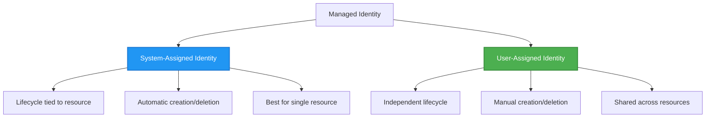

# Corak Pengesahan dan Identiti Terurus

⏱️ **Anggaran Masa**: 45-60 minit membaca; sediakan masa tambahan untuk latihan integrasi | 💰 **Impak Kos**: Identiti/RBAC adalah percuma; pengiraan, penyimpanan, dan Key Vault yang dikerahkan dikenakan bayaran | ⭐ **Kerumitan**: Pertengahan

> Disemak berdasarkan `azd 1.37.2` (November 2026). Pelajaran ini mengandungi **fragmen integrasi ilustratif, bukan template `secure-app` lengkap boleh dimuat turun**. Buat fail yang dirujuk, sediakan infrastruktur yang sepadan, dan gantikan tempat letak sebelum penerapan. Tiada sumber Azure diperuntukkan semasa semakan.

**📚 Laluan Pembelajaran:**
- ← Sebelumnya: [Pengurusan Konfigurasi](configuration.md) - Menguruskan pembolehubah persekitaran dan rahsia
- 🎯 **Anda Di Sini**: Pengesahan & Keselamatan (Identiti Terurus, Key Vault, corak selamat)
- → Seterusnya: [Infrastruktur sebagai Kod](../chapter-04-infrastructure/README.md) - Menyediakan dan mengerahkan sumber
- 🏠 [Laman Kursus](../../README.md)

---

## Apa yang Anda Akan Pelajari

Dengan menyiapkan pelajaran ini, anda akan:
- Memahami corak pengesahan Azure (kunci, rentetan sambungan, identiti terurus)
- Melaksanakan **Identiti Terurus** untuk pengesahan tanpa kata laluan
- Mengamankan rahsia dengan integrasi **Azure Key Vault**
- Menyediakan **kawalan akses berasaskan peranan (RBAC)** untuk penerapan AZD
- Mengaplikasi amalan keselamatan terbaik dalam Container Apps dan perkhidmatan Azure
- Memindahkan dari pengesahan berasaskan kunci ke berasaskan identiti

## Kenapa Identiti Terurus Penting

### Masalah: Pengesahan Tradisional

**Sebelum Identiti Terurus:**
```javascript
// ❌ SECURITY RISK: Hardcoded secrets in code
const connectionString = "Server=mydb.database.windows.net;User=admin;Password=P@ssw0rd123";
const storageKey = "xK7mN9pQ2wR5tY8uI0oP3aS6dF1gH4jK...";
const cosmosKey = "C2x7B9n4M1p8Q5w3E6r0T2y5U8i1O4p7...";
```

**Masalah:**
- 🔴 **Rahsia terbuka** dalam kod, fail konfigurasi, pembolehubah persekitaran
- 🔴 **Putaran kelayakan** memerlukan perubahan kod dan penyebaran semula
- 🔴 **Mimpi ngeri audit** - siapa mengakses apa, bila?
- 🔴 **Penyebaran** - rahsia tersebar di banyak sistem
- 🔴 **Risiko pematuhan** - gagal audit keselamatan

### Penyelesaian: Identiti Terurus

**Selepas Identiti Terurus:**
```javascript
// ✅ SECURE: No secrets in code
const credential = new DefaultAzureCredential();
const client = new BlobServiceClient(
  "https://mystorageaccount.blob.core.windows.net",
  credential  // Azure automatically handles authentication
);
```

**Manfaat:**
- ✅ **Tiada rahsia** dalam kod atau konfigurasi
- ✅ **Putaran automatik** - diurus oleh Azure
- ✅ **Jejak audit penuh** dalam log Microsoft Entra ID
- ✅ **Keselamatan berpusat** - urus dalam Azure Portal
- ✅ **Sedia mematuhi** - memenuhi piawaian keselamatan

**Analogi**: Pengesahan tradisional ibarat membawa pelbagai kunci fizikal untuk pintu berbeza. Identiti Terurus seperti mempunyai lencana keselamatan yang secara automatik memberikan akses berdasarkan siapa anda—tiada kunci untuk hilang, salin atau putar.

---

## Gambaran Keseluruhan Seni Bina

### Aliran Pengesahan dengan Identiti Terurus

```mermaid
sequenceDiagram
    participant App as Your Application<br/>(Container App)
    participant MI as Managed Identity<br/>(Microsoft Entra ID)
    participant KV as Key Vault
    participant Storage as Azure Storage
    participant DB as Azure SQL
    
    App->>MI: Request access token<br/>(automatic)
    MI->>MI: Verify identity<br/>(no password needed)
    MI-->>App: Return token for requested audience<br/>(lifetime varies)
    
    App->>KV: Get secret<br/>(using token)
    KV->>KV: Check RBAC permissions
    KV-->>App: Return secret value
    
    App->>Storage: Upload blob<br/>(using token)
    Storage->>Storage: Check RBAC permissions
    Storage-->>App: Success
    
    App->>DB: Query data<br/>(using token)
    DB->>DB: Check SQL permissions
    DB-->>App: Return results
    
    Note over App,DB: Request a separate token for each service audience;<br/>SDK credentials handle caching and renewal
```

### Jenis Identiti Terurus



| Ciri | Ditugaskan Sistem | Ditugaskan Pengguna |
|---------|----------------|---------------|
| **Kitaran Hayat** | Terikat pada sumber | Bebas |
| **Penciptaan** | Automatik dengan sumber | Penciptaan manual |
| **Pemadaman** | Dipadam bersama sumber | Kekal selepas pemadaman sumber |
| **Perkongsian** | Satu sumber sahaja | Berbilang sumber |
| **Kes Penggunaan** | Senario mudah | Senario kompleks berbilang sumber |
| **Pilihan template** | Ditentukan dalam infrastruktur | Ditentukan dalam infrastruktur |

---

## Prasyarat

### Alat Diperlukan

Anda sepatutnya sudah memasang ini dari pelajaran sebelum:

```bash
# Verify Azure Developer CLI
azd version
# ✅ Expected: azd version 1.0.0 or higher

# Verify Azure CLI
az --version
# ✅ Expected: azure-cli 2.50.0 or higher
```

### Keperluan Azure

- Langganan Azure aktif
- Kebenaran untuk:
  - Buat identiti terurus
  - Tugaskan peranan RBAC
  - Buat sumber Key Vault
  - Terapkan Container Apps

### Prasyarat Pengetahuan

Anda sepatutnya telah menyiapkan:
- [Panduan Pemasangan](../chapter-01-foundation/installation.md) - Persediaan AZD
- [Asas AZD](../chapter-01-foundation/azd-basics.md) - Konsep teras
- [Pengurusan Konfigurasi](configuration.md) - Pembolehubah persekitaran

---

## Pelajaran 1: Memahami Corak Pengesahan

### Corak 1: Rentetan Sambungan (Warisan - Elak)

**Bagaimana ia berfungsi:**
```bash
# Connection string contains credentials
STORAGE_CONNECTION_STRING="DefaultEndpointsProtocol=https;AccountName=myaccount;AccountKey=xK7mN9pQ2wR5..."
COSMOS_CONNECTION_STRING="AccountEndpoint=https://myaccount.documents.azure.com:443/;AccountKey=C2x7..."
SQL_CONNECTION_STRING="Server=myserver.database.windows.net;User=admin;Password=P@ssw0rd..."
```

**Masalah:**
- ❌ Rahsia kelihatan dalam pembolehubah persekitaran
- ❌ Tercatat dalam sistem penerapan
- ❌ Sukar diputar
- ❌ Tiada jejak audit akses

**Bila guna:** Apabila perkhidmatan sasaran memerlukan pengesahan berasaskan kunci. Utamakan identiti jika disokong; jika tidak, simpan kunci dengan selamat dan putar, termasuk di pengeluaran.

---

### Corak 2: Rujukan Key Vault (Lebih Baik)

**Bagaimana ia berfungsi:**
**Fragmen Bicep separa:** medan vault diperlukan, identiti Container App, dan entri `configuration.secrets`nya tidak disertakan. `secretRef` menamakan rahsia Container App; ia **bukan URI Key Vault itu sendiri**. Untuk guna Key Vault, definisikan rahsia bernama itu dengan `keyVaultUrl` dan `identity` yang dibenarkan.

```bicep
// Store secret in Key Vault
resource keyVault 'Microsoft.KeyVault/vaults@2023-02-01' = {
  name: 'mykv'
  properties: {
    enableRbacAuthorization: true
  }
}

// Reference in Container App
env: [
  {
    name: 'STORAGE_KEY'
    secretRef: 'storage-key'  // References Key Vault
  }
]
```

**Manfaat:**
- ✅ Rahsia disimpan dengan selamat dalam Key Vault
- ✅ Pengurusan rahsia berpusat
- ✅ Putaran tanpa perubahan kod

**Limitasi:**
- ⚠️ Masih menggunakan kunci/kata laluan
- ⚠️ Perlu mengurus akses Key Vault

**Bila guna:** Langkah peralihan dari rentetan sambungan ke identiti terurus.

---

### Corak 3: Identiti Terurus (Amalan Terbaik)

**Bagaimana ia berfungsi:**
**Bicep separa:** gabungkan blok identiti ke dalam Container App lengkap dan sediakan `storageAccount` serta definisi peranan. Penugasan peranan juga memerlukan `name` yang deterministik.

```bicep
// Enable managed identity
resource containerApp 'Microsoft.App/containerApps@2023-05-01' = {
  name: 'myapp'
  identity: {
    type: 'SystemAssigned'  // Automatically creates identity
  }
}

// Grant permissions
resource roleAssignment 'Microsoft.Authorization/roleAssignments@2022-04-01' = {
  name: guid(storageAccount.id, containerApp.id, storageBlobDataContributorRole)
  scope: storageAccount
  properties: {
    roleDefinitionId: storageBlobDataContributorRole
    principalId: containerApp.identity.principalId
    principalType: 'ServicePrincipal'
  }
}
```

**Kod aplikasi:**
```javascript
// No secrets needed!
const { DefaultAzureCredential } = require('@azure/identity');
const { BlobServiceClient } = require('@azure/storage-blob');

const credential = new DefaultAzureCredential();
const blobServiceClient = new BlobServiceClient(
  'https://mystorageaccount.blob.core.windows.net',
  credential
);
```

**Manfaat:**
- ✅ Tiada rahsia dalam kod/konfigurasi
- ✅ Putaran kelayakan automatik
- ✅ Jejak audit penuh
- ✅ Kebenaran berasaskan RBAC
- ✅ Sedia mematuhi

**Bila guna:** Utamakan untuk aplikasi hos Azure yang mengakses perkhidmatan yang menyokong pengesahan Microsoft Entra.

---

### Corak 4: Prinsipal Perkhidmatan (CI/CD & Automasi)

Identiti terurus adalah piawai emas *untuk sumber yang berjalan dalam Azure*. Tetapi bagaimana dengan perkara yang berjalan **luar** Azure—seperti aliran CI/CD pada agen binaan, atau skrip pada komputer riba anda yang tak boleh guna log masuk interaktif? Di situlah **prinsipal perkhidmatan** berperanan: identiti bukan manusia dengan kelayakan sendiri yang proses automatik boleh log masuk sebagai.

**Bagaimana ia berfungsi:**

Cipta prinsipal perkhidmatan yang berskala untuk kumpulan sumber (keistimewaan paling rendah):

```bash
az ad sp create-for-rbac \
  --name "myapp-cicd" \
  --role contributor \
  --scopes "/subscriptions/<sub-id>/resourceGroups/<rg-name>"
```

Ini mencetak ID klien, rahsia klien, dan ID penyewa. azd boleh log masuk dengan mereka secara tidak interaktif:

```bash
azd auth login \
  --client-id "<appId>" \
  --client-secret "<password>" \
  --tenant-id "<tenant>"
```

**Utamakan kelayakan persekutuan (OIDC) berbanding rahsia.** Daripada rahsia klien jangka panjang, konfigurasikan kelayakan persekutuan supaya saluran paip menukar token jangka pendek—tiada rahsia untuk bocor atau putar:

```bash
azd auth login \
  --client-id "<appId>" \
  --federated-credential-provider "github" \
  --tenant-id "<tenant>"
```

> `azd pipeline config` menyediakan ini secara automatik untuk anda. Lihat panduan CI/CD di [Bab 8](../chapter-08-production/production-ai-practices.md).

**Manfaat:**
- ✅ Berfungsi luar Azure (agen binaan, on-prem, awan lain)
- ✅ Boleh diskala pada satu kumpulan sumber dengan satu peranan
- ✅ Varian persekutuan (OIDC) tidak gunakan rahsia yang disimpan

**Pertukaran:**
- ⚠️ Varian berasaskan rahsia memerlukan penyimpanan dan putaran teliti
- ⚠️ Rahsia yang bocor memberikan apa sahaja kemampuan SP—jaga skop ketat

**Bila guna:** Saluran paip CI/CD dan automasi yang tidak boleh menggunakan identiti terurus. Sentiasa utamakan varian **persekutuan/OIDC** berbanding rahsia klien, dan utamakan identiti terurus apabila beban kerja berjalan dalam Azure.

**Menyimpan kelayakan dengan selamat:**
- Jangan sesekali komit rahsia—guna stor rahsia paip anda (rahsia GitHub Actions, kumpulan pembolehubah Azure DevOps / Key Vault).
- Skopkan SP pada peranan dan kumpulan sumber terkecil yang diperlukan.
- Tetapkan tamat tempoh dan putar, atau hapuskan rahsia sepenuhnya dengan OIDC.

---

## Pelajaran 2: Melaksanakan Identiti Terurus dengan AZD

### Pelaksanaan Langkah demi Langkah

Fragmen berikut menunjukkan cara mengintegrasikan identiti terurus ke dalam projek Container App. Ia **bukan salinan-mula dan jalan**: modul Penyimpanan, infrastruktur penuh persekitaran terurus/registri, Dockerfile, dan fail parameter tidak disertakan sepenuhnya di sini. Mulakan dari templat Container Apps yang berfungsi dan gabungkan corak ini, kekalkan konfigurasi registri dan tag perkhidmatannya.

### Struktur Projek

```
secure-app/
├── azure.yaml                 # AZD configuration
├── infra/
│   ├── main.bicep            # Main infrastructure
│   ├── core/
│   │   ├── identity.bicep    # Managed identity setup
│   │   ├── keyvault.bicep    # Key Vault configuration
│   │   └── storage.bicep     # Storage with RBAC
│   └── app/
│       └── container-app.bicep
└── src/
    ├── app.js                # Application code
    ├── package.json
    └── Dockerfile
```

### 1. Konfigurasikan AZD (azure.yaml)

```yaml
name: secure-app
metadata:
  template: secure-app@1.0.0

services:
  api:
    project: ./src
    language: js
    host: containerapp

# Managed identity must be enabled in the infrastructure, not by this YAML.
```

### 2. Infrastruktur: Aktifkan Identiti Terurus

**Fail: `infra/main.bicep`**

```bicep
targetScope = 'subscription'

param environmentName string
param location string = 'eastus'
param containerAppsEnvironmentId string
param containerImage string

var tags = { 'azd-env-name': environmentName }

// Resource group
resource rg 'Microsoft.Resources/resourceGroups@2021-04-01' = {
  name: 'rg-${environmentName}'
  location: location
  tags: tags
}

// Storage Account
module storage './core/storage.bicep' = {
  name: 'storage'
  scope: rg
  params: {
    name: 'st${uniqueString(rg.id)}'
    location: location
    tags: tags
  }
}

// Key Vault
module keyVault './core/keyvault.bicep' = {
  name: 'keyvault'
  scope: rg
  params: {
    name: 'kv-${uniqueString(rg.id)}'
    location: location
    tags: tags
  }
}

// Container App with Managed Identity
module containerApp './app/container-app.bicep' = {
  name: 'container-app'
  scope: rg
  params: {
    name: 'ca-${environmentName}'
    location: location
    tags: tags
    storageAccountName: storage.outputs.name
    keyVaultName: keyVault.outputs.name
    containerAppsEnvironmentId: containerAppsEnvironmentId
    containerImage: containerImage
  }
}

// Grant Container App access to Storage
module storageRoleAssignment './core/role-assignment.bicep' = {
  name: 'storage-role'
  scope: rg
  params: {
    principalId: containerApp.outputs.identityPrincipalId
    roleDefinitionId: 'ba92f5b4-2d11-453d-a403-e96b0029c9fe'  // Storage Blob Data Contributor
    targetResourceType: 'storage'
    targetResourceName: storage.outputs.name
  }
}

// Grant Container App access to Key Vault
module kvRoleAssignment './core/role-assignment.bicep' = {
  name: 'kv-role'
  scope: rg
  params: {
    principalId: containerApp.outputs.identityPrincipalId
    roleDefinitionId: '4633458b-17de-408a-b874-0445c86b69e6'  // Key Vault Secrets User
    targetResourceType: 'keyvault'
    targetResourceName: keyVault.outputs.name
  }
}

// Outputs
output AZURE_STORAGE_ACCOUNT_NAME string = storage.outputs.name
output AZURE_KEY_VAULT_NAME string = keyVault.outputs.name
output APP_URL string = containerApp.outputs.url
```

### 3. Container App dengan Identiti Ditugaskan Sistem

**Fail: `infra/app/container-app.bicep`**

```bicep
param name string
param location string
param tags object = {}
param storageAccountName string
param keyVaultName string
param containerAppsEnvironmentId string
param containerImage string

resource containerApp 'Microsoft.App/containerApps@2023-05-01' = {
  name: name
  location: location
  tags: union(tags, { 'azd-service-name': 'api' })
  identity: {
    type: 'SystemAssigned'  // 🔑 Enable managed identity
  }
  properties: {
    managedEnvironmentId: containerAppsEnvironmentId
    configuration: {
      ingress: {
        external: true
        targetPort: 3000
      }
    }
    template: {
      containers: [
        {
          name: 'api'
          image: containerImage // Must exist; configure registry credentials for private images
          resources: {
            cpu: json('0.5')
            memory: '1Gi'
          }
          env: [
            {
              name: 'AZURE_STORAGE_ACCOUNT_NAME'
              value: storageAccountName
            }
            {
              name: 'AZURE_KEY_VAULT_NAME'
              value: keyVaultName
            }
            // 🔑 No secrets - managed identity handles authentication!
          ]
        }
      ]
    }
  }
}

// Output the identity for RBAC assignments
output identityPrincipalId string = containerApp.identity.principalId
output id string = containerApp.id
output url string = 'https://${containerApp.properties.configuration.ingress.fqdn}'
```

### 4. Modul Penugasan Peranan RBAC

**Fail: `infra/core/role-assignment.bicep`**

```bicep
param principalId string
param roleDefinitionId string  // Azure built-in role ID
@allowed(['storage', 'keyvault'])
param targetResourceType string
param targetResourceName string

// Typed existing resources give Bicep a valid resource scope, not a string ID.
resource storageTarget 'Microsoft.Storage/storageAccounts@2023-01-01' existing = {
  name: targetResourceName
}
resource vaultTarget 'Microsoft.KeyVault/vaults@2023-02-01' existing = {
  name: targetResourceName
}

resource storageAssignment 'Microsoft.Authorization/roleAssignments@2022-04-01' = if (targetResourceType == 'storage') {
  name: guid(storageTarget.id, principalId, roleDefinitionId)
  scope: storageTarget
  properties: {
    roleDefinitionId: subscriptionResourceId('Microsoft.Authorization/roleDefinitions', roleDefinitionId)
    principalId: principalId
    principalType: 'ServicePrincipal'
  }
}

resource vaultAssignment 'Microsoft.Authorization/roleAssignments@2022-04-01' = if (targetResourceType == 'keyvault') {
  name: guid(vaultTarget.id, principalId, roleDefinitionId)
  scope: vaultTarget
  properties: {
    roleDefinitionId: subscriptionResourceId('Microsoft.Authorization/roleDefinitions', roleDefinitionId)
    principalId: principalId
    principalType: 'ServicePrincipal'
  }
}

// This module assigns at the target resource scope, not the whole resource group.
```

### 5. Kod Aplikasi dengan Identiti Terurus

**Fail: `src/app.js`**

```javascript
const express = require('express');
const { DefaultAzureCredential } = require('@azure/identity');
const { BlobServiceClient } = require('@azure/storage-blob');
const { SecretClient } = require('@azure/keyvault-secrets');

const app = express();
const PORT = process.env.PORT || 3000;

// 🔑 Initialize credential (works automatically with managed identity)
const credential = new DefaultAzureCredential();

// Azure Storage setup
const storageAccountName = process.env.AZURE_STORAGE_ACCOUNT_NAME;
const blobServiceClient = new BlobServiceClient(
  `https://${storageAccountName}.blob.core.windows.net`,
  credential  // No keys needed!
);

// Key Vault setup
const keyVaultName = process.env.AZURE_KEY_VAULT_NAME;
const secretClient = new SecretClient(
  `https://${keyVaultName}.vault.azure.net`,
  credential  // No keys needed!
);

// Health check
app.get('/health', (req, res) => {
  res.json({ status: 'healthy', authentication: 'managed-identity' });
});

// Upload file to blob storage
app.post('/upload', async (req, res) => {
  try {
    const containerClient = blobServiceClient.getContainerClient('uploads');
    await containerClient.createIfNotExists();
    
    const blobName = `file-${Date.now()}.txt`;
    const blockBlobClient = containerClient.getBlockBlobClient(blobName);
    
    const content = 'Hello from managed identity!';
    await blockBlobClient.upload(content, Buffer.byteLength(content));
    
    res.json({
      success: true,
      blobName: blobName,
      message: 'File uploaded using managed identity!'
    });
  } catch (error) {
    console.error('Upload error:', error);
    res.status(500).json({ error: error.message });
  }
});

// Get secret from Key Vault
app.get('/secret/:name', async (req, res) => {
  try {
    const secretName = req.params.name;
    const secret = await secretClient.getSecret(secretName);
    
    res.json({
      name: secretName,
      retrieved: secret.value !== undefined, // Never return the secret value to callers
      message: 'Secret retrieved using managed identity!'
    });
  } catch (error) {
    console.error('Secret error:', error);
    res.status(500).json({ error: error.message });
  }
});

// List blob containers (demonstrates read access)
app.get('/containers', async (req, res) => {
  try {
    const containers = [];
    for await (const container of blobServiceClient.listContainers()) {
      containers.push(container.name);
    }
    
    res.json({
      containers: containers,
      count: containers.length,
      message: 'Containers listed using managed identity!'
    });
  } catch (error) {
    console.error('List error:', error);
    res.status(500).json({ error: error.message });
  }
});

app.listen(PORT, () => {
  console.log(`Secure API listening on port ${PORT}`);
  console.log('Authentication: Managed Identity (passwordless)');
});
```

**Fail: `src/package.json`**

```json
{
  "name": "secure-app",
  "version": "1.0.0",
  "dependencies": {
    "express": "^4.18.2",
    "@azure/identity": "^4.0.0",
    "@azure/storage-blob": "^12.17.0",
    "@azure/keyvault-secrets": "^4.7.0"
  },
  "scripts": {
    "start": "node app.js"
  }
}
```

### 6. Terap dan Uji

Jalankan arahan ini **selepas** melengkapkan infrastruktur hilang, Dockerfile, dan `main.parameters.json` yang sepadan dalam projek anda sendiri. Sahkan azd dengan `azd auth login`; log masuk secara berasingan dengan `az login` untuk pemeriksaan Azure CLI nanti. Titik hujung yang dipaparkan adalah demonstrasi dan memerlukan kawalan akses sesuai sebelum digunakan secara awam.

```bash
# Initialize AZD environment
azd init

# Deploy infrastructure and application
azd up

# Get the app URL
APP_URL=$(azd env get-value APP_URL)

# Test health check
curl $APP_URL/health
```

**✅ Output dijangka:**
```json
{
  "status": "healthy",
  "authentication": "managed-identity"
}
```

**Uji muat naik blob:**
```bash
curl -X POST $APP_URL/upload
```

**✅ Output dijangka:**
```json
{
  "success": true,
  "blobName": "file-1700404800000.txt",
  "message": "File uploaded using managed identity!"
}
```

**Uji penyenaraian bekas:**
```bash
curl $APP_URL/containers
```

**✅ Output dijangka:**
```json
{
  "containers": ["uploads"],
  "count": 1,
  "message": "Containers listed using managed identity!"
}
```

---

## Peranan RBAC Azure Biasa

### ID Peranan Terbina untuk Identiti Terurus

| Perkhidmatan | Nama Peranan | ID Peranan | Kebenaran |
|---------|-----------|---------|-------------|
| **Penyimpanan** | Pembaca Data Blob Penyimpanan | `2a2b9908-6ea1-4ae2-8e65-a410df84e7d1` | Baca blob dan bekas |
| **Penyimpanan** | Penyumbang Data Blob Penyimpanan | `ba92f5b4-2d11-453d-a403-e96b0029c9fe` | Baca, tulis, hapus blob |
| **Penyimpanan** | Penyumbang Data Barisan Penyimpanan | `974c5e8b-45b9-4653-ba55-5f855dd0fb88` | Baca, tulis, hapus barisan/mesej |
| **Key Vault** | Pengguna Rahsia Key Vault | `4633458b-17de-408a-b874-0445c86b69e6` | Baca rahsia |
| **Key Vault** | Pegawai Rahsia Key Vault | `b86a8fe4-44ce-4948-aee5-eccb2c155cd7` | Baca, tulis, hapus rahsia |
| **Cosmos DB** | Pembaca Data Asal Cosmos DB | `00000000-0000-0000-0000-000000000001` | Baca data Cosmos DB |
| **Cosmos DB** | Penyumbang Data Asal Cosmos DB | `00000000-0000-0000-0000-000000000002` | Baca, tulis data Cosmos DB |
| **Pangkalan Data SQL** | Penyumbang SQL DB | `9b7fa17d-e63e-47b0-bb0a-15c516ac86ec` | Urus sumber pangkalan data; tidak beri akses data SQL |
| **Service Bus** | Pemilik Data Azure Service Bus | `090c5cfd-751d-490a-894a-3ce6f1109419` | Hantar, terima, urus mesej |

### Cara Cari ID Peranan

Dua ID Cosmos DB untuk NoSQL di atas adalah **definisi peranan data pesawat Cosmos asli**, bukan ID peranan langganan Azure RBAC. Tugaskan dengan `az cosmosdb sql role assignment create` (atau `Microsoft.DocumentDB/databaseAccounts/sqlRoleAssignments`), bukan `az role assignment create`. Akses data SQL memerlukan pengguna pangkalan data Entra dan kebenaran SQL.

```bash
# List all built-in roles
az role definition list --query "[].{Name:roleName, ID:name}" --output table

# Search for specific role
az role definition list --query "[?contains(roleName, 'Storage Blob')].{Name:roleName, ID:name}" --output table

# Get role details
az role definition list --name "Storage Blob Data Contributor"
```

---

## Latihan Praktikal

**Prasyarat integrasi bagi ketiga-tiga latihan:** templat Container App yang berfungsi dalam projek anda sendiri, sumber Bicep sepadan, log masuk Azure CLI/azd, dan kuasa menugaskan peranan yang diperlukan. Ini adalah adaptasi berpandu, bukan pemula tempatan berdiri sendiri; gantikan nama sumber contoh dengan nama yang telah anda terapkan.

### Latihan 1: Aktifkan Identiti Terurus untuk Aplikasi Sedia Ada ⭐⭐ (Sederhana)

**Matlamat**: Tambah identiti terurus ke penerapan Container App sedia ada

**Senario**: Anda mempunyai Container App menggunakan rentetan sambungan. Tukarkannya ke identiti terurus.

**Titik Permulaan**: Container App dengan konfigurasi ini:

```bicep
// ❌ Current: Using connection string
env: [
  {
    name: 'STORAGE_CONNECTION_STRING'
    secretRef: 'storage-connection'
  }
]
```

**Langkah**:

1. **Aktifkan identiti terurus dalam Bicep:**

```bicep
resource containerApp 'Microsoft.App/containerApps@2023-05-01' = {
  name: 'myapp'
  identity: {
    type: 'SystemAssigned'  // Add this
  }
  // ... rest of configuration
}
```

2. **Berikan akses Penyimpanan:**

```bicep
// Get storage account reference
resource storageAccount 'Microsoft.Storage/storageAccounts@2023-01-01' existing = {
  name: storageAccountName
}

// Assign role
resource roleAssignment 'Microsoft.Authorization/roleAssignments@2022-04-01' = {
  name: guid(containerApp.id, 'ba92f5b4-2d11-453d-a403-e96b0029c9fe', storageAccount.id)
  scope: storageAccount
  properties: {
    roleDefinitionId: subscriptionResourceId('Microsoft.Authorization/roleDefinitions', 'ba92f5b4-2d11-453d-a403-e96b0029c9fe')
    principalId: containerApp.identity.principalId
    principalType: 'ServicePrincipal'
  }
}
```

3. **Kemas kini kod aplikasi:**

**Sebelum (rentetan sambungan):**
```javascript
const { BlobServiceClient } = require('@azure/storage-blob');

const blobServiceClient = BlobServiceClient.fromConnectionString(
  process.env.STORAGE_CONNECTION_STRING
);
```

**Selepas (identiti terurus):**
```javascript
const { DefaultAzureCredential } = require('@azure/identity');
const { BlobServiceClient } = require('@azure/storage-blob');

const credential = new DefaultAzureCredential();
const blobServiceClient = new BlobServiceClient(
  `https://${process.env.STORAGE_ACCOUNT_NAME}.blob.core.windows.net`,
  credential
);
```

4. **Kemas kini pembolehubah persekitaran:**

```bicep
env: [
  {
    name: 'STORAGE_ACCOUNT_NAME'
    value: storageAccountName  // Just the name, no secrets!
  }
  // Remove STORAGE_CONNECTION_STRING
]
```

5. **Terap dan uji:**

```bash
# Redeploy
azd up

# Test that it still works
APP_URL=$(azd show --output json | jq -er '.services.api.ingressUrl')
curl --fail -X POST "$APP_URL/upload"
```

**✅ Kriteria kejayaan:**
- ✅ Aplikasi diterapkan tanpa ralat
- ✅ Operasi penyimpanan berfungsi (muat naik, senarai, muat turun)
- ✅ Tiada rentetan sambungan dalam pembolehubah persekitaran
- ✅ Identiti kelihatan dalam Azure Portal di bawah panel "Identity"

**Pengesahan:**

```bash
# Check managed identity is enabled
az containerapp show \
  --name myapp \
  --resource-group rg-myapp \
  --query "identity.type"
# ✅ Expected: "SystemAssigned"

# Check role assignment
az role assignment list \
  --assignee $(az containerapp show --name myapp --resource-group rg-myapp --query "identity.principalId" -o tsv) \
  --scope /subscriptions/{sub-id}/resourceGroups/rg-myapp/providers/Microsoft.Storage/storageAccounts/mystorageaccount
# ✅ Expected: Shows "Storage Blob Data Contributor" role
```

**Masa**: 20-30 minit

---

### Latihan 2: Akses Pelbagai Perkhidmatan dengan Identiti Ditugaskan Pengguna ⭐⭐⭐ (Lanjutan)

**Matlamat**: Cipta identiti ditugaskan pengguna yang dikongsi merentasi beberapa Container Apps

**Senario**: Anda mempunyai 3 mikroservis yang semuanya memerlukan akses ke akaun Penyimpanan yang sama dan Key Vault.

**Langkah**:

1. **Cipta identiti ditugaskan pengguna:**

**Fail: `infra/core/identity.bicep`**

```bicep
param name string
param location string
param tags object = {}

resource userAssignedIdentity 'Microsoft.ManagedIdentity/userAssignedIdentities@2023-01-31' = {
  name: name
  location: location
  tags: tags
}

output id string = userAssignedIdentity.id
output principalId string = userAssignedIdentity.properties.principalId
output clientId string = userAssignedIdentity.properties.clientId
```

2. **Tugaskan peranan kepada identiti ditugaskan pengguna:**

```bicep
// In main.bicep
module userIdentity './core/identity.bicep' = {
  name: 'user-identity'
  scope: rg
  params: {
    name: 'id-${environmentName}'
    location: location
    tags: tags
  }
}

// Grant Storage access
resource storageRoleAssignment 'Microsoft.Authorization/roleAssignments@2022-04-01' = {
  name: guid(storageAccount.id, environmentName, 'storage-contributor')
  scope: storageAccount
  properties: {
    roleDefinitionId: subscriptionResourceId('Microsoft.Authorization/roleDefinitions', 'ba92f5b4-2d11-453d-a403-e96b0029c9fe')
    principalId: userIdentity.outputs.principalId
    principalType: 'ServicePrincipal'
  }
}

// Grant Key Vault access
resource kvRoleAssignment 'Microsoft.Authorization/roleAssignments@2022-04-01' = {
  name: guid(keyVault.id, environmentName, 'kv-secrets-user')
  scope: keyVault
  properties: {
    roleDefinitionId: subscriptionResourceId('Microsoft.Authorization/roleDefinitions', '4633458b-17de-408a-b874-0445c86b69e6')
    principalId: userIdentity.outputs.principalId
    principalType: 'ServicePrincipal'
  }
}
```

3. **Tetapkan identiti kepada berbilang Container Apps:**

```bicep
resource apiGateway 'Microsoft.App/containerApps@2023-05-01' = {
  name: 'api-gateway'
  identity: {
    type: 'UserAssigned'
    userAssignedIdentities: {
      '${userIdentity.outputs.id}': {}
    }
  }
  // ... rest of config
}

resource productService 'Microsoft.App/containerApps@2023-05-01' = {
  name: 'product-service'
  identity: {
    type: 'UserAssigned'
    userAssignedIdentities: {
      '${userIdentity.outputs.id}': {}
    }
  }
  // ... rest of config
}

resource orderService 'Microsoft.App/containerApps@2023-05-01' = {
  name: 'order-service'
  identity: {
    type: 'UserAssigned'
    userAssignedIdentities: {
      '${userIdentity.outputs.id}': {}
    }
  }
  // ... rest of config
}
```

4. **Kod aplikasi (semua perkhidmatan menggunakan corak yang sama):**

```javascript
const { ManagedIdentityCredential } = require('@azure/identity');
const { BlobServiceClient } = require('@azure/storage-blob');

// For user-assigned identity, specify the client ID
const credential = new ManagedIdentityCredential(
  process.env.AZURE_CLIENT_ID  // User-assigned identity client ID
);

// Alternative (choose ONE credential declaration):
// const { DefaultAzureCredential } = require('@azure/identity');
// const credential = new DefaultAzureCredential({
//   managedIdentityClientId: process.env.AZURE_CLIENT_ID
// });

const blobServiceClient = new BlobServiceClient(
  `https://${process.env.STORAGE_ACCOUNT_NAME}.blob.core.windows.net`,
  credential
);
```

Tetapkan setiap runtime `AZURE_CLIENT_ID` Container App kepada `userIdentity.outputs.clientId` dan `STORAGE_ACCOUNT_NAME` kepada nama storan anda dalam Bicep. Hanya menetapkan identiti atau menjalankan `azd env set` tidak mengkonfigurasi nilai runtime ini.

5. **Terbitkan dan sahkan:**

```bash
azd up

# Test all services can access storage
# Replace with the actual ingress URLs reported for your three services
curl --fail -X POST "$API_GATEWAY_URL/upload"
curl --fail -X POST "$PRODUCT_SERVICE_URL/upload"
curl --fail -X POST "$ORDER_SERVICE_URL/upload"
```

**✅ Kriteria Kejayaan:**
- ✅ Satu identiti dikongsi merentas 3 perkhidmatan
- ✅ Semua perkhidmatan boleh mengakses Storage dan Key Vault
- ✅ Identiti kekal jika anda memadam satu perkhidmatan
- ✅ Pengurusan kebenaran terpusat

**Manfaat Identiti Ditugaskan oleh Pengguna:**
- Satu identiti untuk diuruskan
- Kebenaran konsisten merentas perkhidmatan
- Kekal selepas pemadaman perkhidmatan
- Lebih baik untuk seni bina yang kompleks

**Masa**: 30-40 minit

---

### Latihan 3: Laksanakan Putaran Rahsia Key Vault ⭐⭐⭐ (Lanjutan)

**Matlamat**: Simpan kunci API pihak ketiga dalam Key Vault dan akses menggunakan identiti terurus

**Senario**: App anda perlu panggil API luaran (OpenAI, Stripe, SendGrid) yang memerlukan kunci API.

**Langkah-langkah**:

1. **Cipta Key Vault dengan RBAC:**

**Fail: `infra/core/keyvault.bicep`**

```bicep
param name string
param location string
param tags object = {}

resource keyVault 'Microsoft.KeyVault/vaults@2023-02-01' = {
  name: name
  location: location
  tags: tags
  properties: {
    enableRbacAuthorization: true  // Use RBAC instead of access policies
    sku: {
      family: 'A'
      name: 'standard'
    }
    tenantId: subscription().tenantId
    enableSoftDelete: true
    softDeleteRetentionInDays: 90
  }
}

// Allow Container App to read secrets
output id string = keyVault.id
output name string = keyVault.name
output uri string = keyVault.properties.vaultUri
```

2. **Simpan rahsia dalam Key Vault:**

```bash
# Get Key Vault name
KV_NAME=$(azd env get-value AZURE_KEY_VAULT_NAME)

# Store third-party API keys
az keyvault secret set \
  --vault-name $KV_NAME \
  --name "OpenAI-ApiKey" \
  --value "sk-proj-xxxxxxxxxxxxx"

az keyvault secret set \
  --vault-name $KV_NAME \
  --name "Stripe-ApiKey" \
  --value "sk_live_xxxxxxxxxxxxx"

az keyvault secret set \
  --vault-name $KV_NAME \
  --name "SendGrid-ApiKey" \
  --value "SG.xxxxxxxxxxxxx"
```

3. **Kod aplikasi untuk mengambil rahsia:**

**Fail: `src/config.js`**

```javascript
const { DefaultAzureCredential } = require('@azure/identity');
const { SecretClient } = require('@azure/keyvault-secrets');

class Config {
  constructor() {
    this.credential = new DefaultAzureCredential();
    this.secretClient = new SecretClient(
      `https://${process.env.AZURE_KEY_VAULT_NAME}.vault.azure.net`,
      this.credential
    );
    this.cache = {};
  }

  async getSecret(secretName) {
    // Check cache first
    if (this.cache[secretName]) {
      return this.cache[secretName];
    }

    try {
      const secret = await this.secretClient.getSecret(secretName);
      this.cache[secretName] = secret.value;
      console.log(`✅ Retrieved secret: ${secretName}`);
      return secret.value;
    } catch (error) {
      console.error(`❌ Failed to get secret ${secretName}:`, error.message);
      throw error;
    }
  }

  async getOpenAIKey() {
    return this.getSecret('OpenAI-ApiKey');
  }

  async getStripeKey() {
    return this.getSecret('Stripe-ApiKey');
  }

  async getSendGridKey() {
    return this.getSecret('SendGrid-ApiKey');
  }
}

module.exports = new Config();
```

4. **Gunakan rahsia dalam aplikasi:**

**Fail: `src/app.js`**

Fragmen aplikasi **pengganti** ini memerlukan `npm install openai`, kunci pihak ketiga sebenar, model yang boleh diakses, dan infrastruktur dari projek kerja anda. Ia memanggil OpenAI secara langsung, bukan pelaksanaan Azure OpenAI. Kunci tempat letak di bawah tidak membenarkan permintaan.

```javascript
const express = require('express');
const config = require('./config');
const { OpenAI } = require('openai');

const app = express();

// Initialize OpenAI with key from Key Vault
let openaiClient;

async function initializeServices() {
  const openaiKey = await config.getOpenAIKey();
  openaiClient = new OpenAI({ apiKey: openaiKey });
  console.log('✅ Services initialized with secrets from Key Vault');
}

app.post('/chat', async (req, res) => {
  try {
    const completion = await openaiClient.chat.completions.create({
      model: 'gpt-4.1',
      messages: [{ role: 'user', content: 'Hello!' }]
    });
    
    res.json({
      response: completion.choices[0].message.content,
      authentication: 'Key from Key Vault via Managed Identity'
    });
  } catch (error) {
    res.status(500).json({ error: error.message });
  }
});

// Start listening only after initialization succeeds.
initializeServices().then(() => {
  app.listen(3000, () => console.log('Key Vault demo running'));
}).catch(error => {
  console.error('Initialization failed:', error.message);
  process.exitCode = 1;
});
```

5. **Terbitkan dan uji:**

```bash
azd up

# Test that API keys work
curl -X POST https://myapp.azurecontainerapps.io/chat \
  -H "Content-Type: application/json" \
  -d '{"message":"Hello AI"}'
```

**✅ Kriteria Kejayaan:**
- ✅ Tiada kunci API dalam kod atau pemboleh ubah persekitaran
- ✅ Aplikasi mengambil kunci dari Key Vault
- ✅ API pihak ketiga berfungsi dengan betul
- ✅ Boleh putar kunci tanpa perubahan kod

**Putar rahsia:**

```bash
# Update secret in Key Vault
az keyvault secret set \
  --vault-name $KV_NAME \
  --name "OpenAI-ApiKey" \
  --value "sk-proj-NEW_KEY_HERE"

# Find the active revision name, then restart it to clear the in-process cache
az containerapp revision list --name myapp --resource-group rg-myapp --output table
az containerapp revision restart \
  --name myapp \
  --resource-group rg-myapp \
  --revision "<active-revision-name>"
```

**Masa**: 25-35 minit

---

## Titik Semak Pengetahuan

### 1. Corak Pengesahan ✓

Uji kefahaman anda:

- [ ] **S1**: Apakah tiga corak pengesahan utama? 
  - **J**: Rentetan sambungan (warisan), Rujukan Key Vault (peralihan), Identiti Terurus (terbaik)

- [ ] **S2**: Kenapa identiti terurus lebih baik daripada rentetan sambungan?
  - **J**: Tiada rahsia dalam kod, putaran automatik, jejak audit penuh, kebenaran RBAC

- [ ] **S3**: Bila anda menggunakan identiti ditugaskan pengguna dan bukannya sistem?
  - **J**: Apabila berkongsi identiti merentas pelbagai sumber atau apabila kitaran hayat identiti adalah bebas daripada kitaran hayat sumber

**Pengesahan Praktikal:**
```bash
# Check what type of identity your app uses
az containerapp show \
  --name myapp \
  --resource-group rg-myapp \
  --query "identity.type"

# List all role assignments for the identity
az role assignment list \
  --assignee $(az containerapp show --name myapp --resource-group rg-myapp --query "identity.principalId" -o tsv)
```

---

### 2. RBAC dan Kebenaran ✓

Uji kefahaman anda:

- [ ] **S1**: Apakah ID peranan untuk "Storage Blob Data Contributor"?
  - **J**: `ba92f5b4-2d11-453d-a403-e96b0029c9fe`

- [ ] **S2**: Apakah kebenaran yang disediakan oleh "Key Vault Secrets User"?
  - **J**: Akses baca sahaja ke rahsia (tidak boleh mencipta, mengemas kini, atau memadam)

- [ ] **S3**: Bagaimana anda memberikan akses Container App ke Azure SQL?
  - **J**: Konfigurasikan pengesahan Microsoft Entra, cipta identiti sebagai pengguna pangkalan data, dan berikan kebenaran SQL yang diperlukan. "SQL DB Contributor" hanya mengurus sumber Azure; ia tidak membenarkan pertanyaan.

**Pengesahan Praktikal:**
```bash
# Find specific role
az role definition list --name "Storage Blob Data Contributor"

# Check what roles are assigned to your identity
PRINCIPAL_ID=$(az containerapp show --name myapp --resource-group rg-myapp --query "identity.principalId" -o tsv)
az role assignment list --assignee $PRINCIPAL_ID --output table
```

---

### 3. Integrasi Key Vault ✓

Uji kefahaman anda:

- [ ] **S1**: Bagaimana anda mengaktifkan RBAC untuk Key Vault menggantikan polisi akses?
  - **J**: Tetapkan `enableRbacAuthorization: true` dalam Bicep

- [ ] **S2**: Perpustakaan SDK Azure mana yang mengendalikan pengesahan identiti terurus?
  - **J**: `@azure/identity` dengan kelas `DefaultAzureCredential`

- [ ] **S3**: Berapa lama rahsia Key Vault kekal dalam cache?
  - **J**: Bergantung pada aplikasi; laksanakan strategi caching sendiri

**Pengesahan Praktikal:**
```bash
# Test Key Vault access
az keyvault secret show \
  --vault-name $KV_NAME \
  --name "OpenAI-ApiKey" \
  --query "{name:name,enabled:attributes.enabled}"

# Check RBAC is enabled
az keyvault show \
  --name $KV_NAME \
  --query "properties.enableRbacAuthorization"
# ✅ Expected: true
```

---

## Amalan Terbaik Keselamatan

### ✅ LAKUKAN:

1. **Sentiasa gunakan identiti terurus dalam pengeluaran**
   ```bicep
   identity: {
     type: 'SystemAssigned'
   }
   ```

2. **Gunakan peranan RBAC sekurang-kurangnya keistimewaan**
   - Gunakan peranan "Pembaca" bila boleh
   - Elakkan "Pemilik" atau "Penyumbang" melainkan perlu

3. **Simpan kunci pihak ketiga dalam Key Vault**
   ```javascript
   const apiKey = await secretClient.getSecret('ThirdPartyApiKey');
   ```

4. **Aktifkan log audit** (fragmen sumber separa; gabungkan dengan deklarasi vault dan workspace anda)
   ```bicep
   resource vaultDiagnostics 'Microsoft.Insights/diagnosticSettings@2021-05-01-preview' = {
     name: 'vault-audit'
     scope: keyVault
     properties: {
       workspaceId: logAnalytics.id
       logs: [{ category: 'AuditEvent', enabled: true }]
     }
   }
   ```

5. **Gunakan identiti berbeza untuk dev/staging/produk**
   ```bash
   azd env new dev
   azd env new staging
   azd env new prod
   ```

6. **Putar rahsia secara berkala**
   - Tetapkan tarikh luput pada rahsia Key Vault
   - Automate putaran dengan Azure Functions

### ❌ JANGAN:

1. **Jangan kecualikan rahsia secara keras**
   ```javascript
   // ❌ BAD
   const apiKey = "sk-proj-xxxxxxxxxxxxx";
   ```

2. **Jangan gunakan rentetan sambungan dalam pengeluaran**
   ```javascript
   // ❌ BAD
   BlobServiceClient.fromConnectionString(process.env.STORAGE_CONNECTION_STRING)
   ```

3. **Jangan berikan kebenaran berlebihan**
   ```bicep
   // ❌ BAD - too much access
   roleDefinitionId: subscriptionResourceId('Microsoft.Authorization/roleDefinitions', '8e3af657-a8ff-443c-a75c-2fe8c4bcb635')
   
   // ✅ GOOD - least privilege
   roleDefinitionId: subscriptionResourceId('Microsoft.Authorization/roleDefinitions', '2a2b9908-6ea1-4ae2-8e65-a410df84e7d1')
   ```

4. **Jangan log rahsia**
   ```javascript
   // ❌ BAD
   console.log('API Key:', apiKey);
   
   // ✅ GOOD
   console.log('API Key retrieved successfully');
   ```

5. **Jangan kongsi identiti pengeluaran merentas persekitaran**
   ```bicep
   // ❌ BAD - same identity for dev and prod
   // ✅ GOOD - separate identities per environment
   ```

---

## Panduan Penyelesaian Masalah

### Masalah: "Tidak Sah" ketika mengakses Azure Storage

**Gejala:**
```
Error: Unauthorized (403)
AuthorizationPermissionMismatch: This request is not authorized to perform this operation
```

**Diagnosis:**

```bash
# Check if managed identity is enabled
az containerapp show \
  --name myapp \
  --resource-group rg-myapp \
  --query "identity.type"
# ✅ Expected: "SystemAssigned" or "UserAssigned"

# Check role assignments
PRINCIPAL_ID=$(az containerapp show --name myapp --resource-group rg-myapp --query "identity.principalId" -o tsv)
az role assignment list --assignee $PRINCIPAL_ID

# Expected: Should see "Storage Blob Data Contributor" or similar role
```

**Penyelesaian:**

1. **Berikan peranan RBAC yang betul:**
```bash
STORAGE_ID=$(az storage account show --name mystorageaccount --resource-group rg-myapp --query "id" -o tsv)
az role assignment create \
  --assignee $PRINCIPAL_ID \
  --role "Storage Blob Data Contributor" \
  --scope $STORAGE_ID
```

2. **Tunggu untuk pengedaran (boleh ambil masa 5-10 minit):**
```bash
# Check role assignment status
az role assignment list --assignee $PRINCIPAL_ID --scope $STORAGE_ID
```

3. **Sahkan kod aplikasi menggunakan kelayakan betul:**
```javascript
// Make sure you're using DefaultAzureCredential
const credential = new DefaultAzureCredential();
```

---

### Masalah: Akses Key Vault ditolak

**Gejala:**
```
Error: Forbidden (403)
The user, group or application does not have secrets get permission
```

**Diagnosis:**

```bash
# Check Key Vault RBAC is enabled
az keyvault show \
  --name $KV_NAME \
  --query "properties.enableRbacAuthorization"
# ✅ Expected: true

# Check role assignments
az role assignment list \
  --assignee $PRINCIPAL_ID \
  --scope /subscriptions/{sub-id}/resourceGroups/rg-myapp/providers/Microsoft.KeyVault/vaults/$KV_NAME
```

**Penyelesaian:**

1. **Aktifkan RBAC pada Key Vault:**
```bash
az keyvault update \
  --name $KV_NAME \
  --enable-rbac-authorization true
```

2. **Berikan peranan Key Vault Secrets User:**
```bash
KV_ID=$(az keyvault show --name $KV_NAME --query "id" -o tsv)
az role assignment create \
  --assignee $PRINCIPAL_ID \
  --role "Key Vault Secrets User" \
  --scope $KV_ID
```

---

### Masalah: DefaultAzureCredential gagal secara lokal

**Gejala:**
```
Error: DefaultAzureCredential failed to retrieve a token
CredentialUnavailableError: No credential available
```

**Diagnosis:**

```bash
# Check if you're logged in
az account show

# Check Azure CLI authentication
az ad signed-in-user show
```

**Penyelesaian:**

1. **Log masuk ke Azure CLI:**
```bash
az login
```

2. **Tetapkan langganan Azure:**
```bash
az account set --subscription "Your Subscription Name"
```

3. **Untuk pembangunan tempatan, gunakan pemboleh ubah persekitaran:**
```bash
export AZURE_TENANT_ID="your-tenant-id"
export AZURE_CLIENT_ID="your-client-id"
export AZURE_CLIENT_SECRET="your-client-secret"
```

4. **Atau gunakan kelayakan berbeza secara lokal:**
```javascript
const { DefaultAzureCredential, AzureCliCredential } = require('@azure/identity');

// Use AzureCliCredential for local dev
const credential = process.env.NODE_ENV === 'production' 
  ? new DefaultAzureCredential()
  : new AzureCliCredential();
```

---

### Masalah: Penugasan peranan mengambil masa lama untuk diedarkan

**Gejala:**
- Peranan berjaya ditugaskan
- Masih mendapat ralat 403
- Akses berselang-seli (kadang-kadang berfungsi, kadang-kadang tidak)

**Penjelasan:**
Perubahan RBAC Azure boleh mengambil masa 5-10 minit untuk diedarkan secara global.

**Penyelesaian:**

```bash
# Wait and retry
echo "Waiting for RBAC propagation..."
sleep 300  # Wait 5 minutes

# Test access
curl --fail -X POST "$APP_URL/upload"

# If still failing, restart the app
az containerapp revision restart \
  --name myapp \
  --resource-group rg-myapp \
  --revision "<active-revision-name>"
```

---

## Pertimbangan Kos

### Kos Identiti Terurus

| Sumber | Kos |
|----------|------|
| **Identiti Terurus** | 🆓 **PERCUMA** - Tiada caj |
| **Penugasan Peranan RBAC** | 🆓 **PERCUMA** - Tiada caj |
| **Permintaan Token Microsoft Entra ID** | 🆓 **PERCUMA** - Termasuk |
| **Operasi Key Vault** | $0.03 bagi setiap 10,000 operasi |
| **Penyimpanan rahsia Key Vault** | Semak harga semasa; jangan anggap yuran bulanan mengikut rahsia |

**Identiti terurus menjimatkan wang dengan:**
- ✅ Menghapuskan operasi Key Vault untuk pengesahan perkhidmatan-ke-perkhidmatan
- ✅ Mengurangkan insiden keselamatan (tiada kebocoran kelayakan)
- ✅ Mengurangkan beban operasi (tiada putaran manual)

Jumlah permintaan aplikasi tidak sama dengan jumlah operasi Key Vault: corak caching dan putaran menentukan kos pembacaan rahsia. Identiti tidak menghapuskan caj pengiraan/penyimpanan. Semak [Harga Key Vault](https://azure.microsoft.com/pricing/details/key-vault/) dan Kalkulator Harga Azure untuk rantau anda dan jangan membuat andaian jimat bulanan daripada jumlah permintaan sahaja.

---

## Ketahui Lebih Lanjut

### Dokumentasi Rasmi
- [Azure Managed Identity](https://learn.microsoft.com/entra/identity/managed-identities-azure-resources/overview)
- [Azure RBAC](https://learn.microsoft.com/azure/role-based-access-control/overview)
- [Azure Key Vault](https://learn.microsoft.com/azure/key-vault/general/overview)
- [DefaultAzureCredential](https://learn.microsoft.com/dotnet/api/azure.identity.defaultazurecredential)

### Dokumentasi SDK
- [@azure/identity (Node.js)](https://www.npmjs.com/package/@azure/identity)
- [Azure.Identity (C#)](https://www.nuget.org/packages/Azure.Identity/)
- [azure-identity (Python)](https://pypi.org/project/azure-identity/)

### Langkah Seterusnya dalam Kursus Ini
- ← Sebelumnya: [Pengurusan Konfigurasi](configuration.md)
- → Seterusnya: [Infrastruktur sebagai Kod](../chapter-04-infrastructure/README.md)
- 🏠 [Halaman Utama Kursus](../../README.md)

### Contoh Berkaitan
- [Contoh Sembang Model Microsoft Foundry](../../../../examples/azure-openai-chat) - Menggunakan identiti terurus untuk Model Microsoft Foundry
- [Contoh Mikroservis](../../../../examples/microservices) - Corak pengesahan pelbagai perkhidmatan

---

## Ringkasan

**Anda telah belajar:**
- ✅ Tiga corak pengesahan (rentetan sambungan, Key Vault, identiti terurus)
- ✅ Cara mengaktifkan dan mengkonfigurasi identiti terurus dalam AZD
- ✅ Penugasan peranan RBAC untuk perkhidmatan Azure
- ✅ Integrasi Key Vault untuk rahsia pihak ketiga
- ✅ Identiti ditugaskan pengguna berbanding sistem
- ✅ Amalan terbaik keselamatan dan penyelesaian masalah

**Intipati Utama:**
1. **Sentiasa gunakan identiti terurus dalam pengeluaran** - Tiada rahsia, putaran automatik
2. **Gunakan peranan RBAC sekurang-kurangnya keistimewaan** - Berikan hanya kebenaran perlu
3. **Simpan kunci pihak ketiga dalam Key Vault** - Pengurusan rahsia terpusat
4. **Pisahkan identiti mengikut persekitaran** - Isolasi dev, staging, prod
5. **Aktifkan log audit** - Jejak siapa mengakses apa

**Langkah Seterusnya:**
1. Lengkapkan latihan praktikal di atas
2. Migrasikan app sedia ada daripada rentetan sambungan ke identiti terurus
3. Kaji semula aliran penerbitan pemula: [Projek Pertama](../chapter-01-foundation/first-project.md)

---

<!-- CO-OP TRANSLATOR DISCLAIMER START -->
**Penafian**:
Dokumen ini telah diterjemahkan menggunakan perkhidmatan terjemahan AI [Co-op Translator](https://github.com/Azure/co-op-translator). Walaupun kami berusaha untuk ketepatan, sila ambil maklum bahawa terjemahan automatik mungkin mengandungi kesilapan atau ketidaktepatan. Dokumen asal dalam bahasa asalnya harus dianggap sebagai sumber yang sahih. Untuk maklumat penting, terjemahan oleh manusia profesional adalah disyorkan. Kami tidak bertanggungjawab terhadap sebarang salah faham atau salah tafsir yang timbul daripada penggunaan terjemahan ini.
<!-- CO-OP TRANSLATOR DISCLAIMER END -->