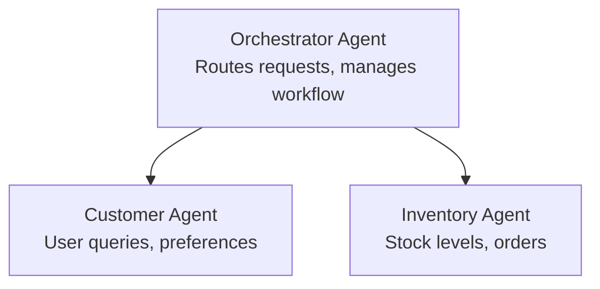

# Bab 5: Penyelesaian AI Pelbagai Ejen

**📚 Kursus**: [AZD Untuk Pemula](../../README.md) | **⏱️ Tempoh**: 2-3 jam | **⭐ Kerumitan**: Lanjutan

---

## Gambaran Keseluruhan

Bab ini merangkumi corak seni bina pelbagai ejen yang lanjutan, orkestrasi ejen, dan penyebaran AI yang siap untuk produksi bagi senario yang kompleks.

> Panduan perintah disemak berbanding rujukan `azd 1.37.2` yang dikeluarkan. Penyebaran awan tidak dijalankan.

## Objektif Pembelajaran

Dengan menyelesaikan bab ini, anda akan:
- Memahami corak seni bina pelbagai ejen
- Menyebarkan sistem ejen AI yang berkoordinasi
- Melaksanakan komunikasi antara ejen
- Membina penyelesaian pelbagai ejen yang siap untuk produksi

---

## 📚 Pelajaran

| # | Pelajaran | Penerangan | Masa |
|---|----------|------------|------|
| 1 | [Asas Pelbagai Ejen](multi-agent-basics.md) | Praktikal: menyebarkan aplikasi pelbagai ejen yang berfungsi dengan `azd up` | 45 min |
| 2 | [Corak Koordinasi](../chapter-06-pre-deployment/coordination-patterns.md) | Strategi orkestrasi ejen (bersambung dalam Bab 6) | 30 min |
| 3 | [Penyebaran Templat ARM](../../examples/retail-multiagent-arm-template/README.md) | Contoh penyebaran satu klik | 30 min |

> **Mula dengan Pelajaran 1.** Ia merupakan satu-satunya pelajaran yang sepenuhnya praktikal dan boleh disebarkan dalam bab ini. Pelajaran 2 terdapat dalam Bab 6 (dikongsi dengan perancangan pra-penyebaran), dan [Penyelesaian Pelbagai Ejen Runcit](../../examples/retail-scenario.md) adalah cetak biru seni bina—rujukan reka bentuk, bukan templat satu arahan.

---

## 🚀 Mula Pantas

```bash
# Option 1: Deploy the multi-agent template used in Lesson 1
azd init --template Azure-Samples/contoso-creative-writer .
azd up

# Option 2: Initialize a Foundry agent interactively (requires azure.ai.agents)
azd extension install azure.ai.agents
azd ai agent init
azd up
```

> **Pendekatan mana?** Gunakan `azd init --template` untuk bermula dari sampel yang berfungsi. Gunakan `azd ai agent init` secara interaktif, atau `azd ai agent init --template <path-to-azure.yaml>` untuk mengadaptasi projek ejen semasa. Lihat [rujukan AZD AI CLI](../chapter-08-production/production-ai-practices.md#azd-ai-cli-commands-and-extensions) untuk keperluan versi dan migrasi penilaian.

Jalankan alternatif ini dalam folder kosong yang berasingan. Sambungan ejen `1.0.0-beta.23` memerlukan `azd >= 1.37.0`; alur interaktifnya tidak menghasilkan saluran Service Bus khusus dalam pelajaran koordinasi.

---

## 🤖 Seni Bina Pelbagai Ejen



---

## 🎯 Penyelesaian Pilihan: Pelbagai Ejen Runcit

Penyelesaian [Agen Pelbagai Runcit](../../examples/retail-scenario.md) menunjukkan:

- **Agen Pelanggan**: Mengendalikan interaksi dan keutamaan pengguna
- **Agen Inventori**: Menguruskan stok dan pemprosesan pesanan
- **Pengaturcara**: Menyelaraskan antara agen
- **Memori Kongsi**: Pengurusan konteks merentasi agen

### Perkhidmatan yang Digunakan

| Perkhidmatan | Tujuan |
|---------|---------|
| Model Microsoft Foundry | Pemahaman bahasa |
| Azure AI Search | Katalog produk |
| Cosmos DB | Status dan memori agen |
| Apl Kontena | Hos agen |
| Application Insights | Pemantauan |

---

## 🔗 Navigasi

| Arah | Bab |
|-----------|---------|
| **Sebelum** | [Bab 4: Infrastruktur](../chapter-04-infrastructure/README.md) |
| **Seterusnya** | [Bab 6: Pra-Penerapan](../chapter-06-pre-deployment/README.md) |

---

## 📖 Sumber Berkaitan

- [Panduan Agen AI](../chapter-02-ai-development/agents.md)
- [Amalan AI Pengeluaran](../chapter-08-production/production-ai-practices.md)
- [Penyelesaian Masalah AI](../chapter-07-troubleshooting/ai-troubleshooting.md)

---

<!-- CO-OP TRANSLATOR DISCLAIMER START -->
**Penafian**:
Dokumen ini telah diterjemahkan menggunakan perkhidmatan terjemahan AI [Co-op Translator](https://github.com/Azure/co-op-translator). Walaupun kami berusaha untuk ketepatan, sila ambil maklum bahawa terjemahan automatik mungkin mengandungi kesilapan atau ketidaktepatan. Dokumen asal dalam bahasa asalnya harus dianggap sebagai sumber yang sahih. Untuk maklumat penting, terjemahan oleh manusia profesional adalah disyorkan. Kami tidak bertanggungjawab terhadap sebarang salah faham atau salah tafsir yang timbul daripada penggunaan terjemahan ini.
<!-- CO-OP TRANSLATOR DISCLAIMER END -->