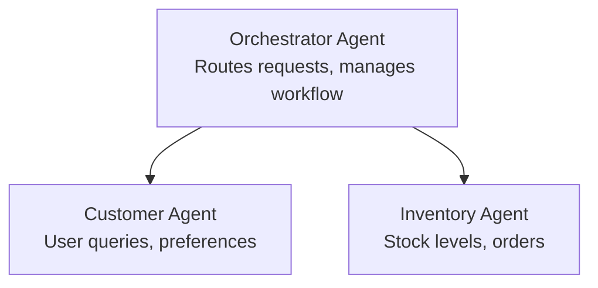

# Bab 5: Penyelesaian AI Multi-Ejen

**📚 Kursus**: [AZD Untuk Pemula](../../README.md) | **⏱️ Tempoh**: 2-3 jam | **⭐ Kerumitan**: Lanjutan

---

## Gambaran Keseluruhan

Bab ini merangkumi corak seni bina multi-ejen lanjutan, pengurusan ejen, dan penyebaran AI sedia produksi untuk senario kompleks.

> Panduan arahan disemak dengan rujukan `azd 1.37.2` yang telah dikeluarkan. Penyebaran awan tidak dijalankan.

## Objektif Pembelajaran

Dengan melengkapkan bab ini, anda akan:
- Memahami corak seni bina multi-ejen
- Menyebarkan sistem ejen AI yang terkoordinasi
- Melaksanakan komunikasi antara ejen
- Membina penyelesaian multi-ejen sedia produksi

---

## 📚 Pelajaran

| # | Pelajaran | Penerangan | Masa |
|---|----------|------------|------|
| 1 | [Asas Multi-Ejen](multi-agent-basics.md) | Amali: menyebarkan aplikasi multi-ejen yang berfungsi dengan `azd up` | 45 min |
| 2 | [Corak Koordinasi](../chapter-06-pre-deployment/coordination-patterns.md) | Strategi pengurusan ejen (bersambung di Bab 6) | 30 min |
| 3 | [Penyebaran Templat ARM](../../examples/retail-multiagent-arm-template/README.md) | Contoh penyebaran satu klik | 30 min |

> **Mula dengan Pelajaran 1.** Ia adalah satu-satunya pelajaran amali sepenuhnya yang boleh disebarkan dalam bab ini. Pelajaran 2 berada di Bab 6 (ia dikongsi dengan perancangan sebelum penyebaran), dan [Penyelesaian Multi-Ejen Runcit](../../examples/retail-scenario.md) adalah pelan seni bina—rujukan reka bentuk, bukan templat satu arahan.

---

## 🚀 Mula Cepat

```bash
# Option 1: Deploy the multi-agent template used in Lesson 1
azd init --template Azure-Samples/contoso-creative-writer .
azd up

# Option 2: Initialize a Foundry agent interactively with the GA bundle
azd ext install microsoft.foundry
azd ai agent init
azd up
```

> **Pendekatan mana?** Gunakan `azd init --template` untuk bermula dari contoh yang berfungsi. Gunakan `azd ai agent init` secara interaktif, atau `azd ai agent init --template <path-to-azure.yaml>` untuk mengguna pakai projek ejen semasa. Lihat [rujukan AZD AI CLI](../chapter-08-production/production-ai-practices.md#azd-ai-cli-commands-and-extensions) untuk keperluan versi dan migrasi penilaian.

Jalankan alternatif ini dalam folder kosong yang berasingan. Aliran kerja GA Foundry memerlukan `azd >= 1.37.0`; aliran interaktifnya tidak menjana saluran perkhidmatan Service Bus khusus dalam pelajaran koordinasi. Untuk ujian tempatan, penyebaran kod, dan pembersihan projek baru berbanding yang digunakan semula, ikuti [panduan ejen yang dihoskan](../chapter-02-ai-development/microsoft-foundry-integration.md#hosted-agent-walkthrough-ga).

---

## 🤖 Seni Bina Multi-Ejen



---

## 🎯 Penyelesaian Pilihan: Multi-Ejen Runcit

Penyelesaian [Ejen Pelbagai Runcit](../../examples/retail-scenario.md) menunjukkan:

- **Ejen Pelanggan**: Mengendalikan interaksi dan keutamaan pengguna
- **Ejen Inventori**: Mengurus stok dan pemprosesan pesanan
- **Pengaturcara**: Menyelaras antara ejen
- **Memori Berkongsi**: Pengurusan konteks rentas ejen

### Perkhidmatan Digunakan

| Perkhidmatan | Tujuan |
|---------|---------|
| Model Microsoft Foundry | Pemahaman bahasa |
| Azure AI Search | Katalog produk |
| Cosmos DB | Keadaan dan memori ejen |
| Aplikasi Kontena | Penghosting ejen |
| Application Insights | Pemantauan |

---

## 🔗 Navigasi

| Arah | Bab |
|-----------|---------|
| **Sebelumnya** | [Bab 4: Infrastruktur](../chapter-04-infrastructure/README.md) |
| **Seterusnya** | [Bab 6: Pra-Penerapan](../chapter-06-pre-deployment/README.md) |

---

## 📖 Sumber Berkaitan

- [Panduan Ejen AI](../chapter-02-ai-development/agents.md)
- [Amalan AI Pengeluaran](../chapter-08-production/production-ai-practices.md)
- [Penyelesaian Masalah AI](../chapter-07-troubleshooting/ai-troubleshooting.md)

---

<!-- CO-OP TRANSLATOR DISCLAIMER START -->
**Penafian**:
Dokumen ini telah diterjemahkan menggunakan perkhidmatan terjemahan AI [Co-op Translator](https://github.com/Azure/co-op-translator). Walaupun kami berusaha untuk ketepatan, sila ambil maklum bahawa terjemahan automatik mungkin mengandungi kesilapan atau ketidaktepatan. Dokumen asal dalam bahasa asalnya harus dianggap sebagai sumber yang sahih. Untuk maklumat penting, terjemahan oleh manusia profesional adalah disyorkan. Kami tidak bertanggungjawab terhadap sebarang salah faham atau salah tafsir yang timbul daripada penggunaan terjemahan ini.
<!-- CO-OP TRANSLATOR DISCLAIMER END -->