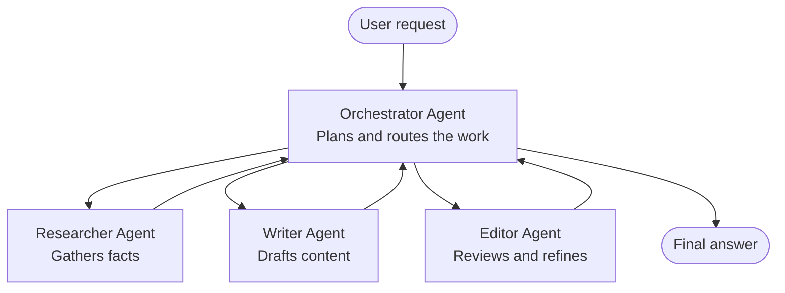

# Asas Multi-Ejen - Lancarkan Sistem AI Berkoordinasi Pertama Anda

**Navigasi Bab:**
- **📚 Laman Utama Kursus**: [AZD Untuk Pemula](../../README.md)
- **📖 Bab Semasa**: Bab 5 - Penyelesaian Multi-Ejen AI
- **⬅️ Sebelumnya**: [Bab 4: Infrastruktur](../chapter-04-infrastructure/README.md)
- **➡️ Seterusnya**: [Corak Koordinasi](../chapter-06-pre-deployment/coordination-patterns.md)

> Panduan arahan disemak mengikut rujukan `azd 1.37.2` yang dikeluarkan. Penempatan awan tidak dilaksanakan.

## Pengenalan

Dalam bab-bab awal, anda melancarkan satu aplikasi—dan dalam Bab 2 anda melancarkan satu ejen AI. Pelajaran ini membawa langkah seterusnya: melancarkan **sistem multi-ejen**, di mana beberapa ejen khusus bekerja bersama untuk menyelesaikan masalah yang tidak dapat diuruskan dengan baik oleh satu ejen sahaja.

Berita baik untuk pemula: **anda tidak memerlukan arahan baru.** Penyelesaian multi-ejen masih merupakan projek azd. Anda akan `azd init`, `azd up`, menguji, dan `azd down`—tepat seperti aliran kerja yang sudah anda ketahui. Apa yang berubah adalah *bentuk* aplikasi di dalamnya.

## Matlamat Pembelajaran

Pada akhir pelajaran ini, anda akan:
- Memahami maksud "multi-ejen" dan bila ianya berbaloi dengan kerumitan tambahan
- Mengenal pasti peranan biasa dalam sistem multi-ejen (pengarah + pakar)
- Melancarkan templat multi-ejen sebenar dengan `azd up`
- Memahami sumber Azure yang menyokong aplikasi multi-ejen
- Tahu bagaimana untuk mengesahkan, menyesuaikan, dan membongkar penyelesaian dengan selamat

## Hasil Pembelajaran

Selepas melengkapkan pelajaran ini, anda akan dapat:
- Menerangkan perbezaan antara satu ejen dan sistem multi-ejen
- Memilih antara ejen tunggal dengan alat dan reka bentuk multi-ejen sebenar
- Melancarkan dan menguji templat multi-ejen dari mula hingga akhir dengan azd
- Mengenal pasti di mana setiap ejen berjalan dan bagaimana mereka berkomunikasi
- Membersihkan semua sumber untuk mengelakkan caj berterusan

---

## Apakah Sistem Multi-Ejen?

Satu ejen AI adalah satu model dengan set arahan dan (secara pilihan) beberapa alat. Ia berfungsi dengan baik untuk tugas terfokus. Tetapi apabila tugas berkembang—penyelidikan, kemudian penulisan, kemudian penyuntingan, kemudian pemeriksaan fakta—memasukkan semuanya ke dalam satu arahan membuat ejen menjadi lebih perlahan, kurang boleh dipercayai, dan sukar untuk dibaiki.

Sistem **multi-ejen** membahagikan kerja kepada pakar yang masing-masing melakukan satu kerja dengan baik, diselaraskan oleh seorang pengarah:



### Dua peranan yang sentiasa anda lihat

| Peranan | Kerja | Contoh |
|------|-----|---------|
| **Pengarah** | Memutuskan *apa yang berlaku seterusnya* dan mengarahkan kerja antara ejen | "Mula dengan penyelidikan, kemudian tulis, kemudian sunting" |
| **Pakar** | Melakukan satu kerja khusus dan mengembalikan hasil | Seorang "penyelidik" yang hanya mengumpul fakta |

### Adakah anda benar-benar memerlukan berbilang ejen?

Mulakan dengan mudah. Rujuk multi-ejen **hanya** apabila salah satu daripada ini benar:

- ✅ Tugasan mempunyai **peringkat berbeza** yang mendapat manfaat daripada arahan berlainan (penyelidikan vs tulis vs semak)
- ✅ Anda mahu pakar berjalan **secara selari** untuk menjimatkan masa
- ✅ Langkah berbeza memerlukan **alat atau sumber data berlainan**
- ✅ Anda mahu setiap langkah boleh diuji dan diperbetulkan secara **bersendirian**

Jika tugasan anda ialah satu soalan dan jawapan atau panggilan alat mudah, **ejen tunggal dengan alat** (Bab 2) lebih mudah, murah, dan senang dioperasikan.

> **Tip pemula:** "Lebih banyak ejen" bukan bermakna "lebih baik." Setiap ejen menambah kelewatan, kos, dan satu perkara baru untuk dipantau. Tambah ejen hanya apabila masalah jelas terbahagi kepada beberapa bahagian.

---

## Dua Cara Membina Multi-Ejen pada Azure

| Pendekatan | Apa itu | Terbaik untuk |
|----------|-----------|----------|
| **Ejen tunggal + alat** | Satu ejen Foundry yang memanggil fungsi/alat | Aliran kerja sederhana, permulaan |
| **Beberapa ejen berkoordinasi** | Beberapa ejen dengan pengarah | Peringkat berbeza, kerja selari, kepakaran |

Pelajaran ini menumpukan pada pendekatan kedua menggunakan **templat sedia ada**, supaya anda dapat melihat sistem multi-ejen sebenar berjalan sebelum membina sendiri.

---

## Praktikal: Lancarkan Aplikasi Multi-Ejen Berfungsi

Kami akan melancarkan **Penulis Kreatif Contoso**, sampel rasmi Azure yang mengkoordinasi ejen penyelidikan, produk, penulisan, dan penyuntingan untuk menghasilkan artikel. Sebelum meneruskan, periksa [prasyarat dan kos sampel](https://github.com/Azure-Samples/contoso-creative-writer#azure-account-requirements): ia memerlukan kuota model, Azure AI Search, akses Bing Grounding, Python, Docker, dan hooks serasi Bash. Ketersediaan model dan rantau bergantung pada langganan anda; penempatan tidak dijamin hanya dengan memilih rantau tertentu.

### Langkah 1: Inisialisasi templat

```bash
# Create a working folder
mkdir creative-writer && cd creative-writer

# Initialize from the official multi-agent template
azd init --template Azure-Samples/contoso-creative-writer .
```

> Layari lebih banyak templat multi-ejen bila-bila masa dalam [galeri Hebat AZD AI](https://azure.github.io/awesome-azd/?tags=ai). Pilihan mesra pemula lain termasuk `get-started-with-ai-agents` dan `azure-ai-travel-agents`.

### Langkah 2: Sahkan identiti

```bash
# Required for azd workflows
azd auth login

# Also required by this sample's Azure CLI hooks
az login
```

### Langkah 3: Periksa persekitaran

```bash
# init normally creates/selects an environment; confirm it before proceeding
azd env list
# Only if you need an additional environment:
# azd env new dev
```

### Langkah 4: Pratonton, kemudian lancarkan

```bash
# See what will be created before spending anything (recommended)
azd provision --preview

# Provision infrastructure and deploy all agents in one step
azd up
```

`azd up` akan meminta tetapan langganan dan rantau yang hilang, kemudian menyediakan sumber dan melancarkan aplikasi. Pratonton tidak menempah kuota atau menjamin kejayaan; hooks templat mungkin masih berjalan semasa pratonton penyediaan, jadi periksalah dahulu. Untuk melanjutkan masa azd menunggu setiap **penempatan perkhidmatan** (bukan penyediaan model):

```bash
azd deploy --timeout 1800
```

Masa tamat henti menghentikan azd menunggu; ia tidak membatalkan penempatan dalam Azure. Periksa status sumber sebelum mencuba semula.

> **Perhatian tentang kos dan kapasiti:** Aplikasi multi-ejen melancarkan model AI yang menggunakan kuota dan menimbulkan kos. Jika `azd up` gagal pada kuota model, rujuk [Selesaikan Masalah AI](../chapter-07-troubleshooting/ai-troubleshooting.md) untuk pembetulan rantau dan kuota, serta Bab 6 [Perancangan Kapasiti](../chapter-06-pre-deployment/capacity-planning.md).

---

## Memahami Apa yang Anda Lancarkan

Aplikasi multi-ejen tipikal seperti ini menyediakan satu set sumber Azure yang berkaitan secara langsung dengan tanggungjawab dalam rajah di atas:

| Sumber | Sebab ia ada |
|----------|----------------|
| **Microsoft Foundry / Model** | Menempatkan model bahasa yang digunakan setiap ejen |
| **Azure AI Search** | Memberi ejen penyelidik data berasas untuk mencari |
| **Container Apps** (atau App Service) | Menempatkan pengarah dan kod ejen |
| **Cosmos DB** (dalam beberapa sampel) | Menyimpan keadaan/memori berkongsi yang dipindahkan antara ejen |
| **Application Insights** | Jejak permintaan *merentasi* ejen supaya anda boleh debug aliran |

### Bagaimana ejen berkomunikasi antara satu sama lain

Dalam kebanyakan sampel azd multi-ejen, **pengarah berjalan dalam kod aplikasi anda** (contohnya, menggunakan rangka kerja seperti Semantic Kernel atau Microsoft Agent Framework). Pengarah memanggil setiap ejen pakar satu persatu, menyampaikan keputusan, dan menyusun jawapan akhir. Ejen berkongsi konteks melalui:

- **Panggilan fungsi/alat** — pengarah memanggil pakar dan mendapat keputusan kembali
- **Memori berkongsi** — pangkalan data (sering Cosmos DB) menyimpan keadaan yang boleh dibaca kedua-dua ejen
- **Mesej/acara** — untuk kopling yang lebih longgar, ejen berkomunikasi melalui barisan atau Service Bus

> **Mengapa ini penting untuk debugging:** kerana setiap langkah adalah berasingan, Application Insights menunjukkan kepada anda *ejen* mana yang lambat atau gagal. Itu sebab utama membahagi kerja melalui ejen sejak awal lagi.

---

## Sahkan Penempatan

Sahkan sistem berfungsi sebelum meneruskan:

```bash
# Show the deployed endpoints
azd show

# Open the app's monitoring dashboard
azd monitor

# Open Application Insights Logs (not a terminal log stream)
azd monitor --logs
```

Kemudian buka URL aplikasi dari `azd show` dan minta artikel ringkas. Gunakan pandangan debug sampel untuk memeriksa aliran kerja ejen. Carian transaksi Application Insights boleh menunjukkan langkah individu hanya jika sampel menginstrument dan memautkannya; azd tidak menambah span ejen secara automatik.

**Kriteria kejayaan:**
- ✅ `azd show` menyenaraikan endpoint yang boleh dicapai
- ✅ Satu permintaan menghasilkan keputusan yang jelas melalui beberapa peringkat
- ✅ Pandangan debug menunjukkan beberapa langkah ejen; jika penjejakan diaktifkan, sahkan telemetri yang sepadan selepas pencernaan

---

## Sesuaikan: Tambah atau Laraskan Ejen

Kerana setiap ejen hanyalah arahan ditambah alat, penyesuaian boleh dicapai:

1. **Cari definisi ejen** dalam templat (sering satu set fail `prompts/`, `agents/`, atau `*.prompty`).
2. **Laraskan arahan ejen** — contohnya, beritahu ejen penyunting untuk menguatkuasakan nada atau bilangan perkataan tertentu.
3. **Lancarkan semula hanya kod** (infrastruktur tidak berubah):

   ```bash
   azd deploy
   ```

Untuk melangkah lebih jauh dengan projek ejen Foundry *anda sendiri*, gunakan inisialisasi interaktif sambungan ejen:

```bash
azd extension install azure.ai.agents
azd ai agent init
azd up
azd ai agent invoke      # test, with response timing
```

Lihat [Bab 2: Ejen](../chapter-02-ai-development/agents.md) dan [rujukan AZD AI CLI](../chapter-08-production/production-ai-practices.md#azd-ai-cli-commands-and-extensions) untuk kitar hayat lengkap: ejen `invoke`, aliran kerja sambungan penilaian berasingan `azd ai eval`, ejen `optimize`, dan ejen `delete`.

---

## Bersihkan

Aplikasi multi-ejen menjalankan beberapa perkhidmatan yang dikenakan bayaran. Bongkar semuanya apabila selesai:

```bash
# Review the resources and confirm deletion interactively
azd down
```

Pemadaman adalah merosakkan. Untuk makmal sekali guna, `azd down --force --purge` melangkau pemadaman dan pengesahan penghapusan lembut yang disokong; penghapusan tidak boleh dipulihkan di mana disokong dan boleh disekat oleh perlindungan penghapusan. Pemadaman lembut adalah kebimbangan pemulihan/penamaan semula, bukan bukti caj berterusan. Periksa sumber tertahan dan bil selepas pembersihan.

---

## Nota Tentang Sistem Multi-Ejen Dalam Produksi

Penyelesaian [Retail Multi-Agent](../../examples/retail-scenario.md) dalam repo ini adalah **rangka seni bina**, bukan templat satu perintah—ia mendokumentasikan bagaimana sistem runcit produksi *akan* dibina (dan dengan jelas bahawa binaan penuh adalah usaha yang besar). Gunakannya sebagai rujukan reka bentuk *selepas* anda melancarkan contoh yang berfungsi di sini. Untuk kebimbangan produksi (ketahanan, kos, pemantauan, tadbir urus), teruskan ke [Bab 8: Amalan AI Produksi](../chapter-08-production/production-ai-practices.md).

---

## Ringkasan

- Sistem pelbagai ejen membahagikan kerja antara pakar yang diatur oleh seorang pengatur cara.
- Gunakannya hanya apabila tugasan mempunyai peringkat yang berbeza, keparalelan, atau alat yang berbeza bagi setiap langkah—jika tidak, lebih baik guna satu ejen sahaja.
- Aliran kerja azd tidak berubah: `azd init` → `azd up` → ujian → `azd down`.
- Templat sebenar seperti `contoso-creative-writer` membolehkan anda melihat dan menyesuaikan aplikasi pelbagai ejen yang berfungsi hari ini.
- Penjejakan Application Insights merentas ejen adalah salah satu manfaat praktikal terbesar reka bentuk pelbagai ejen.

---

## 🔗 Navigasi

| Arah | Pelajaran |
|-----------|--------|
| **Sebelumnya** | [Bab 4: Infrastruktur](../chapter-04-infrastructure/README.md) |
| **Seterusnya** | [Corak Penyelarasan](../chapter-06-pre-deployment/coordination-patterns.md) |

## 📖 Sumber Berkaitan

- [Panduan Ejen AI](../chapter-02-ai-development/agents.md)
- [Corak Penyelarasan](../chapter-06-pre-deployment/coordination-patterns.md)
- [Amalan AI Pengeluaran](../chapter-08-production/production-ai-practices.md)
- [Penyelesaian Masalah AI](../chapter-07-troubleshooting/ai-troubleshooting.md)

---

<!-- CO-OP TRANSLATOR DISCLAIMER START -->
**Penafian**:
Dokumen ini telah diterjemahkan menggunakan perkhidmatan terjemahan AI [Co-op Translator](https://github.com/Azure/co-op-translator). Walaupun kami berusaha untuk ketepatan, sila ambil maklum bahawa terjemahan automatik mungkin mengandungi kesilapan atau ketidaktepatan. Dokumen asal dalam bahasa asalnya harus dianggap sebagai sumber yang sahih. Untuk maklumat penting, terjemahan oleh manusia profesional adalah disyorkan. Kami tidak bertanggungjawab terhadap sebarang salah faham atau salah tafsir yang timbul daripada penggunaan terjemahan ini.
<!-- CO-OP TRANSLATOR DISCLAIMER END -->