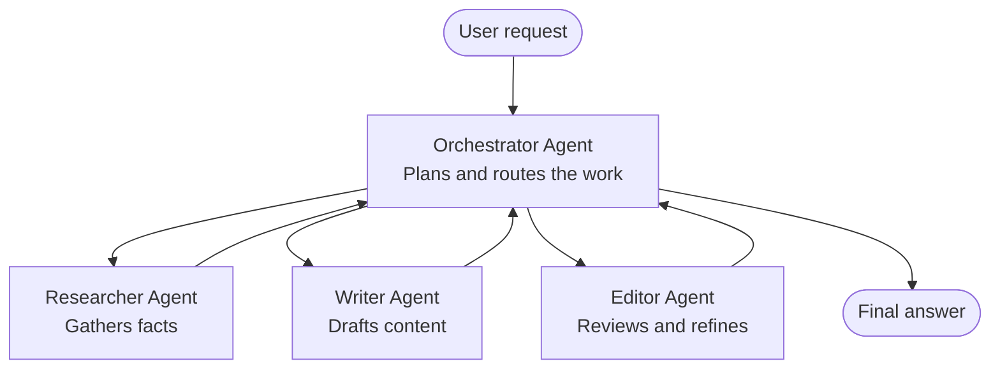

# Asas Multi-Ejen - Mengeluarkan Sistem AI Berkoordinasi Pertama Anda

**Navigasi Bab:**
- **📚 Halaman Utama Kursus**: [AZD Untuk Pemula](../../README.md)
- **📖 Bab Semasa**: Bab 5 - Penyelesaian AI Multi-Ejen
- **⬅️ Sebelumnya**: [Bab 4: Infrastruktur](../chapter-04-infrastructure/README.md)
- **➡️ Seterusnya**: [Corak Koordinasi](../chapter-06-pre-deployment/coordination-patterns.md)

> Panduan arahan disemak mengikut rujukan `azd 1.37.2` yang dikeluarkan. Penempatan awan tidak dijalankan.

## Pengenalan

Dalam bab-bab sebelumnya anda mengeluarkan satu aplikasi — dan dalam Bab 2 anda mengeluarkan satu ejen AI. Pelajaran ini mengambil langkah seterusnya: mengeluarkan **sistem multi-ejen**, di mana beberapa ejen khusus bekerjasama untuk menyelesaikan masalah yang tidak dapat ditangani dengan baik oleh satu ejen sahaja.

Berita baik untuk pemula: **anda tidak memerlukan arahan baru.** Penyelesaian multi-ejen masih merupakan projek azd. Anda akan `azd init`, `azd up`, menguji, dan `azd down`—tepat seperti aliran kerja yang anda sudah tahu. Apa yang berubah adalah *bentuk* aplikasi di dalamnya.

## Matlamat Pembelajaran

Pada akhir pelajaran ini, anda akan:
- Memahami maksud "multi-ejen" dan bila ia berbaloi dengan kerumitan tambahan
- Mengenal pasti peranan biasa dalam sistem multi-ejen (orchestrator + pakar)
- Mengeluarkan templat multi-ejen sebenar yang berfungsi dengan `azd up`
- Memahami sumber Azure yang menyokong aplikasi multi-ejen
- Tahu bagaimana untuk mengesahkan, menyesuaikan, dan membongkar penyelesaian dengan selamat

## Hasil Pembelajaran

Selepas melengkapkan pelajaran ini, anda akan dapat:
- Jelaskan perbezaan antara satu ejen dan sistem multi-ejen
- Memilih antara satu ejen dengan alat dan reka bentuk multi-ejen sebenar
- Mengeluarkan dan menguji templat multi-ejen dari awal hingga akhir dengan azd
- Kenal pasti di mana setiap ejen berjalan dan bagaimana mereka berkomunikasi
- Bersihkan semua sumber untuk mengelakkan caj berterusan

---

## Apakah Sistem Multi-Ejen?

Satu ejen AI adalah satu model dengan satu set arahan dan (secara pilihan) beberapa alat. Itu berfungsi baik untuk tugas terfokus. Tetapi apabila tugas berkembang—penyelidikan, kemudian penulisan, kemudian penyuntingan, kemudian pemeriksaan fakta—memasukkan semuanya ke dalam satu arahan membuatkan ejen menjadi lebih perlahan, kurang boleh dipercayai, dan lebih sukar untuk dibaiki.

Sistem **multi-ejen** memecahkan kerja kepada pakar yang masing-masing melakukan satu kerja dengan baik, dikordinasikan oleh seorang pengaturcara:



### Dua peranan yang akan sentiasa anda lihat

| Peranan | Kerja | Contoh |
|------|-----|---------|
| **Pengaturcara** | Memutuskan *apa yang berlaku seterusnya* dan mengarahkan kerja antara ejen | "Pertama penyelidikan, kemudian menulis, kemudian menyunting" |
| **Pakar** | Melakukan satu kerja terfokus dan mengembalikan hasil | Seorang "penyelidik" yang hanya mengumpul fakta |

### Adakah anda benar-benar memerlukan pelbagai ejen?

Mulakan dengan mudah. Gunakan multi-ejen **hanya** apabila salah satu daripada ini benar:

- ✅ Tugas mempunyai **tahap berbeza** yang mendapat manfaat daripada arahan berbeza (penyelidikan vs. penulisan vs. semakan)
- ✅ Anda mahu pakar menjalankan **secara selari** untuk menjimatkan masa
- ✅ Langkah berbeza memerlukan **alat atau sumber data berbeza**
- ✅ Anda mahu setiap langkah **boleh diuji dan dibetulkan secara bebas**

Jika tugas anda adalah soalan dan jawapan tunggal atau panggilan alat mudah, **satu ejen dengan alat** (Bab 2) lebih mudah, lebih murah, dan lebih mudah dikendalikan.

> **Petua pemula:** "Lebih banyak ejen" tidak bermaksud "lebih baik." Setiap ejen menambah kelewatan, kos, dan satu perkara baru untuk dipantau. Tambah ejen hanya apabila masalah jelas terbahagi kepada bahagian.

---

## Dua Cara Membangunkan Multi-Ejen di Azure

| Pendekatan | Apa itu | Sesuai untuk |
|----------|-----------|----------|
| **Satu ejen + alat** | Satu ejen Foundry yang memanggil fungsi/alat | Aliran kerja mudah, permulaan |
| **Beberapa ejen berkoordinasi** | Beberapa ejen dengan pengaturcara | Tahap berbeza, kerja selari, kepakaran |

Pelajaran ini memfokuskan pada pendekatan kedua menggunakan **templat yang sedia ada**, supaya anda dapat melihat sistem multi-ejen sebenar berjalan sebelum anda membina sendiri.

---

## Praktikal: Mengeluarkan Aplikasi Multi-Ejen Berfungsi

Kita akan mengeluarkan **Penulis Kreatif Contoso**, sampel rasmi Azure yang mengkoordinasi ejen penyelidikan, produk, penulisan, dan penyuntingan untuk menghasilkan artikel. Sebelum meneruskan, semak [prasyarat dan kos sampel](https://github.com/Azure-Samples/contoso-creative-writer#azure-account-requirements): ia memerlukan kuota model, Azure AI Search, akses Bing Grounding, Python, Docker, dan kaitan serasi Bash. Ketersediaan model dan wilayah bergantung pada langganan anda; penempatan tidak dijamin hanya dengan memilih wilayah tertentu.

### Langkah 1: Inisialisasi templat

```bash
# Create a working folder
mkdir creative-writer && cd creative-writer

# Initialize from the official multi-agent template
azd init --template Azure-Samples/contoso-creative-writer .
```

> Layari lebih banyak templat multi-ejen bila-bila masa dalam [galeri Awesome AZD AI](https://azure.github.io/awesome-azd/?tags=ai). Pilihan mesra pemula lain termasuk `get-started-with-ai-agents` dan `azure-ai-travel-agents`.

### Langkah 2: Sahkan Identiti

```bash
# Required for azd workflows
azd auth login

# Also required by this sample's Azure CLI hooks
az login
```

### Langkah 3: Semak persekitaran

```bash
# init normally creates/selects an environment; confirm it before proceeding
azd env list
# Only if you need an additional environment:
# azd env new dev
```

### Langkah 4: Pratonton, kemudian keluarkan

```bash
# See what will be created before spending anything (recommended)
azd provision --preview

# Provision infrastructure and deploy all agents in one step
azd up
```

`azd up` akan meminta tetapan langganan dan wilayah yang hilang, kemudian menyediakan sumber dan mengeluarkan aplikasi. Pratonton tidak menempah kuota atau menjamin kejayaan; kait templat mungkin masih berjalan semasa pratonton penyediaan, jadi periksa dahulu. Untuk melanjutkan masa azd menunggu setiap **penempatan perkhidmatan** (bukan penyediaan model):

```bash
azd deploy --timeout 1800
```

Masa tamat menghentikan azd menunggu; ia tidak membatalkan penempatan di Azure. Periksa keadaan sumber sebelum mencuba lagi.

> **Amaran tentang kos dan kapasiti:** Aplikasi multi-ejen mengeluarkan model AI yang menggunakan kuota dan menyebabkan kos. Jika `azd up` gagal kerana kuota model, lihat [Penyelesaian Masalah AI](../chapter-07-troubleshooting/ai-troubleshooting.md) untuk pembaikan wilayah dan kuota, serta Bab 6 [Perancangan Kapasiti](../chapter-06-pre-deployment/capacity-planning.md).

---

## Memahami Apa Yang Anda Keluarkan

Aplikasi multi-ejen tipikal seperti ini menyediakan satu set sumber Azure yang berkait langsung dengan tanggungjawab dalam rajah di atas:

| Sumber | Kenapa wujud |
|----------|----------------|
| **Microsoft Foundry / Model** | Menempatkan model bahasa yang digunakan oleh setiap ejen |
| **Azure AI Search** | Memberi data berpandukan kepada ejen penyelidik untuk mencari |
| **Container Apps** (atau App Service) | Menempatkan kod pengaturcara dan ejen |
| **Cosmos DB** (dalam beberapa sampel) | Menyimpan keadaan / memori bersama yang dipindahkan antara ejen |
| **Application Insights** | Menjejaki permintaan *merentasi* ejen supaya anda boleh membaiki aliran |

### Bagaimana ejen berkomunikasi antara satu sama lain

Dalam kebanyakan sampel multi-ejen azd, **pengaturcara berjalan dalam kod aplikasi anda** (contohnya, menggunakan rangka kerja seperti Semantic Kernel atau Microsoft Agent Framework). Pengaturcara memanggil setiap ejen pakar secara bergilir, menyerahkan hasil, dan menyusun jawapan akhir. Ejen berkongsi konteks melalui:

- **Panggilan fungsi/alat** — pengaturcara memanggil pakar dan mendapat hasil kembali
- **Memori bersama** — pangkalan data (sering Cosmos DB) menyimpan keadaan yang boleh dibaca oleh kedua-dua ejen
- **Mesej/acara** — untuk penyambungan lebih longgar, ejen berkomunikasi melalui antrian atau Service Bus

> **Kenapa ini penting untuk pembaikan:** kerana setiap langkah dipisahkan, Application Insights menunjukkan *ejen mana* yang lambat atau gagal. Itu adalah sebab utama untuk memecahkan kerja kepada beberapa ejen.

---

## Sahkan Penempatan

Sahkan sistem berfungsi sebelum meneruskan:

```bash
# Show the deployed endpoints
azd show

# Open the app's monitoring dashboard
azd monitor

# Open Application Insights Logs (not a terminal log stream)
azd monitor --logs
```

Kemudian buka URL aplikasi dari `azd show` dan minta artikel pendek. Gunakan pandangan debug sampel untuk memeriksa aliran kerja ejen. Carian transaksi Application Insights boleh menunjukkan langkah individu hanya jika sampel menyediakan instrumen dan korelasinya; azd tidak menambah span ejen secara automatik.

**Kriteria kejayaan:**
- ✅ `azd show` menyenaraikan titik akhir yang boleh dicapai
- ✅ Permintaan menghasilkan hasil yang jelas melalui pelbagai tahap
- ✅ Pandangan debug menunjukkan beberapa langkah ejen; jika jejak diaktifkan, sahkan telemetri berkaitan selepas isi

---

## Sesuaikan: Tambah atau Laraskan Ejen

Oleh kerana setiap ejen hanyalah arahan ditambah alat, penyesuaian boleh dilakukan dengan mudah:

1. **Cari definisi ejen** dalam templat (sering set fail `prompts/`, `agents/`, atau `*.prompty`).
2. **Laraskan arahan ejen** — contohnya, beritahu ejen editor untuk menguatkuasakan nada atau bilangan kata tertentu.
3. **Keluarkan semula hanya kod** (infrastruktur tidak berubah):

   ```bash
   azd deploy
   ```

Untuk pergi lebih jauh dengan projek ejen Foundry *anda sendiri*, gunakan pakej GA dengan AZD 1.37.0+ dalam direktori kosong berasingan:

```bash
azd ext install microsoft.foundry
azd ai agent init
azd up
azd ai agent invoke      # test, with response timing
```

Lihat [panduan ejen dihos GA](../chapter-02-ai-development/microsoft-foundry-integration.md#hosted-agent-walkthrough-ga) untuk ujian tempatan Penginspek Ejen, penyebaran kod jauh, dan pemilikan pembersihan. [Rujukan AZD AI CLI](../chapter-08-production/production-ai-practices.md#azd-ai-cli-commands-and-extensions) juga meliputi sambungan penilaian berasingan, pengoptimuman, dan penghapusan ejen.

---

## Membersihkan

Aplikasi multi-ejen menjalankan beberapa perkhidmatan yang boleh dikenakan bayaran. Bongkar semuanya apabila anda sudah selesai:

```bash
# Review the resources and confirm deletion interactively
azd down
```

Penghapusan adalah destruktif. Untuk makmal boleh buang, `azd down --force --purge` melangkau penghapusan dan pengesahan pembersihan lembut yang disokong; pembersihan tidak boleh dipulihkan di mana disokong dan boleh dihalang oleh perlindungan pembersihan. Penghapusan lembut adalah kebimbangan pemulihan/penggunaan semula nama, bukan bukti caj berterusan. Semak sumber yang masih kekal dan bil selepas pembersihan.

Jika anda juga menginisialisasi ejen dihos terhadap projek Foundry yang sedia ada, `azd down` meninggalkan ejen projek dan sumber lain di tempatnya. Buang hanya sumber yang tidak diingini yang anda miliki secara berasingan. Untuk projek Foundry baru yang dibuat oleh persekitaran AZDnya, `azd down` memadamkan kumpulan sumber dan segala isinya.

---

## Nota Mengenai Sistem Multi-Ejen Pengeluaran

Penyelesaian [Retail Multi-Agent](../../examples/retail-scenario.md) di repo ini adalah **pelan seni bina**, bukan templat satu arahan—ia mendokumentasikan bagaimana sistem runcit pengeluaran *akan* dibina (dan secara jelas menyatakan bahawa binaan penuh adalah usaha yang besar). Gunakannya sebagai rujukan reka bentuk *selepas* anda telah melancarkan contoh yang berfungsi di sini. Untuk kebimbangan pengeluaran (ketahanan, kos, pemantauan, tadbir urus), teruskan ke [Bab 8: Amalan AI Pengeluaran](../chapter-08-production/production-ai-practices.md).

---

## Ringkasan

- Sistem multi-ejen membahagikan kerja di antara pakar yang diselaraskan oleh seorang pengarah.
- Gunakannya hanya apabila tugasan mempunyai peringkat yang berbeza, paralelisme, atau alat yang berbeza bagi setiap langkah—jika tidak lebih baik menggunakan sebuah ejen tunggal.
- Aliran kerja azd tidak berubah: `azd init` → `azd up` → ujian → `azd down`.
- Sebuah templat sebenar seperti `contoso-creative-writer` membolehkan anda melihat dan menyesuaikan aplikasi multi-ejen yang berfungsi hari ini.
- Penjejakan Application Insights merentasi ejen adalah salah satu manfaat praktikal terbesar reka bentuk multi-ejen.

---

## 🔗 Navigasi

| Arah | Pelajaran |
|-----------|--------|
| **Sebelumnya** | [Bab 4: Infrastruktur](../chapter-04-infrastructure/README.md) |
| **Seterusnya** | [Corak Penyelarasan](../chapter-06-pre-deployment/coordination-patterns.md) |

## 📖 Sumber Berkaitan

- [Panduan Ejen AI](../chapter-02-ai-development/agents.md)
- [Corak Penyelarasan](../chapter-06-pre-deployment/coordination-patterns.md)
- [Amalan AI Pengeluaran](../chapter-08-production/production-ai-practices.md)
- [Penyelesaian Masalah AI](../chapter-07-troubleshooting/ai-troubleshooting.md)

---

<!-- CO-OP TRANSLATOR DISCLAIMER START -->
**Penafian**:
Dokumen ini telah diterjemahkan menggunakan perkhidmatan terjemahan AI [Co-op Translator](https://github.com/Azure/co-op-translator). Walaupun kami berusaha untuk ketepatan, sila ambil maklum bahawa terjemahan automatik mungkin mengandungi kesilapan atau ketidaktepatan. Dokumen asal dalam bahasa asalnya harus dianggap sebagai sumber yang sahih. Untuk maklumat penting, terjemahan oleh manusia profesional adalah disyorkan. Kami tidak bertanggungjawab terhadap sebarang salah faham atau salah tafsir yang timbul daripada penggunaan terjemahan ini.
<!-- CO-OP TRANSLATOR DISCLAIMER END -->