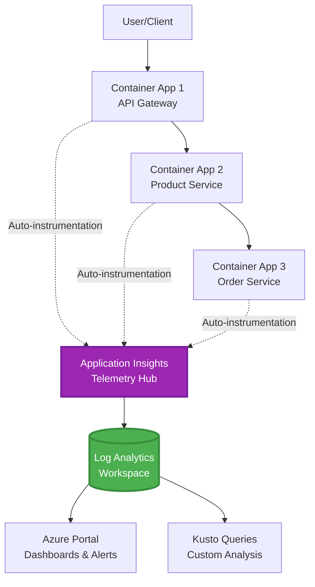
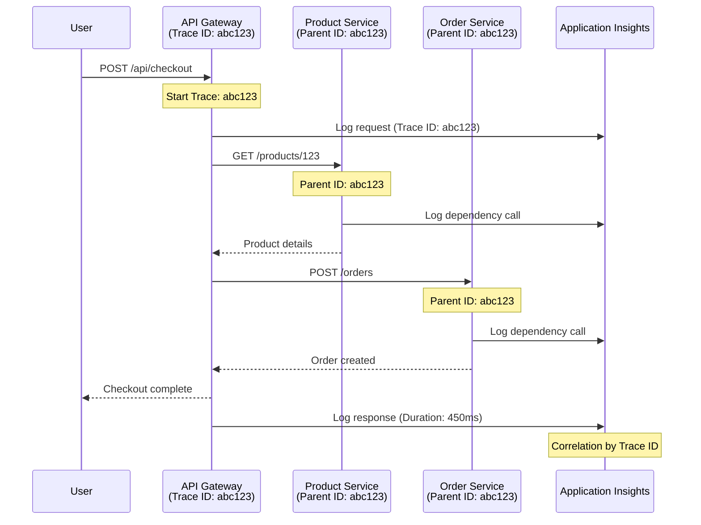

# Integrasi Application Insights dengan AZD

⏱️ **Anggaran Masa**: 40-50 minit | 💰 **Impak Kos**: ~$5-15/sebulan | ⭐ **Kerumitan**: Sederhana

**📚 Laluan Pembelajaran:**
- ← Sebelumnya: [Pemeriksaan Preflight](preflight-checks.md) - Pengesahan pra-penerapan
- 🎯 **Anda Di Sini**: Integrasi Application Insights (Pemantauan, telemetri, penyahpepijatan)
- → Seterusnya: [Panduan Penerapan](../chapter-04-infrastructure/deployment-guide.md) - Terapkan ke Azure
- 🏠 [Halaman Kursus](../../README.md)

---

## Apa Yang Akan Anda Pelajari

Dengan menamatkan pelajaran ini, anda akan:
- Mengisytiharkan **Application Insights** dalam infrastruktur AZD dan mengkonfigurasi instrumentasi SDK
- Mengkonfigurasi **penjejakan teragih** untuk mikroservis
- Melaksanakan **telemetri tersuai** (metriks, acara, kebergantungan)
- Menetapkan **metriks langsung** untuk pemantauan masa nyata
- Membuat **amaran dan papan pemuka** dari penerapan AZD
- Menyahpepijat isu produksi dengan **pertanyaan telemetri**
- Mengoptimumkan **kos dan strategi pensampelan**
- Memantau **aplikasi AI/LLM** (token, latensi, kos)

## Kenapa Application Insights dengan AZD Penting

### Cabaran: Observabiliti Produksi

**Tanpa Application Insights:**
```
❌ No visibility into production behavior
❌ Manual log aggregation across services
❌ Reactive debugging (wait for customer complaints)
❌ No performance metrics
❌ Cannot trace requests across services
❌ Unknown failure rates and bottlenecks
```

**Dengan Application Insights + AZD:**
```
✅ Automatic telemetry collection
✅ Centralized logs from all services
✅ Proactive issue detection
✅ End-to-end request tracing
✅ Performance metrics and insights
✅ Real-time dashboards
✅ AZD provisions the monitoring declared in your templates
```

**Analogi**: Application Insights seperti mempunyai "kotak hitam" perakam penerbangan + papan pemuka kokpit untuk aplikasi anda. Anda melihat segala-galanya yang berlaku secara masa nyata dan boleh memainkan semula sebarang insiden.

---

## Gambaran Keseluruhan Seni Bina

### Application Insights dalam Seni Bina AZD



### Apa Yang Dipantau Secara Automatik

Pencapturedan auto-instrumentasi yang disokong merakam permintaan/kebergantungan untuk perpustakaan yang diinstrumentasi. Acara dan metriks tersuai memerlukan kod aplikasi; ujian ketersediaan mesti dikonfigurasikan secara berasingan. Ia tidak mengumpulkan setiap baris di bawah hanya kerana sumber wujud.

| Jenis Telemetri | Apa Yang Dirakam | Kes Penggunaan |
|----------------|------------------|----------|
| **Permintaan** | Permintaan HTTP, kod status, tempoh | Pemantauan prestasi API |
| **Kebergantungan** | Panggilan luaran (DB, API, storan) | Kenal pasti kesesakan |
| **Pengecualian** | Ralat tidak dikendalikan dengan jejak timbunan | Penyahpepijatan kegagalan |
| **Acara Tersuai** | Acara perniagaan (pendaftaran, pembelian) | Analitis dan corong |
| **Metriks** | Penghitung prestasi, metriks tersuai | Perancangan kapasiti |
| **Jejak** | Mesej log dengan keterukan | Penyahpepijatan dan pengauditan |
| **Ketersediaan** | Ujian masa operasi dan masa tindak balas | Pemantauan SLA |

---

## Prasyarat

### Alat Diperlukan

```bash
# Verify Azure Developer CLI
azd version
# Command reference baseline: azd 1.37.2

# Verify Azure CLI
az --version
# ✅ Expected: azure-cli 2.50.0 or higher
```

### Keperluan Azure

- Langganan Azure aktif
- Kebenaran untuk membuat:
  - Sumber Application Insights
  - Workspace Log Analytics
  - Aplikasi Kontena
  - Kumpulan sumber

### Prasyarat Pengetahuan

Anda perlu menyelesaikan:
- [Asas AZD](../chapter-01-foundation/azd-basics.md) - Konsep utama AZD
- [Konfigurasi](../chapter-03-configuration/configuration.md) - Penyediaan persekitaran
- [Projek Pertama](../chapter-01-foundation/first-project.md) - Penerapan asas

---

## Pelajaran 1: Application Insights Automatik dengan AZD

### Bagaimana AZD Menyediakan Application Insights

AZD menyediakan Application Insights **hanya apabila infrastruktur projek mengisytiharkannya**. `azure.yaml` sendiri tidak mencipta pemantauan atau menginstrumentasi kod aplikasi.

> **Contoh skop:** Pelajaran ini mengandungi serpihan integrasi, bukan projek `monitored-app` lengkap dalam repositori ini. Sediakan templat utama dan pemetaan parameter, persekitaran Aplikasi Kontena, konfigurasi pendaftaran/gambar dan identiti, Dockerfile, dan tag perkhidmatan sebelum penerapan. Pelajaran kemudian menunjukkan serpihan alternatif/pelengkap, bukan fail yang boleh salin tampal bersama tanpa ubah. Mulakan dengan [contoh mikroservis](../../../../examples/microservices) yang berfungsi jika anda perlukan asas yang boleh dijalankan.

### Struktur Projek

```
monitored-app/
├── azure.yaml                     # AZD configuration
├── infra/
│   ├── main.bicep                # Main infrastructure
│   ├── core/
│   │   └── monitoring.bicep      # Application Insights + Log Analytics
│   └── app/
│       └── api.bicep             # Container App with monitoring
└── src/
    ├── app.py                    # Application with telemetry
    ├── requirements.txt
    └── Dockerfile
```

---

### Langkah 1: Konfigurasikan AZD (azure.yaml)

**Fail: `azure.yaml`**

```yaml
name: monitored-app
metadata:
  template: monitored-app@1.0.0

services:
  api:
    project: ./src
    language: python
    host: containerapp

# Monitoring must be declared in infra/ and enabled in application code.
```

Ini mengisytiharkan perkhidmatan yang boleh diterapkan. Konfigurasi Bicep dan SDK berikut menyediakan pemantauan; azd tidak menambahnya secara tersirat.

---

### Langkah 2: Infrastruktur Pemantauan (Bicep)

**Fail: `infra/core/monitoring.bicep`**

```bicep
param logAnalyticsName string
param applicationInsightsName string
param location string = resourceGroup().location
param tags object = {}

// Log Analytics Workspace (required for Application Insights)
resource logAnalytics 'Microsoft.OperationalInsights/workspaces@2022-10-01' = {
  name: logAnalyticsName
  location: location
  tags: tags
  properties: {
    sku: {
      name: 'PerGB2018'  // Pay-as-you-go pricing
    }
    retentionInDays: 30  // Keep logs for 30 days
    features: {
      enableLogAccessUsingOnlyResourcePermissions: true
    }
  }
}

// Application Insights
resource applicationInsights 'Microsoft.Insights/components@2020-02-02' = {
  name: applicationInsightsName
  location: location
  tags: tags
  kind: 'web'
  properties: {
    Application_Type: 'web'
    WorkspaceResourceId: logAnalytics.id
    IngestionMode: 'LogAnalytics'
    publicNetworkAccessForIngestion: 'Enabled'
    publicNetworkAccessForQuery: 'Enabled'
  }
}

// Outputs for Container Apps
output logAnalyticsWorkspaceId string = logAnalytics.id
output logAnalyticsWorkspaceName string = logAnalytics.name
output applicationInsightsConnectionString string = applicationInsights.properties.ConnectionString
output applicationInsightsInstrumentationKey string = applicationInsights.properties.InstrumentationKey
output applicationInsightsName string = applicationInsights.name
output applicationInsightsId string = applicationInsights.id
```

---

### Langkah 3: Sambungkan Aplikasi Kontena ke Application Insights

**Fail: `infra/app/api.bicep`**

```bicep
param name string
param location string
param tags object = {}
param containerAppsEnvironmentId string
param containerImage string
param applicationInsightsConnectionString string

resource containerApp 'Microsoft.App/containerApps@2023-05-01' = {
  name: name
  location: location
  tags: tags
  properties: {
    managedEnvironmentId: containerAppsEnvironmentId
    configuration: {
      ingress: {
        external: true
        targetPort: 8000
      }
      secrets: [
        {
          name: 'appinsights-connection-string'
          value: applicationInsightsConnectionString
        }
      ]
    }
    template: {
      containers: [
        {
          name: 'api'
          image: containerImage // Supply an accessible image and registry authentication
          resources: {
            cpu: json('0.5')
            memory: '1Gi'
          }
          env: [
            {
              name: 'APPLICATIONINSIGHTS_CONNECTION_STRING'
              secretRef: 'appinsights-connection-string'
            }
            {
              name: 'APPLICATIONINSIGHTS_ENABLED'
              value: 'true'
            }
          ]
        }
      ]
    }
  }
}

output uri string = 'https://${containerApp.properties.configuration.ingress.fqdn}'
```

---

### Langkah 4: Kod Aplikasi dengan Telemetri

**Fail: `src/app.py`**

```python
from flask import Flask, request, jsonify
from azure.monitor.opentelemetry import configure_azure_monitor
import logging
import os

app = Flask(__name__)

# Get Application Insights connection string
connection_string = os.environ.get('APPLICATIONINSIGHTS_CONNECTION_STRING')

if connection_string:
    # Azure Monitor OpenTelemetry instruments supported libraries, including Flask.
    configure_azure_monitor(
        connection_string=connection_string,
        logger_name=__name__,
        enable_live_metrics=True
    )
    logger = logging.getLogger(__name__)
    logger.setLevel(logging.INFO)
    
    print("✅ Application Insights enabled")
else:
    logger = logging.getLogger(__name__)
    logger.setLevel(logging.INFO)
    print("⚠️ Application Insights not configured")

@app.route('/health')
def health():
    logger.info('Health check endpoint called')
    return jsonify({'status': 'healthy', 'monitoring': 'enabled' if connection_string else 'disabled'})

@app.route('/api/products')
def get_products():
    logger.info('Fetching products')
    
    # In-memory fixture: this is not a database dependency call.
    products = [
        {'id': 1, 'name': 'Laptop', 'price': 999.99},
        {'id': 2, 'name': 'Mouse', 'price': 29.99},
        {'id': 3, 'name': 'Keyboard', 'price': 79.99}
    ]
    
    logger.info(f'Returned {len(products)} products')
    return jsonify(products)

@app.route('/api/error-test')
def error_test():
    """Test error tracking"""
    logger.error('Testing error tracking')
    try:
        raise ValueError('This is a test exception')
    except Exception as e:
        logger.exception('Exception occurred in error-test endpoint')
        return jsonify({'error': str(e)}), 500

@app.route('/api/slow')
def slow_endpoint():
    """Test performance tracking"""
    import time
    logger.info('Slow endpoint called')
    time.sleep(3)  # Simulate slow operation
    logger.warning('Endpoint took 3 seconds to respond')
    return jsonify({'message': 'Slow operation completed'})

if __name__ == '__main__':
    app.run(host='0.0.0.0', port=8000)
```

**Fail: `src/requirements.txt`**

```txt
Flask
azure-monitor-opentelemetry
gunicorn
requests
openai
```

Selesaikan kebergantungan ini dalam projek anda, uji bersama, dan kunci versi yang terhasil. Projek baru harus menggunakan Azure Monitor OpenTelemetry, bukan pengeksport OpenCensus Python yang telah bersara.

---

### Langkah 5: Terap dan Sahkan

```bash
# Deploy only after completing and wiring the infrastructure fragments above
azd up

# Get app URL
APP_URL=$(azd env get-value API_URL) # Requires this output in main.bicep

# Generate telemetry
curl $APP_URL/health
curl $APP_URL/api/products
curl $APP_URL/api/error-test
curl $APP_URL/api/slow
```

**✅ Output Dijangkakan:**
```json
{
  "status": "healthy",
  "monitoring": "enabled"
}
```

---

### Langkah 6: Lihat Telemetri di Portal Azure

```bash
# Get Application Insights details
azd env get-values | grep APPLICATIONINSIGHTS

# Open in Azure Portal
az monitor app-insights component show \
  --app $(azd env get-values | grep APPLICATIONINSIGHTS_NAME | cut -d '=' -f2 | tr -d '"') \
  --resource-group $(azd env get-values | grep AZURE_RESOURCE_GROUP | cut -d '=' -f2 | tr -d '"') \
  --query "appId" -o tsv
```

**Navigasi ke Azure Portal → Application Insights → Pencarian Transaksi**

Anda harus melihat:
- ✅ Permintaan HTTP dengan kod status
- ✅ Tempoh permintaan (3+ saat untuk `/api/slow`)
- ✅ Butiran pengecualian dari `/api/error-test`
- ✅ Mesej log tersuai

---

## Pelajaran 2: Telemetri dan Acara Tersuai

### Jejaki Acara Perniagaan

Mari tambah telemetri tersuai untuk acara perniagaan penting.

**Fail: `src/telemetry.py`**

```python
from contextlib import contextmanager
from azure.monitor.opentelemetry import configure_azure_monitor
from opentelemetry import metrics, trace
from opentelemetry.trace import SpanKind
import logging
import os

class TelemetryClient:
    """Custom telemetry client for Application Insights"""
    
    def __init__(self, connection_string=None):
        self.connection_string = connection_string or os.environ.get('APPLICATIONINSIGHTS_CONNECTION_STRING')
        
        # Configure once per process. If app.py already calls this, keep only
        # one configure_azure_monitor call and use logger_name='telemetry'.
        if self.connection_string:
            configure_azure_monitor(
                connection_string=self.connection_string,
                logger_name=__name__,
                enable_live_metrics=True
            )
        self.logger = logging.getLogger(__name__)
        self.logger.setLevel(logging.INFO)
        self.tracer = trace.get_tracer(__name__)
        self.meter = metrics.get_meter(__name__)
        self.instruments = {}
    
    def track_event(self, event_name: str, properties: dict = None):
        """Track custom business event"""
        properties = properties or {}
        self.logger.info(
            f"CustomEvent: {event_name}",
            extra={
                # OTel log attributes become customDimensions in App Insights.
                    'event_name': event_name,
                    **properties
            }
        )
    
    def track_metric(self, metric_name: str, value: float, properties: dict = None):
        """Track custom metric"""
        properties = properties or {}
        if metric_name not in self.instruments:
            self.instruments[metric_name] = self.meter.create_histogram(metric_name)
        self.instruments[metric_name].record(value, attributes=properties)
    
    @contextmanager
    def track_dependency(self, name: str):
        """Time the real operation inside a client span; exceptions mark failure."""
        with self.tracer.start_as_current_span(name, kind=SpanKind.CLIENT) as span:
            yield span

# Global telemetry client
telemetry = TelemetryClient()
```

### Kemas Kini Aplikasi dengan Acara Tersuai

**Fail: `src/app.py` (dipertingkat)**

Tambah laluan ini pada aplikasi Flask yang sedia ada; simpan laluan kesihatan/ujian terdahulu. Blok ringkas di bawah menunjukkan aplikasi berasingan untuk kejelasan. Inisialisasi telemetri kini berada di `telemetry.py`—jangan inisialisasi pengeksport dua kali.

```python
from flask import Flask, request, jsonify
from telemetry import telemetry
import time
import random
import os

app = Flask(__name__)

@app.route('/api/purchase', methods=['POST'])
def purchase():
    """Track purchase event with custom telemetry"""
    data = request.get_json(silent=True) or {}
    product_id = data.get('product_id')
    quantity = data.get('quantity', 1)
    price = data.get('price', 0)
    if not isinstance(quantity, int) or quantity < 1 or \
       not isinstance(price, (int, float)) or price < 0:
        return jsonify({'error': 'quantity and price must be non-negative numbers; quantity >= 1'}), 400
    
    # Track business event
    telemetry.track_event('Purchase', {
        'product_id': product_id,
        'quantity': quantity,
        'total_amount': price * quantity,
        'user_id': request.headers.get('X-User-Id', 'anonymous')
    })
    
    # Track revenue metric
    telemetry.track_metric('Revenue', price * quantity, {
        'product_id': product_id,
        'currency': 'USD'
    })
    
    return jsonify({
        'order_id': f'ORD-{random.randint(1000, 9999)}',
        'status': 'confirmed',
        'total': price * quantity
    })

@app.route('/api/search')
def search():
    """Track search queries"""
    query = request.args.get('q', '')
    
    start_time = time.time()
    
    # Simulate search (would be real database query)
    results = [{'id': 1, 'name': f'Result for {query}'}]
    
    duration = (time.time() - start_time) * 1000  # Convert to ms
    
    # Track search event
    telemetry.track_event('Search', {
        'query': query,
        'results_count': len(results),
        'duration_ms': duration
    })
    
    # Track search performance metric
    telemetry.track_metric('SearchDuration', duration, {
        'query_length': len(query)
    })
    
    return jsonify({'results': results, 'count': len(results)})

@app.route('/api/external-call')
def external_call():
    """Track external API dependency"""
    import requests
    
    try:
        # Set an actual test endpoint; api.example.com is not a working API.
        with telemetry.track_dependency('ExternalAPI'):
            response = requests.get(os.environ['EXTERNAL_API_URL'], timeout=5)
            response.raise_for_status()
            result = response.json()
    except Exception as e:
        return jsonify({'error': 'External dependency failed'}), 502
    
    return jsonify(result)

if __name__ == '__main__':
    app.run(host='0.0.0.0', port=8000)
```

### Uji Telemetri Tersuai

```bash
# Track purchase event
curl -X POST $APP_URL/api/purchase \
  -H "Content-Type: application/json" \
  -H "X-User-Id: user123" \
  -d '{"product_id": 1, "quantity": 2, "price": 29.99}'

# Track search event
curl "$APP_URL/api/search?q=laptop"

# Track external dependency
curl $APP_URL/api/external-call
```

**Lihat di Azure Portal:**

Navigasi ke Application Insights → Log, kemudian jalankan:

```kusto
// View purchase events
traces
| where customDimensions.event_name == "Purchase"
| project 
    timestamp,
    product_id = tostring(customDimensions.product_id),
    total_amount = todouble(customDimensions.total_amount),
    user_id = tostring(customDimensions.user_id)
| order by timestamp desc

// Revenue recorded in Purchase events (not a billing ledger)
traces
| where customDimensions.event_name == "Purchase"
| summarize TotalRevenue = sum(todouble(customDimensions.total_amount)) by bin(timestamp, 1h)
| render timechart

// View search performance
traces
| where customDimensions.event_name == "Search"
| summarize 
    AvgDuration = avg(todouble(customDimensions.duration_ms)),
    SearchCount = count()
  by bin(timestamp, 5m)
| render timechart
```

---

## Pelajaran 3: Penjejakan Teragih untuk Mikroservis

### Aktifkan Penjejakan Rentas Perkhidmatan

Dengan instrumentasi yang serasi dan penyebaran konteks jejak W3C, Application Insights mengaitkan permintaan antara perkhidmatan. Berkongsi rentetan sambungan sahaja tidak mewujudkan span induk-anak. Serpihan seni bina berikut merujuk modul yang anda mesti laksanakan.

**Fail: `infra/main.bicep`**

```bicep
targetScope = 'subscription'

param environmentName string
param location string = 'eastus'

var tags = { 'azd-env-name': environmentName }

resource rg 'Microsoft.Resources/resourceGroups@2021-04-01' = {
  name: 'rg-${environmentName}'
  location: location
  tags: tags
}

// Monitoring (shared by all services)
module monitoring './core/monitoring.bicep' = {
  name: 'monitoring'
  scope: rg
  params: {
    logAnalyticsName: 'log-${environmentName}'
    applicationInsightsName: 'appi-${environmentName}'
    location: location
    tags: tags
  }
}

// API Gateway
module apiGateway './app/api-gateway.bicep' = {
  name: 'api-gateway'
  scope: rg
  params: {
    name: 'ca-gateway-${environmentName}'
    location: location
    tags: union(tags, { 'azd-service-name': 'gateway' })
    applicationInsightsConnectionString: monitoring.outputs.applicationInsightsConnectionString
  }
}

// Product Service
module productService './app/product-service.bicep' = {
  name: 'product-service'
  scope: rg
  params: {
    name: 'ca-products-${environmentName}'
    location: location
    tags: union(tags, { 'azd-service-name': 'products' })
    applicationInsightsConnectionString: monitoring.outputs.applicationInsightsConnectionString
  }
}

// Order Service
module orderService './app/order-service.bicep' = {
  name: 'order-service'
  scope: rg
  params: {
    name: 'ca-orders-${environmentName}'
    location: location
    tags: union(tags, { 'azd-service-name': 'orders' })
    applicationInsightsConnectionString: monitoring.outputs.applicationInsightsConnectionString
  }
}

output APPLICATIONINSIGHTS_CONNECTION_STRING string = monitoring.outputs.applicationInsightsConnectionString
output GATEWAY_URL string = apiGateway.outputs.uri
```

### Lihat Transaksi Sehingga Akhir



**Pertanyaan jejak menyeluruh:**

```kusto
// Find complete request flow
let traceId = "abc123...";  // Copy operation_Id from a request in Application Insights
dependencies
| union requests
| where operation_Id == traceId
| project 
    timestamp,
    type = itemType,
    name,
    duration,
    success,
    cloud_RoleName
| order by timestamp asc
```

---

## Pelajaran 4: Metrik Langsung dan Pemantauan Masa Nyata

### Aktifkan Aliran Metrik Langsung

Metrik Langsung menyediakan telemetri hampir masa nyata apabila disokong dan diaktifkan oleh SDK. Ia bukan SLA latensi. Penyediaan Python OpenTelemetry di atas memilih dengan `enable_live_metrics=True`.

**Akses Metrik Langsung:**

```bash
# Get Application Insights resource
APPI_NAME=$(azd env get-values | grep APPLICATIONINSIGHTS_NAME | cut -d '=' -f2 | tr -d '"')

# Get resource group
RG_NAME=$(azd env get-values | grep AZURE_RESOURCE_GROUP | cut -d '=' -f2 | tr -d '"')

echo "Navigate to: Azure Portal → Resource Groups → $RG_NAME → $APPI_NAME → Live Metrics"
```

**Apa yang anda lihat secara masa nyata:**
- ✅ Kadar permintaan masuk (permintaan/saat)
- ✅ Panggilan kebergantungan keluar
- ✅ Kiraan pengecualian
- ✅ Penggunaan CPU dan memori
- ✅ Kiraan pelayan aktif
- ✅ Sampel telemetri

### Jana Beban untuk Ujian

```bash
# Generate load to see live metrics
for i in {1..100}; do
  curl --silent --max-time 10 "$APP_URL/api/products"
  curl --silent --max-time 10 "$APP_URL/api/search?q=test$i"
done

# Watch live metrics in Azure Portal
# You should see request rate spike
```

---

## Latihan Praktikal

### Latihan 1: Tetapkan Amaran ⭐⭐ (Sederhana)

**Matlamat**: Buat amaran untuk kadar ralat tinggi dan tindak balas perlahan.

**Langkah-langkah:**

1. **Buat amaran untuk kadar ralat:**

```bash
# Get Application Insights resource ID
APPI_ID=$(az monitor app-insights component show \
  --app $APPI_NAME \
  --resource-group $RG_NAME \
  --query "id" -o tsv)

# Create metric alert for failed requests
az monitor metrics alert create \
  --name "High-Error-Rate" \
  --resource-group $RG_NAME \
  --scopes $APPI_ID \
  --condition "count requests/failed > 10" \
  --window-size 5m \
  --evaluation-frequency 1m \
  --description "Alert when failed request count exceeds 10 per 5 minutes"
```

2. **Buat amaran untuk tindak balas perlahan:**

```bash
az monitor metrics alert create \
  --name "Slow-Responses" \
  --resource-group $RG_NAME \
  --scopes $APPI_ID \
  --condition "avg requests/duration > 3000" \
  --window-size 5m \
  --evaluation-frequency 1m \
  --description "Alert when average response time exceeds 3 seconds"
```

3. **Buat amaran melalui Bicep (disyorkan untuk AZD):**

**Fail: `infra/core/alerts.bicep`**

```bicep
param applicationInsightsId string
param actionGroupId string = ''
param location string = resourceGroup().location

// High error rate alert
resource errorRateAlert 'Microsoft.Insights/metricAlerts@2018-03-01' = {
  name: 'high-error-rate'
  location: 'global'
  properties: {
    description: 'Alert when error rate exceeds threshold'
    severity: 2
    enabled: true
    scopes: [
      applicationInsightsId
    ]
    evaluationFrequency: 'PT1M'
    windowSize: 'PT5M'
    criteria: {
      'odata.type': 'Microsoft.Azure.Monitor.SingleResourceMultipleMetricCriteria'
      allOf: [
        {
          name: 'Error rate'
          metricName: 'requests/failed'
          operator: 'GreaterThan'
          threshold: 10
          timeAggregation: 'Count'
        }
      ]
    }
    actions: actionGroupId != '' ? [
      {
        actionGroupId: actionGroupId
      }
    ] : []
  }
}

// Slow response alert
resource slowResponseAlert 'Microsoft.Insights/metricAlerts@2018-03-01' = {
  name: 'slow-responses'
  location: 'global'
  properties: {
    description: 'Alert when response time is too high'
    severity: 3
    enabled: true
    scopes: [
      applicationInsightsId
    ]
    evaluationFrequency: 'PT1M'
    windowSize: 'PT5M'
    criteria: {
      'odata.type': 'Microsoft.Azure.Monitor.SingleResourceMultipleMetricCriteria'
      allOf: [
        {
          name: 'Response duration'
          metricName: 'requests/duration'
          operator: 'GreaterThan'
          threshold: 3000
          timeAggregation: 'Average'
        }
      ]
    }
  }
}

output errorAlertId string = errorRateAlert.id
output slowResponseAlertId string = slowResponseAlert.id
```

4. **Uji amaran:**

```bash
# Generate errors
for i in {1..20}; do
  curl $APP_URL/api/error-test
done

# Generate slow responses
for i in {1..10}; do
  curl $APP_URL/api/slow
done

# Check rule configuration (not fired/resolved alert-instance history)
az monitor metrics alert list \
  --resource-group $RG_NAME \
  --query "[].{Name:name, Enabled:enabled}" \
  --output table
```

**✅ Kriteria Kejayaan:**
- ✅ Amaran berjaya dibuat
- ✅ Amaran diaktifkan apabila ambang melepasi
- ✅ Boleh melihat sejarah amaran di Azure Portal
- ✅ Terintegrasi dengan penerapan AZD

**Masa**: 20-25 minit

---

### Latihan 2: Buat Papan Pemuka Tersuai ⭐⭐ (Sederhana)

**Matlamat**: Bangun papan pemuka yang menunjukkan metriks utama aplikasi.

**Langkah-langkah:**

1. **Buat papan pemuka melalui Azure Portal:**

Navigasi ke: Azure Portal → Papan Pemuka → Papan Pemuka Baru

2. **Tambah jubin untuk metriks utama:**

- Kiraan permintaan (24 jam terakhir)
- Purata masa tindak balas
- Kadar ralat
- 5 operasi paling perlahan
- Taburan geografi pengguna

3. **Buat papan pemuka melalui Bicep:**

**Fail: `infra/core/dashboard.bicep`**

```bicep
param dashboardName string
param applicationInsightsId string
param location string = resourceGroup().location

resource dashboard 'Microsoft.Portal/dashboards@2020-09-01-preview' = {
  name: dashboardName
  location: location
  properties: {
    lenses: [
      {
        order: 0
        parts: [
          // Request count
          {
            position: {
              x: 0
              y: 0
              rowSpan: 4
              colSpan: 6
            }
            metadata: {
              type: 'Extension/Microsoft_OperationsManagementSuite_Workspace/PartType/LogsDashboardPart'
              inputs: [
                {
                  name: 'resourceId'
                  value: applicationInsightsId
                }
                {
                  name: 'query'
                  value: '''
                    requests
                    | summarize RequestCount = count() by bin(timestamp, 1h)
                    | render timechart
                  '''
                }
              ]
            }
          }
          // Error rate
          {
            position: {
              x: 6
              y: 0
              rowSpan: 4
              colSpan: 6
            }
            metadata: {
              type: 'Extension/Microsoft_OperationsManagementSuite_Workspace/PartType/LogsDashboardPart'
              inputs: [
                {
                  name: 'resourceId'
                  value: applicationInsightsId
                }
                {
                  name: 'query'
                  value: '''
                    requests
                    | summarize 
                        Total = count(),
                        Failed = countif(success == false)
                    | extend ErrorRate = (Failed * 100.0) / Total
                    | project ErrorRate
                  '''
                }
              ]
            }
          }
        ]
      }
    ]
  }
}

output dashboardId string = dashboard.id
```

4. **Terap papan pemuka:**

```bicep
// Add to a subscription-scoped main.bicep with rg and monitoring declared
module dashboard './core/dashboard.bicep' = {
  name: 'dashboard'
  scope: rg
  params: {
    dashboardName: 'dashboard-${environmentName}'
    applicationInsightsId: monitoring.outputs.applicationInsightsId
    location: location
  }
}
```

```bash
# Deploy
azd up
```

**✅ Kriteria Kejayaan:**
- ✅ Papan pemuka memaparkan metriks utama
- ✅ Boleh disematkan ke halaman utama Azure Portal
- ✅ Kemas kini masa nyata
- ✅ Boleh diterapkan melalui AZD

**Masa**: 25-30 minit

---

### Latihan 3: Pantau Aplikasi AI/LLM ⭐⭐⭐ (Lanjutan)

**Matlamat**: Jejaki penggunaan Model Microsoft Foundry (token, kos, latensi).

**Langkah-langkah:**

1. **Buat pembalut pemantauan AI:**

**Fail: `src/ai_telemetry.py`**

```python
from telemetry import telemetry
from openai import AzureOpenAI
import time

class MonitoredAzureOpenAI:
    """Microsoft Foundry Models client with automatic telemetry"""
    
    def __init__(self, api_key, endpoint, input_usd_per_million,
                 output_usd_per_million, api_version="2024-10-21"):
        self.client = AzureOpenAI(
            api_key=api_key,
            api_version=api_version,
            azure_endpoint=endpoint
        )
        self.input_rate = input_usd_per_million
        self.output_rate = output_usd_per_million
    
    def chat_completion(self, model: str, messages: list, **kwargs):
        """Track chat completion with telemetry"""
        start_time = time.time()
        
        try:
            # Call Microsoft Foundry Models
            response = self.client.chat.completions.create(
                model=model,
                messages=messages,
                **kwargs
            )
            
            duration = (time.time() - start_time) * 1000  # ms
            
            # Extract usage
            usage = response.usage
            prompt_tokens = usage.prompt_tokens
            completion_tokens = usage.completion_tokens
            total_tokens = usage.total_tokens
            
            # Approximation: supply actual deployment/region/contract rates.
            # Cached input, batch, provisioned and other charges need separate accounting.
            prompt_cost = (prompt_tokens / 1_000_000) * self.input_rate
            completion_cost = (completion_tokens / 1_000_000) * self.output_rate
            total_cost = prompt_cost + completion_cost
            
            # Track custom event
            telemetry.track_event('OpenAI_Request', {
                'model': model,
                'prompt_tokens': prompt_tokens,
                'completion_tokens': completion_tokens,
                'total_tokens': total_tokens,
                'duration_ms': duration,
                'cost_usd': total_cost,
                'success': True
            })
            
            # Track metrics
            telemetry.track_metric('OpenAI_Tokens', total_tokens, {
                'model': model,
                'type': 'total'
            })
            
            telemetry.track_metric('OpenAI_Cost', total_cost, {
                'model': model,
                'currency': 'USD'
            })
            
            telemetry.track_metric('OpenAI_Duration', duration, {
                'model': model
            })
            
            return response
            
        except Exception as e:
            duration = (time.time() - start_time) * 1000
            
            telemetry.track_event('OpenAI_Request', {
                'model': model,
                'duration_ms': duration,
                'success': False,
                'error': str(e)
            })
            
            raise
```

2. **Gunakan klien yang dipantau:**

```python
from flask import Flask, request, jsonify
from ai_telemetry import MonitoredAzureOpenAI
import os

app = Flask(__name__)

# Initialize monitored OpenAI client
openai_client = MonitoredAzureOpenAI(
    api_key=os.environ['AZURE_OPENAI_API_KEY'],
    endpoint=os.environ['AZURE_OPENAI_ENDPOINT'],
    input_usd_per_million=float(os.environ['INPUT_USD_PER_MILLION']),
    output_usd_per_million=float(os.environ['OUTPUT_USD_PER_MILLION'])
)

@app.route('/api/chat', methods=['POST'])
def chat():
    data = request.json
    user_message = data.get('message')
    
    # Call with automatic monitoring
    response = openai_client.chat_completion(
        model=os.environ['AZURE_OPENAI_DEPLOYMENT'], # Deployment name, not catalog ID
        messages=[
            {'role': 'user', 'content': user_message}
        ]
    )
    
    return jsonify({
        'response': response.choices[0].message.content,
        'tokens': response.usage.total_tokens
    })
```

3. **Pertanyaan metriks AI:**

```kusto
// Total AI spend over time
traces
| where customDimensions.event_name == "OpenAI_Request"
| where tobool(customDimensions.success) == true
| summarize TotalCost = sum(todouble(customDimensions.cost_usd)) by bin(timestamp, 1h)
| render timechart

// Token usage by model
traces
| where customDimensions.event_name == "OpenAI_Request"
| summarize 
    TotalTokens = sum(toint(customDimensions.total_tokens)),
    RequestCount = count()
  by Model = tostring(customDimensions.model)

// Average latency
traces
| where customDimensions.event_name == "OpenAI_Request"
| summarize AvgDuration = avg(todouble(customDimensions.duration_ms))
| project AvgDurationSeconds = AvgDuration / 1000

// Cost per request
traces
| where customDimensions.event_name == "OpenAI_Request"
| extend Cost = todouble(customDimensions.cost_usd)
| summarize 
    TotalCost = sum(Cost),
    RequestCount = count(),
    AvgCostPerRequest = avg(Cost)
```

**✅ Kriteria Kejayaan:**
- ✅ Setiap panggilan OpenAI dijejaki secara automatik
- ✅ Penggunaan token dan kos dapat dilihat
- ✅ Latensi dipantau
- ✅ Boleh menetapkan amaran bajet

**Masa**: 35-45 minit

---

## Pengoptimuman Kos

### Strategi Pensampelan

Kawal kos dengan pensampelan telemetri:

```python
import os

# Configure before the one configure_azure_monitor() call in your process.
os.environ["OTEL_TRACES_SAMPLER"] = "microsoft.fixed_percentage"
os.environ["OTEL_TRACES_SAMPLER_ARG"] = "0.1" # 10% trace sampling
```

Pensampelan jejak tidak mengurangkan setiap kategori telemetri sebanyak 90%. Metriks dan log yang dihantar secara bebas memerlukan kawalan volum tersendiri. Pilih kadar menggunakan keperluan observabiliti, bukan larangan penerbitan menyeluruh.

Tetapkan pensampel SDK secara eksplisit; sifat `SamplingPercentage` komponen bukan pengganti untuk mengkonfigurasi pensampel OpenTelemetry Python.

### Penyimpanan Data

```bicep
resource logAnalytics 'Microsoft.OperationalInsights/workspaces@2022-10-01' = {
  name: logAnalyticsName
  properties: {
    retentionInDays: 30  // Minimum (cheapest)
    // Options: 30, 31, 60, 90, 120, 180, 270, 365, 550, 730
  }
}
```

### Anggaran Kos Bulanan

| Jumlah Data | Penyimpanan | Kos Bulanan |
|-------------|-----------|--------------|
| 1 GB/bulan | 30 hari | ~$2-5 |
| 5 GB/bulan | 30 hari | ~$10-15 |
| 10 GB/bulan | 90 hari | ~$25-40 |
| 50 GB/bulan | 90 hari | ~$100-150 |

Angka ini adalah sebagai contoh, bukan sebut harga. Sahkan harga penyusupan, penyimpanan, amaran, dan ujian di rantau dan perjanjian anda; elaun percuma dikongsi/diskop mengikut harga Azure Monitor, bukan SKU percuma dijamin setiap sumber Application Insights.

---

## Titik Semak Pengetahuan

### 1. Integrasi Asas ✓

Uji pemahaman anda:

- [ ] **S1**: Bagaimana AZD menyediakan Application Insights?
  - **J**: Ia menerapkan sumber pemantauan yang diisytiharkan secara eksplisit oleh templat Bicep/Terraform projek.

- [ ] **S2**: Apakah pembolehubah persekitaran yang mengaktifkan Application Insights?
  - **J**: `APPLICATIONINSIGHTS_CONNECTION_STRING`

- [ ] **S3**: Apakah tiga jenis telemetri utama?
  - **J**: Permintaan (panggilan HTTP), Kebergantungan (panggilan luaran), Pengecualian (ralat)

**Sahkan secara Amali:**
```bash
# Check if Application Insights is configured
azd env get-values | grep APPLICATIONINSIGHTS

# Verify telemetry is flowing
az monitor app-insights metrics show \
  --app $APPI_NAME \
  --resource-group $RG_NAME \
  --metric "requests/count"
```

---

### 2. Telemetri Tersuai ✓

Uji pemahaman anda:

- [ ] **S1**: Bagaimana anda menjejaki acara perniagaan tersuai?
  - **J**: Pembalut pelajaran ini menulis log OTel berstruktur dengan atribut `event_name`, boleh dipertanyaan di `traces`; ini tidak automatik `customEvents`.

- [ ] **S2**: Apa perbezaan antara acara dan metriks?
  - **J**: Acara adalah kejadian berasingan, metriks adalah pengukuran berangka

- [ ] **S3**: Bagaimana anda mengaitkan telemetri merentas perkhidmatan?
  - **J**: Application Insights secara automatik menggunakan `operation_Id` untuk korelasi

**Sahkan secara Amali:**
```kusto
// Verify custom events
traces
| where customDimensions.event_name != ""
| summarize count() by tostring(customDimensions.event_name)
```

---

### 3. Pemantauan Produksi ✓

Uji pemahaman anda:

- [ ] **S1**: Apakah pensampelan dan kenapa menggunakannya?
  - **J**: Pensampelan mengurangkan jumlah data (dan kos) dengan hanya merakam peratusan telemetri

- [ ] **S2**: Bagaimana anda memasang amaran?
  - **J**: Gunakan amaran metriks dalam Bicep atau Azure Portal berdasarkan metriks Application Insights

- [ ] **S3**: Apa perbezaan antara Log Analytics dan Application Insights?
  - **J**: Application Insights menyimpan data dalam workspace Log Analytics; App Insights menyediakan paparan khusus aplikasi

**Sahkan secara Amali:**
```bash
# Check the sampler configured for the running application, not only the ARM component.
az containerapp show --name "$APP_NAME" --resource-group "$RG_NAME" \
  --query "properties.template.containers[].env[?starts_with(name, 'OTEL_TRACES_SAMPLER')]"
```

---

## Amalan Terbaik

### ✅ LAKUKAN:

1. **Gunakan ID korelasi**
   ```python
   logger.info('Processing order', extra={
           'order_id': order_id,
           'user_id': user_id
   })
   ```

2. **Pasang amaran untuk metriks kritikal**
   ```bicep
   // Error rate, slow responses, availability
   ```

3. **Gunakan log berstruktur**
   ```python
   # ✅ GOOD: Structured
   logger.info('User signup', extra={'user_id': 'pseudonymous-id'})
   
   # ❌ BAD: Unstructured
   logger.info(f'User 123 signed up')
   ```

4. **Pantau kebergantungan**
   ```python
   # Automatically track database calls, HTTP requests, etc.
   ```

5. **Gunakan Metrik Langsung semasa penerapan**

### ❌ JANGAN:

1. **Jangan log data sensitif**
   ```python
   # ❌ BAD
   logger.info(f'Login: {username}:{password}')
   
   # ✅ GOOD
   logger.info('Login attempt', extra={'result': 'failed'})
   ```

2. **Jangan pilih pensampelan tanpa mengukur jumlah dan keperluan diagnostik**
   ```python
   # ❌ Expensive
   # 100% traces may be appropriate for a small workload or investigation.
   
   # ✅ Cost-effective
   # A lower trace rate reduces visibility; validate coverage before enabling.
   ```

3. **Jangan abaikan barisan surat mati**

4. **Jangan lupa tetapkan had pengekalan data**

---

## Penyelesaian Masalah

### Masalah: Tiada telemetri muncul

**Diagnosis:**
```bash
# Check connection string is set
azd env get-values | grep APPLICATIONINSIGHTS

# Check application logs via Azure Monitor
azd monitor --logs

# Or use Azure CLI for Container Apps:
az containerapp logs show --name $APP_NAME --resource-group $RG_NAME --tail 50
```

**Penyelesaian:**
```bash
# Verify connection string in Container App
az containerapp show \
  --name $APP_NAME \
  --resource-group $RG_NAME \
  --query "properties.template.containers[0].env" \
  | grep -i applicationinsights
```

---

### Masalah: Kos tinggi

**Diagnosis:**
```bash
# Query ingestion volume in the linked Log Analytics workspace.
# WORKSPACE_ID is the workspace customer ID (GUID), not its ARM resource ID.
az monitor log-analytics query --workspace "$WORKSPACE_ID" \
  --analytics-query "Usage | where TimeGenerated > ago(30d) | where IsBillable == true | summarize IngestedMB=sum(Quantity) by DataType"
```

**Penyelesaian:**
- Kurangkan kadar pensampelan
- Kurangkan tempoh pengekalan
- Buang log verbose

---

## Ketahui Lebih Lanjut

### Dokumentasi Rasmi
- [Gambaran Keseluruhan Application Insights](https://learn.microsoft.com/azure/azure-monitor/app/app-insights-overview)
- [Persediaan Azure Monitor OpenTelemetry](https://learn.microsoft.com/azure/azure-monitor/app/opentelemetry-enable?tabs=python)
- [Bahasa Pertanyaan Kusto](https://learn.microsoft.com/azure/data-explorer/kusto/query/)
- [Pemantauan AZD](https://learn.microsoft.com/azure/developer/azure-developer-cli/monitor-your-app)

### Langkah Seterusnya Dalam Kursus Ini
- ← Sebelumnya: [Pemeriksaan Pra-Penerbangan](preflight-checks.md)
- → Seterusnya: [Panduan Penyebaran](../chapter-04-infrastructure/deployment-guide.md)
- 🏠 [Halaman Utama Kursus](../../README.md)

### Contoh Berkaitan
- [Contoh Model Microsoft Foundry](../../../../examples/azure-openai-chat) - Telemetri AI
- [Contoh Mikroservis](../../../../examples/microservices) - Penjejakan Teragih

---

## Ringkasan

**Anda telah mempelajari:**
- ✅ Penyediaan automatik Application Insights dengan AZD
- ✅ Telemetri tersuai (acara, metrik, pergantungan)
- ✅ Penjejakan teragih merentasi mikroservis
- ✅ Metrik langsung dan pemantauan masa nyata
- ✅ Amaran dan papan pemuka
- ✅ Pemantauan aplikasi AI/LLM
- ✅ Strategi pengoptimuman kos

**Petikan Utama:**
1. **Isytihar pemantauan secara eksplisit** - AZD menggerakkan templat anda; instrumentasi SDK menghantar telemetri
2. **Gunakan log berstruktur** - Memudahkan pertanyaan
3. **Jejaki acara perniagaan** - Bukan hanya metrik teknikal
4. **Pantau kos AI** - Jejaki token dan perbelanjaan
5. **Tetapkan amaran** - Bersikap proaktif, bukan reaktif
6. **Optimumkan kos** - Gunakan pensampelan dan had pengekalan

**Langkah Seterusnya:**
1. Selesaikan latihan praktikal
2. Tambah Application Insights ke projek AZD anda
3. Cipta papan pemuka tersuai untuk pasukan anda
4. Pelajari [Panduan Penyebaran](../chapter-04-infrastructure/deployment-guide.md)

---

<!-- CO-OP TRANSLATOR DISCLAIMER START -->
**Penafian**:
Dokumen ini telah diterjemahkan menggunakan perkhidmatan terjemahan AI [Co-op Translator](https://github.com/Azure/co-op-translator). Walaupun kami berusaha untuk ketepatan, sila ambil maklum bahawa terjemahan automatik mungkin mengandungi kesilapan atau ketidaktepatan. Dokumen asal dalam bahasa asalnya harus dianggap sebagai sumber yang sahih. Untuk maklumat penting, terjemahan oleh manusia profesional adalah disyorkan. Kami tidak bertanggungjawab terhadap sebarang salah faham atau salah tafsir yang timbul daripada penggunaan terjemahan ini.
<!-- CO-OP TRANSLATOR DISCLAIMER END -->