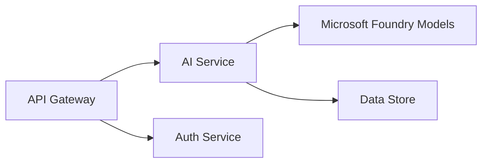
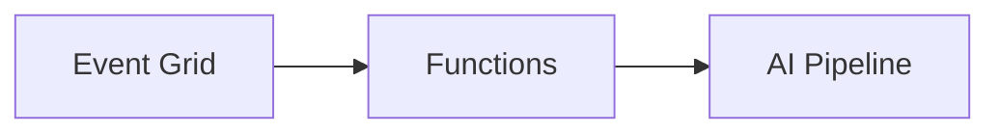

# Bab 8: Corak Pengeluaran & Perusahaan

**📚 Kursus**: [AZD Untuk Pemula](../../README.md) | **⏱️ Durasi**: 2-3 jam | **⭐ Kerumitan**: Lanjutan

---

## Gambaran Keseluruhan

Bab ini merangkumi corak penerapan siap perusahaan, pengukuhan keselamatan, pemantauan, dan pengoptimuman kos untuk beban kerja AI pengeluaran.

Ini adalah rujukan seni bina, bukan templat pengeluaran lengkap yang boleh diterapkan. Contoh mengabaikan butiran integrasi yang mesti disediakan dan diuji dalam aplikasi anda sendiri; membaca senarai semak tidak mengesahkan kesiapan pengeluaran.

> **Semakan pelepasan (2026-11-04):** Panduan AI CLI telah disemak mengikut `azd 1.37.2`, ejen `1.0.0-beta.23`, dan dokumentasi/sumber penilaian `1.0.0-beta.2`. Lihat [perubahan dan pembetulan pelepasan](production-ai-practices.md#recent-release-changes-and-fixes) untuk keperluan keserasian dan butiran migrasi; ini bukan pengesahan penerapan langsung.

## Objektif Pembelajaran

Dengan menyelesaikan bab ini, anda akan:
- Menggunakan aplikasi multi-wilayah yang tahan lasak
- Melaksanakan corak keselamatan perusahaan
- Mengkonfigurasi pemantauan menyeluruh
- Mengoptimumkan kos pada skala besar
- Menyediakan saluran paip CI/CD dengan AZD

---

## 📚 Pelajaran

| # | Pelajaran | Penerangan | Masa |
|---|--------|-------------|------|
| 1 | [Amalan AI Pengeluaran](production-ai-practices.md) | Corak penerapan perusahaan | 90 min |

---

## 🚀 Senarai Semak Pengeluaran

- [ ] Penerapan multi-wilayah untuk ketahanan
- [ ] Identiti terurus untuk pengesahan (tanpa kunci)
- [ ] Application Insights untuk pemantauan
- [ ] Belanjawan kos dan amaran dikonfigurasikan
- [ ] Imbasan keselamatan diaktifkan
- [ ] Integrasi saluran paip CI/CD
- [ ] Pelan pemulihan bencana

---

## 🏗️ Corak Seni Bina

### Corak 1: AI Perkhidmatan Mikro



### Corak 2: AI Berpandukan Acara



---

## 🔐 Amalan Terbaik Keselamatan

```bicep
// Illustrative properties from different resources, NOT a standalone Bicep file.
// Attach identity to the application host:
identity: {
  type: 'SystemAssigned'
}

// AI account properties (also require private endpoints, DNS and app connectivity):
properties: {
  publicNetworkAccess: 'Disabled'
  networkAcls: {
    defaultAction: 'Deny'
  }
}
```

---

## 💰 Pengoptimuman Kos

| Strategi | Kekangan Utama |
|----------|---------|
| Skalakan ke sifar (Container Apps) | Memerlukan pencetus yang sesuai; perkhidmatan lain masih menanggung kos |
| Gunakan tahap penggunaan untuk pembangunan | Bandingkan harga perkhidmatan yang dipilih dan beban kerja |
| Skalakan mengikut jadual | Skalakan melalui infrastruktur/automasi yang disokong |
| Tempahan/kapasiti diperuntukkan | Hanya apabila disokong; komitmen boleh meningkatkan kos menganggur |

Gunakan [corak sumber bajet lengkap](production-ai-practices.md#2-cost-monitoring-and-budgets) dengan tarikh mula yang sah, skop bil, penerima, dan kebenaran. Bajet menghantar amaran; ia tidak mengehadkan perbelanjaan. Penjimatan bergantung pada penggunaan yang diukur dan tidak dijamin peratusannya.

---

## 📊 Tetapan Pemantauan

```bash
# Open the Application Insights logs view (requires configured monitoring)
azd monitor --logs

# Check Application Insights
azd monitor --overview

# View metrics
az monitor metrics list --resource <resource-id>
```

---

## 🔗 Navigasi

| Arah | Bab |
|-----------|---------|
| **Sebelumnya** | [Bab 7: Penyelesaian Masalah](../chapter-07-troubleshooting/README.md) |
| **Kursus Selesai** | [Halaman Kursus](../../README.md) |

---

## 📖 Sumber Berkaitan

- [Panduan Ejen AI](../chapter-02-ai-development/agents.md)
- [Application Insights](../chapter-06-pre-deployment/application-insights.md)
- [Penyelesaian Multi-Ejen](../chapter-05-multi-agent/README.md)
- [Contoh Perkhidmatan Mikro](../../examples/microservices/README.md)

---

<!-- CO-OP TRANSLATOR DISCLAIMER START -->
**Penafian**:
Dokumen ini telah diterjemahkan menggunakan perkhidmatan terjemahan AI [Co-op Translator](https://github.com/Azure/co-op-translator). Walaupun kami berusaha untuk ketepatan, sila ambil maklum bahawa terjemahan automatik mungkin mengandungi kesilapan atau ketidaktepatan. Dokumen asal dalam bahasa asalnya harus dianggap sebagai sumber yang sahih. Untuk maklumat penting, terjemahan oleh manusia profesional adalah disyorkan. Kami tidak bertanggungjawab terhadap sebarang salah faham atau salah tafsir yang timbul daripada penggunaan terjemahan ini.
<!-- CO-OP TRANSLATOR DISCLAIMER END -->