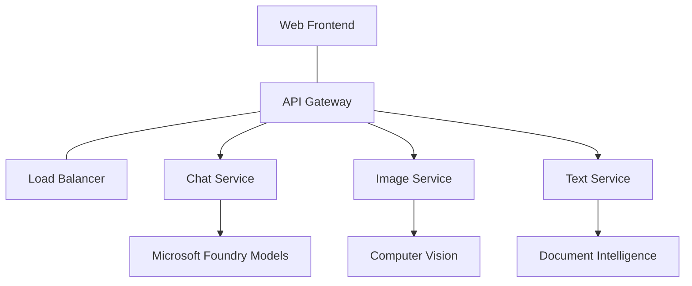

# Amalan Terbaik Beban Kerja AI Produksi dengan AZD

**Navigasi Bab:**
- **📚 Laman Utama Kursus**: [AZD Untuk Pemula](../../README.md)
- **📖 Bab Terkini**: Bab 8 - Corak Produksi & Perusahaan
- **⬅️ Bab Sebelumnya**: [Bab 7: Penyelesaian Masalah](../chapter-07-troubleshooting/debugging.md)
- **⬅️ Juga Berkaitan**: [Makmal Bengkel AI](../chapter-02-ai-development/ai-workshop-lab.md)
- **🎯 Kursus Lengkap**: [AZD Untuk Pemula](../../README.md)

## Gambaran Keseluruhan

Panduan ini menerangkan corak reka bentuk AI produksi menggunakan Azure Developer CLI (AZD). Ia adalah rujukan reka bentuk, bukan aplikasi yang boleh diterapkan atau sijil produksi.

**Sempadan contoh:** Kecuali secara jelas digambarkan sebagai lengkap, serpihan Bicep menganggap parameter dan sumber yang dirujuk dari templat yang mengandungi. Ia mengecualikan imej/rancangan hos, identiti, penugasan peranan, DNS, output, dan integrasi lain yang diperlukan. Laluan perkhidmatan YAML dan skrip kait/ujian adalah fail ilustratif untuk dibuat dalam **aplikasi anda sendiri**; ia tidak disediakan oleh kursus ini. Gunakan sampel AZD yang berfungsi sebagai asas, kompilasikan infrastruktur lengkap, dan uji dalam persekitaran terpencil sebelum produksi.

## Cabaran Utama Yang Ditangani

Kebimbangan produksi biasa termasuk penerapan multi-perkhidmatan, pengurusan identiti dan rahsia, penskalaan, kawalan kos, dan pemantauan. Tiada prevalens yang diukur dituntut di sini.

## Corak Seni Bina untuk AI Produksi

### Corak 1: Seni Bina Mikroservis AI

**Bila digunakan**: Aplikasi AI kompleks dengan banyak kebolehan



**Pelaksanaan AZD**:

```yaml
# azure.yaml
name: enterprise-ai-platform
services:
  web:
    project: ./web
    host: staticwebapp
  api-gateway:
    project: ./api-gateway
    host: containerapp
  chat-service:
    project: ./services/chat
    host: containerapp
  vision-service:
    project: ./services/vision
    host: containerapp
  text-service:
    project: ./services/text
    host: containerapp
```

### Corak 2: Pemprosesan AI Dipacu Acara

**Bila digunakan**: Pemprosesan kelompok, analisis dokumen, aliran kerja async

```bicep
// Event Hub for AI processing pipeline
resource eventHub 'Microsoft.EventHub/namespaces@2024-01-01' = {
  name: eventHubNamespaceName
  location: location
  sku: {
    name: 'Standard'
    tier: 'Standard'
    capacity: 1
  }
}

// Service Bus for reliable message processing
resource serviceBus 'Microsoft.ServiceBus/namespaces@2024-01-01' = {
  name: serviceBusNamespaceName
  location: location
  sku: {
    name: 'Premium'
    tier: 'Premium'
    capacity: 1
  }
}

// Function App for processing
resource functionApp 'Microsoft.Web/sites@2023-01-01' = {
  name: functionAppName
  location: location
  kind: 'functionapp,linux'
  properties: {
    siteConfig: {
      appSettings: [
        {
          name: 'FUNCTIONS_EXTENSION_VERSION'
          value: '~4'
        }
        {
          name: 'AZURE_OPENAI_ENDPOINT'
          value: '@Microsoft.KeyVault(VaultName=${keyVault.name};SecretName=openai-endpoint)'
        }
      ]
    }
  }
}
```

Ini mencipta serpihan ruang nama, bukan hab, barisan, langganan, atau pencetus Fungsi. Fungsi yang boleh dijalankan juga memerlukan rancangan hos, konfigurasi runtime/penyimpanan, identiti terpasang, RBAC, dan akses rangkaian. Rujukan Key Vault memerlukan kebenaran untuk membaca rahsia; URL titik akhir bukanlah kelayakan.

## Fikirkan Mengenai Kesihatan Ejen AI

Apabila aplikasi web tradisional rosak, simptomnya biasa: halaman tidak dimuat, API mengembalikan ralat, atau penyebaran gagal. Aplikasi yang dikuasakan AI boleh rosak dengan cara yang sama—tetapi juga boleh berkelakuan salah dengan cara halus yang tidak menghasilkan mesej ralat yang jelas.

Bahagian ini membantu anda membina model mental untuk memantau beban kerja AI supaya anda tahu di mana hendak mencari apabila keadaan tidak nampak betul.

### Bagaimana Kesihatan Ejen Berbeza daripada Kesihatan Aplikasi Tradisional

Aplikasi tradisional juga boleh mengalami kegagalan ketepatan halus. Ejen AI menambah kualiti respons tidak deterministik kepada kebimbangan kebolehcapaian dan ketepatan biasa. Fikirkan kesihatan ejen dalam dua lapisan:

| Lapisan | Apa Yang Perlu Ditonton | Di Mana Hendak Mencari |
|-------|--------------|---------------|
| **Kesihatan infrastruktur** | Adakah perkhidmatan berjalan? Adakah sumber diperuntukkan? Adakah titik akhir boleh dicapai? | `azd monitor`, kesihatan sumber Azure Portal, log bekas/aplikasi |
| **Kesihatan tingkah laku** | Adakah ejen memberi respons dengan tepat? Adakah respons tepat pada masa? Adakah model dipanggil dengan betul? | Penjejak Application Insights, metrik kelewatan panggilan model, log kualiti respons |

Kesihatan infrastruktur adalah biasa—sama untuk mana-mana aplikasi azd. Kesihatan tingkah laku adalah lapisan baru yang diperkenalkan oleh beban kerja AI.

### Di Mana Hendak Mencari Apabila Aplikasi AI Tidak Berkelakuan Seperti Dijangka

Jika aplikasi AI anda tidak menghasilkan keputusan yang dijangka, berikut adalah senarai semak konseptual:

1. **Mulakan dengan asas.** Adakah aplikasi berjalan? Bolehkah ia mencapai kebergantungan? Semak `azd monitor` dan kesihatan sumber seperti anda lakukan untuk mana-mana aplikasi.
2. **Periksa sambungan model.** Adakah aplikasi anda berjaya memanggil model AI? Panggilan model gagal atau tamat masa adalah punca paling biasa masalah aplikasi AI dan akan muncul dalam log aplikasi anda.
3. **Periksa input dan asas dengan selamat.** Jawapan yang salah boleh disebabkan oleh pengambilan, arahan, keterbatasan model, atau pelaksanaan alat. Gunakan data diagnostik dikawal akses, disunting; jangan aktifkan log sembang/prompt secara membuta tuli dalam produksi.
4. **Semak kelewatan respons.** Panggilan model AI lebih perlahan daripada panggilan API biasa. Jika aplikasi anda perlahan, periksa sama ada masa respons model meningkat—ini boleh menunjukkan perencatan, had kapasiti, atau kesesakan peringkat rantau.
5. **Peka kepada isyarat kos.** Peningkatan penggunaan token atau panggilan API yang tidak dijangka boleh menunjukkan gelung, prompt salah konfigurasi, atau percubaan berlebihan.

Anda tidak perlu menguasai alat pemerhatian dengan segera. Pengajaran utama ialah aplikasi AI mempunyai lapisan tingkah laku tambahan untuk dipantau, dan pemantauan terbina dalam azd (`azd monitor`) memberi anda titik permulaan untuk menyiasat kedua-dua lapisan.

---

## Amalan Terbaik Keselamatan

### 1. Model Keselamatan Zero-Trust

**Strategi Pelaksanaan**:
- Tiada komunikasi perkhidmatan-ke-perkhidmatan tanpa pengesahan
- Semua panggilan API menggunakan identiti terurus
- Pengasingan rangkaian dengan titik akhir peribadi
- Kawalan akses keistimewaan minimum

```bicep
// Managed Identity for each service
resource chatServiceIdentity 'Microsoft.ManagedIdentity/userAssignedIdentities@2023-01-31' = {
  name: 'chat-service-identity'
  location: location
}

// Role assignments with minimal permissions
resource openAIUserRole 'Microsoft.Authorization/roleAssignments@2022-04-01' = {
  scope: openAIAccount
  name: guid(openAIAccount.id, chatServiceIdentity.id, '5e0bd9bd-7b93-4f28-af87-19fc36ad61bd')
  properties: {
    roleDefinitionId: subscriptionResourceId('Microsoft.Authorization/roleDefinitions', '5e0bd9bd-7b93-4f28-af87-19fc36ad61bd')
    principalId: chatServiceIdentity.properties.principalId
    principalType: 'ServicePrincipal'
  }
}
```

### 2. Pengurusan Rahsia Selamat

**Corak Integrasi Key Vault**:

```bicep
// Key Vault with proper access policies
resource keyVault 'Microsoft.KeyVault/vaults@2023-02-01' = {
  name: keyVaultName
  location: location
  properties: {
    tenantId: tenant().tenantId
    sku: {
      family: 'A'
      name: 'standard' // Premium is needed for HSM-backed keys, not ordinary secrets
    }
    enableRbacAuthorization: true  // Use RBAC instead of access policies
    enablePurgeProtection: true    // Prevent accidental deletion
    enableSoftDelete: true
    softDeleteRetentionInDays: 90
  }
}

// Optional legacy key-auth alternative; omit when using Entra ID.
resource openAIKeySecret 'Microsoft.KeyVault/vaults/secrets@2023-02-01' = {
  parent: keyVault
  name: 'openai-api-key'
  properties: {
    value: openAIAccount.listKeys().key1
    attributes: {
      enabled: true
    }
  }
}
```

Tetapkan identiti runtime `Key Vault Secrets User` pada skop yang sesuai dan lampirkan ke hos; `enableRbacAuthorization` sahaja tidak memberi akses. Utamakan pengesahan identiti terurus OpenAI dengan `disableLocalAuth: true`. Rahsia kunci pilihan hanya masuk akal untuk akaun yang diaktifkan kunci dengan sengaja, dan prinsipal penyediaan juga memerlukan kebenaran untuk menulis rahsia.

### 3. Keselamatan Rangkaian

**Konfigurasi Titik Akhir Peribadi**:

```bicep
// Virtual Network for AI services
resource virtualNetwork 'Microsoft.Network/virtualNetworks@2023-04-01' = {
  name: vnetName
  location: location
  properties: {
    addressSpace: {
      addressPrefixes: ['10.0.0.0/16']
    }
    subnets: [
      {
        name: 'ai-services-subnet'
        properties: {
          addressPrefix: '10.0.1.0/24'
          privateEndpointNetworkPolicies: 'Disabled'
        }
      }
      {
        name: 'app-services-subnet'
        properties: {
          addressPrefix: '10.0.2.0/24'
          delegations: [
            {
              name: 'Microsoft.Web/serverFarms'
              properties: {
                serviceName: 'Microsoft.Web/serverFarms'
              }
            }
          ]
        }
      }
    ]
  }
}

// Private endpoints for all AI services
resource openAIPrivateEndpoint 'Microsoft.Network/privateEndpoints@2023-04-01' = {
  name: '${openAIAccountName}-pe'
  location: location
  properties: {
    subnet: {
      id: virtualNetwork.properties.subnets[0].id
    }
    privateLinkServiceConnections: [
      {
        name: 'openai-connection'
        properties: {
          privateLinkServiceId: openAIAccount.id
          groupIds: ['account']
        }
      }
    ]
  }
}
```

Titik akhir peribadi juga memerlukan kumpulan zon DNS peribadi/pautan VNet dan integrasi VNet aplikasi. Mereka tidak secara automatik menyekat akses awam: nyahaktifkan secara jelas akses rangkaian awam akaun AI selepas mengesahkan kesalinghubungan peribadi dan akses penyebaran.

## Prestasi dan Penskalaan

### 1. Strategi Pensakalan Automatik

**Pensakalan Automatik Aplikasi Kontena**:

```bicep
resource containerApp 'Microsoft.App/containerApps@2023-05-01' = {
  name: containerAppName
  location: location
  properties: {
    configuration: {
      ingress: {
        external: true
        targetPort: 8000
        transport: 'http'
      }
    }
    template: {
      scale: {
        minReplicas: 2  // Always have 2 instances minimum
        maxReplicas: 50 // Scale up to 50 for high load
        rules: [
          {
            name: 'http-scaling'
            http: {
              metadata: {
                concurrentRequests: '20'  // Scale when >20 concurrent requests
              }
            }
          }
          {
            name: 'cpu-scaling'
            custom: {
              type: 'cpu'
              metadata: {
                type: 'Utilization'
                value: '70'  // Scale when CPU >70%
              }
            }
          }
        ]
      }
    }
  }
}
```

### 2. Strategi Caching

**Cache Redis untuk Respons AI**:

```bicep
// Legacy Azure Cache for Redis example (not recommended for new deployments)
resource redisCache 'Microsoft.Cache/redis@2023-04-01' = {
  name: redisCacheName
  location: location
  properties: {
    sku: {
      name: 'Premium'
      family: 'P'
      capacity: 1
    }
    enableNonSslPort: false
    minimumTlsVersion: '1.2'
    redisConfiguration: {
      'maxmemory-policy': 'allkeys-lru'
    }
    // Sharding distributes data; replication/failover provides availability.
    shardCount: 2
  }
}

// Cache configuration in application
var cacheConnectionString = '${redisCache.properties.hostName}:6380,password=${redisCache.listKeys().primaryKey},ssl=True,abortConnect=False'
```

Azure Cache untuk Redis Basic/Standard/Premium sedang dalam [laluan persaraan](https://learn.microsoft.com/azure/azure-cache-for-redis/retirement-faq). Gunakan Azure Managed Redis untuk reka bentuk baru dan konfigurasi SKU, identiti, dan TLS yang didokumentasikan, bukannya menyalin sumber legasi ini ke dalam sistem produksi baru. Baris rentetan sambungan adalah tempat letak tidak berfungsi, bukan kelayakan. Bahagikan kekunci cache mengikut kebenaran, model/arah, dan versi pengambilan, dengan tarikh luput; cache kongsi hanya carian boleh mendedahkan data pengguna lain.

### 3. Pengimbangan Beban dan Pengurusan Trafik

**Gerbang Aplikasi dengan WAF**:

```bicep
// Application Gateway with Web Application Firewall
resource applicationGateway 'Microsoft.Network/applicationGateways@2023-04-01' = {
  name: appGatewayName
  location: location
  properties: {
    sku: {
      name: 'WAF_v2'
      tier: 'WAF_v2'
      capacity: 2
    }
    webApplicationFirewallConfiguration: {
      enabled: true
      firewallMode: 'Prevention'
      ruleSetType: 'OWASP'
      ruleSetVersion: '3.2'
    }
    // Backend pools for AI services
    backendAddressPools: [
      {
        name: 'ai-services-pool'
        properties: {
          backendAddresses: [
            {
              fqdn: '${containerApp.properties.configuration.ingress.fqdn}'
            }
          ]
        }
      }
    ]
  }
}
```

Ini adalah sumber gerbang separa: penyebaran sebenar juga memerlukan konfigurasi subnet/IP gerbang, IP dan port hadapan, pendengar/sijil TLS, tetapan/probed HTTP belakang, peraturan laluan dan keutamaan, serta polisi WAF yang disemak. Nama hos/SNI TLS dan pengesahan mesti sepadan dengan belakang Container App.

## 💰 Pengoptimuman Kos

### 1. Saiz Sumber Yang Sesuai

**Konfigurasi Spesifik Persekitaran**:

Nama ini adalah **input templat tersuai ilustratif**, bukan tetapan AZD automatik. Pemetaan setiap ke `infra/main.parameters.json`/Bicep dan konfigurasi hos dahulu. Contohnya, sampel RAG menggunakan `AZURE_SEARCH_SERVICE_SKU` dan `AZURE_OPENAI_CHATGPT_DEPLOYMENT_CAPACITY`, bukan nama generik di bawah. Berikan memori Container Apps unit yang disokong seperti `1Gi` dalam sumber sebenar. Terapkan perubahan infrastruktur dengan `azd up` atau `azd provision`; `azd deploy` sahaja tidak menerapkan perubahan Bicep.

```bash
# Development environment
azd env new development
azd env set AZURE_OPENAI_SKU "S0"
azd env set AZURE_OPENAI_CAPACITY 10
azd env set AZURE_SEARCH_SKU "basic"
azd env set CONTAINER_CPU 0.5
azd env set CONTAINER_MEMORY 1.0

# Production environment  
azd env new production
azd env set AZURE_OPENAI_SKU "S0"
azd env set AZURE_OPENAI_CAPACITY 100
azd env set AZURE_SEARCH_SKU "standard"
azd env set CONTAINER_CPU 2.0
azd env set CONTAINER_MEMORY 4.0
```

### 2. Pemantauan Kos dan Belanjawan

```bicep
// Supply the first day of the current UTC month, e.g. 2026-11-01T00:00:00Z.
param budgetStartDate string

// Cost management and budgets
resource budget 'Microsoft.Consumption/budgets@2024-08-01' = {
  name: 'ai-workload-budget'
  properties: {
    timePeriod: {
      startDate: budgetStartDate
    }
    timeGrain: 'Monthly'
    amount: 2000  // In the billing currency, not necessarily USD
    category: 'Cost'
    notifications: {
      warning: {
        enabled: true
        operator: 'GreaterThan'
        threshold: 80
        contactEmails: [
          'finance@company.com'
          'engineering@company.com'
        ]
        contactRoles: [
          'Owner'
          'Contributor'
        ]
      }
      critical: {
        enabled: true
        operator: 'GreaterThan'
        threshold: 95
        contactEmails: [
          'cto@company.com'
        ]
      }
    }
  }
}
```

Gantikan penerima contoh dan semak skop/kebenaran. Amaran bajet menggunakan data bil tertunda dan tidak menguatkuasakan had perbelanjaan.

### 3. Pengoptimuman Penggunaan Token

**Pengurusan Kos OpenAI**:

Ini hanya heuristik berdasarkan aksara untuk pratonton UI, **bukan** pengesah had token model. Kod produksi mesti menggunakan tokenizer yang sesuai dengan model diterapkan dan mengambil kira arahan sistem, skema alat, sejarah, dan bajet output. Tolak mesej pengguna yang terlalu besar daripada memotong secara diam-diam.

```typescript
// Application-level token optimization
class TokenOptimizer {
  private readonly maxTokens = 4000;
  private readonly reserveTokens = 500;
  
  optimizePrompt(userInput: string, context: string): string {
    const availableTokens = this.maxTokens - this.reserveTokens;
    if (this.estimateTokens(userInput) + 8 >= availableTokens) {
      throw new Error("User input exceeds the illustrative prompt budget");
    }
    const estimatedTokens = this.estimateTokens(userInput + context) + 8;
    
    if (estimatedTokens > availableTokens) {
      // Truncate context, not user input
      context = this.truncateContext(context, Math.max(0, availableTokens - this.estimateTokens(userInput) - 8));
    }
    
    return `${context}\n\nUser: ${userInput}`;
  }
  
  private estimateTokens(text: string): number {
    // Rough estimation: 1 token ≈ 4 characters
    return Math.ceil(text.length / 4);
  }

  private truncateContext(text: string, estimatedBudget: number): string {
    return text.slice(0, Math.max(0, estimatedBudget) * 4);
  }
}
```

## Pemantauan dan Kebolehlihatan

### 1. Application Insights Menyeluruh

```bicep
// Application Insights with advanced features
resource applicationInsights 'Microsoft.Insights/components@2020-02-02' = {
  name: applicationInsightsName
  location: location
  kind: 'web'
  properties: {
    Application_Type: 'web'
    WorkspaceResourceId: logAnalyticsWorkspace.id
    SamplingPercentage: 100  // Ingestion setting; review cost and SDK sampling separately
    DisableIpMasking: false  // Retain IP masking
  }
}

// Custom metrics for AI operations
resource aiMetricAlerts 'Microsoft.Insights/metricAlerts@2018-03-01' = {
  name: 'ai-high-error-rate'
  location: 'global'
  properties: {
    description: 'Alert when failed request count exceeds 10 in five minutes'
    severity: 2
    enabled: true
    scopes: [
      applicationInsights.id
    ]
    evaluationFrequency: 'PT1M'
    windowSize: 'PT5M'
    criteria: {
      'odata.type': 'Microsoft.Azure.Monitor.SingleResourceMultipleMetricCriteria'
      allOf: [
        {
          name: 'high-error-rate'
          metricName: 'requests/failed'
          operator: 'GreaterThan'
          threshold: 10
          timeAggregation: 'Count'
        }
      ]
    }
  }
}
```

### 2. Pemantauan Khusus AI

**Papan Pemuka Tersuai untuk Metrik AI**:

```json
{
  "dashboard": {
    "name": "AI Application Monitoring",
    "tiles": [
      {
        "name": "OpenAI Request Volume",
        "query": "dependencies | where target contains 'openai' | summarize count() by bin(timestamp, 5m)"
      },
      {
        "name": "AI Response Latency",
        "query": "dependencies | where target contains 'openai' | summarize avg(duration) by bin(timestamp, 5m)"
      },
      {
        "name": "Token Usage",
        "query": "customMetrics | where name == 'openai_tokens_used' | summarize sum(value) by bin(timestamp, 1h)"
      },
      {
        "name": "Cost per Hour",
        "query": "customMetrics | where name == 'openai_cost' | summarize sum(value) by bin(timestamp, 1h)"
      }
    ]
  }
}
```

JSON ini adalah lakaran yang ditakrifkan aplikasi, bukan skema papan pemuka portal Azure yang boleh diimport. Pertanyaan token/kos memerlukan aplikasi anda mengeluarkan metrik tersuai tepat itu; ia tidak dicipta oleh AZD. Sesuaikan penapis pergantungan untuk nama titik akhir/span model sebenar anda.

### 3. Pemeriksaan Kesihatan dan Pemantauan Masa Aktif

```bicep
// Application Insights availability tests
resource availabilityTest 'Microsoft.Insights/webtests@2022-06-15' = {
  name: 'ai-app-availability-test'
  location: location
  tags: {
    'hidden-link:${applicationInsights.id}': 'Resource'
  }
  properties: {
    SyntheticMonitorId: 'ai-app-availability-test'
    Name: 'AI Application Availability Test'
    Description: 'Tests AI application endpoints'
    Enabled: true
    Frequency: 300  // 5 minutes
    Timeout: 120    // 2 minutes
    Kind: 'standard'
    Locations: [
      {
        Id: 'us-east-2-azr'
      }
      {
        Id: 'us-west-2-azr'
      }
    ]
    Request: {
      RequestUrl: 'https://${webApp.properties.defaultHostName}/health'
      HttpVerb: 'GET'
      FollowRedirects: true
      ParseDependentRequests: false
    }
    ValidationRules: {
      ExpectedHttpStatusCode: 200
      SSLCheck: true
      SSLCertRemainingLifetimeCheck: 7
    }
  }
}
```

## Pemulihan Bencana dan Kebolehsediaan Tinggi

Ujian sebelumnya menganggap perkhidmatan App Service `webApp` dan sumber Application Insights yang sedia ada. Ujian kebolehsediaan standard dikenakan bayaran dan memerlukan titik akhir boleh dihubungi; aplikasi hanya peribadi memerlukan reka bentuk pemantauan peribadi yang sesuai. Ujian ping URL sudah usang; gunakan [ujian kebolehsediaan standard](https://learn.microsoft.com/azure/azure-monitor/app/availability).

### 1. Penyebaran Pelbagai Wilayah

```yaml
# azure.yaml - Multi-region configuration
name: ai-app-multiregion
services:
  api-primary:
    project: ./api
    host: containerapp
    env:
      AZURE_REGION: eastus
  api-secondary:
    project: ./api
    host: containerapp
    env:
      AZURE_REGION: westus2
```

```bicep
// Separate App Service topology, not the Container Apps declarations above
resource trafficManager 'Microsoft.Network/trafficManagerProfiles@2022-04-01' = {
  name: trafficManagerProfileName
  location: 'global'
  properties: {
    profileStatus: 'Enabled'
    trafficRoutingMethod: 'Priority'
    dnsConfig: {
      relativeName: trafficManagerProfileName
      ttl: 30
    }
    monitorConfig: {
      protocol: 'HTTPS'
      port: 443
      path: '/health'
      intervalInSeconds: 30
      toleratedNumberOfFailures: 3
      timeoutInSeconds: 10
    }
    endpoints: [
      {
        name: 'primary-endpoint'
        type: 'Microsoft.Network/trafficManagerProfiles/azureEndpoints'
        properties: {
          targetResourceId: primaryAppService.id
          endpointStatus: 'Enabled'
          priority: 1
        }
      }
      {
        name: 'secondary-endpoint'
        type: 'Microsoft.Network/trafficManagerProfiles/azureEndpoints'
        properties: {
          targetResourceId: secondaryAppService.id
          endpointStatus: 'Enabled'
          priority: 2
        }
      }
    ]
  }
}
```

Pembolehubah persekitaran tidak memilih lokasi sumber. IaC mesti memperuntukkan hos serantau yang berbeza dan mengikat setiap perkhidmatan dengan tag `resourceName` atau `azd-service-name`. Contoh Pengurus Trafik adalah **topologi App Service berlainan** (`primaryAppService`/`secondaryAppService`), bukan penghalaan untuk deklarasi Container Apps. Container Apps memerlukan titik akhir luaran/pintu depan, penghalaan TLS/domain tersuai yang dikonfigurasi dengan betul, dan probe kesihatan.

### 2. Sandaran dan Pemulihan Data

```bicep
// Backup configuration for critical data
resource backupVault 'Microsoft.DataProtection/backupVaults@2023-05-01' = {
  name: backupVaultName
  location: location
  identity: {
    type: 'SystemAssigned'
  }
  properties: {
    storageSettings: [
      {
        datastoreType: 'VaultStore'
        type: 'LocallyRedundant'
      }
    ]
  }
}

```

Penyangkutan sahaja tidak membuat sandaran apa-apa. Konfigurasikan **dasar dan contoh sandaran yang disokong khusus beban kerja**, kebenaran sumber, pengekalan, dan ujian pemulihan menggunakan [matriks sokongan Sandaran Azure](https://learn.microsoft.com/azure/backup/backup-support-matrix). Tiada dasar sandaran Azure generik untuk penyebaran model Azure OpenAI yang dihoskan. Simpan definisi penyebaran infrastruktur/model dalam kawalan sumber; lindungi dokumen dimuat naik, data aplikasi, dan artifak pelarasan halus menggunakan ciri sandaran/eksport yang disokong oleh setiap perkhidmatan sokongan. Takrif dan uji RPO/RTO secara eksplisit.

## Integrasi DevOps dan CI/CD

### 1. Aliran Kerja GitHub Actions

```yaml
# .github/workflows/deploy-ai-app.yml
name: Deploy AI Application

on:
  push:
    branches: [main]
  pull_request:
    branches: [main]

jobs:
  test:
    runs-on: ubuntu-latest
    steps:
      - uses: actions/checkout@v4
      
      - name: Setup Python
        uses: actions/setup-python@v4
        with:
          python-version: '3.11'
          
      - name: Install dependencies
        run: |
          pip install -r requirements.txt
          pip install pytest
          
      - name: Run tests
        run: pytest tests/
        
      - name: AI Safety Tests
        run: |
          python scripts/test_ai_safety.py
          python scripts/validate_prompts.py

```

Ini adalah **bahagian ujian sahaja** aliran kerja dan menganggap anda telah mencipta `requirements.txt`, `tests/`, dan dua skrip keselamatan. Tambah tugasan penyediaan/penyebaran OIDC yang disahkan dari [Konfigurasi Saluran CI/CD](#cicd-pipeline-configuration), dengan `needs: test`, pemicu tolak/manual yang dipercayai, dan persekitaran GitHub yang dilindungi. Jangan sebarkan kod permintaan tarik tidak dipercayai dengan kelayakan awan. Runner baru tiada persekitaran AZD tempatan yang dipilih; sediakan input persekitaran/langganan/lokasi dan gunakan `azd auth login`, bukan hanya `azure/login`.

### 2. Pengesahan Infrastruktur

```bash
# scripts/validate_infrastructure.sh
#!/bin/bash
set -euo pipefail

echo "Validating AI infrastructure deployment..."

# Requires Azure CLI login and the resource group selected explicitly.
: "${AZURE_RESOURCE_GROUP:?Set AZURE_RESOURCE_GROUP}"
: "${AZURE_OPENAI_NAME:?Set AZURE_OPENAI_NAME}"
: "${AZURE_OPENAI_CHAT_DEPLOYMENT:?Set the actual deployment name}"

# A successful empty list is not proof that resources exist.
types=("Microsoft.CognitiveServices/accounts" "Microsoft.Search/searchServices"
       "Microsoft.Storage/storageAccounts" "Microsoft.KeyVault/vaults")
for resource_type in "${types[@]}"; do
    count=$(az resource list --resource-group "$AZURE_RESOURCE_GROUP" \
        --resource-type "$resource_type" --query "length(@)" -o tsv)
    if [[ "$count" -lt 1 ]]; then
        echo "ERROR: No $resource_type found in $AZURE_RESOURCE_GROUP"
        exit 1
    fi
done

# Validate OpenAI model deployments
echo "Validating OpenAI model deployments..."
state=$(az cognitiveservices account deployment show \
  --name "$AZURE_OPENAI_NAME" --resource-group "$AZURE_RESOURCE_GROUP" \
  --deployment-name "$AZURE_OPENAI_CHAT_DEPLOYMENT" \
  --query "properties.provisioningState" -o tsv)
if [[ "$state" != "Succeeded" ]]; then
    echo "ERROR: Required model deployment is not provisioned successfully"
    exit 1
fi

echo "Infrastructure validation completed successfully!"
```

Dijangka: keluar sifar dan mesej selesai hanya apabila semua jenis dijangka wujud dan penyebaran model bernama diprovokasi. Ini memeriksa inventori/keadaan penyediaan, **bukan** kesihatan sumber, topologi tepat, RBAC, kebolehcapaian rangkaian, atau tingkah laku model. Sesuaikan jenis dijangka dengan seni bina anda, kemudian lakukan ujian kesediaan aplikasi yang disahkan berasingan.

## Senarai Semak Kesediaan Produksi

### Keselamatan ✅
- [ ] Semua perkhidmatan menggunakan identiti terurus
- [ ] Rahsia disimpan dalam Key Vault
- [ ] Titik akhir peribadi dikonfigurasi
- [ ] Kumpulan keselamatan rangkaian dilaksanakan
- [ ] RBAC dengan keistimewaan minimum
- [ ] WAF diaktifkan pada titik akhir awam

### Prestasi ✅
- [ ] Penskalaan automatik dikonfigurasi
- [ ] Caching dilaksanakan
- [ ] Persediaan pengimbangan beban
- [ ] CDN untuk kandungan statik
- [ ] Pengumpulan sambungan pangkalan data
- [ ] Pengoptimuman penggunaan token

### Pemantauan ✅
- [ ] Application Insights dikonfigurasi
- [ ] Metrik tersuai ditakrif
- [ ] Peraturan amaran disediakan
- [ ] Papan pemuka dibuat
- [ ] Pemeriksaan kesihatan dilaksanakan
- [ ] Polisi pengekalan log

### Kebolehpercayaan ✅
- [ ] Penyebaran pelbagai wilayah
- [ ] Pelan sandaran dan pemulihan
- [ ] Pemutus litar dilaksanakan
- [ ] Polisi cubaan semula dikonfigurasikan
- [ ] Kemerosotan anggun
- [ ] Titik akhir pemeriksaan kesihatan

### Pengurusan Kos ✅
- [ ] Amaran bajet dikonfigurasi
- [ ] Saiz sumber yang sesuai
- [ ] Diskaun dev/ujian digunakan
- [ ] Pembelian instans terpelihara
- [ ] Papan pemuka pemantauan kos
- [ ] Kajian kos berkala

### Pematuhan ✅
- [ ] Keperluan kediaman data dipenuhi
- [ ] Log audit diaktifkan
- [ ] Polisi pematuhan digunakan
- [ ] Garis dasar keselamatan dilaksanakan
- [ ] Penilaian keselamatan berkala
- [ ] Pelan tindak balas insiden

## Penanda Aras Prestasi

### Sasaran Produksi Ilustratif

Ini adalah contoh SLO untuk perundingan dan ujian beban, bukan penanda aras yang diukur atau jaminan. Kelewatan respons bergantung pada panjang model/output; perbelanjaan token bulanan bergantung pada trafik dan harga, bukan hanya kiraan token.

| Metrik | Sasaran | Pemantauan |
|--------|--------|------------|
| **Masa Respons** | < 2 saat | Application Insights |
| **Kebolehcapaian** | 99.9% | Pemantauan masa aktif |
| **Kadar Ralat** | < 0.1% | Log aplikasi |
| **Perbelanjaan Model** | < $500/bulan (belanjawan contoh) | Pengurusan kos |
| **Pengguna Serentak** | 1000+ | Ujian beban |
| **Masa Pemulihan** | < 1 jam | Ujian pemulihan bencana |

### Ujian Beban

Berikut adalah lakaran antara muka untuk skrip ujian beban **yang mesti anda laksanakan**; repositori ini tidak menyediakan `scripts/load_test.py`. Tetapkan beban permintaan, pengesahan, beban kerja perwakilan, pernyataan latensi/ralat peratusan, dan had perbelanjaan dalam alat ujian beban pilihan anda sebelum menjalankannya:

```bash
# Load testing script for AI applications
python scripts/load_test.py \
  --endpoint https://your-ai-app.azurewebsites.net \
  --concurrent-users 100 \
  --duration 300 \
  --ramp-up 60
```

## 🤝 Amalan Terbaik Komuniti

Berdasarkan maklum balas komuniti Microsoft Foundry Discord:

### Cadangan Teratas dari Komuniti:

1. **Mula Kecil, Skala Secara Beransur-ansur**: Mulakan dengan SKU asas dan skala naik berdasarkan penggunaan sebenar
2. **Pantau Segalanya**: Sediakan pemantauan menyeluruh dari hari pertama
3. **Automasi Keselamatan**: Gunakan infrastruktur sebagai kod untuk keselamatan yang konsisten
4. **Uji Secara Teliti**: Sertakan ujian khusus AI dalam aliran kerja anda
5. **Rancang untuk Kos**: Pantau penggunaan token dan tetapkan amaran bajet awal

### Perangkap Biasa yang Perlu Dielakkan:

- ❌ Kunci API yang dihoskan keras dalam kod
- ❌ Tidak menyediakan pemantauan yang betul
- ❌ Mengabaikan pengoptimuman kos
- ❌ Tidak menguji senario kegagalan
- ❌ Melaksanakan tanpa pemeriksaan kesihatan

## Perintah dan Sambungan AI AZD CLI

AZD merangkumi set perintah dan sambungan khusus AI yang semakin berkembang yang memudahkan aliran kerja AI pengeluaran. Alat ini merapatkan jurang antara pembangunan tempatan dan pelaksanaan pengeluaran untuk beban kerja AI.

> **Semakan pelepasan (2026-11-04):** Panduan CLI di bawah telah disemak terhadap pelepasan yang diterbitkan bagi `azd` **1.37.2**, `azure.ai.agents` **1.0.0-beta.23**, dan `azure.ai.evaluations` **1.0.0-beta.2**. Agen beta.23 memerlukan `azd >= 1.37.0`; penilaian beta.2 memerlukan `azd >= 1.33.0`. Gunakan sekurang-kurangnya 1.37.0 untuk aliran kerja gabungan. Ini adalah semakan dokumentasi/sumber, bukan pengesahan pelaksanaan Azure langsung.

### Sambungan AZD untuk AI

AZD menggunakan sistem sambungan untuk menambah keupayaan khusus AI. Pasang dan urus sambungan dengan:

```bash
# List all available extensions (including AI)
azd extension list

# Inspect installed extension details
azd version
azd extension show azure.ai.agents

# Install the Foundry agents extension
azd extension install azure.ai.agents

# Install the separate Foundry evaluations extension
azd extension install azure.ai.evaluations

# Install the fine-tuning extension
azd extension install azure.ai.finetune

# Install the custom models extension
azd extension install azure.ai.models

# Upgrade all installed extensions
azd extension upgrade --all
```

**Sambungan AI yang tersedia:**

| Sambungan | Tujuan | Status |
|-----------|---------|--------|
| `azure.ai.agents` | Pengurusan Perkhidmatan Agen Foundry | Pratonton |
| `azure.ai.evaluations` | Set data penilaian, penilai, kumpulan eval, dan larian | Pratonton |
| `azure.ai.skills` | Kemahiran agen yang boleh digunakan semula | Pratonton |
| `azure.ai.connections` | Sambungan Foundry (sumber data, alat) | Pratonton |
| `azure.ai.finetune` | Penalaan model Foundry | Pratonton |
| `azure.ai.models` | Model tersuai Foundry | Pratonton |
| `azure.coding-agent` | Konfigurasi agen pengaturcaraan | Tersedia |

> Jalankan `azd extension list --installed` dan `azd extension show azure.ai.evaluations` untuk memeriksa versi terpasang. Kemas kini teras CLI dahulu menggunakan [arahan pemasangan/kemas kini](https://learn.microsoft.com/azure/developer/azure-developer-cli/install-azd) (untuk pemasangan winget Windows: `winget upgrade Microsoft.Azd`), kemudian jalankan `azd extension upgrade --all`. Tiada perintah teras `azd upgrade`. Semak perubahan besar sebelum menaik taraf automasi pengeluaran; jangan anggap kemas kini sambungan mengekalkan format perintah atau konfigurasi lama.

### Perubahan dan Pembaikan Pelepasan Terkini

| Pelepasan | Apa yang berubah untuk kursus ini |
|---------|------------------------------|
| `azd 1.37.0` | Menambah API pelancaran-stabil dan membetulkan penyuntingan sambungan yang menulis semula tetapan `azure.yaml` yang tidak berkaitan. |
| `azd 1.37.1` | Memperbaiki penyaluran Ctrl+C merentas sambungan dan membezakan pembatalan/timeout dari kegagalan umum. |
| `azd 1.37.2` | Meningkatkan pengesahan penyediaan: amaran kritikal lalai kepada **Tidak**, gagal tanpa pengesahan dalam larian tanpa pengawasan, dan pembatalan melangkau kaitan pasca-penyediaan. Juga membetulkan nilai persekitaran tidak diselesaikan dalam senarai larangan Deployment Stacks apabila ciri alfa tersebut diaktifkan. |
| Agen `beta.22` | Memindahkan penilaian ke `azd ai eval`, menukar pengoptimuman kepada API GA v1, memerlukan `toolboxes` jamak, dan memisahkan pengurus-harness, suara, dan opt-in pratonton jangka panjang. Membetulkan pemilihan model khusus persekitaran dan pengesahan alat. |
| Agen `beta.23` | Mendedahkan `init --harness`; membetulkan output jawapan A2A 0.3, laluan/modul prompt-agent tidak sah merentas lapisan infrastruktur, diagnostik masa tamat pengaktifan, dan amaran RBAC pembangun yang disimpan. |
| Penilaian `beta.2` | Memerlukan konfigurasi penilaian camelCase, menambah penyusunan perbualan statik/bersimulasi dan sumber fail tempatan eksplisit, serta membetulkan pengendalian identiti/versi set data, kiraan pintu kualiti, dan diagnostik larian gagal. |

Masa tamat pengaktifan agen **tidak** membuktikan kegagalan pelaksanaan: periksa versi yang dicuba dan keadaannya sebelum mencuba semula. Amaran RBAC pembangun boleh kekal walaupun penyediaan berjaya; selesaikan akses yang hilang sebelum memanggil sebagai pembangun tersebut.

Sumber: [pelepasan AZD](https://github.com/Azure/azure-dev/releases), [pelepasan agen beta.23](https://github.com/Azure/azure-dev/releases/tag/azd-ext-azure-ai-agents_1.0.0-beta.23), [migrasi agen beta.22](https://github.com/Azure/azure-dev/releases/tag/azd-ext-azure-ai-agents_1.0.0-beta.22), dan [pelepasan penilaian beta.2](https://github.com/Azure/azure-dev/releases/tag/azd-ext-azure-ai-evaluations_1.0.0-beta.2).

**Apakah sambungan `skills` dan `connections` yang lebih baru?**

Dua sambungan pratonton muncul bersama alat agen dan patut difahami walaupun sebagai pemula:

- **`azure.ai.skills`** — **kemahiran** adalah keupayaan yang boleh digunakan semula (alat atau tingkah laku yang dibungkus) yang anda boleh lampirkan pada satu atau lebih agen daripada melaksanakannya berulang kali. Anggap ia sebagai blok binaan bersama: definisikan kemahiran "cari dokumen" atau "semak pesanan" sekali, kemudian guna semula merentas agen. Ini memastikan sistem multi-agen (Bab 5) konsisten dan mengelakkan salin-tampal.
- **`azure.ai.connections`** — **sambungan** adalah pautan yang diurus dari projek Foundry anda ke sumber luaran yang diperlukan agen anda—sumber data (seperti Azure AI Search), titik akhir alat, atau perkhidmatan lain. Sambungan menempatkan *di mana* dan *bagaimana* agen mengakses data, jadi kelayakan dan titik akhir tinggal di satu tempat yang dikawal dan bukan berselerak dalam kod.

Anda tidak memerlukan ini untuk melaksanakan agen pertama anda—teruskan dengan `azure.ai.agents` semasa belajar. Gunakan `skills` apabila anda mendapati diri anda menyalin alat yang sama merentas agen, dan `connections` apabila beberapa agen berkongsi sumber data yang sama.

### Memulakan Projek Agen dengan `azd ai agent init`

Perintah `azd ai agent init` membina kerangka projek agen Microsoft Foundry. Gunakan templat projek `azure.yaml` semasa, bukan manifest agen legacy yang tersirat:

```bash
# Initialize a new agent project from a local project template
azd ai agent init --template ./templates/support-agent/azure.yaml

# Initialize and target a specific Foundry project
azd ai agent init --template ./templates/support-agent/azure.yaml --project-id <foundry-project-id>

# Adopt the template into a different directory
azd ai agent init --template ./templates/support-agent/azure.yaml --src ./agents/my-agent
```

**Bendera utama:**

| Bendera | Penerangan |
|------|-------------|
| `-t, --template` | Laluan atau URI GitHub yang disokong kepada dokumen projek `azure.yaml` |
| `-p, --project-id` | ID Projek Microsoft Foundry sedia ada untuk persekitaran azd anda |
| `-s, --src` | Direktori sumber untuk agen yang dijana, atau direktori sasaran semasa mengadaptasi projek |
| `--kind` | Inisialisasi agen `hosted`, `prompt`, atau pratonton `prompt-voice` |
| `--harness` | Harness pelaksanaan opsional untuk `--kind prompt`; memerlukan opt-in pratonton |
| `-e, --environment` | Persekitaran azd untuk digunakan |

`--manifest`/`-m` adalah alias yang tidak disokong untuk `--template`/`-t`; menamakan semula bendera tidak menukar manifest lama kepada dokumen projek semasa. `--host containerapp` bukan bendera agen-init semasa. Untuk aplikasi Container Apps biasa, gunakan `azd init --template` dengan templat yang mengisytiharkan `host: containerapp`.

Untuk projek sedia ada dengan tepat satu perkhidmatan `azure.ai.project`, `azd ai agent add support-agent --file ./agents/support-agent.yaml` menambah atau mengemas kini definisi agen langsung tanpa penyediaan atau pelaksanaan. Perintah runtime menolak definisi lama tersirat `agent.yaml`/AgentManifest dan definisi perkhidmatan bersarang `config:`; migrasikan ke perkhidmatan `azure.ai.agent` semasa. Apabila init mencetak langkah seterusnya `cd`, jalankan ia sebelum `azd up`: init tidak menukar direktori shell anda.

**Petua pengeluaran**: Gunakan `--project-id` untuk menyambung terus ke projek Foundry sedia ada, mengekalkan kod agen dan sumber awan anda dipautkan dari awal.

#### Ciri Pratonton Pilihan

Harness berkawal, suara, dan panggilan jangka panjang dilumpuhkan secara berasingan secara lalai. Tetapkan hanya suis untuk ciri yang anda perlukan dalam **persekitaran proses shell/CI**, bukan dengan `azd env set`:

| Ciri | Pembolehubah persekitaran proses |
|---------|------------------------------|
| Harness berkawal (`init --kind prompt --harness ...`) | `AZD_ALPHA_ENABLE_AGENTS_MANAGED_HARNESS=true` |
| Suara (`init --kind prompt-voice`) | `AZD_ALPHA_ENABLE_AGENTS_VOICE=true` |
| Panggilan jangka panjang | `AZD_ALPHA_ENABLE_AGENTS_LONG_RUNNING=true` |

Contohnya, gunakan `export AZD_ALPHA_ENABLE_AGENTS_MANAGED_HARNESS=true` dalam Bash atau `$env:AZD_ALPHA_ENABLE_AGENTS_MANAGED_HARNESS = "true"` dalam PowerShell sebelum menjalankan perintah berkaitan. Satu suis tidak menghidupkan yang lain. Lihat [README agen yang dilepaskan](https://github.com/Azure/azure-dev/blob/azd-ext-azure-ai-agents_1.0.0-beta.23/cli/azd/extensions/azure.ai.agents/README.md) untuk semua suis pratonton dan batasan.

### Mengurus Kitaran Hayat Agen

Gunakan `azure.ai.agents` untuk menguji, memeriksa, mengoptimumkan, dan mengecualikan agen, dan sambungan `azure.ai.evaluations` yang berasingan untuk mengukur kualiti:

```bash
# Invoke a deployed agent and view server response timing
# (total latency and time to first byte)
azd ai agent invoke

# Show the live endpoint configuration before changing it
azd ai agent endpoint show

# Download the deployed source of a code-based hosted agent
# (with SHA-256 verification)
azd ai agent code download

# Delete a hosted agent and all of its versions
# (--force terminates active sessions)
azd ai agent delete --force
```

**Kitaran hayat sekilas:**

| Peringkat | Perintah | Penggunaan pengeluaran |
|-------|---------|----------------|
| Uji | `azd ai agent invoke` | Sahkan respons dan ukur latensi sebelum pelepasan |
| Periksa | `azd ai agent endpoint show` | Semak auth/config titik akhir; kesan perubahan besar awal |
| Ukur | `azd ai eval init`, `generate`, `run start` | Takrif, laksana, dan jalankan penilaian berulang |
| Tingkatkan | `azd ai agent optimize --eval <evaluation-name> --optimize-model <optimizer-deployment>` | Gunakan semula penilaian yang serasi untuk mengoptimumkan agen |
| Pulihkan | `azd ai agent code download` | Dapatkan semula sumber yang dikerahkan tepat untuk audit/rollback |
| Pencen | `azd ai agent delete --force` | Buka agen dan versinya dengan bersih |

> Ini adalah perintah pratonton dan mungkin berubah antara pelepasan sambungan. Jalankan `azd ai agent --help` untuk melihat subperintah tepat tersedia dalam versi yang dipasang.

`endpoint show` menyokong agen yang dihos, prompt, dan suara, tetapi kemas kini titik akhir hanya dihos; workflow agen tidak disokong. Muat turun kod dan contoh pencen agen dihos di atas bukan operasi generik untuk setiap jenis agen.

#### Migrasi Penilaian dan Pemeriksaan Kualiti

Bermula dengan agen **1.0.0-beta.22 (2026-10-23)**, perintah legacy `azd ai agent eval` menyediakan panduan migrasi dan bukannya aliran kerja penilaian lama. Jangan salin contoh lama `eval generate --dataset ...`: penilaian kini berada di bawah **`azd ai eval`**.

Dalam projek agen yang diinisialisasi, sahkan dengan `azd auth login`, sahkan persekitaran/projek Foundry yang dipilih, dan pasang `azure.ai.evaluations`. Pelaksanaan model hakim diperlukan untuk penilaian berasaskan model; penjanaan dan simulasi perbualan mungkin memerlukan pemilihan model sendiri dan turut mengenakan caj tambahan.

```bash
# Scaffold evals/ and wire an azure.ai.eval service into azure.yaml
azd ai eval init

# Optionally synthesize a rubric and dataset from the agent
azd ai eval generate

# Review generated files, then register datasets, evaluators, and eval groups
azd up

# Start an evaluation and wait for its results
azd ai eval run start --wait

# Inspect runs and available test-case output
azd ai eval run list
azd ai eval run show <run-id>
azd ai eval run output list <run-id>
```

Ikuti pilihan interaktif dan langkah seterusnya yang dicetak daripada menganggap aset yang dijana sudah didaftarkan. Konfigurasi penilaian biasanya terletak di `evals/azure.eval.yaml`, dirujuk oleh perkhidmatan `azure.ai.eval` dalam `azure.yaml`. Kekunci adalah **camelCase** (`evaluationLevel`, `maxSamples`, `initializationParameters`, `dataMapping`); kekunci konfigurasi lama snake_case ditolak. Laluan dalam konfigurasi rujukan menyelesai secara relatif kepada fail itu, bukan akar repositori.

Untuk penilaian perbualan, pilih **statik** untuk menilai transkrip lengkap tanpa memanggil agen, atau **simulasi** untuk menjana perbualan dari biji scenario. Simulasi memerlukan sasaran agen, model simulator, dan pemilihan model hakim berasingan. Untuk perintah tanpa pengawasan, sediakan input yang disenaraikan oleh `azd ai eval init --help` dan `azd ai eval generate --help`; jangan anggap model penjanaan juga adalah hakim atau simulator.

Untuk CI, konfigurasikan polisi kualiti eksplisit menggunakan `azd ai eval run start --help` (`--fail-on`) dan anggap keluar hos bukan sifar sebagai kegagalan. Larian selesai tidak secara automatik lulus kualiti. Semak baris gagal/rosak dan diagnostik; kekurangan atau ketidakkonsistenan kiraan keputusan bukan bukti kejayaan. Dataset yang berdaftar mengekalkan identiti/version perkhidmatan; `--max-samples` tidak boleh subset dataset berdaftar. Terbitkan dataset yang lebih kecil secara sengaja, atau gunakan sumber fail tempatan yang disokong.

```bash
# Example CI policy: at least 90% of all test cases must pass
azd ai eval run start --wait --fail-on "pass-rate=0.9"
```

Pintu kadar lulus menggunakan kes ujian yang lulus dibahagi dengan jumlah kes ujian; baris yang gagal, rosak, dilangkau, dan tidak lulus mengira terhadapnya. Jangan gabungkan pintu dengan `--no-wait`, yang kembali sebelum keputusan tersedia.

#### Migrasi Konfigurasi Pengoptimuman

Pengoptimuman kini menggunakan API GA v1. Untuk guna semula penilaian **peringkat giliran, disokong dataset** yang serasi dari aliran kerja baru:

```bash
# Replace placeholders with the evaluation name and optimizer model deployment
azd ai agent optimize --eval-config ./evals/azure.eval.yaml --eval <evaluation-name> --optimize-model <optimizer-deployment>
```

`--eval` memilih penilaian; `--eval-config` memilih fail konfigurasi (termasuk definisi berpandukan fail). `--config` sebaliknya mengambil **permintaan API pengoptimuman bebas berdiri** dalam YAML atau JSON. Jangan hantar `eval.yaml` agen lama atau `azure.eval.yaml` baru kepada `--config`, dan jangan gabungkan `--config` dengan `--eval`/`--eval-config`. Penilaian perbualan, berpandukan jejak, atau simulasi tidak boleh dipertukarkan dengan pintasan pengoptimuman berpandukan dataset; gunakan format permintaan pengoptimuman yang disokong untuk senario tersebut. Semak calon-calon sebelum menerapkan atau menggunakan mereka.

Lihat [rujukan penilaian untuk versi yang dikaji semula](https://github.com/Azure/azure-dev/blob/azd-ext-azure-ai-evaluations_1.0.0-beta.2/cli/azd/extensions/azure.ai.evaluations/README.md) dan [sumber perintah pengoptimuman untuk versi yang dikaji semula](https://github.com/Azure/azure-dev/blob/azd-ext-azure-ai-agents_1.0.0-beta.23/cli/azd/extensions/azure.ai.agents/internal/cmd/optimize.go) untuk pilihan tepat.

#### Pratonton Penggunaan Agen Hos Baca Sahaja

Untuk persekitaran sedia ada yang terikat pada Foundry dengan perkhidmatan `azure.ai.agent` yang bersatu bagi `kind: hosted`, bandingkan konfigurasi yang disokong sebelum penerapan:

```bash
azd deploy <service-name> --preview --no-prompt
```

Pratonton ini tidak memasang agen. Ia bukan perbezaan lengkap infrastruktur/sekuriti: agen prompt/suara/aliran kerja, susun atur konfigurasi lama, dan beberapa tetapan hos adalah di luar skopnya. Keputusan `unknown` bukanlah kelulusan untuk menerapkan. Tiada perintah `azd ai agent deploy` atau agen `--dry-run` bebas berdiri; gunakan aliran kerja pemasangan teras.

### Protokol Konteks Model (MCP) dengan `azd mcp`

AZD termasuk sokongan pelayan MCP terbina dalam (Alpha), membolehkan agen dan alat AI berinteraksi dengan sumber Azure anda melalui protokol standard:

```bash
# Start the MCP server for your project
azd mcp start

# Review current Copilot consent rules for tool execution
azd copilot consent list
```

Pelayan MCP mendedahkan konteks projek azd anda—persekitaran, perkhidmatan, dan sumber Azure—kepada alat pembangunan berkuasa AI. Ini membolehkan:

- **Pemasangan dibantu AI**: Benarkan agen kod menyoal keadaan projek anda dan mencetuskan pemasangan
- **Penemuan sumber**: Alat AI boleh menemui sumber Azure yang digunakan projek anda
- **Pengurusan persekitaran**: Agen boleh bertukar antara persekitaran membangun/ujian/produksi

### Penjanaan Infrastruktur dengan `azd infra generate`

Untuk beban kerja AI produksi, anda boleh menjana dan menyesuaikan Infrastruktur sebagai Kod dan bukannya bergantung pada penyediaan automatik:

```bash
# Generate supported infrastructure for this project type
azd infra generate
```

Sokongan bergantung pada projek/hos dan penyedia yang dipasang; ini bukan perintah penyongsangan umum untuk sumber Azure sewenang-wenangnya atau janji untuk menjana kedua-dua Bicep dan Terraform. Jalankan `azd infra generate --help` dan periksa format yang dijana. Jika disokong, menulis IaC ke cakera membolehkan anda:
- Menyemak dan mengaudit infrastruktur sebelum pemasangan
- Menambah polisi keselamatan tersuai (peraturan rangkaian, titik akhir persendirian)
- Mengintegrasi dengan proses semakan IaC sedia ada
- Mengawal versi perubahan infrastruktur secara berasingan dari kod aplikasi

### Lekuk Kitaran Hayat Produksi

Lekuk AZD membolehkan anda menyuntik logik tersuai pada setiap peringkat kitaran hayat pemasangan—penting untuk aliran kerja AI produksi:

```yaml
# azure.yaml - Production hooks example
name: ai-production-app
hooks:
  preprovision:
    shell: sh
    run: scripts/validate-quotas.sh    # Check AI model quota before provisioning
  postprovision:
    shell: sh
    run: scripts/verify-networking.sh  # Verify IaC-provisioned private connectivity
  predeploy:
    shell: sh
    run: scripts/run-ai-safety-tests.sh  # Run prompt safety checks
  postdeploy:
    shell: sh
    run: scripts/smoke-test.sh           # Verify agent responses post-deploy
services:
  agent-api:
    project: ./src/agent
    host: containerapp
    hooks:
      predeploy:
        shell: sh
        run: scripts/validate-model-access.sh  # Per-service hook
```

```bash
# Run a specific hook manually during development
azd hooks run predeploy
```

**Lekuk produksi yang disyorkan untuk beban kerja AI:**

| Lekuk | Kes Penggunaan |
|------|----------|
| `preprovision` | Sahkan kuota langganan untuk kapasiti model AI |
| `postprovision` | Sahkan sambungan persendirian dan keluaran sumber yang diperlukan |
| `predeploy` | Jalankan ujian keselamatan AI, sahkan templat prompt |
| `postdeploy` | Ujian respons agen, sahkan sambungan model |

### Konfigurasi Paip CI/CD

Gunakan `azd pipeline config` untuk menyambungkan projek anda ke GitHub Actions atau Azure Pipelines dengan pengesahan Azure selamat:

```bash
# Configure CI/CD pipeline (interactive)
azd pipeline config

# Configure with a specific provider
azd pipeline config --provider github
```

Perintah ini:
- Mencipta atau mengkonfigurasi identiti paip; semak skop peranan/kebenaran yang dijana dan bukannya menganggap keistimewaan paling minimum
- Mengkonfigurasi kelayakan federasi (tiada rahsia yang disimpan)
- Menjana atau mengemas kini fail definisi paip anda
- Menetapkan pemboleh ubah persekitaran yang diperlukan dalam sistem CI/CD anda

#### Langkah demi langkah: paip GitHub Actions pertama anda

Berikut ialah panduan penuh dari projek azd yang berfungsi hingga pemasangan automatik pada setiap tolak.

**1. Pastikan projek anda berada di GitHub**

```bash
git init
git add .
git commit -m "Initial azd project"
gh repo create my-ai-app --private --source=. --push
```

**2. Jalankan konfigurasi paip**

```bash
azd pipeline config --provider github
```

azd akan, secara interaktif:
- Tanya langganan dan persekitaran Azure yang hendak disasarkan
- Mencipta **pendaftaran aplikasi + prinsipal perkhidmatan** Entra untuk paip
- Menyediakan **kelayakan federasi (OIDC)** — supaya GitHub mengesahkan kepada Azure dengan token jangka pendek dan **tiada rahsia disimpan**
- Tolak **pemboleh ubah** yang diperlukan ke repo GitHub anda (`AZURE_CLIENT_ID`, `AZURE_TENANT_ID`, `AZURE_SUBSCRIPTION_ID`, `AZURE_ENV_NAME`, `AZURE_LOCATION`)

**3. Fahami aliran kerja yang dijana**

Untuk templat yang disokong, konfigurasikan/semak `.github/workflows/azure-dev.yml`. Bahagian utama kelihatan seperti ini (templat mesti menyediakan rantaian alat dan parameter persekitaran aplikasi):

```yaml
# .github/workflows/azure-dev.yml
on:
  push:
    branches: [ main ]
  workflow_dispatch:        # lets you run it manually too

permissions:
  id-token: write           # required for OIDC federated login
  contents: read

jobs:
  build:
    runs-on: ubuntu-latest
    env:
      AZURE_CLIENT_ID: ${{ vars.AZURE_CLIENT_ID }}
      AZURE_TENANT_ID: ${{ vars.AZURE_TENANT_ID }}
      AZURE_SUBSCRIPTION_ID: ${{ vars.AZURE_SUBSCRIPTION_ID }}
      AZURE_ENV_NAME: ${{ vars.AZURE_ENV_NAME }}
      AZURE_LOCATION: ${{ vars.AZURE_LOCATION }}
    steps:
      - uses: actions/checkout@v4
      - name: Install azd
        uses: Azure/setup-azd@v2
      - name: Log in with OIDC
        run: azd auth login --client-id "$AZURE_CLIENT_ID" --federated-credential-provider "github" --tenant-id "$AZURE_TENANT_ID"
      - name: Provision infrastructure
        run: azd provision --no-prompt
      - name: Deploy application
        run: azd deploy --no-prompt
```

**4. Sahkan ia berfungsi**

```bash
# Push a change to trigger the pipeline
git commit -am "Trigger pipeline" --allow-empty
git push
```

Buka tab **Actions** di repo GitHub anda dan tonton aliran kerja berjalan `azd provision` dan `azd deploy` secara automatik.

> **Mengapa kelayakan federasi penting:** paip lama menyimpan rahsia klien dalam GitHub. Kelayakan federasi OIDC mengeluarkan rahsia itu sepenuhnya—GitHub meminta token jangka pendek semasa masa jalan, yang lebih selamat dan tiada yang perlu diputar atau bocor. Ini adalah default yang `azd pipeline config` sediakan.

> **Rahsia vs. pemboleh ubah:** pengecam tidak sensitif (`AZURE_CLIENT_ID`, dll.) dimasukkan dalam **pemboleh ubah** repo. Jika aplikasi anda benar-benar memerlukan rahsia semasa binaan, tambahkannya sebagai **rahsia** GitHub dan rujuk menggunakan `${{ secrets.NAME }}` — tetapi lebih baik gunakan Key Vault + identiti yang diuruskan semasa masa jalan (lihat [Bab 3](../chapter-03-configuration/authsecurity.md)).

**Aliran kerja produksi dengan konfigurasi paip:**

```bash
# 1. Set up production environment
azd env new production
azd env set AZURE_OPENAI_CAPACITY 100

# 2. Configure the pipeline
azd pipeline config --provider github

# 3. Review the generated trigger, provisioning/deployment steps, and approvals
```

#### Langkah demi langkah: Azure DevOps Pipelines

Lebih suka Azure DevOps berbanding GitHub Actions? azd menyokongnya secara asli dengan penyedia `azdo`. Alurannya hampir sama—azd menjana fail paip, mencipta sambungan perkhidmatan, dan menghubungkan pengesahan.

**1. Pastikan anda mempunyai projek Azure DevOps**

Anda memerlukan organisasi dan projek di `https://dev.azure.com/<your-org>`. Jana Token Akses Peribadi (PAT) dengan skop **Build (Baca & laksanakan)**, **Code (Baca & tulis)**, dan **Service Connections (Baca, soal & urus)** — azd akan meminta anda untuk ini.

**2. Konfigurasikan paip**

```bash
azd pipeline config --provider azdo
```

azd akan:
- Tanya organisasi dan projek Azure DevOps anda
- Mencipta (atau menggunakan semula) **sambungan perkhidmatan** ke Azure menggunakan prinsipal perkhidmatan
- Konfigurasikan **persekutuan identiti beban kerja (OIDC)** supaya tiada rahsia klien disimpan
- Konfigurasikan definisi paip (biasanya `.azdo/pipelines/azure-dev.yml`) dari templat paip projek

**3. Semak paip yang dijana**

Gunakan paip yang dijana projek, termasuk **sambungan perkhidmatan Azure dan langkah pengesahan AZD**. Panduan rasmi [persediaan Azure Pipelines](https://learn.microsoft.com/azure/developer/azure-developer-cli/pipeline-azure-pipelines) menunjukkan fragmen pemasangan di bawah; ini **hanya pemasangan**, bukan aliran kerja pemasangan dengan pengesahan yang berjalan:

```yaml
# .azdo/pipelines/azure-dev.yml (installer fragment only)
trigger:
  - main

pool:
  vmImage: ubuntu-latest

steps:
  - task: setup-azd@0
    displayName: Install azd
```

Pasang peluasan AZD Azure DevOps jika tugas itu tidak tersedia dalam organisasi anda. Jangan salin langkah shell `azd provision`/`azd deploy` kosong tanpa pengesahan: mempunyai sambungan perkhidmatan yang dikonfigurasi tidak secara automatik log setiap proses ke dalam AZD. Ikuti log masuk OIDC dan konteks tugas yang dibenarkan dalam templat yang dijana, dan sediakan persekitaran/langganan/lokasi yang dipilih.

**4. Dari mana pemboleh ubah datang**

azd menyimpan nilai persekitaran (`AZURE_ENV_NAME`, `AZURE_LOCATION`, `AZURE_SUBSCRIPTION_ID`) sebagai **kumpulan pemboleh ubah** dalam Azure DevOps supaya paip boleh membacanya. Anda boleh melihat dan mengeditnya di bawah **Pipelines → Library**.

> **Manfaat OIDC sama seperti GitHub:** penyedia `azdo` juga mengkonfigurasi persekutuan identiti beban kerja secara default, jadi tiada rahsia klien disimpan dalam sambungan perkhidmatan—Azure DevOps menukar token jangka pendek semasa masa jalan. Hantar `--auth-type client-credentials` hanya jika organisasi anda belum boleh menggunakan OIDC.

**5. Jalankannya**

```bash
git commit -am "Add Azure DevOps pipeline" --allow-empty
git push
```

Buka **Pipelines** dalam Azure DevOps untuk menonton `azd provision` dan `azd deploy` berjalan.

### Menambah Komponen dengan `azd add`

Tambah perkhidmatan Azure secara berperingkat ke projek sedia ada:

```bash
# Add a new service component interactively
azd add
```

Ini sangat berguna untuk mengembangkan aplikasi AI produksi—contohnya, menambah perkhidmatan carian vektor, titik akhir agen baru, atau komponen pemantauan ke pemasangan sedia ada.

## Sumber Tambahan

- **Azure Well-Architected Framework**: [Panduan beban kerja AI](https://learn.microsoft.com/azure/well-architected/ai/)
- **Dokumentasi Microsoft Foundry**: [Dokumen rasmi](https://learn.microsoft.com/azure/ai-studio/)
- **Templat Komuniti**: [Contoh Azure](https://github.com/Azure-Samples)
- **Komuniti Discord**: [saluran #Azure](https://discord.gg/microsoft-azure)
- **Kemahiran Agen untuk Azure**: [microsoft/github-copilot-for-azure di skills.sh](https://skills.sh/microsoft/github-copilot-for-azure) - Kemahiran agen yang boleh digunakan semula untuk Azure AI, Foundry, pemasangan, pengoptimuman kos, dan diagnostik. Pasang dalam penyunting anda:
  ```bash
  npx skills add microsoft/github-copilot-for-azure
  ```

---

**Navigasi Bab:**
- **📚 Laman Utama Kursus**: [AZD Untuk Pemula](../../README.md)
- **📖 Bab Semasa**: Bab 8 - Corak Produksi & Perusahaan
- **⬅️ Bab Sebelum**: [Bab 7: Penyelesaian Masalah](../chapter-07-troubleshooting/debugging.md)
- **⬅️ Juga Berkaitan**: [Makmal Bengkel AI](../chapter-02-ai-development/ai-workshop-lab.md)
- **🎯 Kursus Lengkap**: [AZD Untuk Pemula](../../README.md)

**Ingat**: Beban kerja AI produksi memerlukan perancangan teliti, pemantauan, dan pengoptimuman berterusan. Mulakan dengan corak ini dan sesuaikan dengan keperluan khusus anda.

---

<!-- CO-OP TRANSLATOR DISCLAIMER START -->
**Penafian**:
Dokumen ini telah diterjemahkan menggunakan perkhidmatan terjemahan AI [Co-op Translator](https://github.com/Azure/co-op-translator). Walaupun kami berusaha untuk ketepatan, sila ambil maklum bahawa terjemahan automatik mungkin mengandungi kesilapan atau ketidaktepatan. Dokumen asal dalam bahasa asalnya harus dianggap sebagai sumber yang sahih. Untuk maklumat penting, terjemahan oleh manusia profesional adalah disyorkan. Kami tidak bertanggungjawab terhadap sebarang salah faham atau salah tafsir yang timbul daripada penggunaan terjemahan ini.
<!-- CO-OP TRANSLATOR DISCLAIMER END -->