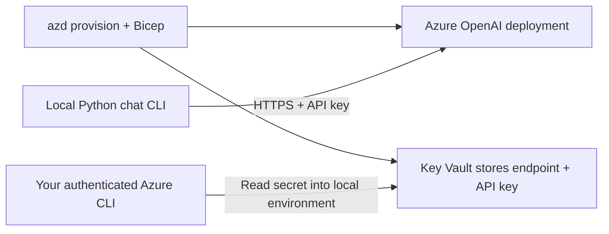

# Azure OpenAI Chat — CLI Tempatan dan Infrastruktur AZD

**Tahap:** Sederhana · **Masa:** 35–60 minit termasuk penyediaan

Contoh ini menyediakan **sumber Azure OpenAI dan Key Vault**, kemudian menjalankan
CLI chat Python interaktif **pada mesin anda**. Ia tidak mengehos aplikasi web
atau Aplikasi Container. Model lalai ialah `gpt-4.1`, versi `2025-04-14`, dengan
kapasiti penyebaran `GlobalStandard` 20. Semak ketersediaan dan kuota semasa di
rantau pilihan anda sebelum penyediaan; tarikh hayat model boleh berubah.

## Objektif pembelajaran

- Menyediakan infrastruktur model dengan Bicep dan azd.
- Mendapatkan kunci API dari Key Vault tanpa meletakkannya dalam output penyebaran.
- Menghantar permintaan Chat Completions dan mengekalkan sejarah perbualan.
- Mentafsir kiraan token dan batasan anggaran kos.



Tiada integrasi runtime identiti terurus, failover berbilang rantau, pengehad kadar tersuai,
mod penstriman, atau pengiraan hos dalam contoh ini. SDK OpenAI
melakukan sehingga dua percubaan semula untuk kegagalan boleh cuba semula; CLI melaporkan ralat yang tinggal.

## Prasyarat

- Versi stabil terkini [azd](https://learn.microsoft.com/azure/developer/azure-developer-cli/install-azd)
  (rilis yang diterbitkan pada masa semakan: 1.37.2).
- [Azure CLI](https://learn.microsoft.com/cli/azure/install-azure-cli).
- Python **3.10+** (3.11 disyorkan) dan persekitaran maya.
- Langganan Azure dengan kebenaran untuk membuat Perkhidmatan Kognitif dan Key Vault
  sumber, melaksanakan model, dan membaca rahsia peti besi.
- Ketersediaan rantau dan kuota `GlobalStandard` untuk `gpt-4.1`. Keperluan akses
  bergantung pada langganan dan ciri; tiada jaminan tempoh kelulusan.

```bash
azd version
az version
python --version
azd auth login
az login
```

Ini adalah sesi pengesahan berasingan. Pilih langganan yang sama dalam kedua-dua
alat sebelum menjalankan arahan di bawah.

## Mula cepat (Bash)

Jalankan dari akar repositori:

```bash
cd examples/azure-openai-chat
azd env new myopenai
azd provision
```

Pilih rantau yang disokong. Penyediaan mencipta kumpulan sumber, akaun OpenAI,
pelaksanaan model, Key Vault, dan rahsia `openai-endpoint`/`openai-api-key`.
Tiada **perkhidmatan yang perlu dilaksanakan** dalam `azure.yaml`.

Muatkan output bukan rahsia dan dapatkan rahsia ke dalam shell semasa anda:

```bash
export AZURE_OPENAI_ENDPOINT="$(azd env get-value AZURE_OPENAI_ENDPOINT)"
export AZURE_OPENAI_MODEL="$(azd env get-value AZURE_OPENAI_MODEL)"
KV_NAME="$(azd env get-value AZURE_KEY_VAULT_NAME)"
export AZURE_OPENAI_API_KEY="$(az keyvault secret show \
  --vault-name "$KV_NAME" --name openai-api-key --query value --output tsv)"

python -m venv .venv
source .venv/bin/activate
python -m pip install -r src/requirements.txt
python src/chat.py
```

Dalam PowerShell, aktifkan dengan `.\.venv\Scripts\Activate.ps1` dan tetapkan pembolehubah persekitaran
dengan `$env:AZURE_OPENAI_ENDPOINT = azd env get-value AZURE_OPENAI_ENDPOINT`
(dan serupa untuk model). Dapatkan kunci API menggunakan
`$env:AZURE_OPENAI_API_KEY = az keyvault secret show --vault-name $KV_NAME --name openai-api-key --query value -o tsv`.
Tetapkan `$KV_NAME = azd env get-value AZURE_KEY_VAULT_NAME` terlebih dahulu.

Jangan cetak, komit, atau tampal kunci API ke dalam laporan isu. CLI membaca pembolehubah
proses persekitaran; ia **tidak** mendapatkan rahsia Key Vault atau memuatkan fail `.env`.
`config.py` mengesahkan titik akhir, had token, dan suhu semasa permulaan.

Output dijangka (kandungan dan penggunaan berbeza-beza):

```text
Azure OpenAI Chat Application
Model: gpt-4.1
...
You: Say hello in one sentence.
Assistant: Hello! How can I help you today?
[Tokens: ... | Cost: $...]
```

Arahan: `stats` menunjukkan jumlah, `clear` membersihkan sejarah perbualan, dan
`quit`/`exit` menamatkan sesi. Tiada arahan `--stream`, `--show-tokens`, `tokens`,
atau `cost`.

## Sahkan pelaksanaan

Selepas memuatkan pembolehubah shell di atas:

```bash
curl --fail-with-body \
  "${AZURE_OPENAI_ENDPOINT%/}/openai/deployments/${AZURE_OPENAI_MODEL}/chat/completions?api-version=2024-10-21" \
  -H "Content-Type: application/json" \
  -H "api-key: $AZURE_OPENAI_API_KEY" \
  -d '{"messages":[{"role":"user","content":"Say hello!"}],"max_tokens":50}'

az keyvault secret list --vault-name "$KV_NAME" --query "[].name" -o table
```

Berjaya: API mengembalikan HTTP 200 dengan `choices[0].message.content` dan `usage`;
peti besi menyenaraikan `openai-api-key` dan `openai-endpoint`. Pelaksanaan ARM yang berjaya
sahaja tidak mengesahkan inferens.

## Fail dan konfigurasi

```text
azure.yaml                         # Infrastructure-only AZD project
infra/main.bicep                   # Subscription deployment
infra/main.parameters.json         # Environment, location, principal ID
infra/resources/openai.bicep       # Account + model
infra/resources/keyvault.bicep     # Vault + deploying user's secret access policy
infra/resources/secrets.bicep      # Writes secrets, no key output
src/chat.py                        # Interactive CLI
src/config.py                      # Environment validation
src/requirements.txt               # Python packages
```

Untuk menukar model/versi/kapasiti yang disediakan, sunting lalai dalam
`infra/main.bicep` dan jalankan `azd provision`. Menetapkan `AZURE_OPENAI_MODEL` dalam
shell anda hanya memilih **nama pelaksanaan sedia ada**; ia tidak melaksanakan model lain.

| Pembolehubah runtime | Lalai / sumber |
|---|---|
| `AZURE_OPENAI_ENDPOINT` | Diperlukan; output azd bukan rahsia |
| `AZURE_OPENAI_API_KEY` | Diperlukan; dapatkan dari Key Vault |
| `AZURE_OPENAI_MODEL` | `gpt-4.1`; nama pelaksanaan Azure |
| `AZURE_OPENAI_MAX_TOKENS` | 800 (julat pengesahan 1–4096) |
| `AZURE_OPENAI_TEMPERATURE` | 0.7 (julat 0–2) |
| `AZURE_OPENAI_INPUT_PRICE_PER_1K` | 0.002 USD; kadar input tanpa cache illustratif |
| `AZURE_OPENAI_OUTPUT_PRICE_PER_1K` | 0.008 USD; kadar output illustratif |

## Kos dan had keselamatan

Paparan kos adalah **anggaran**, bukan bil Azure. Ia mengalikan token API
yang digunakan dengan kadar yang ditetapkan dan tidak mengambil kira diskaun input cache,
perbezaan wilayah/SKU, cukai, perubahan harga, atau panggilan yang gagal/dicuba semula.
Nyahaktifkan **kedua-dua kadar** apabila menggunakan model atau SKU lain dan sahkan
[harga Azure OpenAI](https://azure.microsoft.com/pricing/details/cognitive-services/openai-service/) terkini.

Sebagai ilustrasi, 100 permintaan menggunakan 500 token input tanpa cache dan 200 token output setiap satu
pada kadar lalai berharga `100 × (500/1000 × .002 + 200/1000 × .008) = $0.26`.
Operasi/pemindahan Key Vault dikenakan caj berasingan. Tiada caj tetap $50/bulan
untuk CLI tempatan ini dan tiada pengkomputeran hos dalam templat.

Vault menggunakan dasar capaian untuk prinsipal yang melakukan penyebaran; ini bukan contoh aplikasi RBAC atau
identiti-terurus. Titik akhir awam dan pengesahan kunci API
digunakan untuk tujuan pengajaran. Hadkan kebenaran dan tambah kawalan identiti/rangkaian yang sesuai
sebelum menyesuaikannya untuk produksi.

## Latihan praktikal

### 1. Sahkan konteks dan tetapkan semula

**Mula:** menjalankan CLI. **Matlamat:** memerhati sejarah.
Katakan “Ingat perkataan cedar,” kemudian tanya “Perkataan apa yang saya suruh kamu ingat?”
Jalankan `stats`; dua giliran berjaya harus dikira sebagai dua mesej yang dipertukarkan.
Jalankan `clear` dan `stats`; mesej yang dipertukarkan sepatutnya sifar (jumlah token kekal).
Perkataan tepat model tidak deterministik.

### 2. Tukar had tindak balas

**Mula:** keluar dari CLI, kekal dalam shell yang sama.
Jalankan `export AZURE_OPENAI_MAX_TOKENS=100`, mulakan semula `python src/chat.py`, dan minta
penjelasan ringkas tentang azd. Periksa bahawa banner menunjukkan 100.
Pulihkan dengan `unset AZURE_OPENAI_MAX_TOKENS`. Had tindak balas yang lebih kecil tidak
mengurangkan token sejarah yang sudah dihantar.

### Isu biasa

- **Pembolehubah persekitaran hilang:** penyediaan tidak mengeksport nilai shell;
  ulang langkah eksport. Terminal baru memerlukannya semula.
- **403 membaca Key Vault:** semak langganan/log masuk Azure CLI dan prinsipal
  dalam dasar capaian vault. Perubahan dasar mungkin mengambil masa untuk tersebar.
- **404 inferens:** semak nama penyebaran, titik akhir, dan status penyebaran.
- **429 inferens:** tunggu had kadar disetel semula; sahkan kuota model wilayah.
  CLI membuang giliran yang gagal daripada sejarah supaya percubaan semula tidak menggandakannya.
- **Panjang konteks:** contoh tidak memangkas perbualan panjang; gunakan `clear`.
- **Model tidak tersedia/persaraan:** rujuk ketersediaan model semasa dan kemas kini
  model/versi/SKU bersama; versi API dan versi model adalah tetapan berbeza.

## Pembersihan dan langkah seterusnya

```bash
azd down
unset AZURE_OPENAI_API_KEY
```

Tempoh simpanan penghapusan lembut Key Vault adalah tujuh hari; pembersihan memerlukan kebenaran berasingan.
Tiada suite ujian komited; jangan jalankan perintah `pytest tests/` yang tiada.
Tambah ujian API tiruan sebelum menambah kod.

[Contoh kontena](../../../../examples/container-app) · [Rangka seni bina peruncitan](../retail-scenario.md) ·
[Laman kursus](../../README.md) · [Laporkan isu](https://github.com/microsoft/AZD-for-beginners/issues)

---

<!-- CO-OP TRANSLATOR DISCLAIMER START -->
**Penafian**:
Dokumen ini telah diterjemahkan menggunakan perkhidmatan terjemahan AI [Co-op Translator](https://github.com/Azure/co-op-translator). Walaupun kami berusaha untuk ketepatan, sila ambil maklum bahawa terjemahan automatik mungkin mengandungi kesilapan atau ketidaktepatan. Dokumen asal dalam bahasa asalnya harus dianggap sebagai sumber yang sahih. Untuk maklumat penting, terjemahan oleh manusia profesional adalah disyorkan. Kami tidak bertanggungjawab terhadap sebarang salah faham atau salah tafsir yang timbul daripada penggunaan terjemahan ini.
<!-- CO-OP TRANSLATOR DISCLAIMER END -->