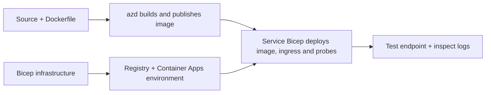

# Contoh Penggunaan App Kontena dengan AZD

Direktori ini mengandungi dua contoh pembelajaran dengan kod sumber, Dockerfiles,
infrastruktur Bicep, dan `azure.yaml`. Kedua-duanya tidak disediakan untuk pengeluaran.

## Pilih satu contoh

| Sampel | Apa yang dilaksanakan | Prasyarat |
|---|---|---|
| [Simple Flask API](../../../../examples/container-app/simple-flask-api) | API CRUD Python tunggal, item dalam memori, pemeriksaan kesihatan, penskalaan HTTP | Pengetahuan asas CLI dan HTTP |
| [Mikroservis dua perkhidmatan](../../../../examples/container-app/microservices) | Gateway Node.js, perkhidmatan produk baca sahaja Python dalaman, telemetri dan penskalaan | Selesaikan sampel perkhidmatan tunggal dulu |

Benarkan 30–60 minit termasuk penyediaan dan pengesahan. Masa penyediaan Azure berbeza-beza.

## Prasyarat

- [Azure Developer CLI](https://learn.microsoft.com/azure/developer/azure-developer-cli/install-azd)
- [Azure CLI](https://learn.microsoft.com/cli/azure/install-azure-cli) untuk arahan pengesahan
- Docker dengan daemon berjalan untuk membina imej kontena ini
- Langganan Azure dengan keizinan penciptaan sumber dan kuota wilayah yang mencukupi
- Bash untuk contoh shell, atau arahan PowerShell setara

```bash
azd version
az version
docker info
azd auth login
az login
```

Dua alat ini mempunyai sesi log masuk berasingan. Gunakan azd yang stabil dan terkini; versi
semasa yang diterbitkan pada masa semakan adalah 1.37.2. Tuntutan versi minimum lama bukan
jaminan keserasian.

## Mula dengan cepat

Dari akar repositori:

```bash
cd examples/container-app/simple-flask-api
azd env new flask-demo
azd up
API_URL=$(azd env get-value API_ENDPOINT)
curl --fail-with-body "${API_URL}/health"
```

Dijangka: HTTP 200 dengan `"status": "healthy"`. Ikuti README sampel untuk mencipta,
membaca, mengemas kini, dan memadam item, serta untuk memeriksa log.



Penyediaan awal menggunakan imej hello-world awam pada port 80. Fail parameter Bicep
khusus perkhidmatan membolehkan `azd deploy` menggantikannya dengan imej aplikasi yang dibina
dan port/probe apl yang betul (8000 untuk Flask/produk, 8080 untuk gateway).
Simpan fail ini dengan tetapan `azure.yaml` `module` mereka.

## Konfigurasi: apa yang mengubah apa

`azure.yaml` memilih direktori sumber, bahasa, hos, dan modul penyebaran.
CPU/memori kontena, ingress, probe, bilangan replika, dan peraturan skala ditentukan
dalam **Bicep**, bukan sifat perkhidmatan `resources`, `scale`, atau `regions` yang sewenang-wenangnya.

`azd env set SOME_VALUE ...` menyimpan nilai secara tempatan. Ia hanya mengubah sumber yang telah disebarkan
apabila parameter, pemetaan persekitaran, atau hook secara eksplisit menggunakan nilai itu.
Contoh ini tidak menggunakan `MAX_REPLICAS`, `SCALE_TO_ZERO_TIMEOUT`,
`CONTAINER_APP_REPLICA_TYPE`, atau tetapan canary tersuai daripada nilai persekitaran azd.
Sunting Bicep yang berkaitan dan jalankan `azd up` untuk penyediaan semula dan penyebaran.

Jangan letakkan sumber aplikasi di bawah `infra/`. `project` mesti menunjuk ke direktori sumber
yang mengandungi Dockerfile dan manifest pergantungan.

## Pemantauan dan kos

- `azd monitor --logs` membuka pandangan portal; ia bukan aliran log terminal.
  Gunakan `az containerapp logs show --follow` dengan nama sumber sebenar.
- API mudah menulis log stdout yang dikumpulkan melalui Container Apps/Log Analytics.
  Sumber Application Insights yang disediakan tidak secara automatik diinstrumentasi.
- Gateway mikroservis menggunakan SDK Node.js Application Insights; perkhidmatan Python
  mengeksport jejak log aplikasi. Penjejakan penuh permintaan/pergantungan Python
  tidak dikonfigurasikan.
- Skala-hingga-nol boleh mengurangkan caj pengkomputeran, tetapi pendaftaran dan penyimpanan log
  masih boleh menelan kos. Tetapan mikroservis lalai mengekalkan replika berjalan.
  Anggarkan kawasan dan penggunaan anda dalam
  [pengira harga Azure](https://azure.microsoft.com/pricing/calculator/).

## Corak lanjutan — pelaksanaan tidak termasuk

Ini adalah garis panduan reka bentuk, bukan projek tempatan tambahan atau potongan salin-dan-jalankan:

- **Data berterusan dan pengesahan:** gantikan stor memori dan tambah
  pengesahan/pengesahan Microsoft Entra ID sebelum pengeluaran.
- **Blue-green/canary:** gunakan mod revisi-berganda Container Apps, label revisi,
  berat trafik, pengesahan kesihatan, dan prosedur rollback.
  Tiada konfigurasi `deploymentStrategy: canary` azd dalam sampel ini.
  Lihat [pengurusan revisi](https://learn.microsoft.com/azure/container-apps/revisions).
- **Multi-wilayah:** bina persekitaran dan aplikasi berasingan dalam Bicep dan reka bentuk
  penentuan laluan global dan konsistensi data. Senarai `regions` perkhidmatan
  bukan mekanisme penyebaran azd.
- **Pekerja barisan:** tambah sumber pekerja, pergantungan, sumber barisan, pengurusan
  identiti dengan peranan pesawat data, dan peraturan skala yang diautentasikan. Jangan salin
  laluan `src/worker` kosong dan jangkakan projek yang boleh dijalankan.
- **Dapr:** sediakan komponen, konfigurasikan sidecar, pasang SDK yang sepadan,
  dan laksanakan pengendalian ralat state/pub-sub.
- **Rahsia:** gunakan identiti terurus dan peranan yang diperuntukkan jika boleh. Hanya
  mencipta Key Vault tidak memberi akses kepada aplikasi atau memuat rahsia.

## Pembersihan

Dari direktori contoh:

```bash
azd down
```

Semak arahan penghapusan dan sahkan bahawa kumpulan sumber khusus telah dikeluarkan.
Jangan gunakan contoh ini sebagai asas pengeluaran tanpa reka bentuk dan ujian tambahan.

[Indeks contoh](../README.md) · [Halaman kursus](../../README.md) ·
[Dokumentasi Container Apps](https://learn.microsoft.com/azure/container-apps/) ·
[Laporkan isu](https://github.com/microsoft/AZD-for-beginners/issues)

---

<!-- CO-OP TRANSLATOR DISCLAIMER START -->
**Penafian**:
Dokumen ini telah diterjemahkan menggunakan perkhidmatan terjemahan AI [Co-op Translator](https://github.com/Azure/co-op-translator). Walaupun kami berusaha untuk ketepatan, sila ambil maklum bahawa terjemahan automatik mungkin mengandungi kesilapan atau ketidaktepatan. Dokumen asal dalam bahasa asalnya harus dianggap sebagai sumber yang sahih. Untuk maklumat penting, terjemahan oleh manusia profesional adalah disyorkan. Kami tidak bertanggungjawab terhadap sebarang salah faham atau salah tafsir yang timbul daripada penggunaan terjemahan ini.
<!-- CO-OP TRANSLATOR DISCLAIMER END -->