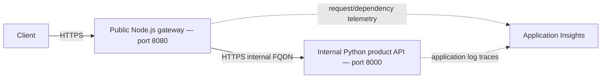

# Dua Perkhidmatan Mikro — Azure Container Apps

**Tahap:** Pertengahan · **Masa:** 45–60 minit termasuk persediaan

Sampel pembelajaran ini melaksanakan **Node.js API Gateway** dan **Perkhidmatan Produk Python hanya-baca**. Kod sumber, Dockerfiles, Bicep, dan konfigurasi azd disertakan.
Ia bukan sistem yang sudah diperkukuh untuk produksi.


## Apa yang akan anda pelajari

- Menggunakan dua perkhidmatan secara berasingan.
- Menggunakan FQDN backend dalaman melalui HTTPS.
- Memastikan respon kejayaan, tidak ditemui, dan perkhidmatan tidak tersedia.
- Memahami telemetri dan sempadan skala bebas.



Katalog produk mengandungi lima produk tetap dalam ingatan. Tiada **pengendali POST,
PUT, atau DELETE**, pangkalan data, Service Bus, perkhidmatan pesanan/pengguna/pemberitahuan,
C#, atau kod Go. Itu adalah idea pembangunan masa depan, bukan ciri yang disertakan.
Gerbang tidak mengesahkan pengguna; kemasukan dalaman bukan pengganti
untuk kebenaran aplikasi.

## Prasyarat

Selesaikan [API Flask tunggal](../../../../../examples/container-app/simple-flask-api) terlebih dahulu.
Pasang azd stabil terkini (rilis diterbitkan semasa semakan: 1.37.2), Azure CLI,
dan Docker dengan daemon dijalankan. Anda memerlukan langganan Azure, kebenaran
penciptaan sumber, dan kuota rantau Container Apps.

```bash
azd version
az version
docker info
azd auth login
az login
```

Gunakan langganan yang sama dalam kedua-dua alat CLI. Arahan di bawah menggunakan Bash.

## Pasang dan sahkan

Dari akar repositori:

```bash
cd examples/container-app/microservices
azd env new microservices-demo
azd up
GATEWAY_URL=$(azd env get-value API_GATEWAY_URL)
RG_NAME=$(azd env get-value AZURE_RESOURCE_GROUP)
GATEWAY_NAME=$(azd env get-value API_GATEWAY_NAME)
PRODUCT_NAME=$(azd env get-value PRODUCT_SERVICE_NAME)

curl --fail-with-body "${GATEWAY_URL}/health"
curl --fail-with-body "${GATEWAY_URL}/api/products"
curl --fail-with-body "${GATEWAY_URL}/api/products/1"
curl -i "${GATEWAY_URL}/api/products/999"
```

**Berjaya:** kesihatan 200; daftar 200 dengan **lima** produk; produk 1 ialah Laptop
berharga 999.99 dengan stok 50; produk yang tidak dikenali mengembalikan 404.
Penerangan disertakan dalam respons; cap masa berbeza-beza.

Penyediaan awal menggunakan imej hello-world awam pada port 80 supaya ia tidak cuba
menarik imej yang tidak wujud dari daftar kosong. Modul Bicep khusus perkhidmatan
dan fail parameter menggantikannya dengan imej binaan dan port/probekan aplikasi semasa
`azd deploy`. Parameter utama mengekalkan nama imej yang diterbitkan untuk penyediaan kemudian.

## Perkhidmatan dan rangkaian

| Perkhidmatan | Titik akhir didedahkan | Sumber lalai |
|---|---|---|
| Gerbang | GET `/`, `/health`, `/api/products`, `/api/products/:id` | 1 vCPU, 2 GiB, 2–20 replika |
| Produk | GET `/`, `/health`, `/products`, `/products/<id>` | 0.5 vCPU, 1 GiB, 1–10 replika |

Kemasukan produk mempunyai `external: false` dan `allowInsecure: false`. Bicep menyuntik
`PRODUCT_SERVICE_URL=https://<actual-internal-fqdn>` ke dalam gerbang. HTTP akan
mengalihkan; HTTPS sepadan dengan kemasukan yang dikonfigurasikan. Nama DNS pendek mesti sepadan dengan
**nama sebenar Container App**, bukan kunci perkhidmatan logik `product-service`.
Jangan cuba memanggil URL dalaman secara terus dari komputer riba anda.

Gerbang mempunyai masa tamat lima saat untuk panggilan produk. ID produk yang hilang
dibawa sebagai 404; kegagalan pengangkutan/kegagalan backend lain mengembalikan 503. Gerbang
`/health` hanya memeriksa gerbang, bukan ketersediaan backend.

## Fail dan konfigurasi

```text
azure.yaml
infra/main.bicep
infra/main.parameters.json
infra/abbreviations.json
infra/core/container-apps-environment.bicep
infra/core/monitor.bicep
infra/app/api-gateway.bicep
infra/app/api-gateway.parameters.json
infra/app/product-service.bicep
infra/app/product-service.parameters.json
src/api-gateway/{app.js,package.json,Dockerfile}
src/product-service/{main.py,requirements.txt,Dockerfile}
```

Skala, CPU/memori, port, dan probe ditetapkan dalam `infra/app/*.bicep`. Tukar fail
tersebut dan jalankan `azd up` untuk menggunakan infrastruktur dan menyebarkan semula. Tiada
parameter pembolehubah persekitaran `GATEWAY_MAX_REPLICAS` dalam contoh ini.

Untuk perubahan kod sahaja:

```bash
azd deploy product-service
azd deploy api-gateway
```

Imej Node menggunakan Node 22; imej Python menggunakan Python 3.11. Kedua-duanya mengikat ke
`0.0.0.0`. Ingress/probe menggunakan port 8080 (pintu masuk) dan 8000 (produk), masing-masing.

## Pembangunan tempatan dengan Docker

Jalankan dari direktori contoh ini. Gunakan rangkaian yang ditakrifkan pengguna, **bukan `localhost`
dari satu kontena untuk mencapai yang lain**:

```bash
docker network create azd-microservices-demo
docker build -t local-product ./src/product-service
docker build -t local-gateway ./src/api-gateway
docker run -d --name azd-product --network azd-microservices-demo local-product
docker run -d --name azd-gateway --network azd-microservices-demo \
  -p 8080:8080 -e PRODUCT_SERVICE_URL=http://azd-product:8000 local-gateway
curl --fail-with-body http://localhost:8080/api/products
```

Dijangka: lima produk. HTTP hanya digunakan untuk rangkaian Docker tempatan ini.

```bash
docker stop azd-product azd-gateway
docker rm azd-product azd-gateway
docker network rm azd-microservices-demo
```

## Pemantauan

```bash
az containerapp logs show --name "$GATEWAY_NAME" --resource-group "$RG_NAME" --follow
# In a separate terminal:
az containerapp logs show --name "$PRODUCT_NAME" --resource-group "$RG_NAME" --tail 100
```

`azd monitor --logs` membuka paparan portal; ia tidak menstrim log terminal.
Node SDK mengumpul permintaan/gantungan pintu masuk. `AzureLogHandler` Python
mengeksport **jejak log**, bukan permintaan Flask automatik, gantungan SQL, atau jejak
teragih penuh. OpenCensus adalah SDK lama; utamakan Azure Monitor OpenTelemetry
apabila melanjutkan contoh ini.

Dalam Application Insights Logs, jana permintaan dan periksa:

```kusto
requests
| where timestamp > ago(1h)
| where name contains "products"
| summarize RequestCount=count(), AvgDuration=avg(duration) by bin(timestamp, 5m)
```

Untuk mesej aplikasi Python:

```kusto
traces
| where timestamp > ago(1h)
| where message contains "products"
| project timestamp, message, severityLevel
```

Benarkan kelewatan pengambilan dan persampelan; jangan jangka kiraan permintaan tepat atau
latensi terjamin. Tiada amaran atau papan pemuka tersuai yang dikonfigurasikan.

## Latihan Praktikal

### Latihan 1: Ubah katalog

**Titik permulaan:** `src/product-service/main.py`.
**Matlamat:** sahkan penyebaran perkhidmatan bebas.
Tukar stok Laptop dari 50 ke 49 dalam senarai tetap `products`, jalankan
`azd deploy product-service`, kemudian minta `${GATEWAY_URL}/api/products/1`.

**Kriteria kejayaan / penyelesaian:** HTTP 200 dengan `"stock":49`. Pulihkan ke 50 dan sebarkan semula.
**Isu biasa:** mengedit gerbang bukannya perkhidmatan yang memiliki katalog.
Ini mengubah data sumber, bukan pangkalan data inventori berterusan.

### Latihan 2: Sahkan konfigurasi replika

**Titik permulaan:** `infra/app/product-service.bicep`.
**Matlamat:** perhatikan perubahan infrastruktur tanpa meneka autoscaling.
Tukar `minReplicas: 1` ke `minReplicas: 2`, jalankan `azd up`, kemudian:

```bash
az containerapp show --name "$PRODUCT_NAME" --resource-group "$RG_NAME" \
  --query properties.template.scale -o json
```

**Kriteria kejayaan:** minimum yang dikonfigurasikan ialah 2 dan maksimum kekal 10.
Pulihkan minimum 1 dan jalankan `azd up`.
**Isu biasa:** `azd deploy` sahaja tidak menerapkan perubahan kepada infrastruktur berkongsi yang tidak berkaitan.
Jangan setkan `maxReplicas` ke sifar sebagai simulasi kegagalan.
Ini mengesahkan konfigurasi, bukan ujian beban atau jumlah replika serta-merta yang dijamin.

### Latihan 3: Uji pengendalian perkhidmatan tidak tersedia secara tempatan

**Titik permulaan:** kedua-dua bekas Docker tempatan di atas sedang berjalan.
**Matlamat:** bezakan kegagalan backend daripada produk yang hilang.
Berhentikan hanya bekas produk:

```bash
docker stop azd-product
curl -i http://localhost:8080/api/products
docker start azd-product
curl --fail-with-body http://localhost:8080/api/products
```

**Kriteria kejayaan:** semasa berhenti, gerbang mengembalikan 503 dengan
`"error":"Product service unavailable"`; selepas mula semula, senarai mengembalikan 200.
Cuba semula selepas kelewatan permulaan yang singkat jika perlu.
**Isu biasa:** menghentikan gerbang menguji kegagalan yang berbeza (tiada tindak balas HTTP).

## Kos dan jurang pengeluaran

Replika minimum lalai memastikan pengiraan berjalan. Pendaftaran dan pemantauan juga menanggung
caj. Tiada jumlah $50/bulan tetap yang disahkan: anggarkan CPU/memori serantau,
jam replika, permintaan, pendaftaran, dan penyimpanan log dalam
[kalkulator harga Azure](https://azure.microsoft.com/pricing/calculator/).
Padamkan sumber pembelajaran dengan segera.

Kerja produksi termasuk pengesahan/pengesahan, identiti terurus berjangkauan,
data berterusan, pengesahan input/tindak balas, instrumentasi pemerhatian yang disokong,
ujian beban/kegagalan, CI/CD, amaran, dan prosedur pemulihan. Menambah servis pesanan,
barisan, atau pangkalan data adalah tugas pelaksanaan berasingan, bukan latihan siap
atau ciri yang sudah tersedia di sini.

## Penyelesaian masalah dan pembersihan

- **Imej tidak ditemui semasa penyediaan pertama:** bootstrap harus menggunakan imej awam;
  sahkan parameter imej utama lalai dan pemetaan modul penyebaran.
- **503 produk:** periksa log produk, semakan imej, dan URL HTTPS dalaman yang disuntik.
- **404 laluan tidak dijangka:** API produk adalah baca sahaja; sahkan laluan, bukan pengendali CRUD yang tidak wujud.
- **Tiada telemetri:** periksa rentetan sambungan runtime tanpa mendedahkannya dan
  benarkan kelewatan pengambilan. Jadual permintaan Python tidak diisi oleh pengendali lognya.

Dari direktori contoh ini:

```bash
azd down
```

Semak arahan pemadaman dan sahkan kumpulan sumber khusus dipadamkan.

[Sebelum: Flask API](../../../../../examples/container-app/simple-flask-api) · [Seterusnya: aplikasi pangkalan data](../../../../../examples/database-app) ·
[Pembangunan AI](../../../docs/chapter-02-ai-development/README.md) ·
[Laman kursus](../../../README.md) · [Laporkan isu](https://github.com/microsoft/AZD-for-beginners/issues)

---

<!-- CO-OP TRANSLATOR DISCLAIMER START -->
**Penafian**:
Dokumen ini telah diterjemahkan menggunakan perkhidmatan terjemahan AI [Co-op Translator](https://github.com/Azure/co-op-translator). Walaupun kami berusaha untuk ketepatan, sila ambil maklum bahawa terjemahan automatik mungkin mengandungi kesilapan atau ketidaktepatan. Dokumen asal dalam bahasa asalnya harus dianggap sebagai sumber yang sahih. Untuk maklumat penting, terjemahan oleh manusia profesional adalah disyorkan. Kami tidak bertanggungjawab terhadap sebarang salah faham atau salah tafsir yang timbul daripada penggunaan terjemahan ini.
<!-- CO-OP TRANSLATOR DISCLAIMER END -->