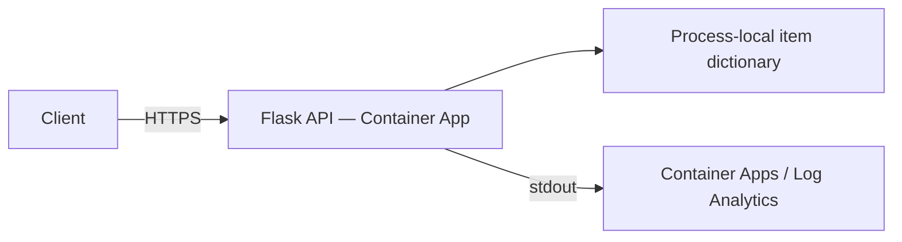

# API Flask Mudah — Azure Container Apps

**Tahap:** Pemula · **Masa:** 30–45 minit termasuk penetapan

Sediakan API CRUD Python Flask dengan Azure Developer CLI (azd). Sumber, Dockerfile,
Bicep, dan parameter penyebaran disertakan. Ini adalah **contoh pembelajaran**, bukan
API siap produksi.

## Apa yang anda akan pelajari

- Membina dan menerbitkan bekas melalui azd.
- Konfigurasi ingress dan probes kesihatan/kesiapsiagaan.
- Mengesahkan respons CRUD dan memeriksa log aplikasi.
- Memahami mengapa data dalam memori tidak sesuai untuk aplikasi tahan lama.



**Penting:** item disimpan dalam satu proses. Lalai adalah **satu pekerja Gunicorn,
0–1 replika**, dengan sengaja mengelakkan data tidak konsisten antara pekerja/replika.
Item hilang apabila dimulakan semula, perubahan revisi, atau skala ke sifar. Meningkatkan replika
memerlukan storan persisten yang dikongsi. API ini tiada pengesahan atau kebenaran.

## Prasyarat

- [azd stabil semasa](https://learn.microsoft.com/azure/developer/azure-developer-cli/install-azd)
  (versi siaran pada masa ulasan: 1.37.2).
- [Azure CLI](https://learn.microsoft.com/cli/azure/install-azure-cli) untuk pengesahan.
- Docker dengan daemon berfungsi; diperlukan untuk binaan imej tempatan lalai.
- Langganan Azure, kebenaran ciptaan sumber, dan kuota rantau Container Apps.
- Bash untuk arahan di bawah (atau PowerShell setara).
- Python 3.11 untuk pembangunan tempatan pilihan.

```bash
azd version
az version
docker info
azd auth login
az login
```

Alat CLI mempunyai sesi log masuk berasingan. Gunakan langganan yang sama dalam kedua-duanya.

## Mula dengan cepat

Dari akar repositori:

```bash
cd examples/container-app/simple-flask-api
azd env new flask-demo
azd up
API_URL=$(azd env get-value API_ENDPOINT)
RG_NAME=$(azd env get-value AZURE_RESOURCE_GROUP)
API_NAME=$(azd env get-value API_NAME)
curl --fail-with-body "${API_URL}/health"
```

Dijangka: HTTP 200 dan JSON dengan `"status":"healthy"`,
`"service":"simple-flask-api"`, dan cap masa UTC semasa.
Penyediaan dan bina imej biasanya mengambil masa beberapa minit; masa berbeza-beza.

Penyediaan awal menggunakan imej hello-world awam yang mendengar pada port 80.
`azure.yaml` memilih `infra/app/api.bicep` dan fail parameter yang sepadan untuk
penyebaran perkhidmatan, yang menukar imej, ingress, dan probes ke port 8000.
Jangan padam parameter penyebaran tersebut.

## Sahkan CRUD

Jalankan berikut secara berturutan selagi replika yang sama kekal aktif:

```bash
# Create: HTTP 201; note the returned id (1 for a fresh process).
curl -i -X POST "${API_URL}/api/items" \
  -H "Content-Type: application/json" \
  -d '{"name":"Test Item","description":"My first item"}'

# Read list: HTTP 200, total 1 in a fresh process.
curl --fail-with-body "${API_URL}/api/items"

# Replace 1 if your create response returned another id.
curl --fail-with-body "${API_URL}/api/items/1"
curl -i -X PUT "${API_URL}/api/items/1" \
  -H "Content-Type: application/json" -d '{"name":"Updated Item"}'
curl -i -X DELETE "${API_URL}/api/items/1"
curl -i "${API_URL}/api/items/1"
```

Berjaya: POST 201, bacaan/PUT 200, DELETE 204 tanpa badan, kemudian item hilang 404.
JSON yang cacat/bukan objek atau nama kosong memberikan 400.
Jika item hilang antara permintaan, periksa sama ada ada permulaan semula atau skala ke sifar;
ini adalah had sengaja dalam memori, bukan penyimpanan kekal.

| Titik Akhir | Kaedah |
|---|---|
| `/` | GET — maklumat perkhidmatan |
| `/health` | GET — kesihatan/kesiapsiagaan |
| `/api/items` | GET, POST |
| `/api/items/{id}` | GET, PUT, DELETE |

## Log dan konfigurasi

```bash
az containerapp logs show --name "$API_NAME" --resource-group "$RG_NAME" --follow
```

Dijangka: permulaan Gunicorn, log akses permintaan, dan mesej aplikasi.
`azd monitor --logs` membuka pandangan portal; ia tidak menstrim ke terminal.
Application Insights disediakan tetapi **tidak diinstrumentasi oleh kod Flask ini**;
gunakan Container Apps/Log Analytics untuk log stdout.

Edit `infra/app/api.bicep` untuk CPU/memori, had replika, atau peraturan skala, kemudian
jalankan `azd up`. Lalai adalah 0.5 vCPU, 1 GiB, minimum 0 / maksimum 1 replika, dan
ambang HTTP 50 permintaan serentak. Skala ke sifar boleh menambah kelewatan permulaan sejuk.

Nilai `azd env set MAX_REPLICAS`, `API_KEY`, `LOG_LEVEL`, atau
`SCALE_TO_ZERO_TIMEOUT` sewenang-wenangnya **tidak disambungkan ke templat atau aplikasi ini**.
Menetapkan nilai tidak secara automatik menjadikannya pembolehubah persekitaran waktu jalan.
Imej mengikat port 8000 secara eksplisit; kemas kini Dockerfile, ingress Bicep, dan probes
bersama-sama jika menukar port.

## Fail

```text
azure.yaml
infra/main.bicep
infra/main.parameters.json
infra/app/container-apps.bicep       # Environment, registry, monitoring
infra/app/api.bicep                  # App, ingress, probes, scale settings
infra/app/api.parameters.json        # Image and resource values for azd deploy
src/app.py
src/Dockerfile
src/requirements.txt
```

## Pembangunan tempatan

Dari direktori contoh ini:

```bash
python -m venv .venv
source .venv/bin/activate  # PowerShell: .\.venv\Scripts\Activate.ps1
python -m pip install -r src/requirements.txt
python src/app.py
```

Dalam terminal lain, uji `http://localhost:8000/health` dan titik akhir CRUD.
Atau bina dan jalankan imej sebenar:

```bash
docker build -t flask-api:local ./src
docker run --rm -p 8000:8000 flask-api:local
```

Untuk perubahan kod sahaja selepas penyebaran pertama, jalankan `azd deploy api`.
Untuk perubahan Bicep, jalankan `azd up` untuk penyediaan semula dan penyebaran.

## Latihan praktikal

### 1. Sahkan penolakan input

**Titik mula:** API yang disebarkan, `API_URL` di atas.
**Matlamat:** sahkan API menolak bentuk JSON tidak sah dan nama hilang.

```bash
curl -i -X POST "${API_URL}/api/items" \
  -H "Content-Type: application/json" -d '[]'
curl -i -X POST "${API_URL}/api/items" \
  -H "Content-Type: application/json" -d '{"name":""}'
```

**Kriteria kejayaan / penyelesaian:** kedua-duanya mengembalikan 400 dengan ralat JSON, bukan 500.
**Isu biasa:** terlepas pengepala jenis kandungan JSON.

### 2. Tambah titik akhir versi baca sahaja

**Titik mula:** `src/app.py`. **Matlamat:** luaskan dan sebar semula API.
Tambah ini sebelum blok `if __name__ == '__main__':`:

```python
@app.route('/version', methods=['GET'])
def version():
    return jsonify({'version': '1.0.0'})
```

Jalankan `azd deploy api`, kemudian `curl --fail-with-body "${API_URL}/version"`.
**Kriteria kejayaan:** HTTP 200 dan `{"version":"1.0.0"}`.
**Isu biasa:** meletakkan laluan selepas panggilan `app.run()` yang menghalang semasa
menguji dengan `python src/app.py`.

### Titik pemeriksaan pengetahuan

Mengapa satu pekerja tidak mencukupi untuk data yang tahan lama? Kerana walaupun satu proses kehilangan
kamusnya apabila dimulakan semula. Versi produksi memerlukan storan kongsi persisten,
pengesahan, kebenaran, migrasi, ujian, dan pemantauan operasi.

## Kos dan penyelesaian masalah

Ini bukan penyebaran $0 yang dijamin: daftar Asas dan storan/log penjerapan
boleh menimbulkan caj walaupun pengkomputeran aplikasi berada pada sifar. Gunakan
[pengira harga](https://azure.microsoft.com/pricing/calculator/) untuk rantau anda.

- **Kegagalan bina Docker:** sahkan `docker info`, capaian rangkaian, dan pergantungan.
- **Aplikasi tidak sihat:** periksa log konsol/sistem dan sahkan port imej, ingress,
  dan probes bersetuju. Pemegang tempat tidak boleh diprob pada port Flask.
- **403/kebenaran:** sahkan langganan dan kebenaran ciptaan sumber.
- **Item hilang:** keadaan dalam memori diset semula apabila dimulakan semula/skala ke sifar; tambah pangkalan data
  untuk tingkah laku tahan lama.

## Pembersihan dan langkah seterusnya

```bash
azd down
```

Semak prompt pemadaman dan sahkan kumpulan sumber khusus telah dialih keluar.
Jangan gunakan pembersihan destruktif terhadap kumpulan sumber yang mengandungi data tidak berkaitan.

[Seterusnya: Aplikasi pangkalan data](../../../../../examples/database-app) · [Mikroservis](../../../../../examples/container-app/microservices) ·
[Gambaran bekas](../README.md) · [Rumah kursus](../../../README.md) ·
[Laporkan isu](https://github.com/microsoft/AZD-for-beginners/issues)

---

<!-- CO-OP TRANSLATOR DISCLAIMER START -->
**Penafian**:
Dokumen ini telah diterjemahkan menggunakan perkhidmatan terjemahan AI [Co-op Translator](https://github.com/Azure/co-op-translator). Walaupun kami berusaha untuk ketepatan, sila ambil maklum bahawa terjemahan automatik mungkin mengandungi kesilapan atau ketidaktepatan. Dokumen asal dalam bahasa asalnya harus dianggap sebagai sumber yang sahih. Untuk maklumat penting, terjemahan oleh manusia profesional adalah disyorkan. Kami tidak bertanggungjawab terhadap sebarang salah faham atau salah tafsir yang timbul daripada penggunaan terjemahan ini.
<!-- CO-OP TRANSLATOR DISCLAIMER END -->