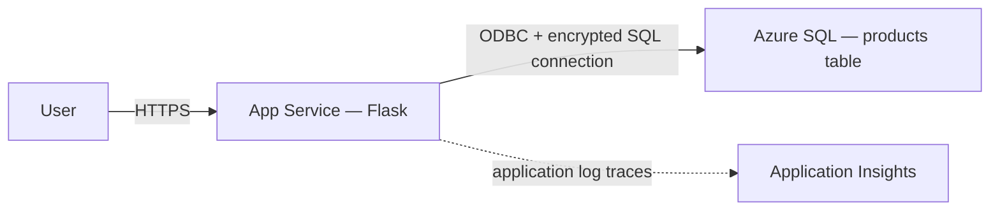

# Flask dan Azure SQL di App Service

**Tahap:** Sederhana · **Masa:** 30–60 minit termasuk prasyarat

Contoh ini memasang API baca Python Flask ke **Linux App Service** dan pangkalan data Azure SQL Basic.
Sumber, Bicep, dan konfigurasi azd disertakan. Ia adalah
aplikasi pembelajaran, bukan seni bina pangkalan data yang sedia untuk produksi.

## Apa yang anda akan pelajari

- Menyediakan sumber App Service, SQL, dan pemantauan dengan Bicep.
- Mengkonfigurasi sambungan SQL yang disulitkan tanpa menyimpan kelayakan.
- Memulakan skema sebelum memulakan pekerja Gunicorn.
- Mengesahkan data yang dimasukkan, tindak balas tidak dijumpai, dan kesihatan pangkalan data.



Sumber: kumpulan sumber berdedikasi, pelan Linux App Service B1, Web App Python 3.11,
pelayan SQL dan pangkalan data Basic 2-GB, Application Insights, dan Log Analytics.
Web App menggunakan **penyebaran sumber/ZIP dan pemasangan pergantungan Oryx**;
`azd deploy` tidak membina atau menyebarkan Dockerfile pilihan.

## Prasyarat

- Stabil semasa [azd](https://learn.microsoft.com/azure/developer/azure-developer-cli/install-azd)
  (rilisan diterbitkan pada masa semakan: 1.37.2).
- [Azure CLI](https://learn.microsoft.com/cli/azure/install-azure-cli) untuk pengesahan.
- Langganan Azure, kebenaran untuk mencipta sumber yang disenaraikan, dan kuota serantau.
- Python **3.11** untuk pembangunan tempatan; `pyodbc==5.0.1` yang dikomit mungkin memerlukan
  alat bina asli pada versi Python yang lebih baru.
- Pemacu Microsoft ODBC 18 (atau 17) untuk SQL Server pada mesin tempatan. `pip install
  pyodbc` tidak memasang pemacu sistem. Lihat
  [pemasangan ODBC](https://learn.microsoft.com/sql/connect/odbc/download-odbc-driver-for-sql-server).
- Docker hanya jika menguji bekas pilihan secara tempatan.

```bash
azd version
az version
azd auth login
az login
```

Gunakan langganan yang sama dalam kedua-dua alat. Perintah di bawah menggunakan Bash.

## Lancarkan

Dari akar repositori:

```bash
cd examples/database-app
azd env new sql-demo
azd provision
azd deploy
WEB_URL=$(azd env get-value WEB_APP_URI)
WEB_NAME=$(azd env get-value WEB_APP_NAME)
RG_NAME=$(azd env get-value AZURE_RESOURCE_GROUP)
```

Pilih rantau yang disokong. `sqlAdminLogin` lalai kepada `sqladmin`; yang diperlukan
`sqlAdminPassword` adalah parameter selamat. Berikan kata laluan yang kukuh apabila diminta.
Simpan kelayakan pelaksanaan di luar Git dan laporan isu. Penyerapan rentetan sambungan semasa
menjangka kata laluan tanpa pemisah rentetan sambungan seperti
`;`; sesuaikan pelarian sebelum menggunakan nilai sedemikian.

Bicep menetapkan arahan permulaan yang menjalankan `init_database()` **sebelum** pekerja Gunicorn
bermula. Ini perlu kerana mengimport `app:app` tidak melaksanakan
blok `if __name__ == '__main__'` Python. Pada pangkalan data baru, inisialisasi
mencipta `products` dan memasukkan lima baris. Ia adalah biji pengajaran mudah, bukan
rangka kerja migrasi serentak; gunakan migrasi yang betul sebelum memperkembangkan instans.

Aplikasi memilih Microsoft ODBC Driver 18 yang dipasang, kemudian 17, jika
rentetan sambungan tidak secara eksplisit menyebutkan pemacu. Jika kedua-duanya tidak wujud,
permulaan gagal dengan ralat pemasangan yang boleh diambil tindakan. Sahkan ketersediaan
pemacu dalam runtime App Service yang dipilih dan jangan membuat andaian.

## Sahkan

```bash
curl --fail-with-body "${WEB_URL}/"
curl --fail-with-body "${WEB_URL}/health"
curl --fail-with-body "${WEB_URL}/products"
curl --fail-with-body "${WEB_URL}/products/1"
curl -i "${WEB_URL}/products/999"
```

Dijangka:

- `/` mengembalikan maklumat titik akhir.
- `/health` mengembalikan 200 dengan `{"status":"healthy","database":"connected"}`.
- `/products` mengembalikan lima produk benih dalam pangkalan data baru.
- `/products/1` mengembalikan Laptop dengan harga 1299.99.
- Produk yang tidak wujud mengembalikan 404 dengan `{"error":"Product not found"}`.

API ini hanya baca sahaja. Tiada laluan POST/PUT/DELETE atau UI pelayar.
Kegagalan sambungan pangkalan data mengembalikan 503 daripada `/health`; ia bukan kejayaan.

## Fail dan konfigurasi

```text
azure.yaml                         # Python App Service source deployment
infra/main.bicep
infra/main.parameters.json
infra/abbreviations.json
infra/resources/sql-server.bicep
infra/resources/sql-database.bicep
infra/resources/app-service-plan.bicep
infra/resources/web-app.bicep       # Settings + initialization/startup command
infra/resources/app-insights.bicep
src/web/app.py
src/web/requirements.txt
src/web/Dockerfile                 # Optional local container, not the azd target
.env.sample
```

`SQL_CONNECTION_STRING` dihantar sebagai parameter Bicep selamat ke modul Web App
dan disimpan dalam tetapan App Service, bukan keluaran penyebaran.
`APPLICATIONINSIGHTS_CONNECTION_STRING` mengkonfigurasi eksport log.
`SCM_DO_BUILD_DURING_DEPLOYMENT=true` mengaktifkan pemasangan pergantungan sisi pelayan.
Menetapkan nilai `azd env` sewenang-wenangnya tidak secara automatik mengubah tetapan aplikasi.

Peraturan `0.0.0.0` pada firewall SQL membenarkan sambungan dari **perkhidmatan Azure,
termasuk langganan pelanggan lain**, tertakluk pada pengesahan SQL. Ia
tidak terhad kepada aplikasi atau langganan ini. Akses rangkaian awam SQL diaktifkan.
Gunakan rangkaian berkala dan identiti aplikasi bukan pentadbir sebelum produksi.

## Pembangunan tempatan

Gunakan Python 3.11 dan pemacu Microsoft SQL ODBC yang dipasang:

```bash
python -m venv .venv
source .venv/bin/activate  # PowerShell: .\.venv\Scripts\Activate.ps1
python -m pip install -r src/web/requirements.txt
export SQL_CONNECTION_STRING='Server=tcp:YOUR_SERVER.database.windows.net,1433;Database=YOUR_DATABASE;UID=YOUR_USER;PWD=YOUR_PASSWORD;Encrypt=yes;TrustServerCertificate=no;Connection Timeout=30;'
python src/web/app.py
```

Gantikan pemegang tempat dengan selamat. Fail `.env` yang disalin **tidak dimuatkan secara automatik**
oleh aplikasi ini. Eksport pembolehubah dalam shell semasa anda sebaliknya.
Untuk Azure SQL dari komputer riba, benarkan hanya IP awam anda sendiri buat sementara waktu:

```bash
SQL_SERVER=$(azd env get-value SQL_SERVER_NAME)
MY_IP=YOUR_PUBLIC_IP
az sql server firewall-rule create -g "$RG_NAME" -s "$SQL_SERVER" \
  -n AllowMyLearningIP --start-ip-address "$MY_IP" --end-ip-address "$MY_IP"
```

Buang peraturan selepas ujian:

```bash
az sql server firewall-rule delete -g "$RG_NAME" -s "$SQL_SERVER" -n AllowMyLearningIP
```

Ujian kontena pilihan dari direktori contoh ini:

```bash
docker build -t sql-flask:local src/web
docker run --rm -p 8000:8000 -e SQL_CONNECTION_STRING sql-flask:local
```

Imej ini memasang Pemacu 18 menggunakan repositori pakej Debian 12 yang sepadan dengan
asas Bookwormnya, memulakan pangkalan data sekali, kemudian memulakan Gunicorn.

## Pemantauan dan penyelesaian masalah

Aktifkan/ikuti log aplikasi filesystem App Service ketika mendiagnosis permulaan:

```bash
az webapp log config --name "$WEB_NAME" --resource-group "$RG_NAME" \
  --application-logging filesystem --level information
az webapp log tail --name "$WEB_NAME" --resource-group "$RG_NAME"
```

Kod ini mengeksport **jejak log** aplikasi melalui pengendali OpenCensus lama.
Ia tidak mengkonfigurasi penjejakan permintaan/kepantungan Flask automatik, Metrik Langsung,
pengauditan SQL, tetapan diagnostik, atau amaran. Itu memerlukan penyiapan berasingan.
Untuk penginstrumentasian baru, utamakan Azure Monitor OpenTelemetry.

Dalam Logs Application Insights, selepas membuat permintaan API:

```kusto
traces
| where timestamp > ago(1h)
| where message contains "products" or message contains "Health check"
| project timestamp, message, severityLevel
```

Benarkan kelewatan penyerapan. Aktiviti jadual permintaan atau Metrik Langsung bukan kriteria
penyempurnaan untuk penginstrumentasian hanya log ini.

- **Pemacu hilang:** periksa `pyodbc.drivers()` dalam runtime dan pasang
  pemacu ODBC Microsoft yang disokong. Pakej Python sahaja tidak mencukupi.
- **Kegagalan sambungan:** periksa tetapan SQL, kelayakan, firewall, dan
  langganan yang dipilih. Jangan lumpuhkan penyulitan untuk mengatasi ralat.
- **Jadual produk hilang:** sahkan arahan permulaan Bicep telah dihantar;
  memulakan `gunicorn app:app` sahaja mengabaikan inisialisasi.
- **Kegagalan bina pakej:** gunakan Python 3.11 atau sediakan keperluan binaan asli.
- **Data harga sifar:** sifar adalah harga perpuluhan sah; ia mesti diseri sebagai 0.0,
  bukan `null`.

## Latihan Praktikal

### Latihan 1: Sahkan tingkah laku produk hilang

**Titik permulaan:** API sudah digunakan dan `WEB_URL` di atas.
**Matlamat:** bezakan baris hilang dari pangkalan data rosak.
Minta `/health` dan `/products/999` menggunakan arahan di atas.
**Kriteria kejayaan / jawapan:** status kesihatan 200, produk tidak wujud 404 (bukan 500 atau 503).
**Isu biasa:** menganggap tindak balas tidak ditemui membuktikan sambungan SQL rosak.

### Latihan 2: Tukar nilai berbiji

**Titik permulaan:** Editor Pertanyaan Azure SQL, disambung ke pangkalan data contoh.
**Matlamat:** tunjukkan bahawa data API disimpan dalam SQL dan bukannya dalam memori proses.

```sql
UPDATE products SET price = 0 WHERE id = 1;
SELECT id, name, price FROM products WHERE id = 1;
```

Minta `${WEB_URL}/products/1`. **Kriteria kejayaan:** harga adalah `0.0`, bukan `null`.
Pulihkan nilai:

```sql
UPDATE products SET price = 1299.99 WHERE id = 1;
```

**Isu biasa:** mengedit senarai biji Python tidak mengemas kini baris yang sudah ada dalam SQL.
Jangan jalankan latihan skema/data ke atas pangkalan data produksi.

### Latihan 3: Tambah titik akhir kiraan baca sahaja

**Titik permulaan:** `src/web/app.py`.
**Matlamat:** luaskan API menggunakan pertanyaan agregat tanpa parameter.
Tambah ini sebelum blok `if __name__ == '__main__':`:

```python
@app.route('/product-count')
def product_count():
    from contextlib import closing
    with closing(get_db_connection()) as conn, closing(conn.cursor()) as cursor:
        cursor.execute("SELECT COUNT(*) FROM products")
        return jsonify({'count': cursor.fetchone()[0]})
```

Jalankan `azd deploy web`, kemudian minta `${WEB_URL}/product-count`.
**Kriteria kejayaan:** 200 dengan `{"count":5}` pada pangkalan data yang dipasang tanpa sentuhan.
**Isu biasa:** menukar laluan tetapi lupa untuk melaksanakan semula.
Untuk pengeluaran, tambah pengendalian ralat/ujian; latihan ringkas ini menumpukan pada pertanyaan.

## Kos, jurang pengeluaran, dan pembersihan

Perkhidmatan Aplikasi B1 dan pangkalan data Basic akan dikenakan bayaran semasa disediakan. Menghentikan
Aplikasi Web **tidak** menghentikan pengebilan rancangan Perkhidmatan Aplikasi. Log dan storan boleh menambah kos.
Gunakan [kalkulator harga Azure](https://azure.microsoft.com/pricing/calculator/)
untuk harga serantau semasa. Beralih ke F1 juga memerlukan penyahaktifan `alwaysOn`;
ia bukan pengganti satu baris yang mudah. SQL serverless tidak secara automatik percuma.

Kerja pengeluaran termasuk identiti aplikasi keistimewaan minimum (bukan pentadbir SQL),
pengesahan/kebenaran, rangkaian peribadi, migrasi selamat, semakan kitar hayat/pengkumpulan sambungan,
telemetri, pengauditan, amaran, ujian, dan prosedur pemulihan.
Caching Redis dan jadual tambahan adalah idea pembangunan, bukan latihan yang dilaksanakan.

Daripada direktori contoh ini:

```bash
azd down
```

Semak permintaan penghapusan dan sahkan bahawa kumpulan sumber khusus telah dialih keluar.
Jangan padam kumpulan yang mengandungi data yang tidak berkaitan.

[Contoh kontena](../../../../examples/container-app) ·
[Pembangunan AI](../../docs/chapter-02-ai-development/README.md) ·
[Laman utama kursus](../../README.md) · [Laporkan isu](https://github.com/microsoft/AZD-for-beginners/issues)

---

<!-- CO-OP TRANSLATOR DISCLAIMER START -->
**Penafian**:
Dokumen ini telah diterjemahkan menggunakan perkhidmatan terjemahan AI [Co-op Translator](https://github.com/Azure/co-op-translator). Walaupun kami berusaha untuk ketepatan, sila ambil maklum bahawa terjemahan automatik mungkin mengandungi kesilapan atau ketidaktepatan. Dokumen asal dalam bahasa asalnya harus dianggap sebagai sumber yang sahih. Untuk maklumat penting, terjemahan oleh manusia profesional adalah disyorkan. Kami tidak bertanggungjawab terhadap sebarang salah faham atau salah tafsir yang timbul daripada penggunaan terjemahan ini.
<!-- CO-OP TRANSLATOR DISCLAIMER END -->