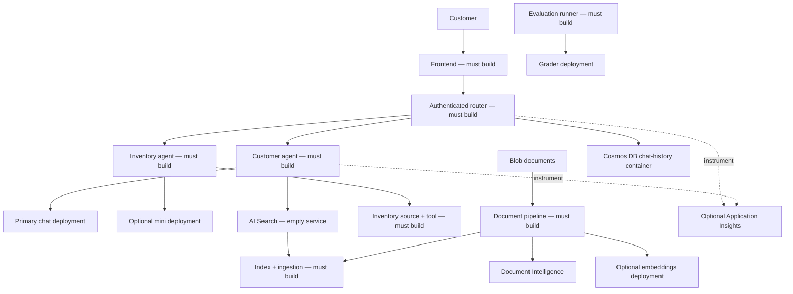

# Sokongan Pelanggan Berbilang Ejen — Reka Bentuk Seni Bina Runcit

**Bab 5: Penyelesaian AI Berbilang Ejen**

- [Laman kursus](../README.md)
- [Bab 5](../docs/chapter-05-multi-agent/README.md)
- [Prasyarat: Integrasi AI](../docs/chapter-02-ai-development/microsoft-foundry-integration.md)
- [Seterusnya: Perancangan kapasiti](../docs/chapter-06-pre-deployment/capacity-planning.md)
- [Rangka infrastruktur ARM](retail-multiagent-arm-template/README.md)

> **Panduan seni bina, bukan aplikasi berfungsi.** Satu-satunya fail pelaksanaan runcit
> adalah `azuredeploy.json`, `azuredeploy.parameters.json` dan `deploy.sh` dalam
> `retail-multiagent-arm-template/`. Konteiner router/frontend adalah tempat letak hello-world.
> Tiada ejen runcit, UI, saluran pengambilan, penilai, pengimbas, atau
> suite ujian aplikasi wujud secara lokal.

## Gambaran Keseluruhan

**Matlamat:** mereka bentuk sistem sokongan pelanggan dengan ejen pelanggan dan ejen inventori,
kenal pasti apa yang infrastruktur sediakan, dan rancang kontrak aplikasi dan pengesahan yang hilang.


**Penonton:** pembangun yang telah melengkapkan
[contoh sembang](../../../examples/azure-openai-chat) dan [contoh bekas dua perkhidmatan](../../../examples/container-app/microservices).
Sediakan masa 2–3 jam untuk kajian seni bina. Membangunkan aplikasi adalah projek yang berasingan:
80–120 jam pembangunan adalah anggaran perancangan ilustratif untuk
pembangun berpengalaman, **bukan janji penghantaran**; penyerapan produksi, ujian,
semakan keselamatan, dan operasi memerlukan kerja tambahan.

### Hasil pembelajaran

- Terangkan penghalaan, perladangan, kebenaran alat, dan pemilikan perbualan.
- Bezakan pengecam model, nama pelaksanaan, versi API, dan versi ARM.
- Reka bentuk pengambilan dan pengambilan dokumen dengan dimensi vektor yang sepadan.
- Definisikan keperluan fungsian, penilaian, dan pemulihan kegagalan yang boleh disahkan.
- Pisahkan matlamat seni bina pilihan daripada sumber yang sebenarnya dibekalkan.

## Seni Bina Penyelesaian



Ini adalah **seni bina aplikasi sasaran**, bukan rajah perkhidmatan agen yang berjalan.
Kerangka ARM mencipta perkhidmatan asas dan dua bekas tempat kosong sahaja.
Front Door, daftar, identiti terurus, penugasan peranan,
titik akhir persendirian, failover, instrumentasi aplikasi, dan amaran tidak termasuk.

### Tanggungjawab dan kontrak

| Komponen | Tingkah laku diperlukan | Bukti sebelum menganggap lengkap |
|---|---|---|
| Antara muka pengguna depan | Mengesahkan pengguna, memaparkan sembang, memuat naik dokumen dengan selamat | Ujian UI dan muat naik, ralat boleh diakses |
| Penghala | Mengizinkan permintaan, memilih agen, panggilan alat yang terikat/masa tamat | Ujian penghalaan, pemeriksaan kebenaran, ujian kegagalan |
| Agen pelanggan | Melandaskan jawapan polisi/produk pada sumber yang diluluskan | Petikan yang betul, penolakan apabila data tiada |
| Alat inventori | Membaca stok berwibawa dengan kebenaran terhad | Ujian stok deterministik; tiada ketersediaan direka |
| Saluran dokumen | Ekstrak, pecah, benam, indeks, kemas kini/hapus | Peralatan berindeks dan tingkah laku percubaan semula/surat mati |
| Penyimpanan perbualan | Mengasingkan pengguna, menguatkuasakan pengekalan | Ujian kebenaran silang pengguna dan TTL |
| Pelari penilaian | Bandingkan hasil dengan kebenaran sebenar dan rubrik | Liputan, kiraan kegagalan, laporan boleh diulang |

Fikirkan penghala sebagai kaunter penerimaan dan alat sebagai sistem dalaman terhad:
memilih pakar bukanlah kebenaran untuk mengakses semua rekod pelanggan.
Kuatkuasakan identiti dan kebenaran dalam kod aplikasi dan perkhidmatan data, bukan dalam arahan.

## Infrastruktur vs. Aplikasi

Baca [scaffold README](retail-multiagent-arm-template/README.md) sebelum
menyiapkan. Ia menyenaraikan sumber tepat, mod, kos, dan had.

| Penggunaan logik | Nama penyebaran ARM | Model / versi | Kawasan lalai |
|---|---|---|---|
| Sembang pelanggan | `gpt-4.1-chat` | `gpt-4.1` / `2025-04-14` | `eastus2` |
| Inventori | `gpt-4.1-mini-inventory` | `gpt-4.1-mini` / `2025-04-14` | `westus2`, pilihan |
| Penanaman | `text-embedding-ada-002` | `text-embedding-ada-002` / `2` | `francecentral`, pilihan |
| Penilaian | `gpt-4.1-grader` | `gpt-4.1` / `2025-04-14` | Kawasan utama secara lalai |

Periksa ketersediaan model/versi/SKU dan kuota dalam **setiap kawasan**. Sembang/mini/grader
menggunakan `GlobalStandard`; penanaman menggunakan `Standard`. Pemetaan unit kapasiti-ke-TPM adalah
khusus model. Jangan tambah unit kapasiti yang berbeza sebagai jaminan kuota sejagat.

Argumen `model` permintaan Azure OpenAI adalah **nama penyebaran**, bukan
semestinya pengenal model katalog. Versi API data-plane `2024-10-21`
berbeza daripada versi model `2025-04-14` dan sumber ARM `apiVersion`.
Tidak boleh membaiki model yang tidak tersedia hanya dengan mengubah versi API data-plane.

`--no-multi-region` mengabaikan akaun sekunder dan penanaman. Akaun sembang utama dan
penilai berdikari kekal. Akaun model berasingan tidak menyediakan alih ganti automatik;
itu memerlukan penghalaan aplikasi, penyebaran serasi, pemeriksaan kesihatan,
had percubaan semula, dan semakan kediaman data.

## Peta jalan pelaksanaan

### 1. Mulakan dengan satu interaksi yang diuji

Sebelum menyiapkan scaffold besar, gunakan contoh sembang tempatan untuk membina
sambungan inferens. Definisikan satu soalan pelanggan wakilan, sumber jawapan yang diluluskan,
rujukan yang dijangka, dan tingkah laku kegagalan apabila sumber itu hilang.

### 2. Tentukan sempadan penghalaan dan alat

Cipta sumber penghala sendiri, manifes kebergantungan, Dockerfile, dan ujian. Kontrak
contoh boleh jadi `POST /chat` dengan `{"message":"...","conversation_id":"..."}`.
**Titik akhir itu adalah cadangan reka bentuk; ia tidak dilaksanakan oleh templat ARM.**

Sahihkan jenis/batas badan, terbitkan identiti pengguna daripada pengesahan, laksanakan
hak milik perbualan, gunakan had masa permintaan, dan kembalikan kod ralat bermakna.
Jangan anggap kegagalan HTTP atau jawapan kosong sebagai keputusan agen berjaya.

### 3. Laksanakan pembumian dan penyisipan

Templat ARM tidak mencipta indeks carian. Ini adalah **fragmen JSON rujukan
untuk diadaptasi dalam definisi indeks sendiri**, bukan fail sedia ada dalam repo:

```json
{
  "name": "retail-product-index",
  "fields": [
    {"name": "id", "type": "Edm.String", "key": true},
    {"name": "title", "type": "Edm.String", "searchable": true},
    {"name": "content", "type": "Edm.String", "searchable": true},
    {"name": "category", "type": "Edm.String", "filterable": true},
    {
      "name": "content_vector",
      "type": "Collection(Edm.Single)",
      "searchable": true,
      "dimensions": 1536,
      "vectorSearchProfile": "retail-profile"
    }
  ],
  "vectorSearch": {
    "algorithms": [{"name": "retail-hnsw", "kind": "hnsw"}],
    "profiles": [{"name": "retail-profile", "algorithm": "retail-hnsw"}]
  }
}
```

Profil menghubungkan medan vektor kepada algoritmanya. Dimensi mesti sepadan dengan
output penanaman sebenar (1536 untuk penyebaran `ada-002` ini). Untuk pengambilan Python,
gunakan `azure.search.documents.models.VectorizedQuery` bukan kamus yang tidak lengkap
yang tiada jenis pertanyaan vektor:

```python
# Reference function only: supply an authenticated async SearchClient and an embedding.
from azure.search.documents.models import VectorizedQuery

async def retrieve(search_client, embedding):
    results = await search_client.search(
        search_text=None,
        vector_queries=[VectorizedQuery(
            vector=embedding,
            k_nearest_neighbors=5,
            fields="content_vector"
        )],
        select=["id", "title", "content"]
    )
    return [document async for document in results]
```

Cipta pelaksanaan penyisipan yang berasingan yang:

1. Memberi kebenaran muat naik dan mengesahkan jenis serta saiz kandungan.
2. Membaca blob peribadi menggunakan panggilan SDK yang disahkan. URL blob peribadi sahaja
   **bukan** input Kebijaksanaan Dokumen yang boleh dibaca; hantar bait yang dimuat turun dengan
   `AnalyzeDocumentRequest(bytes_source=...)` atau guna SAS jangkamasa pendek,
   selepas menilai keperluan akses.
3. Mengekstrak teks, membahagikannya supaya muat batasan penanaman, dan menjana penanaman.
4. Mencipta kunci dokumen yang stabil sah dan memuat naik potongan dengan vektor sepadan.
5. Memeriksa keputusan pengindeksan per dokumen, mengendalikan cubaan semula, dan mengemaskini/menghapus data usang.

Jangan interpolasi kunci/nilai pengguna yang sewenang-wenangnya ke penapis OData. Benarkan senarai medan,
sahihkan jenis nilai, dan lari kuotasi rentetan. Penapis boolean dan numerik memerlukan
literal berjenis, bukan rentetan yang dikuotasi.

### 4. Pembumian web

**Bing Search v7 telah dimansuhkan pada 11 Ogos 2025.** Sumber lama `Microsoft.Bing/accounts`
dan contoh `api.bing.microsoft.com/v7.0/search` bukan jalan pelaksanaan yang disokong.
Nilai integrasi pembumian yang kini disokong dalam
Microsoft Foundry dan SDK, kebenaran, bil, dan keperluan rujukan;
tiada yang dilaksanakan di sini. Ia bukan pengganti terus untuk titik akhir yang dimansuhkan.

### 5. Tambah telemetri dan penilaian

Mewujudkan Application Insights tidak bermakna menyediakan piawaian kod. Gunakan piawaian Azure Monitor
OpenTelemetry yang disokong semasa membina aplikasi baru, sebarkan konteks jejak
antara perkhidmatan, dan elakkan log petunjuk pelanggan, dokumen, atau rahsia.
Memendekkan pertanyaan **tidak** menjadikannya tanpa nama.

Ukur tempoh permintaan, kegagalan penghalaan/alat, kaitan pengambilan, ketepatan rujukan,
penggunaan token, dan pengunduran. Simpan fakta inventori/dasar fakta tanah
bersama-sama kes penilaian: penilai tidak boleh menentukan ketepatan fakta
hanya dari satu soalan dan jawapan.

Penyebaran penilai bukan pelaksana penilaian. Laksanakan rubrik berversi,
output berstruktur/sah penskema, semakan julat skor,
kiraan kegagalan pengangkutan, dan kes disemak manusia. Laporkan kes tidak lengkap/ralat berasingan;
jangan tukar kepada gred berjaya atau sertakan secara senyap sebagai jawapan model kualiti sifar.

Begitu juga, beberapa semakan kata kunci bukan sijil keselamatan. Permintaan HTTP yang gagal,
strategi ujian hilang, atau jawapan kosong mesti menjadikan ujian **tidak pasti atau
gagal**, bukan menghasilkan skor “100% selamat”. Laksanakan ujian yang diberi kuasa dengan peralatan
dan semakan manusia sebelum membuat sebarang tuntutan kesediaan produksi.

### 6. Sebarkan aplikasi anda

Cipta direktori sumber sendiri, manifes, ujian, daftar, dan kebenaran tarik imej.
Gantikan tempat letak dengan imej binaan dan kemas kini ingress/probe untuk
padankan port dengar setiap aplikasi. Konfigurasikan pembolehubah persekitaran runtime dalam Bicep
atau pemetaan persekitaran azd yang disokong secara jelas.

Tiada kamus `config` generik di bawah perkhidmatan azd yang secara automatik
mencipta pembolehubah persekitaran runtime. `azd env set` hanya mengubah sumber yang
secara jelas menggunakan nilai itu. Tiada perkenalan canary, senarai kawasan, atau kait penalaan halus
dilaksanakan dalam scaffold ini.

## Latihan reka bentuk praktikal

Ini adalah **latihan seni bina**, bukan tuntutan kod permulaan runcit boleh laku.

### Latihan 1: Sahkan sempadan

**Titik mula:** tiga fail dalam `retail-multiagent-arm-template/`.
**Matlamat:** bezakan penyediaan daripada fungsi aplikasi.
Buka `azuredeploy.json`, cari kedua-dua imej bekas dan nilai `targetPort`,
kemudian senaraikan komponen aplikasi yang hilang daripada repositori.

**Kriteria kejayaan / jawapan:** kedua imej adalah tempat letak hello-world yang mendengar
pada port 80; ejen, UI sembang, pengendali penghala, indeks/penyisipan, penilai, dan pengimbas
tiada. Permintaan akar tempat letak berjaya tidak mengesahkan `/chat`.
**Isu biasa:** mentafsir nama sumber seperti `retail-router` sebagai kod berfungsi.

### Latihan 2: Jejak konfigurasi vektor

**Titik mula:** JSON indeks di atas.
**Matlamat:** fahami kaitan medan → profil → algoritma.
Kenal pasti nilai mana mesti berubah apabila bertukar ke model penanaman dengan
dimensi output berbeza, kemudian periksa fungsi `retrieve`.

**Kriteria kejayaan / jawapan:** ubah medan `dimensions` kepada panjang vektor sebenar;
kekalkan `vectorSearchProfile` sejajar dengan profil yang diisytiharkan dan algoritmanya;
pertanyaan `fields` mesti menamakan medan vektor. Jana semula vektor dokumen
sedia ada apabila model penanaman berubah.
**Isu biasa:** hanya menukar nama model sambil mengekalkan vektor yang tidak serasi.

### Latihan 3: Tentukan ujian kegagalan

**Titik mula:** jadual tanggungjawab.
**Matlamat:** cegah kejayaan palsu.
Tulis tingkah laku dijangka bagi API inventori yang tidak tersedia, indeks carian tanpa
dokumen padan, dan permintaan penilaian yang memulangkan HTTP 503.

**Kriteria kejayaan / jawapan:** tiada nilai inventori direka; pengunduran jelas atau
peningkatan apabila konteks hilang; penilaian melaporkan kegagalan pengangkutan dan bukan
lulus kualiti atau keselamatan. Tambah ujian boleh laku apabila membina aplikasi.
**Isu biasa:** menangkap setiap pengecualian dan meneruskan dengan jawapan kosong.

## Kos, penyelesaian masalah, dan pembersihan

- Infrastruktur mempunyai caj berterusan walau indeks carian kosong dan aplikasi tempat letak.
  Gunakan harga kawasan semasa; “minimum” atau berbilang kawasan bukan bermakna percuma.
- Kos token bergantung pada model, input yang di-cache/tidak, output, dan SKU penyebaran.
  Penghalaan boleh menjimatkan wang hanya jika kerja dan hasil kualiti yang diukur membenarkannya;
  penjimatan tetap 60–80% tidak dijamin.
- Periksa ketersediaan model dan kuota sebelum penyediaan; bezakan kebenaran,
  nama penyebaran, kawasan, versi model, dan ralat versi API.
- Jangan jalankan `setup-data.sh` yang hilang, CLI penilai, atau perintah `pytest tests/`.
  Pelaksanaan mereka adalah sebahagian daripada baki kerja pembangunan anda.
- Scaffold adalah ARM sahaja: ikut
  [arahan pengesahan dan pembersihan](retail-multiagent-arm-template/README.md).
  `azd down` tidak menguruskan sumber tersebut.

## Sumber berkaitan

- [Contoh sembang tempatan yang berfungsi](../../../examples/azure-openai-chat)
- [Contoh bekas dua perkhidmatan yang berfungsi](../../../examples/container-app/microservices)
- [Indeks vektor AI Search](https://learn.microsoft.com/azure/search/vector-search-how-to-create-index)
- [Dokumentasi Container Apps](https://learn.microsoft.com/azure/container-apps/)
- [Penyelesaian masalah](../docs/chapter-07-troubleshooting/common-issues.md)
- [Laporkan isu](https://github.com/microsoft/AZD-for-beginners/issues)

---

<!-- CO-OP TRANSLATOR DISCLAIMER START -->
**Penafian**:
Dokumen ini telah diterjemahkan menggunakan perkhidmatan terjemahan AI [Co-op Translator](https://github.com/Azure/co-op-translator). Walaupun kami berusaha untuk ketepatan, sila ambil maklum bahawa terjemahan automatik mungkin mengandungi kesilapan atau ketidaktepatan. Dokumen asal dalam bahasa asalnya harus dianggap sebagai sumber yang sahih. Untuk maklumat penting, terjemahan oleh manusia profesional adalah disyorkan. Kami tidak bertanggungjawab terhadap sebarang salah faham atau salah tafsir yang timbul daripada penggunaan terjemahan ini.
<!-- CO-OP TRANSLATOR DISCLAIMER END -->