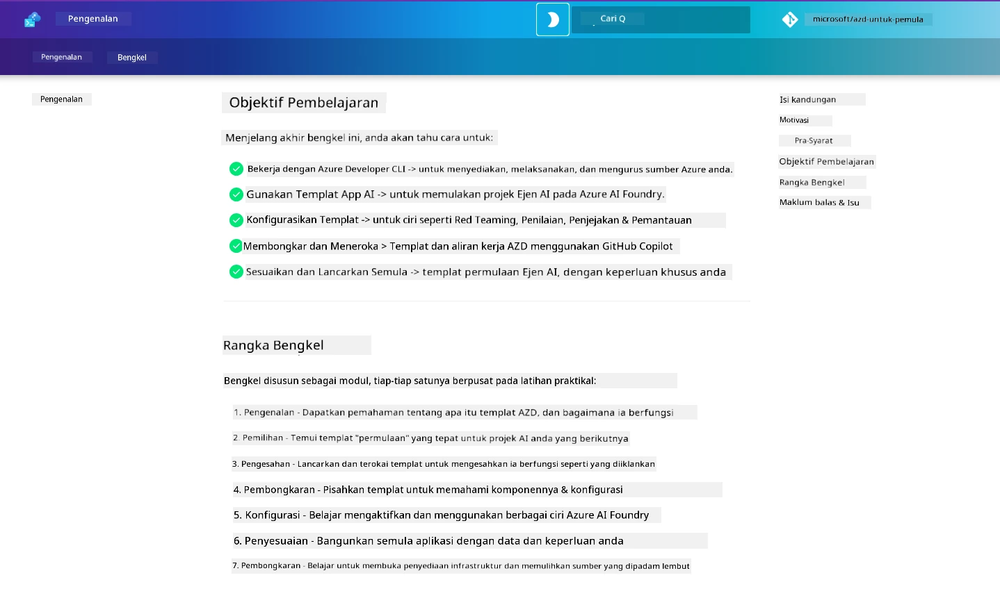

<div align="center">
  <div style="background: linear-gradient(135deg, #0078d4, #106ebe); border-radius: 10px; padding: 20px; margin: 20px 0; box-shadow: 0 4px 15px rgba(0, 120, 212, 0.3); border: 2px solid #005a9e;">
    <h2 style="color: white; margin: 0; font-size: 24px; text-shadow: 1px 1px 2px rgba(0,0,0,0.3);">
      🎯 Bengkel AZD untuk Pembangun AI
    </h2>
    <p style="color: white; margin: 10px 0 0 0; font-size: 16px; text-shadow: 1px 1px 2px rgba(0,0,0,0.3);">
      <strong>Sebuah bengkel amali untuk membina aplikasi AI dengan Azure Developer CLI.</strong><br>
      Lengkapkan 7 modul untuk menguasai templat AZD dan aliran kerja penghantaran AI.
    </p>
    <div style="margin-top: 15px;">
      <span style="background: rgba(255,255,255,0.2); padding: 5px 10px; border-radius: 15px; color: white; font-size: 14px;">
        📅 Panduan sumber disemak: November 2026
      </span>
    </div>
  </div>
</div>

# Bengkel AZD untuk Pembangun AI

Selamat datang ke bengkel amali untuk mempelajari Azure Developer CLI (AZD) dengan fokus pada penghantaran aplikasi AI. Bengkel ini membantu anda mendapat pemahaman praktikal tentang templat AZD dalam 3 langkah:

1. **Penemuan** - cari templat yang sesuai untuk anda.
1. **Penghantaran** - laksanakan dan sahkan bahawa ia berfungsi
1. **Penyesuaian** - ubah suai dan iterasi agar menjadi milik anda!

Sepanjang bengkel ini, anda juga akan diperkenalkan kepada alat dan aliran kerja utama pembangun, untuk membantu anda memudahkan perjalanan pembangunan menyeluruh anda.

<br/>

## Panduan Berasaskan Pelayar

Pelajaran bengkel adalah dalam Markdown. Anda boleh menavigasi mereka terus dalam GitHub - atau melancarkan pratonton berasaskan pelayar seperti yang ditunjukkan dalam tangkapan skrin di bawah.



Untuk menggunakan pilihan ini - garpu repositori ke profil anda, dan lancarkan GitHub Codespaces. Setelah terminal VS Code aktif, taip perintah ini:

Pratonton pelayar ini berfungsi dalam GitHub Codespaces, bekas pembangunan, atau klon tempatan dengan Python dan MkDocs dipasang.

```bash title="" linenums="0"
python -m pip install -r requirements-dev.txt
python -m mkdocs serve --config-file workshop/mkdocs.yml
```

Jalankan arahan ini dari **akar repositori kursus**, bukan contoh AI yang diinisialisasi secara berasingan. Kekalkan pratonton di latar depan supaya kesilapan tetap kelihatan; hentikannya dengan Ctrl+C. Untuk memeriksa tapak tanpa menyajikannya, jalankan `python -m mkdocs build --strict --config-file workshop/mkdocs.yml`.

Dalam beberapa saat, anda akan melihat dialog pop-up. Pilih pilihan untuk `Open in browser`. Panduan berasaskan web kini akan dibuka dalam tab pelayar baru. Beberapa manfaat pratonton ini:

1. **Carian terbina dalam** - cari kata kunci atau pelajaran dengan pantas.
1. **Ikon salin** - tatal ke atas blok kod untuk melihat pilihan ini
1. **Toggle tema** - bertukar antara tema gelap dan terang
1. **Dapatkan bantuan** - klik ikon Discord di kaki halaman untuk sertai!

<br/>

## Gambaran Keseluruhan Bengkel

**Tempoh:** 3-4 jam  
**Tahap:** Pemula ke Pertengahan  
**Prasyarat:** Kefahaman mengenai Azure, konsep AI, VS Code & alat baris arahan.

Ini adalah bengkel amali di mana anda belajar dengan melakukan. Setelah anda menyelesaikan latihan, kami mengesyorkan meninjau kurikulum AZD Untuk Pemula untuk meneruskan perjalanan pembelajaran anda ke amalan terbaik Keselamatan dan Produktiviti.

| Masa| Modul  | Objektif |
|:---|:---|:---|
| 15 minit | [Pengenalan](docs/instructions/0-Introduction.md) | Tetapkan pentas, fahami matlamat |
| 30 minit | [Pilih Templat AI](docs/instructions/1-Select-AI-Template.md) | Terokai pilihan dan pilih permulaan | 
| 30 minit | [Sahkan Templat AI](docs/instructions/2-Validate-AI-Template.md) | Hantar penyelesaian lalai ke Azure |
| 30 minit | [Pecahan Templat AI](docs/instructions/3-Deconstruct-AI-Template.md) | Terokai struktur dan konfigurasi |
| 30 minit | [Konfigurasikan Templat AI](docs/instructions/4-Configure-AI-Template.md) | Aktifkan dan cuba ciri yang tersedia |
| 30 minit | [Sesuaikan Templat AI](docs/instructions/5-Customize-AI-Template.md) | Sesuaikan templat mengikut keperluan anda |
| 30 minit | [Pembongkaran Infrastruktur](docs/instructions/6-Teardown-Infrastructure.md) | Bersihkan dan lepaskan sumber |
| 15 minit | [Penamat & Langkah Seterusnya](docs/instructions/7-Wrap-up.md) | Sumber pembelajaran, cabaran bengkel |

<br/>

## Apa Yang Anda Akan Pelajari

Fikirkan Templat AZD sebagai kotak pasir pembelajaran untuk meneroka pelbagai keupayaan dan alat untuk pembangunan menyeluruh pada Microsoft Foundry. Menjelang akhir bengkel ini, anda harus mempunyai rasa intuitif tentang pelbagai alat dan konsep dalam konteks ini.

| Konsep  | Objektif |
|:---|:---|
| **Azure Developer CLI** | Fahami perintah alat dan aliran kerja|
| **Templat AZD**| Fahami struktur projek dan konfigurasi|
| **Ejen Azure AI**| Sediakan & hantar projek Microsoft Foundry  |
| **Carian Azure AI**| Dayakan kejuruteraan konteks dengan agen |
| **Pengamatan**| Terokai penjejakan, pemantauan dan penilaian |
| **Red Teaming**| Terokai pengujian advesarial dan mitigasi |

<br/>

## Struktur Bengkel

Bengkel disusun untuk membawa anda dalam perjalanan dari penemuan templat, ke penghantaran, pembongkaran, dan penyesuaian - menggunakan templat permulaan rasmi [Memulakan Dengan Ejen AI](https://github.com/Azure-Samples/get-started-with-ai-agents) sebagai asas.

### [Modul 1: Pilih Templat AI](docs/instructions/1-Select-AI-Template.md) (30 minit)

- Apakah Templat AI?
- Di mana saya boleh mencari Templat AI?
- Bagaimana saya boleh mula membina Ejen AI?
- **Makmal**: Mula cepat dalam Codespaces atau bekas pembangunan

### [Modul 2: Sahkan Templat AI](docs/instructions/2-Validate-AI-Template.md) (30 minit)

- Apakah Seni Bina Templat AI?
- Apakah Aliran Kerja Pembangunan AZD?
- Bagaimana saya boleh mendapatkan bantuan dengan Pembangunan AZD?
- **Makmal**: Hantar & Sahkan templat Ejen AI

### [Modul 3: Bongkar Templat AI](docs/instructions/3-Deconstruct-AI-Template.md) (30 minit)

- Terokai persekitaran anda dalam `.azure/` 
- Terokai persediaan sumber anda dalam `infra/` 
- Terokai konfigurasi AZD anda dalam `azure.yaml`s
- **Makmal**: Ubah Suai Pembolehubah Persekitaran & Hantar Semula

### [Modul 4: Konfigurasikan Templat AI](docs/instructions/4-Configure-AI-Template.md) (30 minit)
- Terokai: Penjanaan Dipertingkatkan Pengambilan
- Terokai: Penilaian Ejen & Red Teaming
- Terokai: Penjejakan & Pemantauan
- **Makmal**: Terokai Ejen AI + Pengamatan 

### [Modul 5: Sesuaikan Templat AI](docs/instructions/5-Customize-AI-Template.md) (30 minit)
- Definisikan: PRD dengan Keperluan Senario
- Konfigurasikan: Pembolehubah Persekitaran untuk AZD
- Laksanakan: Langkah Hayat untuk tugasan tambahan
- **Makmal**: Sesuaikan templat untuk senario saya

### [Modul 6: Bongkar Infrastruktur](docs/instructions/6-Teardown-Infrastructure.md) (30 minit)
- Ulas: Apakah Templat AZD?
- Ulas: Kenapa guna Azure Developer CLI?
- Langkah Seterusnya: Cuba templat lain!
- **Makmal**: Henti dan bersihkan infrastruktur

<br/>

## Cabaran Bengkel

Mahu mencabar diri untuk buat lebih banyak? Berikut adalah beberapa cadangan projek - atau kongsi idea anda dengan kami!!

| Projek | Penerangan |
|:---|:---|
|1. **Bongkar Templat AI Kompleks** | Gunakan aliran kerja dan alat yang kami gariskan dan lihat jika anda boleh hantar, sahkan, dan sesuaikan templat penyelesaian AI yang berbeza. _Apa yang anda pelajari?_|
|2. **Sesuaikan Dengan Senario Anda**  | Cuba tulis PRD (Dokumen Keperluan Produk) untuk senario yang berbeza. Kemudian gunakan GitHub Copilot dalam repositori templat anda dalam Model Ejen - dan minta ia hasilkan aliran kerja penyesuaian untuk anda. _Apa yang anda pelajari? Bagaimana anda boleh memperbaiki cadangan ini?_|
| | |

## Ada maklum balas?

1. Hantar isu di repositori ini - tag dengan `Workshop` untuk kemudahan.
1. Sertai Microsoft Foundry Discord - berhubung dengan rakan sebaya anda!


| | | 
|:---|:---|
| **📚 Laman Utama Kursus**| [AZD Untuk Pemula](../README.md)|
| **📖 Dokumentasi** | [Mulakan dengan templat AI](https://learn.microsoft.com/en-us/azure/ai-foundry/how-to/develop/ai-template-get-started)|
| **🛠️Templat AI** | [Templat Microsoft Foundry](https://ai.azure.com/templates) |
|**🚀 Langkah Seterusnya** | [Mulakan Bengkel](#workshop-overview) |
| | |

<br/>

---

**Navigasi:** [Kursus Utama](../README.md) | [Pengenalan](docs/instructions/0-Introduction.md) | [Modul 1: Pilih Templat](docs/instructions/1-Select-AI-Template.md)

**Bersedia untuk mula membina aplikasi AI dengan AZD?**

[Mulakan Bengkel: Pengenalan →](docs/instructions/0-Introduction.md)

---

<!-- CO-OP TRANSLATOR DISCLAIMER START -->
**Penafian**:
Dokumen ini telah diterjemahkan menggunakan perkhidmatan terjemahan AI [Co-op Translator](https://github.com/Azure/co-op-translator). Walaupun kami berusaha untuk ketepatan, sila ambil maklum bahawa terjemahan automatik mungkin mengandungi kesilapan atau ketidaktepatan. Dokumen asal dalam bahasa asalnya harus dianggap sebagai sumber yang sahih. Untuk maklumat penting, terjemahan oleh manusia profesional adalah disyorkan. Kami tidak bertanggungjawab terhadap sebarang salah faham atau salah tafsir yang timbul daripada penggunaan terjemahan ini.
<!-- CO-OP TRANSLATOR DISCLAIMER END -->