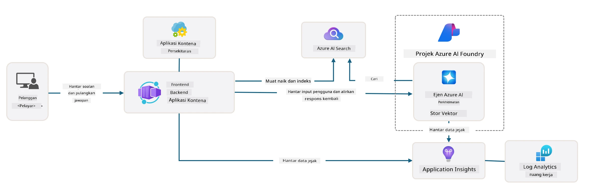

# 3. Membongkar Template

!!! tip "PADA AKHIR MODUL INI ANDA AKAN DAPAT"

    - [ ] Use GitHub Copilot and optional MCP tools for Azure documentation and read-only exploration
    - [ ] Identify the template's application, infrastructure, configuration, and test entry points
    - [ ] Verify generated explanations against actual repository files
    - [ ] **Lab 3:** Trace one request and one configuration input through the project

---

## 1. Aktifkan GitHub Copilot

Buka contoh AI yang telah diinisialisasi dalam VS Code dan aktifkan [GitHub Copilot](https://code.visualstudio.com/docs/copilot/chat/chat-agent-mode). Log masuk dengan akaun yang mempunyai pelan layak; had penggunaan berbeza-beza. Minta Copilot untuk menerangkan repositori sebelum membenarkan perubahan.

### Pelayan MCP Pilihan

Perkhidmatan ini boleh menyediakan alat tambahan:

- [Pelayan Azure MCP](https://learn.microsoft.com/azure/developer/azure-mcp-server/overview)
- [Pelayan Microsoft Learn MCP](https://learn.microsoft.com/training/support/mcp)

Dalam VS Code, semak [panduan konfigurasi MCP](https://code.visualstudio.com/docs/copilot/chat/mcp-servers) dan cipta `.vscode/mcp.json` jika diperlukan:

```json
{
  "servers": {
    "Azure MCP Server": {
      "type": "stdio",
      "command": "npx",
      "args": ["-y", "@azure/mcp@latest", "server", "start"]
    },
    "microsoft.docs.mcp": {
      "type": "http",
      "url": "https://learn.microsoft.com/api/mcp"
    }
  }
}
```

Perintah `npx` memerlukan pemasangan Node.js/npm yang disokong dan memuat turun kod boleh laksana. Semak pakej dan pin versi yang diluluskan untuk tetapan pasukan yang boleh diulang. Mulakan pelayan menggunakan kawalan MCP di VS Code dan periksa alat yang ada; nama boleh berubah antara versi.

**Pengesahan adalah berasingan.** Gunakan `azd auth login` untuk AZD. Ikuti aliran pengesahan yang didokumenkan Azure MCP untuk alatnya; log masuk AZD sahaja tidak mewujudkan sesi MCP. Gunakan `az login` secara berasingan apabila latihan atau kaitan memanggil Azure CLI.

Cuba arahan baca sahaja:

1. “Gunakan Microsoft Learn MCP untuk mencari dokumentasi konfigurasi Azure Developer CLI.”
2. “Terangkan `azure.yaml` repositori ini; nyatakan fail yang melaksanakan setiap kaitan.”
3. “Menggunakan alat Azure MCP yang tersedia, senaraikan sumber yang saya telah terapkan tanpa mengubah apa-apa.”

Semak penyewa/langganan yang dipilih dan setiap panggilan alat yang dicadangkan. Jangan luluskan penciptaan sumber, penghapusan, atau perubahan akses hanya untuk meneroka seni bina.

## 2. Fahami seni bina

Contoh ini menghoskan backend Python FastAPI dan frontend React/TypeScript dalam Azure Container Apps. Backend berkomunikasi dengan ejen dalam projek Microsoft Foundry. Pengambilan dan kebolehamatan bergantung pada ciri templat yang diaktifkan dan persediaan yang berjaya; ia tidak dijamin hanya kerana aplikasi telah diterapkan.



Bandingkan rajah ini dengan [panduan penerapan arus utama semasa](https://github.com/Azure-Samples/get-started-with-ai-agents/blob/main/docs/deployment.md) dan sumber sebenar anda. Semak penerapan model yang dikonfigurasi, alat ejen, identiti terurus, tugasan peranan, dan sumber AI Search/Application Insights pilihan.

**Latihan:** Minta Copilot menjejaki permintaan sembang dari frontend melalui API ke Foundry, dengan rujukan fail dan fungsi. Buka rujukan itu dan sahkan penjelasan. Jangan membuat inferens pengesahan, penghalaan, atau pemberian kuasa yang dilaksanakan hanya dari rajah semata-mata.

## 3. Struktur Repositori

Laluan yang dipilih berikut telah disemak terhadap contoh pada 4 November 2026. Semakan awal anda kekal menjadi sumber yang sahih:

```text
get-started-with-ai-agents/
  azure.yaml
  docker-compose.yaml
  requirements-dev.txt
  .devcontainer/
  infra/
    main.bicep
    main.parameters.json
    api.bicep
    core/
  src/
    Dockerfile
    pyproject.toml
    requirements.txt
    api/
      main.py
      routes.py
      search_index_manager.py
    frontend/
      package.json
      src/
    files/
  scripts/
    validate_env_vars.sh
    validate_env_vars.ps1
    postdeploy.sh
    postdeploy.ps1
  tests/
    test_evaluation.py
    test_red_teaming.py
  docs/
    deployment.md
    deploy_customization.md
    ai_search.md
    observability.md
    local_development.md
    troubleshooting.md
```

### Infrastruktur dan konfigurasi

`infra/main.bicep` mengatur sumber; `main.parameters.json` menghubungkan input templat ke nilai persekitaran AZD. `azure.yaml` memilih perkhidmatan aplikasi dan kaitan kitar hayat. Jejaki input seperti `USE_AZURE_AI_SEARCH_SERVICE` melalui fail-fail ini untuk mengetahui apa yang sebenarnya berubah.

### Aplikasi dan identiti

Baca `src/api/` dan `src/frontend/` bersama. Kenal pasti di mana ejen dicipta atau diambil, di mana arahan/alat dikonfigurasi, dan identiti mana yang digunakan oleh setiap panggilan Azure. Fail contoh di bawah `src/files/` adalah data demonstrasi, bukan katalog pengeluaran atau model pemberian kuasa.

### Ujian dan kebolehamatan

Titik masuk penilaian semasa dan red-teaming berada di bawah `tests/`; rujukan direktori `evals/` dan `airedteaming/` yang lebih lama sudah tidak digunakan untuk contoh ini. Baca `docs/observability.md` untuk prasyarat dan kos sebelum menjalankan ujian awan. Ujian Python ini berasingan daripada sambungan `azure.ai.evaluations` AZD pilihan.

## 4. Sahkan penemuan anda

- Kenal pasti laluan API, interaksi ejen, dan kod pengambilan untuk satu soalan contoh.
- Terangkan identiti yang mengakses Foundry dan konfigurasi yang memilih titik akhirnya.
- Cari skrip pra-pemasangan dan pasca-penerapan sebenar serta tingkah laku pengendalian ralatnya.
- Senaraikan sebarang pergantungan atau ciri pilihan yang tiada dalam penerapan anda.

Teruskan ke [Konfigurasikan Template](4-Configure-AI-Template.md).

---

<!-- CO-OP TRANSLATOR DISCLAIMER START -->
**Penafian**:
Dokumen ini telah diterjemahkan menggunakan perkhidmatan terjemahan AI [Co-op Translator](https://github.com/Azure/co-op-translator). Walaupun kami berusaha untuk ketepatan, sila ambil maklum bahawa terjemahan automatik mungkin mengandungi kesilapan atau ketidaktepatan. Dokumen asal dalam bahasa asalnya harus dianggap sebagai sumber yang sahih. Untuk maklumat penting, terjemahan oleh manusia profesional adalah disyorkan. Kami tidak bertanggungjawab terhadap sebarang salah faham atau salah tafsir yang timbul daripada penggunaan terjemahan ini.
<!-- CO-OP TRANSLATOR DISCLAIMER END -->