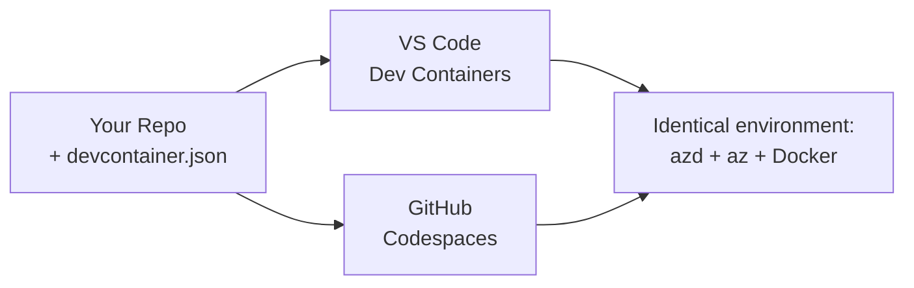

# azd အတွက် Dev Containers နှင့် GitHub Codespaces

**အခန်းလမ်းညွှန်:**
- **📚 သင်တန်းအိမ်**: [AZD အခြေခံသူများအတွက်](../../README.md)
- **📖 လက်ရှိအခန်း**: အခန်း ၁ - အခြေခံနှင့် လျင်မြန်စတင်ခြင်း
- **⬅️ ယခင်**: [သင်၏ကိုယ်ပိုင်အက်ပ်ကိုယူရန်](bring-your-own-app.md)
- **🚀 နောက်ထပ်အခန်း**: [အခန်း ၂: AI-ရှေ့ဆုံး ဖွံ့ဖြိုးရေး](../chapter-02-ai-development/README.md)

> အမိန့်နှင့် ဖွဲ့စည်းခြင်း ပြန်လည်စစ်ဆေးမှု ရည်ရွယ်ချက်: `azd 1.37.2` (နိုဝင်ဘာ ၂၀၂၆)။ Container ဆောက်လုပ်ခြင်းနှင့် Azure ထုတ်လုပ်ခြင်းများကို ဤစစ်ဆေးမှု၏ အစိတ်အပိုင်းအနေဖြင့် မလုပ်ခဲ့ပါ။

## မိတ်ဆက်ခြင်း

azd၊ သင့်လျော်သော ဘာသာစကား runtime၊ Docker နှင့် Azure CLI ကို မည်သည့်စက်မဆို ထည့်သွင်းရန်သည် အလုပ်ရှုပ်နေလွန်းပြီး၊ "ကျွန်ုပ်၏စက်တွင်အလုပ်လုပ်သည်" ဆိုသော သင်ခန်းစာတစ်ခုသည် တခြားသူများအတွက် မအောင်မြင်ပဲဖြစ်သွားရခြင်း၏ အဖွဲ့အစည်း နံပါတ်တစ်ဖြစ်သည်။ **dev container** သည် သင်၏ စက်ကရိယာချိန်းများအားလုံးကို ဖိုင်တစ်ဖိုင် ထဲတွင် ဖော်ပြခြင်းဖြင့်ဤပြဿနာကို ဖြေရှင်းပေးသည်။ VS Code သို့မဟုတ် GitHub Codespaces တွင် project ကို ဖွင့်သည့်သူတိုင်းသည် azd ပါပြီးသား အပြင် သာမာန်တူညီသော ပတ်ဝန်းကျင်တူရရှိစေပါသည်။ ဤသင်ခန်းစာက သင်ကို dev container တစ်ခု ထည့်သွင်းနည်းကို ပြသပါမည်။

## သင်ယူရမည့်ရည်ရွယ်ချက်များ

သင်သင်ခန်းစာအဆုံးသတ်သောအခါ၊ သင်သည်
- dev container သည် မည်သည့်အရာဖြစ်ပြီး azd နှင့်အဘယ်ကြောင့် ကူညီမှုရှိသည်ကို နားလည်သွားမည်။
- project ပြုလုပ်ရာတွင် အနည်းငယ်သော `.devcontainer/devcontainer.json` တစ်ခု ထည့်သွင်းရန်။
- Dev Container *အင်္ဂါရပ်များ* မှတဆင့် azd၊ Azure CLI နှင့် Docker ပါဝင်မှုပြုလုပ်ရန်
- GitHub Codespaces သို့မဟုတ် VS Code မှ project ကို ဖွင့်ရန်

## သင်ယူရမည့်ရလဒ်များ

ဤသင်ခန်းစာပြီးဆုံးပါက၊ သင်အား အောက်ပါအရာများ ပြုလုပ်နိုင်မည်ဖြစ်သည်:
- azd project အတွက် `devcontainer.json` တစ်ခု ရေးသားခြင်း
- လက်ဖြင့် ထည့်သွင်းခြင်းမရှိဘဲ azd နှင့် Azure ကိရိယာများ ထည့်သွင်းခြင်း
- ဆာဗာအတွင်း သို့မဟုတ် Codespace အတွင်းမှ `azd up` ကို အကောင်အထည်ဖော်ခြင်း

---

## Dev Container ဆိုတာဘာလဲ?

Dev container သည် သင့်ရဲ့ repository ထဲရှိ `.devcontainer/devcontainer.json` ဖိုင်တစ်ခုဖြင့် သတ်မှတ်ပေးထားသော Docker အခြေခံ ဖွံ့ဖြိုးရေး ပတ်ဝန်းကျင် တစ်ခုဖြစ်သည်။ Project ကို ဖွင့်သည့်အခါ

- **VS Code** (Dev Containers extension ပါဝင်သော) သည် container ကို ဆောက်ပြီး ကွန်နက်ရှိသည်။
- **GitHub Codespaces** သည် တူညီသော container ကို cloud မှာ ဆောက်ပြီး browser အခြေပြု အယ်ဒီတာဖြစ်စေသည်။

မည်သည့်နည်းလမ်းဖြင့်မဆို၊ အဖွဲ့ပူးပေါင်းသူတိုင်းသည် တူညီသော ကိရိယာများကို ရရှိမည်ဖြစ်သောကြောင့် "azd ထည့်သွင်းပါပြီလား?" ဆိုပြီး ပြဿနာရှာခြင်းမရှိတော့ပါ။



---

## အဆင့် ၁: devcontainer ဖိုင်ကို ဖန်တီးပါ

Project ရဲ့ root တွင် `.devcontainer/devcontainer.json` ဖန်တီးပါ။

```json
{
  "name": "azd-project",
  "image": "mcr.microsoft.com/devcontainers/base:bookworm",
  "features": {
    "ghcr.io/devcontainers/features/azure-cli:1": {},
    "ghcr.io/azure/azure-dev/azd:0": { "version": "1.37.2" },
    "ghcr.io/devcontainers/features/docker-in-docker:2": {},
    "ghcr.io/devcontainers/features/node:1": {}
  },
  "customizations": {
    "vscode": {
      "extensions": [
        "ms-azuretools.azure-dev",
        "ms-azuretools.vscode-bicep"
      ]
    }
  },
  "forwardPorts": [3000],
  "postCreateCommand": "azd version"
}
```

အသီးသီးစိတ်ဝင်စားရန်:

| ကီး | ရည်ရွယ်ချက် |
|-----|---------|
| `image` | Container ပေါ်တွင် အသုံးပြုမည့် အခြေခံ OS |
| `features` | ထုတ်လုပ်ပြီးသား ထည့်သွင်းကိရိယာများ—ဒီမှာ Azure CLI၊ **azd**, Docker နှင့် Node.js |
| `customizations.vscode.extensions` | azd နှင့် Bicep VS Code extensions များကို အလိုအလျောက် ထည့်သွင်းသည် |
| `forwardPorts` | သင်၏ app ၏ port ကို browser အတွက် ဖော်ပြသည် |
| `postCreateCommand` | Container ဆောက်ပြီးနောက်တစ်ကြိမ် လည်ပတ်သော command (ဒီမှာ sanity check) |

> feature version (`azd:0`) နှင့် ထည့်သွင်းထားသော CLI ဗားရှင်းသည် ကွာခြားပါသည်။ CLI ကို pin လုပ်ရန် feature ရဲ့ `version` အစိတ်အပိုင်းကို `"1.37.2"` သတ်မှတ်ပါ၊ CLI ဗားရှင်းကို feature tag အဖြစ် မသုံးပါနှင့်။

---

## အဆင့် ၂: သင်၏ app ဘာသာစကားနှင့် ကိုက်ညီအောင် feature ကို ဆိုင်ခွဲပါ

သင့် app အသုံးပြုသည့် feature ကို `node` ဖြင့် အစားထိုးပါ။

```jsonc
// Python project
"ghcr.io/devcontainers/features/python:1": {},

// .NET project
"ghcr.io/devcontainers/features/dotnet:2": {},

// Java project
"ghcr.io/devcontainers/features/java:1": {},

// Go project
"ghcr.io/devcontainers/features/go:1": {}
```

ဒေသခံတွင် ပုံများ ဆောက်ရန် `docker-in-docker` ကို ထိန်းသိမ်းပါ။ Remote ACR build (`docker.remoteBuild: true`) ကို ပြင်လည်ဖွဲ့စည်းထားခြင်းသည် အခြားရွေးချယ်စရာတစ်ခုဖြစ်သည်; host အမျိုးအစားတစ်ခုတည်းက ဒေသခံ Docker ကို အမြဲလိုအပ်လိမ့်မည် မဟုတ်ပါ။

---

## အဆင့် ၃: ဖွင့်ပါ

**VS Code တွင်:**
1. **Dev Containers** extension ကို ထည့်သွင်းပါ။
2. Project ဖိုလ်ဒါကို ဖွင့်ပါ။
3. Prompt လာလျှင် **Reopen in Container** ကို နှိပ်ပါ (သို့မဟုတ် *Dev Containers: Reopen in Container* ကို run ပါ)။

**GitHub Codespaces တွင်:**
1. Repo ကို GitHub တွင်ပို့ပါ။
2. **Code → Codespaces → Create codespace on main** ကို နှိပ်ပါ။
3. Container ဆောက်နေစဉ် သတိပြုဆောင်ရွက်ပါ—azd သည် terminal တွင် အသင့်ရှိပါပြီ။

---

## အဆင့် ၄: Container အတွင်းမှ ထုတ်လုပ်ပါ

Container တွင် azd သည် အစောပိုင်းတွင် ထည့်သွင်းပြီးသည်ဖြင့် ပုံမှန် workflow သည် အလုပ်လုပ်ပုံမှန် ဆက်လက်လုပ်ဆောင်နိုင်သည်။

```bash
azd auth login --use-device-code   # device code is handy inside Codespaces
azd up
```

> **ဘာလို့ `--use-device-code` လဲ?** remote container သို့မဟုတ် Codespace တစ်ခုတွင် ဒေသခံ browser မရှိသောကြောင့် device-code login သည် ယုံကြည်စိတ်ချရသော လမ်းကြောင်းဖြစ်သည်။ သင်မှ code ကို browser tab တစ်ခုထဲတွင် ကူးထည့်ပြီး စာရင်းသွင်းခြင်း အပြီးသတ်လိုက်ပါမည်။

---

## ရိုးရာဖြစ်တတ်သော အခက်အခဲများ

| အခက်အခဲ | ဖြေရှင်းနည်း |
|---------|-----|
| `azd up` က ပုံတူပြုလုပ်၍ မရ | `docker-in-docker` feature ကို ထည့်သွင်းပါ |
| Codespaces တွင် browser login တင်မရပ် | `azd auth login --use-device-code` ကို အသုံးပြုပါ |
| အဖွဲ့ဝင်များက ကိရိယာများ မတူ | azd feature ရဲ့ `version` အစိတ်အပိုင်းဖြင့် CLI ကို pin လုပ်ပြီး runtime များကို ပင်မလုပ်ပါ |
| Browser ထဲတွင် app ကို မရောက် | `forwardPorts` တွင် port ကို ထည့်သွင်းပါ |

---

## အကျဉ်းချုပ်

- dev container သည် သင့် azd toolchain ကို လူတိုင်းအတွက် ထပ်မံလုပ်ဆောင်နိုင်စေသည်။
- Dev Container *features* ဖြင့် azd၊ Azure CLI နှင့် Docker ကို ထည့်သွင်းပါ။
- သင့် app ဘာသာစကား feature နဲ့ ကိုက်ညီမှု ရှိစေရန်နှင့် container hosts အတွက် `docker-in-docker` ကို ထိန်းသိမ်းပါ။
- Codespaces အတွင်း လည်ပတ်သောအခါ device-code login ကို အသုံးပြုပါ။

---

## 🔗 လမ်းညွှန်

| ဦးတည်ချက် | အရင်းအမြစ် |
|-----------|----------|
| **ယခင်** | [သင်၏ကိုယ်ပိုင်အက်ပ်ကိုယူရန်](bring-your-own-app.md) |
| **အခန်းအိမ်** | [အခန်း ၁: အခြေခံနှင့် လျင်မြန်စတင်ခြင်း](README.md) |
| **နောက်ထပ်အခန်း** | [အခန်း ၂: AI-ရှေ့ဆုံး ဖွံ့ဖြိုးရေး](../chapter-02-ai-development/README.md) |

## 📖 ဆက်စပ်အရင်းအမြစ်များ

- [ထည့်သွင်းခြင်းနှင့် တပ်ဆင်ခြင်း](installation.md)
- [အမိန့် စာရွက်စာတမ်း](../../resources/cheat-sheet.md)
- [တရားဝင် Dev Containers သတ်မှတ်ချက်](https://containers.dev/)
- [azd Dev Container feature](https://github.com/Azure/azure-dev/tree/main/ext/devcontainer)

---

<!-- CO-OP TRANSLATOR DISCLAIMER START -->
**ပြောကြားချက်**
ဤစာတမ်းကို AI ဘာသာပြန်ဝန်ဆောင်မှု [Co-op Translator](https://github.com/Azure/co-op-translator) အသုံးပြု၍ ဘာသာပြန်ထားပါသည်။ ကျွန်ုပ်တို့သည် တိကျမှန်ကန်မှုအတွက် ကြိုးပမ်းနေသော်လည်း၊ စက်ကိရိယာဘာသာပြန်ခြင်းများတွင် အမှားများ သို့မဟုတ် မှားယွင်းချက်များ ပါဝင်နိုင်ကြောင်း သတိပြုပါရန် လိုအပ်ပါသည်။ မူလစာတမ်းကို မူရင်းဘာသာဖြင့်သာ ယုံကြည်စိတ်ချရသော အချက်အလက်အဖြစ် သတ်မှတ်သင့်သည်။ အရေးကြီးသည့် သတင်းအချက်အလက်များအတွက် ပရော်ဖက်ရှင်နယ် လူသားဘာသာပြန်သူဝန်ဆောင်မှုကို အကြံပြုပါသည်။ ဤဘာသာပြန်ချက်ကို အသုံးပြုခြင်းမှ ဖြစ်ပေါ်လာသော နားလည်မှုကွာခြားမှုများ သို့မဟုတ် မမှန်ကန်သော အသုံးပြုမှုများအတွက် ကျွန်ုပ်တို့ တာဝန်မခံပါ။
<!-- CO-OP TRANSLATOR DISCLAIMER END -->