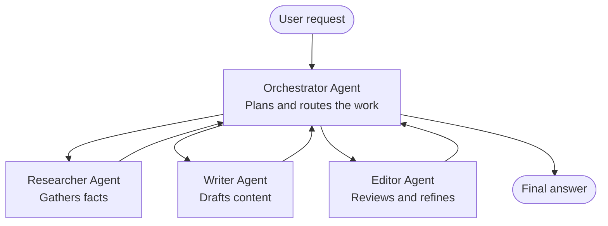

# မတူကွဲပြားတဲ့အေးဂျင့်များအခြေခံ - သင်၏ ပထမဆုံး ချိတ်ဆက်သွယ်ဆောင်ရည် AI စနစ်ကို ထုတ်ဖြန့်ပါ

**အခန်းလမ်းညွှန်မှု:**
- **📚 သင်တန်းအိမ်**: [AZD အတွက် မိတ်ဆက်သင်တန်း](../../README.md)
- **📖 လက်ရှိ အခန်း**: အခန်း ၅ - မတူကွဲပြားတဲ့အေးဂျင့် AI ဖြေရှင်းချက်များ
- **⬅️ အရင်အခန်း**: [အခန်း ၄: ဖွဲ့စည်းပုံအခြေခံ](../chapter-04-infrastructure/README.md)
- **➡️ နောက်တစ်ခန်း**: [ချိတ်ဆက်မှုပုံစံများ](../chapter-06-pre-deployment/coordination-patterns.md)

> ပြောကြားချက် ညွှန်ကြားမှုများကို ထုတ်ပြန်ထားသော `azd 1.37.2` ကိုးကားချက်နှင့် နှိုင်းယှဉ်စစ်ဆေးပြီးဖြစ်သည်။ မိုးကောင်းကင် ထုတ်ဖြန့်မှုများ မပြုလုပ်ခဲ့ပါ။

## မိတ်ဆက်

အရင်က အခန်းများတွင် သင်သည် တစ်ခုတည်းသောအက်ပ်လီကေးရှင်းကို ထုတ်ဖြန့်ခဲ့ပြီး၊ အခန်း ၂ တွင် တစ်ခုတည်းသော AI အေးဂျင့်ကို ထုတ်ဖြန့်ခဲ့သည်။ ဒီသင်ခန်းစာသည် နောက်ဆုံးအဆင့်ဖြစ်ပြီး၊ အထူးပြုအေးဂျင့်များ များစွာပါဝင်ပြီး တစ်ဦးတည်းသောအေးဂျင့်တစ်ခုက ကောင်းစွာ မဖြေရှင်းနိုင်သောပြဿနာကို ပူးပေါင်းဖြေရှင်းရန် **မတူကွဲပြားသော အေးဂျင့်စနစ်** တစ်ခုကို ထုတ်ဖြန့်ခြင်းဖြစ်သည်။

စတင်သင်ယူသူများအတွက် ကြိုဆိုသတင်းကောင်းမှာတော့- **သင့်အား အမိန့်အသစ်များ မလိုအပ်ပါ။** မတူကွဲပြားသော အေးဂျင့်ဖြေရှင်းချက်သည် မကြာသေးခင်ကပဲ azd ပရောဂျက်တစ်ခုဖြစ်သည်။ သင်က `azd init`, `azd up`, စမ်းသပ်ပြီး `azd down` လုပ်မည်- သင့်အားအကြိုအလေ့အကျင့်ကိုတိတိကျကျ သိပြီးသားဖြစ်သည်။ ပြောင်းလဲသည်မှာ အက်ပ်အတွင်းရှိ *ပုံစံ* တစ်ခုသာ ဖြစ်သည်။

## သင်ယူလိုသော ရည်မှန်းချက်များ

ဒီသင်ခန်းစာအဆုံးသတ်ချိန်တွင် သင်အောက်ပါအရာများကို ပြုလုပ်နိုင်မည်ဖြစ်သည်။
- "မတူကွဲပြားသော အေးဂျင့်" ဟူသော အဓိပ္ပါယ်နှင့် ဘယ်အချိန်တွင်ပိုပြီး စိန်ခေါ်မှုများအတွက် သင့်တော်မှုကို နားလည်ခြင်း
- မတူကွဲပြားသောအေးဂျင့်စနစ်တွင် ထင်ရှားသော အလုပ်အခန်းများကို (ချိတ်ဆက်သူ + အထူးပြုသူများ) ရှာဖွေရန်
- `azd up` ဖြင့် တကယ့် အလုပ်လုပ်သော မတူကွဲပြားအေးဂျင့် စနစ်တစ်ခုကို ထုတ်ဖြန့်ခြင်း
- မတူကွဲပြားသောအေးဂျင့် အက်ပ်ကို ထောက်ပံ့သည့် Azure အရင်းအမြစ်များကို နားလည်ခြင်း
- ပြုပြင်ပြောင်းလဲခြင်း၊ စစ်ဆေးခြင်းနှင့် ဖြုတ်ချရေးကို လုံခြုံစွာ ပြုလုပ်နည်းသိရှိခြင်း

## သင်ယူရလဒ်များ

ဒီသင်ခန်းစာပြီးဆုံးလျှင် သင်အောက်ပါနည်းဖြင့်ပြောကြားနိုင်မည်ဖြစ်သည်။
- တစ်ဦးတည်းသောအေးဂျင့်နဲ့ မတူကွဲပြားသောအေးဂျင့်စနစ်တို့၏ ကွာခြားချက်ကို ရှင်းပြနိုင်သည်
- တစ်ဦးတည်းသောအေးဂျင့်နှင့်ကိရိယာများပါရှိမှုအကြား၊ တကယ့်မတူကွဲပြားသောအေးဂျင့်ဒီဇိုင်းကို ရွေးချယ်နိုင်သည်
- azd ဖြင့် မတူကွဲပြားသောအေးဂျင့် စနစ်အား စတင်ထုတ်ဖြန့်ပြီး စမ်းသပ်နိုင်သည်
- အေးဂျင့်တိုင်း ဘယ်မှာ လည်ပတ်လဲ၊ ၎င်းတို့ ဘယ်လိုဆက်သွယ်ကြလဲ ဆိုတာ မှတ်သားနိုင်သည်
- ဆက်လက်စရိတ်မဖြစ်စေရန် အရင်းအမြစ်အားလုံးကို ဆောင်ရွက်ပြီး ရှင်းလင်းနိုင်သည်

---

## မတူကွဲပြားသော အေးဂျင့်စနစ် ဆိုတာဘာလဲ?

တစ်ဦးတည်းသော AI အေးဂျင့်မှာ ဗဟုသုတနှင့် (လိုလားသလို) ကိရိယာအသုံးပြုမှုအတူ တစ်ခုတည်းသော မော်ဒယ်တစ်ခုဖြစ်သည်။ ဒါဟာ အာရုံစူးစိုက်တတ်သော တာဝန်များအတွက် ကောင်းစွာ လည်ပတ်တတ်သည်။ သို့သော် တာဝန်တက်လာသည်နှင့်အမျှ - သုတေသန၊ ရေးသားခြင်း၊ ပြင်ဆင်ခြင်း၊ အတည်ပြုခြင်း အစရှိသည် - တစ်ခုတည်းသော အမိန့်အတွင်း များစွာထည့်သွင်းလိုက်ခြင်းဟာ အေးဂျင့်ကို နည်းလမ်းကျ၊ မယုံကြည်စိတ်ချလောက်၊ ပိုမိုခက်ခဲစေပြီး ပြုပြင်ရှာဖွေရန် ခက်ခဲစေနိုင်သည်။

**မတူကွဲပြားသောအေးဂျင့်စနစ်** သည် အလုပ်ကို အထူးပြု ဆောင်ရွက်သူများသို့ ခွဲထုတ်ပြီး၊ ချိတ်ဆက်သူတစ်ဦးက စုပေါင်းအုပ်ချုပ်သည့် စနစ်ဖြစ်သည်။



### သင် အမြဲမြင်တွေ့ရမည့် အလုပ်အခန်းနှစ်ခု

| အလုပ်အခန်း | တာဝန် | ဥပမာ |
|------|-----|---------|
| **ချိတ်ဆက်သူ** | *နောက်ထပ် ဖြစ်ပေါ်ရမည့်အရာ* ကိုဆုံးဖြတ်ပြီး အေးဂျင့်များအကြား အလုပ်များကို လမ်းညွှန်သည် | "ပထမဆုံး သုတေသန၊ ၎င်းနောက် ရေးသားခြင်း၊ ပြီးလျှင် ပြင်ဆင်ခြင်း" |
| **အထူးပြုသူ** | တာဝန်တစ်ခုကို အာရုံစိုက်ပြီး ရလဒ်ပြန်တယ် | အချက်အလက်ဘဲ စုဆောင်းသော "သုတေသနရှာဖွေသူ" |

### သင်တကယ် မတူကွဲပြားသောအေးဂျင့်များ လိုအပ်ပါသလား?

ရိုးရှင်းစွာ စတင်ပါ။ မတူကွဲပြားသောအေးဂျင့် **သာ** အသုံးပြုရန် အောက်ပါအချို့ဖြစ်ပါကသာ လွယ်ကူသည်။

- ✅ တာဝန်တွင် **ခွဲခြားသောအဆင့်များ** ရှိပြီး လမ်းညွှန်ချက်များ သတ်မှတ်ခြင်းအတွက် အကျိုးရှိသည် (သုတေသန vs ရေးသားခြင်း vs ပြန်လည်သုံးသပ်ခြင်း)
- ✅ အထူးပြုသူများကို **တပြိုင်နက်** လည်ပတ်စေရန် အချိန်သုံးစွဲမှု အလာတစ်ကျွန်းဖြတ်နိုင်ရန် ဆောင်ရွက်ချင်သည်
- ✅ အဆင့်တစ်ခုချင်းစီတွင် **ကိရိယာ သို့မဟုတ် ဒေတာအရင်းအမြစ်များ မတူကွဲပြားသည်**
- ✅ အဆင့်တစ်ခုချင်းစီကို **လွတ်လပ်စွာ စမ်းသပ်ခြင်းနှင့် ပြုပြင်ခြင်း** လုပ်နိုင်စေရန်လိုသည်

သင့်တာဝန်က တစ်ခုတည်းသော မေးခွန်းနှင့် ဖြေဆိုခြင်း သို့မဟုတ် ရိုးရှင်းသော ကိရိယာခေါ်ယူခြင်းဖြစ်ပါက၊ **ကိရိယာများပါရှိသည့် တစ်ဦးတည်းအေးဂျင့်** (အခန်း ၂) သည် ပိုမိုရိုးရှင်း၊ စျေးသက်သာပြီး လည်ပတ်ရန် လွယ်ကူသည်။

> **စတင်သူအတွက် အကြံပြုချက်:** "အေးဂျင့်များ များလာခြင်း" သည် "ပိုကောင်းခြင်း" မဟုတ်ပါ။ အေးဂျင့်တစ်ဦးချင်းစီသည် နောက်ကျမှု၊ စရိတ်နှင့် အသစ်တစ်ခုကို စောင့်ကြည့်ရန် ပံ့ပိုးမှု ပေါင်းထည့်သည်။ ပြဿနာအားမှန်ကန်ကြောင်း ခွဲခြားနိုင်သော အခွင့်အလမ်းများရှိကာ အေးဂျင့်များကို ထည့်သွင်းပါ။

---

## Azure တွင် မတူကွဲပြားသောအေးဂျင့်ကို တည်ဆောက်နည်း နှစ်မျိုး

| နည်းလမ်း | အကြောင်း | အကောင်းဆုံး အသုံးပြုမှု |
|----------|-----------|----------|
| **တစ်ဦးတည်းအေးဂျင့် + ကိရိယာများ** | လုပ်ဆောင်ချက်/ကိရိယာများ ခေါ်သုံးသော Foundry အေးဂျင့် တစ်ခု | ရိုးရှင်းသော လုပ်ငန်းစဉ်များ၊ စတင်ရန် |
| **ပူးပေါင်းချိတ်ဆက်ထားသည့် အေးဂျင့်များ** | ချိတ်ဆက်သူပါဝင်သည့် အေးဂျင့်များအတု | ခွဲခြားအဆင့်များ၊ တပြိုင်နက်အလုပ်များ၊ အထူးပြုခြင်း |

ဒီသင်ခန်းစာသည် ဒုတိယနည်းလမ်းကို သုံးအသုံးပြုသည့် **ပြင်ဆင်ပြီးသားနမူနာ** ဖြင့် ဦးတည်သည်၊ သို့မှသာ မတူကွဲပြားသောအေးဂျင့်စနစ် တကယ့်အားဖြင့်လည်ပတ်နေမှုကို ကြည့်ရှုနိုင်ပြီး ကိုယ်တိုင်တည်ဆောက်နိုင်ပါလိမ့်မည်။

---

## လက်တွေ့လိုက်နာခြင်း: တတ်နိုင်သော မတူကွဲပြားအေးဂျင့်အက်ပ်တစ်ခု ထုတ်ဖြန့်ခြင်း

ကျွန်တော်တို့ သွားလုပ်မယ့်ဟာက **Contoso Creative Writer** ဖြစ်ပြီး၊ သုတေသန၊ ထုတ်ကုန်၊ ရေးသားခြင်း၊ ပြင်ဆင်ခြင်း အေးဂျင့်များကို ချိတ်ဆက်၍ ဆောင်းပါးတစ်ပုဒ် ထုတ်ပေးသည့် အော်ဖီရှယ် Azure နမူနာဖြစ်သည်။ ဆက်လက်လုပ်ဆောင်ရန်မပြုမီ၊ [နမူနာ၏ ကြိုတင်လိုအပ်ချက်များနှင့် စရိတ်များ](https://github.com/Azure-Samples/contoso-creative-writer#azure-account-requirements) ကို စစ်ဆေးပါ။ ၎င်းသည် မော်ဒယ်ကွတ်တာ၊ Azure AI ရှာဖွေမှု၊ Bing Grounding လက်မှတ်၊ Python, Docker နှင့် Bash-ကိုက်ညီသော Hooks များအပါအဝင်လိုအပ်သည်။ မော်ဒယ်နှင့် ဒေသရရှိနိုင်မှုသည် သင့်စာရင်းသွင်းမှုပေါ်မူတည်ပြီး၊ ထုတ်ဖြန့်ခြင်းကို ဒေသဖြစ်ခြားရွေးချယ်ခြင်းဖြင့် အာမခံခြင်းမရှိပါ။

### ၁။ နမူနာစတင်ဖန်တီးခြင်း

```bash
# Create a working folder
mkdir creative-writer && cd creative-writer

# Initialize from the official multi-agent template
azd init --template Azure-Samples/contoso-creative-writer .
```

> မတူကွဲပြားသောအေးဂျင့် နမူနာများကို မည်သည့်အချိန်တွင်မဆို [Awesome AZD AI နယ်ပယ်](https://azure.github.io/awesome-azd/?tags=ai) တွင် လေ့လာနိုင်သည်။ အခြား စတင်သင်ယူသူ စိတ်ဝင်စားဖွယ် ရွေးချယ်စရာများတွင် `get-started-with-ai-agents` နှင့် `azure-ai-travel-agents` ပါရှိသည်။

### ၂။ အသိအမှတ်ပြုခြင်း

```bash
# Required for azd workflows
azd auth login

# Also required by this sample's Azure CLI hooks
az login
```

### ၃။ ပတ်ဝန်းကျင် စစ်ဆေးခြင်း

```bash
# init normally creates/selects an environment; confirm it before proceeding
azd env list
# Only if you need an additional environment:
# azd env new dev
```

### ၄။ ကြိုတင်ကြည့်ရှု ပြီး ထုတ်ဖြန့်ခြင်း

```bash
# See what will be created before spending anything (recommended)
azd provision --preview

# Provision infrastructure and deploy all agents in one step
azd up
```

`azd up` သည် subscription နှင့် region ဆက်တင်များမရှိသေးသောအတွက် prompt မေးမြန်းပြီး နောက်မှ အရင်းအမြစ်များကို provision ပြုလုပ်ပြီး application ကို deploy လုပ်ပါလိမ့်မည်။ preview သည် quota မသိမ်းဆည်းပေးသေးဘဲ အောင်မြင်မှုကိုအာမခံခြင်းမရှိပါ။ template hooks များကို provisioning preview အတွင်းလည်း run ဖြစ်နိုင်သောကြောင့် ပထမဦးဆုံး စစ်ဆေးပါ။ azd သည် **service deployment** (module provisioning မဟုတ်ပါ) တစ်ခုစီအတွက် စောင့်ဆိုင်းသည့်ကြာမြင့်ချိန်ကို တိုးချဲ့လိုပါက –

```bash
azd deploy --timeout 1800
```

timeout တစ်ခုသည် azd ၏စောင့်ဆိုင်းခြင်းကို ရပ်ဆိုင်းပေးသည်။ Azure တွင် deployment ကို cancel မလုပ်ပါ။ ပြန်လည်ကြိုးစားမလုပ်မီ အရင်းအမြစ်အခြေအနေကို စစ်ဆေးပါ။

> **ကုန်ကျစရိတ်နှင့် စွမ်းဆောင်ရည်အပေါ် သတိပြုရန်။** Multi-agent app များသည် quota သုံးစွဲ၍ ကုန်ကျစရိတ်ဖြစ်စေသော AI မော်ဒယ်များကို deploy လုပ်သည်။ `azd up` သည် မော်ဒယ် quota ပေါ် အမှားဖြစ်ခဲ့ပါက၊ [AI Troubleshooting](../chapter-07-troubleshooting/ai-troubleshooting.md) တွင် region နှင့် quota ပြုပြင်မှုများကို ကြည့်ရှုပါ၊ နောက်ထပ် အပိုင်း 6 [Capacity Planning](../chapter-06-pre-deployment/capacity-planning.md) ကိုလည်း ကြည့်ပါ။

---

## သင် deploy လုပ်သည့်အခြေအနေကိုနားလည်ခြင်း

ဒီလို multi-agent app မှာ အောက်ပါပုံအတိုင်းတာဝန်များနှင့် တိုက်ရိုက်ဆက်စပ်နေသော Azure အရင်းအမြစ်များကို provision ပြုလုပ်ထားသည်။

| အရင်းအမြစ် | မည်သည့်အတွက် ရှိသည် |
|----------|----------------|
| **Microsoft Foundry / Models** | နိုင်ငံပေါင်းစုံ agent များအသုံးပြုသည့် ဘာသာစကားမော်ဒယ်များကို host လုပ်သည် |
| **Azure AI Search** | သု‍ေတသမား agent အတွက် အခြေခံထားသော ဒေတာကို ရှာဖွေနိုင်စေသည် |
| **Container Apps** (သို့ App Service) | Orchestrator နှင့် agent ကုဒ်ကို host လုပ်သည် |
| **Cosmos DB** (အချို့နမူနာများတွင်) | Agent များအကြား မျှဝေသော အခြေအနေ/မှတ်ဉာဏ်ကို သိမ်းဆည်းသည် |
| **Application Insights** | Agents များအကြား တောင်းဆိုမှုများအား စောင့်ကြည့်ရန်၊ flow ကို debug လုပ်ရန်သုံးသည် |

### Agent များအကြား ဆက်သွယ်ပုံ

ပုံမှန်အားဖြင့် azd multi-agent နမူနာများမှာ **orchestrator သည် သင့် application ကုဒ်အတွင်း စတင်ရပ်တည်သည်** (ဥပမာ - Semantic Kernel သို့မဟုတ် Microsoft Agent Framework ကဲ့သို့သော framework တစ်ခု အသုံးပြုသည်)။ Orchestrator သည် အထူးကု agent တစ်ဦးချင်း ခေါ်ယူပြီး ရလဒ်များကို လွှဲပြောင်းပေးကာ နောက်ဆုံးဖြေကြားချက်ကို စုစည်းပေးသည်။ Agents များသည် အောက်ပါနည်းလမ်းများမှတစ်ဆင့် context များကိုမျှဝေကြသည်။

- **Function/tool calls** — orchestrator သည် အထူးကု agent ကို ခေါ်တယ်၊ ရလဒ်ကို ပြန်လည်ယူတယ်
- **Shared memory** — database (စုဆောင်းပုံမှန်တွင် Cosmos DB) သည် agent နှစ်ဦးစလုံး ဖတ်ရနိုင်သော အခြေအနေကို ထိန်းသိမ်းထားသည်
- **Messages/events** — ပိုမိုသက်သာသော အင်တာဖေ့စ်အတွက်၊ agents များသည် queue သို့ Service Bus ဖြင့် ဆက်သွယ်ကြသည်

> **debugging အတွက် အရေးပါခြင်း:** လုပ်ဆောင်ချက်တစ်ဆင့်စီသည် ကြာရှည်ခြားနားသောကြောင့် Application Insights သည် *မည်သူ agent သည် ဖြတ်သန်းکرد တယ်၊ နှေးကွေးသည် သို့မဟုတ် မအောင်မြင်တာ* ကို ပြသပေးသည်။ ဒါပေမယ့် agents များကို အလုပ်ခွဲခြားရန် အရေးကြီးသောအကြောင်းတစ်ခုဖြစ်သည်။

---

## Deployment ကို အတည်ပြုပါ

စနစ်သည် အမှန်တကယ် အလုပ်လုပ်နေသောကြောင်း သေချာစေရန် အောက်ပါအတိုင်း စစ်ဆေးပါ။

```bash
# Show the deployed endpoints
azd show

# Open the app's monitoring dashboard
azd monitor

# Open Application Insights Logs (not a terminal log stream)
azd monitor --logs
```

ထို့နောက် `azd show` မှ app URL ကိုဖွင့်ပြီး အကျဉ်းသေးသော ဆောင်းပါးတစ်ခုကို တောင်းဆိုပါ။ sample ၏ debug view ဖြင့် agent workflow ကို စစ်ဆေးနိုင်သည်။ Application Insights transaction search သည် ကြောင်းအဆင့်များကို သာတည်း ပြသနိုင်သည် sample ၌ instrumentation နှင့် correlation ဖွင့်ထားပါကဖြစ်သည်။ azd သည် agent span များကို အလိုအလျောက် မထည့်သွင်းပေးပါ။

**အောင်မြင်မှုမီတာများ:**
- ✅ `azd show` သည် ရောက်ရှိနိုင်သော endpoint များစာရင်း
- ✅ တောင်းဆိုမှုမှာ အဆင့်အတန်းအရ ပြီးစီးသည်ဟု သေချာပြသတယ်
- ✅ debug view သည် agent အဆင့်များ များသောအားဖြင့် ပြသသည်၊ tracing ဖွင့်ထားပါက ingestion ၏ နောက်ထပ် telemetry ကို အတည်ပြုပါ

---

## ကိုယ်ပိုင်ပြင်ဆင်မှု - Agent တစ်ဦး ထည့်ရန် သို့မဟုတ် ပြင်ဆင်ရန်

Agent တစ်ဦးချင်းစီသည် ဖြေရှင်းချက်များနှင့် tools များပဲဖြစ်သည်သောကြောင့် ပြင်ဆင်ရန် လွယ်ကူပါသည်။

1. **Agent သတ်မှတ်ချက်များကို** template တွင် ရှာပါ (များအားဖြင့် `prompts/`, `agents/`, သို့မဟုတ် `*.prompty` ဖိုင်များအစု)။
2. **အေးဂျင့်ရဲ့ လမ်းညွှန်ချက်များကို ကိုက်ညီအောင် ပြင်ဆင်ပါ** — ဥပမာ၊ တည်းဖြတ်သူအေးဂျင့်ကို အထူးသတ်မှတ်ထားသော စကားလုံးရေ သို့မဟုတ် အသံအဆင့်ကိုလိုက်နာစေဖို့ ပြောပြပါ။
3. **ကုဒ်ကိုသာ ပြန်လည်ထည့်သွင်းပါ** (အင်ဖရာစတရပ်ချာ မပြောင်းလဲပါ):

   ```bash
   azd deploy
   ```

မိမိ* Foundry အေးဂျင့်ပရောဂျက်နဲ့ ပိုမိုရှင်းလင်းအောင် ဆက်လက်လုပ်ဆောင်ချင်ရင်၊ AZD 1.37.0+ နဲ့ GA bundle ကို ပွားထားတဲ့ အခြားလုံးဝလွတ်လပ်တဲ့ ဒိုင်ရက်ထရီမှာ သုံးပါ။

```bash
azd ext install microsoft.foundry
azd ai agent init
azd up
azd ai agent invoke      # test, with response timing
```

Agent Inspector အတွက် ဒေသိယစမ်းသပ်မှု၊ ပို့ချပေးမှု၊ နှင့် ရှင်းလင်းရေးပိုင်ဆိုင်မှုအတွက် [GA hosted-agent walkthrough](../chapter-02-ai-development/microsoft-foundry-integration.md#hosted-agent-walkthrough-ga) ကိုကြည့်ပါ။ [AZD AI CLI reference](../chapter-08-production/production-ai-practices.md#azd-ai-cli-commands-and-extensions) မွ အခြားသီးခြားအကဲဖြတ်မှု၊ ထိရောက်မှုတိုးတက်ရေးနှင့် အေးဂျင့်ဖျက်သိမ်းခြင်းများကိုလည်း ဖော်ပြထားပါသည်။

---

## ရှင်းလင်းပါ

Multi-agent ပရောဂျက်တွေအတွက် ငွေလိုက်စားတဲ့၀န်ဆောင်မှုများအများကြီးကို လှမ်းဆွဲဖြန့်ချိတယ်။ အလုပ်ပြီးချိန်တွင် အားလုံးကို ဖျက်ပစ်ပါ။

```bash
# Review the resources and confirm deletion interactively
azd down
```

ဖျက်ပစ်ခြင်းမှာ နောက်ကျောမဲ့ဖြစ်စေတတ်သည်။ ကန့်သတ်ချက်ရှိသော အချိန်သုံးလေ့လာရေးဓါတ်ခွဲခန်းတစ်ခုအတွက်၊ `azd down --force --purge` က ဖျက်ပစ်ခြင်းနှင့် စနစ်ထောက်ပံ့သည့် ပျောက်ဆုံးမှုအတည်ပြုချက်များကို ကျော်လွန်ခွင့်ပြုသည်။ ပျောက်ဆုံးမှုက မပြန်သင့်သော အခြေအနေဖြစ်ပြီး၊ အတားအဆီးကာကွယ်စောင့်ရှောက်မှုဖြင့်တားထားနိုင်သည်။ ဆော့ဖ့်ဖျက်ပစ်ခြင်းက ပြန်လည်ရယူခြင်း/အမည်ပြန်သုံးခြင်းစိုးရိမ်ရသောကိစ္စဖြစ်ပြီး လက်ရှိအခကြေးငွေ ဆက်လက်ရှိရှိခြင်းအထောက်အထား မဟုတ်ပါ။ ရှင်းလင်းပြီးနောက် ထိန်းသိမ်းထားသော ရင်းမြစ်များနှင့် ဘီလ်များကို စစ်ဆေးပါ။

သင့်တင့် Foundry ပရောဂျက်ထဲမှာ hosted agent ကိုလည်း စတင်တည်ဆောက်ခဲ့ပါက၊ `azd down` က အဲဒီပရောဂျက်ရဲ့ အေးဂျင့်နဲ့ အခြားရင်းမြစ်များကို မထိခိုက်ဘဲထားရှိပါလိမ့်မယ်။ မလိုချင်သော ကိုယ်ပိုင်ရင်းမြစ်များကိုသာ သီးခြားဖယ်ရှားပါ။ AZD ပတ်ဝန်းကျင်နဲ့ ဖန်တီးထားသော Findry ပရောဂျက်အသစ်အတွက် `azd down` က resource group နဲ့ အထဲမှာရှိတာအားလုံးကို ဖျက်ပစ်ပါလိမ့်မယ်။

---

## ထုတ်လုပ်မှု Multi-Agent စနစ်များအပေါ် မှတ်ချက်

ဒီ repo ထဲရှိ [Retail Multi-Agent Solution](../../examples/retail-scenario.md) သည် **ဒီဇိုင်း ပုံစံမြေပုံ** တစ်ခုဖြစ်ပြီး၊ တစ်ချက်တည်းမှာ အလုပ်လုပ်တဲ့အစံတစ်ခုမဟုတ်ပါ၊ ထွက်ရှိထားသော ဆိုင်တိုက်စနစ် *ကိုယ်တိုင်* ဖန်တီးခြင်းကို အကောင်အထည်ဖော်ပုံကို မှတ်တမ်းတင်ထားခြင်းဖြစ်ပြီး (အပြည့်အစုံ လုံးဝဆောက်လုပ်မှုမှာ ကြီးမားသောကြိုးပမ်းမှုတစ်ရပ်ဖြစ်သည်)။ ဒီကို ဒီမှာ အလုပ်လုပ်နိုင်သော စမ်းသပ်မှုတစ်ခု ဖြန့်ထားပြီးနောက် *ဒီဇိုင်း ရည်ညွှန်းချက်* အနေနဲ့ အသုံးပြုပါ။ ထုတ်လုပ်မှုဆိုင်ရာ ပြဿနာများ (ဦးချုပ်မှု၊ ကုန်ကျစရိတ်၊ စောင့်ကြည့်မှု၊ အုပ်ချုပ်မှု) အတွက်လည်း [အပိုင်း ၈: ထုတ်လုပ်မှု AI လေ့ကျင့်မှုများ](../chapter-08-production/production-ai-practices.md) ကို ဆက်လက် လေ့လာပါ။

---

## အကျဉ်းချုပ်

- မတူညီသောအထူးပြုပြီးသူများအကြားတာဝန်များခွဲဝေပြီး စီမံခန့်ခွဲသူတစ်ဦးက စနစ်တကျညှိနှိုင်းပေးသည့် လူအေဂျင့်မြောက်စနစ်။
- အလုပ်အဆင့်ရှယ်ရာတွေ၊ 병렬စနစ်၊ သို့မဟုတ် အဆင့်တစ်ခုချင်းစီအတွက် ကိရိယာကွဲပြားမှုရှိသော အခါတွင်သာ အသုံးပြုနှင့်ဖြစ်ပြီး၊ မဟုတ်လျှင် တစ်ဦးတည်းသော အေဂျင့်ကို ဦးစားပေးသင့်သည်။
- azd workflow သည် မပြောင်းလဲသေးပါ: `azd init` → `azd up` → စမ်းသပ်ခြင်း → `azd down`။
- `contoso-creative-writer` ကဲ့သို့သော တကယ့်အတန်းအစား စမ်းသပ်မှုလက်တွေ့ ကြည့်ရှုခြင်းနှင့် ကိုယ်ပိုင်စီစဉ်ပြင်ဆင်နိုင်သော လူအေဂျင့်မြောက်အက်ပ်တစ်ခုကို ယနေ့မှစ၍ မြင်ရသည်။
- လုပ်ငန်းသုံး Application Insights ဖြင့် အေဂျင့်များကြားရှိ ကျိုးကြောင်းဆက်ခံခြင်းသည် လူအေဂျင့်ဒီဇိုင်း၏ အကျိုးကျေးဇူးတစ်ခုအကြီးဆုံးဖြစ်သည်။

---

## 🔗 လမ်းညွှန်မှု

| အချက်အလက် | သင်ခန်းစာ |
|-----------|--------|
| **ယခင်** | [အခန်း ၄: အခြေခံအဆောက်အအုံ](../chapter-04-infrastructure/README.md) |
| **ရှေ့ဆက်** | [အင်အားညှိနှိုင်းမှု ပုံစံများ](../chapter-06-pre-deployment/coordination-patterns.md) |

## 📖 ဆက်စပ်အရင်းအမြစ်များ

- [AI များအတွက် ဉဉ်းချုပ်လမ်းညွှန်](../chapter-02-ai-development/agents.md)
- [အင်အားညှိနှိုင်းမှု ပုံစံများ](../chapter-06-pre-deployment/coordination-patterns.md)
- [တီထွင်ထုတ်လုပ်သည့် AI အတွေ့အကြုံများ](../chapter-08-production/production-ai-practices.md)
- [AI ပြဿနာရှာဖွေခြင်း](../chapter-07-troubleshooting/ai-troubleshooting.md)

---

<!-- CO-OP TRANSLATOR DISCLAIMER START -->
**ပြောကြားချက်**
ဤစာတမ်းကို AI ဘာသာပြန်ဝန်ဆောင်မှု [Co-op Translator](https://github.com/Azure/co-op-translator) အသုံးပြု၍ ဘာသာပြန်ထားပါသည်။ ကျွန်ုပ်တို့သည် တိကျမှန်ကန်မှုအတွက် ကြိုးပမ်းနေသော်လည်း၊ စက်ကိရိယာဘာသာပြန်ခြင်းများတွင် အမှားများ သို့မဟုတ် မှားယွင်းချက်များ ပါဝင်နိုင်ကြောင်း သတိပြုပါရန် လိုအပ်ပါသည်။ မူလစာတမ်းကို မူရင်းဘာသာဖြင့်သာ ယုံကြည်စိတ်ချရသော အချက်အလက်အဖြစ် သတ်မှတ်သင့်သည်။ အရေးကြီးသည့် သတင်းအချက်အလက်များအတွက် ပရော်ဖက်ရှင်နယ် လူသားဘာသာပြန်သူဝန်ဆောင်မှုကို အကြံပြုပါသည်။ ဤဘာသာပြန်ချက်ကို အသုံးပြုခြင်းမှ ဖြစ်ပေါ်လာသော နားလည်မှုကွာခြားမှုများ သို့မဟုတ် မမှန်ကန်သော အသုံးပြုမှုများအတွက် ကျွန်ုပ်တို့ တာဝန်မခံပါ။
<!-- CO-OP TRANSLATOR DISCLAIMER END -->