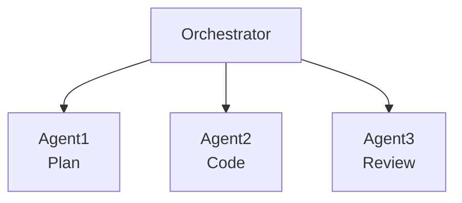
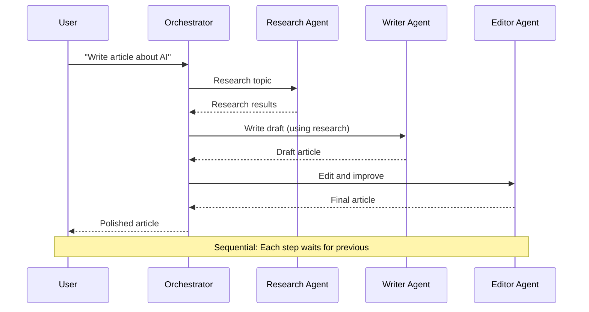
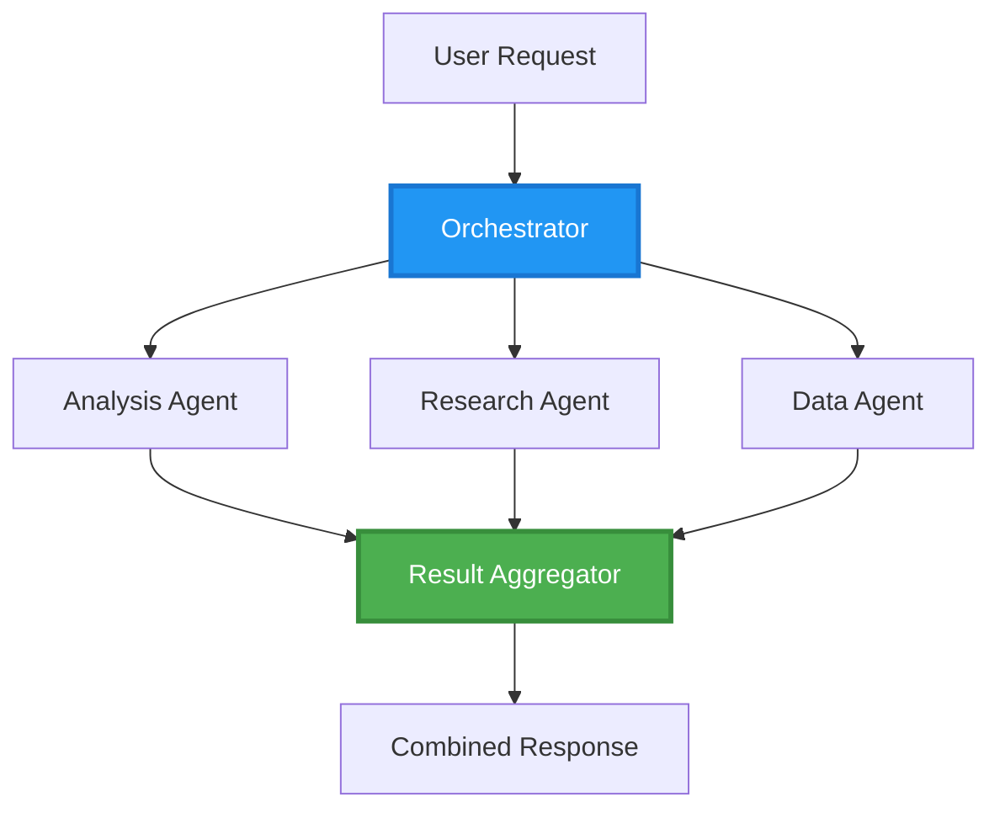
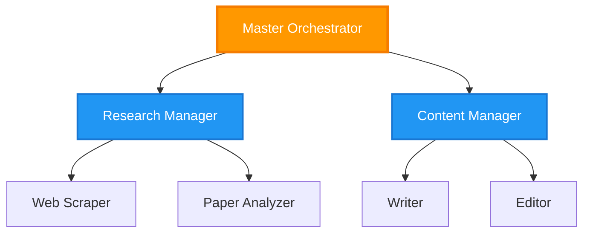
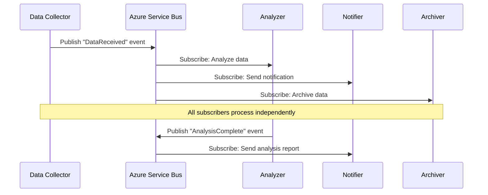
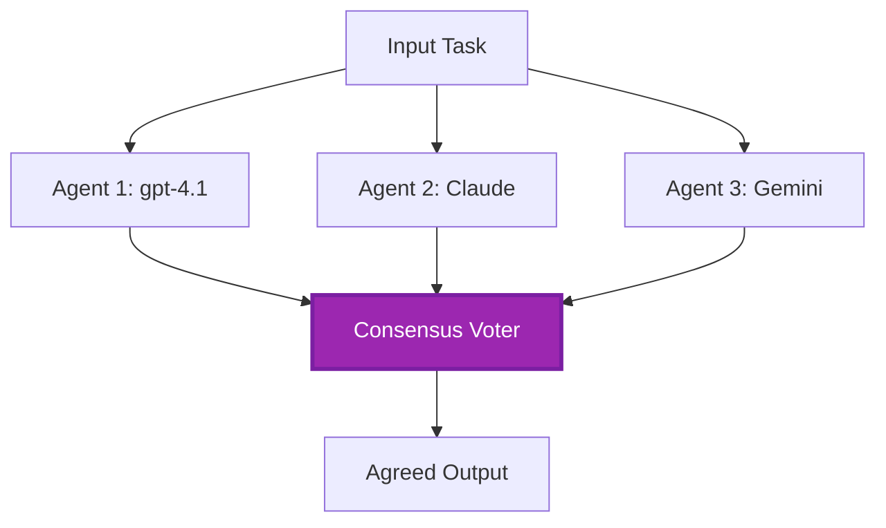
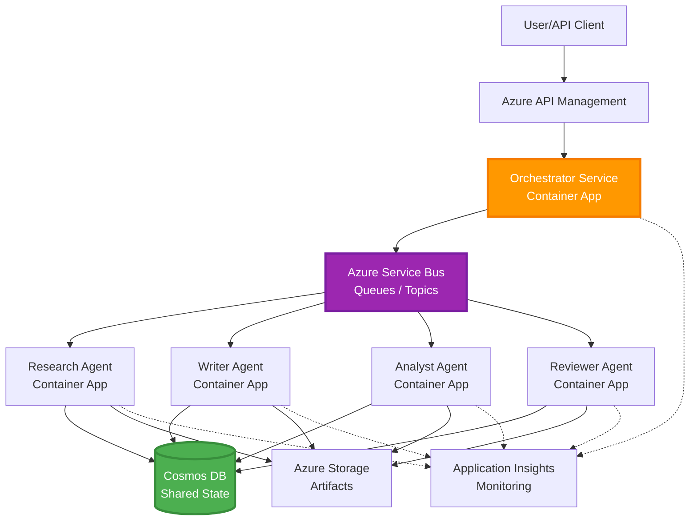

# မူလတန်းအေဂျင့်များ ကော်အပ် ကျင့်စဉ်များ

⏱️ **ခန့်မှန်းချိန်**: ၆၀-၇၅ မိနစ် ဖတ်ရှုရန်; တီထွင်ရန် အချိန် အနည်းငယ် | 💰 **ခန့်မှန်းကုန်ကျစရိတ်**: အလုပ်ပမာဏပေါ်မူတည် | ⭐ **ရှုပ်ထွေးမှု**: အဆင့်မြင့်

**📚 သင်ယူမှု လမ်းညွှန်:**
- ← ယခင်: [စွမ်းအားစီမံချက်](capacity-planning.md) - အရင်းအမြစ် အရွယ်အစားပြုခြင်းနှင့် အဆင့်မြှင့်မှု မဟာဗျူဟာများ
- 🎯 **သင် ရှိသည့်နေရာ**: မူလတန်းအေဂျင့် များ၏ ကော်အပ် ကျင့်စဉ်များ (စီမံခြင်း၊ ဆက်သွယ်ရေး၊ အခြေအနေ စီမံခန့်ခွဲမှု)
- → နောက်တစ်ခု: [SKU ရွေးချယ်ခြင်း](sku-selection.md) - မှန်ကန်သော Azure ဝန်ဆောင်မှုများကို ရွေးချယ်ခြင်း
- 🏠 [သင်တန်း မူလစာမျက်နှာ](../../README.md)

---

## သင် အောက်ပါကို သင်ယူ မည်

ဤသင်ခန်းစာ ဖြည့်ဆည်းပြီးနောက် သင်သည်
- **မူလတန်းအေဂျင့် ဖွဲ့စည်းပုံ** ကျင့်စဉ်များနှင့် ဘယ်အချိန်တွင် အသုံးပြုရမည်ကို နားလည်မည်
- **စီမံခြင်းကျင့်စဉ်များ** (အလယ်ခေါင်းစဉ်၊ အရေးပေါ်၊ အဆင့်မြင့်) ကို တည်ဆောက်မည်
- **အေဂျင့် ဆက်သွယ်ရေး** မဟာဗျူဟာများ (အချိန်တော်တည်း၊ အချိန်ကြာ, ဖြစ်စဉ်ချုပ်) တည်ဆောက်မည်
- ဖြန့်ဝေထားသော အေဂျင့်များအတွက် **မျှဝေထားသော အခြေအနေ** ကို စီမံခန့်ခွဲမည်
- AZD နှင့်အတူ **မူလတန်းအေဂျင့် စနစ်များ** ကို ပို့ဆောင်မည်
- လူကြီးမင်း၏ AI လက်တွေ့ဖြည်းဖြည်းမှုများအတွက် **ကော်အပ်ကျင့်စဉ်များ** ကို အသုံးပြုမည်
- ဖြန့်ဝေထားသော အေဂျင့်စနစ်များကို စောင့်ကြည့်၍ အဆင်ပြေအောင် ပြင်ဆင်မည်

## မူလတန်းအေဂျင့် ကော်အပ်မှု အရေးကြီးချက်

### တိုးတက်မှု: တစ်ခုတည်းအေဂျင့်မှ မူလတန်းအေဂျင့်ဆီသို့

**တစ်ဦးတည်းအေဂျင့် (ရိုးရိုး):**
```
User → Agent → Response
```
- ✅ နားလည်ရလွယ်ကူပြီး တည်ဆောက်ရလွယ်ကူသည်
- ✅ ရိုးရှင်းတဲ့ အလုပ်များအတွက် အမြန်ဖြစ်သည်
- ❌ တစ်ခုတည်း မော်ဒယ်၏ စွမ်းရည်ကန့်သတ်ချက်ရှိသည်
- ❌ ရှုပ်ထွေးသော အလုပ်များကို 병렬လုပ်ဆောင်၍ မရနိုင်ပါ
- ❌ အထူးပြုလုပ်မှု မရှိပါ

**မူလတန်းအေဂျင့် စနစ် (အဆင့်မြင့်):**

- ✅ အထူးပြုအေဂျင့်များခုခံထားသော အလုပ်များအတွက်
- ✅ အမြန်လုပ်ဆောင်ရန် 병렬 အလုပ်လုပ်နိုင်သည်
- ✅ မော်ဂျူးမြှောက်၍ ထိန်းသိမ်းရန် လွယ်ကူသည်
- ✅ ရှုပ်ထွေးသော လုပ်ငန်းစဉ်များအတွက် ကောင်းမွန်သည်
- ⚠️ ကော်အပ်ခြင်းဆိုင်ရာ ရေးရာများ လိုအပ်သည်

**တူညီချက်**: တစ်ဦးတည်းအေဂျင့်မှာ တစ်ဦးလူကိုယ်တိုင် အလုပ်အားလုံးသွားရာ။ မူလတန်းအေဂျင့်မှာ တစ်ဦးချင်းစွမ်းရည် အထူးပြုထားသော အဖွဲ့ (သုတေသနသူ၊ ကုဒ်ရေးသူ၊ သုံးသပ်သူ၊ စာရေးသူ) တစ်စုတစ်ဝေးလုပ်ကိုင်နေရာဖြစ်သည်။

---

## အခြေခံ ကော်အပ်ကျင့်စဉ်များ

### ကျင့်စဉ် ၁: တန်းလိုက် ကော်အပ်မှု (တာဝန်ဗျိုးဆက်)

**ဘယ်အချိန်အသုံးပြုမလဲ**: အလုပ်များအားတိကျသောအဆင့်လိုက်ပြီးဆုံးရန်၊ တစ်ဦးချင်းစီ အရင်အဆင့်၏ ထုတ်ကုန်ပေါ်တွင် တည်ဆောက်သည်။



**အားသာချက်များ:**
- ✅ အချက်အလက် လွှဲပြောင်းမှု ရှင်းလင်းသည်
- ✅ အမှားရှာဖွေရန် လွယ်ကူသည်
- ✅ ဆောင်ရွက်မှု အဆင့်စဉ် ကြိုတင်ခန့်မှန်းနိုင်သည်

**ကန့်သတ်ချက်များ:**
- ❌ အမြန်မဖြစ်နိုင် (병렬 မရှိ)
- ❌ တစ်ခုခု မအောင်မြင်ပါက တာ၀န်စဉ်တစ်လျှောက် လုပ်ငန်းများ ပိတ်မိသည်
- ❌ အချိုးကျမှုရှိသော အလုပ်များကို ကိုင်တွယ်၍ မရသည်

**ဥပမာ အသုံးပြုမှုများ:**
- အကြောင်းအရာ ဖန်တီးခြင်း လုပ်ငန်းစဉ် (သုတေသန → စာရေး → အည်းတည် → ဖြန့်ချိ)
- ကုဒ် ဖန်တီးမှု (အစီအစဉ် → အကောင်အထည် → စမ်းသပ် → ထုတ်လုပ်)
- အစီရင်ခံစာ ဖန်တီးမှု (ဒေတာ စုဆောင်း → စမ်းသပ် → ချမူ → အနှစ်ချုပ်)

---

### ကျင့်စဉ် ၂: 병렬 ကော်အပ်မှု (ပန်ထွက်/ပန်ဝင်)

**ဘယ်အချိန်အသုံးပြုမလဲ**: လွတ်လပ်သော အလုပ်များကို တပြိုင်နက် ထပ်တလဲလဲ ရန်၊ ရလဒ်များကို နောက်ဆုံးတွင် ပေါင်းစပ်ရန်။



**အားသာချက်များ:**
- ✅ အမြန်။ 병렬 လုပ်ဆောင်မှု
- ✅ အမှားခံနိုင်သည် (အစိတ်အပိုင်းရလဒ်များ လက်ခံနိုင်သည်)
- ✅ အလျားလိုက် ဆွဲချသော ရွေးချယ်မှုရှိသည်

**ကန့်သတ်ချက်များ:**
- ⚠️ ရလဒ်များ အစီအစဉ်မကျောက်နိုင်
- ⚠️ ပေါင်းစပ်ရေးရာ လိုအပ်သည်
- ⚠️ အခြေအနေ စီမံခန့်ခွဲမှု ခက်ခဲသည်

**ဥပမာ အသုံးပြုမှုများ:**
- အရင်းအမြစ်စုံမှ ဒေတာ စုဆောင်းမှု (API များ + ဒေတာဘေ့စ်များ + ဝဘ် စကရပ်)
- ယှဉ်ပြိုင်မှု သုတေသန (မော်ဒယ်များစွာက ဖြေရှင်းချက် ထုတ်လုပ်၍ အကောင်းဆုံး ရွေးချယ်)
- ဘာသာပြန် ဝန်ဆောင်မှုများ (ဘာသာစကားများစွာအတွက် တပြိုင်နက် ဘာသာပြန်)

---

### ကျင့်စဉ် ၃: အဆင့်တန်း ကော်အပ်မှု (မန်နေဂျာ-အလုပ်သမား)

**ဘယ်အချိန်အသုံးပြုမလဲ**: ရှုပ်ထွေးသော လုပ်ငန်းစဉ်များတွင် အခြားအလုပ်ငန်းများ ဝေဝါးဖွဲ့ရန် လိုအပ်သည်။



**အားသာချက်များ:**
- ✅ ရှုပ်ထွေးသော လုပ်ငန်းစဉ်များကို ကိုင်တွယ်နိုင်သည်
- ✅ မော်ဂျူးမြှောက်၍ ထိန်းသိမ်းမှု လွယ်ကူသည်
- ✅ တာဝန် ခွဲခြားမှုရှင်းလင်းသည်

**ကန့်သတ်ချက်များ:**
- ⚠️ အဆောက်အအုံ ပိုရှုပ်ထွေးသည်
- ⚠️ နှောင့်နှေးမှု ပိုရှိသည် (ကော်အပ်မှု အလွှာများ များသည်)
- ⚠️ အဆန်းတစ်တွေ့ရင် စီမံခန့်ခွဲမှုလိုအပ်သည်

**ဥပမာ အသုံးပြုမှုများ:**
- အဖြစ်မှန် စာရွက်စာတမ်း စီမံခန့်ခွဲမှု (အမျိုးအစားခွဲ → လမ်းညွှန် → ဆောင်ရွက် → သိုလှောင်)
- အဆင့်ရှည် ဒေတာ လုပ်ငန်းစဉ် (လက်ခံ → အဆင်း → ပြောင်း → စိစစ် → အစီရင်ခံ)
- ရှုပ်ထွေးသော အလိုအလျောက် လုပ်ငန်းစဉ်များ (အစီအစဉ် → အရင်းအမြစ် မျွှားပေးမှု → ဆောင်ရွက် → စောင့်ကြည့်)

---

### ကျင့်စဉ် ၄: ဖြစ်စဉ်အခြေခံ ကော်အပ်မှု (ဖော်ပြမှု-စာရင်းသွင်းမှု)

**ဘယ်အချိန်အသုံးပြုမလဲ**: အေဂျင့်များ ဖြစ်ပွားမှုများကိုတုံ့ပြန်ရန်လိုအပ်ပြီး၊ ဇွဲမဟုတ်သော ဆက်သွယ်မှုလိုအပ်သည်။



**အားသာချက်များ:**
- ✅ အေဂျင့်များအကြား ဇွဲမဟုတ်သော ဆက်သွယ်မှု
- ✅ အေဂျင့်အသစ် ထည့်ရန် လွယ်ကူသည် (စာရင်းသွင်းခြင်းဖြင့်)
- ✅ အချိန်ကြာ ညှိနှိုင်းမှု
- ✅ ခိုင်မာသော (စာတိုက်မြဲခြင်း)

**ကန့်သတ်ချက်များ:**
- ⚠️ နောက်ဆုံးတွင် တိကျမှု ရှိရန်လိုအပ်သည်
- ⚠️ အမှားရှာဖွေရေး အရမ်းခက်ခဲသည်
- ⚠️ စာတိုက်စီအစဉ် အခက်အခဲများ

**ဥပမာ အသုံးပြုမှုများ:**
- အချိန်နောက်ခံ စောင့်ကြည့်ရေး စနစ်များ (သတိပေးချက်များ၊ ပေါ်လာဖော်ပြမှုများ၊ မှတ်တမ်းများ)
- စနစ်များထဲမှ အကြောင်းကြားချက်များ (အီးမေလ်, SMS, push, Slack)
- ဒေတာ လုပ်ငန်းစဉ်များ (အချက်အလက်နှစ်သက်သူများစွာ)

---

### ကျင့်စဉ် ၅: သဘောတူညီမှုလေ့လာပုံ (မဲပေးခြင်း / ပါဝင်ခွင့်)

**ဘယ်အချိန်အသုံးပြုမလဲ**: ရှေ့ဆက်ရန် မမီမှီ သဘောတူညီမှု လိုအပ်သောအခါ။



**အားသာချက်များ:**
- ✅ တိကျမှု ပိုမိုမြင့်မား (ထောက်ခံချက်များစွာ)
- ✅ အမှားခံနိုင်မှု (ထူးခြားမှု မဖြစ်လျှင်လက်ခံနိုင်သည်)
- ✅ အရည်အသွေး အာမခံမှု ထည့်သွင်းထားသည်

**ကန့်သတ်ချက်များ:**
- ❌ တန်ဖိုးကြီး (မော်ဒယ်များစွာကို ခေါ်ယူရသည်)
- ❌ နှောင့်နှေး (အေဂျင့်အားလုံး စောင့်ရသည်)
- ⚠️ ညှိနှိုင်း ပြဿနာ မဖြေရှင်းနိုင်ရုံ

**ဥပမာ အသုံးပြုမှုများ:**
- အကြောင်းအရာ ပြုပြင်ခြင်း (မော်ဒယ်များစွာ ထောက်ဖြည့်သည်)
- ကုဒ် သုံးသပ်ခြင်း (လင့်တာများ/ခွဲခြမ်းဆန်းစစ်သူများစွာ)
- ဆေးဘက်ဆိုင်ရာ ရောဂါ ခွဲခြားခြင်း (AI မော်ဒယ်များစွာနှင့် ကျွမ်းကျင်သူ အတည်ပြုချက်)

---

## ဖွဲ့စည်းပုံ အနှစ်ချုပ်

### Azure ပေါ်တွင် အပြည့်အစုံ မူလတန်း အေဂျင့် စနစ်



**အဓိက အစိတ်အပိုင်းများ:**

| အစိတ်အပိုင်း | ရည်ရွယ်ချက် | Azure ဝန်ဆောင်မှု |
|-----------|---------|---------------|
| **API Gateway** | ဝင်ပေါက်၊ အမြန်နှုန်း ကန့်သတ်မှု၊ အတည်ပြုချက် | API Management |
| **Orchestrator** | အေဂျင့် လုပ်ငန်းစဉ်များ စီမံကိန်း | Container Apps |
| **Message Queue** | အချိန်ကြာ ဆက်သွယ်ရေး | Service Bus / Event Hubs |
| **Agents** | အထူးပြု AI အလုပ်သမားများ | Container Apps / Functions |
| **State Store** | မျှဝေထားသော အခြေအနေ၊ အလုပ် စောင့်ကြည့်မှု | Cosmos DB |
| **Artifact Storage** | စာတမ်းများ၊ ရလဒ်များ၊ မှတ်တမ်းများ | Blob Storage |
| **Monitoring** | ဖြန့်ဝေထားသော အခြေအနေ စောင့်ကြည့်မှု၊ မှတ်တမ်းများ | Application Insights |

Service Bus queues/topics နှင့် Event Hubs သည် တစ်ခုချင်းစီ၏ ပို့ဆောင်မှု/စားသုံးမှု မော်ဒယ် မတူကြပါ; Event Hubs သည် Service Bus အလုပ်သမားကုဒ်အတွက် အစားထိုး မဟုတ်ပါ။ 병렬လုပ်ဆောင်မှု၊ စာတိုက်မြဲမှုနှင့် မော်ဒယ် မဲပေးမှု တို့သည် ကိုယ်တိုင် အမှားခံနိုင်မှု သို့မဟုတ် တိကျမှုတိုးစေခြင်း မပေးပါ။

---

## မေ့မထားသည့်သီကောင်းချက်များ

### လိုအပ်သောကိရိယာများ

```bash
# Verify Azure Developer CLI
azd version
# Command reference baseline: azd 1.37.2

# Verify Azure CLI
az --version
# ✅ Expected: azure-cli 2.50.0 or higher

# Verify Docker (for local testing)
docker --version
# ✅ Expected: Docker version 20.10 or higher
```

### Azure လိုအပ်ချက်များ

- လုပ်ငန်းဆောင်ရွက်နေသော Azure စာရင်းသွင်းမရှိမဖြစ်လိုအပ်သည်
- ဖန်တီးခွင့်များရရန်:
  - Container Apps
  - Service Bus namespaces
  - Cosmos DB အကောင့်များ
  - Storage အကောင့်များ
  - Application Insights

### အသိပညာ လိုအပ်ချက်များ

သင်သည် အောက်ပါများ ပြီးစီးထားသင့်သည်
- [ဖွဲ့စည်းမှု စီမံခန့်ခွဲမှု](../chapter-03-configuration/configuration.md)
- [အကိုက်အခက်များနှင့် လုံခြုံရေး](../chapter-03-configuration/authsecurity.md)
- [Microservices ဥပမာ](../../../../examples/microservices)

---

## အကောင်အထည်ဖော်ခြင်း လမ်းညွှန်

> **ဒီဇိုင်း အပိုင်းများ ဖြစ်ပြီး တိုက်ရိုက် အသုံးပြုနိုင်မယ့် စမ်းသပ်ကြည့်ရန် မဟုတ်ပါ:** ယခု ပရောဂျက် ကြန့်ဆိုင်ရာ နှင့် `File:` အဖြစ် ဖိုင်များကို တည်ဆောက်ရန် ရည်ရွယ်ထားသည်၊ ဤသိုလှောင်ထားရာ မူလတန်း `multi-agent-system` အပြည့်အစုံ မပါဝင်ပါ။ ပျောက်နေတဲ့အပိုင်းများမှာ main/parameter တemplates, Container Apps ပတ်ဝန်းကျင်/ မှတ်ပုံတင်မှု, Dockerfiles နှင့် မှီခိုမှု Locks, Cosmos ဒေတာဘေ့စ်/ ကွန်တိနာများ စီစဉ်မှု, မော်ဒယ် တပ်ဆင်မှုများ, အထောက်အကူပြု Identity/Role ဖွဲ့စည်းမှု, အဆင့် မြှင့် စည်းမျဉ်းများ နှင့် 병렬 အလုပ်သမား/ပြားများ ပါဝင်သည်။ `azd init` သည် အဆိုပါ ဖိုင်များကို မထုတ်ပေးနိုင်ပါ၊ `azd up` သည် အပိုင်းများကို မပြောင်းလဲဘဲ တပ်ဆင်မည် မဟုတ်ပါ။ စမ်းသပ်လုပ်ဆောင်ရန် စတင်ရာအတွက် [Multi-Agent Basics](../chapter-05-multi-agent/multi-agent-basics.md) အပြီးသတ်ပါ။

**Runtime ကတိများ:** Python 3.10+, `azure-servicebus`, `azure-cosmos`, `openai`, Flask နှင့် (စောင့်ကြည့်မှုအတွက်) `azure-monitor-opentelemetry`; ၀န်ဆောင်မှုရုပ်ပုံတိုင်းတွင် `shared` ကို Python import လမ်းကြောင်း၌ ထည့်ပါ။ Cosmos `agent-state/tasks` ကွန်တိနာသည် `/id` partition key ဖြင့် ရှိပြီးသားဖြစ်ရမည်။ key-based ချိတ်ဆက်မှုများသည် ဤအပိုင်းများကို လွယ်ကူစေပြီး ထုတ်လုပ်မှု ညွှန်ကြားချက် မဟုတ်ပါ: Service Bus/Cosmos/OpenAI data-plane များအတွက် scoped managed identities ကို အသုံးပြုရန် ပိုမိုအဆင်ပြေသည်။ keys များကို output သို့မဟုတ် မှတ်တမ်းများတွင် မထုတ်ပြန်ပေးရ။ 

Service Bus ပို့ဆောင်မှုသည် **အနည်းဆုံးတစ်ကြိမ်** သေချာမှုရှိသည်။ taskနှင့် step တို့အလိုက် idempotency ကို ထိန်းသိမ်းပါ၊ optimistic concurrency (ETags) ဖြင့် state ကို ဖတ်/ပြောင်း/ရေးဆွဲ လုပ်ရပါမည်၊ နှင့် သတင်းစကားလှုပ်ရှားမှု တာရှည်ဖြစ်စဉ်မှာ message lock များကို ပြန်လည်ပြီးသေချာ စေပါ။ အောက်ပါ ရိုးရှင်းသော အခြေအနေစီမံသူမှာ ဖွဲ့စည်းရန်သာဖြစ်ပြီး ထုတ်လုပ်မှုအာမခံချက် မပါဝင်ပါ။

### ပရောဂျက် ဖွဲ့စည်းပုံ

```
multi-agent-system/
├── azure.yaml                    # AZD configuration
├── infra/
│   ├── main.bicep               # Main infrastructure
│   ├── core/
│   │   ├── servicebus.bicep     # Message queue
│   │   ├── cosmos.bicep         # State store
│   │   ├── storage.bicep        # Artifact storage
│   │   └── monitoring.bicep     # Application Insights
│   └── app/
│       ├── orchestrator.bicep   # Orchestrator service
│       └── agent.bicep          # Agent template
└── src/
    ├── orchestrator/            # Orchestration logic
    │   ├── app.py
    │   ├── workflows.py
    │   └── Dockerfile
    ├── agents/
    │   ├── research/            # Research agent
    │   ├── writer/              # Writer agent
    │   ├── analyst/             # Analyst agent
    │   └── reviewer/            # Reviewer agent
    └── shared/
        ├── state_manager.py     # Shared state logic
        └── message_handler.py   # Message handling
```

---

## သင်ခန်းစာ ၁: တန်းလိုက် ကော်အပ်မှု ကျင့်စဉ်

### လုပ်ဆောင်မှု: အကြောင်းအရာ ဖန်တီးမှု လုပ်ငန်းစဉ်

တန်းလိုက် လုပ်ငန်းစဉ် တစ်ခုဒီဇိုင်းဆွဲပါ: သုတေသန → စာရေး → အည်းတည်။ ထုတ်လုပ်ခြင်းက ဤဥပမာထဲ မပါဝင်ပါ။

### ၁. AZD ဖွဲ့စည်းမှု

**ဖိုင်: `azure.yaml`**

```yaml
name: content-pipeline
metadata:
  template: multi-agent-sequential@1.0.0

services:
  orchestrator:
    project: ./src/orchestrator
    language: python
    host: containerapp
  
  research-agent:
    project: ./src/agents/research
    language: python
    host: containerapp
  
  writer-agent:
    project: ./src/agents/writer
    language: python
    host: containerapp
  
  editor-agent:
    project: ./src/agents/editor
    language: python
    host: containerapp
```

### ၂. အင်ဖရာ: ကော်အပ်မှုအတွက် Service Bus

**ဖိုင်: `infra/core/servicebus.bicep`**

```bicep
param name string
param location string
param tags object = {}

resource serviceBusNamespace 'Microsoft.ServiceBus/namespaces@2022-10-01-preview' = {
  name: name
  location: location
  tags: tags
  sku: {
    name: 'Standard'
    tier: 'Standard'
  }
  properties: {
    minimumTlsVersion: '1.2'
  }
}

// Queue for orchestrator → research agent
resource researchQueue 'Microsoft.ServiceBus/namespaces/queues@2022-10-01-preview' = {
  parent: serviceBusNamespace
  name: 'research-tasks'
  properties: {
    maxDeliveryCount: 3
    lockDuration: 'PT5M'
    deadLetteringOnMessageExpiration: true
  }
}

// Queue for research agent → writer agent
resource writerQueue 'Microsoft.ServiceBus/namespaces/queues@2022-10-01-preview' = {
  parent: serviceBusNamespace
  name: 'writer-tasks'
  properties: {
    maxDeliveryCount: 3
    lockDuration: 'PT5M'
  }
}

// Queue for writer agent → editor agent
resource editorQueue 'Microsoft.ServiceBus/namespaces/queues@2022-10-01-preview' = {
  parent: serviceBusNamespace
  name: 'editor-tasks'
  properties: {
    maxDeliveryCount: 3
    lockDuration: 'PT5M'
  }
}

output namespace string = serviceBusNamespace.name
// Do not output RootManageSharedAccessKey. Resolve scoped credentials
// securely or use managed identity in the application and scale rules.
```

### ၃. မျှဝေထားသော အခြေအနေ စီမံခန့်ခွဲသူ

**ဖိုင်: `src/shared/state_manager.py`**

```python
from azure.cosmos import CosmosClient, PartitionKey
from datetime import datetime, timezone
import os

class StateManager:
    """Manages shared state across agents using Cosmos DB"""
    
    def __init__(self):
        endpoint = os.environ['COSMOS_ENDPOINT']
        key = os.environ['COSMOS_KEY']
        
        self.client = CosmosClient(endpoint, key)
        self.database = self.client.get_database_client('agent-state')
        self.container = self.database.get_container_client('tasks')
    
    def create_task(self, task_id: str, task_type: str, input_data: dict):
        """Create a new task"""
        task = {
            'id': task_id,
            'type': task_type,
            'status': 'pending',
            'input': input_data,
            'created_at': datetime.now(timezone.utc).isoformat(),
            'steps': []
        }
        self.container.create_item(task)
        return task
    
    def update_task_step(self, task_id: str, step_name: str, result: dict):
        """Update task with completed step"""
        task = self.container.read_item(task_id, partition_key=task_id)
        
        task['steps'].append({
            'name': step_name,
            'completed_at': datetime.now(timezone.utc).isoformat(),
            'result': result
        })
        
        self.container.replace_item(task_id, task)
        return task
    
    def complete_task(self, task_id: str, final_result: dict):
        """Mark task as complete"""
        task = self.container.read_item(task_id, partition_key=task_id)
        task['status'] = 'completed'
        task['result'] = final_result
        task['completed_at'] = datetime.now(timezone.utc).isoformat()
        self.container.replace_item(task_id, task)
        return task
    
    def get_task(self, task_id: str):
        """Retrieve task state"""
        return self.container.read_item(task_id, partition_key=task_id)
```

### ၄. စီမံခန့်ခွဲသူ ဝန်ဆောင်မှု

**ဖိုင်: `src/orchestrator/app.py`**

```python
from flask import Flask, request, jsonify
from azure.servicebus import ServiceBusClient, ServiceBusMessage
import json
import uuid
import os
from shared.state_manager import StateManager

app = Flask(__name__)
state_manager = StateManager()

# Service Bus connection
servicebus_connection_str = os.environ['SERVICEBUS_CONNECTION_STRING']
servicebus_client = ServiceBusClient.from_connection_string(servicebus_connection_str)

@app.route('/health', methods=['GET'])
def health():
    return jsonify({'status': 'healthy', 'service': 'orchestrator'})

@app.route('/create-content', methods=['POST'])
def create_content():
    """
    Sequential workflow: Research → Write → Edit (returns a draft; no publishing)
    """
    data = request.get_json(silent=True) or {}
    topic = data.get('topic')
    
    if not topic:
        return jsonify({'error': 'Topic required'}), 400
    
    # Create task in state store
    task_id = str(uuid.uuid4())
    task = state_manager.create_task(
        task_id=task_id,
        task_type='content_creation',
        input_data={'topic': topic}
    )
    
    # Send message to research agent (first step)
    sender = servicebus_client.get_queue_sender('research-tasks')
    message = ServiceBusMessage(
        body=json.dumps({
            'task_id': task_id,
            'topic': topic,
            'next_queue': 'writer-tasks'  # Where to send results
        }),
        content_type='application/json'
    )
    
    with sender:
        sender.send_messages(message)
    
    return jsonify({
        'task_id': task_id,
        'status': 'started',
        'workflow': 'sequential',
        'steps': ['research', 'write', 'edit'],
        'message': 'Content creation pipeline initiated'
    }), 202

@app.route('/task/<task_id>', methods=['GET'])
def get_task_status(task_id):
    """Check task status"""
    try:
        task = state_manager.get_task(task_id)
        return jsonify(task)
    except Exception as e:
        return jsonify({'error': str(e)}), 404

if __name__ == '__main__':
    app.run(host='0.0.0.0', port=8080)
```

### ၅. သုတေသန အေဂျင့်

**ဖိုင်: `src/agents/research/app.py`**

```python
from azure.servicebus import ServiceBusClient, ServiceBusMessage
from openai import AzureOpenAI
import json
import os
import time
from shared.state_manager import StateManager

# Initialize clients
state_manager = StateManager()
servicebus_client = ServiceBusClient.from_connection_string(
    os.environ['SERVICEBUS_CONNECTION_STRING']
)

openai_client = AzureOpenAI(
    api_key=os.environ['AZURE_OPENAI_API_KEY'],
    api_version="2024-10-21",
    azure_endpoint=os.environ['AZURE_OPENAI_ENDPOINT']
)

def process_research_task(message_data):
    """Process research request and pass to writer"""
    task_id = message_data['task_id']
    topic = message_data['topic']
    next_queue = message_data['next_queue']
    
    print(f"🔬 Researching: {topic}")
    
    # Call Microsoft Foundry Models for research
    response = openai_client.chat.completions.create(
        model=os.environ['AZURE_OPENAI_DEPLOYMENT'],
        messages=[
            {"role": "system", "content": "You are a research assistant. Provide comprehensive research on the given topic."},
            {"role": "user", "content": f"Research this topic thoroughly: {topic}"}
        ],
        max_tokens=1500
    )
    
    research_results = response.choices[0].message.content
    
    # Update state
    state_manager.update_task_step(
        task_id=task_id,
        step_name='research',
        result={'research': research_results}
    )
    
    # Send to next agent (writer)
    sender = servicebus_client.get_queue_sender(next_queue)
    message = ServiceBusMessage(
        body=json.dumps({
            'task_id': task_id,
            'topic': topic,
            'research': research_results,
            'next_queue': 'editor-tasks'
        }),
        content_type='application/json'
    )
    
    with sender:
        sender.send_messages(message)
    
    print(f"✅ Research complete for task {task_id}")

def main():
    """Listen to research queue"""
    receiver = servicebus_client.get_queue_receiver('research-tasks')
    
    print("🔬 Research Agent started, listening for tasks...")
    
    with receiver:
        while True:
            messages = receiver.receive_messages(max_wait_time=5)
            for message in messages:
                try:
                    message_data = json.loads(str(message))
                    process_research_task(message_data)
                    receiver.complete_message(message)
                except Exception as e:
                    print(f"❌ Error processing message: {e}")
                    receiver.abandon_message(message)

if __name__ == '__main__':
    main()
```

### ၆. စာရေး အေဂျင့်

**ဖိုင်: `src/agents/writer/app.py`**

```python
from azure.servicebus import ServiceBusClient, ServiceBusMessage
from openai import AzureOpenAI
import json
import os
from shared.state_manager import StateManager

state_manager = StateManager()
servicebus_client = ServiceBusClient.from_connection_string(
    os.environ['SERVICEBUS_CONNECTION_STRING']
)

openai_client = AzureOpenAI(
    api_key=os.environ['AZURE_OPENAI_API_KEY'],
    api_version="2024-10-21",
    azure_endpoint=os.environ['AZURE_OPENAI_ENDPOINT']
)

def process_writing_task(message_data):
    """Write article based on research"""
    task_id = message_data['task_id']
    topic = message_data['topic']
    research = message_data['research']
    next_queue = message_data['next_queue']
    
    print(f"✍️ Writing article: {topic}")
    
    # Call Microsoft Foundry Models to write article
    response = openai_client.chat.completions.create(
        model=os.environ['AZURE_OPENAI_DEPLOYMENT'],
        messages=[
            {"role": "system", "content": "You are a professional writer. Write engaging, well-structured articles."},
            {"role": "user", "content": f"Based on this research:\n\n{research}\n\nWrite a comprehensive article about: {topic}"}
        ],
        max_tokens=2000
    )
    
    article_draft = response.choices[0].message.content
    
    # Update state
    state_manager.update_task_step(
        task_id=task_id,
        step_name='writing',
        result={'draft': article_draft}
    )
    
    # Send to editor
    sender = servicebus_client.get_queue_sender(next_queue)
    message = ServiceBusMessage(
        body=json.dumps({
            'task_id': task_id,
            'topic': topic,
            'draft': article_draft
        }),
        content_type='application/json'
    )
    
    with sender:
        sender.send_messages(message)
    
    print(f"✅ Article draft complete for task {task_id}")

def main():
    """Listen to writer queue"""
    receiver = servicebus_client.get_queue_receiver('writer-tasks')
    
    print("✍️ Writer Agent started, listening for tasks...")
    
    with receiver:
        while True:
            messages = receiver.receive_messages(max_wait_time=5)
            for message in messages:
                try:
                    message_data = json.loads(str(message))
                    process_writing_task(message_data)
                    receiver.complete_message(message)
                except Exception as e:
                    print(f"❌ Error: {e}")
                    receiver.abandon_message(message)

if __name__ == '__main__':
    main()
```

### ၇. အည်းတည် အေဂျင့်

**ဖိုင်: `src/agents/editor/app.py`**

```python
from azure.servicebus import ServiceBusClient
from openai import AzureOpenAI
import json
import os
from shared.state_manager import StateManager

state_manager = StateManager()
servicebus_client = ServiceBusClient.from_connection_string(
    os.environ['SERVICEBUS_CONNECTION_STRING']
)

openai_client = AzureOpenAI(
    api_key=os.environ['AZURE_OPENAI_API_KEY'],
    api_version="2024-10-21",
    azure_endpoint=os.environ['AZURE_OPENAI_ENDPOINT']
)

def process_editing_task(message_data):
    """Edit and finalize article"""
    task_id = message_data['task_id']
    topic = message_data['topic']
    draft = message_data['draft']
    
    print(f"📝 Editing article: {topic}")
    
    # Call Microsoft Foundry Models to edit
    response = openai_client.chat.completions.create(
        model=os.environ['AZURE_OPENAI_DEPLOYMENT'],
        messages=[
            {"role": "system", "content": "You are an expert editor. Improve grammar, clarity, and structure."},
            {"role": "user", "content": f"Edit and improve this article:\n\n{draft}"}
        ],
        max_tokens=2000
    )
    
    final_article = response.choices[0].message.content
    
    # Mark task as complete
    state_manager.complete_task(
        task_id=task_id,
        final_result={
            'topic': topic,
            'final_article': final_article,
            'word_count': len(final_article.split())
        }
    )
    
    print(f"✅ Article finalized for task {task_id}")

def main():
    """Listen to editor queue"""
    receiver = servicebus_client.get_queue_receiver('editor-tasks')
    
    print("📝 Editor Agent started, listening for tasks...")
    
    with receiver:
        while True:
            messages = receiver.receive_messages(max_wait_time=5)
            for message in messages:
                try:
                    message_data = json.loads(str(message))
                    process_editing_task(message_data)
                    receiver.complete_message(message)
                except Exception as e:
                    print(f"❌ Error: {e}")
                    receiver.abandon_message(message)

if __name__ == '__main__':
    main()
```

### ၈. တပ်ဆင်ပြီး စမ်းသပ်ခြင်း

၎င်း အမိန့်မှာ **သင် မသိမ်းဆည်းထားသော ပရောဂျက် ဖိုင်များကို တည်ဆောက်ပြီးနောက်** မှာသာ အသုံးပြုနိုင်သည်။ Interactive Foundry အေဂျင့် စတင်ခြင်းက သီးကွဲသော လုပ်ငန်းစဉ်ဖြစ်ပြီး ဤ Service Bus ဒီဇိုင်းကို မထုတ်ပေးပါ။

```bash
# In your completed custom project
azd up

# Alternative in a SEPARATE empty folder (agents beta.23 requires azd >= 1.37)
azd extension install azure.ai.agents
azd ai agent init
azd up
```

> မှတ်ချက်အတွက် [AZD AI CLI Command များ](../chapter-08-production/production-ai-practices.md#azd-ai-cli-commands-and-extensions) ကိုကြည့်ပါ၊ `azd ai` အားလုံး၏ စက်ထားချက်များနှင့် ရွေးချယ်စရာများ။

```bash
# Get orchestrator URL
ORCHESTRATOR_URL=$(azd env get-values | grep ORCHESTRATOR_URL | cut -d '=' -f2 | tr -d '"')

# Create content
curl -X POST $ORCHESTRATOR_URL/create-content \
  -H "Content-Type: application/json" \
  -d '{"topic": "The Future of AI in Healthcare"}'
```

**✅ မျှော်မှန်းထားသော output:**
```json
{
  "task_id": "a1b2c3d4-e5f6-7890-abcd-ef1234567890",
  "status": "started",
  "workflow": "sequential",
  "steps": ["research", "write", "edit"],
  "message": "Content creation pipeline initiated"
}
```

**အလုပ်တိုးတက်မှု စစ်ဆေးရန်:**
```bash
TASK_ID="a1b2c3d4-e5f6-7890-abcd-ef1234567890"
curl $ORCHESTRATOR_URL/task/$TASK_ID
```

**✅ မျှော်မှန်းထားသော output (ပြီးဆုံးပြီး):**
```json
{
  "id": "a1b2c3d4-e5f6-7890-abcd-ef1234567890",
  "type": "content_creation",
  "status": "completed",
  "steps": [
    {
      "name": "research",
      "completed_at": "2025-11-19T10:30:00Z",
      "result": {"research": "..."}
    },
    {
      "name": "writing",
      "completed_at": "2025-11-19T10:32:00Z",
      "result": {"draft": "..."}
    }
  ],
  "result": {
    "topic": "The Future of AI in Healthcare",
    "final_article": "...",
    "word_count": 1500
  }
}
```

---

## သင်ခန်းစာ 2: 병렬 조정 패턴 (Parallel Coordination Pattern)

### အကောင်အထည်ဖော်ခြင်း: အရင်းအမြစ်များစွာမှ သုတေသန စုစည်းသူ

မျိုးစုံသောအရင်းအမြစ်များမှ အချက်အလက်များကို တပြိုင်နက်တည်း စုဆောင်းသည့် 병렬စနစ်တစ်ခု တည်ဆောက်ကြစို့။

### 병렬 조정 기관 (Parallel Orchestrator)

**ဖိုင်: `src/orchestrator/parallel_workflow.py`**

```python
from flask import Flask, request, jsonify
from azure.servicebus import ServiceBusClient, ServiceBusMessage
import json
import uuid
import os
from shared.state_manager import StateManager

app = Flask(__name__)
state_manager = StateManager()

servicebus_client = ServiceBusClient.from_connection_string(
    os.environ['SERVICEBUS_CONNECTION_STRING']
)

@app.route('/research-parallel', methods=['POST'])
def research_parallel():
    """
    Parallel workflow: Multiple agents work simultaneously
    """
    data = request.json
    query = data.get('query')
    
    task_id = str(uuid.uuid4())
    task = state_manager.create_task(
        task_id=task_id,
        task_type='parallel_research',
        input_data={
            'query': query,
            'agents': ['web', 'academic', 'news', 'social']
        }
    )
    
    # Fan-out: publish sequentially; workers may process concurrently.
    agents = [
        ('web-research-queue', 'web'),
        ('academic-research-queue', 'academic'),
        ('news-research-queue', 'news'),
        ('social-research-queue', 'social')
    ]
    
    for queue_name, agent_type in agents:
        sender = servicebus_client.get_queue_sender(queue_name)
        message = ServiceBusMessage(
            body=json.dumps({
                'task_id': task_id,
                'query': query,
                'agent_type': agent_type,
                'result_queue': 'aggregation-queue'
            }),
            content_type='application/json'
        )
        
        with sender:
            sender.send_messages(message)
    
    return jsonify({
        'task_id': task_id,
        'status': 'started',
        'workflow': 'parallel',
        'agents_dispatched': 4,
        'message': 'Parallel research initiated'
    }), 202

if __name__ == '__main__':
    app.run(host='0.0.0.0', port=8080)
```

### စုပေါင်းမှု လုပ်ငန်းစဉ်

**ဖိုင်: `src/agents/aggregator/app.py`**

```python
from azure.servicebus import ServiceBusClient
import json
import os
from collections import defaultdict
from shared.state_manager import StateManager

state_manager = StateManager()
servicebus_client = ServiceBusClient.from_connection_string(
    os.environ['SERVICEBUS_CONNECTION_STRING']
)

# Single-process demo only: not durable or shared across replicas.
# Production: use durable unique (task_id, agent_type) result records.
task_results = defaultdict(dict)
expected_agents = 4  # web, academic, news, social

def process_result(message_data):
    """Aggregate results from parallel agents"""
    task_id = message_data['task_id']
    agent_type = message_data['agent_type']
    result = message_data['result']
    
    # Store result
    task_results[task_id][agent_type] = {
        'agent': agent_type,
        'data': result
    }
    
    print(f"📊 Received result from {agent_type} agent ({len(task_results[task_id])}/{expected_agents})")
    
    # Check if all agents completed (fan-in)
    if len(task_results[task_id]) == expected_agents:
        print(f"✅ All agents completed for task {task_id}. Aggregating...")
        
        # Combine results
        aggregated = {
            'query': message_data['query'],
            'sources': list(task_results[task_id].values()),
            'summary': generate_summary(list(task_results[task_id].values()))
        }
        
        # Mark complete
        state_manager.complete_task(task_id, aggregated)
        
        # Clean up
        del task_results[task_id]
        
        print(f"✅ Aggregation complete for task {task_id}")

def generate_summary(results):
    """Generate summary from all sources"""
    summaries = [r['data'].get('summary', '') for r in results]
    return '\n\n'.join(summaries)

def main():
    """Listen to aggregation queue"""
    receiver = servicebus_client.get_queue_receiver('aggregation-queue')
    
    print("📊 Aggregator started, listening for results...")
    
    with receiver:
        while True:
            messages = receiver.receive_messages(max_wait_time=5)
            for message in messages:
                try:
                    message_data = json.loads(str(message))
                    process_result(message_data)
                    receiver.complete_message(message)
                except Exception as e:
                    print(f"❌ Error: {e}")
                    receiver.abandon_message(message)

if __name__ == '__main__':
    main()
```

**တန်းတူ မျဉ်းစာ၏ အကျိုးကျေးဇူးများ -**
- ⚡ **လျော့နည်းနိုင်သော ကန့်လန့်ချိန်** (အဆိုးဆုံး သမားအလုပ်သမားနှင့် သဟဇာတမှုဆိုင်ရာ ကုန်ကျစရိတ်တို့ဖြင့် ကန့်သတ်ထားသည်)
- 🔄 **အစိတ်အပိုင်း ရလဒ်များကို ထောက်ပံ့နိုင်သည်** ပြီးဆုံးချိန်နှင့် မအောင်မြင်မှု မူဝါဒတို့ကို သတ်မှတ်ထား၍ (အခြေခံ စုစည်းသူက ချမှတ်ထားသည့် မဟုတ်)
- 📈 **မတန်ခါမှုရှိသည်** (အေးဂျင့်များ ပေါင်းထည့်ရန် လွယ်ကူသည်)

---

## လက်တွေ့ လေ့ကျင့်မှုများ

### လေ့ကျင့်ခန်း ၁: Timeout ကိုင်တွယ်မှု ထည့်သွင်းခြင်း ⭐⭐ (အလယ်အလတ်)

**ရည်မှန်းချက်**: Aggregator သည် အလွန်ပျင်းရိသမျှ အေးဂျင့်များအတွက် အမြဲစောင့်မည် မဟုတ်ဘဲ Timeout မွတ်ရန် စနစ်ထည့်သွင်းရန်။

**စတင်ချက်**: ဒီ ဒေသခံ ပြီးဆုံးချိန် သဘောတူညီမှုကို queue worker ထဲသို့ ပေါင်းသင်းမတိုင်မီ ပြေးကြည့်ပါ။ အခြားသတင်းစကား တစ်ခု ရောက်လာတဲ့အခါမှသာ Timeout စစ်ဆေးသည်မှာ ပျောက်ဆုံးထားသော worker ထံမှ မည်သည့်သတင်းမပေးလျှင် မလည်ပတ်ပါ။

**အဆင့်များ**:

1. **Aggregator သို့ Timeout ချိန် ဂရုစိုက်မှု ထည့်ပါ**:

```python
import asyncio

async def simulated_agent(name, delay):
    await asyncio.sleep(delay)
    return {'agent': name, 'result': 'done'}

async def main():
    tasks = [asyncio.create_task(simulated_agent(name, delay))
             for name, delay in [('web', 0.1), ('academic', 0.2),
                                 ('news', 0.3), ('social', 3)]]
    done, pending = await asyncio.wait(tasks, timeout=1)
    results = [task.result() for task in done]
    for task in pending:
        task.cancel()
    await asyncio.gather(*pending, return_exceptions=True)
    print({'completed_agents': len(results), 'timed_out': bool(pending)})
    assert len(results) == 3 and pending

asyncio.run(main())
```

2. **မျှော်မှန်းရလဒ်**:

```text
{'completed_agents': 3, 'timed_out': True}
```

3. **Queue-system ပေါင်းစည်းမှု (ဒီဇိုင်းအလုပ်):** တာဝန်ဖန်တီးစဉ်တွင် ပို့ဆောင်စောင့်မှတ်ချိန်နှင့် မျှော်လင့်ထားသော အေးဂျင့်များကို မြဲမြံစွာ သိမ်းဆည်းပါ၊ ရလာဒ်များ ဝင်ရောက်မှု မဟုတ်ဘဲ သတ်မှတ်ချိန်အား ပုံမှန် စစ်ဆေးပါ၊ အပိုင်းအစ ရလဒ်များကို အတူတကွ ပြီးစီးအောင် ဆောင်ရွက်ပါ၊ နောက်ကျ/ တူညီသော မက်ဆေ့များကို ပြီးစီးပြီးသော တာဝန်များအတွက် ဂရုမထားပါနှင့်။ ဒေသတွင်း အချိန်ကုန် သတ်မှတ်ချက်သည် ရှေ့နေ ဝန်ထမ်းများကို ပယ်ဖျက်ခြင်း မလုပ်ပါ။

သင့်မှ ဆောင်ရွက်ထားသော ပရောဂျက်အတွက်သာ:

```bash
azd deploy aggregator

# Submit task
curl -X POST $ORCHESTRATOR_URL/research-parallel \
  -H "Content-Type: application/json" \
  -d '{"query": "AI safety research"}'

# Check results after 30 seconds
curl $ORCHESTRATOR_URL/task/$TASK_ID
```

**✅ အောင်မြင်မှု မီတာများ:**
- ✅ ဒေသတွင်း စမ်းသပ်မှုသည် တစ်စက္ကန့် သတ်မှတ်ချိန် အပြီးတွင် ဖြတ်သန်းပြီး မျှော်လင့်ထားသော အေးဂျင့် မပြီးစီးပါကလည်း ပြန်လာသည်
- ✅ တုံ့ပြန်ချက်သည် အပိုင်းအစ ရလဒ်များကို ပြသသည် (`"timed_out": true`)
- ✅ ရနိုင်သော ရလဒ်များ ပြန်ပေးသည် (အေးဂျင့် ၄ ဦးထဲမှ ၃ ဦး)

**အချိန်**: ၂၀-၂၅ မိနစ်

---

### အာဆိုက် ၂: Retry Logic ကို အကောင်အထည်ဖော်ပါ ⭐⭐⭐ (ရှုပ်ထွေး)

**ရည်ရွယ်ချက်**: မအောင်မြင်သော အေးဂျင့် တာဝန်များကို အလိုအလျောက် ပြန်ကြိုးစားပါ။

**ခြေလှမ်းများ**:

1. **ပြန်လည်တိမ်းခြင်း မရည်ရွယ်သော custom retry Counters များအစား Service Bus ပို့ဆောင်မှု အရေအတွက်များကို သုံးပါ:**

```python
import json
import time
# Integration fragment: use a live peek-lock ServiceBusReceiver.
# Set queue maxDeliveryCount to 4 for one attempt + up to three retries.
```

2. **အေးဂျင့်များထဲသို့ retry handler ချိတ်ဆက်ပါ:**

```python
def process_with_retry(message, receiver, process_func):
    """Process message with automatic retry on failure"""
    try:
        message_data = json.loads(str(message))
        
        # Process the message
        process_func(message_data)
        
        # Success - complete
        receiver.complete_message(message)
        
    except Exception as e:
        if message.delivery_count < 4:
            # Bounded exponential delay: 5s, 10s, 20s.
            # Renew the lock if processing + waiting can exceed its duration.
            time.sleep(5 * 2 ** (message.delivery_count - 1))
            receiver.abandon_message(message)
        else:
            # Max retries exceeded - move to dead letter queue
            print(f"❌ Max attempts exceeded for message {message.message_id}")
            receiver.dead_letter_message(
                message,
                reason="MaxRetriesExceeded",
                error_description=str(e)
            )
```

3. **dead letter queue ကို စောင့်ကြည့်ပါ:**

```python
def monitor_dead_letters():
    """Check dead letter queue for failed messages"""
    receiver = servicebus_client.get_queue_receiver(
        'research-tasks',
        sub_queue='deadletter'
    )
    
    with receiver:
        messages = receiver.receive_messages(max_wait_time=5)
        for message in messages:
            print(f"☠️ Dead letter: {message.message_id}")
            print(f"Reason: {message.dead_letter_reason}")
            print(f"Description: {message.dead_letter_error_description}")
```

**✅ အောင်မြင်မှု မီတာများ:**
- ✅ မအောင်မြင်သော တာဝန်များကို အလိုအလျောက် retry လုပ်သည် (အကြိမ် ၃ ကြိမ်အထိ)
- ✅ retry အကြား exponential backoff ရှိသည် (၅စက္ကန့်၊ ၁၀စက္ကန့်၊ ၂၀စက္ကန့်)၊ မက်ဆေ့ ဂရုစိုက်မှု ထပ်မံသတ်မှတ်ခြင်းနှင့်အတူ
- ✅ retry အမြောက်ဆုံးတွင် မက်ဆေ့များသည် dead letter queue သို့သွားသည်
- ✅ dead letter မက်ဆေ့များကို စစ်ဆေးနိုင်ပြီး replay လုပ်ရန် သီးခြား idempotent ပြန်လည်ရယူခြင်း စနစ် လိုအပ်သည်

**အချိန်**: ၃၀-၄၀ မိနစ်

---

### အာဆိုက် ၃: Circuit Breaker ကို အကောင်အထည်ဖော်ပါ ⭐⭐⭐ (ရှုပ်ထွေး)

**ရည်ရွယ်ချက်**: ပျက်စီးနေသော အေးဂျင့်များသို့ တောင်းဆိုမှုများကို ရပ်တန့်ခြင်းမှတဆင့် ပျက်စီးမှု စီးဆင်းခြင်းကို ကာကွယ်ပါ။

**ခြေလှမ်းများ**:

1. **စကာကဒီသာမြန်းအတန်းဖန်တီးပါ။**

```python
from enum import Enum
from datetime import datetime, timedelta, timezone

class CircuitState(Enum):
    CLOSED = "closed"      # Normal operation
    OPEN = "open"          # Failing, reject requests
    HALF_OPEN = "half_open"  # Testing if recovered

class CircuitBreaker:
    def __init__(self, failure_threshold=5, timeout_seconds=60):
        self.failure_threshold = failure_threshold
        self.timeout_seconds = timeout_seconds
        self.failure_count = 0
        self.last_failure_time = None
        self.state = CircuitState.CLOSED
    
    def call(self, func):
        """Execute function with circuit breaker protection"""
        if self.state == CircuitState.OPEN:
            # Check if timeout expired
            if datetime.now(timezone.utc) - self.last_failure_time > timedelta(seconds=self.timeout_seconds):
                self.state = CircuitState.HALF_OPEN
                print("🔄 Circuit breaker: HALF_OPEN (testing)")
            else:
                raise Exception(f"Circuit breaker OPEN for agent. Try again in {self.timeout_seconds}s")
        
        try:
            result = func()
            
            # Success
            self.failure_count = 0 # Count consecutive failures only
            if self.state == CircuitState.HALF_OPEN:
                self.state = CircuitState.CLOSED
                self.failure_count = 0
                print("✅ Circuit breaker: CLOSED (recovered)")
            
            return result
            
        except Exception as e:
            self.failure_count += 1
            self.last_failure_time = datetime.now(timezone.utc)
            
            if self.failure_count >= self.failure_threshold:
                self.state = CircuitState.OPEN
                print(f"🔴 Circuit breaker: OPEN (too many failures)")
            
            raise
```

2။ **အေးဂျင့်ခေါ်ဆိုမှုများတွင် အကောင်အထည်ဖော်ပါ။**

```python
# In orchestrator
agent_circuits = {
    'web': CircuitBreaker(failure_threshold=5, timeout_seconds=60),
    'academic': CircuitBreaker(failure_threshold=5, timeout_seconds=60),
    'news': CircuitBreaker(failure_threshold=5, timeout_seconds=60),
    'social': CircuitBreaker(failure_threshold=5, timeout_seconds=60)
}

def send_to_agent(agent_type, message_data):
    """Send with circuit breaker protection"""
    circuit = agent_circuits[agent_type]
    
    try:
        circuit.call(lambda: send_message(agent_type, message_data))
    except Exception as e:
        print(f"⚠️ Skipping {agent_type} agent: {e}")
        # Continue with other agents
```

ဒီစက်ရုပ်ထို့သည် **ပို့ဆောင်ရေးလုပ်ငန်း** ကို ကာကွယ်ပေးပြီး၊ ကွယ်လွန်ပါသောအလုပ်သမားမှ ပြီးမြောက်မှုမဟုတ်ပါ: စာတိုက်တစ်စောင် အောင်မြင်စွာ စာကြည့်တိုက်ထဲ ထည့်ခြင်းသည် ကိုယ်စားလှယ်တစ်ယောက် အသက်ရှင်သောအကြောင်း မပြောဆိုနိုင်ပါ။ `send_message` သည် သင့်အက်ပ်လိကေးရှင်း၏ ပို့ဆောင်သူလုပ်ဆောင်ချက် ဖြစ်သည်။ လုပ်ဆောင်စက်နှင့်အတူ စမ်းသပ်မှုများကို ပြည့်စုံသောကိုအော်ဒင်းနေတာထဲ အတွင်းစွဲ၍ ထည့်သွင်းပါ။ ဒီအမှတ်အသားစနစ်သည် တစ်သွက်ဘီးမှ အချင်းချင်းညှိနှိုင်းမှု မဟုတ်ပဲ single-thread လေ့လာမှု တစ်ခုဖြစ်သည်။

3. **စက်ရုပ်ကိရိယာကို ဒေသတွင်းစမ်းသပ်ပါ:**

```python
# Run after the class definition; no Azure changes required.
circuit = CircuitBreaker(failure_threshold=5, timeout_seconds=0)
def fail():
    raise RuntimeError("simulated failure")
for _ in range(5):
    try:
        circuit.call(fail)
    except RuntimeError:
        pass
assert circuit.state == CircuitState.OPEN
assert circuit.call(lambda: "recovered") == "recovered"
assert circuit.state == CircuitState.CLOSED
print("Circuit breaker recovery verified")
```

**✅ အောင်မြင်မှုအပိုင်းများ:**
- ✅  အမှား ၅ ကြိမ်ဖြစ်လျှင် စက်ရုပ်ကိရိယာ ပြတ်စဲသည် (တောင်းဆိုမှုများကို ငြင်းပယ်သည်)
- ✅ စက္ကန့် ၆၀ ပြီးသောအခါ စက်ရုပ်ကိရိယာ အဝက်ဖွင့် (ပြန်လည်ကောင်းမွန်မှုကို စမ်းသပ်သည်)
- ✅ အခြားကိုယ်စားလှယ်များ ဆက်လက် လုပ်ဆောင်နေသည်
- ✅ ကိုယ်စားလှယ် ပြန်လည်ကောင်းမွန်လျှင် စက်ရုပ်ကိရိယာ ကိုယ်တိုင်ပိတ်သည်

**အချိန်**: ၄၀-၅၀ မိနစ်

---

## ကြည့်ရှုမှု နှင့် မှားယွင်းချက်ရှာဖွေရေး

### Application Insights ဖြင့် မျှဝေထားသော လမ်းကြောင်းနက္ခတ်ခြင်း

**ဖိုင်: `src/shared/tracing.py`**

```python
from azure.monitor.opentelemetry import configure_azure_monitor
from opentelemetry import trace
from opentelemetry.trace import SpanKind
import logging
import os

connection_string = os.environ.get('APPLICATIONINSIGHTS_CONNECTION_STRING')

# Configure once per process. Message send/receive trace-context propagation
# and agent attributes on exceptions need explicit instrumentation.
if connection_string:
    configure_azure_monitor(connection_string=connection_string, logger_name=__name__)
tracer = trace.get_tracer(__name__)

# Configure logging
logger = logging.getLogger(__name__)
logger.setLevel(logging.INFO)

def trace_agent_call(agent_name, task_id, operation_name, operation):
    """Trace agent operations"""
    with tracer.start_as_current_span(f'agent.{agent_name}.{operation_name}', kind=SpanKind.CLIENT) as span:
        span.set_attribute('agent', agent_name)
        span.set_attribute('task_id', task_id)
        span.set_attribute('operation', operation_name)
        
        try:
            result = operation()
            span.set_attribute('status', 'success')
            logger.info('Agent operation completed', extra={
                'agent': agent_name, 'task_id': task_id, 'operation': operation_name
            })
            return result
        except Exception as e:
            span.set_attribute('status', 'error')
            logger.exception('Agent operation failed', extra={
                'agent': agent_name, 'task_id': task_id, 'operation': operation_name
            })
            raise
```

### Application Insights မေးခွန်းများ

**အေဂျင့်များစွာ စီမံကိန်းများ ကို မျှဝေကြည့်ပါ:**

```kusto
// Trace complete workflow for a task
traces
| where customDimensions.task_id == "a1b2c3d4-..."
| project timestamp, message, customDimensions.agent, customDimensions.operation
| order by timestamp asc
```

**အေဂျင့် စွမ်းဆောင်ရည် နှိုင်းယှဉ်မှု:**

```kusto
// Compare agent execution times
dependencies
| where name contains "agent"
| summarize 
    avg_duration = avg(duration),
    p95_duration = percentile(duration, 95),
    count = count()
  by agent = tostring(customDimensions.agent)
| order by avg_duration desc
```

**အမှားခွဲခြမ်းစိတ်ဖြာခြင်း:**

```kusto
// Find which agents fail most
exceptions
| where customDimensions.agent != ""
| summarize 
    failure_count = count(),
    unique_errors = dcount(outerMessage)
  by agent = tostring(customDimensions.agent)
| order by failure_count desc
```

---

## ကုန်ကျစရိတ် ခွဲခြမ်းစိတ်ဖြာခြင်း

### အေဂျင့်စနစ်များ လစဉ် ကျသင့်စရိတ်များ ခန့်မှန်းချက်

ဤသင်ခန်းစာမှာ စီမံမှုပုံပြင်များ ဖြစ်ပြီး၊ ဈေးနှုန်းမဟုတ်ပါ: အောက်ပါထည့်သွင်းချက်မှာ **လစဉ် $240-565** ဖြစ်သည်။ ပြည်နယ်အလိုက် လက်ရှိနှုန်း၊ လည်ပတ်/အပန်းဖြေ မော်ဒယ်အချိန်များ၊ ဝင်/ထွက် တိုကင်ပေါင်းစပ်မှု၊ သိမ်းဆည်းခြင်းနှင့် စစ်ဆေးမှုများကို အတည်ပြုပါ။ Serverless သည် provisioned-throughput အနည်းဆုံးမရသော သို့ပင် အမိန့်များနှင့် သိမ်းဆည်းမှုများအတွက် ငွေချေနိုင်သည်။

| ပစ္စည်း | ဖွဲ့စည်းမှု | စျေးနှုန်း |
|-----------|--------------|------|
| **အော်ခတ်စထရေးတာ** | Container App ၁ ခု (vCPU ၁, ၂GB) | $30-50 |
| **အေဂျင့် ၄ ယောက်** | Container App ၄ ခု (vCPU 0.5, 1GB တစ်ခုချင်း) | $60-120 |
| **Service Bus** | စံတော်ချိန်အဆင့်, ၁၀ မီလီယံ စာတိုက်များ | $10-20 |
| **Cosmos DB** | Serverless, 5GB သိမ်းဆည်းမှု, ၁ မီလီယံ RUs | $25-50 |
| **Blob Storage** | ၁၀GB သိမ်းဆည်းမှု, ၁၀၀,၀၀၀ လည်ပတ်မှုများ | $5-10 |
| **Application Insights** | ၅GB ဝင်စာများ | $10-15 |
| **Microsoft Foundry Models** | gpt-4.1, ၁၀ မီလီယံ တိုကင် | $100-300 |
| **စုစုပေါင်း** | | **လစဉ် $240-565** |

### ကုန်ကျစရိတ် လျှော့ချရေးနည်းလမ်းများ

1. **ဖြစ်နိုင်သမျှ serverless အသုံးချပါ:**
   ```bicep
   // Cosmos DB serverless (no minimum cost)
   properties: {
     databaseAccountOfferType: 'Standard'
     capabilities: [{ name: 'EnableServerless' }]
   }
   ```

2. **အေးဆေးအချိန်မှာ အေဂျင့်များကို အကွာအဝေးသို့ ချိန်ညှိပါ:**
   ```bicep
   scale: {
     minReplicas: 0  // Requires a Service Bus/KEDA scale rule to wake workers
     maxReplicas: 10
   }
   ```

3. **Service Bus အတွက် အစုလိုက်အသုံးပြုပါ:**
   ```python
   # Send messages in batches (cheaper)
   sender.send_messages([message1, message2, message3])
   ```

4. **မကြာခဏသုံးသော ရလဒ်များကို cache ထားပါ:**
   ```python
   # Use Azure Cache for Redis
   if cache.exists(query_hash):
       return cache.get(query_hash)
   ```

---

## အကောင်းဆုံးလမ်းညွှန်ချက်များ

### ✅ ပြုလုပ်ရန်:

1. **idempotent လုပ်ဆောင်ချက်များ အသုံးပြုပါ**
   ```python
   # Pseudocode: implement a durable, atomic per-step deduplication claim.
   def process_task(task_id):
       raise NotImplementedError("Claim (task_id, step) atomically, execute, persist outcome")
   ```

2. **ပြည့်စုံသော မှတ်တမ်းတင်ခြင်း လုပ်ဆောင်ပါ**
   ```python
   logger.info(f"Agent: {agent_name}, Task: {task_id}, Action: {action}")
   ```

3. **correlation ID များ အသုံးပြုပါ**
   ```python
   # Pass task_id through entire workflow
   message_data = {
       'task_id': task_id,  # Correlation ID
       'timestamp': datetime.utcnow().isoformat()
   }
   ```

4. **စာတိုက် TTL (အသက်တာကာလ) သတ်မှတ်ပါ**
   ```bicep
   properties: {
     defaultMessageTimeToLive: 'PT1H'  // 1 hour max
   }
   ```

5. **dead letter queue များ စောင့်ကြည့်ပါ**
   ```python
   # Regular monitoring of failed messages
   monitor_dead_letters()
   ```

### ❌ မပြုလုပ်ရ:

1. **စက်ဝိုင်းမိုက်မှု မဖန်တီးရ**
   ```python
   # ❌ BAD: Agent A → Agent B → Agent A (infinite loop)
   # ✅ GOOD: Define clear directed acyclic graph (DAG)
   ```

2. **အေဂျင့် သြားကြိုး မပိတ်ရ**
   ```python
   # ❌ BAD: Synchronous wait
   while not task_complete:
       time.sleep(1)
   
   # ✅ GOOD: Use message queue callbacks
   ```

3. **မပြီးမြောက်သေးသော အမှားများကို မလွှတ်တင်ရ**
   ```python
   # ❌ BAD: Fail entire workflow if one agent fails
   # ✅ GOOD: Return partial results with error indicators
   ```

4. **အဆုံးမဲ့ ပြန်ကြိုးစားမှု မသုံးရ**
   ```python
   # ❌ BAD: retry forever
   # ✅ GOOD: max_retries = 3, then dead letter
   ```

---

## ပြသနာဖြေရှင်းလမ်းညွှန်

### ပြသနာ: စာတိုက်များ ကြိမ်တစ်ခါတွင် ချိတ်ဆက်နေခြင်း

**လက္ခဏာများ:**
- စာတိုက်မကြာခဏ စုစည်းနေခြင်း
- ကိုယ်စားလှယ်များ မလုပ်ဆောင်ခြင်း
- တာဝန်အခြေအနေ "pending" တွင် ရပ်တန့်နေခြင်း

**အဓိကကြားနာချက်များ:**
```bash
# Check queue depth
az servicebus queue show \
  --resource-group "$RG_NAME" \
  --namespace-name mybus \
  --name research-tasks \
  --query "countDetails"

# Check agent logs using Azure CLI
az containerapp logs show --name research-agent --resource-group $RG_NAME --tail 50
```

**ဖြေရှင်းနည်းများ:**

1. **ကိုယ်စားလှယ်ကူးသန်းမှု အရေအတွက် တိုးမြှင့်ပါ:**
   ```bash
   az containerapp update \
     --resource-group "$RG_NAME" \
     --name research-agent \
     --min-replicas 3 \
     --max-replicas 10
   ```

2. **dead letter queue ကို စစ်ဆေးပါ:**
   ```bash
   az servicebus queue show \
     --resource-group "$RG_NAME" \
     --namespace-name mybus \
     --name research-tasks \
     --query "countDetails.deadLetterMessageCount"
   ```

---

### ပြသနာ: တာဝန် မာကျေမဖြစ်၊ မပြီးမြောက်ပေါ့

**လက္ခဏာများ:**
- တာဝန်အခြေအနေ "in_progress" အနေဖြင့် ဆက်လက်ရှိနေခြင်း
- အချို့ကိုယ်စားလှယ်များပြီးမြောက်ပြီး၊ အချို့ မပြီးမြောက်
- အမှားစာတွေ မရရှိခြင်း

**အဓိကကြားနာချက်များ:**
```bash
# Check task state
curl $ORCHESTRATOR_URL/task/$TASK_ID

# Check Application Insights
# Run query: traces | where customDimensions.task_id == "..."
```

**ဖြေရှင်းနည်းများ:**

1. **Aggregator တွင် timeout စနစ် ထည့်သွင်းပါ (လေ့ကျင့်မှု ၁)**

2. **Azure Monitor ဖြင့် ကိုယ်စားလှယ် ပြဿနာများ စစ်ဆေးပါ:**
   ```bash
   # View logs via azd monitor
   azd monitor --logs
   
   # Or use Azure CLI to check specific container app logs
   az containerapp logs show --name <agent-name> --resource-group $RG_NAME --follow | grep "ERROR\|FAIL"
   ```

3. **ကိုယ်စားလှယ်အားလုံး လည်ပတ်နေကြောင်း အတည်ပြုပါ:**
   ```bash
   az containerapp list \
     --resource-group rg-agents \
     --query "[].{name:name, status:properties.runningStatus}"
   ```

---

## ပိုမိုလေ့လာရန်

### တရား၀င်စာရွက်စာတမ်းများ
- [Azure Service Bus](https://learn.microsoft.com/azure/service-bus-messaging/service-bus-messaging-overview)
- [Cosmos DB](https://learn.microsoft.com/azure/cosmos-db/introduction)
- [Container Apps DAPR](https://learn.microsoft.com/azure/container-apps/dapr-overview)
- [AI Agent Orchestration Patterns](https://learn.microsoft.com/azure/architecture/ai-ml/guide/ai-agent-design-patterns)

### ဒီသင်ခန်းစာတွင် နောက်တက်ရန်
- ← ယခင်: [Capacity Planning](capacity-planning.md)
- → နောက်: [SKU Selection](sku-selection.md)
- 🏠 [သင်ခန်းစာ မူလစာမျက်နှာ](../../README.md)

### ဆက်စပ် ဥပမာများ
- [Microservices ဥပမာ](../../../../examples/microservices) - ဝန်ဆောင်မှု ဆက်သွယ်မှု ပုံစံများ
- [Microsoft Foundry Models ဥပမာ](../../../../examples/azure-openai-chat) - AI ပေါင်းစပ်ခြင်း

---

## အကျဉ်းချုပ်

**သင်ယူထားသည်များ:**
- ✅ ငါးမျိုးစီမံခန့်ခွဲမှု ပုံစံများ (စဉ်ဆက်, 병렬, အဆင့်လိုက်, ဖြစ်စဉ်အခြေစိုက်, သဘောတူညီမှု)
- ✅ Azure ပေါ်တွင် အေဂျင့်စနစ် (Service Bus, Cosmos DB, Container Apps)
- ✅ မျှဝေပေးထားသော ကိုယ်စားလှယ်များအကြား အခြေအနေစီမံခန့်ခွဲမှု
- ✅ Timeout ကိုင်တွယ်ချက်များ၊ ပြန်လည်ကြိုးစားမှုနှင့် စက်ရုပ်ကိရိယာများ
- ✅ မျှဝေထားသောစနစ်များကို ကြည့်ရှုမှုပြုခြင်းနှင့် မှားယွင်းချက်ရှာဖွေရေး
- ✅ ကုန်ကျစရိတ် လျှော့ချရေးနည်းလမ်းများ

**အဓိကယူဆချက်များ:**
1. **မှန်ကန်သော ပုံစံ ရွေးချယ်ပါ** - စဉ်ဆက်လုပ်ငန်းများအတွက် စဉ်လိုက်၊ အမြန်နှုန်းအတွက် 병렬, လွယ်ကူမှုအတွက် ဖြစ်စဉ်အခြေစိုက်
2. **အခြေအနေကို ဂရုစိုက်စွာ စီမံပါ** - Cosmos DB သို့တူညီသော စနစ်များ အသုံးချပါ
3. **အမှားများကို ဂရုမစိုက် စီမံပါ** - Timeout, ပြန်ကြိုးစားမှု, စက်ရုပ်ကိရိယာ, dead letter queue များ
4. **အားလုံးကို ကြည့်ရှုပါ** - မျှဝေထားသော လမ်းကြောင်းနက္ခတ်ခြင်းသည် မှားယွင်းချက်ရှာဖွေရေးအတွက် အရေးပါသည်
5. **ကုန်ကျစရိတ် အများဆုံး လျှော့ချပါ** - အေးဆေး အချိန်တွင် အဆင်းသို့ချ, serverless အသုံးပြု, cache ထည့်သွင်းပါ

**နောက်တက်ရန်:**
1. လေ့ကျင့်ခန်းများ ပြီးမြောက်ပါ
2. ကိုယ်ပိုင် ကိစ္စအတွက် အေဂျင့်စနစ် တည်ဆောက်ပါ
3. စွမ်းဆောင်ရည်နှင့် ကုန်ကျစရိတ် လျှော့ကြည့်ရန် [SKU Selection](sku-selection.md) ကိုလေ့လာပါ

---

<!-- CO-OP TRANSLATOR DISCLAIMER START -->
**ပြောကြားချက်**
ဤစာတမ်းကို AI ဘာသာပြန်ဝန်ဆောင်မှု [Co-op Translator](https://github.com/Azure/co-op-translator) အသုံးပြု၍ ဘာသာပြန်ထားပါသည်။ ကျွန်ုပ်တို့သည် တိကျမှန်ကန်မှုအတွက် ကြိုးပမ်းနေသော်လည်း၊ စက်ကိရိယာဘာသာပြန်ခြင်းများတွင် အမှားများ သို့မဟုတ် မှားယွင်းချက်များ ပါဝင်နိုင်ကြောင်း သတိပြုပါရန် လိုအပ်ပါသည်။ မူလစာတမ်းကို မူရင်းဘာသာဖြင့်သာ ယုံကြည်စိတ်ချရသော အချက်အလက်အဖြစ် သတ်မှတ်သင့်သည်။ အရေးကြီးသည့် သတင်းအချက်အလက်များအတွက် ပရော်ဖက်ရှင်နယ် လူသားဘာသာပြန်သူဝန်ဆောင်မှုကို အကြံပြုပါသည်။ ဤဘာသာပြန်ချက်ကို အသုံးပြုခြင်းမှ ဖြစ်ပေါ်လာသော နားလည်မှုကွာခြားမှုများ သို့မဟုတ် မမှန်ကန်သော အသုံးပြုမှုများအတွက် ကျွန်ုပ်တို့ တာဝန်မခံပါ။
<!-- CO-OP TRANSLATOR DISCLAIMER END -->