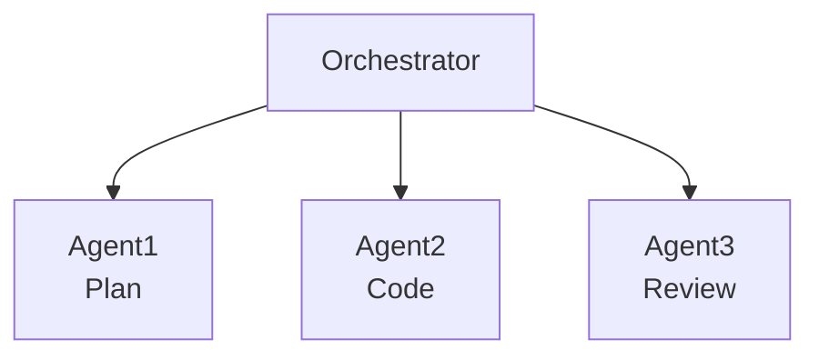
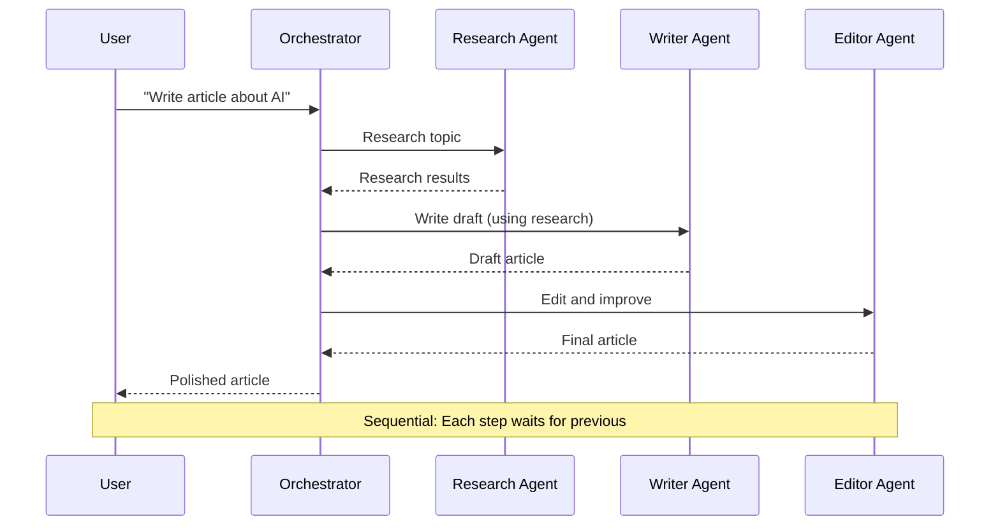
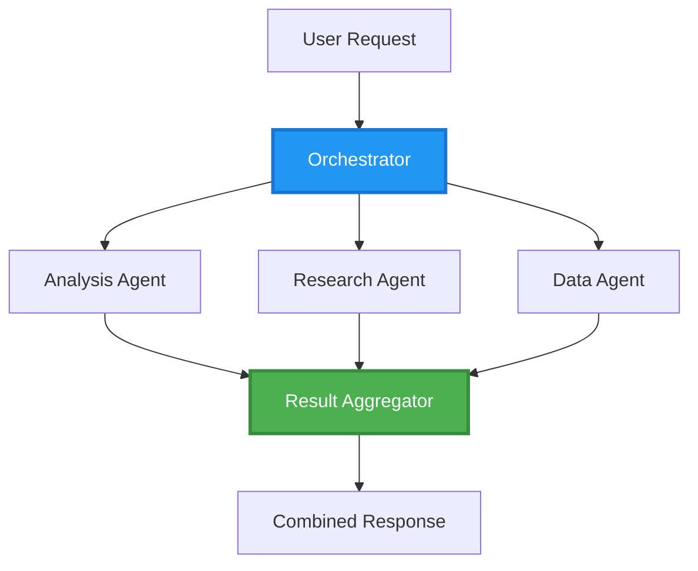
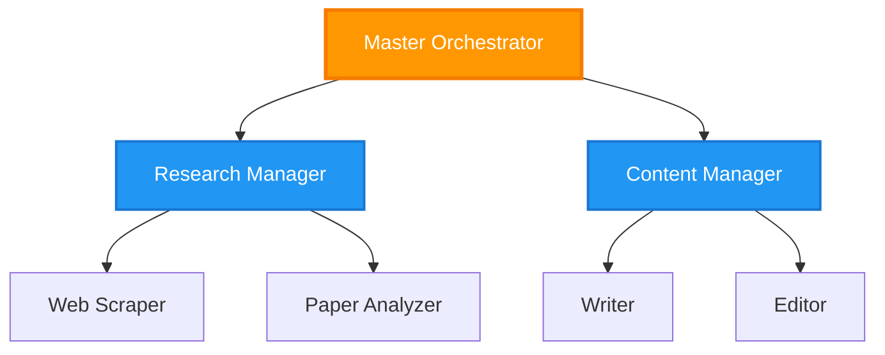
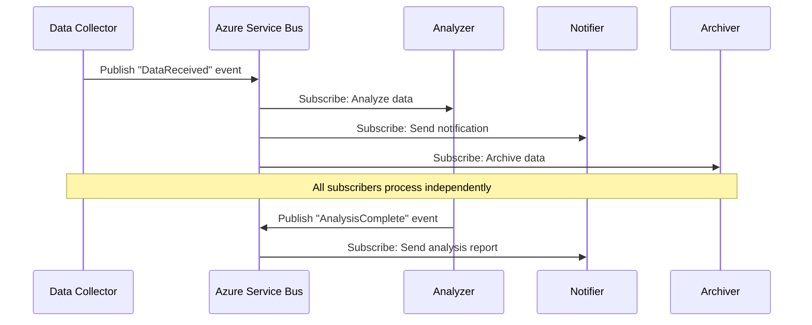
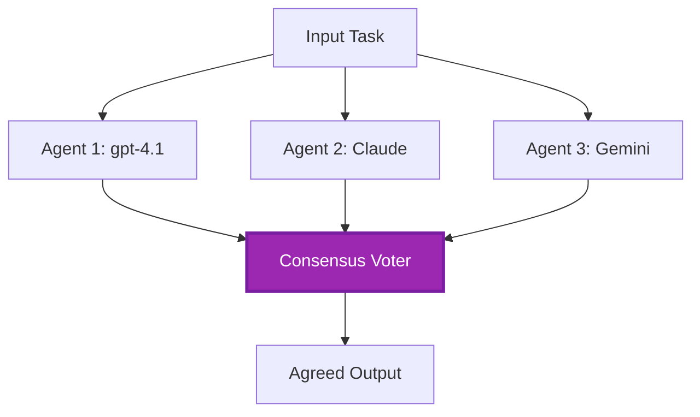
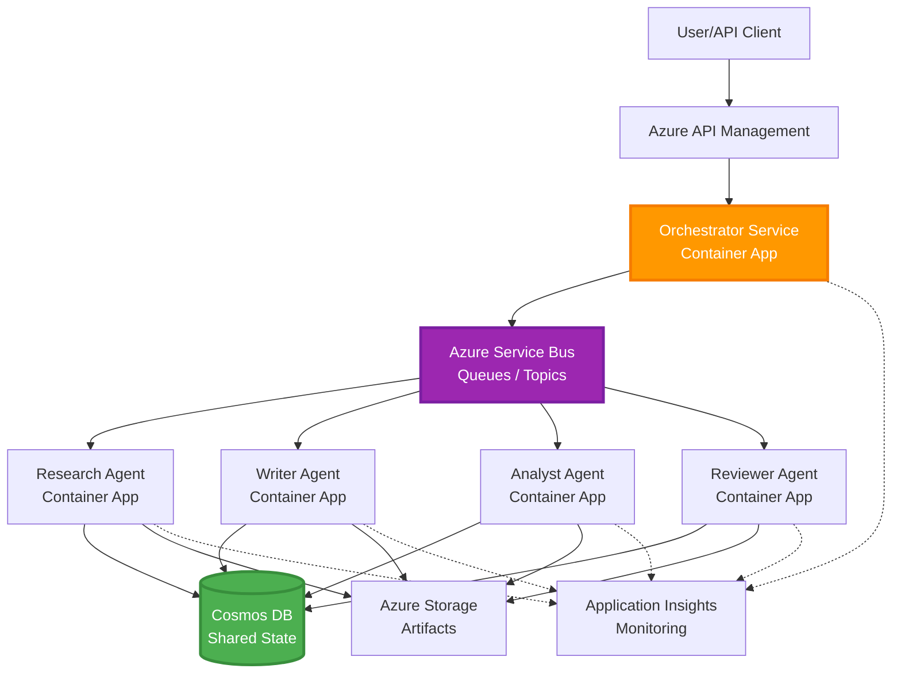

# မျိုးစုံသုံးနေသော အေဂျင့်များ ပူးပေါင်းညှိနှိုင်းစနစ် မျိုးစုံပုံစံများ

⏱️ **ခန့်မှန်းချိန်**: ၆၀-၇၅ မိနစ်ဖတ်ရှုရန်; အချိန်အနည်းငယ်အလုပ်လုပ်ရန် | 💰 **ခန့်မှန်းစရိတ်**: အလုပ်ပိုင်းဆိုင်ရာ မှီခိုသည် | ⭐ **ရှုပ်ထွေးမှု အဆင့်**: အဆင့်မြင့်

**📚 သင်ယူကြမည့် လမ်းညွှန်:**
- ← ယခင်အပိုင်း: [စွမ်းဆောင်ရည်အစီအစဉ်](capacity-planning.md) - အရင်းအမြစ်အရွယ်အစားနှင့် ချဲ့ထွင်မှု မဟာဗျူဟာများ
- 🎯 **သင်ရှိသောနေရာ**: မျိုးစုံသုံးနေသော အေဂျင့်များ ပူးပေါင်းညှိနှိုင်းမှု ပုံစံများ (ညှိနှိုင်းရေး, ဆက်သွယ်မှု, အခြေအနေ စီမံခန့်ခွဲမှု)
- → နောက်ထပ်: [SKU ရွေးချယ်ခြင်း](sku-selection.md) - မှန်ကန်သော Azure ဝန်ဆောင်မှုများ ရွေးခြယ်ခြင်း
- 🏠 [သင်တန်းမူလစာမျက်နှာ](../../README.md)

---

## သင်ယူရမည့်အကြောင်းအရာများ

ဒီသင်ခန်းစာကိုပြီးမြောက်စေခြင်းဖြင့် အသုံးပြုသူသည်:
- **မျိုးစုံသုံးနေသော အေဂျင့် အထုတ်အပိုး** ပုံစံများ နားလည်သည့်အပြင် သုံးစွဲရန်အချိန်များကို သိရှိရမည်
- **ညှိနှိုင်းရေး ပုံစံများ** (ဗဟိုစနစ်, အစိတ်အပိုင်းစနစ်, အဆင့်ဆင့်စနစ်) ကို အကောင်အထည်ဖော်နိုင်ခြင်း
- **အေဂျင့်ဆက်သွယ်ရေး မဟာဗျူဟာများ** (အချိန်ညီ, အချိန်မညီ, ဖြစ်ရပ်အခြေခံ) တည်ဆောက်နိုင်ခြင်း
- လွှဲပြောင်းထားသော အေဂျင့်များအကြား **မျှဝေထားသော အခြေအနေ** ကို စီမံခန့်ခွဲခြင်း
- AZD အသုံးပြု၍ **မျိုးစုံသုံးနေသော စနစ်များ** ကို Azure ပေါ်တွင် တပ်ဆင်ခြင်း
- အမှန်တကယ်ဖြစ်နေသော AI နှင့် ပတ်သက်သော **ညှိနှိုင်းမှု ပုံစံများ** ကို အသုံးပြုခြင်း
- နှံ့နှံ့ပြားပြား တာဝန်ယူထားသော အေဂျင့် စနစ်များကို မျက်မြင်စောင့်ကြည့်ပြီး ပြုပြင်နိုင်ခြင်း

## မျိုးစုံသုံးနေသော အေဂျင့် ညှိနှိုင်းမှု အရေးပါခြင်း

### တိုးတက်မြင့်မားခြင်း: တစ်ဦးတည်း အေဂျင့်မှ မျိုးစုံသုံးနေသော အေဂျင့် သို့

**တစ်ဦးတည်း အေဂျင့် (ရိုးရှင်း):**
```
User → Agent → Response
```
- ✅ နားလည်ရန်နှင့် အကောင်အထည်ဖော်ရန်လွယ်ကူသည်
- ✅ ရိုးရှင်းသော လုပ်ငန်းများအတွက် မြန်ဆန်သည်
- ❌ တစ်မျိုးတည်း မော်ဒယ်၏ စွမ်းဆောင်ချက်များမပြည့်စုံမှုရှိသည်
- ❌ မှန်ကန်မှု့ ထပ်တူလုပ်ကိုင်ခြင်း မဖြစ်နိုင်ပါ
- ❌ အထူးပြုနိုင်မှု မရှိပါ

**မျိုးစုံသုံးနေသော စနစ် (အဆင့်မြင့်):**

- ✅ အထူးပြုထားသော အေဂျင့်များသည် အထူးစီစဉ်ထားသော တာဝန်များရှိသည်
- ✅ လှုပ်ရှားမှုတွေ တပြိုင်နက် လုပ်ကိုင်ရာတွင် မြန်ဆန်သော parallel execution
- ✅ စုပေါင်းထား၍ ပြုစုထိန်းသိမ်းရလွယ်ကူသည်
- ✅ ရိုးရှင်းလွယ်ကူမှုရှိသော လုပ်ငန်းစဉ်များထက် ပိုမိုကောင်းမွန်သည်
- ⚠️ ညှိနှိုင်းမှု အတွင်းကိန်းလုပ်ရန် လိုအပ်သည်

**သိပ်တူညီခြင်း**: တစ်ဦးတည်း အေဂျင့်သည် တစ်ဦးတည်း လူတစ်ယောက်သည် အားလုံးလုပ်နေသလို ဖြစ်သည်။ မျိုးစုံသုံးနေသော အေဂျင့်သည် အဖွဲ့လို ဖြစ်ပြီး အဖွဲ့ဝင်တိုင်းတွင် သုတေသန, ကုဒ်ရေးစက်ရုပ်, ပြန်လည်သုံးသပ်သူ, စာရေးသူ တို့အတွက် အထူးတတ်ကျွမ်းမှုများရှိပြီး အတူတကွ လုပ်ကိုင်နေသည်။

---

## အဓိက ညှိနှိုင်းမှု ပုံစံများ

### ပုံစံ ၁: အဆက်အဆက်ညှိနှိုင်းမှု (တာဝန်စဉ်ကြိုး)

**အသုံးပြုရန်အချိန်**: လုပ်ငန်းများကို သတ်မှတ်ထားသော အစဉ်အတိုင်း ပြီးမြောက်ရမည်၊ တစ်ဦးချင်း စနစ်သည် ယခင်အဖြေနှင့် အခြေခံ၍ တည်ဆောက်သည်။



**အကျိုးခံစားချက်များ:**
- ✅ ဒေတာလည်ပတ်မှု ပုံမှန်ပြီး မှန်ကန်သည်
- ✅ ပြုပြင်ရန် လွယ်ကူသည်
- ✅ လုပ်ငန်းစဉ်ကောင်းစွာ ခန့်မှန်းနိုင်သည်

**ကန့်သတ်ချက်များ:**
- ❌ နှစ်သက်ရသော parallelism မရှိသည့် ကြောင့် နှေးကွေးသည်
- ❌ တစ်ခုခု ဖောက်ပြန်မှု ဖြစ်လျှင် လုံးဝဆက်စပ်မှု ပျက်ကွက်သည်
- ❌ မဟာဗျူဟာပေါ်မူတည်၍ ဆက်စပ်မှု လုပ်ငန်းများကို ကိုင်တွယ်မရနိုင်ပါ

**နမူနာအသုံးပြုမှုများ:**
- အကြောင်းအရာ ဖန်တီးခြင်း လမ်းကြောင်း (သုတေသန → စာရေး → တည်းဖြတ် → ထုတ်ဝေ)
- ကုဒ်ထုတ်လုပ်ခြင်း (အစီအစဉ် → အကောင်အထည် → စမ်းသပ် → တပ်ဆင်)
- အစီရင်ခံတင်ပြခြင်း (ဒေတာစုဆောင်း → ခွဲခြမ်းစိတ်ဖြာ → မြင်ကွင်းပြ → အနှစ်ချုပ်)

---

### ပုံစံ ၂: တပြိုင်နက်ညှိနှိုင်းမှု (Fan-Out/Fan-In)

**အသုံးပြုရန်အချိန်**: အချိုးမီသော လုပ်ငန်းများကို တပြိုင်နက် လုပ်ဆောင်နိုင်ပြီး၊ နောက်ဆုံးတွင် ရလဒ်များ ပေါင်းစပ်သည်။



**အကျိုးခံစားချက်များ:**
- ✅ မြန်ဆန်သည် (တပြိုင်နက် လုပ်ဆောင်မှု)
- ✅ ဖောက်ပြန်မှု ခံနိုင်ရည်ရှိသည် (အစိတ်အပိုင်း ရလဒ်များလက်ခံနိုင်သည်)
- ✅ နက်နဲစွာ ချဲ့ထွင်နိုင်သည်

**ကန့်သတ်ချက်များ:**
- ⚠️ ရလဒ်များသည် စီစဉ်ထားသကဲ့သို့ မရောက်နိုင်ပါ
- ⚠️ ပေါင်းစပ်မှု မဟာဗျူဟာ လိုအပ်သည်
- ⚠️ အခြေအနေ စီမံခန့်ခွဲမှုမှာ ရှုပ်ထွေးသည်

**နမူနာအသုံးပြုမှုများ:**
- မျှဝေသော ဒေတာစုဆောင်းခြင်း (API များ + ဒေတာဘေ့(စ်)များ + ဝက်ဘ် ထုတ်ယူခြင်း)
- ယှဉ်ပြိုင်ခွဲခြမ်းစိတ်ဖြာခြင်း (မျိုးစုံ မော်ဒယ်များ ဖြေရှင်းချက် ထုတ်လုပ်၊ ထိပ်တန်းရွေးချယ်ခြင်း)
- ဘာသာပြန်ဝန်ဆောင်မှုများ (ဘာသာစကားအမျိုးမျိုးကို တပြိုင်နက် ဘာသာပြန်ခြင်း)

---

### ပုံစံ ၃: အဆင့်ဆင့်ညှိနှိုင်းမှု (မန်နေဂျာ-အလုပ်သမား)

**အသုံးပြုရန်အချိန်**: ရှုပ်ထွေးသော လုပ်ငန်းစဉ်များနှင့် အပိုင်းခြားတာဝန်ပေးလိုအပ်သောအခါ



**အကျိုးခံစားချက်များ:**
- ✅ ရှုပ်ထွေးသော လုပ်ငန်းစဉ်များကို ကိုင်တွယ်နိုင်သည်
- ✅ စုပေါင်းထားပြီး၊ ထိန်းသိမ်းရလွယ်ကူသည်
- ✅ တာဝန်နယ်နိမိတ်တွေ ပန်းကန်ကျကျ ရှင်းလင်းသည့် အနားများရှိသည်

**ကန့်သတ်ချက်များ:**
- ⚠️ ပိုမိုရှုပ်ထွေးသော ဘောင်အဆောက်အအုံ
- ⚠️ အချိန်နောက်ကျမှု များသည် (ညှိနှိုင်းမှု အဆင့်များ များသည့်ကြောင့်)
- ⚠️ ညှိနှိုင်းမှု လှုပ်ရှားမှု ကြိုးစားမှု ပိုမိုလိုအပ်သည်

**နမူနာအသုံးပြုမှုများ:**
- စီးပွားရေး စာရွက်စာတမ်း စီမံခန့်ခွဲမှု (အုပ်စုခွဲ → ပို့ဆောင် → လုပ်ငန်းဆောင်ရွက် → သိမ်းဆည်း)
- အဆင့်အတန်း များစွာပါဝင်သော ဒေတာ လမ်းကြောင်းများ (ထည့်သွင်း → သန့်ရှင်း → ပြောင်းလဲ → ခွဲခြမ်းစိတ်ဖြာ → အစီရင်ခံ)
- ရှုပ်ထွေးသော အလိုအလျောက်လုပ်ငန်းစဉ်များ (အစီအစဉ် → အရင်းအမြစ် ခွဲဝေ → အကောင်အထည် → စောင့်ကြည့်)

---

### ပုံစံ ၄: ဖြစ်ရပ်ရိုက်ကူးညှိနှိုင်းမှု (ပို့စာတမ်း-စာရင်းသွင်း)

**အသုံးပြုရန်အချိန်**: အေဂျင့်များသည် ဖြစ်ရပ်များကို တုံ့ပြန်ရန် လိုအပ်ပြီး၊ သက်သာသည့် ပူးပေါင်းမှုလိုအပ်လျှင်



**အကျိုးခံစားချက်များ:**
- ✅ အေဂျင့်များ အကြား လမ်းကြောင်းချိတ်ဆက်မှု သက်သာသည်
- ✅ အသစ်အေဂျင့်များ ထပ်မံ ဖြည့်စွက်ရလွယ်သည် (စာရင်းသွင်းရန်သာ လုပ်သည်)
- ✅ အချိန်မရွေး လုပ်ငန်းစဉ်များ ဆောင်ရွက်နိုင်သည်
- ✅ တင်းမာမှု (စာတိုက်မေတ္တာ တည်ရှိမှု)

**ကန့်သတ်ချက်များ:**
- ⚠️ နောက်ဆုံးရလဒ် တို့ အားလုံး ထိန်းညှိမှု မရှိမှု
- ⚠️ ပြန်လည်ခြုံငုံသုံးသပ်ရန် ရှုပ်ထွေးသည်
- ⚠️ စာတိုက်အမှာစာ စီမံခန့်ခွဲမှု အခက်အခဲများ

**နမူနာအသုံးပြုမှုများ:**
- အချိန်နှင့်တပြိုင်နက် စောင့်ကြည့်ရေး စနစ်များ (သတိပေးချက်များ, မျက်နှာပြင်များ, မှတ်တမ်းများ)
- အများမျိုးစုံ လမ်းကြောင်းအသိပေးမှုများ (အီးမေးလ်, SMS, push, Slack)
- ဒေတာ လုပ်ငန်းစဉ် လမ်းကြောင်းများ (တစ်ဦးတည်း ဒေတာအတွက် များစွာသောအသုံးပြုသူများ)

---

### ပုံစံ ၅: သဘောတူညီမှု အခြေခံညှိနှိုင်းမှု (မဲခြင်း/Quorum)

**အသုံးပြုရန်အချိန်**: ဆက်လက်လုပ်ဆောင်ရန် မတိုင်မီ မျိုးစုံအေဂျင့်တစ်ခုချင်းစီ၏ သဘောတူညီမှုလိုအပ်သည်



**အကျိုးခံစားချက်များ:**
- ✅ တိကျမှုပိုဖြစ်စေသည် (ခွဲခြားချက်များ များစွာ)
- ✅ ဖောက်ပြန်မှုခံနိုင်ရည်ရှိသည် (သေးငယ်သော တစ်စိတ်တစ်ပိုင်းအရေးပေါ်များ လက်ခံနိုင်သည်)
- ✅ အရည်အသွေးစစ်ဆေးမှု ပေါင်းစပ်ထားသည်

**ကန့်သတ်ချက်များ:**
- ❌ စရိတ်အလွန်ကြီးသည် (မျိုးစုံ မော်ဒယ်များ ကို ခေါ်ယူရန်)
- ❌ စောင့်ဆိုင်းမှုများ ပိုမိုကြာသည် (အဲဂျင့်အားလုံး ဆုံးဖြတ်တိုင်)
- ⚠️ ဆန့်ကျင်မှု ဖြေရှင်းမှု လိုအပ်သည်

**နမူနာအသုံးပြုမှုများ:**
- အကြောင်းအရာ စစ်ဆေးခြင်း (မျိုးစုံ မော်ဒယ်များ စာမူကို ပြန်သုံးသပ်သည်)
- ကုဒ်ပြန်လည်သုံးသပ်ခြင်း (မျိုးစုံ linters/analyzers)
- ဆေးဘက်ဆိုင်ရာ သုံးသပ်ချက် (မျိုးစုံ AI မော်ဒယ်များ, ကျွမ်းကျင်သူအတည်ပြုချက်)

---

## ဘောင်အဆောက်အအုံ အနှစ်ချုပ်

### Azure ပေါ်တွင် မျိုးစုံသုံးနေသော စနစ် ပြည့်စုံ



**ရင်းမြစ်အစိတ်အပိုင်းများ:**

| အစိတ်အပိုင်း | ရည်မှန်းချက် | Azure ဝန်ဆောင်မှု |
|-----------|---------|---------------|
| **API Gateway** | ဝင်ခွင့်ပေါက်, အမြန်နှုန်း ကန့်သတ်မှု, အတည်ပြုခြင်း | API Management |
| **Orchestrator** | အေဂျင့် လုပ်ငန်းစဉ်များ ထိန်းချုပ်မှု | Container Apps |
| **Message Queue** | အချိန်မရွေး ဆက်သွယ်မှု | Service Bus / Event Hubs |
| **Agents** | အထူးပြု AI အလုပ်သမားများ | Container Apps / Functions |
| **State Store** | မျှဝေထားသော အခြေအနေ, တာဝန် ချီးမြှင့်မှု | Cosmos DB |
| **Artifact Storage** | စာရွက်စာတမ်းများ, ရလဒ်များ, မှတ်တမ်းများ | Blob Storage |
| **Monitoring** | ဖြန့်ဖြူးထားသော တခြားခရမ်းခြယ်တမ်း, မှတ်တမ်းများ | Application Insights |

Service Bus queues/topics နှင့် Event Hubs တို့သည် ဝန်ဆောင်မှု သက်ရောက်မှု/သုံးစွဲပုံ မတူကြသည်; Event Hubs သည် Service Bus အလုပ်သမားကုဒ်ကို အစားထိုးချိတ်ဆက်နိုင်သော ဝန်ဆောင်မှု မဟုတ်ပါ။ တပြိုင်နက်လုပ်ခြင်း, မက်ဆေ့ချ်များမှတ်တမ်းတင်ခြင်းနှင့် မော်ဒယ် မဲပေးခြင်းသည် တစ်ကိုယ်တည်း ဖောက်ပြန်မှုခံနိုင်ရည် သို့မဟုတ် တိကျမှု ပိုမိုအဆင့်မြင့်မှု မအာမခံပါ။

---

## လိုအပ်ချက်များ

### လိုအပ်သည့်ကိရိယာများ

```bash
# Verify Azure Developer CLI
azd version
# Command reference baseline: azd 1.37.2

# Verify Azure CLI
az --version
# ✅ Expected: azure-cli 2.50.0 or higher

# Verify Docker (for local testing)
docker --version
# ✅ Expected: Docker version 20.10 or higher
```

### Azure လိုအပ်ချက်များ

- Azure စာရင်းအသစ်ရှိရမည်
- ဖန်တီးခွင့်ရရှိရမည်:
  - Container Apps
  - Service Bus namespaces
  - Cosmos DB အကောင့်များ
  - Storage အကောင့်များ
  - Application Insights

### အသိပညာလိုအပ်ချက်များ

သင်ပြီးမြောက်ထားသင့်သည်:
- [ဖွဲ့စည်းတည်ဆောက်မှု စီမံခန့်ခွဲမှု](../chapter-03-configuration/configuration.md)
- [အတည်ပြုခြင်း နှင့် လုံခြုံရေး](../chapter-03-configuration/authsecurity.md)
- [မိုက်ခရိုဝန်ဆောင်မှု ဥပမာ](../../../../examples/microservices)

---

## ဆောင်ရွက်ပုံလမ်းညွှန်

> **ဒီဇိုင်း တစ်စိတ်တစ်ပိုင်းများ, တပ်ဆင်နိုင်သော လက်တွေ့ ကျောင်းမဟုတ်ပါ:** စီမံကိန်း သစ်ရေမှာ `File:` လိုမျိုး ကိုယ်ပိုင် စီမံကိန်းတွင် ဖိုင်များ ဖန်တီးရန် ဖော်ပြရာရှိသည်။ ဒီဂိုင်းသည် `multi-agent-system` လုံးဝ ပြည့်စုံ အသုံးချမှု မပါဝင်ပါ။ မပါဝင်သော ပိုင်းများမှာ main/parameter templates, Container Apps ပတ်ဝန်းကျင်/သိုလှောင်ရာ, Dockerfiles နှင့် dependency locks, Cosmos database/container သတ်မှတ်ခြင်း, မော်ဒယ် တပ်ဆင်ခြင်း, identity/role သတ်မှတ်ချက်များ၊ ချဲ့ထွင်ရေး နည်းလမ်းများ ဖြစ်သည်။ `azd init` မှ ဖိုင်များ ထုတ်ပြီး မဟုတ်သည့် နည်းဖြင့် `azd up` ဖြင်ဖြ့မည် မထင်ပါနှင့်။ အကောင်အထည် ဖန်တီးရန် အစီအစဉ်အများဆုံး [Multi-Agent Basics](../chapter-05-multi-agent/multi-agent-basics.md) ကိုပြီးမြောက်ပါ။

**စက်မှတင်ထားသော လောတီနာများ:** Python 3.10+, `azure-servicebus`, `azure-cosmos`, `openai`, Flask အပါအဝင်၊ (ကြည့်ရှုမှတ်တမ်း အတွက်) `azure-monitor-opentelemetry`; `shared` ကို Python import လမ်းကြောင်းတွင် တစ်စိတ်တစ်ပိုင်းမှာ ထည့်ပါ။ Cosmos `agent-state/tasks` containter သည် `/id` partition key ဖြင့် ရှိပြီးဖြစ်ရမည်။ key-based connection များသည် ဒီအစိတ်အပိုင်းများကို ရိုးရှင်းစေပြီး ထုတ်လုပ်မှု ညွှန်ကြားချက် မဟုတ်ပါ: Service Bus, Cosmos, OpenAI data-plane role များအတွက် Managed Identities ကို ဦးစားပေး သုံးပါ။ key များကို output သို့မဟုတ် log များတွင် ဖော်ပြ မထားပေးပါနှင့်။

Service Bus ပို့ဆောင်မှုသည် **အနည်းဆုံး တစ်ကြိမ် သေချာပို့သည်**။ တာဝန် နှင့် အဆင့် တိုင်းတွင် idempotency ကို ထိန်းသိမ်းပါ၊ optimistic concurrency (ETags) ကို ဖတ်/ပြင်/ရေး အခြေအနေများဆောင်ရွက်ရာတွင် အသုံးပြုပါ၊ နောက်ကြာသော လုပ်ဆောင်မှု တြင် မက်ဆေ့ချ် လေးများကို ပြန်လည် အသစ်တပ်ပေးပါ။ အောက်တိုက် ရိုးရှင်းသော အခြေအနေမန်နေဂျာသည် အဆက်အသွယ် ဝါကျစနစ်သာဖြစ်ပြီး ထုတ်လုပ်မှု အာမခံချက် မရှိပါ။

### စီမံကိန်း ဖွဲ့စည်းပုံ

```
multi-agent-system/
├── azure.yaml                    # AZD configuration
├── infra/
│   ├── main.bicep               # Main infrastructure
│   ├── core/
│   │   ├── servicebus.bicep     # Message queue
│   │   ├── cosmos.bicep         # State store
│   │   ├── storage.bicep        # Artifact storage
│   │   └── monitoring.bicep     # Application Insights
│   └── app/
│       ├── orchestrator.bicep   # Orchestrator service
│       └── agent.bicep          # Agent template
└── src/
    ├── orchestrator/            # Orchestration logic
    │   ├── app.py
    │   ├── workflows.py
    │   └── Dockerfile
    ├── agents/
    │   ├── research/            # Research agent
    │   ├── writer/              # Writer agent
    │   ├── analyst/             # Analyst agent
    │   └── reviewer/            # Reviewer agent
    └── shared/
        ├── state_manager.py     # Shared state logic
        └── message_handler.py   # Message handling
```

---

## သင်ခန်းစာ ၁: အဆက်အဆက်ညှိနှိုင်းမှု ပုံစံ

### ဆောင်ရွက်ပုံ: အကြောင်းအရာ ဖန်တီးခြင်း လမ်းကြောင်း

အဆက်အဆက် လမ်းကြောင်း ဒီဇိုင်းဆွဲကြမယ်: သုတေသန → စာရေး → တည်းဖြတ်။ ထုတ်ဝေခြင်းမှာ ဤဥပမာတွင် မပါဝင်ပါ။

### ၁။ AZD ကျော်တည်ခြင်း

**ဖိုင်: `azure.yaml`**

```yaml
name: content-pipeline
metadata:
  template: multi-agent-sequential@1.0.0

services:
  orchestrator:
    project: ./src/orchestrator
    language: python
    host: containerapp
  
  research-agent:
    project: ./src/agents/research
    language: python
    host: containerapp
  
  writer-agent:
    project: ./src/agents/writer
    language: python
    host: containerapp
  
  editor-agent:
    project: ./src/agents/editor
    language: python
    host: containerapp
```

### ၂။ အခြေခံအဆောက်အအုံ: ညှိနှိုင်းမှုအတွက် Service Bus

**ဖိုင်: `infra/core/servicebus.bicep`**

```bicep
param name string
param location string
param tags object = {}

resource serviceBusNamespace 'Microsoft.ServiceBus/namespaces@2022-10-01-preview' = {
  name: name
  location: location
  tags: tags
  sku: {
    name: 'Standard'
    tier: 'Standard'
  }
  properties: {
    minimumTlsVersion: '1.2'
  }
}

// Queue for orchestrator → research agent
resource researchQueue 'Microsoft.ServiceBus/namespaces/queues@2022-10-01-preview' = {
  parent: serviceBusNamespace
  name: 'research-tasks'
  properties: {
    maxDeliveryCount: 3
    lockDuration: 'PT5M'
    deadLetteringOnMessageExpiration: true
  }
}

// Queue for research agent → writer agent
resource writerQueue 'Microsoft.ServiceBus/namespaces/queues@2022-10-01-preview' = {
  parent: serviceBusNamespace
  name: 'writer-tasks'
  properties: {
    maxDeliveryCount: 3
    lockDuration: 'PT5M'
  }
}

// Queue for writer agent → editor agent
resource editorQueue 'Microsoft.ServiceBus/namespaces/queues@2022-10-01-preview' = {
  parent: serviceBusNamespace
  name: 'editor-tasks'
  properties: {
    maxDeliveryCount: 3
    lockDuration: 'PT5M'
  }
}

output namespace string = serviceBusNamespace.name
// Do not output RootManageSharedAccessKey. Resolve scoped credentials
// securely or use managed identity in the application and scale rules.
```

### ၃။ မျှဝေထားသော အခြေအနေ မန်နေဂျာ

**ဖိုင်: `src/shared/state_manager.py`**

```python
from azure.cosmos import CosmosClient, PartitionKey
from datetime import datetime, timezone
import os

class StateManager:
    """Manages shared state across agents using Cosmos DB"""
    
    def __init__(self):
        endpoint = os.environ['COSMOS_ENDPOINT']
        key = os.environ['COSMOS_KEY']
        
        self.client = CosmosClient(endpoint, key)
        self.database = self.client.get_database_client('agent-state')
        self.container = self.database.get_container_client('tasks')
    
    def create_task(self, task_id: str, task_type: str, input_data: dict):
        """Create a new task"""
        task = {
            'id': task_id,
            'type': task_type,
            'status': 'pending',
            'input': input_data,
            'created_at': datetime.now(timezone.utc).isoformat(),
            'steps': []
        }
        self.container.create_item(task)
        return task
    
    def update_task_step(self, task_id: str, step_name: str, result: dict):
        """Update task with completed step"""
        task = self.container.read_item(task_id, partition_key=task_id)
        
        task['steps'].append({
            'name': step_name,
            'completed_at': datetime.now(timezone.utc).isoformat(),
            'result': result
        })
        
        self.container.replace_item(task_id, task)
        return task
    
    def complete_task(self, task_id: str, final_result: dict):
        """Mark task as complete"""
        task = self.container.read_item(task_id, partition_key=task_id)
        task['status'] = 'completed'
        task['result'] = final_result
        task['completed_at'] = datetime.now(timezone.utc).isoformat()
        self.container.replace_item(task_id, task)
        return task
    
    def get_task(self, task_id: str):
        """Retrieve task state"""
        return self.container.read_item(task_id, partition_key=task_id)
```

### ၄။ Orchestrator ဝန်ဆောင်မှု

**ဖိုင်: `src/orchestrator/app.py`**

```python
from flask import Flask, request, jsonify
from azure.servicebus import ServiceBusClient, ServiceBusMessage
import json
import uuid
import os
from shared.state_manager import StateManager

app = Flask(__name__)
state_manager = StateManager()

# Service Bus connection
servicebus_connection_str = os.environ['SERVICEBUS_CONNECTION_STRING']
servicebus_client = ServiceBusClient.from_connection_string(servicebus_connection_str)

@app.route('/health', methods=['GET'])
def health():
    return jsonify({'status': 'healthy', 'service': 'orchestrator'})

@app.route('/create-content', methods=['POST'])
def create_content():
    """
    Sequential workflow: Research → Write → Edit (returns a draft; no publishing)
    """
    data = request.get_json(silent=True) or {}
    topic = data.get('topic')
    
    if not topic:
        return jsonify({'error': 'Topic required'}), 400
    
    # Create task in state store
    task_id = str(uuid.uuid4())
    task = state_manager.create_task(
        task_id=task_id,
        task_type='content_creation',
        input_data={'topic': topic}
    )
    
    # Send message to research agent (first step)
    sender = servicebus_client.get_queue_sender('research-tasks')
    message = ServiceBusMessage(
        body=json.dumps({
            'task_id': task_id,
            'topic': topic,
            'next_queue': 'writer-tasks'  # Where to send results
        }),
        content_type='application/json'
    )
    
    with sender:
        sender.send_messages(message)
    
    return jsonify({
        'task_id': task_id,
        'status': 'started',
        'workflow': 'sequential',
        'steps': ['research', 'write', 'edit'],
        'message': 'Content creation pipeline initiated'
    }), 202

@app.route('/task/<task_id>', methods=['GET'])
def get_task_status(task_id):
    """Check task status"""
    try:
        task = state_manager.get_task(task_id)
        return jsonify(task)
    except Exception as e:
        return jsonify({'error': str(e)}), 404

if __name__ == '__main__':
    app.run(host='0.0.0.0', port=8080)
```

### ၅။ သုတေသန အေဂျင့်

**ဖိုင်: `src/agents/research/app.py`**

```python
from azure.servicebus import ServiceBusClient, ServiceBusMessage
from openai import AzureOpenAI
import json
import os
import time
from shared.state_manager import StateManager

# Initialize clients
state_manager = StateManager()
servicebus_client = ServiceBusClient.from_connection_string(
    os.environ['SERVICEBUS_CONNECTION_STRING']
)

openai_client = AzureOpenAI(
    api_key=os.environ['AZURE_OPENAI_API_KEY'],
    api_version="2024-10-21",
    azure_endpoint=os.environ['AZURE_OPENAI_ENDPOINT']
)

def process_research_task(message_data):
    """Process research request and pass to writer"""
    task_id = message_data['task_id']
    topic = message_data['topic']
    next_queue = message_data['next_queue']
    
    print(f"🔬 Researching: {topic}")
    
    # Call Microsoft Foundry Models for research
    response = openai_client.chat.completions.create(
        model=os.environ['AZURE_OPENAI_DEPLOYMENT'],
        messages=[
            {"role": "system", "content": "You are a research assistant. Provide comprehensive research on the given topic."},
            {"role": "user", "content": f"Research this topic thoroughly: {topic}"}
        ],
        max_tokens=1500
    )
    
    research_results = response.choices[0].message.content
    
    # Update state
    state_manager.update_task_step(
        task_id=task_id,
        step_name='research',
        result={'research': research_results}
    )
    
    # Send to next agent (writer)
    sender = servicebus_client.get_queue_sender(next_queue)
    message = ServiceBusMessage(
        body=json.dumps({
            'task_id': task_id,
            'topic': topic,
            'research': research_results,
            'next_queue': 'editor-tasks'
        }),
        content_type='application/json'
    )
    
    with sender:
        sender.send_messages(message)
    
    print(f"✅ Research complete for task {task_id}")

def main():
    """Listen to research queue"""
    receiver = servicebus_client.get_queue_receiver('research-tasks')
    
    print("🔬 Research Agent started, listening for tasks...")
    
    with receiver:
        while True:
            messages = receiver.receive_messages(max_wait_time=5)
            for message in messages:
                try:
                    message_data = json.loads(str(message))
                    process_research_task(message_data)
                    receiver.complete_message(message)
                except Exception as e:
                    print(f"❌ Error processing message: {e}")
                    receiver.abandon_message(message)

if __name__ == '__main__':
    main()
```

### ၆။ စာရေးသူ အေဂျင့်

**ဖိုင်: `src/agents/writer/app.py`**

```python
from azure.servicebus import ServiceBusClient, ServiceBusMessage
from openai import AzureOpenAI
import json
import os
from shared.state_manager import StateManager

state_manager = StateManager()
servicebus_client = ServiceBusClient.from_connection_string(
    os.environ['SERVICEBUS_CONNECTION_STRING']
)

openai_client = AzureOpenAI(
    api_key=os.environ['AZURE_OPENAI_API_KEY'],
    api_version="2024-10-21",
    azure_endpoint=os.environ['AZURE_OPENAI_ENDPOINT']
)

def process_writing_task(message_data):
    """Write article based on research"""
    task_id = message_data['task_id']
    topic = message_data['topic']
    research = message_data['research']
    next_queue = message_data['next_queue']
    
    print(f"✍️ Writing article: {topic}")
    
    # Call Microsoft Foundry Models to write article
    response = openai_client.chat.completions.create(
        model=os.environ['AZURE_OPENAI_DEPLOYMENT'],
        messages=[
            {"role": "system", "content": "You are a professional writer. Write engaging, well-structured articles."},
            {"role": "user", "content": f"Based on this research:\n\n{research}\n\nWrite a comprehensive article about: {topic}"}
        ],
        max_tokens=2000
    )
    
    article_draft = response.choices[0].message.content
    
    # Update state
    state_manager.update_task_step(
        task_id=task_id,
        step_name='writing',
        result={'draft': article_draft}
    )
    
    # Send to editor
    sender = servicebus_client.get_queue_sender(next_queue)
    message = ServiceBusMessage(
        body=json.dumps({
            'task_id': task_id,
            'topic': topic,
            'draft': article_draft
        }),
        content_type='application/json'
    )
    
    with sender:
        sender.send_messages(message)
    
    print(f"✅ Article draft complete for task {task_id}")

def main():
    """Listen to writer queue"""
    receiver = servicebus_client.get_queue_receiver('writer-tasks')
    
    print("✍️ Writer Agent started, listening for tasks...")
    
    with receiver:
        while True:
            messages = receiver.receive_messages(max_wait_time=5)
            for message in messages:
                try:
                    message_data = json.loads(str(message))
                    process_writing_task(message_data)
                    receiver.complete_message(message)
                except Exception as e:
                    print(f"❌ Error: {e}")
                    receiver.abandon_message(message)

if __name__ == '__main__':
    main()
```

### ၇။ တည်းဖြတ်အေဂျင့်

**ဖိုင်: `src/agents/editor/app.py`**

```python
from azure.servicebus import ServiceBusClient
from openai import AzureOpenAI
import json
import os
from shared.state_manager import StateManager

state_manager = StateManager()
servicebus_client = ServiceBusClient.from_connection_string(
    os.environ['SERVICEBUS_CONNECTION_STRING']
)

openai_client = AzureOpenAI(
    api_key=os.environ['AZURE_OPENAI_API_KEY'],
    api_version="2024-10-21",
    azure_endpoint=os.environ['AZURE_OPENAI_ENDPOINT']
)

def process_editing_task(message_data):
    """Edit and finalize article"""
    task_id = message_data['task_id']
    topic = message_data['topic']
    draft = message_data['draft']
    
    print(f"📝 Editing article: {topic}")
    
    # Call Microsoft Foundry Models to edit
    response = openai_client.chat.completions.create(
        model=os.environ['AZURE_OPENAI_DEPLOYMENT'],
        messages=[
            {"role": "system", "content": "You are an expert editor. Improve grammar, clarity, and structure."},
            {"role": "user", "content": f"Edit and improve this article:\n\n{draft}"}
        ],
        max_tokens=2000
    )
    
    final_article = response.choices[0].message.content
    
    # Mark task as complete
    state_manager.complete_task(
        task_id=task_id,
        final_result={
            'topic': topic,
            'final_article': final_article,
            'word_count': len(final_article.split())
        }
    )
    
    print(f"✅ Article finalized for task {task_id}")

def main():
    """Listen to editor queue"""
    receiver = servicebus_client.get_queue_receiver('editor-tasks')
    
    print("📝 Editor Agent started, listening for tasks...")
    
    with receiver:
        while True:
            messages = receiver.receive_messages(max_wait_time=5)
            for message in messages:
                try:
                    message_data = json.loads(str(message))
                    process_editing_task(message_data)
                    receiver.complete_message(message)
                except Exception as e:
                    print(f"❌ Error: {e}")
                    receiver.abandon_message(message)

if __name__ == '__main__':
    main()
```

### ၈။ တပ်ဆင်၍ စမ်းသပ်ခြင်း

ယခုအမိန့်များကို **သင့်လုပ်ငန်းစီမံကိန်း ဖိုင်များ ပြည့်စုံပြီးနောက်သာ အသုံးချပါ။** Interactive Foundry agent Initialization သည် လုံး၀ကွဲထွက်သည့် လုပ်ငန်းစဉ် ဖြစ်ပြီး ဒီ Service Bus ဒီဇိုင်းကို မဖန်တီးပါ။ 

```bash
# In your completed custom project
azd up

# Alternative in a SEPARATE empty folder (GA bundle workflow requires azd >= 1.37.0)
azd ext install microsoft.foundry
azd ai agent init
azd up
```

> ကြည့်ပါ [AZD AI CLI Commands](../chapter-08-production/production-ai-practices.md#azd-ai-cli-commands-and-extensions) တွင် `azd ai` ရုပ်သံနှင့် ရွေးချယ်စရာများအားလုံးအတွက်။

```bash
# Get orchestrator URL
ORCHESTRATOR_URL=$(azd env get-values | grep ORCHESTRATOR_URL | cut -d '=' -f2 | tr -d '"')

# Create content
curl -X POST $ORCHESTRATOR_URL/create-content \
  -H "Content-Type: application/json" \
  -d '{"topic": "The Future of AI in Healthcare"}'
```

**✅ မျှော်မှန်းထားသော output:**
```json
{
  "task_id": "a1b2c3d4-e5f6-7890-abcd-ef1234567890",
  "status": "started",
  "workflow": "sequential",
  "steps": ["research", "write", "edit"],
  "message": "Content creation pipeline initiated"
}
```

**လုပ်ငန်းစဉ် တိုးတက်မှုကို စစ်ဆေးပါ:**
```bash
TASK_ID="a1b2c3d4-e5f6-7890-abcd-ef1234567890"
curl $ORCHESTRATOR_URL/task/$TASK_ID
```

**✅ မျှော်မှန်းထားသော output (ပြီးဆုံးထား):**
```json
{
  "id": "a1b2c3d4-e5f6-7890-abcd-ef1234567890",
  "type": "content_creation",
  "status": "completed",
  "steps": [
    {
      "name": "research",
      "completed_at": "2025-11-19T10:30:00Z",
      "result": {"research": "..."}
    },
    {
      "name": "writing",
      "completed_at": "2025-11-19T10:32:00Z",
      "result": {"draft": "..."}
    }
  ],
  "result": {
    "topic": "The Future of AI in Healthcare",
    "final_article": "...",
    "word_count": 1500
  }
}
```

---

## သင်ခန်းစာ ၂: စုံလင်သော ပူးပေါင်းစီမံခန့်ခွဲမှု ပုံစံ

### အကောင်အထည်ဖော်ခြင်း: မျိုးစုံ မှုတက်ရောက်မှုစုစည်းသူ

လက်ရှိတွင် တစ်ပြိုင်နက်တည်း မျိုးစုံထံမှ သတင်းအချက်အလက်များ စုဆောင်းသည့် ပူးပေါင်းစနစ် တည်ဆောက်ကြမယ်။

### ပူးပေါင်းစီမံခန့်ခွဲသူ

**ဖိုင်: `src/orchestrator/parallel_workflow.py`**

```python
from flask import Flask, request, jsonify
from azure.servicebus import ServiceBusClient, ServiceBusMessage
import json
import uuid
import os
from shared.state_manager import StateManager

app = Flask(__name__)
state_manager = StateManager()

servicebus_client = ServiceBusClient.from_connection_string(
    os.environ['SERVICEBUS_CONNECTION_STRING']
)

@app.route('/research-parallel', methods=['POST'])
def research_parallel():
    """
    Parallel workflow: Multiple agents work simultaneously
    """
    data = request.json
    query = data.get('query')
    
    task_id = str(uuid.uuid4())
    task = state_manager.create_task(
        task_id=task_id,
        task_type='parallel_research',
        input_data={
            'query': query,
            'agents': ['web', 'academic', 'news', 'social']
        }
    )
    
    # Fan-out: publish sequentially; workers may process concurrently.
    agents = [
        ('web-research-queue', 'web'),
        ('academic-research-queue', 'academic'),
        ('news-research-queue', 'news'),
        ('social-research-queue', 'social')
    ]
    
    for queue_name, agent_type in agents:
        sender = servicebus_client.get_queue_sender(queue_name)
        message = ServiceBusMessage(
            body=json.dumps({
                'task_id': task_id,
                'query': query,
                'agent_type': agent_type,
                'result_queue': 'aggregation-queue'
            }),
            content_type='application/json'
        )
        
        with sender:
            sender.send_messages(message)
    
    return jsonify({
        'task_id': task_id,
        'status': 'started',
        'workflow': 'parallel',
        'agents_dispatched': 4,
        'message': 'Parallel research initiated'
    }), 202

if __name__ == '__main__':
    app.run(host='0.0.0.0', port=8080)
```

### စုစည်းခြင်း လုပ်ဆောင်ချက်

**ဖိုင်: `src/agents/aggregator/app.py`**

```python
from azure.servicebus import ServiceBusClient
import json
import os
from collections import defaultdict
from shared.state_manager import StateManager

state_manager = StateManager()
servicebus_client = ServiceBusClient.from_connection_string(
    os.environ['SERVICEBUS_CONNECTION_STRING']
)

# Single-process demo only: not durable or shared across replicas.
# Production: use durable unique (task_id, agent_type) result records.
task_results = defaultdict(dict)
expected_agents = 4  # web, academic, news, social

def process_result(message_data):
    """Aggregate results from parallel agents"""
    task_id = message_data['task_id']
    agent_type = message_data['agent_type']
    result = message_data['result']
    
    # Store result
    task_results[task_id][agent_type] = {
        'agent': agent_type,
        'data': result
    }
    
    print(f"📊 Received result from {agent_type} agent ({len(task_results[task_id])}/{expected_agents})")
    
    # Check if all agents completed (fan-in)
    if len(task_results[task_id]) == expected_agents:
        print(f"✅ All agents completed for task {task_id}. Aggregating...")
        
        # Combine results
        aggregated = {
            'query': message_data['query'],
            'sources': list(task_results[task_id].values()),
            'summary': generate_summary(list(task_results[task_id].values()))
        }
        
        # Mark complete
        state_manager.complete_task(task_id, aggregated)
        
        # Clean up
        del task_results[task_id]
        
        print(f"✅ Aggregation complete for task {task_id}")

def generate_summary(results):
    """Generate summary from all sources"""
    summaries = [r['data'].get('summary', '') for r in results]
    return '\n\n'.join(summaries)

def main():
    """Listen to aggregation queue"""
    receiver = servicebus_client.get_queue_receiver('aggregation-queue')
    
    print("📊 Aggregator started, listening for results...")
    
    with receiver:
        while True:
            messages = receiver.receive_messages(max_wait_time=5)
            for message in messages:
                try:
                    message_data = json.loads(str(message))
                    process_result(message_data)
                    receiver.complete_message(message)
                except Exception as e:
                    print(f"❌ Error: {e}")
                    receiver.abandon_message(message)

if __name__ == '__main__':
    main()
```

**ပူးပေါင်းပုံစံ၏ အကျိုးကျေးဇူးများ:**
- ⚡ **လျှော့ချနိုင်သော ရောင့်ရဲမှု** (အမြန်ဆုံးလုပ်သားနီးပါး နှင့် စီမံခန့်ခွဲမှု ပေါင်းစပ်မှုတို့ဖြင့် ကန့်သတ်ထားသည်)
- 🔄 **အပိုုပုံမှန်ရလဒ်များကို ထောက်ခံနိုင်သည်** သတ်မှတ်ထားသော အချိန်နှင့် မအောင်မြင်မှု မူဝါဒဖြင့် (ပုံမှန် စုစည်းသူက မကိုင်တွယ်သေး)
- 📈 **တိုးချဲ့နိုင်သော** (လုပ်သားများ ပိုများစေရန် လွယ်ကူ)

---

## လက်တွေ့လေ့ကျင့်မှုများ

### လေ့ကျင့်မှု ၁: Timeout ကို ထည့်သွင်း စီမံခြင်း ⭐⭐ (အလယ်အလတ်)

**ရည်မှန်းချက်**: Aggregator သည် မျောမလောက်သော agent များကို အမြဲစောင့်မနေဘဲ timeout လုပ်ခြင်းကို အကောင်အထည်ဖော်ပါ။

**စတင်ရာနေရာ:** ထို local deadline စမ်းသပ်မှုကို queue worker မှာ ထည့်သွင်းရန်မတိုင်ခင် အသုံးပြုပါ။ timeout သည် အခြားမက်ဆေ့ခ်ျတစ်ခု လာမှ စစ်ဆေးသောကြောင့် မပို့သော worker များအတွက် မဖြစ်ပါ။

**ခြေလှမ်းများ**:

1. **Aggregator ကို timeout ခြင်းတိုးစွာ ထည့်သွင်းပါ:**

```python
import asyncio

async def simulated_agent(name, delay):
    await asyncio.sleep(delay)
    return {'agent': name, 'result': 'done'}

async def main():
    tasks = [asyncio.create_task(simulated_agent(name, delay))
             for name, delay in [('web', 0.1), ('academic', 0.2),
                                 ('news', 0.3), ('social', 3)]]
    done, pending = await asyncio.wait(tasks, timeout=1)
    results = [task.result() for task in done]
    for task in pending:
        task.cancel()
    await asyncio.gather(*pending, return_exceptions=True)
    print({'completed_agents': len(results), 'timed_out': bool(pending)})
    assert len(results) == 3 and pending

asyncio.run(main())
```

2. **မျှော်မှန်းထားသော output:**

```text
{'completed_agents': 3, 'timed_out': True}
```

3. **Queue စနစ် ဖြင့် ပေါင်းစပ်ခြင်း (ဒီဇိုင်း လုပ်ငန်း):** Task တစ်ခုဖန်တီးသည့်အခါ dispatch deadline နှင့် မျှော်မှန်းထားသော agent များကို သိုလှောင်ပြီး မှန်ကန်သောအချိန်တိုင်း deadline စစ်ဆေးမှု ပြုလုပ်၊ partial ရလဒ်များကို တပြိုင်နက်တည်း ပြီးစီးချပေးခြင်းနှင့် နောက်ကျသော/မိတ္တူ မက်ဆေ့ခ်ျများကို အလျင်အမြန် စီမံထားသော task များအတွက် မျက်နှာမဖုံးဘဲ လျော့ပါး/ပယ်ဖျက်ခြင်း။ Local timeout သည် remote worker များအား ဖျက်ဆီးခြင်းမပြုပါ။

သင်၏အကောင်အထည်ဖော်ထားသော ပရိုဂျက်အတွက်သာ:

```bash
azd deploy aggregator

# Submit task
curl -X POST $ORCHESTRATOR_URL/research-parallel \
  -H "Content-Type: application/json" \
  -d '{"query": "AI safety research"}'

# Check results after 30 seconds
curl $ORCHESTRATOR_URL/task/$TASK_ID
```

**✅ အောင်မြင်သည့် စံချိန်များ:**
- ✅ ဒေသတွင်း စမ်းသပ်မှုသည် ၁ စက္ကန့် deadline ပြီပင် ပြန်လည်ထုတ်ပေးသည်၊ agent တစ်ဦးမှ ပြီးမြောက်မှု မရှိသော်လည်း
- ✅ တုံ့ပြန်ချက်သည် partial ရလဒ်များကို ပြသည် (`"timed_out": true`)
- ✅ ရရှိနိုင်သော ရလဒ်များ ကို ပြန်လည်ပို့ပေးသည် (agent ၄ ယောက်မှ ၃ ယောက်)

**အချိန်**: 20-25 မိနစ်

---

### လေ့ကျင့်မှု ၂: Retry Logic ကို အကောင်အထည်ဖော်ခြင်း ⭐⭐⭐ (တိုးတက်)

**ရည်မှန်းချက်**: မအောင်မြင်သော agent task များကို အလိုအလျောက် ပြန်လည်ကြိုးစားပါ။

**ခြေလှမ်းများ**:

1. **စီမံခန့်ခွဲမှုကွန်ယက် တင်ပို့မှုရေတွက်မှုများကို ပြန် enqueue သကဲ့သို့ မလုပ်ဘဲ အသုံးပြုပါ:**

```python
import json
import time
# Integration fragment: use a live peek-lock ServiceBusReceiver.
# Set queue maxDeliveryCount to 4 for one attempt + up to three retries.
```

2. **Agent များတွင် retry handler ထည့်သွင်းပါ:**

```python
def process_with_retry(message, receiver, process_func):
    """Process message with automatic retry on failure"""
    try:
        message_data = json.loads(str(message))
        
        # Process the message
        process_func(message_data)
        
        # Success - complete
        receiver.complete_message(message)
        
    except Exception as e:
        if message.delivery_count < 4:
            # Bounded exponential delay: 5s, 10s, 20s.
            # Renew the lock if processing + waiting can exceed its duration.
            time.sleep(5 * 2 ** (message.delivery_count - 1))
            receiver.abandon_message(message)
        else:
            # Max retries exceeded - move to dead letter queue
            print(f"❌ Max attempts exceeded for message {message.message_id}")
            receiver.dead_letter_message(
                message,
                reason="MaxRetriesExceeded",
                error_description=str(e)
            )
```

3. **Dead letter queue ကို မျှောလင့်စောင့်ကြည့်ပါ:**

```python
def monitor_dead_letters():
    """Check dead letter queue for failed messages"""
    receiver = servicebus_client.get_queue_receiver(
        'research-tasks',
        sub_queue='deadletter'
    )
    
    with receiver:
        messages = receiver.receive_messages(max_wait_time=5)
        for message in messages:
            print(f"☠️ Dead letter: {message.message_id}")
            print(f"Reason: {message.dead_letter_reason}")
            print(f"Description: {message.dead_letter_error_description}")
```

**✅ အောင်မြင်မှု စံချိန်များ:**
- ✅ မအောင်မြင်သော task များကို အလိုအလျောက် ပြန်ကြိုးစားသည် (အများဆုံး ၃ ကြိမ်)
- ✅ ပြန်ကြိုးစားမှုအကြား အဆင့်သိပ်မြင့် သက်သာခြင်း (၅စက္ကန့်၊ ၁၀စက္ကန့်၊ ၂၀စက္ကန့်) နှင့် မက်ဆေ့ချ် lock ပြန်လည်တိုးမြှင့်ခြင်း လိုအပ်သောနေရာများတွင်
- ✅ ပြန်ကြိုးစားမှု အများဆုံးရောက်ပြီဆိုရင် မက်ဆေ့ခ်ျများသည် dead letter queue သို့ သွားသည်
- ✅ Dead letter မက်ဆေ့ချ်များကို စစ်ဆေးနိုင်ပြီး ပြန်လည်မောင်းနှင်ရန် လိုအပ်သော idempotent ပြန်လည်ရရှိမှု စနစ်ကို သီးသန့် ထည့်သွင်းရမည်

**အချိန်**: ၃၀-၄၀ မိနစ်

---

### လေ့ကျင့်မှု ၃: Circuit Breaker ကို အကောင်အထည်ဖော်ခြင်း ⭐⭐⭐ (တိုးတက်)

**ရည်မှန်းချက်**: မအောင်မြင်သော agent များသို့ မေးမြန်းခြင်း မပြုခြင်းဖြင့် ဆက်တိုက် အခက်အခဲများ ရှောင်ရှားရန်။

**ခြေလှမ်းများ**:

1. **Circuit breaker class တည်ဆောက်ပါ:**

```python
from enum import Enum
from datetime import datetime, timedelta, timezone

class CircuitState(Enum):
    CLOSED = "closed"      # Normal operation
    OPEN = "open"          # Failing, reject requests
    HALF_OPEN = "half_open"  # Testing if recovered

class CircuitBreaker:
    def __init__(self, failure_threshold=5, timeout_seconds=60):
        self.failure_threshold = failure_threshold
        self.timeout_seconds = timeout_seconds
        self.failure_count = 0
        self.last_failure_time = None
        self.state = CircuitState.CLOSED
    
    def call(self, func):
        """Execute function with circuit breaker protection"""
        if self.state == CircuitState.OPEN:
            # Check if timeout expired
            if datetime.now(timezone.utc) - self.last_failure_time > timedelta(seconds=self.timeout_seconds):
                self.state = CircuitState.HALF_OPEN
                print("🔄 Circuit breaker: HALF_OPEN (testing)")
            else:
                raise Exception(f"Circuit breaker OPEN for agent. Try again in {self.timeout_seconds}s")
        
        try:
            result = func()
            
            # Success
            self.failure_count = 0 # Count consecutive failures only
            if self.state == CircuitState.HALF_OPEN:
                self.state = CircuitState.CLOSED
                self.failure_count = 0
                print("✅ Circuit breaker: CLOSED (recovered)")
            
            return result
            
        except Exception as e:
            self.failure_count += 1
            self.last_failure_time = datetime.now(timezone.utc)
            
            if self.failure_count >= self.failure_threshold:
                self.state = CircuitState.OPEN
                print(f"🔴 Circuit breaker: OPEN (too many failures)")
            
            raise
```

2. **Agent ခေါ်ဆိုမှုများတွင် အသုံးပြုပါ:**

```python
# In orchestrator
agent_circuits = {
    'web': CircuitBreaker(failure_threshold=5, timeout_seconds=60),
    'academic': CircuitBreaker(failure_threshold=5, timeout_seconds=60),
    'news': CircuitBreaker(failure_threshold=5, timeout_seconds=60),
    'social': CircuitBreaker(failure_threshold=5, timeout_seconds=60)
}

def send_to_agent(agent_type, message_data):
    """Send with circuit breaker protection"""
    circuit = agent_circuits[agent_type]
    
    try:
        circuit.call(lambda: send_message(agent_type, message_data))
    except Exception as e:
        print(f"⚠️ Skipping {agent_type} agent: {e}")
        # Continue with other agents
```

ဒီ စာရင်းကွက်က **ပို့ဆောင်မှုဆောင်ရွက်ခြင်း** ကိုကာကွယ်ပေးကာ ယာယီအလုပ်လုပ်သူမှ အပြီးသတ်ခြင်းကို မကာကွယ်ပေးပါဘူး။ မက်ဆေ့ခ်ျတစ်ခုအား အောင်မြင်စွာ စာအိတ်ထဲသို့ ထည့်သွင်းခြင်းသည် အေးဂျင့်တစ်ဦးအလုပ်လုပ်မလုပ်ကို ပြောပြပေးခြင်းမဟုတ်ပါ။ `send_message` သည် သင့်အပ်ပလီကေးရှင်း၏ ပို့သူလုပ်ဆောင်ချက်ဖြစ်သည်။ အကောင်အထည်ဖော်မှု စက်စနစ်များအတွက် မှတ်တမ်းတင်ထားသော လုပ်ငန်းကျရှုံးမှု/ချိန်မီမဟုတ်မှုများကို ကိုယ်ခံရေရှည်စ်တင်ကော်အော်ဒင်းနေတာထံထည့်ပေးပါ။ ဒီမှတ်ဉာဏ်တစ်ခုဖြစ်တဲ့ class က တစ်ခုတည်းသော စဉ်ကြောရန်အစမ်းကို ပြသပြီး ခွဲဝေပေးထားသော စက်လက်ခွဲကာကွယ်ရေးမဟုတ်ပါ။

၃။ **စစ်ဆေးရန် စက်လက်ခွဲကာကွယ်စက်ကို ဒေသခံတွင်စမ်းသပ်ခြင်း:**

```python
# Run after the class definition; no Azure changes required.
circuit = CircuitBreaker(failure_threshold=5, timeout_seconds=0)
def fail():
    raise RuntimeError("simulated failure")
for _ in range(5):
    try:
        circuit.call(fail)
    except RuntimeError:
        pass
assert circuit.state == CircuitState.OPEN
assert circuit.call(lambda: "recovered") == "recovered"
assert circuit.state == CircuitState.CLOSED
print("Circuit breaker recovery verified")
```

**✅ အောင်မြင်မှု စံချိန်:**
- ✅ အနစ်နာခံ ၅ ကြိမ်နောက်ပိုင်း စက်လက်ခွဲဖွင့်မည် (တောင်းဆိုမှုများကို ငြင်းပယ်သည်)
- ✅ ၆၀ စက္ကန့်အကြာမှာ စက်လက်ခွဲက အပိုင်းခွဲဖွင့်မှုသို့ သွားတယ် (နောက်လေ့လာမှုစမ်းသပ်ခြင်း)
- ✅ အခြား အေးဂျင့်များ ဆက်လက်ပုံမှန် အလုပ်လုပ်ဆောင်နေသည်
- ✅ အေးဂျင့် ပြန်လည်အသက်သွင်း ခဲ့ပါက စက်လက်ခွဲ ပိတ်မည်

**အချိန်**: ၄၀-၅၀ မိနစ်

---

## စောင့်ကြည့်ခြင်း နှင့် အမှားပြင်ဆင်ခြင်း

### Application Insights ဖြင့် ခွဲဝေတင်ကြောင်း ချရေးခြင်း

**ဖိုင်: `src/shared/tracing.py`**

```python
from azure.monitor.opentelemetry import configure_azure_monitor
from opentelemetry import trace
from opentelemetry.trace import SpanKind
import logging
import os

connection_string = os.environ.get('APPLICATIONINSIGHTS_CONNECTION_STRING')

# Configure once per process. Message send/receive trace-context propagation
# and agent attributes on exceptions need explicit instrumentation.
if connection_string:
    configure_azure_monitor(connection_string=connection_string, logger_name=__name__)
tracer = trace.get_tracer(__name__)

# Configure logging
logger = logging.getLogger(__name__)
logger.setLevel(logging.INFO)

def trace_agent_call(agent_name, task_id, operation_name, operation):
    """Trace agent operations"""
    with tracer.start_as_current_span(f'agent.{agent_name}.{operation_name}', kind=SpanKind.CLIENT) as span:
        span.set_attribute('agent', agent_name)
        span.set_attribute('task_id', task_id)
        span.set_attribute('operation', operation_name)
        
        try:
            result = operation()
            span.set_attribute('status', 'success')
            logger.info('Agent operation completed', extra={
                'agent': agent_name, 'task_id': task_id, 'operation': operation_name
            })
            return result
        except Exception as e:
            span.set_attribute('status', 'error')
            logger.exception('Agent operation failed', extra={
                'agent': agent_name, 'task_id': task_id, 'operation': operation_name
            })
            raise
```

### Application Insights မေးခွန်းများ

**အေးဂျင့်များစွာ Workflow များကို စောင့်ကြည့်ရန်:**

```kusto
// Trace complete workflow for a task
traces
| where customDimensions.task_id == "a1b2c3d4-..."
| project timestamp, message, customDimensions.agent, customDimensions.operation
| order by timestamp asc
```

**အေးဂျင့် ဖျော်ဖြေမှုနှိုင်းယှဉ်ခြင်း:**

```kusto
// Compare agent execution times
dependencies
| where name contains "agent"
| summarize 
    avg_duration = avg(duration),
    p95_duration = percentile(duration, 95),
    count = count()
  by agent = tostring(customDimensions.agent)
| order by avg_duration desc
```

**ကျရှုံးမှု စိတ်ဝင်စားစရာ:**

```kusto
// Find which agents fail most
exceptions
| where customDimensions.agent != ""
| summarize 
    failure_count = count(),
    unique_errors = dcount(outerMessage)
  by agent = tostring(customDimensions.agent)
| order by failure_count desc
```

---

## ကုန်ကျစရိတ် ခွဲခြမ်းစိတ်ဖြာခြင်း

### အေးဂျင့်စနစ်များ၏ ကုန်ကျစရိတ်များ (လစဉ် ခန့်မှန်းချက်)

ဥပမာ အတွက်သာ ခန့်မှန်းထားသော စာရင်းများဖြစ်ပြီး စာရင်းများမဟုတ်ပါ: အောက်ပါထပ်မံစုစုပေါင်းမှာ **လစဉ် $240-565** ဖြစ်သည်။ နောက်ဆုံးကာလဒေသရေးနှုန်းများ၊ လည်ပတ်နေသော/အနားယူနေသော မိတ္တူနာရီများ၊ ထည့်သွင်း/ထွက်ရှိသော အမှတ်အသားပေါင်းစပ်မှု၊ သိမ်းဆည်းမှုနှင့် တယ်လီမီထရီကို အတည်ပြုပါ။ Serverless သည် မသတ်မှတ်ထားသော throughput အနည်းငယ်မရရှိသော်လည်း တောင်းဆိုမှုများနှင့် သိမ်းဆည်းမှုအတွက် စားစရာရှိပါသည်။

| အစိတ်အပိုင်း | ဖွဲ့စည်းတပ်ဆင်မှု | ကုန်ကျစရိတ် |
|-----------|--------------|------|
| **Orchestrator** | ကွန်တိန်နာ အက်ပ် ၁ ခု (vCPU ၁ ခု၊ 2GB) | $30-50 |
| **အေးဂျင့် ၄ ခု** | ကွန်တိန်နာ အက်ပ် ၄ ခု (vCPU 0.5 ၊ 1GB တစ်ခုစီ) | $60-120 |
| **Service Bus** | စံတန်းအဆင့်၊ မက်ဆေ့ချ် ၁၀ မီလီယံ | $10-20 |
| **Cosmos DB** | Serverless၊ 5GB သိမ်းဆည်းမှု၊ 1M RU | $25-50 |
| **Blob Storage** | 10GB သိမ်းဆည်းမှု၊ ၃၀၀K လုပ်ငန်း | $5-10 |
| **Application Insights** | 5GB အချက်အလက် စုဆောင်းမှု | $10-15 |
| **Microsoft Foundry Models** | gpt-4.1, 10M token | $100-300 |
| **စုစုပေါင်း** | | **လစဉ် $240-565** |

### ကုန်ကျစရိတ် လျှော့ချနည်းများ

၁။ **Serverless ကို အလားအလာရှိရာတွင် သုံးပါ:**
   ```bicep
   // Cosmos DB serverless (no minimum cost)
   properties: {
     databaseAccountOfferType: 'Standard'
     capabilities: [{ name: 'EnableServerless' }]
   }
   ```

၂။ **အေးဂျင့်များအား အနားယူစဉ် တိုင်း ဇီဝဖြတ်ပါ:**
   ```bicep
   scale: {
     minReplicas: 0  // Requires a Service Bus/KEDA scale rule to wake workers
     maxReplicas: 10
   }
   ```

၃။ **Service Bus အတွက် အုပ်စုဖော်ခြင်းကို အသုံးပြုပါ:**
   ```python
   # Send messages in batches (cheaper)
   sender.send_messages([message1, message2, message3])
   ```

၄။ **အရမ်းအသုံးများသော အဖြေများကို ကေ့ရှ်တင်ပါ:**
   ```python
   # Use Azure Cache for Redis
   if cache.exists(query_hash):
       return cache.get(query_hash)
   ```

---

## အကောင်းဆုံး လုပ်ထုံးလုပ်နည်းများ

### ✅ လုပ်ရန်:

၁။ **Idempotent လုပ်ဆောင်ချက်များကို သုံးပါ**
   ```python
   # Pseudocode: implement a durable, atomic per-step deduplication claim.
   def process_task(task_id):
       raise NotImplementedError("Claim (task_id, step) atomically, execute, persist outcome")
   ```

၂။ **စုစည်းလက်မှတ်တင်ခြင်းကို အပြည့်အစုံ အကောင်အထည်ဖော်ပါ**
   ```python
   logger.info(f"Agent: {agent_name}, Task: {task_id}, Action: {action}")
   ```

၃။ **Correlation ID များကို အသုံးပြုပါ**
   ```python
   # Pass task_id through entire workflow
   message_data = {
       'task_id': task_id,  # Correlation ID
       'timestamp': datetime.utcnow().isoformat()
   }
   ```

၄။ **မက်ဆေ့ချ် TTL (အသက်တာဝယ်အချိန်) ကို သတ်မှတ်ပါ**
   ```bicep
   properties: {
     defaultMessageTimeToLive: 'PT1H'  // 1 hour max
   }
   ```

၅။ **Dead letter queue များကို စောင့်ကြည့်ပါ**
   ```python
   # Regular monitoring of failed messages
   monitor_dead_letters()
   ```

### ❌ မလုပ်ရန်:

၁။ **စက်ဝိုင်းဆိုင်ရာ မူတည်မှုများ မဖန်တီးပါနှင့်**
   ```python
   # ❌ BAD: Agent A → Agent B → Agent A (infinite loop)
   # ✅ GOOD: Define clear directed acyclic graph (DAG)
   ```

၂။ **အေးဂျင့် စက်ကြောများကို တားမြစ်ခြင်း မပြုပါနှင့်**
   ```python
   # ❌ BAD: Synchronous wait
   while not task_complete:
       time.sleep(1)
   
   # ✅ GOOD: Use message queue callbacks
   ```

၃။ **အစိတ်အပိုင်းကျရှုံးမှု မလွဲချော်စွာ လျော့မလုပ်ပါနှင့်**
   ```python
   # ❌ BAD: Fail entire workflow if one agent fails
   # ✅ GOOD: Return partial results with error indicators
   ```

၄။ **အဆုံးမဲ့ ထပ်မံကြိုးစားမှု မလုပ်ပါနှင့်**
   ```python
   # ❌ BAD: retry forever
   # ✅ GOOD: max_retries = 3, then dead letter
   ```

---

## ပြဿနာဖြေရှင်း လမ်းညွန်

### ပြဿနာ: Queue တွင် မက်ဆေ့ချ်များ ကပ်နေခြင်း

**ရဲ့အလားအလာများ:**
- မက်ဆေ့ချ်များလုံးဝပေါင်းစည်းနေသည်
- အေးဂျင့်များ မလုပ်ဆောင်ခြင်း
- တာဝန်၏ အခြေအနေ "pending" တွင် ကပ်နေခြင်း

**မှန်ကန်မှု စစ်ဆေးခြင်း:**
```bash
# Check queue depth
az servicebus queue show \
  --resource-group "$RG_NAME" \
  --namespace-name mybus \
  --name research-tasks \
  --query "countDetails"

# Check agent logs using Azure CLI
az containerapp logs show --name research-agent --resource-group $RG_NAME --tail 50
```

**ဖြေရှင်းနည်းများ:**

၁။ **အေးဂျင့် မိတ္တူများ မြှင့်တင်ပါ:**
   ```bash
   az containerapp update \
     --resource-group "$RG_NAME" \
     --name research-agent \
     --min-replicas 3 \
     --max-replicas 10
   ```

၂။ **Dead letter queue ကို စစ်ဆေးပါ:**
   ```bash
   az servicebus queue show \
     --resource-group "$RG_NAME" \
     --namespace-name mybus \
     --name research-tasks \
     --query "countDetails.deadLetterMessageCount"
   ```

---

### ပြဿနာ: တာဝန်ချိန်မီမပြီးဆုံးခြင်း

**ရဲ့အလားအလာများ:**
- တာဝန်အခြေအနေ "in_progress" အနေဖြင့် ဆက်လက်နေသည်
- အေးဂျင့်တချို့ပြီးစီးခဲ့၍၊ အခြားသည် မပြီးစီးခြင်း
- အမှားမက်ဆေ့ချ် မရှိခြင်း

**မှန်ကန်မှု စစ်ဆေးခြင်း:**
```bash
# Check task state
curl $ORCHESTRATOR_URL/task/$TASK_ID

# Check Application Insights
# Run query: traces | where customDimensions.task_id == "..."
```

**ဖြေရှင်းနည်းများ:**

၁။ **Aggregator တွင် timeout ထည့်သွင်းပါ (လေ့ကျင့်မှု ၁)**

၂။ **Azure Monitor ကိုအသုံးပြုကာ အေးဂျင့်ကျရှုံးမှုများ စစ်ဆေးပါ:**
   ```bash
   # View logs via azd monitor
   azd monitor --logs
   
   # Or use Azure CLI to check specific container app logs
   az containerapp logs show --name <agent-name> --resource-group $RG_NAME --follow | grep "ERROR\|FAIL"
   ```

၃။ **အေးဂျင့်အားလုံး လည်ပတ်နေသည်ကို အတည်ပြုပါ:**
   ```bash
   az containerapp list \
     --resource-group rg-agents \
     --query "[].{name:name, status:properties.runningStatus}"
   ```

---

## ပိုမိုလေ့လာရန်

### တရားဝင် စာရွက်စာတမ်းများ
- [Azure Service Bus](https://learn.microsoft.com/azure/service-bus-messaging/service-bus-messaging-overview)
- [Cosmos DB](https://learn.microsoft.com/azure/cosmos-db/introduction)
- [Container Apps DAPR](https://learn.microsoft.com/azure/container-apps/dapr-overview)
- [AI Agent Orchestration Patterns](https://learn.microsoft.com/azure/architecture/ai-ml/guide/ai-agent-design-patterns)

### ဤသင်တန်းတွင် နောက်တစ်ဆင့်များ
- ← ယခင်: [Capacity Planning](capacity-planning.md)
- → နောက်တစ်ဆင့်: [SKU Selection](sku-selection.md)
- 🏠 [သင်တန်း အိမ်ရာ](../../README.md)

### ဆက်စပ် ဥပမာများ
- [Microservices Example](../../../../examples/microservices) - ဝန်ဆောင်မှု ဆက်သွယ်ရေး ပုံစံများ
- [Microsoft Foundry Models Example](../../../../examples/azure-openai-chat) - AI ပေါင်းစည်းခြင်း

---

## အနှစ်ချုပ်

**သင် သင်ယူခဲ့သည်:**
- ✅ ချုပ်ဆွဲမှု နည်းလမ်း ၅ ရပ် (စဉ်ဆက်, 병렬, အဆင့်ဆင့်, ဖြစ်ရပ်အခြေခံ, သဘောတူညီမှု)
- ✅ Azure တွင် multi-agent ဖွဲ့စည်းမှု (Service Bus, Cosmos DB, Container Apps)
- ✅ ခွဲဝေပေးထားသော အေးဂျင့်များအကြား အခြေအနေ စီမံခန့်ခွဲမှု
- ✅ Timeout ကိုင်တွယ်မှု, တုန့်ပြန်ကြိုးစားမှု နှင့် စက်လက်ခွဲကာကွယ်မှု
- ✅ ခွဲဝေစနစ်များ စောင့်ကြည့်ခြင်းနှင့် အမှားရှာဖွေရေး
- ✅ ကုန်ကျစရိတ် လျှော့ချရေး နည်းလမ်းများ

**အဓိက သင်ရယူမှုများ:**
၁။ **မှန်ကန်သော ပုံစံကို ရွေးပါ** - စဉ်လိုက် Workflow များအတွက် စဉ်ဆက်၊ အမြန်နှုန်းအတွက် 병렬၊ နှိုင်းယှဉ်အသုံးပြုမှုအတွက် ဖြစ်ရပ်အခြေခံ
၂။ **အခြေအနေကို အထူးစွာ စီမံပါ** - Cosmos DB သို့မဟုတ် အတူတူသော နှိုင်းယှဉ်မှုများကို အသုံးပြုပါ
၃။ **ကျရှုံးမှုကို ချစ်ခြင်းမရှိနဲ့ ကိုင်တွယ်ပါ** - Timeout, တုန့်ပြန်ကြိုးစားမှု, စက်လက်ခွဲကာကွယ်မှု၊ Dead letter queue များ
၄။ **အားလုံးကို စောင့်ကြည့်ပါ** - ခွဲဝေပေးထားသော ချရေးခြင်းသည် အမှားရှာဖွေရေး အတွက် အရေးကြီးသည်
၅။ **ကုန်ကျစရိတ် Optimize လုပ်ပါ** - အနားယူစဉ် ဇီဝဖြတ်ပါ၊ Serverless ကိုအသုံးပြုပါ, Cache ထည့်ပါ

**နောက်တစ်ဆင့်များ:**
၁။ လက်တွေ့ လေ့ကျင့်ခန်းများ ပြီးစီးပါ
၂။ သင့်အသုံးအဆောင်အတွက် multi-agent စနစ်တည်ဆောက်ပါ
၃။ [SKU Selection](sku-selection.md) ကို လေ့လာ၍ ဖျော်ဖြေမှုနှင့် ကုန်ကျစရိတ် ပြင်ဆင်ပါ

---

<!-- CO-OP TRANSLATOR DISCLAIMER START -->
**ပြောကြားချက်**
ဤစာတမ်းကို AI ဘာသာပြန်ဝန်ဆောင်မှု [Co-op Translator](https://github.com/Azure/co-op-translator) အသုံးပြု၍ ဘာသာပြန်ထားပါသည်။ ကျွန်ုပ်တို့သည် တိကျမှန်ကန်မှုအတွက် ကြိုးပမ်းနေသော်လည်း၊ စက်ကိရိယာဘာသာပြန်ခြင်းများတွင် အမှားများ သို့မဟုတ် မှားယွင်းချက်များ ပါဝင်နိုင်ကြောင်း သတိပြုပါရန် လိုအပ်ပါသည်။ မူလစာတမ်းကို မူရင်းဘာသာဖြင့်သာ ယုံကြည်စိတ်ချရသော အချက်အလက်အဖြစ် သတ်မှတ်သင့်သည်။ အရေးကြီးသည့် သတင်းအချက်အလက်များအတွက် ပရော်ဖက်ရှင်နယ် လူသားဘာသာပြန်သူဝန်ဆောင်မှုကို အကြံပြုပါသည်။ ဤဘာသာပြန်ချက်ကို အသုံးပြုခြင်းမှ ဖြစ်ပေါ်လာသော နားလည်မှုကွာခြားမှုများ သို့မဟုတ် မမှန်ကန်သော အသုံးပြုမှုများအတွက် ကျွန်ုပ်တို့ တာဝန်မခံပါ။
<!-- CO-OP TRANSLATOR DISCLAIMER END -->