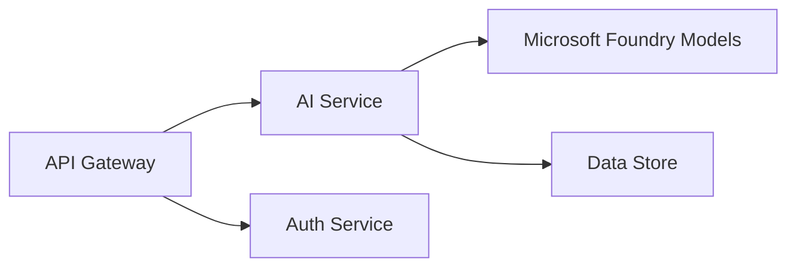

# အခန်း ၈: ထုတ်လုပ်မှုနှင့် စီးပွားရေး ပုံစံများ

**📚 သင်တန်း**: [AZD အတွက် စတင်သူများ](../../README.md) | **⏱️ ကြာမြင့်ချိန်**: ၂-၃ နာရီ | **⭐ အဆင့်အတန်း**: ကျွမ်းကျင်မြင့်မားသော

---

## အနှစ်ချုပ်

အခန်းဤတွင် စီးပွားရေးအဆင့်သင့် ဖော်ပြလေ့လာမှု ပုံစံများ၊ လုံခြုံရေးတင်းကြပ်မှု၊ စောင့်ကြည့်မှုနှင့် ထုတ်လုပ်မှုပိုင် AI စနစ်များအတွက် ကုန်ကျစရိတ်အသင့်ဖြည့်ခြင်းတို့ပါဝင်သည်။

၎င်းမှာ ဆောက်လုပ်မှုပုံစံကို ဦးတည်သည်၊ လုံးဝအပြည့်အစုံ Deploy ပြုလုပ်နိုင်သော Template မဟုတ်ပါ။ နမူနာများသည် သင့် application တွင် ဖြည့်စွက်ရန်နှင့် စမ်းသပ်ရန် လိုအပ်သည့် ပေါင်းစပ်မှုအသေးစိတ်များကို မပါဝင်ပါ; စစ်ဆေးစာရင်းကို ဖတ်ရှုခြင်းဖြင့် ထုတ်လုပ်မှုအဆင်သင့် ဖြစ်ကြောင်း အတည်ပြုခြင်း မဖြစ်ပါ။

> **ထုတ်ပြန်သုံးသပ်မှု (2026-11-04):** AI CLI လမ်းညွှန်များကို `azd 1.37.2`၊ agent များ `1.0.0-beta.23` နှင့် သုံးသပ်ချက်များ `1.0.0-beta.2` မူကြမ်းစာရွက်/အရင်းအမြစ်များနှင့် စစ်ဆေးခဲ့သည်။ လက်ရှိအသုံးပြုမှုလိုအပ်ချက်များနှင့် ပြောင်းရွှေ့မှုအသေးစိတ်များအတွက် [ထုတ်ပြန်ချက်များနှင့် ပြင်ဆင်မှုများ](production-ai-practices.md#recent-release-changes-and-fixes) ကို ကြည့်ပါ; ဤသည်မှာ တိုက်ရိုက် deploy စစ်ဆေးခြင်း မဟုတ်ပါ။

## သင်ယူရမည့် ရည်မှန်းချက်များ

ဤအခန်းကို ပြီးမြောက်စွာ လေ့လာခြင်းဖြင့် သင်သည် -
- စျေးကွက်စွမ်းဆောင်မှုမြင့်မားသော မျိုးဆက်ပြသနာချိုး application များ deploy ပြုလုပ်နိုင်မည်
- စီးပွားရေးလုံခြုံရေးပုံစံများ အကောင်အထည်ဖော်နိုင်မည်
- စုံလင်သော စောင့်ကြည့်မှု စနစ်များ ရှိစေမည်
- တိုးပွားမှုနှုန်းအခြေခံပြီး ကုန်ကျစရိတ် လေ့လာ၍ စီမံနိုင်မည်
- AZD ဖြင့် CI/CD pipeline များ ဆက်သွယ်တပ်ဆင်နိုင်မည်

---

## 📚 သင်ခန်းစာများ

| # | သင်ခန်းစာ | ဖော်ပြချက် | အချိန် |
|---|--------|-------------|------|
| 1 | [ထုတ်လုပ်မှု AI ဆောင်ရွက်ချက်များ](production-ai-practices.md) | စီးပွားရေး deploy ပုံစံများ | ၉၀ မိနစ် |

---

## 🚀 ထုတ်လုပ်မှု စစ်ဆေးစာရင်း

- [ ] စျေးကွက်စွမ်းဆောင်မှုအတွက် မျိုးဆက်ပြသနာချိုး deployment
- [ ] မှတ်ပုံတင် အသိအမှတ်ပြု Managed identity ဖြင့် အသုံးပြုသူအတည်ပြုခြင်း (key မလိုအပ်)
- [ ] စောင့်ကြည့်မှုအတွက် Application Insights အသုံးပြုခြင်း
- [ ] ကုန်ကျစရိတ် လက်လွှတ်နှင့် သတိပေးချက်များ ပြင်ဆင်ထားခြင်း
- [ ] လုံခြုံရေး စစ်ဆေးမှု ဖွင့်ထားခြင်း
- [ ] CI/CD pipeline ဆက်သွယ်တပ်ဆင်မှု
- [ ] ဖယ်ရှားမှု ပြန်လည်စီမံရေးအစီအစဉ်

---

## 🏗️ ဆောက်လုပ်မှုပုံစံများ

### ပုံစံ ၁: Microservices AI



### ပုံစံ ၂: ပွင့်လင်းအတိုး အမြှင့် AI


---

## 🔐 လုံခြုံရေး အကောင်းဆုံး လေ့လာမှုများ

```bicep
// Illustrative properties from different resources, NOT a standalone Bicep file.
// Attach identity to the application host:
identity: {
  type: 'SystemAssigned'
}

// AI account properties (also require private endpoints, DNS and app connectivity):
properties: {
  publicNetworkAccess: 'Disabled'
  networkAcls: {
    defaultAction: 'Deny'
  }
}
```

---

## 💰 ကုန်ကျစရိတ် အာရုံစိုက်မှု

| မူဝါဒ | အဓိက ကန့်သတ်ချက် |
|----------|---------|
| သုညသို့ ဆွဲရာသင့်ခြင်း (Container Apps) | သင့်လျော်သော trigger လိုအပ်သည်; အခြားဝန်ဆောင်မှုများမှာ ကုန်ကျစရိတ်ရှိနေဆဲ |
| ဖွံ့ဖြိုးရေးအတွက် consumption tier များ အသုံးပြုခြင်း | ရွေးချယ်ထားသော ဝန်ဆောင်မှုစျေးနှုန်းနှင့် အလုပ်မတင်မှုနှိုင်းယှဉ်ခြင်း |
| အချိန်ဇယားအလိုက် အရွယ်အစားတိုးခြင်း | ထောက်ခံထားသော အဆောက်အအုံ/အလိုအလျောက်စနစ်ဖြင့် တိုးချဲ့ခြင်း |
| မှတ်ပုံတင်/ ကြိုတင်သတ်မှတ်ထားသော စွမ်းရည် | ထောက်ခံထားသည့်အခါသာဖြစ်ပြီး; ကတိများကြောင့် နားထိုင်သော ကုန်ကျစရိတ် တိုးတက်နိုင်သည် |

မှန်ကန်သောစတင်သည့်ရက်စွဲ၊ ဘီလ်ပေးခွင့်အ ရည်အချင်း၊ လက်ခံသူများနှင့် ခွင့်ပြုချက်များဖြင့် [ပြည့်စုံသော ဘတ်ဂျက်ရင်းမြစ်ပုံစံ](production-ai-practices.md#2-cost-monitoring-and-budgets) ကို အသုံးပြုပါ။ ဘတ်ဂျက်သည် အသိပေးချက်များ ပေးပို့ပေမယ့် သုံးစွဲမှုကို ကန့်သတ်ပေးခြင်း မရှိပါ။ စုဆောင်းနိုင်မှုသည် အသုံးပြုမှုတိုင်းတာချက်ပေါ် မူတည်ပြီး သက်ဆိုင်ရာရာခိုင်နှုန်းများ အတည်ပြုမထားပါ။  

---

## 📊 စောင့်ကြည့်မှု အဆင်သင့်ပြင်ဆင်မှု

```bash
# Open the Application Insights logs view (requires configured monitoring)
azd monitor --logs

# Check Application Insights
azd monitor --overview

# View metrics
az monitor metrics list --resource <resource-id>
```

---

## 🔗 လမ်းညွှန်မှု

| ဦးတည်ချက် | အခန်း |
|-----------|---------|
| **မတိုင်မီ** | [အခန်း ၇: ပြဿနာဖြေရှင်းခြင်း](../chapter-07-troubleshooting/README.md) |
| **သင်တန်းပြီးစီးမှု** | [သင်တန်းမူလစာမျက်နှာ](../../README.md) |

---

## 📖 ဆက်စပ်ရင်းမြစ်များ

- [AI အေးဂျင့်လမ်းညွှန်](../chapter-02-ai-development/agents.md)
- [လျှပ်စစ် သတင်းအချက်အလက်များ](../chapter-06-pre-deployment/application-insights.md)
- [စုံလင်သောအေးဂျင့်ဖြေရှင်းနည်းများ](../chapter-05-multi-agent/README.md)
- [မိုက်ခရိုဆာဗစ် ဥပမာ](../../examples/microservices/README.md)

---

<!-- CO-OP TRANSLATOR DISCLAIMER START -->
**ပြောကြားချက်**
ဤစာတမ်းကို AI ဘာသာပြန်ဝန်ဆောင်မှု [Co-op Translator](https://github.com/Azure/co-op-translator) အသုံးပြု၍ ဘာသာပြန်ထားပါသည်။ ကျွန်ုပ်တို့သည် တိကျမှန်ကန်မှုအတွက် ကြိုးပမ်းနေသော်လည်း၊ စက်ကိရိယာဘာသာပြန်ခြင်းများတွင် အမှားများ သို့မဟုတ် မှားယွင်းချက်များ ပါဝင်နိုင်ကြောင်း သတိပြုပါရန် လိုအပ်ပါသည်။ မူလစာတမ်းကို မူရင်းဘာသာဖြင့်သာ ယုံကြည်စိတ်ချရသော အချက်အလက်အဖြစ် သတ်မှတ်သင့်သည်။ အရေးကြီးသည့် သတင်းအချက်အလက်များအတွက် ပရော်ဖက်ရှင်နယ် လူသားဘာသာပြန်သူဝန်ဆောင်မှုကို အကြံပြုပါသည်။ ဤဘာသာပြန်ချက်ကို အသုံးပြုခြင်းမှ ဖြစ်ပေါ်လာသော နားလည်မှုကွာခြားမှုများ သို့မဟုတ် မမှန်ကန်သော အသုံးပြုမှုများအတွက် ကျွန်ုပ်တို့ တာဝန်မခံပါ။
<!-- CO-OP TRANSLATOR DISCLAIMER END -->