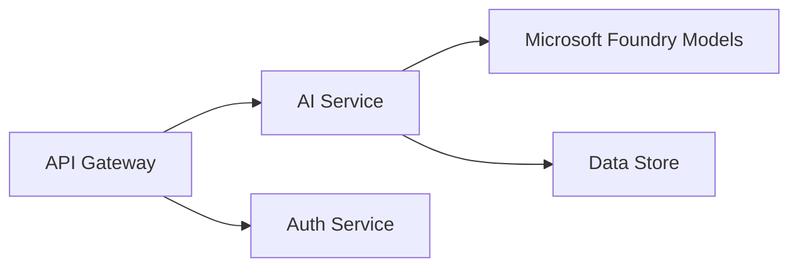
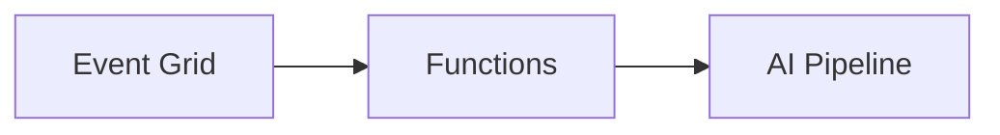

# အခန်း ၈: ထုတ်လုပ်မှုနှင့် စီးပွားရေး လုပ်ထုံးလုပ်နည်းများ

**📚 သင်တန်း**: [AZD စတင်လေ့လာသူများအတွက်](../../README.md) | **⏱️ ကြာမြင့်ချိန်**: ၂-၃ နာရီ | **⭐ အဆင့်အတန်း**: အဆင့်မြင့်

---

## အနှစ်ချုပ်

ဤအခန်းတွင် စီးပွားရေးအသုံးပြုနိုင်သော တပ်ဆင်မှု ပုံစံများ၊ လုံခြုံရေးတင်းကြပ်မှု၊ မျက်မှောက်ကြည့်ရှုခြင်းနှင့် ထုတ်လုပ်မှု AI အလုပ်ဆောင်မှုများအတွက် ကုန်ကျစရိတ် အကောင်းမြှင့်တင်မှုများကို ဖော်ပြထားသည်။

၎င်းသည် ဆောက်ပုံအမျိုးအစားကို ကိုးကားချက်အဖြစ်သာဖြစ်ပြီး၊ ပြည့်စုံစွာ တပ်ဆင်နိုင်သည့် ထုတ်လုပ်မှုနမူနာ မဟုတ်ပါ။ နမူနာများတွင် သင်၏ကိုယ်ပိုင်လျှောက်လွှာတွင် ထည့်သွင်းစမ်းသပ်ရမည့် ပေါင်းစပ်ချက် အသေးစိတ်များ မပါဝင်ပါ; စစ်တမ်းစာမျက်နှာ ဖတ်ခြင်းအားဖြင့် ထုတ်လုပ်မှု အဆင့်မြှင့်မှု အတည်ပြုခြင်း မရရှိနိုင်ပါ။

> **Foundry GA အပ်ဒိတ် (၂၀၂၆-၁၁-၀၉):** Foundry workflow အတွက် `azd >= 1.37.0` နှင့် ပြည့်စုံလုံခြုံစွာ ရရှိနိုင်သည့် `microsoft.foundry` 1.0 bundle ကို သုံးပါ; အကဲဖြတ်မှုများကို သီးသန့်တပ်ဆင်ထားသည်။ [မိတ်ဆက်ခြင်း နယ်ပယ်နှင့် ရွှေ့ပြောင်းခြင်း](production-ai-practices.md#recent-release-changes-and-fixes) နှင့် [အတည်ပြုချက်ပါ လမ်းကြောင်းနမူနာ](production-ai-practices.md#cicd-pipeline-configuration) ကို ကြည့်ပါ။ ၎င်းသည် စာရွက်အတည်ပြုပြင်ဆင်ခြင်း ဖြစ်ပြီး တိုက်ရိုက်တပ်ဆင်ခြင်း အတည်ပြုခြင်း သို့မဟုတ် ရွေးချယ်အားပေး ပြသချက်များအတွက် GA အခြေအနေ မဟုတ်ပါ။

## လေ့လာမှု ရည်မှန်းချက်များ

ဤအခန်းအား ပြီးမြောက်စွာ သင်ယူပြီးနောက် သင်မှာ:
- တိုင်းဒေသ အမျိုးမျိုးတွင် တပ်ဆင်နိုင်သော သက်တံ့ခံအစားထိုး အပလီကေးရှင်းများ တပ်ဆင်ပါမည်
- စီးပွားရေး လုံခြုံရေး ပုံစံများ ကို အကောင်အထည်ဖော်ပါမည်
- စုံလင်သော မျက်မှောက်ကြည့်ရှုမှု တပ်ဆင်ပါမည်
- သုံးစွဲမှု ကုန်ကျစရိတ်ကို အကောင်းဆုံးဖြစ်စေရန် ပြင်ဆင်နိုင်ပါမည်
- AZD ဖြင့် CI/CD လမ်းကြောင်းများ ကို တပ်ဆင်ပါမည်

---

## 📚 သင်ခန်းစာများ

| အမှတ် | သင်ခန်းစာ | ဖော်ပြချက် | အချိန် |
|---|--------|-------------|------|
| 1 | [ထုတ်လုပ်မှု AI လေ့လာမှုများ](production-ai-practices.md) | စီးပွားရေး တပ်ဆင်မှု ပုံစံများ | ၉၀ မိနစ် |

---

## 🚀 ထုတ်လုပ်မှု စစ်တမ်းစာရင်း

- [ ] သက်တံ့ခံနိုင်သော တိုင်းဒေသ အမျိုးမျိုး တပ်ဆင်မှု
- [ ] အသုံးပြုသူများ အတွက် စီမံခန့်ခွဲထားသော ကိုယ်ပိုင်အကြောင်းအရာ အသိအမှတ်ပြုခြင်း (သော့များမလို)
- [ ] မျက်မှောက်ကြည့်ရှုမှု အတွက် Application Insights
- [ ] ကုန်ကျစရိတ် ဘတ်ဂျက်များနှင့် သတိပေးချက်များ ပြင်ဆင်ထားခြင်း
- [ ] လုံခြုံရေး စစ်ဆေးမှု အခွင့်အလမ်းများ ဖွင့်ထားခြင်း
- [ ] CI/CD လမ်းကြောင်းပေါင်းစပ်ခြင်း
- [ ] ဘေးအန္တရာယ် ပြန်လည်ကယ်ဆယ်မှု အစီအစဉ်

---

## 🏗️ ဆောက်လုပ်မှု ပုံစံများ

### ပုံစံ ၁: မိုက်ခရိုစီဝစ်များ AI



### ပုံစံ ၂: ဖြစ်ရပ်အခြေခံ AI



---

## 🔐 လုံခြုံရေး အကောင်းဆုံး အလေ့အကျင့်များ

```bicep
// Illustrative properties from different resources, NOT a standalone Bicep file.
// Attach identity to the application host:
identity: {
  type: 'SystemAssigned'
}

// AI account properties (also require private endpoints, DNS and app connectivity):
properties: {
  publicNetworkAccess: 'Disabled'
  networkAcls: {
    defaultAction: 'Deny'
  }
}
```

---

## 💰 ကုန်ကျစရိတ် အကောင်းဆုံးပြုခြင်း

| မဟာဗျူဟာ | အဓိက ကန့်သတ်ချက် |
|----------|---------|
| ဝင်ငွေနံပါတ် သတ်မှတ်ထားသည့် အတိုင်း (Container Apps) | သင့်တော်သော လှုံ့ဆော်မှုလိုသည်; အခြားဝန်ဆောင်မှုများ သို့မဟုတ် ကုန်ကျစရိတ်များ ရှိနေဆဲ |
| တီထွင်မှုအတွက် စားသုံးမှုအဆင့်များ အသုံးပြုခြင်း | ရွေးချယ်ထားသော ဝန်ဆောင်မှု စျေးနှုန်းနှင့် အလုပ်လုပြောင့်နှိုင်းယှဉ်ပါ |
| မိုက်မောင်းတင်ပြီး အတိုင်းအတာချိန်ဖြတ် ပမာဏချိန်ညှိခြင်း | ထောက်ပံ့မှုရှိသော အဆောက်အအုံ/အလိုအလျောက်လုပ်ငန်းများ ဖြင့် ချိန်ညှိပါ |
| ကြိုတင်သိုလှောင်မှု/သတ်မှတ်ထားသော စွမ်းအား | ထောက်ပံ့မှုပြီးမှသာ ဖြစ်သည်; ကတိများသည် မဖြည့်ဆည်းသော ကုန်ကျစရိတ်တိုးစေနိုင်သည် |

ကျေးဇူးပြု၍ [ပြည့်စုံသော ဘတ်ဂျက် ရင်းမြစ် ပုံစံ](production-ai-practices.md#2-cost-monitoring-and-budgets) ကို တရားဝင် စတင်မှုရက်စွဲ၊ ဘီလ်အတိုင်းအတာ၊ လက်ခံသူများနှင့် ခွင့်ပြုချက်များဖြင့် အသုံးပြုပါ။ ဘတ်ဂျက်သည် သတိပေးချက်များ ပို့ပေးသော်လည်း အသုံးစရိတ်ကို ကန့်သတ်မထားပါ။ စုစည်းချထားမှုများမှာ တိုင်းတာထားသော အသုံးပြုမှု ပမာဏပေါ်မူတည်ပြီး အာမခံထားသော ရာခိုင်နှုန်း မဖြစ်ပါ။

---

## 📊 မျက်မှောက်ကြည့်ရှုမှု တပ်ဆင်ခြင်း

```bash
# Open the Application Insights logs view (requires configured monitoring)
azd monitor --logs

# Check Application Insights
azd monitor --overview

# View metrics
az monitor metrics list --resource <resource-id>
```

---

## 🔗 လမ်းညွှန်

| ဦးတည်ရာ | အခန်း |
|-----------|---------|
| **ယခင်** | [အခန်း ၇: ပြဿနာဖြေရှင်းခြင်း](../chapter-07-troubleshooting/README.md) |
| **သင်တန်း ပြီးဆုံး** | [သင်တန်း အိမ်စာမျက်နှာ](../../README.md) |

---

## 📖 ဆက်စပ် အရင်းအမြစ်များ

- [AI အေးဂျင့်များ လမ်းညွှန်](../chapter-02-ai-development/agents.md)
- [Application Insights](../chapter-06-pre-deployment/application-insights.md)
- [အများပြည်သူ အေးဂျင့် ဖြေရှင်းနည်းများ](../chapter-05-multi-agent/README.md)
- [မိုက်ခရိုစီဝစ် နမူနာ](../../examples/microservices/README.md)

---

<!-- CO-OP TRANSLATOR DISCLAIMER START -->
**ပြောကြားချက်**
ဤစာတမ်းကို AI ဘာသာပြန်ဝန်ဆောင်မှု [Co-op Translator](https://github.com/Azure/co-op-translator) အသုံးပြု၍ ဘာသာပြန်ထားပါသည်။ ကျွန်ုပ်တို့သည် တိကျမှန်ကန်မှုအတွက် ကြိုးပမ်းနေသော်လည်း၊ စက်ကိရိယာဘာသာပြန်ခြင်းများတွင် အမှားများ သို့မဟုတ် မှားယွင်းချက်များ ပါဝင်နိုင်ကြောင်း သတိပြုပါရန် လိုအပ်ပါသည်။ မူလစာတမ်းကို မူရင်းဘာသာဖြင့်သာ ယုံကြည်စိတ်ချရသော အချက်အလက်အဖြစ် သတ်မှတ်သင့်သည်။ အရေးကြီးသည့် သတင်းအချက်အလက်များအတွက် ပရော်ဖက်ရှင်နယ် လူသားဘာသာပြန်သူဝန်ဆောင်မှုကို အကြံပြုပါသည်။ ဤဘာသာပြန်ချက်ကို အသုံးပြုခြင်းမှ ဖြစ်ပေါ်လာသော နားလည်မှုကွာခြားမှုများ သို့မဟုတ် မမှန်ကန်သော အသုံးပြုမှုများအတွက် ကျွန်ုပ်တို့ တာဝန်မခံပါ။
<!-- CO-OP TRANSLATOR DISCLAIMER END -->