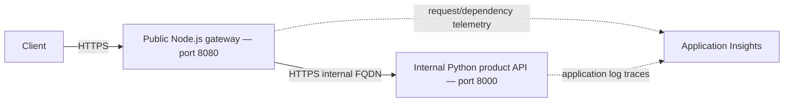

# နှစ်ခုဝန်ဆောင်မှုပေါင်း မိုက်ခရိုဆာဗစ်များ — Azure Container Apps

**အဆင့်:** အလယ်အလတ် · **အချိန်:** ၄၅–၆၀ မိနစ် setup အပါအဝင်

ဒီသင်ယူမှုနမူနာက **Node.js API Gateway** နဲ့ **ဖတ်-only Python ထုတ်ကုန်ဝန်ဆောင်မှု** ကိုမှီတည်တည်ဆောက်ထားပါတယ်။
အရင်းအမြစ်၊ Dockerfiles၊ Bicep၊ နဲ့ azd ကွန်ဖီးဂျူရေးရှင်းများပါဝင်ပါတယ်။
၎င်းမှာ ထုတ်လုပ်မှုအဆင့်မတက်သေးသည့် စနစ်ဖြစ်သည်။

## သင်ယူမည့်အချက်များ

- ဝန်ဆောင်မှုနှစ်ခုကို အလွတ်တန်းသိသာစွာ တင်သွင်းတည်ဆောက်ပါ။
- HTTPS မှတဆင့် အတွင်းပိုင်း backend FQDN ကိုသုံးပါ။
- အောင်မြင်မှု၊ မတွေ့ရှိခြင်းနှင့် ဝန်ဆောင်မှုမရရှိနိုင်ခြင်းဖြေကြားချက်များကို အတည်ပြုပါ။
- telemetry နှင့် သီးခြားတိုးချဲ့နိုင်မှု နယ်နိမိတ်များကို နားလည်ပါ။



ထုတ်ကုန် ကတ်တလာတွင် မှတ်ဉာဏ်ထဲတွင် သတ်မှတ်ထားသော ထုတ်ကုန်ငါးခု ပါဝင်သည်။ **POST, 
PUT, သို့မဟုတ် DELETE ကိုင်တွယ်မှု မရှိပါ**၊ ဒေတာဘေ့စ်၊ စားသုံးသူ့ဝန်ဆောင်မှု၊ အမိန့်/အသုံးပြုသူ/အသိပေးဝန်ဆောင်မှု၊ 
C# သို့မဟုတ် Go ကုတ်များ မပါဝင်ပါ။ ၎င်းတို့သည် အနာဂတ်ဖွံ့ဖြိုးတိုးတက်မှုအတွက် အကြံအစည်များဖြစ်ပြီး ပါဝင်သော အင်္ဂါရပ်များ မဟုတ်ပါ။
ဂိတ်ဝေးသည် အသုံးပြုသူများအား အတည်ပြုသည် မဟုတ်ပါ။ အတွင်းပိုင်း ဝင်ရောက်မှုသည် လျှောက်လွှာ အတည်ပြုခွင့်အစား ထည့်သွင်းခြင်း မဟုတ်ပါ။


## လိုအပ်ချက်များ

ပထမဦးဆုံး [single Flask API](../../../../../examples/container-app/simple-flask-api) ကို ပြီးမြောက်ပါ။
လတ်တလောတည်ငြိမ်သော azd (သုံးသပ်ချိန်တွင် ထုတ်ပြန်ထားသော version: 1.37.2), Azure CLI,
နှင့် Docker ကို daemon chạy နေစေ၍ 설치ပါ။ သင်သည် Azure subscription, resource
ဖန်တီးခွင့်များနှင့် Container Apps တိုင်းဒေသအလိုက် အရေအတွက်ကန့်သတ်ချက်လိုအပ်သည်။

```bash
azd version
az version
docker info
azd auth login
az login
```

CLI ကိရိယာနှစ်ခုစလုံးတွင် ဆော့စ်ကွန်းတူ subscription ကို အသုံးပြုပါ။ အောက်ပါ command များမှာ Bash ကိုသုံးထားသည်။

## တပ်ဆင်ခြင်းနှင့် အတည်ပြုခြင်း

ကုဒ်သိုလှောင်ထားသော root ဖိုလ်ဒါမှစ၍-

```bash
cd examples/container-app/microservices
azd env new microservices-demo
azd up
GATEWAY_URL=$(azd env get-value API_GATEWAY_URL)
RG_NAME=$(azd env get-value AZURE_RESOURCE_GROUP)
GATEWAY_NAME=$(azd env get-value API_GATEWAY_NAME)
PRODUCT_NAME=$(azd env get-value PRODUCT_SERVICE_NAME)

curl --fail-with-body "${GATEWAY_URL}/health"
curl --fail-with-body "${GATEWAY_URL}/api/products"
curl --fail-with-body "${GATEWAY_URL}/api/products/1"
curl -i "${GATEWAY_URL}/api/products/999"
```

**အောင်မြင်မှု:** health 200; list 200 နှင့် **ငါး**ပစ္စည်း; ပစ္စည်း ၁ သည် Laptop ဖြစ်ပြီး
၉၉၉.၉၉ ဈေးနှုန်းနှင့် စတော့ ၅၀ ရှိသည်; မသိသော ပစ္စည်းသည် 404 ပြန်ပေးသည်။
ဖော်ပြချက်များသည် အကြောင်းပြန်စာများတွင် ပါဝင်သည်; အချိန်တံဆိပ်များ မတူကွဲပြားသည်။

စတင် ပေးပို့ခြင်းသည် 80 port ပေါ်ရှိ ပရိသတ်ကြီး hello-world image များကို အသုံးပြုသည်၊
ထိုကြောင့် ရှိမရှိမသိရှိ image များကို ကုဒ်သိုလှောင်မှုရာထဲမှ ဆွဲယူရန် မကြိုးစားပါ။
ဝန်ဆောင်မှုအလိုက် Bicep module များနှင့် parameter ဖိုင်များသည် ဘေးကင်း image နှင့် app port/probes များဖြင့်
`azd deploy` အတွင်း ပြောင်းလဲ ထားသည်။ အဓိက parameter များမှာ ထုတ်ပြန်ထားသော image အမည်များကို နောက်ဆုံးအတွက်

## ဝန်ဆောင်မှုများနှင့် ကွန်ယက်ဆက်သွယ်မှု

| ဝန်ဆောင်မှု | ထွက်ရှိသည့် endpoint များ | မူရင်း အရင်းအမြစ်များ |
|---|---|---|
| Gateway | GET `/`, `/health`, `/api/products`, `/api/products/:id` | 1 vCPU, 2 GiB, 2–20 မျိုးခွဲများ |
| Product | GET `/`, `/health`, `/products`, `/products/<id>` | 0.5 vCPU, 1 GiB, 1–10 မျိုးခွဲများ |

Product ingress တွင် `external: false` နှင့် `allowInsecure: false` ပါဝင်သည်။ Bicep သည်
`PRODUCT_SERVICE_URL=https://<actual-internal-fqdn>` ကို gateway ထဲသို့ထည့်သည်။ HTTP သည်
ပြောင်းလဲရန်ဖြစ်မည်။ HTTPS သည် သတ်မှတ်ထားသော ingress ကို ကိုက်ညီသည်။ DNS အတိုကောက်အမည်သည်
**အစစ်ဖြစ်သော Container App အမည်နှင့်ကိုက်ညီရမည်**၊ မရှိမှ logical service key `product-service` မဟုတ်ပါ။
သင့် laptop မှ အတွင်းပိုင်း URL ကို တိုက်ရိုက်ခေါ်ရန် မကြိုးစားပါနှင့်။

Gateway တွင် product ခေါ်ဆိုမှုများတွင် ၅ စက္ကန့် timeout ရှိသည်။ ပစ္စည်း ID မရှိခြင်းသည် 404 ပြန်လည်ပေးသည်။
သယ်ယူပို့ဆောင်မှု မအောင်မြင်ခြင်း/နောက်ခံ server မအောင်မြင်ခြင်းသည် 503 ပြန်လည်ပေးသည်။ Gateway
`/health` သည် gateway ကိုသာ စစ်ဆေးပြီး နောက်ခံရရှိနိုင်မှုကို မစစ်ဆေးပါ။

## ဖိုင်များနှင့် ဖွဲ့စည်းမှု

```text
azure.yaml
infra/main.bicep
infra/main.parameters.json
infra/abbreviations.json
infra/core/container-apps-environment.bicep
infra/core/monitor.bicep
infra/app/api-gateway.bicep
infra/app/api-gateway.parameters.json
infra/app/product-service.bicep
infra/app/product-service.parameters.json
src/api-gateway/{app.js,package.json,Dockerfile}
src/product-service/{main.py,requirements.txt,Dockerfile}
```

ထိုစာရွက်စာတမ်းများတွင် `infra/app/*.bicep` တွင် Scaling, CPU/memory, ports, နှင့် probes များကို သတ်မှတ်ထားသည်။ ပြောင်းလဲပါ
ဖိုင်များကို ပြုပြင်ပြီး `azd up` ကို ပြေး၍ အင်ဖရာစက်မှုလုပ်ငန်းများကို သက်ဆိုင်စွာ အသုံးပြု၍ ထပ်တိုး ပြန်တင်ပါ။ ဤနမူနာတွင်
`GATEWAY_MAX_REPLICAS` ပတ်ဝန်းကျင်-အပြောင်းအလဲ ပါရာမီတာ မရှိပါ။

သာ code ပြောင်းလဲမှုများအတွက်:

```bash
azd deploy product-service
azd deploy api-gateway
```

Node image သည် Node 22 ကို အသုံးပြုသည်; Python image သည် Python 3.11 ကို အသုံးပြုသည်။ နှစ်ခုစလုံးသည် တပ်ဆင်ထားသည်
`0.0.0.0`။ Ingress/probes များသည် port 8080 (gateway) နှင့် 8000 (product) ကို လိုက်လံအသုံးပြုပါသည်။

## Docker ဖြင့် ဒေသဆိုင်ရာ ဖွံ့ဖြိုးတိုးတက်မှု

ဤဥပမာဖိုင်ထဲမှ ပိတ်ဆို့ထား၍ အသုံးပြုပါ။ အသုံးပြုသူသတ်မှတ်ထားသော ကွန်ရက်ကို အသုံးပြုပါ၊ **မဟုတ်ပါ `localhost`
ကို တစ်ခုတည်းသော ကွန်တိန်နာမှ တစ်ခုတည်းသို့ ရောက်ရှိရန်**:

```bash
docker network create azd-microservices-demo
docker build -t local-product ./src/product-service
docker build -t local-gateway ./src/api-gateway
docker run -d --name azd-product --network azd-microservices-demo local-product
docker run -d --name azd-gateway --network azd-microservices-demo \
  -p 8080:8080 -e PRODUCT_SERVICE_URL=http://azd-product:8000 local-gateway
curl --fail-with-body http://localhost:8080/api/products
```

မျှော်မှန်းထားသည်မှာ ကုန်ပစ္စည်းငါးခုဖြစ်သည်။ HTTP ကို ဒီဒေါက်ခါးကွန်ရက် ဒေသတွင်းတွင်သာ အသုံးပြုသည်။

```bash
docker stop azd-product azd-gateway
docker rm azd-product azd-gateway
docker network rm azd-microservices-demo
```

## စောင့်ကြည့်ခြင်း

```bash
az containerapp logs show --name "$GATEWAY_NAME" --resource-group "$RG_NAME" --follow
# In a separate terminal:
az containerapp logs show --name "$PRODUCT_NAME" --resource-group "$RG_NAME" --tail 100
```

`azd monitor --logs` သည် ပေါ်တယ်ပြတင်းပေါ်ကို ဖွင့်ပေးသည်။ ၎င်းသည် terminal မှတ်တမ်းများကို မစီးဆင်းပေးပါ။
Node SDK သည် မေကိုင်တံခါး ငြိမ်ငွေ့/လိုအပ်ချက်များကို စုဆောင်းပေးသည်။ Python ၏ `AzureLogHandler`
သည် **မှတ်တမ်းလွှာများကို တင်ပေးသည်၊ မဟုတ်ပေ - အလိုအလျောက် Flask မေကိုင်တံခါး၊ SQL လိုအပ်ချက်များ သို့မဟုတ် ပြည့်စုံသော
ဖြန့်ဝေသည့် မှတ်တမ်းများကို မတင်ပေးပါ။ OpenCensus သည် အရင် SDK တစ်ခုဖြစ်သည်။ ဤဥပမာကို ဆက်လက်တိုးချဲ့ရန်အတွက် Azure Monitor OpenTelemetry ကို ဦးစားပေးသုံးစွဲပါ။


Application Insights Logs တွင်၊ requests များ ပြုလုပ်ပြီး စစ်ဆေးပါ။

```kusto
requests
| where timestamp > ago(1h)
| where name contains "products"
| summarize RequestCount=count(), AvgDuration=avg(duration) by bin(timestamp, 5m)
```

Python application စာတိုများအတွက်။

```kusto
traces
| where timestamp > ago(1h)
| where message contains "products"
| project timestamp, message, severityLevel
```

ingestion ကာလနှင့် sampling ကို ခွင့်ပြုပါ၊ တိတိကျကျ request အရေအတွက် သို့မဟုတ် အာမခံထားသော လေထုကြာချိန် မျှော်လင့်မထားပါနှင့်။ သုံးစွဲသူ alert များ သို့မဟုတ် dashboards များ မထည့်သွင်းထားပါ။


## လက်တွေ့ လေ့ကျင့်မှုများ

### လေ့ကျင့်မှု ၁: ကက်တယ်လော့ကို ပြင်ဆင်ပါ

**စတင်ရာနေရာ:** `src/product-service/main.py`။
**ရည်မှန်းချက်:** လွတ်လပ်သောဝန်ဆောင်မှုစွန့်ပစ်မှုကို အတည်ပြုသည်။
Laptop ရဲ့စာရင်းအင်းကို 50 မှ 49 သို့ပြောင်းပြင်ပြီး `products` စာရင်းဒေတာတွင်၊
`azd deploy product-service` ကိုပြေးပြီးနောက် `${GATEWAY_URL}/api/products/1` ကိုတောင်းဆိုပါ။

**အောင်မြင်မှုစံချိန် / ဖြေရှင်းနည်း:** HTTP 200 နှင့်အတူ `"stock":49` ရပါမည်။ ထပ်မံ 50 ကိုပြန်တည်ဆောက်၍ ထပ်တလဲလဲတင်ပါ။
**ပုံမှန်ပြဿနာ:** စာရင်းကိုင်မှုတို့ကိုပိုင်ဆိုင်သောဝန်ဆောင်မှုမဟုတ်ဘဲ gateway ကိုပြင်ဆင်နေခြင်း။
ဤကိစ္စသည် အရင်းအမြစ်ဒေတာကိုပြောင်းလဲခြင်းဖြစ်ပြီး ပုံမှန်မပြောင်းလဲသော စတော့အမျိုးအစားဒေတာဘေ့စ်မှာ မဟုတ်ပါ။

### လေ့ကျင့်မှု ၂: ဥပမာမော်ဒယ်ဖွဲ့စည်းမှုပြင်ဆင်မှုကို အတည်ပြုပါ

**စတင်နေရာ:** `infra/app/product-service.bicep`။
**ရည်ရွယ်ချက်:** autoscaling ကိုခန့်မှန်းခြေမပြုဘဲ အဆောက်အအုံပြောင်းလဲမှုကိုကြည့်ရန်။
`minReplicas: 1` ကို `minReplicas: 2` သို့ပြောင်းပြီး `azd up` ကိုပြေးပါ၊ ထို့နောက်

```bash
az containerapp show --name "$PRODUCT_NAME" --resource-group "$RG_NAME" \
  --query properties.template.scale -o json
```

**အောင်မြင်မှုစံနှုန်းများ:** ကုန်ကြမ်းထားသောအနည်းဆုံးသည် 2 ဖြစ်ပြီး အများဆုံးသည် 10 အဖြစ်မပြောင်းလဲပါ။
အနည်းဆုံးကို 1 ပြန်ထားပြီး `azd up` ကို စစ်ဆေးပါ။
**အထူးပြောရမည့် ပြဿနာ:** `azd deploy` သီးသန့်တက်သောအခါ မဆက်စပ်သောမျှဝေထားသောအရာများ အပေါ် ပြောင်းလဲမှု မပြုလုပ်ပါ။
နေရာအခြေခံအဆောက်အဦ။ ချိုးဖျက်မှုစမ်းသပ်မှုအဖြစ် `maxReplicas` ကို သုညတန်ဖိုးထားခြင်း မလုပ်ပါနဲ့။
ဒါဟာ configuration ကိုသာ အတည်ပြုပေးတာဖြစ်ပြီး load-test လုပ်ခြင်းမဟုတ်ပါ၊ ဒါမှ မဟုတ် ချက်ချက်ပုံအကြိမ်ရေကို အာမခံခြင်းမဟုတ်ပါ။

### လေ့ကျင့်ခန်း ၃: ဒေသခံတွင် unavailable-service ကို စမ်းသပ်ခြင်း

**အစပျိုးချက်:** အထက်ပါ ဒေသခံ Docker container နှစ်ခုလုံး တက်နေပြီဖြစ်တယ်။
**ရည်ရွယ်ချက်:** backend ပျက်ကွက်မှုကို ပစ္စည်းပျောက်မှုနှင့် ခြားနားစေနိုင်ရန်။
ပစ္စည်း container ကိုသာ ရပ်ပါ။

```bash
docker stop azd-product
curl -i http://localhost:8080/api/products
docker start azd-product
curl --fail-with-body http://localhost:8080/api/products
```

**အောင်မြင်မှုအချက်အလက်:** ရပ်ထားရင်းမှာ gateway က 503 ကို ပြန်ပေးမယ်၊
`"error":"Product service unavailable"` ရှိပြီး; ပြန်စလိုက်ရင်စာရင်းက 200 ပြန်ရရှိမယ်။
လိုအပ်ဆိုရင် စတင်တက်နိုင်ချိန်နည်းနည်း ကြာသေးမှ ပြန်ကြိုးစားပါ။
**အထွေထွေပြဿနာ:** gateway ကို ရပ်လိုက်တဲ့အခါ မတူညီတဲ့ ချို့ယွင်းမှု (HTTP တုံ့ပြန်ချက် မရှိခြင်း) ကို စမ်းသပ်တာဖြစ်တတ်တယ်။

## ကုန်ကျစရိတ်များနှင့် ထုတ်လုပ်မှု အတားအဆီးများ

ပုံသေ အနည်းဆုံး အမိန့်များသည် ကွန်ပျူတာကို အလုပ်လုပ်နေစေသည်။ မှတ်တမ်းပုံသွင်းခြင်းနှင့် ကြည့်ရှုစောင့်ကြည့်ခြင်းတို့သည်လည်း
ကုန်ကျစရိတ်များဖြစ်စေသည်။ အတည်ပြုပြီးသား $50/လ တိတိရှိသည် မဟုတ်ပါ: ဒေသအလိုက် CPU/မှတ်ဥာဏ်,
မိတ္တူနာရီ အားလုံး, ဘောက်အော်ဒါများ, မှတ်ပုံတင်ခြင်းနှင့် မှတ်တမ်းသိမ်းဆည်းမှုကို
[Azure စျေးနူန်းတွက်ချက်သူ](https://azure.microsoft.com/pricing/calculator/) တွင် ခန့်မှန်းပါ။
သင်ယူမှုအရင်းအမြစ်များကို အမြန် ဖျက်ပစ်ပါ။

ထုတ်လုပ်မှုပြုလုပ်မှုများတွင် မှန်ကန်မှု/ခွင့်ပြုချက်, အတည်ပြုသတ်မှတ်ထားသော စီမံခန့်ခွဲထားသော မှတ်ပုံတင်ခွင့်များ,
တည်ငြိမ်သော ဒေတာ, ထည့်သွင်းမှု/ပြန်ကြားရေး စစ်ဆေးခြင်း, ထောက်ခံမှု ရှိသော ကြည့်ရှုနိုင်မှုကိရိယာများ,
အခွန်/ပျက်ကွက် စမ်းသပ်ခြင်း, CI/CD, သတိပေးချက်များ, ပြန်လည် ကုသဖြေရှင်းနည်းများ များပါဝင်သည်။ အော်ဒါဝန်ဆောင်မှု,
လိုင်း၊ ဒေတာအခြေခံကို ထည့်ရန် သော အလုပ် များသည် သဘောတူညီမှုလုပ်ငန်းမဟုတ်၊ ဒီနေရာမှာ အသုံးပြုနိုင်သော အင်္ဂါရပ် မဟုတ်ပါ။


## ဆုံးဖြတ်ရန်အခက်အခဲများနှင့် ရှင်းလင်းရေး

- **ပုံရိပ်ကို ပထမအကြိမ် တပ်ဆင်စဉ် တွက်မတွေ့ခြင်း:** bootstrap သည် ပြည်သူများ အသုံးပြုနိုင်သော ပုံရိပ်ကို အသုံးပြုသင့်သည်;
  အဓိကပုံရိပ် parameter မူလတန်ဖိုးများနှင့် တပ်ဆင်မှု module များကို စစ်ဆေးပါ။
- **503 ပစ္စည်းများ:** ပစ္စည်းမှတ်တမ်းများ၊ ပုံရိပ်ပြုပြင်မှုနှင့် ထိုးထွင်းသွင်းထားသော မူရင်း HTTPS URL ကို စစ်ဆေးပါ။
- **404 မမှန်မကန်သော လမ်းကြောင်း:** ပစ္စည်း API သည် ဖတ်သက်သာသာဖြစ်သည်; လမ်းကြောင်းကို စစ်ဆေးပါ၊ မရှိသော CRUD handler မဟုတ်ရန်
- **တယ်လီမီထရီ မရှိခြင်း:** runtime ချိတ်ဆက်မှုစာကြောင်းများကို ဖော်ထုတ်ခြင်းမပြုဘဲ စောင့်ကြည့်ပြီး နှောင့်နှေးမှု ခွင့်ပြုပါ။
  Python request စာရင်းဇယားများကို၎င်း၏ မှတ်တမ်းဝန်ဆောင်မှုပို့ခံ မပြုပါ။

ဤ နမူနာ ဖိုင်လမ်းကြောင်းမှ။

```bash
azd down
```

ဖျက်ရန် မှတုံ့ပြန်ချက်များကို ပြန်လည်ကြည့်ရှု၍ ပုံမှန် အထူးသတ်မှတ်ထားသော သယံဇာတအုပ်စု ဖျက်ပစ်ထားသည်ကို သေချာပါစေ။

[ခေတ္တ: Flask API](../../../../../examples/container-app/simple-flask-api) · [နောက်တစ်ခု: ဒေတာဘေ့စ် app](../../../../../examples/database-app) ·
[AI ဖွံ့ဖြိုးမှု](../../../docs/chapter-02-ai-development/README.md) ·
[သင်တန်း မူလစာမျက်နှာ](../../../README.md) · [ပြဿနာတင်ရန်](https://github.com/microsoft/AZD-for-beginners/issues)

---

<!-- CO-OP TRANSLATOR DISCLAIMER START -->
**ပြောကြားချက်**
ဤစာတမ်းကို AI ဘာသာပြန်ဝန်ဆောင်မှု [Co-op Translator](https://github.com/Azure/co-op-translator) အသုံးပြု၍ ဘာသာပြန်ထားပါသည်။ ကျွန်ုပ်တို့သည် တိကျမှန်ကန်မှုအတွက် ကြိုးပမ်းနေသော်လည်း၊ စက်ကိရိယာဘာသာပြန်ခြင်းများတွင် အမှားများ သို့မဟုတ် မှားယွင်းချက်များ ပါဝင်နိုင်ကြောင်း သတိပြုပါရန် လိုအပ်ပါသည်။ မူလစာတမ်းကို မူရင်းဘာသာဖြင့်သာ ယုံကြည်စိတ်ချရသော အချက်အလက်အဖြစ် သတ်မှတ်သင့်သည်။ အရေးကြီးသည့် သတင်းအချက်အလက်များအတွက် ပရော်ဖက်ရှင်နယ် လူသားဘာသာပြန်သူဝန်ဆောင်မှုကို အကြံပြုပါသည်။ ဤဘာသာပြန်ချက်ကို အသုံးပြုခြင်းမှ ဖြစ်ပေါ်လာသော နားလည်မှုကွာခြားမှုများ သို့မဟုတ် မမှန်ကန်သော အသုံးပြုမှုများအတွက် ကျွန်ုပ်တို့ တာဝန်မခံပါ။
<!-- CO-OP TRANSLATOR DISCLAIMER END -->