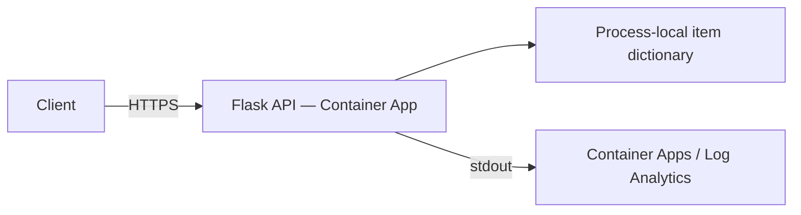

# လွယ်ကူသော Flask API — Azure Container Apps

**အဆင့်:** မစတင်သူ · **အချိန်:** 30–45 မိနစ် (စတင်တပ်ဆင်ခြင်းအပါအဝင်)

Azure Developer CLI (azd) ဖြင့် Python Flask CRUD API တစ်ခု ထုတ်လုပ်ပါ။ မူလကုဒ်, Dockerfile,
Bicep နှင့် deployment parameters များ ပါဝင်သည်။ သည်သည် **သင်ယူမှုနမူနာ** ဖြစ်ကာ
ထုတ်လုပ်မှုအဆင့်ပြည့် API မဟုတ်ပါ။

## သင်ယူရမည့်အရာများ

- azd ဖြင့် container တည်ဆောက်ပြီး ဖော်ပြခြင်း။
- ingress နှင့် liveness/readiness probes ကို ဖွဲ့စည်းညှိနှိုင်းခြင်း။
- CRUD အဖြေများစစ်ဆေးပြီး application logs များကို စစ်ဆေးခြင်း။
- မှတ်ဉာဏ်ရှိ ဒေတာသည် ခိုင်မာသော application များအတွက် မသင့်လျော်သောကြောင်း နားလည်ခြင်း။



**အရေးကြီး:** ပစ္စည်းများကို တစ်ခုသော process တစ်ခုအတွင်း သိမ်းဆည်းထားသည်။ မူလတစ်ခုမှာ **Gunicorn worker တစ်ခု,
0–1 replicas** ဖြစ်ပြီး ဝေါ်ကာများ/replicas အကြား ဒေတာ မညီမျှမှုကို ရှောင်ကြဉ်ရန် ရည်ရွယ်သည်။
ပြန်ခေါ်သည့်အခါ, ပြင်ဆင်မှု ပြောင်းလဲသည့်အခါ သို့မဟုတ် zero သို့ မျှတစွာကြီးပြင်းစေသည့် အခါ ပစ္စည်းများဆုံးရှုံးမှု ရှိသည်။
replicas များဖြင့် ကြီးပြင်းရန် shared persistent storage လိုအပ်သည်။ API သည် authentication သို့မဟုတ် authorization မပါဝင်ပါ။

## ကြိုတင်လိုအပ်ချက်များ

- [လက်ရှိတည်ငြိမ်သော azd](https://learn.microsoft.com/azure/developer/azure-developer-cli/install-azd)
  (သုံးသပ်ချိန်တွင် ထုတ်ဝေထားသောဗားရှင်း: 1.37.2)။
- [Azure CLI](https://learn.microsoft.com/cli/azure/install-azure-cli) ကို စစ်ဆေးရန်။
- Docker နဲ့ daemon လည်ပတ်နေမှု; ဒါဟာ ပျမ်းမျှ ဒေသခံ image တည်ဆောက်မှုအတွက် လိုအပ်ပါတယ်။
- Azure subscription, resource-creation ခွင့်ပြုချက်များ၊ နှင့် Container Apps ဒေသဆိုင်ရာ အနုတ်ထိန်းချုပ်မှု။
- အောက်ပါ command များအတွက် Bash (သို့) PowerShell တူညီသောအသုံးပြုမှု။
- ရွေးချယ်စရာ local development အတွက် Python 3.11။

```bash
azd version
az version
docker info
azd auth login
az login
```

CLI tools များတွင် login session များကွာခြားသည်။ နှစ်ခုလုံးတွင် တူညီသော subscription ကို အသုံးပြုပါ။

## အလျင်အမြန် စတင်ခြင်း

စာကြည့်တိုက်ရဲ့ အခြေခံ directory မှ:

```bash
cd examples/container-app/simple-flask-api
azd env new flask-demo
azd up
API_URL=$(azd env get-value API_ENDPOINT)
RG_NAME=$(azd env get-value AZURE_RESOURCE_GROUP)
API_NAME=$(azd env get-value API_NAME)
curl --fail-with-body "${API_URL}/health"
```

မျှော်မှန်းထားချက်: HTTP 200 နှင့် `"status":"healthy"`၊
`"service":"simple-flask-api"`, နှင့် လက်ရှိ UTC အချိန်ကိုပါရှိသည့် JSON။
Provisioning နှင့် image တည်ဆောက်ခြင်းသည် မိနစ်အနည်းငယ်ကြာနိုင်သည်၊ အချိန်သည် မတူညီနိုင်ပါသည်။

စတင်စဥ်၌ ပေါ်ပြူလာ hello-world image တစ်ခုကို port 80 တွင် အသုံးပြုသည်။
`azure.yaml` က `infra/app/api.bicep` နှင့် ပြန်လည်လိုက်ဖက်သော parameters ဖိုင်ကို
service deployment အတွက် ရွေးချယ်ပြီး image, ingress, နှင့် probes ကို port 8000 သို့ ပြောင်းသည်။
ထို deployment parameters များကို ဖျက်မထားပေးရ။

## CRUD ကို စစ်ဆေးခြင်း

တူညီသော replica က အလုပ်လုပ်နေစဉ် အောက်ပါ အဆင့်များကို အဆက်မပြတ် လုပ်ဆောင်ပါ။

```bash
# Create: HTTP 201; note the returned id (1 for a fresh process).
curl -i -X POST "${API_URL}/api/items" \
  -H "Content-Type: application/json" \
  -d '{"name":"Test Item","description":"My first item"}'

# Read list: HTTP 200, total 1 in a fresh process.
curl --fail-with-body "${API_URL}/api/items"

# Replace 1 if your create response returned another id.
curl --fail-with-body "${API_URL}/api/items/1"
curl -i -X PUT "${API_URL}/api/items/1" \
  -H "Content-Type: application/json" -d '{"name":"Updated Item"}'
curl -i -X DELETE "${API_URL}/api/items/1"
curl -i "${API_URL}/api/items/1"
```

အောင်မြင်မှု: POST 201, reads/PUT 200, DELETE 204 မှာ body မရှိဘဲ၊ ထို့နောက် ပျောက်ဆုံး item 404။
မမှန်ကန်သော/non-object JSON သို့မဟုတ် name ထည့်မထားခြင်းသည် 400 ပြန်ပေးသည်။
အကြောင်းတစ်ခုခုကြောင့် item တစ်ခု တောင်းဆိုမှုတွေအကြားပျောက်ဆုံးပါက၊ restart သို့မဟုတ် scale-to-zero ကို စစ်ဆေးပါ။
၎င်းမှာ အကုန်အကျဆုံး မှတ်ဉာဏ်ကန့်သတ်ချက်ဖြစ်ပြီး၊ persist မရှိပါ။

| Endpoint | Methods |
|---|---|
| `/` | GET — service အချက်အလက်များ |
| `/health` | GET — liveness/readiness |
| `/api/items` | GET, POST |
| `/api/items/{id}` | GET, PUT, DELETE |

## မှတ်တမ်းများနှင့် ပုံသဏ္ဍာန်သတ်မှတ်ချက်

```bash
az containerapp logs show --name "$API_NAME" --resource-group "$RG_NAME" --follow
```

မျှော်မှန်းချက်: Gunicorn စတင်မှု၊ အတောင်းထားပါ မူဝါဒမှတ်တမ်းများ နှင့် အပ်ပလီ케ရှင်း စာရင်းများ။
`azd monitor --logs` သည် portal view ကို ဖွင့်ပေးသည်၊ terminal သို့ stream မဟုတ်ပါ။
Application Insights ကို provision လုပ်ထားသော်လည်း **ဤ Flask code မှ စက်မှုပစ္စည်းအဖြစ် မအပ်ထားပါ**။
stdout logs များအတွက် Container Apps/Log Analytics ကို အသုံးပြုပါ။

CPU/memory, replica ကန့်သတ်ချက်များ သို့မဟုတ် scale နည်းလမ်းများကို ပြင်ဆင်ရန် `infra/app/api.bicep` ကို ပြင်ဆင်ပြီး
`azd up` ကို စတင်ပါ။ ပုံမှန်တန်ဖိုးများမှာ 0.5 vCPU, 1 GiB, အနည်းဆုံး 0 / အများဆုံး 1 replica နှင့်
HTTP threshold တန်ဖိုးသည် တပြိုင်တည်း အတောင်းများ 50 ဖြစ်သည်။ Scale-to-zero သည် cold-start နောက်ကျချိန်ကို ထပ်မံဖြည့်စွက်နိုင်သည်။

မသက်ဆိုင်သော `azd env set MAX_REPLICAS`, `API_KEY`, `LOG_LEVEL`, သို့မဟုတ်
`SCALE_TO_ZERO_TIMEOUT` တန်ဖိုးများကို **ဤအမျိုးအစား သို့မဟုတ် အက်ပ်နှင့် မချိတ်ဆက်ပါ**။
တန်ဖိုးတစ်ခု ချမှတ်ခြင်းသည် လုပ်ဆောင်ချိန် ပတ်ဝန်းကျင် အပြောင်းအလဲအဖြစ် အလိုအလျောက် မပြောင်းလဲစေပါ။
Image သည် port 8000 ကို တိတိကျကျ bind လုပ်ထားသည်။ Port ပြောင်းလဲလိုပါက Dockerfile, Bicep ingress နှင့် probes များကို
တပြိုင်နက် ပြင်ဆင်ပါ။

## ဖိုင်များ

```text
azure.yaml
infra/main.bicep
infra/main.parameters.json
infra/app/container-apps.bicep       # Environment, registry, monitoring
infra/app/api.bicep                  # App, ingress, probes, scale settings
infra/app/api.parameters.json        # Image and resource values for azd deploy
src/app.py
src/Dockerfile
src/requirements.txt
```

## ဒေသခံ ဖွံ့ဖြိုးတိုးတက်မှု

ဤဥပမာ directory မှ:

```bash
python -m venv .venv
source .venv/bin/activate  # PowerShell: .\.venv\Scripts\Activate.ps1
python -m pip install -r src/requirements.txt
python src/app.py
```

အသစ်သော terminal တစ်ခုတွင် `http://localhost:8000/health` နှင့် CRUD endpoint များကို စမ်းသပ်ပါ။
သို့မဟုတ် အမှန်တကယ် image ကို တည်ဆောက်ပြီး လည်ပတ်ပါ:

```bash
docker build -t flask-api:local ./src
docker run --rm -p 8000:8000 flask-api:local
```

ယုံကြည်မှုသာ ပြောင်းလဲမှုများအတွက် ပထမ deployment ပြီးနောက် `azd deploy api` ကို လည်ပတ်ပါ။
Bicep ပြောင်းလဲမှုများအတွက် `azd up` ကို လည်ပတ်၍ ပြန်လည် provision နှင့် deploy လုပ်ပါ။

## အသုံးချနိုင်သော လေ့ကျင့်ခန်းများ

### 1. ထည့်သွင်းချက် ပယ်ဖျက်မှုကို တိုက်ထွန်းစစ်ဆေးခြင်း

**ပထမဆုံးအချက်:** deployed API, `API_URL` အထက်ပါ။
**ရည်မှန်းချက်:** ဘလောက် JSON ပုံသဏ္ဍာန် မမှန်ကန်ခြင်းနှင့် နာမည် မပါဝင်ခြင်းတို့ကို API မှ ပယ်ချသည်ကို အတည်ပြုခြင်း။

```bash
curl -i -X POST "${API_URL}/api/items" \
  -H "Content-Type: application/json" -d '[]'
curl -i -X POST "${API_URL}/api/items" \
  -H "Content-Type: application/json" -d '{"name":""}'
```

**အောင်မြင်မှု သတ်မှတ်ချက် / ဖြေရှင်းချက်:** နှစ်ခုစလုံး 400 နှင့် JSON အမှားပြ မှတ်ချက်ပြန်သည်၊ 500 မဟုတ်ပါ။
**ပုံမှန်ပြဿနာ:** JSON content-type header ကို ဖယ်ရှားထားခြင်း။

### 2. ဖတ်ရန်သာ version endpoint တစ်ခု ထည့်ပါ

**ပထမဆုံးအချက်:** `src/app.py`။ **ရည်မှန်းချက်:** API ကို တိုးချဲ့ပြီး ပြန်လည် deploy ပြုလုပ်ခြင်း။
`if __name__ == '__main__':` block မတိုင်မီ အောက်ပါကို ထည့်ပါ။

```python
@app.route('/version', methods=['GET'])
def version():
    return jsonify({'version': '1.0.0'})
```

`azd deploy api` ကို စတင်ပြီးနောက် `curl --fail-with-body "${API_URL}/version"` ကို လည်ပတ်ပါ။
**အောင်မြင်မှု သတ်မှတ်ချက်:** HTTP 200 နှင့် `{"version":"1.0.0"}`။
**ပုံမှန်ပြဿနာ။** `app.run()` ကိုအတားအဆီးပေးသည့်ခေါ်ဆိုမှုပြီးနောက်တွင် လမ်းကြောင်းကို ထားခြင်း၊
သုံးသည့်အခါ `python src/app.py` တွင်စစ်ဆေးခြင်း။

### သိမှတ်ချက် စစ်ဆေးမှု

ဘာဖြစ်လို့ သန်ခါယာဒေတာအတွက် ဝန်ထမ်းတစ်ဦးမလုံလောက်သလဲ? ပြန်လည်စတင်သည့်အခါ သဲခြဲစာအုပ်ကို ဆုံးရှုံးသွားတတ်သည်။
ထုတ်လုပ်မှုဗားရှင်းတွင် တာရှည်ခံမျှဝေမှုသိုလှောင်မှု၊ အတည်ပြုမှု၊ ခွင့်ပြုမှု၊ ပြောင်းရွှေ့မှုများ၊ စစ်ဆေးမှုများနှင့် စက်မှုကြီးကြပ်မှုလိုအပ်သည်။


## ကုန်ကျစရိတ်နှင့်ပြဿနာဖြေရှင်းခြင်း

၎င်းသည် အာမခံထားသော $0 ဖြင့် တပ်ဆင်ခြင်းမဟုတ်ပါ။ အခြေခံမှတ်ပုံတင်မှုနှင့် မှတ်တမ်းသိုလှောင်ခြင်း/သိမ်းဆည်းခြင်းသည်
အက်ပ် ရုပ်ရှင်ခြင်း ပိတ်ထားသောအချိန်တွင်ပါ ကုန်ကျစရိတ်ရှိနိုင်သည်။ သင့်ဒေသအတွက်
[စျေးနှုန်းတွက်ချက်ကိရိယာ](https://azure.microsoft.com/pricing/calculator/) ကိုအသုံးပြုပါ။

- **Docker ဝန်ဆောင်မှုလည်ပတ်မှုမအောင်မြင်ခြင်း:** `docker info`၊ network access နှင့် ကိုယ်တိုင်သက်ဆိုင်သော dependencies များကို အတည်ပြုပါ။
- **ကျန်းမာမဟုတ်သော app:** console/system logs များကို စစ်ဆေးပြီး image port၊ ingress,
  နှင့် probes များညီညွတ်ကြောင်း အတည်ပြုပါ။ Flask port ကို placeholder ဖြင့် probe မပြုရ။
- **403/permissions:** membership နှင့် resource-creation အာဏာများကို အတည်ပြုပါ။
- **ပစ္စည်းများပျောက်ဆုံးခြင်း:** in-memory state သည် restart/scale-to-zero မှာ reset ဖြစ်သောကြောင့်
  တာရှည်ခံလိုသောအတွက် database တစ်ခု ထည့်သွင်းပါ။

## သန့်ရှင်းရေးနှင့် နောက်လှုပ်ရှားမှုများ

```bash
azd down
```

ဖျက်သိမ်းမှုအတိုင်ပင်ခံကို ပြန်လည်စစ်ဆေးပြီး အထူးသီးသန့် resource group ကို ဖယ်ရှားထားသည်ကို အတည်ပြုပါ။
မဆက်စပ်သော ဒေတာများပါသော resource group တွင် ပျက်စီးဖျက်စီးမှု သန့်ရှင်းမှုမပြုပါနှင့်။

[နောက်တစ်ခု: Database app](../../../../../examples/database-app) · [Microservices](../../../../../examples/container-app/microservices) ·
[Container overview](../README.md) · [Course home](../../../README.md) ·
[ပြဿနာတင်ရန်](https://github.com/microsoft/AZD-for-beginners/issues)

---

<!-- CO-OP TRANSLATOR DISCLAIMER START -->
**ပြောကြားချက်**
ဤစာတမ်းကို AI ဘာသာပြန်ဝန်ဆောင်မှု [Co-op Translator](https://github.com/Azure/co-op-translator) အသုံးပြု၍ ဘာသာပြန်ထားပါသည်။ ကျွန်ုပ်တို့သည် တိကျမှန်ကန်မှုအတွက် ကြိုးပမ်းနေသော်လည်း၊ စက်ကိရိယာဘာသာပြန်ခြင်းများတွင် အမှားများ သို့မဟုတ် မှားယွင်းချက်များ ပါဝင်နိုင်ကြောင်း သတိပြုပါရန် လိုအပ်ပါသည်။ မူလစာတမ်းကို မူရင်းဘာသာဖြင့်သာ ယုံကြည်စိတ်ချရသော အချက်အလက်အဖြစ် သတ်မှတ်သင့်သည်။ အရေးကြီးသည့် သတင်းအချက်အလက်များအတွက် ပရော်ဖက်ရှင်နယ် လူသားဘာသာပြန်သူဝန်ဆောင်မှုကို အကြံပြုပါသည်။ ဤဘာသာပြန်ချက်ကို အသုံးပြုခြင်းမှ ဖြစ်ပေါ်လာသော နားလည်မှုကွာခြားမှုများ သို့မဟုတ် မမှန်ကန်သော အသုံးပြုမှုများအတွက် ကျွန်ုပ်တို့ တာဝန်မခံပါ။
<!-- CO-OP TRANSLATOR DISCLAIMER END -->