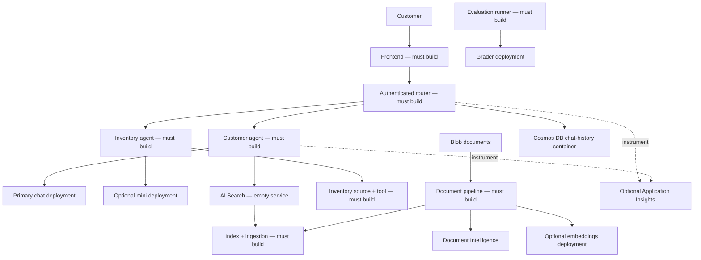

# ဘုံအေရာင်းဆိုင်အတွက် မျိုးစုံကိုယ်စားလှယ် ဖောက်သည်ကူညီမှု — ဈေးမြင့်ဆိုင် စီမံကိန်း ရုပ်ပုံ

**အခန်း ၅: မျိုးစုံကိုယ်စားလှယ် AI ဖြေရှင်းချက်များ**

- [သင်တန်းမူလစာမျက်နှာ](../README.md)
- [အခန်း ၅](../docs/chapter-05-multi-agent/README.md)
- [မတိုင်မီလိုအပ်ချက်: AI ပေါင်းစည်းခြင်း](../docs/chapter-02-ai-development/microsoft-foundry-integration.md)
- [နောက်တန်း: စွမ်းဆောင်ရည် စီမံခန့်ခွဲမှု](../docs/chapter-06-pre-deployment/capacity-planning.md)
- [ARM အဆောက်အအုံ နေရာတည်မြဲစက်](retail-multiagent-arm-template/README.md)

> **ဆောက်လုပ်မှု လမ်းညွှန်ချက်ဖြစ်ပြီး အလုပ်လုပ်သော အပလီကေးရှင်း မဟုတ်ပါ။** တစ်ခုတည်းသော ဘုံအေရာင်းဆိုင် အကောင်အထည်ဖော်မှု
> ဖိုင်တွေက `azuredeploy.json`၊ `azuredeploy.parameters.json`၊ နဲ့ `deploy.sh` တို့ဖြစ်ပြီး
> `retail-multiagent-arm-template/` မှာရှိပါတယ်။ Router/frontend containers တွေက hello-world
> အစားထိုးတွေပါ။ မည်သည့် retail agent၊ UI၊ ingestion pipeline၊ evaluator၊ scanner၊
> သို့မဟုတ် application စမ်းသပ်မှုစုစုပေါင်းမှတ်တမ်းဖြစ်တဲ့ test suite မရှိပါဘူး။

## အထွေထွေကြည့်ရှုခြင်း

**ရည်ရွယ်ချက်။** ဖောက်သည်-ထောက်ခံမှုပေးရေးစနစ်တစ်ခုအား ဖောက်သည်အေဂျင့်နှင့် သိုလှောင်မှု
အေဂျင့်နှစ်ယောက်ပါဝင်စေရန် ဒီဇိုင်းဆွဲခြင်း၊ အင်ဖရာစတရပ်ခ်စနစ် ပေးဆောင်ပေးသည့်အရာများကို သိရှိယူဆောင်ခြင်းနှင့်
မကျန်ခဲ့သော အပလီကေးရှင်းစာချုပ်များနှင့် အတည်ပြုမှုများကို စီဘွတ်ဆွဲခြင်းဖြစ်သည်။

**ပရိသတ်:** ဒေဗယ်လော့ပ်များ၊ သူတို့သည် ဒေသတွင်းရှိ
[စကားပြောနမူနာ](../../../examples/azure-openai-chat) နှင့် [နှစ်ဝန်ဆောင်မှုပို့ကွန်တိန်နာနမူနာ](../../../examples/container-app/microservices) ကိုပြီးမြောက်ထားသူများ ဖြစ်သည်။
ဧကရာဇ်အတွက် ၂–၃ နာရီခန့် ခွင့်ပြုပါ။ အက်ပလီကေးရှင်းတည်ဆောက်ခြင်းမှာ အသီးသီးသော
ပရောဂျက်ဖြစ်ပြီး အတွေ့အကြုံရှိ ဒေဗယ်လော့ပ်များအတွက် နမူနာအစီအစဉ် ခန့်မှန်းချက်မှာ ၈၀–၁၂၀ နာရီဖြစ်သည်၊ **ပို့ဆောင်မှု အာမခံချက် မဟုတ်ပါ**; ထုတ်လုပ်မှု ခိုင်မာစေရေး၊ စမ်းသပ်မှုများ၊
လုံခြုံရေး ကြည့်ရှုခြင်းနှင့် လည်ပတ်မှုများအတွက် လမ်းကြောင်းပိုလိုအပ်သည်။


- မော်ဒယ်အသိအမှတ်ပြုနံပါတ်များ၊ ထုတ်လုပ်မှုနာမည်များ၊ API ဗားရှင်းများနှင့် ARM ဗားရှင်းများကို ခွဲခြားနိုင်ပါ။
- ကိုက်ညီသော vector အတိုင်းအတာများနှင့်အတူ စာရွက်စာတမ်းနှုတ်ယူခြင်းနှင့် ရယူခြင်းကို ဒီဇိုင်းဖန်တီးပါ။
- အတည်ပြုနိုင်သော လုပ်ဆောင်ချက်များ၊ အကဲဖြတ်မှုနှင့် မအောင်မြင်မှု ပြန်လည်ကပ်ညီရေးလိုအပ်ချက်များကို သတ်မှတ်ပါ။
- ပစ္စည်းအရင်းအမြစ်များမှ မဟုတ်၊ ရွေးချယ်ဇယားဆောင်ရွက်မှု ရည်မှန်းချက်များကို ခွဲခြားထားပါ။




ဤသည်မှာ **ပစ်မှတ်အပလီကေးရှင်းစီမံခန့်ခွဲမှုပုံစံ** ဖြစ်ပြီး agent ဝန်ဆောင်မှုများ အသင့်လည်ပတ်နေမှု ချုပ်ပြပုံ မဟုတ်ပါ။
ARM scaffold သည် အောက်ခံဝန်ဆောင်မှုများနှင့် အစားထိုး container နှစ်ခုကိုသာ ဖန်တီးပေးသည်။
Front Door, registry, managed identities, role assignments,
private endpoints, failover, application instrumentation, နှင့် alerts မပါဝင်ပါ။

### တာဝန်များနှင့် သဘောတူချက်များ

| အစိတ်အပိုင်း | လိုအပ်သော သွင်ပြင်ကျင့်သုံးမှု | ပြီးစီးမှု ခေါ်ယူမတိုင်မီ သက်သေ |
|---|---|---|
| Frontend | အသုံးပြုသူများကို အတည်ပြု၊ စကားပြောအား ပြသ၊ စာရွက်တင်ပို့မှု လုံခြုံစွာလုပ်ဆောင် | UI နှင့် တင်ပို့မှု စမ်းသပ်မှုများ၊ အသုံးပြုနိုင်သော အမှားများ |
| Router | မေးမြန်းချက်များ စစ်ဆေး ခွင့်ပြု၊ agent ရွေးချယ်၊ tool ခေါ်သုံးမှုများ/timeout များ ကန့်သတ် | Routing စမ်းသပ်မှုများ၊ ခွင့်ပြုမှု စစ်ဆေးမှုများ၊ မအောင်မြင်မှု စမ်းသပ်မှုများ |
| Customer agent | ပစ္စည်းအကြောင်း/ထုတ်ကုန် အဖြေများကို သတ်မှတ်ထားသော ရင်းမြစ်များမှ ရယူ | မှန်မှန်ကန်ကန် ကိုးကားချက်များ၊ အချက်အလက် မရှိပါမှ ခြွင်းချက် ထုတ်ယူမှု |
| Inventory tool | သတ်မှတ်ထားသော ခွင့်ပြုချက်ဖြင့် အတည်ရှိသော စတော့များ ဖတ်ရှု | သတ်မှတ်ထားသော စတော့ စမ်းသပ်မှုများ၊ မဖန်တီးထားသော ရရှိနိုင်မှု မရှိစေရန် |
| Document pipeline | ထုတ်ယူခြင်း၊ အပိုင်းခွဲခြင်း၊ ထည့်သွင်းခြင်း၊ အညွှန်းပြုခြင်း၊ အပ်ဒိတ်/ဖျက်ခြင်း | အညွှန်းထားသော စမ်းသပ်မူများနှင့် ထပ်မံကြိုးစားမှု/သေဆုံးစာအုပ် လုပ်ဆောင်ချက်များ |
| Conversation storage | အသုံးပြုသူများကို သီးခြားဆောင်ရွက်ခြင်း၊ သိမ်းဆည်းမှု သတ်မှတ်ချက်များ အကောင်အထည်ဖော် | အသုံးပြုသူ အရှေ့တန်း ခွင့်ပြုချက်နှင့် TTL စမ်းသပ်မှုများ |
| Evaluation runner | ထွက်ရှိမှုများကို အချက်အလက် အမှန်နှင့် သတ်မှတ်ချက်များနှင့် နှိုင်းယှဉ် | အခြေခံမှု, မအောင်မြင်မှု ရေတွက်ချက်များ, ထပ်မံပြုလုပ်နိုင်သော အစီရင်ခံစာများ |

Router ကို ဝင်ရောက်ခန်းမတစ်ခုလို ယူဆပါ၊ tool များကို စိတ်တိုင်းမကျသော အတွင်းစနစ်များအဖြစ် မြင်ပါ။
အထူးကျွမ်းကျင်သူ ရွေးချယ်ခြင်းသည် အသုံးပြုသူတိုင်း၏ မှတ်တမ်းများကို ဝင်ရောက်ခွင့် ပြုခြင်း မဟုတ်ပါ။
လူမှုသုံး လုံခြုံရေး သင်္ကေတများနှင့် ခွင့်ပြုချက်များကို အပလီကေးရှင်း ကုဒ်နှင့် ဒေတာ ဝန်ဆောင်မှုများတွင် တင်းကြပ်စွာ စောင့်ရှောက်ပါ၊ ပြောကြားချက်များတွင် မလုပ်ပါနှင့်။

## အခြေခံအဆောက်အအုံနှင့် အပလီကေးရှင်း ကြားက ကွာခြားချက်

provision လုပ်မတိုင်မီ [scaffold README](retail-multiagent-arm-template/README.md) ကို ဖတ်ရှုပါ။
၎င်းတွင် တိကျသော အရင်းအမြစ်များ၊ မတူညီမှုများ၊ ခွန်အားနှင့် ကန့်သတ်ချက်များ ပါရှိသည်။

| တူရူလုပ်အသုံးပြုမှု | ARM deployment နာမည် | မော်ဒယ် / ဗားရှင်း | ပုံမှန်ဒေသ |
|---|---|---|---|
| Customer chat | `gpt-4.1-chat` | `gpt-4.1` / `2025-04-14` | `eastus2` |
| Inventory | `gpt-4.1-mini-inventory` | `gpt-4.1-mini` / `2025-04-14` | `westus2`, ရွေးချယ်စရာ |
| ထည့်သွင်းချက်များ | `text-embedding-ada-002` | `text-embedding-ada-002` / `2` | `francecentral`, ရွေးချယ်နိုင်သည် |
| အကဲဖြတ်ခြင်း | `gpt-4.1-grader` | `gpt-4.1` / `2025-04-14` | ပထမကန့်သတ်ဒေသဖြစ်သည် |

မော်ဒယ်/ဗားရှင်း/SKU ရရှိနိုင်မှုနှင့် ကွိုတာကို **တိုင်းဒေသ** အလိုက် စစ်ဆေးပါ။ စကားပြော/မီနီ/အဆင့်သတ်မှတ်သူ
သည် `GlobalStandard` ကို အသုံးပြုသည်။ ထည့်သွင်းချက်များသည် `Standard` ကို အသုံးပြုသည်။ စွမ်းဆောင်ရည်ယူနစ်မှ TPM သို့ သတ်မှတ်ခြင်းသည်
မော်ဒယ်အလိုက် သတ်မှတ်ထားသည်။ မတူညီသောစွမ်းဆောင်ရည်ယူနစ်များကို အထွေထွေကွိုတာအာမခံချက်အဖြစ် မထည့်သွင်းပါနှင့်။

Azure OpenAI တောင်းဆိုမှု၏ `model` အချက်အလက်သည် **တပ်ဆင်မှုအမည်** ဖြစ်ပြီး၊
မဖြစ်မနေ ကတ်တလော့ မော်ဒယ် ကိုယ်စားပြုနံပါတ်မဟုတ်ပါ။ ဒေတာပလိန် API ဗားရှင်းဖြစ်သော `2024-10-21` သည်
မော်ဒယ်ဗားရှင်း `2025-04-14` နှင့် ARM အရင်းအမြစ် `apiVersion` မှ မတူပါ။
မရရှိနိုင်သော မော်ဒယ်ကို ဒေတာပလိန် API ဗားရှင်းကိုသာ ပြောင်းလဲခြင်းဖြင့် ပြုပြင်၍ မရနိုင်ပါ။

`--no-multi-region` သည် ဒုတိယနှင့် ထည့်သွင်းချက်အကောင့်များကို ရှောင်လွှဲသည်။ ပထမအဆင့် စကားပြောနှင့်
လွတ်လပ်သော အဆင့်သတ်မှတ်သူအကောင့် တစ်ခုတည်း ကျန်ရှိသည်။ မော်ဒယ်အကောင့်အလိုက် အလိုအလျှောက်
နောက်ပြန်လာမှု မရှိပါ။ ၎င်းသည် အပလီကေးရှင်းလမ်းညွှန်၊ ကိုက်ညီသော တပ်ဆင်မှုများ၊ ကျန်းမာရေးစစ်ဆေးမှုများ၊
ထပ်မံကြိုးစားမှု အကန့်အသတ်များနှင့် ဒေတာတည်နေရာ ပြန်လည်သုံးသပ်မှုလိုအပ်သည်။

## ဆောင်ရွက်မှု လမ်းပြမြေပုံ

### ၁။ စမ်းသပ်ပြီးသား အပြန်အလှန်သက်ဆိုင်မှု တစ်ခုနှင့် စတင်ပါ

ကြီးမားသော ဖွဲ့စည်းတည်ဆောက်မှု တည်ဆောက်မီ၊ ဒေသိယ စကားပြော နမူနာကို အသုံးပြု၍
ခန့်မှန်းချက် ချိတ်ဆက်မှုကို တည်ထောင်ပါ။ တစ်ဦးချင်းကိုယ်စားလှယ်သုံးသပ်ထားသော ဖောက်သည်မေးခွန်း၊ အတည်ပြုထားသော
ဖြေကြားမှု မူရင်း၊ မျှော်မှန်းချက်ထောက်ခံချက် နှင့် အဆိုပါ မူရင်းမရရှိပါက ပြဿနာဖြစ်ပုံအခြေအနေကို သတ်မှတ်ပါ။

### ၂။ လမ်းညွှန်မှုနှင့် ကိရိယာနယ်နိမိတ်ကို သတ်မှတ်ပါ

သင့်ရဲ့ ကိုယ်ပိုင် router source၊ dependency manifest၊ Dockerfile နှင့် စမ်းသပ်မှုများကို ဖန်တီးပါ။ တစ်ခု
ရှုမြင်နိုင်သော စာချုပ်မှာ `POST /chat` နှင့် `{"message":"...","conversation_id":"..."}` ဖြစ်နိုင်ပါသည်။
**အဆိုပါ endpoint သည် ဒီဇိုင်း အကြံပြုချက်ဖြစ်ပြီး ARM တမ်းပလိတ်မှ အကောင်အထည်မဖော်ထားပါ။**

ကိုယ်ထည်အမျိုးအစား/အကန့်အသတ်များကို အတည်ပြုဆောင်ရွက်ပါ၊ အတည်ပြုချက်မှ အသုံးပြုသူ ကိုယ်ပိုင်ချိန်ယူမှုကို ယူဆောင်ပါ၊
စကားပြောရှင်ပိုင်ဆိုင်မှုကို အတည်ပြုပါ၊ တောင်းဆိုချိန် ကန့်သတ်ချက်များကို သက်ဆိုင်စွာ အသုံးချပါ၊ စကားကြောင်းမှန်သော အမှားကုဒ်များ ပြန်ပေးပါ။
HTTP ရဲ့ ညံ့ပါးချက်များ သို့မဟုတ် အဖြေမရှိခြင်းကို အောင်မြင်သော agent ရလဒ်ဟု မယူဆပါနှင့်။

### 3. နေရာချခြင်းနှင့် အချက်အလက်ထည့်သွင်းခြင်း ကို အကောင်အထည်ဖော်ခြင်း

ARM တမ်းပလိတ်သည် ရှာဖွေရေးညွှန်းကိန်းကို မဖန်တီးပေးပါ။ ၎င်းသည် သင့် တစ်ကိုယ်တော်ညွှန်းကိန်းသတ်မှတ်ချက်တွင် ချိန်ညှိရန် **ကိုးကား JSON အစိတ်အပိုင်း** ဖြစ်ပြီး၊ ရေပိုးထဲတွင်ရှိပြီးသား ဖိုင်မဟုတ်ပါ။


```json
{
  "name": "retail-product-index",
  "fields": [
    {"name": "id", "type": "Edm.String", "key": true},
    {"name": "title", "type": "Edm.String", "searchable": true},
    {"name": "content", "type": "Edm.String", "searchable": true},
    {"name": "category", "type": "Edm.String", "filterable": true},
    {
      "name": "content_vector",
      "type": "Collection(Edm.Single)",
      "searchable": true,
      "dimensions": 1536,
      "vectorSearchProfile": "retail-profile"
    }
  ],
  "vectorSearch": {
    "algorithms": [{"name": "retail-hnsw", "kind": "hnsw"}],
    "profiles": [{"name": "retail-profile", "algorithm": "retail-hnsw"}]
  }
}
```

ပရိုဖိုင်သည်ဗက်တာကွက်တိကို ၎င်း၏ အယ်လ်ဂိုရိသမ်နှင့် ဆက်သွယ်ပေးသည်။ မျက်နှာပြင်များသည်
အမှန်တကယ်ထုတ်ပေးသည့် embedding အထွက်နံပါတ်နှင့် ကိုက်ညီရမည် (ဒီ `ada-002` ချဲ့ထွင်မှုအတွက် 1536)။ Python မှ ရယူခြင်းအတွက်,
အပြီးမဲ့သောအစား `azure.search.documents.models.VectorizedQuery` ကို အသုံးပြုပါ
စကားလုံးအိတ်သည် ၎င်း၏ vector ရှာဖွေမှုအမျိုးအစားမပါရှိခြင်း။

```python
# Reference function only: supply an authenticated async SearchClient and an embedding.
from azure.search.documents.models import VectorizedQuery

async def retrieve(search_client, embedding):
    results = await search_client.search(
        search_text=None,
        vector_queries=[VectorizedQuery(
            vector=embedding,
            k_nearest_neighbors=5,
            fields="content_vector"
        )],
        select=["id", "title", "content"]
    )
    return [document async for document in results]
```

သီးခြား တင်သွင်းရေး အကောင်အထည်ဖော်မှု တစ်ခုကို ဖန်တီးပါ၊ ၎င်းမှာ-

1. တင်သွင်းခွင့်အတည်ပြုခြင်းနှင့် မူလတန်းအကြောင်းအရာ အမျိုးအစားနှင့် အရွယ်အစားကို စစ်ဆေးသည်။
2. ကိုယ်ပိုင် ဖိုင်များကို မှတ်ပုံတင်ထားသော SDK ခေါ်ဆိုချက်များဖြင့် ဖတ်ရှုသည်။ ကိုယ်ပိုင် ဖိုင် URL တစ်ခု သာဖြစ်လျှင်
   ၎င်းသည် Document Intelligence အတွက် ဖတ်ရှုနိုင်သော အချက်အလက် မဟုတ်ပါ။ ဒေသနယ်လုံးဆိုင်ရာ အချက်များကို တင်ပို့ပြီး၊
   `AnalyzeDocumentRequest(bytes_source=...)` သို့မဟုတ် လူမှုအသုံးပြုခွင့်ရှိသော၊
   သက်တမ်းကာလတိုသော SAS ကို ဝင်ရောက်ခွင့် လိုအပ်ချက်များ စစ်ပြီး အသုံးပြုပါ။
3. စာသားထုတ်ယူခြင်း၊ embedding အကန့်အသတ်ကို ဖြည့်ဆည်းရန် အပိုင်းများခွဲခြင်း၊ နှင့် embedding များ ဖန်တီးခြင်း။
4. မူရင်း မှတ်ချက်ခလုတ်များ တည်ဆောက်ပြီး အပိုင်းများနှင့် ကိုက်ညီသော ဗက်တာများဖြင့် တင်ပို့ခြင်း။
5. စာရွက်စာတမ်း အလိုက် အညွှန်းဖြစ်မှုရလဒ်များ စစ်ဆေးခြင်း၊ ပြန်လည်ကြိုးစားမှုများ ကိုင်တွယ်ခြင်းနှင့် အဟောင်း ဒေတာများကို ပြန်လည်အပ်ဒိတ်/ဖျက်ပစ်ခြင်း။

ကျပ်တည်းထားသော OData စစ်စစ်များထဲသို့ အုပ်စုလိုက် အသုံးပြုသူ key/value များ မထည့်သွင်းပါနှင့်။ field များကို အကြောင်းအရာသတ်မှတ်ပါ၊
တန်ဖိုးအမျိုးအစားများကို အတည်ပြုပါ၊ နှင့် string ကိုးလုံးခွဲ စာလုံးများကို ပယ်ဖယ်ထားပါ။ Boolean နှင့် ဂဏန်းစစ်စစ်များသည်
ကြပ်မတ်ထားသော literal များလိုအပ်ပြီး၊ တန်းတူ စာလုံးများ မဟုတ်ပါ။

### 4. ဝက်ဘ် အခြေခံခြင်း

**Bing Search v7 ကို ၂၀၂၅ ခုနှစ် သြဂုတ် ၁၁ ရက်နေ့တွင် အဆုံးသတ်ခဲ့ပါသည်။** ရှေးဟောင်း `Microsoft.Bing/accounts`
အရင်းအမြစ်နှင့် `api.bing.microsoft.com/v7.0/search` နမူနာများသည် မပံ့ပိုးသော
အကောင်အထည်ဖော်မူလမ်းကြောင်းများ ဖြစ်ပါသည်။ Microsoft Foundry နှင့် ၎င်း၏ SDK၊ ခွင့်ပြုချက်များ၊ ငွေတောင်းခံမှုများနှင့် အညွှန်းလိုအပ်ချက်များအတွက် လက်ရှိ ပံ့ပိုးထားသော grounding အတူဆက်သွယ်မှုကို သုံးသပ်ပါ။
အဲဒီမှာ မည်သည်မျှ အကောင်အထည်ဖော်မှု မရှိပါ။ ယခု အဆုံးသတ်ထားသော endpoint အစား မစွဲစမ်းနိုင်ပါ။


### 5. တယ်လီမက်ထရီ နှင့် တိုင်းတာခြင်း ထည့်ပါ

Application Insights ဖန်တီးခြင်းသည် ကုဒ်အပိုင်း တပ်ဆင်ခြင်း မဟုတ်ပါ။ အသစ်သော အပလီကေးရှင်းတစ်ခု တည်ဆောက်သော အခါတွင် Azure Monitor OpenTelemetry တပ်ဆင်မှု အသုံးပြုပါ၊ ဝန်ဆောင်မှုများအကြား trace context ကို ကူးပြောင်းပေးပါ၊ ဖောက်သည်၏_prompt များ၊ စာရွက်စာတမ်းများ သို့မဟုတ် လျှို့ဝှက်ချက်များကို မွတ်တမ်းမတင်ပါနှင့်။

လှေကားတစ်ခု ချုပ်ဆိုခြင်းသည် အချက်အလက်ကို **နောက်ခံမေ့ခြင်းမဟုတ်ပါ**။


စစ်မှန်သော ရောင်းဝယ်မှု/မူဝါဒ အချက်အလက်များကို တိုင်းတာမှုများနှင့်အတူ သိမ်းဆည်းပါ။ တိုင်းတာသူသည် မေးခွန်းနှင့် ဖြေဆိုချက်တစ်ခုကိုသာ အခြေခံ၍ အချက်အလက်တိကျမှုကို ယုံကြည်စိတ်ချရစွာ ဆုံးဖြတ်၍ မရပါ။


မပြီးပြည့်စုံသော/အမှားအယွင်းဖြစ်ပေါ်သော အမှုများကို သီးသန့်အသုံးပြု၍ တင်ပြပါ။ ၎င်းတို့ကို အောင်မြင်မှုအဆင့် အဖြစ် ပြောင်းလဲ မလုပ်ပါနှင့် သို့မဟုတ် အရည်အသွေး Zero မော်ဒယ်ဖြေဆိုမှု အဖြစ် အတိတ်ဂွန်းထဲ တွင် တိတ်ဆိတ်စွာ ထည့်ပါနှင့်။


### 6. သင့်အပလီကေးရှင်းကို ဖြန့်ချိပါ


### ၆။ သင့်အက်ပ်ကို မလှမ်းပါ

သင့်ရဲ့ကိုယ်ပိုင်မူရင်းဖိုလ်ဒါများ၊ manifests၊ စမ်းသပ်မှုများ၊ registry နှင့် image-pull
ခွင့်များကို ဖန်တီးပါ။ နေရာစွမ်းဆောင်မှုများကို တည်ဆောက်ပြီး တည်ဆောက်ပြီးခဲ့သော ပုံထုတ်ကိရိယာများဖြင့် အစားထိုးပါ၊ နှင့် ingress/probes များကို
အက်ပ်တစ်ခုချင်းစီ၏ နားဆင်နားကြပ် ပေါ့ဒ်နှင့် ကိုက်ညီအောင် update ပြုလုပ်ပါ။ Bicep ဖြင့် runtime ပတ်ဝန်းကျင် ပတ်သက်သော သတ်မှတ်ချက်များ သို့မဟုတ် ပေါ်တင်ထားသော azd ပတ်ဝန်းကျင် များဖေါ်ပြချက်ကို ဖော်ဆောင်ပါ။


azd ဝန်ဆောင်မှုအောက်မှာ အလိုအလျောက် runtime ပတ်ဝန်းကျင်ပြောင်းလဲနိုင်သော ယေဘုယျ `config` အဘိဓါန်မရှိပါ။
`azd env set` သည် ထိုတန်ဖိုးများကို သတ်မှတ်သုံးစွဲသော အရင်းအမြစ်များကိုသာ ပြောင်းလဲသည်။
ဤခဲဒ်တွင် canary၊ ဒေသစာရင်း သို့မဟုတ် နှိုင်းယှဉ်ကောင်းမွန်မှု ဆက်စပ်တံဆိပ်တန်း မရှိပါ။


## လက်တွေ့ဒီဇိုင်းလေ့ကျင့်ခန်းများ

၎င်းများမှာ **ဗိသုကာလေ့ကျင့်ခန်းများ** ဖြစ်ပြီး မွမ်းမံနိုင်သော လက်ကားစတင်ကုဒ် မဟုတ်ပါ။

### လေ့ကျင့်ခန်း ၁: အကန့်အသတ်ကို အတည်ပြုပါ

**စတင်ရာနေရာ:** `retail-multiagent-arm-template/` ထဲမှ ဖိုင်သုံးခု။
**ရည်မှန်းချက်:** provisioning ကို application လုပ်ဆောင်ချက်မှ ကွဲပြားစေခြင်း။
`azuredeploy.json` ကို ဖွင့်ပြီး container images နှင့် `targetPort` တန်ဖိုးများကို တွေ့ရှိပါ၊
ပြီးတော့ repository မှ ပျောက်သွားသော application အစိတ်အပိုင်းများစာရင်းပြုစုပါ။

**အောင်မြင်မှု မူကွဲ / ဖြေချက်:** ပုံစံနှစ်ခုသည် port ၈၀ တွင် နားဆင်နေသော hello-world placeholder များဖြစ်သည်။ 
agents, chat UI, router handlers, index/ingestion, evaluator, နှင့် scanner မပါဝင်ပါ။ 
အောင်မြင်သော placeholder root request သည် `/chat` ကို အတည်ပြုမည် မဟုတ်ပါ။
**သည့်အခါအားဖြင့် ဖြစ်ပေါ်သည့် ပြဿနာ:** `retail-router` ကဲ့သို့သော ပြုစုထားသော resource အမည်များကို လည်ပတ်နေသော ကုဒ်ဟု မှတ်ယူခြင်း။

### လေ့ကျင့်ခန်း ၂: vector configuration ကို ထောက်လှမ်းပါ

**စတင်ရာနေရာ:** အထက်ပါ index JSON။
**ရည်မှန်းချက်:** field → profile → algorithm ဆက်နွယ်မှုကို နားလည်လိုခြင်း။
ပုံနှိပ်မှုမော်ဒယ်သို့ ပြောင်းလဲစဉ်တွင် ဘယ်တန်ဖိုးများ ပြောင်းလဲရမည်ကို သိရှိပါ။  
ကွဲပြားသော output dimension ဖြစ်ပါက၊ `retrieve` function ကို စစ်ဆေးပါ။

**အောင်မြင်မှုမီတာများ / အဖြေ:** `dimensions` ကွင်းကို တကယ်သော vector အရှည်သို့ ပြောင်းလဲပါ;
ကြေညာထားသော ကိုယ်ရေးအကျဉ်းနှင့် ၎င်း၏ အယ်လ်ဂိုရစ်သမ်နှင့်အညီ `vectorSearchProfile` ကို ထိန်းသိမ်းပါ;
query `fields` သည် vector field ကို အမည်ပေးရမည်။ embedding model ပြောင်းလဲလျှင် ရှိပြီးသား စာရွက်စာတမ်း vectors များကို မျှလောက်ပြန်ဖန်တီးပါ။
embedding model ပြောင်းလဲသောအခါ စာရွက်စာတမ်း ရှိပြီးသား vectors များကို ပြန်ဖန်တီးပါ။
**ပုံမှန် ပြဿနာ:** မကိုက်ညီသော vectors များကို ထိန်းသိမ်းထားပြီး model အမည်ကို သာပြောင်းလဲခြင်း။

### အလေ့အကျင့် ၃: မအောင်မြင်မှု စမ်းသပ်မှု သတ်မှတ်ပါ

**စတင်ချက်:** တာဝန်ရှိမှု အချက်ဇယား။
**ရည်မှန်းချက်:** မှားယွင်းသော အောင်မြင်မှု ကို တားဆီးရန်။
မရရှိနိုင်သော စတော့ရှယ်ယာ API၊ မကိုက်ညီသော စာရွက်စာတမ်း မပါသော ရှာဖွေရှေ့တန်း၊ နှင့် HTTP 503 ပြန်လည်ပေးပို့သည့် အကဲဖြတ်ခြင်း တောင်းဆိုမှုများအတွက် မျှော်မှန်းထားသော အပြုအမူကို ရေးပါ။
HTTP 503 ပြန်လည်ပေးပို့သည့် အကဲဖြတ်ခြင်း တောင်းဆိုမှုရေးပါ။

**အောင်မြင်မှု စံနှုန်း / ဖြေကြားချက်:** စတော့ရှယ်ယာတန်ဖိုးများကို မှားယွင်းဖန်တီးခြင်း မရှိပါ။ အခြေအနေမရှိပါက ထူးခြားစွာလျှော့ချခြင်း သို့မဟုတ် တက်ကြွစွာ ကြိုးစားမှု၊ အကဲဖြတ်ချက်သည် အရည်အသွေး သို့မဟုတ် လုံခြုံရေး အောင်မြင်မှု မဟုတ်ဘဲ သယ်ယူပို့ဆောင်မှု မအောင်မြင်မှုကို ဖြတ်တောက်ပါ။ အပလီကေးရှင်း တည်ဆောက်ရာတွင် executable စမ်းသပ်မှုများ ထည့်ပါ။
အကဲဖြတ်ချက်သည် သယ်ယူပို့ဆောင်မှု မအောင်မြင်မှုကို ပြသပါ။
အပလီကေးရှင်း တည်ဆောက်ရာတွင် executable စမ်းသပ်မှုများ ထည့်ပါ။
**ပုံမှန် ပြဿနာ:** မည်သည့် exception မဆို ဖမ်းယူပြီး ဖြေကြားချက် မှားသည့်အတိုင်း ဆက်လက် လုပ်ဆောင်ခြင်း။

## ကုန်ကျစရိတ်၊ အပြစ်ရှာဖွေရေးနှင့် ရှင်းလင်းရေး

- အခြေခံအဆောက်အအုံ သည် ရှာဖွေရှေ့တန်းများနှင့် placeholder application များအတွက် ရှိနေသော charges များရှိသည်။ လက်ရှိဒေသဆိုင်ရာ စျေးနှုန်းများကို အသုံးပြုပါ; “အနည်းဆုံး” သို့မဟုတ် multi-region ဆိုသည်မှာ အခမဲ့ မဟုတ်ပါ။
  apps. Use current regional prices; neither “minimal” nor multi-region implies free.
- တိုကင် ကုန်ကျငွေသည် မော်ဒယ်၊ မှတ်ထားသော/မမှတ်ထားသော အတွင်းပို့၊ အထွက်နှင့် ထည့်သွင်းမှု SKU အပေါ် မူတည်သည်။
  လမ်းညွှန်ခြင်းသည် တိုင်းတာထားသော အလုပ်နှင့် အရည်အသွေးရလဒ်များ အတည်ပြုနိုင်မှသာ ငွေစုစုပေါင်း လျှော့ချနိုင်သည်။
  သတ်မှတ်ထားသော ၆၀–၈၀% လျှော့ချမှုမှာ သေချာကာကွယ်မှု မရှိပါ။
- သတ်မှတ်မည့်မတိုင်မီ မော်ဒယ်ရရှိမှုနှင့် ကွာတာကို စစ်ဆေးပါ။ ခွင့်ပြုချက်၊
  ထည့်သွင်းမှု-နာမည်၊ ဒေသ၊ မော်ဒယ်ဗားရှင်းနှင့် API ဗားရှင်း အမှားများကို ခွဲခြားစွာ သိရှိပါ။
- ပျောက်ကွယ်သွားသော `setup-data.sh`၊ evaluator CLI များ သို့မဟုတ် `pytest tests/` အမိန့်များကို မပြေးပါနှင့်။
  ၎င်းတို့၏ ဆောင်ရွက်မှုများသည် သင့်ဖွံ့ဖြိုးတိုးတက်ရေး နောက်ဆုံးစာရင်းအပိုင်းတစ်စိတ်ဖြစ်သည်။
- အထောက်အကူပံ့မှု ARM သာဖြစ်သည်။ ၎င်း၏
  [အတည်ပြုခြင်းနှင့် သန့်ရှင်းရေးညွှန်ကြားချက်များ](retail-multiagent-arm-template/README.md) ကိုလိုက်နာပါ။
  `azd down` သည် ၎င်း့ရင်းမြစ်များအား စီမံခန့်ခွဲမှုမပြုလုပ်ပါ။

## ဆက်စပ်ရင်းမြစ်များ

- [တည်ရှိပြီး လုပ်အားညှိနှိုင်းထားသော ဒေသခံ စကားပြော နမူနာ](../../../examples/azure-openai-chat)
- [တည်ရှိပြီး နှစ်ဝန်ဆောင်မှု တို့ပါသော container နမူနာ](../../../examples/container-app/microservices)
- [AI ရှာဖွေရေး vector indexes](https://learn.microsoft.com/azure/search/vector-search-how-to-create-index)
- [Container Apps စာတမ်းထဲ](https://learn.microsoft.com/azure/container-apps/)
- [ပြဿနာဖြေရှင်းမှု](../docs/chapter-07-troubleshooting/common-issues.md)
- [ပြဿနာတင်ပြရန်](https://github.com/microsoft/AZD-for-beginners/issues)

---

<!-- CO-OP TRANSLATOR DISCLAIMER START -->
**ပြောကြားချက်**
ဤစာတမ်းကို AI ဘာသာပြန်ဝန်ဆောင်မှု [Co-op Translator](https://github.com/Azure/co-op-translator) အသုံးပြု၍ ဘာသာပြန်ထားပါသည်။ ကျွန်ုပ်တို့သည် တိကျမှန်ကန်မှုအတွက် ကြိုးပမ်းနေသော်လည်း၊ စက်ကိရိယာဘာသာပြန်ခြင်းများတွင် အမှားများ သို့မဟုတ် မှားယွင်းချက်များ ပါဝင်နိုင်ကြောင်း သတိပြုပါရန် လိုအပ်ပါသည်။ မူလစာတမ်းကို မူရင်းဘာသာဖြင့်သာ ယုံကြည်စိတ်ချရသော အချက်အလက်အဖြစ် သတ်မှတ်သင့်သည်။ အရေးကြီးသည့် သတင်းအချက်အလက်များအတွက် ပရော်ဖက်ရှင်နယ် လူသားဘာသာပြန်သူဝန်ဆောင်မှုကို အကြံပြုပါသည်။ ဤဘာသာပြန်ချက်ကို အသုံးပြုခြင်းမှ ဖြစ်ပေါ်လာသော နားလည်မှုကွာခြားမှုများ သို့မဟုတ် မမှန်ကန်သော အသုံးပြုမှုများအတွက် ကျွန်ုပ်တို့ တာဝန်မခံပါ။
<!-- CO-OP TRANSLATOR DISCLAIMER END -->