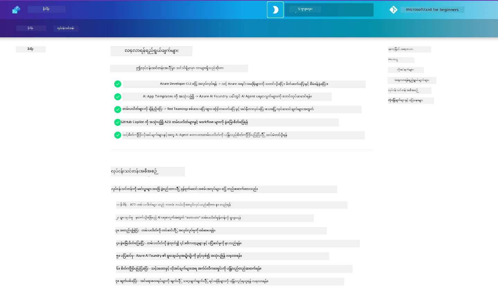

<div align="center">
  <div style="background: linear-gradient(135deg, #0078d4, #106ebe); border-radius: 10px; padding: 20px; margin: 20px 0; box-shadow: 0 4px 15px rgba(0, 120, 212, 0.3); border: 2px solid #005a9e;">
    <h2 style="color: white; margin: 0; font-size: 24px; text-shadow: 1px 1px 2px rgba(0,0,0,0.3);">
      🎯 AI ဖန်တီးသူများအတွက် AZD အလုပ်ရုံဆွေးနွေးပွဲ
    </h2>
    <p style="color: white; margin: 10px 0 0 0; font-size: 16px; text-shadow: 1px 1px 2px rgba(0,0,0,0.3);">
      <strong>Azure Developer CLI ဖြင့် AI အက်ပ်လီကေးရှင်းများ တည်ဆောက်ရန် လက်တွေ့လေ့ကျင့်ခန်း။</strong><br>
      AZD templates နှင့် AI တင်သွင်းလုပ်ထုံးလုပ်နည်းများကို ကျွမ်းကျင်ပါရန် မော်ဂျူး ၇ ခုကို ပြီးမြောက်ပါ။
    </p>
    <div style="margin-top: 15px;">
      <span style="background: rgba(255,255,255,0.2); padding: 5px 10px; border-radius: 15px; color: white; font-size: 14px;">
        📅 သောကြာချက်အရင်းအမြစ်ကို ပြန်လည်သုံးသပ်ပါ: နိုဝင်ဘာ ၂၀၂၆
      </span>
    </div>
  </div>
</div>

# AI ဖန်တီးသူများအတွက် AZD အလုပ်ရုံဆွေးနွေးပွဲ

Azure Developer CLI (AZD) ကို လေ့လာပြီး AI အက်ပ်လီကေးရှင်း တင်သွင်းရန် အာရုံစိုက်၍ လက်တွေ့ လေ့ကျင့်ရာ အလုပ်ရုံဆွေးနွေးပွဲသို့ ကြိုဆိုပါသည်။ ဒီအလုပ်ရုံဆွေးနွေးပွဲမှာ AZD templates ကို ၃ ပတ်လမ်း ကဏ္ဍဖြင့် လေ့လာသင်ယူနိုင်မည်ဖြစ်သည်။

၁။ **ရှာဖွေခြင်း** - သင့်အတွက် ကိုက်ညီသော template ကို ရှာဖွေပါ။
၁။ **တင်သွင်းခြင်း** - တင်သွင်းပြီး အလုပ်လုပ်တာကို သေချာစစ်ဆေးပါ။
၁။ **ကိုင်တွယ်ပြင်ဆင်ခြင်း** - ပြောင်းလဲပြင်ဆင်ပြီး သင့်လိုအပ်ချက်အတိုင်း ပြင်ဆင်ပါ။

ဒီအလုပ်ရုံဆွေးနွေးပွဲတွင် မိတ်ဆက်ပေးမည့် ကိရိယာများနှင့် လုပ်ထုံးလုပ်နည်းများဖြင့် သင်၏ ထုတ်လုပ်မှု လမ်းကြောင်းကို ပိုမိုသက်သာ လွယ်ကူအောင် ကူညီပေးပါသည်။

<br/>

## ဘရောက်ဇာအခြေခံ လမ်းညွှန်

အလုပ်ရုံသင်ခန်းစာများကို Markdown အတွင်း ရေးသားထားပါသည်။ သင်သည်၎င်း အကြောင်းအရာများကို GitHub တွင် တိုက်ရိုက်လိုက်နာနိုင်ပါသည် - သို့မဟုတ် အောက်ပါ ပုံပြင်ကဲ့သို့ ဘရောက်ဇာအခြေခံ ကြိုဆိုချက်ကို ဖွင့်ကြည့်နိုင်ပါသည်။



ဒီရွေးချယ်မှုကို အသုံးပြုရန် - မှတ်တမ်းတိုက်ကို သင်၏ ကိုယ်ရေးမှတ်တမ်းသို့ fork လုပ်ပြီး GitHub Codespaces ကို စတင် ဖွင့်ပါ။ VS Code terminal အလုပ်ဖြစ်လာပြီဆိုပါက ဒီကောမန်းကို ရိုက်ထည့်ပါ။

ဒီဘရောက်ဇာကြိုဆိုချက်ကို GitHub Codespaces, dev containers သို့မဟုတ် Python နဲ့ MkDocs ထည့်သွင်းထားသော ဒေသန္တရ ကလုံးတစ်ခုတွင် အသုံးပြုနိုင်ပါသည်။

```bash title="" linenums="0"
python -m pip install -r requirements-dev.txt
python -m mkdocs serve --config-file workshop/mkdocs.yml
```

ဒီ ကမ်းမလုပ်ငန်းကို **course repository root** ကနေ အလုပ်လုပ်ပါ၊ AI နမူနာကို သီးခြား စတင်ထားတဲ့နေရာကနေ မလုပ်ပါနဲ့။ အမှားတွေကို မြင်နိုင်အောင် preview ကို မျက်နှာပြင်ရှေ့မှာ ထားပြီး Ctrl+C နဲ့ ရပ်ပါ။ ဝဘ်ဆိုဒ်ကို တင်ဆက်မထားဘဲ စစ်ဆေးချင်ရင် `python -m mkdocs build --strict --config-file workshop/mkdocs.yml` ကို သုံးပါ။

တစ်စက္ကန့်အနည်းငယ်အတွင်းမှာ popup dialog တခု မြင်ရမယ်။ `Open in browser` ကို ရွေးချယ်ပါ။ web-based လမ်းညွှန်ဟာ browser tab အသစ်မှာ ဖွင့်မယ်။ ဒီ preview ရဲ့ အကျိုးကျေးဇူးတွေမှာ -

၁။ **Built-in search** - ကီးဝေါ့ဒ်များ သို့မဟုတ် သင်ခန်းစာများကို လျင်မြန်စွာ ရှာဖွေရန်။
၁။ **Copy icon** - codeblocks အပေါ်မှာ cursor တင်ရင် ဒီရွေးချယ်မှု တွေ့ပါမယ်။
၁။ **Theme toggle** - မီးပွားရောင်နှင့် အလင်းရောင် တော့စရာ။
၁။ **Get help** - footer မှာ Discord icon ကို နှိပ်ပြီး ပါဝင်ပူးပေါင်းပါ!

<br/>

## ကမ်းမလုပ်ငန်းအကျဥ်းချုပ်

**Trးောင့်လျားချိန်:** ၃-၄ နာရီ  
**အဆင့်:** စတင်သူမှ အလယ်အလတ်အဆင့်  
**လိုအပ်ချက်များ:** Azure, AIအယူအဆများ, VS Code နှင့် command-line tools များနှင့် လက်တွေ့ကျတ်ဖူးခြင်း။

ဒီ workshops က လက်တွေ့ပြုလုပ်ခြင်းဖြင့် သင်ယူရှိမယ်။ လေ့ကျင့်ခန်းတွေ ပြီးဆုံးချိန်မှာ AZD For Beginners စာရင်းကို ထပ်ပြီး စိစစ်ဖို့ အကြံပြုပါတယ်၊ လုံခြုံရေးနှင့် ထုတ်လုပ်မှု အကောင်းဆုံး လေ့လာတဲ့ လမ်းကြောင်းသို့ ဆက်လက်သွားရန်။

| အချိန်| မော်ဂျူး  | ရည်မှန်းချက် |
|:---|:---|:---|
| ၁၅ မိနစ် | [နိဒါန်း](docs/instructions/0-Introduction.md) | အခြေခံ set လုပ်ခြင်း၊ ရည်မှန်းချက်များနားလည်ခြင်း |
| ၃၀ မိနစ် | [AI Template ရွေးချယ်ခြင်း](docs/instructions/1-Select-AI-Template.md) | ရွေးချယ်နည်းများ ကြည့်ရှုရန်နှင့် စတင်မှုရွေးခြယ်ရန် | 
| ၃၀ မိနစ် | [AI Template အတည်ပြုခြင်း](docs/instructions/2-Validate-AI-Template.md) | Azure သို့ default ဖြေရှင်းချက် တင်ခြင်း |
| ၃၀ မိနစ် | [AI Template ပုံသဏ္ဍာန် ခွဲခြမ်းစိတ်ဖြာခြင်း](docs/instructions/3-Deconstruct-AI-Template.md) | ဖွဲ့စည်းမှုနှင့် တပ်ဆင်မှု စူးစမ်းခြင်း |
| ၃၀ မိနစ် | [AI Template ကို ဖန်တီးပြင်ဆင်ခြင်း](docs/instructions/4-Configure-AI-Template.md) | အလားအလာရှိသော feature များ အသုံးပြုကြည့်ခြင်း |
| ၃၀ မိနစ် | [AI Template ကို စိတ်ကြိုက် ပြောင်းလဲခြင်း](docs/instructions/5-Customize-AI-Template.md) | ကိုယ်တိုင်လိုအပ်သလို လိုက်ဖက်စေရန် |
| ၃၀ မိနစ် | [အဆောက်အဦ သန့်ရှင်းရေး](docs/instructions/6-Teardown-Infrastructure.md) | အရင်းအမြစ်များကို လွှတ်ပေးခြင်းနှင့် သန့်ရှင်းခြင်း |
| ၁၅ မိနစ် | [ပြီးစီးခြင်းနှင့် နောက်တခါ အဆင့်များ](docs/instructions/7-Wrap-up.md) | လေ့လာမှု အရင်းအမြစ်များ၊ ကမ်းမလုပ်ငန်း စိန်ခေါ်မှု |

<br/>

## သင်ယူမယ့်အရာများ

AZD Template ကို Microsoft Foundry မှာ end-to-end ဖွံ့ဖြိုးမှု စွမ်းဆောင်ရည်များနဲ့ ကိရိယာများကို စူးစမ်းလေ့လာဖို့ စူးစမ်းမှု ကစားကွင်းတစ်ခုလို ထင်နားလည်ပါ။ ကမ်းမလုပ်ငန်းဆုံးရောက်တဲ့အချိန်မှာ ဒီ context ထဲရှိ အမျိုးမျိုးသော ကိရိယာများနဲ့ အယူအဆများ အတွက် အရိပ်အယောင် ရရှိနည်း သိမြင်ထားဖို့ ဖြစ်ပါမယ်။

| အယူအဆ  | ရည်မှန်းချက် |
|:---|:---|
| **Azure Developer CLI** | ကိရိယာ command များနှင့် workflow များနားလည်ရန် |
| **AZD Templates**| ပရောဂျက် ဖွဲ့စည်းပုံနှင့် ဖွဲ့စည်းမှုများ နားလည်ရန် |
| **Azure AI Agent**| Microsoft Foundry ပရောဂျက်ကို provision နှင့် တင်သွင်းခြင်း |
| **Azure AI Search**| agents များဖြင့် context engineering ကို တိုးတက်စေခြင်း |
| **Observability**| tracing, monitoring နှင့် အကဲဖြတ်မှုများ စူးစမ်းခြင်း |
| **Red Teaming**| လက်နက်ကြီးစမ်းသပ်ခြင်းနှင့် လှည့်ပြောင်း ကာကွယ်မှုများ စူးစမ်းခြင်း |

<br/>

## ကမ်းမလုပ်ငန်း ဖွဲ့စည်းမှု

ကမ်းမလုပ်ငန်းဟာ AI Agents အတွက် တရားဝင် [Getting Started with AI Agents](https://github.com/Azure-Samples/get-started-with-ai-agents) starter template ကို အခြေခံပြီး template ရှာဖွေရေး၊ တင်သွင်းခြင်း၊ ခွဲခြမ်းစိတ်ဖြာခြင်းနှင့် စိတ်ကြိုက်ပြင်ဆင်ခြင်း သို့ မောင်းနှင်သွားမှာ ဖြစ်ပါတယ်။

### [Module 1: AI Template ရွေးချယ်ခြင်း](docs/instructions/1-Select-AI-Template.md) (၃၀ မိနစ်)

- AI Templates ဆိုတာဘာလဲ?
- AI Templates တည်နေရာ ဘယ်မှာ ရှာမလဲ?
- AI Agents တည်ဆောက်ဖို့ ဘယ်လိုစတင်ရမလဲ?
- **Lab**: Codespaces သို့မဟုတ် dev container မှာ အရင် စတင်ခြင်း

### [Module 2: AI Template အတည်ပြုခြင်း](docs/instructions/2-Validate-AI-Template.md) (၃၀ မိနစ်)

- AI Template Architecture ဆိုတာဘာလဲ?
- AZD Development Workflow ကဘာလဲ?
- AZD Development ကူညီမှု ဘယ်လိုရမလဲ?
- **Lab**: AI Agents Template တင်သွင်းပြီး အတည်ပြုရန်

### [Module 3: AI Template ခွဲခြမ်းစိတ်ဖြာခြင်း](docs/instructions/3-Deconstruct-AI-Template.md) (၃၀ မိနစ်)

- သင့် ပတ်ဝန်းကျင်ကို `.azure/` တွင် စူးစမ်းပါ
- သင့် ရင်းမြစ် ပြင်ဆင်မှုကို `infra/` တွင် စူးစမ်းပါ
- သင့် AZD ဖွဲ့စည်းမှုကို `azure.yaml`s တွင် စူးစမ်းပါ
- **Lab**: Environment Variables ပြင်ဆင်ပြီး ပြန်တင်ပါ

### [Module 4: AI Template ကို ဖန်တီးပြင်ဆင်ခြင်း](docs/instructions/4-Configure-AI-Template.md) (၃၀ မိနစ်)
- စူးစမ်းပါ: Retrieval Augmented Generation
- စူးစမ်းပါ: Agent Evaluation နှင့် Red Teaming
- စူးစမ်းပါ: Tracing နှင့် Monitoring
- **Lab**: AI Agent နှင့် Observability ကို စူးစမ်းပါ 

### [Module 5: AI Template စိတ်ကြိုက်ပြောင်းလဲခြင်း](docs/instructions/5-Customize-AI-Template.md) (၃၀ မိနစ်)
- သတ်မှတ်ပါ: Scenario လိုအပ်ချက်များပါရှိသော PRD
- ဖန်တီးပါ: AZD အတွက် Environment Variables
- ဆောင်ရွက်ပါ: တိုးချဲ့ပြီး တာဝန်များရေးဆွဲမှု Lifecycle Hooks
- **Lab**: စိတ်ကြိုက်စမ်းသပ်ရန်

### [Module 6: အဆောက်အဦ သန့်ရှင်းရေး](docs/instructions/6-Teardown-Infrastructure.md) (၃၀ မိနစ်)
- ပြန်လည်သုံးသပ်ခြင်း: AZD Templates ဆိုတာဘာလဲ?
- ပြန်လည်သုံးသပ်ခြင်း: Azure Developer CLI ဘယ်အတွက်သုံးလဲ?
- နောက်တခါ: template အသစ် စမ်းသပ်ကြည့်ပါ!
- **Lab**: အဆောက်အဦ ဖယ်ရှားခြင်းနှင့် သန့်ရှင်းရေး

<br/>

## ကမ်းမလုပ်ငန်း စိန်ခေါ်မှု

ကိုယ်တိုင် အစဉ်အလာပို မလုပ်ချင်လား? ဒီမှာ စီမံကိန်းအကြံပြုချက်များရှိပါတယ် - သို့မဟုတ် သင့် အကြံပေးချက်များကို မျှဝေလိုက်ပါ!!

| စီမံကိန်း | ဖော်ပြချက် |
|:---|:---|
|၁။ **ခက်ခဲသော AI Template တစ်ခု ခွဲခြမ်းစိတ်ဖြာပါ** | workflow တပ်ဆင်မှုများအသုံးပြုပြီး အခြား AI ဖြေရှင်းချက် တစ်ခုကို တင်သွင်း၊ အတည်ပြု၊ စိတ်ကြိုက် ပြင်ဆင်နိုင်မလား စမ်းသပ်ပါ။ _ဘာတွေသင်ယူခဲ့ပါသလဲ?_ |
|၂။ **သင့် Scenario အတွက် စိတ်ကြိုက် ပြုပြင်ပါ**  | အခြား Scenario တစ်ခုအတွက် PRD (Product Requirements Document) ရေးပါ။ ထို့နောက် Agent Model မှာ သင့် template repo ရဲ့ GitHub Copilot ကို အသုံးပြုပြီး customization workflow ကို ဖန်တီးပေးဖို့ တောင်းဆိုပါ။ _ဘာတွေ သင်ယူခဲ့သလဲ? ဒီအကြံပြုချက်တွေကို ဘယ်လိုတိုးတက်အောင်လုပ်မလဲ?_ |
| | |

## မှတ်ချက် ရှိလား?

၁။ ဒီ repo မှာ issue တင်ပါ - အဆင်ပြေဖို့ `Workshop` နာမည်ထားပါ။
၁။ Microsoft Foundry Discord မှာ ပါဝင်ပြီး မိတ်ဆွေများနှင့် ဆက်သွယ်ပါ!


| | | 
|:---|:---|
| **📚 သင်တန်း မူလစာမျက်နှာ**| [AZD For Beginners](../README.md)|
| **📖 စာရွက်စာတမ်းများ** | [AI templates နဲ့ စတင်ပါ](https://learn.microsoft.com/en-us/azure/ai-foundry/how-to/develop/ai-template-get-started)|
| **🛠️AI Templates** | [Microsoft Foundry Templates](https://ai.azure.com/templates) |
|**🚀 နောက်တခါ အဆင့်များ** | [Workshop စတင်ရန်](#workshop-overview) |
| | |

<br/>

---

**လမ်းညွှန်:** [Main Course](../README.md) | [နိဒါန်း](docs/instructions/0-Introduction.md) | [Module 1: Template ရွေးချယ်ခြင်း](docs/instructions/1-Select-AI-Template.md)

**AZD နဲ့ AI application တွေ တည်ဆောက်ဖို့ အဆင်သင့်ပြီလား?**

[Workshop စတင်ရန်: နိဒါန်း →](docs/instructions/0-Introduction.md)

---

<!-- CO-OP TRANSLATOR DISCLAIMER START -->
**ပြောကြားချက်**
ဤစာတမ်းကို AI ဘာသာပြန်ဝန်ဆောင်မှု [Co-op Translator](https://github.com/Azure/co-op-translator) အသုံးပြု၍ ဘာသာပြန်ထားပါသည်။ ကျွန်ုပ်တို့သည် တိကျမှန်ကန်မှုအတွက် ကြိုးပမ်းနေသော်လည်း၊ စက်ကိရိယာဘာသာပြန်ခြင်းများတွင် အမှားများ သို့မဟုတ် မှားယွင်းချက်များ ပါဝင်နိုင်ကြောင်း သတိပြုပါရန် လိုအပ်ပါသည်။ မူလစာတမ်းကို မူရင်းဘာသာဖြင့်သာ ယုံကြည်စိတ်ချရသော အချက်အလက်အဖြစ် သတ်မှတ်သင့်သည်။ အရေးကြီးသည့် သတင်းအချက်အလက်များအတွက် ပရော်ဖက်ရှင်နယ် လူသားဘာသာပြန်သူဝန်ဆောင်မှုကို အကြံပြုပါသည်။ ဤဘာသာပြန်ချက်ကို အသုံးပြုခြင်းမှ ဖြစ်ပေါ်လာသော နားလည်မှုကွာခြားမှုများ သို့မဟုတ် မမှန်ကန်သော အသုံးပြုမှုများအတွက် ကျွန်ုပ်တို့ တာဝန်မခံပါ။
<!-- CO-OP TRANSLATOR DISCLAIMER END -->