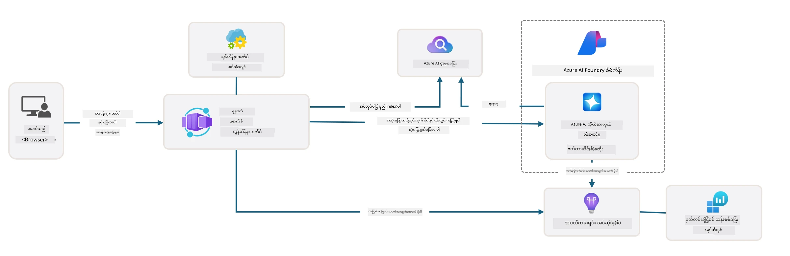

# 3. သင်တန်းပုံစံ တည်ဆောက်ခြင်း

!!! tip "ဒီသင်ခန်းစာပြီးဆုံးသည့်အချိန်မှာ သင်သည်"

    - [ ] Use GitHub Copilot and optional MCP tools for Azure documentation and read-only exploration
    - [ ] Identify the template's application, infrastructure, configuration, and test entry points
    - [ ] Verify generated explanations against actual repository files
    - [ ] **Lab 3:** Trace one request and one configuration input through the project

---

## 1. GitHub Copilot ကို ဖွင့်ပါ

VS Code တွင် initialized AI နမူနာကို ဖွင့်ပြီး [GitHub Copilot](https://code.visualstudio.com/docs/copilot/chat/chat-agent-mode) ကို ဖွင့်ပါ။ အရည်အသွေးမြင့် လုပ်ငန်းစီမံချက်တစ်ခုရှိသည့်အကောင့်ဖြင့် လော့ဂ်အင် ဝင်ပါ၊ သုံးစွဲမှုကန့်သတ်ချက်များကွဲပြားနိုင်သည်။ အပြောင်းအလဲများပြုလုပ်မီ Copilot ကို သိုလှောင်ထားသောကွန်ရက်ကိုရှင်းပြရန် မေးမြန်းပါ။

### ရွေးချယ်စရာ MCP ဆာဗာများ

ဤဝန်ဆောင်မှုများက ပိုမိုသောကိရိယာများကို ပံ့ပိုးပေးနိုင်သည်-

- [Azure MCP Server](https://learn.microsoft.com/azure/developer/azure-mcp-server/overview)
- [Microsoft Learn MCP Server](https://learn.microsoft.com/training/support/mcp)

VS Code တွင် [MCP ဖွဲ့စည်းပုံ လမ်းညွှန်ချက်](https://code.visualstudio.com/docs/copilot/chat/mcp-servers) ကို ကြည့်ပြီး လိုအပ်သည်ဆို `.vscode/mcp.json` ကို ဖန်တီးပါ-

```json
{
  "servers": {
    "Azure MCP Server": {
      "type": "stdio",
      "command": "npx",
      "args": ["-y", "@azure/mcp@latest", "server", "start"]
    },
    "microsoft.docs.mcp": {
      "type": "http",
      "url": "https://learn.microsoft.com/api/mcp"
    }
  }
}
```

`npx` အမိန့်သည် Node.js/npm ထောက်ခံထားသော ထည့်သွင်းမှုတစ်ခုလိုအပ်ပြီး အကောင်အထည်ဖော်နိုင်သောကုဒ်ကို ဒေါင်းလုပ်ဆွဲပါသည်။ အထုပ်ကို ပြန်လည်သုံးသပ်ပြီး အတည်ပြုထားသောဗားရှင်းကို ပင်းဆက်ထားပါ၊ အသင်းကြားသုံးရန် ထပ်မံထုတ်လုပ်နိုင်သည်။ VS Code ၏ MCP ထိန်းချုပ်မှုများဖြင့် ဆာဗာများကို စတင်၍ ရနိုင်သောကိရိယာများအား စစ်ဆေးကြည့်ရှုစေခြင်း၊ နာမည်များသည် ဗားရှင်းများအလိုက် ပြောင်းလဲနိုင်သည်။

**အတည်ပြုခြင်းကို သီးခြားထားသည်။** AZD အတွက် `azd auth login` ကို အသုံးပြုပါ။ Azure MCP ရဲ့ စာရွက်အတိုင်း authentication လုပ်ငန်းစဥ်ကို သူ့ရဲ့ ကိရိယာများအတွက် လိုက်နာပါ။ AZD login ဒါပေမဲ့ MCP session တည်ဆောက်မှု မဖြစ်စေပါ။ Azure CLI ကို လေ့ကျင့်ခန်း ဒါမှမဟုတ် hook မှ အသုံးပြုသောအခါ သီးခြား `az login` ကို သုံးပါ။

ဖတ်-only အမိန့်များကို ကြိုးစားကြည့်ပါ။

1. “Microsoft Learn MCP ကို အသုံးပြု၍ Azure Developer CLI ရဲ့ configuration စာရွက်များကို ရှာဖွေပါ။”
2. “ဤ repository ရဲ့ `azure.yaml` ကို ရှင်းပြပါ။ hook တစ်ခုချင်းစီကို ဖော်ဆောင်တဲ့ ဖိုင်များကို ရည်ညွှန်းပါ။”
3. “အသုံးပြုနိုင်သော Azure MCP ကိရိယာများကို အသုံးပြု၍၊ ကိုယ့်ရဲ့ deployed resources များကို ဘာမှ မပြောင်းလဲဘဲ စာရင်းပေးပါ။”

ရွေးထားသော tenant/subscription နှင့် တင်ပြထားသော tool call တစ်ခုချင်းစီကို စစ်ဆေးပါ။ only architecture ကို အသိပညာရရန်အတွက် resource ဖန်တီးခြင်း၊ ဖျက်ခြင်း သို့မဟုတ် access ပြောင်းခြင်းများ မအတည်ပြုပါနှင့်။

## ၂။ စက်ပစ္စည်းနည်းပညာကို နားလည်ပါ

ဥပမာသည် Azure Container Apps မှာ Python FastAPI backend နဲ့ React/TypeScript frontend ကို ပြုလုပ်ထားသည်။ Backend သည် Microsoft Foundry project ရဲ့ agent နဲ့ ဆက်သွယ်သည်။ ရယူခြင်းနဲ့ ကြည့်ရှုနိုင်ခြင်းသည် မှန်ကန်စွာ တပ်ဆင်ချက်များနှင့် tied ဖြစ်ပြီး အဲဒီ application deployed ဖြစ်တာက ချက်ချင်း အာမခံချက်မဟုတ်ပါ။



ဒီ ပုံနဲ့ [လက်ရှိ upstream deployment မျက်နှာစာလမ်းညွှန်](https://github.com/Azure-Samples/get-started-with-ai-agents/blob/main/docs/deployment.md) နဲ့ ကိုယ့်ရဲ့ အမှန်တကယ် resource များကို နှိုင်းယှဉ်ပါ။ configured model deployment၊ agent ကိရိယာများ၊ managed identity၊ အခန်းကဏ္ဍသတ်မှတ်ချက်များ၊ နဲ့ အလိုရှိပါက AI Search/Application Insights resource များကို စစ်ဆေးပါ။

**လေ့ကျင့်ခန်း:** Copilot ကို ရှေ့မောင်းမှ API သို့၊ ပြီးတော့ Foundry သို့ chat request တစ်ခုကို တန်းကြောင်းလိုက်ဖော်ထုတ်ရန် တောင်းဆိုပါ၊ ဖိုင်နဲ့ function ကို ရည်ညွှန်းပါ။ အဲဒီ ရည်ညွှန်းချက်တွေကို ဖွင့်ပြီး ရှင်းပြချက်ကို အတည်ပြုပါ။ diagram တစ်ခုကနေ authentication၊ routing သို့မဟုတ် authorization ကို သီးသန့် ခန့်မှန်းသင့်မယ် မဟုတ်ပါ။

## ၃။ Repository ဝန်းကျင်ဖွဲ့စည်းမှု

၂၀၁၆ ခုနှစ် နိုဝင်ဘာ ၄ ရက်တွင် စမ်းသပ်ထားသော နမူနာနှင့် နှိုင်းယှဉ်ဆန်းစစ်ထားသော ရွေးချယ်သည့် လမ်းကြောင်းများဖြစ်သည်။ ကိုယ့်ရဲ့ initialize ပြုလုပ်ထားသော ပြုပြင်မှု မူလရင်းမြစ် ဖြစ်ပါသည်။

```text
get-started-with-ai-agents/
  azure.yaml
  docker-compose.yaml
  requirements-dev.txt
  .devcontainer/
  infra/
    main.bicep
    main.parameters.json
    api.bicep
    core/
  src/
    Dockerfile
    pyproject.toml
    requirements.txt
    api/
      main.py
      routes.py
      search_index_manager.py
    frontend/
      package.json
      src/
    files/
  scripts/
    validate_env_vars.sh
    validate_env_vars.ps1
    postdeploy.sh
    postdeploy.ps1
  tests/
    test_evaluation.py
    test_red_teaming.py
  docs/
    deployment.md
    deploy_customization.md
    ai_search.md
    observability.md
    local_development.md
    troubleshooting.md
```

### အဆောက်အအုံနှင့် ပြင်ဆင်ခြင်း

`infra/main.bicep` သည် resource များကို စီမံခန့်ခွဲသည်။ `main.parameters.json` သည် template ပို့ရသော input များကို AZD ပတ်ဝန်းကျင် တန်ဖိုးများနှင့် ချိတ်ဆက်သည်။ `azure.yaml` သည် application service နှင့် lifecycle hook များကို ရွေးချယ်သည်။ `USE_AZURE_AI_SEARCH_SERVICE` ကဲ့သို့ လက်ခံ input တစ်ခုကို ဖိုင်များ၌ လိုက်တွဲပြီး ဘယ်လို ပြောင်းလဲမှု ရှိသည်ကို ရှာပါ။

### application နှင့် အထောက်အထား

`src/api/` နှင့် `src/frontend/` ကိုအတူဖတ်ပါ။ agent ကို ဘယ်မှာ ဖန်တီးထား သို့မဟုတ် ရယူထားသည်၊ အညွှန်းများ/ကိရိယာများကို ဘယ်မှာ ဖွင့်ထားသည်၊ Azure call တစ်ခုချင်းစီမှာ identity ဘယ်ဟာ သုံးထားသည်ကို သတ်မှတ်ပါ။ `src/files/` အောက်ရှိ နမူနာဖိုင်များသည် ပြသမှုအချက်အလက်များဖြစ်ပြီး ထုတ်လုပ်မှု စာရင်းသွင်းမှု သို့မဟုတ် authorization မော်ဒယ် မဟုတ်ပါ။

### စမ်းသပ်မှုနှင့် ကြည့်ရှုခြင်း

လက်ရှိ တန်ဖိုးထားခြင်းနဲ့ red-teaming ဝင်ရောက်မှုများသည် `tests/` အောက်ရှိသည်။ ရှစ်လွန်သော `evals/` နှင့် `airedteaming/` directory ကို ဤနမူနာအတွက် အသုံးမပြုတော့ပဲ ဖြစ်သည်။ cloud စမ်းသပ်ခန်းများကို လုပ်ခိုင်းခြင်းမတိုင်မှီ `docs/observability.md` ကိုဖတ်ပါ။ ဤ Python စမ်းသပ်မှုများသည် ရွေးချယ်ထားသော `azure.ai.evaluations` AZD extension နှင့် သီးခြားထားသည်။

## ၄။ ကိုယ့်ရဲ့ ရလဒ်အတည်ပြုပါ

- API route၊ agent ဆက်သွယ်မှုနှင့် retrieval ကုဒ်ကို နမူနာမေးခွန်းတစ်ခုအတွက် ဖော်ထုတ်ပါ။
- Foundry ကို access လုပ်သော identity နှင့် ကွန်ဖစ်ဂျာရွေးချယ်ထားသော endpoint ကို ရှင်းပြပါ။
- အမှန်တကယ် pre-up နဲ့ post-deploy script များနှင့် သူတို့၏ အမှားကိုင်တွယ်မှု အပြုအမှုကို ရှာပါ။
- ကိုယ့် deployment မှ ပျောက်ဆုံးနေသော မှီခိုမှုများ သို့မဟုတ် တိုက်ဆိုင်နိုင်သော လက္ခဏာများကို စာရင်းပြုစုပါ။

အဆက်မပြတ် [Configure a Template](4-Configure-AI-Template.md) သို့ ဆက်လက် သွားပါ။

---

<!-- CO-OP TRANSLATOR DISCLAIMER START -->
**ပြောကြားချက်**
ဤစာတမ်းကို AI ဘာသာပြန်ဝန်ဆောင်မှု [Co-op Translator](https://github.com/Azure/co-op-translator) အသုံးပြု၍ ဘာသာပြန်ထားပါသည်။ ကျွန်ုပ်တို့သည် တိကျမှန်ကန်မှုအတွက် ကြိုးပမ်းနေသော်လည်း၊ စက်ကိရိယာဘာသာပြန်ခြင်းများတွင် အမှားများ သို့မဟုတ် မှားယွင်းချက်များ ပါဝင်နိုင်ကြောင်း သတိပြုပါရန် လိုအပ်ပါသည်။ မူလစာတမ်းကို မူရင်းဘာသာဖြင့်သာ ယုံကြည်စိတ်ချရသော အချက်အလက်အဖြစ် သတ်မှတ်သင့်သည်။ အရေးကြီးသည့် သတင်းအချက်အလက်များအတွက် ပရော်ဖက်ရှင်နယ် လူသားဘာသာပြန်သူဝန်ဆောင်မှုကို အကြံပြုပါသည်။ ဤဘာသာပြန်ချက်ကို အသုံးပြုခြင်းမှ ဖြစ်ပေါ်လာသော နားလည်မှုကွာခြားမှုများ သို့မဟုတ် မမှန်ကန်သော အသုံးပြုမှုများအတွက် ကျွန်ုပ်တို့ တာဝန်မခံပါ။
<!-- CO-OP TRANSLATOR DISCLAIMER END -->