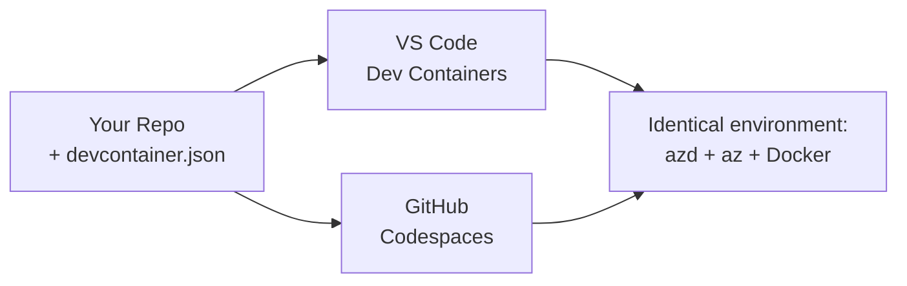

# azd का लागि देव कन्टेनरहरू र GitHub Codespaces

**अध्याय नेभिगेसन:**
- **📚 कोर्स होम**: [AZD For Beginners](../../README.md)
- **📖 वर्तमान अध्याय**: अध्याय 1 - आधार र छिटो सुरु
- **⬅️ अघिल्लो**: [Bring Your Own App](bring-your-own-app.md)
- **🚀 अर्को अध्याय**: [अध्याय 2: AI-First Development](../chapter-02-ai-development/README.md)

> कमाण्ड र कन्फिगरेसन समीक्षा लक्ष्य: `azd 1.37.2` (नोभेम्बर २०२६)। कन्टेनर निर्माण र Azure डिप्लोयमेन्टहरू यस समीक्षाको अंशको रूपमा कार्यान्वयन गरिएनन्।

## परिचय

azd, सही भाषा रनटाइम, Docker, र Azure CLI प्रत्येक मेसिनमा स्थापना गर्नु एक झन्झट हो—र त्यो हो एउटा ट्युटोरियल जुन "मेरो मेसिनमा काम गर्छ" भन्ने अर्को कसैको लागि सफल नहुनुको मुख्य कारण। एउटा **देव कन्टेनर** ले तपाईंको सम्पूर्ण टूलचेनलाई फाइलमा वर्णन गरेर यो समस्या समाधान गर्छ। जसले पनि यो प्रोजेक्ट VS Code वा GitHub Codespaces मा खोल्छ, उसलाई उही ठ्याक्कै वातावरण प्राप्त हुन्छ, जसमा azd पहिले नै स्थापित हुन्छ। यस पाठले तपाईंलाई कसरी एउटा थप्ने देखाउँछ।

## सिकाइ लक्ष्यहरू

यस पाठको अन्त्यसम्म, तपाईंले:
- देव कन्टेनर के हो र यसले azd सँग किन मद्दत गर्छ भन्ने बुझ्नुहुनेछ
- प्रोजेक्टमा न्यूनतम `.devcontainer/devcontainer.json` थप्नुहोस्
- देव कन्टेनर *फिचरहरू* मार्फत azd, Azure CLI, र Docker सँग समावेश गर्नुहोस्
- प्रोजेक्ट GitHub Codespaces वा VS Code मा खोल्नुहोस्

## सिकाइ परिणामहरू

यस पाठ पूरा गरेपछि, तपाईं गर्न सक्षम हुनुहुनेछ:
- azd प्रोजेक्टका लागि एउटा `devcontainer.json` लेख्न
- म्यानुअल इन्स्टल बिना azd र Azure उपकरणहरू थप्न
- कन्टेनर वा Codespace भित्रबाट `azd up` चलाउन

---

## देव कन्टेनर के हो?

देव कन्टेनर तपाईंको रिपोजिटरीमा रहेको `.devcontainer/devcontainer.json` फाइल द्वारा परिभाषित डोकर-आधारित विकास वातावरण हो। जब तपाईं प्रोजेक्ट खोल्नुहुन्छ:

- **VS Code** (देव कन्टेनर एक्सटेन्सनसहित) कन्टेनर बनाउँछ र त्यसमा जडान हुन्छ।
- **GitHub Codespaces** ले क्लाउडमा उही कन्टेनर बनाउँछ र तपाईंलाई ब्राउजरमा आधारित सम्पादक दिन्छ।

दुवै अवस्थामा, प्रत्येक योगदानकर्ता सान्दर्भिक उपकरणहरू समान पाउँछन्—“तपाईंले azd स्थापना गर्नुभयो?” भन्ने समस्या हुँदैन।



---

## चरण 1: devcontainer फाइल बनाउनुहोस्

तपाईंको प्रोजेक्टको मूलमा `.devcontainer/devcontainer.json` बनाउनुहोस्:

```json
{
  "name": "azd-project",
  "image": "mcr.microsoft.com/devcontainers/base:bookworm",
  "features": {
    "ghcr.io/devcontainers/features/azure-cli:1": {},
    "ghcr.io/azure/azure-dev/azd:0": { "version": "1.37.2" },
    "ghcr.io/devcontainers/features/docker-in-docker:2": {},
    "ghcr.io/devcontainers/features/node:1": {}
  },
  "customizations": {
    "vscode": {
      "extensions": [
        "ms-azuretools.azure-dev",
        "ms-azuretools.vscode-bicep"
      ]
    }
  },
  "forwardPorts": [3000],
  "postCreateCommand": "azd version"
}
```

प्रत्येक भागले के गर्छ:

| कुञ्जी | उद्देश्य |
|-----|---------|
| `image` | कन्टेनरको आधार OS |
| `features` | पूर्वनिर्मित इन्स्टलरहरू—यहाँ: Azure CLI, **azd**, Docker, र Node.js |
| `customizations.vscode.extensions` | azd र Bicep VS Code एक्सटेन्सनहरू स्वतः इन्स्टल गर्छ |
| `forwardPorts` | तपाईंको एपको पोर्टसँग ब्राउजरमा पहुँच खुला गर्छ |
| `postCreateCommand` | कन्टेनर बनिसकेपछि एक पटक चल्छ (यहाँ, स्यानिटी जाँच) |

> फिचर संस्करण (`azd:0`) र इन्स्टल गरिएको CLI संस्करण फरक छन्। CLI पिन गर्न फिचरको `version` विकल्पलाई `"1.37.2"` मा सेट गर्नुहोस्; CLI संस्करणलाई फिचर ट्यागको रूपमा प्रयोग नगर्नुहोस्।

---

## चरण 2: फिचरलाई तपाईंको एपको भाषासँग मिलाउनुहोस्

तपाईंको एपले जुन भाषा प्रयोग गर्छ त्यसलाई मेल खाने `node` फिचर बदल्नुहोस्:

```jsonc
// Python project
"ghcr.io/devcontainers/features/python:1": {},

// .NET project
"ghcr.io/devcontainers/features/dotnet:2": {},

// Java project
"ghcr.io/devcontainers/features/java:1": {},

// Go project
"ghcr.io/devcontainers/features/go:1": {}
```

स्थानीय रूपमा इमेज बनाउन बेलामा `docker-in-docker` राख्नुहोस्। कन्फिगर गरिएको रिमोट ACR निर्माण (`docker.remoteBuild: true`) वैकल्पिक हो; होस्ट टाइपले मात्र स्थानीय Docker आवश्यक नपर्न सक्छ।

---

## चरण 3: खोल्नुहोस्

**VS Code मा:**
1. **Dev Containers** एक्सटेन्सन इन्स्टल गर्नुहोस्।
2. प्रोजेक्ट फोल्डर खोल्नुहोस्।
3. अनुरोध गर्दा **Reopen in Container** क्लिक गर्नुहोस् (वा *Dev Containers: Reopen in Container* चलाउनुहोस्)।

**GitHub Codespaces मा:**
1. रिपो GitHub मा पुश गर्नुहोस्।
2. **Code → Codespaces → Create codespace on main** क्लिक गर्नुहोस्।
3. कन्टेनर निर्माणसम्म प्रतीक्षा गर्नुहोस्—azd टर्मिनलमा तयार हुन्छ।

---

## चरण 4: कन्टेनर भित्रबाट डिप्लोय गर्नुहोस्

कन्टेनरमा azd पूर्वइन्स्टल भएकोले, सामान्य कार्यप्रवाह सरलै कार्य गर्छ:

```bash
azd auth login --use-device-code   # device code is handy inside Codespaces
azd up
```

> **किन `--use-device-code`?** रिमोट कन्टेनर वा Codespace मा स्थानीय ब्राउजर हुँदैन, त्यसैले डिभाइस-कोड लगइन भरपर्दो उपाय हो। लगइन पूरा गर्न कोड ब्राउजर ट्याबमा पेस्ट गर्नुहुनेछ।

---

## सामान्य समस्याहरू

| समस्या | समाधान |
|---------|-----|
| `azd up` इमेज बनाउन सक्दैन | `docker-in-docker` फिचर थप्नुहोस् |
| Codespaces मा ब्राउजर लगइन अड्किन्छ | `azd auth login --use-device-code` प्रयोग गर्नुहोस् |
| टिमका सदस्यहरू बीच उपकरण फरक छ | azd फिचरको `version` विकल्प मार्फत CLI पिन गर्नुहोस् र भाषा रनटाइमहरू पिन गर्नुहोस् |
| एप ब्राउजरमा पहुँचयोग्य छैन | पोर्ट `forwardPorts` मा थप्नुहोस् |

---

## सारांश

- एउटा देव कन्टेनर तपाईंको azd टूलचेनलाई सबैका लागि पुन:उत्पादनयोग्य बनाउँछ।
- देव कन्टेनर *फिचरहरू* मार्फत azd, Azure CLI, र Docker थप्नुहोस्।
- तपाईंको एपको भाषालाई मेल खाने फिचर चुन्नुहोस् र कन्टेनर होस्टहरूको लागि `docker-in-docker` राख्नुहोस्।
- Codespaces भित्र चलाउँदा डिभाइस-कोड लगइन प्रयोग गर्नुहोस्।

---

## 🔗 नेभिगेसन

| दिशा | स्रोत |
|-----------|----------|
| **अघिल्लो** | [Bring Your Own App](bring-your-own-app.md) |
| **अध्याय होम** | [अध्याय 1: आधार र छिटो सुरु](README.md) |
| **अर्को अध्याय** | [अध्याय 2: AI-First Development](../chapter-02-ai-development/README.md) |

## 📖 सम्बन्धित स्रोतहरू

- [इन्स्टलेसन र सेटअप](installation.md)
- [कमाण्ड चिट शीट](../../resources/cheat-sheet.md)
- [अधिकारिक देव कन्टेनर विशिष्टता](https://containers.dev/)
- [azd देव कन्टेनर फिचर](https://github.com/Azure/azure-dev/tree/main/ext/devcontainer)

---

<!-- CO-OP TRANSLATOR DISCLAIMER START -->
**अस्वीकरण**:
यो दस्तावेज़ AI अनुवाद सेवा [Co-op Translator](https://github.com/Azure/co-op-translator) प्रयोग गरेर अनुवाद गरिएको हो। हामी सही हुन प्रयास गर्छौं, तर कृपया जानकार हुनुस् कि स्वचालित अनुवादमा त्रुटिहरू वा अशुद्धताहरू हुन सक्छन्। मूल दस्तावेज़ यसको मूल भाषामा आधिकारिक स्रोत मानिनुपर्छ। महत्वपूर्ण जानकारीका लागि व्यावसायिक मानव अनुवाद सिफारिस गरिन्छ। यस अनुवादको प्रयोगबाट उत्पन्न कुनै पनि गलत बुझाइ वा त्रुटिको लागि हामी जिम्मेवार छैनौं।
<!-- CO-OP TRANSLATOR DISCLAIMER END -->