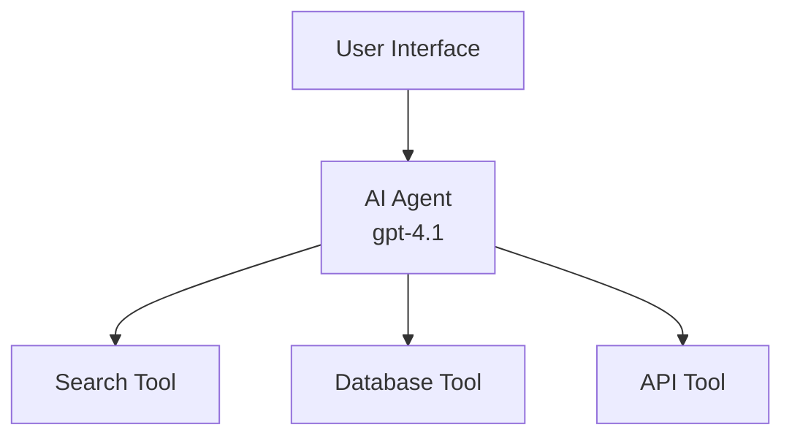
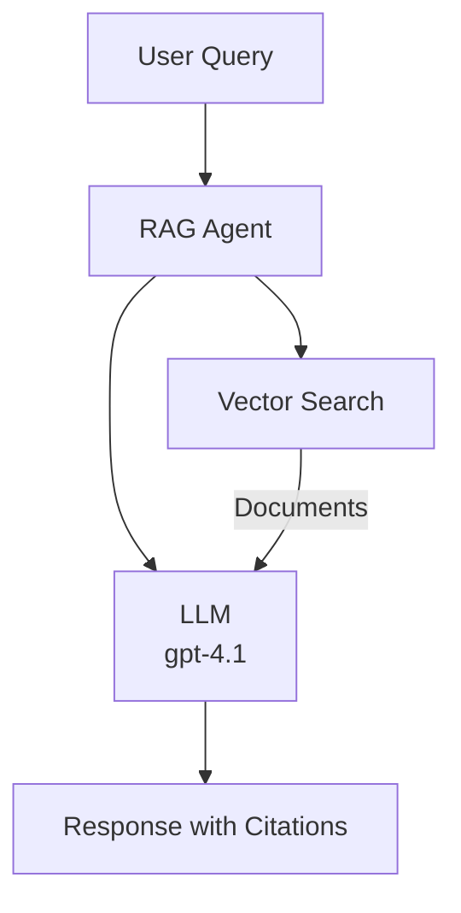
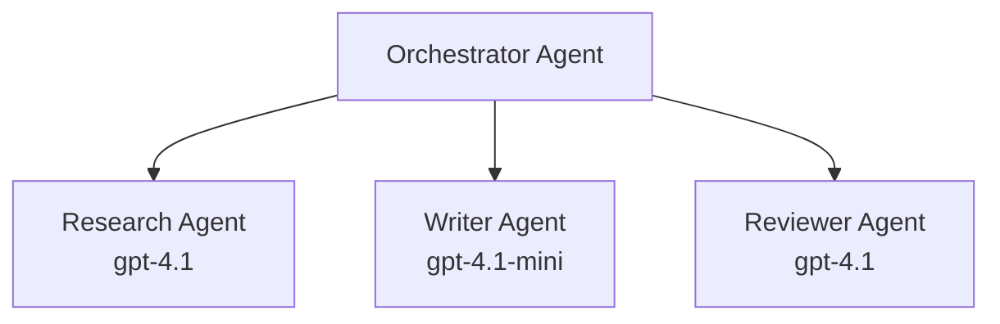

# Azure Developer CLI सँग AI एजेन्टहरू

**अध्याय नेभिगेशन:**
- **📚 कोर्स होम**: [AZD For Beginners](../../README.md)
- **📖 वर्तमान अध्याय**: अध्याय २ - AI-प्रथम विकास
- **⬅️ अघिल्लो**: [Microsoft Foundry Integration](microsoft-foundry-integration.md)
- **➡️ अर्को**: [AI Model Deployment](ai-model-deployment.md)
- **🚀 उन्नत**: [Multi-Agent Solutions](../../examples/retail-scenario.md)

---

## परिचय

AI एजेन्टहरू स्वतन्त्र कार्यक्रमहरू हुन् जुन आफ्नो वातावरणलाई बुझ्न, निर्णय लिन, र विशेष लक्ष्यहरू प्राप्त गर्न क्रियाहरू लिन सक्षम छन्। सरल च्याटबोटहरू जुन संकेतहरूमा प्रतिक्रिया दिन्छन् भन्दा फरक, एजेन्टहरूले:

- **उपकरणहरू प्रयोग गर्नुहोस्** - API हरू कल गर्नुहोस्, डाटाबेस खोज्नुहोस्, कोड कार्यान्वयन गर्नुहोस्
- **योजना र तर्क गर्नुहोस्** - जटिल कार्यहरूलाई चरणहरूमा विभाजन गर्नुहोस्
- **सन्दर्भबाट सिक्नुहोस्** - स्मृति कायम राख्नुहोस् र व्यवहार अनुकूल गर्नुहोस्
- **सहकार्य गर्नुहोस्** - अन्य एजेन्टहरूसँग काम गर्नुहोस् (बहु-एजेन्ट प्रणालीहरू)

यो मार्गदर्शिकाले तपाईंलाई Azure मा Azure Developer CLI (azd) प्रयोग गरेर AI एजेन्टहरू कसरी डिप्लोय गर्ने देखाउँछ।

कुराकानी सन्दर्भ प्रयोग गर्नु मोडेल प्रशिक्षण होइन: स्थायी स्मृति, पहुँच नियन्त्रण, र अवधारण अनुप्रयोगद्वारा कार्यान्वयन/कॉन्फिगर गर्नुपर्छ।

> **Foundry GA अपडेट (2026-11-09):** सामान्य उपलब्धता `microsoft.foundry` 1.0 बन्डल with `azd >= 1.37.0` स्थापना गर्नुहोस्। मूल्याङ्कनहरू अलग्गै स्थापना गरिन्छन्; वैकल्पिक पूर्वावलोकन सुविधाहरू र तलको क्लासिक एसडीकेको अंश GA मा बन्डल घोषणाबाट प्रोत्साहित गरिएको छैन। यो मार्गदर्शन [GA घोषणा](https://devblogs.microsoft.com/azure-sdk/microsoft-foundry-azure-developer-cli-ga/) र दस्तावेजहरूमा आधारित छ, प्रत्यक्ष Azure डिप्लोयमेन्टमा होइन।

## सिक्ने लक्ष्यहरू

यो मार्गदर्शिका पूरा गरेर, तपाईं:
- AI एजेन्टहरू के हुन् र तिनीहरू च्याटबोटहरूबाट कसरी फरक छन् बुझ्नुहुनेछ
- AZD प्रयोग गरेर पूर्वनिर्मित AI एजेन्ट टेम्प्लेटहरू डिप्लोय गर्नुहोस्
- Foundry एजेन्टहरूलाई कस्टम एजेन्टहरूका लागि कन्फिगर गर्नुहोस्
- आधारभूत एजेन्ट ढाँचाहरू कार्यान्वयन गर्नुहोस् (उपकरण प्रयोग, RAG, बहु-एजेन्ट)
- डिप्लोय गरिएका एजेन्टहरू अनुगमन र डिबग गर्नुहोस्

## सिकाइ परिणामहरू

पूरा भएपछि, तपाईं सक्षम हुनुहुनेछ:
- एक मात्र आदेशले Azure मा AI एजेन्ट अनुप्रयोगहरू डिप्लोय गर्न
- एजेन्ट उपकरणहरू र क्षमता कन्फिगर गर्न
- retrieval-augmented generation (RAG) एजेन्टहरूसँग कार्यान्वयन गर्न
- जटिल कार्यप्रवाहका लागि बहु-एजेन्ट वास्तुकला डिजाइन गर्न
- सामान्य एजेन्ट डिप्लोयमेन्ट समस्याहरू समाधान गर्न

---

## 🤖 एजेन्टलाई च्याटबोट भन्दा फरक के बनाउँछ?

| विशेषता | च्याटबोट | AI एजेन्ट |
|---------|---------|----------|
| **व्यवहार** | संकेतहरूमा प्रतिक्रिया दिन्छ | स्वतन्त्र कार्यहरू गर्दछ |
| **उपकरणहरू** | पुनर्प्राप्ति वा उपकरणहरू प्रयोग गर्न सक्छ | सामान्यतया लक्ष्य-निराकरण लूपमा उपकरणहरू प्रयोग गर्छ |
| **स्मृति** | अनुप्रयोग-निर्भर | स्पष्ट रूपमा कार्यान्वयन गरिएकोमा मात्र स्थायी स्मृति |
| **योजना** | एकल प्रतिक्रिया | बहु-चरण तर्क |
| **सहकार्य** | एकल इकाई | अन्य एजेन्टहरूसँग काम गर्न सक्छ |

### सरल उपमा

- **च्याटबोट** = सूचना डेस्कमा प्रश्नहरूको जवाफ दिने सहयोगी व्यक्ति
- **AI एजेन्ट** = तपाईंका लागि फोन कल गर्न, अपोइन्टमेन्ट बुक गर्न, र कार्यहरू पूरा गर्ने व्यक्तिगत सहायक

---

## 🚀 द्रुत सुरु: तपाईंको पहिलो एजेन्ट डिप्लोय गर्नुहोस्

एउटा **नयाँ खाली कार्य निर्देशिका** बाट एउटा विकल्प छान्नुहोस्। पछिल्लो `.` त्यहीँ प्रारम्भ हुन्छ; स्पष्ट गन्तव्य बिना, वर्तमान AZD ले एक टेम्प्लेट-नामित उपनिर्देशिका बनाउन सक्छ र तपाईँको shell को निर्देशिका परिवर्तन गर्दैन। अलग-अलग टेम्प्लेटहरू/पर्यावरणहरू अलग-अलग निर्देशिकाहरूमा राख्नुहोस्।

तलका समय/लागत दायराहरू उदाहरणका लागि मात्र हुन्, प्रमाणित उद्धरणहरू होइनन्। हरेक नमूनाको वर्तमान पूर्वापेक्षाहरू, मूल्य निर्धारण, मोडेल कोटा, र वैकल्पिक सेवाहरू लागू गर्नु अघि जाँच गर्नुहोस्।

### विकल्प १: फाउन्ड्री एजेन्ट टेम्प्लेट (सिफारिस गरिएको)

```bash
# Initialize the AI agents template
azd init --template get-started-with-ai-agents .

# Deploy to Azure
azd up
```

**के डिप्लोय हुन्छ:** नमूना को वर्तमान पूर्वाधार र चयन गरिएका विकल्पहरूले मोडेल, उपकरणहरू, होस्टिंग, र मोनिटरिङ स्रोतहरू निर्धारण गर्छ। यसको README र `infra/` provisioning अघि समीक्षा गर्नुहोस्; प्रत्येक एजेन्ट टेम्प्लेटले खोज वा वेब इन्टरफेस समावेश गरेको हुँदो छैन भनेर नमान्नुहोस्।

**समय:** ~१५-२० मिनेट
**लागत:** ~$१००-१५०/महिना (विकास)

### विकल्प २: Prompty सँग रचनात्मक लेखन एजेन्टहरू

```bash
# Initialize the Prompty-based agent template
azd init --template https://github.com/Azure-Samples/contoso-creative-writer .

# Deploy to Azure
azd up
```

**के के तैनाथ हुन्छ:** Azure OpenAI, Bing Grounding, र Azure AI Search प्रयोग गरेर FastAPI/Prompty बहु-एजेन्ट लेखन नमुना। पहिलेको `agent-openai-python-prompty` रिपोजिटोरी यहाँ रिडिरेक्ट हुन्छ; यो एक न्यूनतम Azure Functions मौसम-एजेन्ट टेम्प्लेट होइन। होस्टिंग, मोडेल कोटा, र Bing Grounding पूर्व-आवश्यकताहरूका लागि यसको वर्तमान README अनुसरण गर्नुहोस्।

**समय:** ~१०-१५ मिनेट
**लागत:** ~$५०-१००/महिना (विकास)

### विकल्प ३: RAG च्याट एजेन्ट

```bash
# Initialize RAG chat template
azd init --template azure-search-openai-demo .

# Deploy to Azure
azd up
```

**के के तैनाथ हुन्छ:**
- ✅ Microsoft Foundry मोडेलहरू
- ✅ नमुना डाटासहित Azure AI Search
- ✅ कागजात प्रशोधन पाइपलाइन
- ✅ उद्धरणसहित च्याट इन्टरफेस

**समय:** ~१५-२५ मिनेट
**लागत:** ~$80-150/महिना (विकास)

### विकल्प ४: GA Foundry बन्डल सहित होस्ट गरिएको एजेन्ट

आधारभूत Python Agent Framework Responses API नमूना लागि [पूर्ण होस्ट गरिएको एजेन्ट वॉकथ्रु](microsoft-foundry-integration.md#hosted-agent-walkthrough-ga) प्रयोग गर्नुहोस्। यो कोड-परिनियोजन पथमा Python 3.13+, वर्तमान uv, Foundry अनुमति, र क्षेत्रीय मोडेल कोटा आवश्यक छ। Azure CLI प्रमाणपत्र प्रयोग गर्दा स्थानीय SDK कलहरूलाई अलग रूपमा प्रमाणित गर्नुहोस्।

```bash
azd auth login
azd ext install microsoft.foundry
```

खाली निर्देशिकामा, नमूना आरम्भ गर्नुहोस्:

```text
azd ai agent init --template https://github.com/microsoft-foundry/foundry-samples/blob/main/samples/python/hosted-agents/agent-framework/responses/01-basic/azure.yaml --deploy-mode code --src .
```

नयाँ वा अवस्थित परियोजना चयन गर्नुहोस्, `azure.yaml` समीक्षा गर्नुहोस्, र `azd provision` चलाउनुहोस्। Agent Inspector खोल्न `azd ai agent run` प्रयोग गर्नुहोस् र सो निर्देशिकामा अर्को टर्मिनलबाट `azd ai agent invoke --local "Explain how this agent is hosted."` चलाउनुहोस्। स्थानीय प्रमाणीकरण पछि, तैनाथ गरेको प्रतिक्रिया तुलना गर्न `azd deploy` र `azd ai agent invoke "Explain how this agent is hosted."` प्रयोग गर्नुहोस्। Foundry ले अपलोड गरिएको स्रोतलाई टाढाबाट निर्माण गर्दछ; स्थानीय कन्टेनर निर्माण आवश्यक छैन।

**कहिलेकाहीँ `azd ai agent init` बनाम `azd init --template` प्रयोग गर्ने:** 

| दृष्टिकोण | सबैभन्दा राम्रो | यो कसरी काम गर्छ |
|----------|----------|------|
| `azd init --template` | कार्यशील नमूना अनुप्रयोगबाट सुरू गरिँदै | पूरा टेम्प्लेट रिपो कोड + पूर्वाधार सहित क्लोन गर्छ |
| `azd ai agent init --template` | वर्तमान Foundry एजेन्ट परियोजना अपनाउँदै | एक `azure.yaml` परियोजना दस्तावेज र यसको परिभाषाहरू प्रयोग गर्छ |

> **सल्लाह:** विकल्प १-३ पूर्ण अनुप्रयोग टेम्प्लेटहरूबाट सुरु हुन्छ; विकल्प ४ GA होस्ट गरिएको एजेन्ट कार्यप्रवाह सिकाउँछ। कुनै पनि आरम्भ आदेशले पुरानो एजेन्ट म्यानिफेस्टहरू स्वचालित रूपमा माइग्रेट गर्दैन। विद्यमान परियोजनामा सिधा एजेन्ट परिभाषा थप्न, [आरम्भ र माइग्रेशन मार्गनिर्देशन](../chapter-08-production/production-ai-practices.md#initializing-agent-projects-with-azd-ai-agent-init) हेर्नुहोस्।

अलग्गै `azure.ai.evaluations` स्थापना गर्नुहोस् परीक्षण डेटा/रुब्रिक्स सिर्जना र समीक्षा गर्न, मूल्यांकन कन्फिगर गर्न, र `azd ai eval` प्रयोग गरेर चलाउन। अनुकूलनले मिल्दोजुल्दो मूल्यांकन पुन: प्रयोग गर्न सक्छ; स्पष्ट रूपमा तैनाथ गर्नु अघि उम्मेदवारहरू समीक्षा गर्नुहोस्। पुराना उदाहरणहरू पुन: प्रयोग गर्नु अघि [मूल्यांकन कार्यप्रवाह](../chapter-08-production/production-ai-practices.md#evaluation-migration-and-quality-checks) र [अनुकूलन माइग्रेसन](../chapter-08-production/production-ai-practices.md#optimization-configuration-migration) अनुसरण गर्नुहोस्। सरसफाइको लागि, पुन: प्रयोग गरिएको Foundry परियोजनाका स्रोतहरू `azd down` पछि पनि रहन्छन्; नयाँ सिर्जना गरिएको परियोजनाको स्रोत समूह मेटाइन्छ। [वाकथ्रु सफाइ मार्गदर्शन](microsoft-foundry-integration.md#7-clean-up-deliberately) हेर्नुहोस्।

---

## 🏗️ एजेन्ट संरचना नमूनाहरू

### नमूना 1: उपकरणहरूसँग एकल एजेन्ट

सबैभन्दा सरल एजेन्ट नमूना - एउटा एजेन्ट जसले विभिन्न उपकरणहरू प्रयोग गर्न सक्छ।



**सुहाउँदो:**
- ग्राहक समर्थन बोटहरू
- अनुसन्धान सहायकहरू
- डाटा विश्लेषण एजेन्टहरू

**सम्बन्धित अनुप्रयोग नमूना:** `azure-search-openai-demo` ले RAG देखाउँछ, सामान्य स्वेच्छिक-उपकरण एजेन्ट लूप होइन।

### नमूना 2: RAG एजेन्ट (प्राप्ति-समृद्ध सिर्जना)

प्रतिक्रियाहरू सिर्जना गर्नु अघि सम्बन्धित कागजातहरू प्राप्त गर्ने एजेन्ट।



**सुहाउँदो:**
- उद्यम ज्ञान आधारहरू
- कागजात Q&A प्रणालीहरू
- अनुपालन र कानूनी अनुसन्धान

**AZD टेम्प्लेट:** `azure-search-openai-demo`

### ढाँचा ३: बहु-एजेन्ट प्रणाली

जटिल कार्यहरूमा सँगै काम गर्ने एकभन्दा बढी विशेषज्ञ एजेन्टहरू।



**सबै भन्दा उपयुक्त:**
- जटिल सामग्री सिर्जना
- बहु-चरण कार्यप्रवाहहरू
- विभिन्न विशेषज्ञता आवश्यक पर्ने कार्यहरू

**थप जान्न:** [बहु-एजेन्ट समन्वय ढाँचाहरू](../chapter-06-pre-deployment/coordination-patterns.md)

---

## ⚙️ एजेन्ट उपकरणहरू कन्फिगर गर्दै

एजेन्टहरू उपकरणहरू प्रयोग गर्न सक्षम हुँदा शक्तिशाली हुन्छन्। यहाँ साधारण उपकरणहरू कसरी कन्फिगर गर्ने वर्णन गरिएको छ:

### फाउन्ड्री एजेन्टहरूमा उपकरण कन्फिगरेसन

यो **क्लासिक एजेन्ट सेवा SDK अंश** ले `azure-ai-projects==1.0.0` र `azure-ai-agents==1.1.0` लाई `azure-identity` का साथ लक्षित गर्दछ। यो नयाँ संस्करणयुक्त-एजेन्ट/Responses API होइन जुन केही वर्तमान फाउन्ड्री टेम्प्लेटहरूले प्रयोग गर्छन्, न त `azure.ai.agents` AZD एक्सटेन्सन (अर्को प्याकेग) हो। यी API पुस्ता नमिक्स गर्नुहोस्। `PROJECT_ENDPOINT` लाई क्लासिक फाउन्ड्री प्रोजेक्ट अन्त बिन्दुमा सेट गर्नुहोस् र `MODEL_DEPLOYMENT_NAME` लाई अवस्थित समर्थित मोडेल डिप्लोयमेन्टमा; स्थानीय रूपमा `az login` संग प्रमाणीकरण गर्नुहोस् र आवश्यक प्रोजेक्ट अधिकारहरू दिनुहोस्।

```python
# agent_config.py
import os
from azure.ai.projects import AIProjectClient
from azure.ai.agents.models import FunctionTool
from azure.identity import DefaultAzureCredential

def search_knowledge_base(query: str) -> str:
    """Search the demonstration knowledge base.

    :param query: Search text.
    :return: Matching demonstration information.
    """
    # Local fixture only, not a production search implementation.
    return "Demo policy: returns are accepted within 30 days."

project_client = AIProjectClient(
    endpoint=os.environ["PROJECT_ENDPOINT"],
    credential=DefaultAzureCredential(),
)
search_tool = FunctionTool(functions={search_knowledge_base})
project_client.agents.enable_auto_function_calls(search_tool)
agent = project_client.agents.create_agent(
    model=os.environ["MODEL_DEPLOYMENT_NAME"],
    name="Support Agent",
    instructions="Use search_knowledge_base for policy questions. Label results as demo data.",
    tools=search_tool.definitions,
)
```

एक फंक्शन स्कीमा दर्ता गर्नु सेवामा पायथन चलाउँदैन। यस SDK मा, `enable_auto_function_calls` र `agents.runs.create_and_process(...)` ले दर्ता गरिएका कलब्याकहरू तपाईंको क्लाइन्ट प्रक्रियामा चलाउँछन्। हेर्नुहोस् [प्रकाशित SDK उदाहरण](https://github.com/Azure/azure-sdk-for-python/blob/azure-ai-agents_1.1.0/sdk/ai/azure-ai-agents/samples/agents_tools/sample_agents_auto_function_call.py)। समाप्त भएपछि क्लाइन्ट बन्द गर्नुहोस् र डेमोका लागि बनाएका एजेन्ट/थ्रेडहरू मेटाउनुहोस्।

### वातावरण कन्फिगरेसन

तलका नामहरू **दर्शनीय कस्टम-टेम्प्लेट इनपुटहरू** हुन्, निर्मित AZD स्विचहरू होइनन्। पहिले प्रत्येक मानलाई `infra/main.parameters.json`, पूर्वाधार, र एप्लिकेशन कोडमार्फत तारसम्म बाँध्नुहोस्। `azd env set` मात्र एजेन्टका उपकरणहरू वा निर्देशनहरू परिवर्तन गर्दैन।

```bash
# Set up agent-specific environment variables
azd env set AZURE_OPENAI_MODEL "gpt-4.1"
azd env set AGENT_INSTRUCTIONS "You are a helpful assistant..."
azd env set ENABLE_CODE_INTERPRETER "true"
azd env set ENABLE_FILE_SEARCH "true"

# Apply wired infrastructure and application changes
azd up
```

---

## 📊 निगरानी एजेन्टहरू

### एप्लिकेशन इनसाइट्स इंटीग्रेशन

यदि तपाईंले छानेको टेम्प्लेटले एप्लिकेशन इनसाइट्स प्रोभिजन गर्छ र इन्स्ट्रुमेन्टेसन कन्फिगर गर्छ:

```bash
# Open monitoring dashboard
azd monitor --overview

# Open the Application Insights logs view (not a streaming log tail)
azd monitor --logs

# View live metrics
azd monitor --live
```

### ट्र्याक गर्नुपर्ने मुख्य मेट्रिक्सहरू

| मेट्रिक | वर्णन | लक्ष्य |
|--------|-------------|--------|
| प्रतिक्रिया ढिलाइ | प्रतिक्रिया निर्माण गर्न लागेको समय | < ५ सेकेण्ड |
| टोकन प्रयोग | अनुरोध प्रति टोकनहरू | लागतको लागि अनुगमन गर्नुहोस् |
| उपकरण कल सफलता दर | सफल उपकरण कार्यान्वयनहरूको % | > ९५% |
| त्रुटि दर | असफल एजेन्ट अनुरोधहरू | < १% |
| प्रयोगकर्ता सन्तुष्टि | प्रतिकृया स्कोरहरू | > ४.०/५.० |

### एजेन्टहरूको लागि कस्टम लगिङ

```python
import os
from azure.monitor.opentelemetry import configure_azure_monitor
from opentelemetry import trace

# Configure Azure Monitor with OpenTelemetry
configure_azure_monitor(
    connection_string=os.environ["APPLICATIONINSIGHTS_CONNECTION_STRING"]
)

tracer = trace.get_tracer(__name__)

def log_agent_interaction(user_query, agent_response, tools_used, latency_ms):
    with tracer.start_as_current_span("agent_interaction") as span:
        span.set_attributes({
            "query_length": len(user_query),  # Do not log raw prompts or personal data
            "response_length": len(agent_response),
            "tools_used": tools_used,
            "latency_ms": latency_ms
        })
```

> **टिप:** आवश्यक प्याकेज स्थापना गर्नुहोस्: `pip install azure-monitor-opentelemetry`। यसले OpenTelemetry निर्भरता ल्याउँछ; आयात नामस्थान प्याकेज नाम `opentelemetry` स्थापना गर्न अनिवार्य छैन।

---

## 💰 लागत सम्बन्धी विचारहरू

### ढाँचाअनुसार अनुमानित मासिक लागतहरू

यी त योजना बनाउने दायराहरू हुन्, उद्धरण वा खर्च सीमा होइन। क्षेत्र, मोडेल टोकनहरू, खोज/कम्प्युट एसकियूहरू, उपकरण सत्रहरू, भण्डारण र ट्राफिक यिनीहरूलाई बढी हुन सक्छन्। नमूना लागत निर्देशन र Azure मूल्य निर्धारण जाँच्नुहोस् `azd up` अघि।

| ढाँचा | विकास वातावरण | उत्पादन |
|---------|-----------------|------------|
| एकल एजेन्ट | $५०-१०० | $२००-५०० |
| RAG एजेन्ट | $८०-१५० | $३००-८०० |
| बहु-एजेन्ट (२-३ एजेन्टहरू) | $१५०-३०० | $५००-१,५०० |
| एंटरप्राइज बहु-एजेन्ट | $३००-५०० | $१,५००-५,०००+ |

### लागत अनुकूलन सुझावहरू

१. **सहज कामहरूको लागि gpt-4.1-mini प्रयोग गर्नुहोस्** (केवल यदि तपाईंको टेम्प्लेटले यो इनपुट प्रयोग गर्छ भने मात्र)
   ```bash
   azd env set AZURE_OPENAI_MODEL "gpt-4.1-mini"
   ```

२. **सुरक्षित, पुनरावृत्त गरिएको प्रश्नहरूको लागि स्कोप गरिएको क्याचिङ लागू गर्नुहोस्।** क्याच कुञ्जीमा टेनन्ट/प्रयोगकर्ता अनुमति, मोडेल डिप्लोयमेन्ट, निर्देशनहरू र पुनःप्राप्ति संस्करण समावेश गर्नुहोस्; समाप्ति अवधि सेट गर्नुहोस्। प्रक्रिया-व्यापी क्वेरी-केवल क्याच मार्फत निजी कुराकानीको उत्तरहरू साझा नगर्नुहोस्। SDK एजेन्ट वस्तुमा कुनै सामान्य `agent.run()` विधि छैन।

३. **प्रत्येक रनका लागि टोकन सीमाहरू सेट गर्नुहोस्**
   ```python
   # Set max_completion_tokens when running the agent, not during creation
   run = project_client.agents.runs.create_and_process(
       thread_id=thread.id,
       agent_id=agent.id,
       max_completion_tokens=1000  # Budget across the run; may finish as incomplete
   )
   ```

४. **प्रयोग नभएको बेलामा योग्य कन्टेनर एपहरूलाई शून्यमा स्केल गर्नुहोस्**
   ```bash
   # Custom-template input: must map to template.scale.minReplicas
   azd env set MIN_REPLICAS "0"
   ```
   इन्फ्रास्ट्रक्चर परिवर्तन लागू गर्न `azd provision` वा `azd up` प्रयोग गर्नुहोस्। शून्यमा स्केल गर्दा उपयुक्त ट्रिगर आवश्यक छ र यसले खोज, भण्डारण वा मोडेल/उपकरण शुल्कहरू रोकेको हुँदैन।

---

## 🔧 एजेन्टहरूको समस्या समाधान

### सामान्य समस्या र समाधानहरू

<details>
<summary><strong>❌ एजेन्ट उपकरण कलहरूमा प्रतिक्रिया गरिरहेको छैन</strong></summary>

```bash
# Inspect the application deployment (not the agent's registered tools)
azd show

# Verify OpenAI deployment
az cognitiveservices account deployment list \
  --name $AZURE_OPENAI_NAME \
  --resource-group $RG_NAME

# Check agent logs
azd monitor --logs
```

**सामान्य कारणहरू:**
- उपकरण फङ्कसन हस्ताक्षर मिलेन
- आवश्यक अनुमति हराएको
- API अन्त बिन्दु पहुँचयोग्य छैन
</details>

<details>
<summary><strong>❌ एजेन्ट प्रतिक्रियाहरूमा उच्च ढिलाइ</strong></summary>

```bash
# Check Application Insights for bottlenecks
azd monitor --live

# Consider using a faster model
azd env set AZURE_OPENAI_MODEL "gpt-4.1-mini"
azd up
```

**अनुकूलन सुझावहरू:**
- स्ट्रिमिङ्ग प्रतिक्रियाहरू प्रयोग गर्नुहोस्
- प्रतिक्रिया क्याचिङ कार्यान्वयन गर्नुहोस्
- सन्दर्भ विन्डो साइज घटाउनुहोस्
</details>

<details>
<summary><strong>❌ एजेन्ट गलत वा भ्रमपूर्ण जानकारी फर्काइरहेको छ</strong></summary>

```python
# Improve with better system prompts
instructions = """
You are a helpful assistant. IMPORTANT:
- Only answer based on provided context
- If you don't know, say "I don't know"
- Always cite your sources
- Never make up information
"""

# Use these instructions in the agent definition.
# For classic file search, first upload/index documents in a vector store,
# then use FileSearchTool(vector_store_ids=[...]) and pass both its
# .definitions and .resources when creating the agent.
```
 निर्देशनहरू र पुनःप्राप्तिले जोखिम घटाउँछन्; कुनै पनि तथ्यगत जवाफको ग्यारेन्टी गर्दैनन्। परिचित र दायराभन्दा बाहिरका प्रश्नहरूलाई ज्ञात उत्तरहरूसँग मूल्याङ्कन गर्नुहोस्।
</details>

<details>
<summary><strong>❌ टोकन सीमा ओगट्ने त्रुटिहरू</strong></summary>

```python
# Implement context window management
def truncate_context(messages, max_tokens=8000, model="gpt-4.1"):
    """Approximate content-only budget for objects with .content strings."""
    import tiktoken
    encoding = tiktoken.encoding_for_model(model)
    total_tokens = 0
    truncated = []
    
    for msg in reversed(messages):
        msg_tokens = len(encoding.encode(msg.content))
        if total_tokens + msg_tokens > max_tokens:
            break
        truncated.insert(0, msg)
        total_tokens += msg_tokens
    
    return truncated
```
यस सहायकले भूमिका/उपकरण स्कीमाहरू, प्रणाली निर्देशनहरू, छवि टोकनहरू, र प्रोटोकल ओभरहेडलाई बहिष्कृत गर्दछ। तिनीहरू र पूर्णताको लागि स्थान रिजर्भ गर्नुहोस्; उपकरण-कल/नतिजा जोडीहरू नबिभाजन गर्नुहोस् वा आवश्यक प्रणाली निर्देशनहरू हटाउनु हुँदैन। `tiktoken` अलग रूपमा स्थापना गर्नुहोस्। यो सामान रूपमा सन्दर्भ-झ्याल प्रमाणीकरण गर्ने उपकरण होइन।
</details>

---

## 🎓 व्यावहारिक अभ्यासहरू

### अभ्यास १: आधारभूत एजेन्ट तैनाथ गर्नुहोस् (२० मिनेट)

**लक्ष्य:** AZD प्रयोग गरेर आफ्नो पहिलो AI एजेन्ट तैनाथ गर्नुहोस्

```bash
# Step 1: Initialize template
azd init --template get-started-with-ai-agents .

# Step 2: Login to Azure
azd auth login
# If you work across tenants, add --tenant-id <tenant-id>

# Step 3: Deploy
azd up

# Step 4: Test the agent
# Expected output after deployment:
#   Deployment Complete!
#   Endpoint: https://<app-name>.<region>.azurecontainerapps.io
# Open the URL shown in the output and try asking a question

# Step 5: View monitoring
azd monitor --overview

# Step 6: Review the listed resources and confirm cleanup
azd down
```

**सफलता मापदण्ड:**
- [ ] एजेन्टले प्रश्नहरूको जवाफ दिन्छ
- [ ] `azd monitor` मार्फत निगरानी ड्यासबोर्ड पहुँच गर्न सकिन्छ
- [ ] स्रोतहरू सफलता पूर्वक सफा गरियो

### अभ्यास २: कस्टम उपकरण थप्नुहोस् (३० मिनेट)

**लक्ष्य:** एजेन्टलाई कस्टम उपकरणसँग विस्तार गर्नुहोस्

**सुरू गर्ने स्थान:** अनियमित टेम्प्लेट नभई [टूल कन्फिगरेसन](#tool-configuration-in-foundry-agents) बाट क्लासिक SDK क्लाइन्ट प्रयोग गर्नुहोस् जसको SDK जनरेशन फरक छ।

1. यस निश्चयकारी फिक्स्चरलाई `agent_config.py` मा थप्नुहोस्:
   ```python
   def get_weather(location: str) -> str:
       """Return demonstration weather, not live conditions.

       :param location: City name.
       :return: A clearly labelled fixture.
       """
       print(f"TOOL_CALLED: {location}")
       return f"Demo weather in {location}: Sunny, 72°F (fixture, not live)"
   ```
2. खोजि-उपकरण दर्ता र सिर्जना ब्लकलाई यसले प्रतिस्थापन गर्नुहोस्:
   ```python
   weather_tool = FunctionTool(functions={get_weather})
   project_client.agents.enable_auto_function_calls(weather_tool)
   agent = project_client.agents.create_agent(
       model=os.environ["MODEL_DEPLOYMENT_NAME"],
       name="Weather Agent",
       instructions="Call get_weather for weather questions; explain that it returns demo data.",
       tools=weather_tool.definitions,
   )
   thread = project_client.agents.threads.create()
   try:
       project_client.agents.messages.create(
           thread_id=thread.id, role="user", content="Use get_weather for Seattle."
       )
       run = project_client.agents.runs.create_and_process(
           thread_id=thread.id, agent_id=agent.id
       )
       if run.status != "completed":
           raise RuntimeError(f"Run status: {run.status}; error: {run.last_error}")
       for message in project_client.agents.messages.list(thread_id=thread.id):
           for text in message.text_messages:
               print(text.text.value)
   finally:
       project_client.agents.threads.delete(thread.id)
       project_client.agents.delete_agent(agent.id)
       project_client.close()
   ```
3. स्थानीय रूपमा चलाउनुहोस् (यसले अवस्थित Azure परियोजनालाई कल गर्छ र मोडल शुल्कहरू लाग्छ):
   ```bash
   python agent_config.py
   # Expected: TOOL_CALLED: Seattle, then a completed answer labelled demo data.
   ```

**सफलता मापदण्डहरू:**
- [ ] एजेन्टले मौसम-संबन्धी प्रश्नहरू चिन्न सक्छ
- [ ] उपकरणलाई सहि तरिकाले कल गरिएको छ
- [ ] प्रतिक्रियामा मौसम जानकारी समावेश छ

### अभ्यास ३: RAG एजेन्ट बनाउनुहोस् (४५ मिनेट)

**लक्ष्य:** तपाईंका कागजातहरूबाट प्रश्नहरूको उत्तर दिने एजेन्ट सिर्जना गर्नुहोस्

```bash
# Step 1: Deploy RAG template
azd init --template azure-search-openai-demo .
azd up

# Step 2: Upload your documents
# For the sample's local ingestion path, place supported files in data/.
# Run from the sample root after following its Python environment setup:
./scripts/prepdocs.sh
# Windows PowerShell equivalent: .\\scripts\\prepdocs.ps1

# Step 3: Test with domain-specific questions
# Open the web app URL from the azd up output
# Ask questions about your uploaded documents
# Responses should include citation references like [doc.pdf]
```

**सफलता मापदण्ड:**
- [ ] एजेन्टले अपलोड गरिएका कागजातहरूबाट उत्तर दिन्छ
- [ ] प्रतिक्रियाहरूमा सन्दर्भहरू समावेश हुन्छन्
- [ ] क्षेत्र बाहिरका परीक्षण प्रश्नहरू बिना असमर्थित दाबीहरू समाधान हुन्छन् (हरेक भविष्यका प्रश्नहरूको लागि ग्यारेन्टी होइन)

यदि `USE_CLOUD_INGESTION=true` छ भने, नमूनाको क्लाउड इनगेस्टन/अपलोड कार्यप्रवाह प्रयोग गर्नुहोस्; स्थानीय र्‍यापरले जानबुझेर इनगेस्टन छोड्दछ। परीक्षण पछि, RAG वातावरणमा `azd down` चलाउनुहोस् र मेटाइने स्रोतहरू समीक्षा गर्नुहोस्।

---

## 📚 अर्को कदमहरू

अब जब तपाईंले AI एजेन्टहरू बुझ्नुभयो, यी उन्नत विषयहरू अन्वेषण गर्नुहोस्:

| विषय | विवरण | लिंक |
|-------|-------------|------|
| **बहु-एजेन्ट प्रणालीहरू** | धेरै सहकारी एजेन्टहरूसँग प्रणालीहरू निर्माण गर्नुहोस् | [Retail Multi-Agent Example](../../examples/retail-scenario.md) |
| **समन्वय ढाँचाहरू** | समन्वय र संचार ढाँचाहरू सिक्नुहोस् | [Coordination Patterns](../chapter-06-pre-deployment/coordination-patterns.md) |
| **उत्पादन परिनियोजन** | उद्यम-तयार एजेन्ट परिनियोजन | [उत्पादन AI अभ्यासहरू](../chapter-08-production/production-ai-practices.md) |
| **एजेन्ट मूल्याङ्कन** | एजेन्ट कार्यसम्पादन परीक्षण र मूल्याङ्कन गर्नुहोस् | [AI समस्या समाधान](../chapter-07-troubleshooting/ai-troubleshooting.md) |
| **AI कार्यशाला ल्याब** | व्यावहारिक: तपाईंको AI समाधान AZD-तयार बनाउनुहोस् | [AI कार्यशाला ल्याब](ai-workshop-lab.md) |

---

## 📖 थप स्रोतहरू

### आधिकारिक दस्तावेज
- [Microsoft Foundry Agent Service](https://learn.microsoft.com/azure/ai-services/agents/)
- [Microsoft Foundry Agent Service Quickstart](https://learn.microsoft.com/azure/ai-services/agents/quickstart)
- [Semantic Kernel Agent Framework](https://learn.microsoft.com/semantic-kernel/)

### एजेन्टहरूका लागि AZD टेम्प्लेटहरू
- [AI एजेन्टहरूसँग सुरु गर्नुहोस्](https://github.com/Azure-Samples/get-started-with-ai-agents)
- [Prompty सहित सर्जनात्मक लेखन एजेन्टहरू](https://github.com/Azure-Samples/contoso-creative-writer)
- [Azure Search OpenAI डेमो](https://github.com/Azure-Samples/azure-search-openai-demo)

### समुदाय स्रोतहरू
- [Awesome AZD - एजेन्ट टेम्प्लेटहरू](https://azure.github.io/awesome-azd/?tags=ai-agents)
- [Azure AI Discord](https://discord.gg/microsoft-azure)
- [Microsoft Foundry Discord](https://discord.gg/nTYy5BXMWG)

### तपाईँको सम्पादकका लागि एजेन्ट कौशलहरू
- [**माइक्रोसफ्ट अजुर एजेन्ट सीपहरू**](https://skills.sh/microsoft/github-copilot-for-azure) - GitHub Copilot, Cursor, वा कुनै पनि समर्थित एजेन्टमा अजुर विकासका लागि पुनः प्रयोग गर्न मिल्ने AI एजेन्ट सीपहरू स्थापना गर्नुहोस्। यसमा [Azure AI](https://skills.sh/microsoft/github-copilot-for-azure/azure-ai), [Microsoft Foundry](https://skills.sh/microsoft/github-copilot-for-azure/microsoft-foundry), [तैनाती](https://skills.sh/microsoft/github-copilot-for-azure/azure-deploy), र [डायग्नोस्टिक्स](https://skills.sh/microsoft/github-copilot-for-azure/azure-diagnostics)का लागि सीपहरू समावेश छन्:
  ```bash
  npx skills add microsoft/github-copilot-for-azure
  ```

---

**नेविगेसन**
- **पछिल्लो पाठ**: [Microsoft Foundry एकीकरण](microsoft-foundry-integration.md)
- **अर्को पाठ**: [AI मोडेल तैनाती](ai-model-deployment.md)

---

<!-- CO-OP TRANSLATOR DISCLAIMER START -->
**अस्वीकरण**:
यो दस्तावेज़ AI अनुवाद सेवा [Co-op Translator](https://github.com/Azure/co-op-translator) प्रयोग गरेर अनुवाद गरिएको हो। हामी सही हुन प्रयास गर्छौं, तर कृपया जानकार हुनुस् कि स्वचालित अनुवादमा त्रुटिहरू वा अशुद्धताहरू हुन सक्छन्। मूल दस्तावेज़ यसको मूल भाषामा आधिकारिक स्रोत मानिनुपर्छ। महत्वपूर्ण जानकारीका लागि व्यावसायिक मानव अनुवाद सिफारिस गरिन्छ। यस अनुवादको प्रयोगबाट उत्पन्न कुनै पनि गलत बुझाइ वा त्रुटिको लागि हामी जिम्मेवार छैनौं।
<!-- CO-OP TRANSLATOR DISCLAIMER END -->