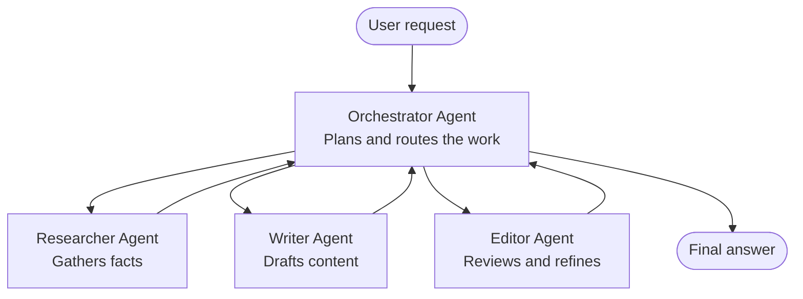

# बहु-एजेन्ट आधारहरू - तपाईंको पहिलो समन्वित AI प्रणाली तैनाथ गर्नुहोस्

**अध्याय नेभिगेसन:**
- **📚 कोर्स गृहपृष्ठ**: [AZD प्रारम्भकर्ताका लागि](../../README.md)
- **📖 वर्तमान अध्याय**: अध्याय ५ - बहु-एजेन्ट AI समाधानहरू
- **⬅️ अघिल्लो**: [अध्याय ४: पूर्वाधार](../chapter-04-infrastructure/README.md)
- **➡️ अर्को**: [समन्वय ढाँचा](../chapter-06-pre-deployment/coordination-patterns.md)

> कमाण्ड मार्गदर्शन रिलिज गरिएको `azd 1.37.2` सन्दर्भ अनुसार समीक्षा गरिएको। क्लाउड तैनाथीकरणहरू सञ्चालन गरिएको छैन।

## परिचय

पहिलेका अध्यायहरूमा तपाईंले एकल एप्लिकेशन तैनाथ गर्नुभयो—र अध्याय २ मा तपाईंले एकल AI एजेन्ट तैनाथ गर्नुभयो। यो पाठले अर्को कदम लिन्छ: एक **बहु-एजेन्ट प्रणाली** तैनाथ गर्ने, जहाँ धेरै विशिष्ट एजेन्टहरूले मिलेर समस्या समाधान गर्छन् जुन कुनै एकल एजेन्टले आफैंले राम्ररी गर्न सक्दैन।

प्रारम्भकर्ताहरूका लागि राम्रो खबर: **तपाईंलाई नयाँ कमाण्डहरू आवश्यक छैन।** बहु-एजेन्ट समाधान अझै azd परियोजना हो। तपाईंले `azd init`, `azd up`, परीक्षण गर्नुहुनेछ, र `azd down`—ठ्याक्कै तपाईंलाई पहिले नै थाहा भएको कार्यप्रवाह। परिवर्तन हुने कुरा एप भित्रको *आकार* हो।

## सिकाइ लक्ष्यहरू

यस पाठको अन्त्यसम्म तपाईं:
- जान्न सक्नुहुन्छ "बहु-एजेन्ट" के हो र यो कहिले अतिरिक्त जटिलताका लागि योग्य हुन्छ
- बहु-एजेन्ट प्रणालीमा सामान्य भूमिकाहरू चिन्हारी गर्न सक्नुहुन्छ (समन्वयकर्ता + विशेषज्ञहरू)
- एक वास्तविक, काम गर्ने बहु-एजेन्ट टेम्प्लेट तैनाथ गर्न सक्नुहुन्छ जसमा `azd up` छ
- बहु-एजेन्ट एप्लिकेशनलाई समर्थन गर्ने Azure स्रोतहरू बुझ्न सक्नुहुन्छ
- समाधानलाई सुरक्षित रूपमा सत्यापित, अनुकूलन, र भत्काउन सक्नुहुन्छ

## सिकाइ नतिजाहरू

यो पाठ पूरा गरेपछि, तपाईं सक्षम हुनुहुनेछ:
- एकल एजेन्ट र बहु-एजेन्ट प्रणाली बीचको फरक व्याख्या गर्न
- उपकरणसहितको एकल एजेन्ट र सच्चा बहु-एजेन्ट डिजाइनबीच छनोट गर्न
- azd सँग अन्तदेखि अन्तसम्म बहु-एजेन्ट टेम्प्लेट तैनाथ र परीक्षण गर्न
- प्रत्येक एजेन्ट कहाँ चलेको छ र कसरी सञ्चार गर्छ भनेर पहिचान गर्न
- सबै स्रोतहरू सफा गरेर निरन्तर शुल्कबाट बच्न

---

## बहु-एजेन्ट प्रणाली के हो?

एकल AI एजेन्ट भनेको एउटा मोडल हो जससँग एक सेट निर्देशहरू र (आवश्यकताअनुसार) केही उपकरणहरू हुन्छन्। यो केन्द्रित कार्यहरूका लागि राम्रो हुन्छ। तर जति जति कार्य बढ्छ—अनुसन्धान, त्यसपछि लेखन, त्यसपछि सम्पादन, त्यसपछि तथ्य-जाँच—सबै कुरा एकै प्रॉम्प्टमा राख्दा एजेन्ट ढिलो, कम भरपर्दो, र डिबग गर्न गाह्रो हुन्छ।

एक **बहु-एजेन्ट प्रणाली** कार्यलाई विशेषज्ञहरूमा विभाजन गर्छ जसले प्रत्येकले एउटा काम राम्ररी गर्छन्, र एक समन्वयकर्ताद्वारा समन्वयित छ:



### कहिले पनि देखिने दुई भूमिका

| भूमिका | काम | उदाहरण |
|------|-----|---------|
| **समन्वयकर्ता** | निर्णय गर्छ *के हुन्छ पछि* र एजेन्टहरू बीच काम साटासाट गर्छ | "पहिले अनुसन्धान, त्यसपछि लेखन, त्यसपछि सम्पादन" |
| **विशेषज्ञ** | एउटा केन्द्रित काम गर्छ र परिणाम फर्काउँछ | यस्तो "अनुसन्धानकर्ता" जसले मात्र तथ्यहरू सङ्कलन गर्छ |

### के तपाईंलाई साँच्चिकै धेरै एजेन्टहरू चाहिन्छ?

सरलबाट सुरु गर्नुहोस्। बहु-एजेन्ट **मात्र** त्यही बेला छान्नुहोस् जब यी मध्ये कुनै एउटै सत्य हो:

- ✅ कार्यसँग **विभिन्न चरणहरू** छन् जसलाई विभिन्न निर्देशहरू जस्तै अनुसन्धान, लेखन, समीक्षा लाभदायक हुन्छ
- ✅ तपाईं विशेषज्ञहरूलाई समय बचत गर्न **समानान्तर** चलाउन चाहनुहुन्छ
- ✅ विभिन्न चरणहरूलाई **विभिन्न उपकरणहरू वा डाटा स्रोतहरू** आवश्यक हुन्छ
- ✅ तपाईंलाई प्रत्येक चरण **स्वतन्त्र रुपमा परीक्षणयोग्य र डिबग योग्य** चाहिन्छ

यदि तपाईंको कार्य एकल प्रश्न-जवाफ वा साधारण उपकरण कल हो भने, **उपकरणसहित एकल एजेन्ट** (अध्याय २) सरल, सस्तो, र सञ्चालन गर्न सजिलो हुन्छ।

> **शुरुआती सुझाव:** "धेरै एजेन्टहरू" भनेको "राम्रो" होइन। प्रत्येक एजेन्टमा विलम्बता, खर्च र नयाँ निगरानीको चीज जोडिन्छ। एजेन्टहरू थप्नुहोस् मात्र तब जब समस्या स्पष्ट रूपमा भागहरूमा विभाजन हुन्छ।

---

## Azure मा बहु-एजेन्ट निर्माणका दुई तरिका

| दृष्टिकोण | के हो | सबैभन्दा उपयुक्त |
|----------|-----------|----------|
| **एकल एजेन्ट + उपकरणहरू** | एउटा Foundry एजेन्ट जसले कार्यहरू/उपकरणहरू कल गर्छ | सरल कार्यप्रवाहहरू, सुरु गर्नका लागि |
| **धेरै समन्वित एजेन्टहरू** | समन्वयकर्तासहित धेरै एजेन्टहरू | फरक चरणहरू, समानान्तर काम, विशेषज्ञता |

यो पाठ दोस्रो दृष्टिकोणमा केन्द्रित छ जसले **तयार टेम्प्लेट** प्रयोग गर्छ, ताकि तपाईंले तपाईंको आफ्नै प्रणाली बनाउनुअघि साँच्चै चलिरहेको बहु-एजेन्ट प्रणाली देख्न सक्नुहुन्छ।

---

## प्रत्यक्ष अभ्यास: काम गर्ने बहु-एजेन्ट एप्लिकेशन तैनाथ गर्नुहोस्

हामी **Contoso Creative Writer** तैनाथ गर्नेछौं, एक आधिकारिक Azure नमूना जुन अनुसन्धान, उत्पादन, लेखन, र सम्पादन एजेन्टहरूलाई समन्वय गर्छ एउटा लेख उत्पादन गर्न। अगाडि बढ्नु अघि, कृपया [नमूनाको पूर्वसर्तहरू र लागतहरू](https://github.com/Azure-Samples/contoso-creative-writer#azure-account-requirements) जाँच्नुहोस्: यसलाई मोडल कोटा, Azure AI खोज, Bing Grounding पहुँच, Python, Docker, र Bash-संगत हुकहरू आवश्यक छन्। मोडेल र क्षेत्र उपलब्धता तपाईंको सदस्यतामा निर्भर गर्दछ; कुनै निश्चित क्षेत्र रोजेर तैनाथीकरण ग्यारेन्टी गरिएको छैन।

### चरण १: टेम्प्लेट सुरु गर्नुहोस्

```bash
# Create a working folder
mkdir creative-writer && cd creative-writer

# Initialize from the official multi-agent template
azd init --template Azure-Samples/contoso-creative-writer .
```

> कुनै पनि समयमा [Awesome AZD AI ग्यालरी](https://azure.github.io/awesome-azd/?tags=ai) मा थप बहु-एजेन्ट टेम्प्लेटहरू ब्राउज गर्नुहोस्। अन्य आरम्भकर्ता मैत्री विकल्पहरूमा `get-started-with-ai-agents` र `azure-ai-travel-agents` समावेश छन्।

### चरण २: प्रमाणिकरण गर्नुहोस्

```bash
# Required for azd workflows
azd auth login

# Also required by this sample's Azure CLI hooks
az login
```

### चरण ३: वातावरण जाँच गर्नुहोस्

```bash
# init normally creates/selects an environment; confirm it before proceeding
azd env list
# Only if you need an additional environment:
# azd env new dev
```

### चरण ४: पूर्वदृश्य गर्नुहोस्, त्यसपछि तैनाथ गर्नुहोस्

```bash
# See what will be created before spending anything (recommended)
azd provision --preview

# Provision infrastructure and deploy all agents in one step
azd up
```

`azd up` ले हराएका सदस्यता र क्षेत्र सेटिङहरूका लागि सोध्नेछ, त्यसपछि स्रोतहरू प्रदान गर्नेछ र अनुप्रयोग तैनाथ गर्नेछ। पूर्वदृश्यले कोटा सुरक्षित गर्दैन वा सफलताको ग्यारेन्टी गर्दैन; टेम्प्लेट हुकहरू प्राविधिक पूर्वदृश्यको क्रममा पनि चल्न सक्छन्, त्यसैले पहिले तिनीहरूलाई निरीक्षण गर्नुहोस्। कसरी लामो azd हरेक **सेवा तैनाथीकरण** (मोडेल प्राविधिक होइन) को लागि प्रतीक्षा गर्छ विस्तार गर्न:

```bash
azd deploy --timeout 1800
```

टाइमआउटले azd को प्रतीक्षा रोक्छ; यसले Azure मा तैनाथीकरण रद्द गर्दैन। पुन: प्रयास गर्नु अघि स्रोतको अवस्था निरीक्षण गर्नुहोस्।

> **खर्च र क्षमता को जानकारी:** बहु-एजेन्ट एपहरूले AI मोडेलहरू तैनाथ गर्छन् जुन कोटा प्रयोग गर्छन् र खर्च लाग्छ। यदि `azd up` मोडेल कोटामा असफल हुन्छ भने, क्षेत्र र कोटा सुधारहरूका लागि [AI Troubleshooting](../chapter-07-troubleshooting/ai-troubleshooting.md) हेर्नुहोस्, र अध्याय ६ [क्षमता योजना](../chapter-06-pre-deployment/capacity-planning.md)।

---

## तपाईंले जे तैनाथ गर्नुभयो त्यसको बुझाइ

यस्तो एउटा सामान्य बहु-एजेन्ट एपले माथि चित्रमा जिम्मेवारीहरू सिधा म्याप गर्ने Azure स्रोतहरूको एक सेट प्रदान गर्दछ:

| स्रोत | किन त्यहाँ छ |
|----------|----------------|
| **Microsoft Foundry / मोडेलहरू** | प्रत्येक एजेन्टले प्रयोग गर्ने भाषा मोडेलहरू होस्ट गर्दछ |
| **Azure AI सर्च** | अनुसन्धानकर्ता एजेन्टलाई खोज्न आधारभूत डेटा दिन्छ |
| **कन्टेनर एप्स** (वा एप सर्भिस) | आयोजक र एजेन्ट कोड होस्ट गर्छ |
| **कोसमस डीबी** (केही नमूनाहरूमा) | एजेण्टहरू बीच साझा गरिएको अवस्था/स्मृति भण्डारण गर्छ |
| **एप्लिकेसन इन्साइट्स** | अनुरोधहरूलाई *एजेण्टहरू बीच* ट्रेस गर्छ ताकि तपाईं प्रवाहलाई डिबग गर्न सक्नुहुन्छ |

### एजेन्टहरू कसरी एकअर्कासँग कुरा गर्छन्

अधिकांश azd मल्टि-एजेन्ट नमूनाहरूमा, **आयोजक तपाईंको एप्लिकेसन कोडमा चल्छ** (जस्तै, Semantic Kernel वा Microsoft Agent Framework जस्ता फ्रेमवर्क प्रयोग गरेर)। आयोजकले क्रमबद्ध रूपमा प्रत्येक विशेषज्ञ एजेन्टलाई कल गर्छ, परिणामहरू पास गर्छ, र अन्तिम उत्तर तयार गर्छ। एजेन्टहरूले सन्दर्भ निम्नबाट साझा गर्छन्:

- **कार्य/टुल कलहरू** — आयोजकले विशेषज्ञलाई बोलाउँछ र परिणाम फर्काउँछ
- **साझा स्मृति** — एउटा डाटाबेस (प्रायः कोसमस डीबी) मा अवस्था भण्डारण हुन्छ जुन दुबै एजेन्टहरूले पढ्न सक्छन्
- **सन्देश/घटनाहरू** — कम कडा जडानको लागि, एजेन्टहरू किनारामा पङ्क्ती वा सर्भिस बसमार्फत सञ्चार गर्छन्

> **डिबगिङका लागि यो किन महत्वपूर्ण छ:** किनभने प्रत्येक चरण अलग हुन्छ, एप्लिकेसन इन्साइट्सले तपाईंलाई देखाउँछ *कुन* एजेन्ट ढिलो भयो वा असफल भयो। यो नै एजेन्टहरूमा काम विभाजन गर्ने मुख्य कारण हो।

---

## परिनियोजन पुष्टि गर्नुहोस्

अगाडि बढ्नु अघि प्रणाली साँच्चै काम गरिरहेको छ कि छैन पुष्टि गर्नुहोस्:

```bash
# Show the deployed endpoints
azd show

# Open the app's monitoring dashboard
azd monitor

# Open Application Insights Logs (not a terminal log stream)
azd monitor --logs
```

त्यसपछि `azd show` बाट एप्लिकेसन URL खोल्नुहोस् र छोटो लेख अनुरोध गर्नुहोस्। नमूनाको डिबग दृश्य प्रयोग गरेर यसको एजेन्ट कार्यप्रवाह निरीक्षण गर्नुहोस्। एप्लिकेसन इन्साइट्स ट्रान्जेक्सन खोजले व्यक्तिगत चरणहरू मात्र देखाउन सक्छ यदि नमूनाले ती उपकरणहरू समावेश गरेर सम्बन्धित गरेको छ भने; azd ले एजेन्ट स्पानहरू स्वतः थप्दैन।

**सफलताको मापदण्ड:**
- ✅ `azd show` ले पहुँच योग्य अन्तबिन्दु सूचीबद्ध गर्छ
- ✅ एउटा अनुरोधले स्पष्ट रूपले धेरै चरणहरूबाट गुज्रिएको परिणाम उत्पादन गर्छ
- ✅ डिबग दृश्यले बहु एजेन्ट कदमहरू देखाउँछ; यदि ट्रेसिङ सक्षम छ भने, सेवन पछि सम्बन्धित टेलिमेट्री जाँच गर्नुहोस्

---

## अनुकूलन: एजेन्ट थप्ने वा समायोजन गर्ने

किनकि प्रत्येक एजेन्ट केवल निर्देशनहरू र उपकरणहरू हुन्, अनुकूलन सजिलो छ:

1. **एजेन्ट परिभाषा खोज्नुहोस्** टेम्प्लेटमा (प्रायः `prompts/`, `agents/`, वा `*.prompty` फाइलहरूको सेट)।
2. **एजेन्टका निर्देशनहरू समायोजित गर्नुहोस्** — उदाहरणका लागि, सम्पादक एजेन्टलाई विशेष लय वा शब्द गणना लागू गर्न भन्नुहोस्।
3. **केवल कोड पुनः वितरण गर्नुहोस्** (पूर्वाधार परिवर्तन हुँदैन):

   ```bash
   azd deploy
   ```

आफ्नो *आफ्नै* Foundry एजेन्ट प्रोजेक्टसँग थप अघि बढ्न, AZD 1.37.0+ सँग GA बन्डललाई अलग खाली निर्देशनामा प्रयोग गर्नुहोस्:

```bash
azd ext install microsoft.foundry
azd ai agent init
azd up
azd ai agent invoke      # test, with response timing
```

Agent Inspector स्थानीय परीक्षण, रिमोट कोड वितरण, र सफाइ अधिकारका लागि [GA होस्टेड-एजेन्ट वाकथ्रु](../chapter-02-ai-development/microsoft-foundry-integration.md#hosted-agent-walkthrough-ga) हेर्नुहोस्। [AZD AI CLI सन्दर्भ](../chapter-08-production/production-ai-practices.md#azd-ai-cli-commands-and-extensions) ले अलग मूल्याङ्कन विस्तार, अनुकूलन, र एजेन्ट मेटाउनसमेत समेट्छ।

---

## सफाइ गर्नुहोस्

बहु-एजेन्ट अनुप्रयोगहरूले बहु शुल्क लाग्ने सेवा सञ्चालन गर्छन्। काम सकिएपछि सबै कुरा बन्द गर्नुहोस्:

```bash
# Review the resources and confirm deletion interactively
azd down
```

मेटाइँ विनाशकारी छ। प्रयोगशालाको लागि, `azd down --force --purge` ले मेटाइँ र समर्थन गरिएको सफ्ट-डिलिट पर्ज पुष्टिकरणहरू छोड्छ; पर्ज अपरिवर्तनीय छ र पर्ज सुरक्षा द्वारा अवरुद्ध हुन सक्छ। सफ्ट मेटाइँ पुनर्प्राप्ति/नाम-पुन: प्रयोगको चिन्ता हो, आफैंमा निरन्तर शुल्कको प्रमाण होइन। सफाइपछि आवद्ध स्रोत र बिलिङ जाँच गर्नुहोस्।

यदि तपाइँले पहिले नै एक होस्टेड एजेन्ट स्थापना गर्नुभएको छ र त्यो Foundry प्रोजेक्टमा आधारित छ भने, `azd down` ले त्यो प्रोजेक्टको एजेन्ट र अन्य स्रोतहरू राख्छ। चाहनुभएको स्रोत मात्र अलग हटाउनुहोस्। AZD वातावरणद्वारा सिर्जित नयाँ Foundry प्रोजेक्टको लागि, `azd down` स्रोत समूह र त्यसमा भएको सबै कुरा मेटाउँछ।

---

## उत्पादन बहु-एजेन्ट प्रणालीहरूमा एउटा नोट

यस रिपोमा रहेको [Retail Multi-Agent Solution](../../examples/retail-scenario.md) एक **वास्तुकला ब्लूप्रिन्ट** हो, एउटा एक-कमान्ड टेम्प्लेट होइन—यसले कसरी उत्पादन खुद्रा प्रणाली *बनाइने* हुन्छ भनेर दस्तावेज गर्दछ (र यो स्पष्ट छ कि पूर्ण निर्माण एक ठूलो प्रयास हो)। यसलाई डिजाइन संदर्भको रूपमा प्रयोग गर्नुहोस् *जब* तपाईंले यहाँ एक काम गर्ने नमूना परिनियोजन गर्नु भएको छ। उत्पादनका विषयहरू (स्थिरता, लागत, अनुगमन, संचालन) का लागि, [Chapter 8: Production AI Practices](../chapter-08-production/production-ai-practices.md) मा जानुहोस्।

---

## सारांश

- एक बहु-एजेन्ट प्रणालीले कार्यलाई विशेषज्ञहरूमा विभाजन गर्छ जसलाई एक समन्वयकले सन्चालन गर्दछ।
- यसलाई मात्र उपयोग गर्नुहोस् जब कार्यमा स्पष्ट चरणहरू, समानान्तरता, वा हरेक चरणको लागि विभिन्न उपकरणहरू हुन्छन् — अन्यथा एकल एजेन्ट रोज्नुहोस्।
- azd कार्यप्रवाह अपरिवर्तित छ: `azd init` → `azd up` → परीक्षण → `azd down`।
- एक वास्तविक टेम्प्लेट जस्तै `contoso-creative-writer` ले तपाईलाई आज नै एक काम गर्ने बहु-एजेन्ट एप हेर्न र अनुकूलन गर्न अनुमति दिन्छ।
- एजेन्टहरू बीच Application Insights ट्रेसिंग बहु-एजेन्ट डिजाइनका सबैभन्दा ठूला व्यावहारिक फाइदाहरूमध्ये एक हो।

---

## 🔗 नेभिगेसन

| दिशानिर्देश | पाठ |
|-----------|--------|
| **अघिल्लो** | [अध्याय ४: पूर्वाधार](../chapter-04-infrastructure/README.md) |
| **अर्को** | [समन्वय ढाँचा](../chapter-06-pre-deployment/coordination-patterns.md) |

## 📖 सम्बन्धित स्रोतहरू

- [एआई एजेन्टहरू गाइड](../chapter-02-ai-development/agents.md)
- [समन्वय ढाँचाहरू](../chapter-06-pre-deployment/coordination-patterns.md)
- [उत्पादन एआई अभ्यासहरू](../chapter-08-production/production-ai-practices.md)
- [एआई समस्या समाधान](../chapter-07-troubleshooting/ai-troubleshooting.md)

---

<!-- CO-OP TRANSLATOR DISCLAIMER START -->
**अस्वीकरण**:
यो दस्तावेज़ AI अनुवाद सेवा [Co-op Translator](https://github.com/Azure/co-op-translator) प्रयोग गरेर अनुवाद गरिएको हो। हामी सही हुन प्रयास गर्छौं, तर कृपया जानकार हुनुस् कि स्वचालित अनुवादमा त्रुटिहरू वा अशुद्धताहरू हुन सक्छन्। मूल दस्तावेज़ यसको मूल भाषामा आधिकारिक स्रोत मानिनुपर्छ। महत्वपूर्ण जानकारीका लागि व्यावसायिक मानव अनुवाद सिफारिस गरिन्छ। यस अनुवादको प्रयोगबाट उत्पन्न कुनै पनि गलत बुझाइ वा त्रुटिको लागि हामी जिम्मेवार छैनौं।
<!-- CO-OP TRANSLATOR DISCLAIMER END -->