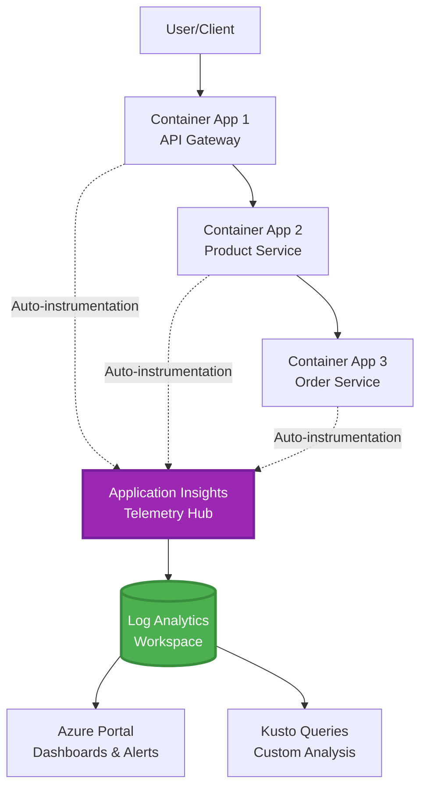
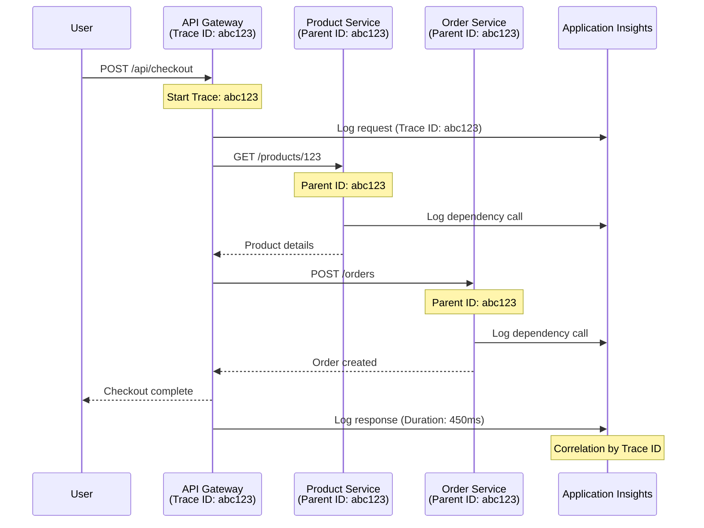

# AZD सँग Application Insights एकीकरण

⏱️ **अनुमानित समय**: ४०-५० मिनेट | 💰 **लागत प्रभाव**: ~$५-१५/महिना | ⭐ **जटिलता**: मध्यवर्ती

**📚 सिकाउने मार्ग:**
- ← अघिल्लो: [पूर्वउडान जाँचहरू](preflight-checks.md) - पूर्व-वितरण प्रमाणीकरण
- 🎯 **तपाईं यहाँ हुनुहुन्छ**: Application Insights एकीकरण (निगरानी, टेलिमेट्री, डिबगिङ)
- → अर्को: [वितरण मार्गदर्शिका](../chapter-04-infrastructure/deployment-guide.md) - Azure मा वितरण
- 🏠 [पाठ्यक्रम गृह](../../README.md)

---

## तपाईंले के सिक्नुहुनेछ

यस पाठ पूरा गर्दा, तपाईं:
- AZD पूर्वाधारमा **Application Insights** घोषणा गर्ने र SDK उपकरण सेटअप गर्ने
- माइक्रोसर्भिसहरूको लागि **वितरित ट्रेसिङ** कन्फिगर गर्ने
- **कस्टम टेलिमेट्री** लागू गर्ने (मेट्रिक्स, घटनाहरू, निर्भरता)
- वास्तविक-समय निगरानीका लागि **लाइभ मेट्रिक्स** सेटअप गर्ने
- AZD वितरणहरूबाट **सूचना र ड्यासबोर्ड** सिर्जना गर्ने
- **टेलिमेट्री प्रश्नहरू** प्रयोग गरी उत्पादन समस्याहरू डिबग गर्ने
- **लागत र स्याम्पलिङ** रणनीतिहरू सुधार गर्ने
- **AI/LLM अनुप्रयोगहरू** (टोकनहरू, विलम्ब, लागत) निगरानी गर्ने

## AZD सँग Application Insights किन महत्त्वपूर्ण छ

### चुनौती: उत्पादन अवलोकनयोग्यता

**Application Insights बिना:**
```
❌ No visibility into production behavior
❌ Manual log aggregation across services
❌ Reactive debugging (wait for customer complaints)
❌ No performance metrics
❌ Cannot trace requests across services
❌ Unknown failure rates and bottlenecks
```

**Application Insights + AZD संग:**
```
✅ Automatic telemetry collection
✅ Centralized logs from all services
✅ Proactive issue detection
✅ End-to-end request tracing
✅ Performance metrics and insights
✅ Real-time dashboards
✅ AZD provisions the monitoring declared in your templates
```

**उपमा**: Application Insights तपाईंको अनुप्रयोगको लागि "ब्ल्याक बक्स" फ्लाइट रेकर्डर + ककपिट ड्यासबोर्ड जस्तै हो। तपाईं वास्तविक-समयमा सबै कुरा देख्न सक्नुहुन्छ र कुनै पनि घटनालाई पुन: चलाउन सक्नुहुन्छ।

---

## वास्तुकला अवलोकन

### AZD वास्तुकलामा Application Insights



### के स्वचालित रूपमा निगरानी गरिन्छ

समर्थित स्वचालित उपकरणले अनुरोधहरू/निर्भरतालाई उपकरण गरिएको पुस्तकालयहरूको लागि कैद गर्दछ। कस्टम घटनाहरू र मेट्रिक्सका लागि अनुप्रयोग कोड आवश्यक छ; उपलब्धता परीक्षणहरू अलग्गै कन्फिगर गर्नुपर्छ। यो संसाधनहरू भएको सबै पङ्क्तिहरू सङ्कलन गर्दैन।

| टेलिमेट्री प्रकार | के यो कैद गर्छ | प्रयोग केश |
|----------------|------------------|----------|
| **अनुरोधहरू** | HTTP अनुरोधहरू, स्थिति कोडहरू, अवधि | API प्रदर्शन निगरानी |
| **निर्भरता** | बाह्य कलहरू (DB, API, भण्डारण) | ब्याकट्लग पहिचान गर्ने |
| **अपवादहरू** | स्ट्याक ट्रेससहितको ह्यान्डल नगरेका त्रुटिहरू | असफलताहरू डिबग गर्ने |
| **कस्टम घटनाहरू** | व्यवसाय घटनाहरू (साइनअप, खरीद) | विश्लेषण र फनेलहरू |
| **मेट्रिक्स** | प्रदर्शन काउन्टरहरू, कस्टम मेट्रिक्स | क्षमता योजना |
| **ट्रेसहरू** | गम्भीरतासहितको लग सन्देशहरू | डिबगिङ र अडिटिङ |
| **उपलब्धता** | अपटाइम र जवाफ समय परीक्षणहरू | SLA निगरानी |

---

## पूर्वआवश्यकताहरू

### आवश्यक उपकरणहरू

```bash
# Verify Azure Developer CLI
azd version
# Command reference baseline: azd 1.37.2

# Verify Azure CLI
az --version
# ✅ Expected: azure-cli 2.50.0 or higher
```

### Azure आवश्यकताहरू

- सक्रिय Azure सदस्यता
- सिर्जना गर्ने अनुमतिहरू:
  - Application Insights स्रोतहरू
  - Log Analytics कार्यक्षेत्रहरू
  - कन्टेनर एप्स
  - संसाधन समूहहरू

### ज्ञान पूर्वशर्तहरू

तपाईंले पूरा गर्नुभएको हुनु पर्छ:
- [AZD आधारभूत](../chapter-01-foundation/azd-basics.md) - AZD कोर अवधारणाहरू
- [कन्फिगरेसन](../chapter-03-configuration/configuration.md) - वातावरण सेटअप
- [पहिलो परियोजना](../chapter-01-foundation/first-project.md) - आधारभूत वितरण

---

## पाठ १: AZD सँग स्वचालित Application Insights

### AZD कसरी Application Insights सेटअप गर्छ

AZD प्रावधान गर्दछ Application Insights **मात्र परियोजनाको पूर्वाधारले यो घोषणा गर्दा**। `azure.yaml` मात्रले निरीक्षण सिर्जना गर्दैन वा आवेदन कोडमा उपकरण लगाउँदैन।

> **उदाहरण दायरा:** यो पाठ्यक्रममा समेकन खण्डहरू छन्, यो रिपोजिटरीमा पूर्ण `monitored-app` परियोजना होइन। तैनाथ गर्नु अघि मुख्य टेम्प्लेट र प्यारामिटर म्यापिङ, कन्टेनर एप्स वातावरण, रजिष्ट्रि/इमेज र पहिचान कन्फिगरेसन, डोकरफाइल, र सेवा ट्यागहरू उपलब्ध गराउनुहोस्। पछि पाठ्यक्रमहरूले वैकल्पिक/विस्तार खण्डहरू देखाउँछन्, सबै फाइलहरू एउटै प्रकारले टाँस्न सकिने छैनन्। एउटा चल्नसक्ने आधारको लागि [माइक्रोसर्भिस उदाहरण](../../../../examples/microservices) बाट सुरु गर्नुहोस्।

### परियोजना संरचना

```
monitored-app/
├── azure.yaml                     # AZD configuration
├── infra/
│   ├── main.bicep                # Main infrastructure
│   ├── core/
│   │   └── monitoring.bicep      # Application Insights + Log Analytics
│   └── app/
│       └── api.bicep             # Container App with monitoring
└── src/
    ├── app.py                    # Application with telemetry
    ├── requirements.txt
    └── Dockerfile
```

---

### चरण 1: AZD कन्फिगर गर्नुहोस् (azure.yaml)

**फाइल: `azure.yaml`**

```yaml
name: monitored-app
metadata:
  template: monitored-app@1.0.0

services:
  api:
    project: ./src
    language: python
    host: containerapp

# Monitoring must be declared in infra/ and enabled in application code.
```

यसले तैनाथ योग्य सेवा घोषणा गर्दछ। तलको Bicep र SDK कन्फिगरेसनले निगरानी प्रदान गर्दछ; azd ले ती स्वतः थप्दैन।

---

### चरण 2: निगरानी पूर्वाधार (Bicep)

**फाइल: `infra/core/monitoring.bicep`**

```bicep
param logAnalyticsName string
param applicationInsightsName string
param location string = resourceGroup().location
param tags object = {}

// Log Analytics Workspace (required for Application Insights)
resource logAnalytics 'Microsoft.OperationalInsights/workspaces@2022-10-01' = {
  name: logAnalyticsName
  location: location
  tags: tags
  properties: {
    sku: {
      name: 'PerGB2018'  // Pay-as-you-go pricing
    }
    retentionInDays: 30  // Keep logs for 30 days
    features: {
      enableLogAccessUsingOnlyResourcePermissions: true
    }
  }
}

// Application Insights
resource applicationInsights 'Microsoft.Insights/components@2020-02-02' = {
  name: applicationInsightsName
  location: location
  tags: tags
  kind: 'web'
  properties: {
    Application_Type: 'web'
    WorkspaceResourceId: logAnalytics.id
    IngestionMode: 'LogAnalytics'
    publicNetworkAccessForIngestion: 'Enabled'
    publicNetworkAccessForQuery: 'Enabled'
  }
}

// Outputs for Container Apps
output logAnalyticsWorkspaceId string = logAnalytics.id
output logAnalyticsWorkspaceName string = logAnalytics.name
output applicationInsightsConnectionString string = applicationInsights.properties.ConnectionString
output applicationInsightsInstrumentationKey string = applicationInsights.properties.InstrumentationKey
output applicationInsightsName string = applicationInsights.name
output applicationInsightsId string = applicationInsights.id
```

---

### चरण 3: कन्टेनर एप्लिकेशनलाई Application Insights सँग जडान गर्नुहोस्

**फाइल: `infra/app/api.bicep`**

```bicep
param name string
param location string
param tags object = {}
param containerAppsEnvironmentId string
param containerImage string
param applicationInsightsConnectionString string

resource containerApp 'Microsoft.App/containerApps@2023-05-01' = {
  name: name
  location: location
  tags: tags
  properties: {
    managedEnvironmentId: containerAppsEnvironmentId
    configuration: {
      ingress: {
        external: true
        targetPort: 8000
      }
      secrets: [
        {
          name: 'appinsights-connection-string'
          value: applicationInsightsConnectionString
        }
      ]
    }
    template: {
      containers: [
        {
          name: 'api'
          image: containerImage // Supply an accessible image and registry authentication
          resources: {
            cpu: json('0.5')
            memory: '1Gi'
          }
          env: [
            {
              name: 'APPLICATIONINSIGHTS_CONNECTION_STRING'
              secretRef: 'appinsights-connection-string'
            }
            {
              name: 'APPLICATIONINSIGHTS_ENABLED'
              value: 'true'
            }
          ]
        }
      ]
    }
  }
}

output uri string = 'https://${containerApp.properties.configuration.ingress.fqdn}'
```

---

### चरण 4: टेलिमेट्री सहितको आवेदन कोड

**फाइल: `src/app.py`**

```python
from flask import Flask, request, jsonify
from azure.monitor.opentelemetry import configure_azure_monitor
import logging
import os

app = Flask(__name__)

# Get Application Insights connection string
connection_string = os.environ.get('APPLICATIONINSIGHTS_CONNECTION_STRING')

if connection_string:
    # Azure Monitor OpenTelemetry instruments supported libraries, including Flask.
    configure_azure_monitor(
        connection_string=connection_string,
        logger_name=__name__,
        enable_live_metrics=True
    )
    logger = logging.getLogger(__name__)
    logger.setLevel(logging.INFO)
    
    print("✅ Application Insights enabled")
else:
    logger = logging.getLogger(__name__)
    logger.setLevel(logging.INFO)
    print("⚠️ Application Insights not configured")

@app.route('/health')
def health():
    logger.info('Health check endpoint called')
    return jsonify({'status': 'healthy', 'monitoring': 'enabled' if connection_string else 'disabled'})

@app.route('/api/products')
def get_products():
    logger.info('Fetching products')
    
    # In-memory fixture: this is not a database dependency call.
    products = [
        {'id': 1, 'name': 'Laptop', 'price': 999.99},
        {'id': 2, 'name': 'Mouse', 'price': 29.99},
        {'id': 3, 'name': 'Keyboard', 'price': 79.99}
    ]
    
    logger.info(f'Returned {len(products)} products')
    return jsonify(products)

@app.route('/api/error-test')
def error_test():
    """Test error tracking"""
    logger.error('Testing error tracking')
    try:
        raise ValueError('This is a test exception')
    except Exception as e:
        logger.exception('Exception occurred in error-test endpoint')
        return jsonify({'error': str(e)}), 500

@app.route('/api/slow')
def slow_endpoint():
    """Test performance tracking"""
    import time
    logger.info('Slow endpoint called')
    time.sleep(3)  # Simulate slow operation
    logger.warning('Endpoint took 3 seconds to respond')
    return jsonify({'message': 'Slow operation completed'})

if __name__ == '__main__':
    app.run(host='0.0.0.0', port=8000)
```

**फाइल: `src/requirements.txt`**

```txt
Flask
azure-monitor-opentelemetry
gunicorn
requests
openai
```

यी निर्भरताहरूलाई तपाईंको परियोजनामा समाधान गर्नुहोस्, संगै परीक्षण गर्नुहोस्, र परिणामी संस्करणहरू लक गर्नुहोस्। नयाँ परियोजनाहरूले Azure Monitor OpenTelemetry प्रयोग गर्नुपर्दछ, अवकाशप्राप्त OpenCensus Python एक्सपोर्टरहरू होइन।

---

### चरण 5: तैनाथ र प्रमाणीकरण गर्नुहोस्

```bash
# Deploy only after completing and wiring the infrastructure fragments above
azd up

# Get app URL
APP_URL=$(azd env get-value API_URL) # Requires this output in main.bicep

# Generate telemetry
curl $APP_URL/health
curl $APP_URL/api/products
curl $APP_URL/api/error-test
curl $APP_URL/api/slow
```

**✅ अपेक्षित आउटपुट:**
```json
{
  "status": "healthy",
  "monitoring": "enabled"
}
```

---

### चरण 6: Azure पोर्टलमा टेलिमेट्री हेर्नुहोस्

```bash
# Get Application Insights details
azd env get-values | grep APPLICATIONINSIGHTS

# Open in Azure Portal
az monitor app-insights component show \
  --app $(azd env get-values | grep APPLICATIONINSIGHTS_NAME | cut -d '=' -f2 | tr -d '"') \
  --resource-group $(azd env get-values | grep AZURE_RESOURCE_GROUP | cut -d '=' -f2 | tr -d '"') \
  --query "appId" -o tsv
```

**Azure पोर्टल → Application Insights → Transaction Search जानुहोस्**

तपाईंले देख्नु पर्ने:
- ✅ HTTP अनुरोधहरू स्थितिकोडहरूसहित
- ✅ अनुरोध अवधि (3+ सेकेन्ड `/api/slow` को लागि)
- ✅ `/api/error-test` बाट अपवाद विवरण
- ✅ अनुकूलित लग सन्देशहरू

---

## पाठ 2: अनुकूल टेलिमेट्री र घटनाहरू

### व्यवसायिक घटनाहरू ट्र्याक गर्नुहोस्

व्यवसायिक-महत्त्वपूर्ण घटनाहरूका लागि अनुकूलित टेलिमेट्री थपौं।

**फाइल: `src/telemetry.py`**

```python
from contextlib import contextmanager
from azure.monitor.opentelemetry import configure_azure_monitor
from opentelemetry import metrics, trace
from opentelemetry.trace import SpanKind
import logging
import os

class TelemetryClient:
    """Custom telemetry client for Application Insights"""
    
    def __init__(self, connection_string=None):
        self.connection_string = connection_string or os.environ.get('APPLICATIONINSIGHTS_CONNECTION_STRING')
        
        # Configure once per process. If app.py already calls this, keep only
        # one configure_azure_monitor call and use logger_name='telemetry'.
        if self.connection_string:
            configure_azure_monitor(
                connection_string=self.connection_string,
                logger_name=__name__,
                enable_live_metrics=True
            )
        self.logger = logging.getLogger(__name__)
        self.logger.setLevel(logging.INFO)
        self.tracer = trace.get_tracer(__name__)
        self.meter = metrics.get_meter(__name__)
        self.instruments = {}
    
    def track_event(self, event_name: str, properties: dict = None):
        """Track custom business event"""
        properties = properties or {}
        self.logger.info(
            f"CustomEvent: {event_name}",
            extra={
                # OTel log attributes become customDimensions in App Insights.
                    'event_name': event_name,
                    **properties
            }
        )
    
    def track_metric(self, metric_name: str, value: float, properties: dict = None):
        """Track custom metric"""
        properties = properties or {}
        if metric_name not in self.instruments:
            self.instruments[metric_name] = self.meter.create_histogram(metric_name)
        self.instruments[metric_name].record(value, attributes=properties)
    
    @contextmanager
    def track_dependency(self, name: str):
        """Time the real operation inside a client span; exceptions mark failure."""
        with self.tracer.start_as_current_span(name, kind=SpanKind.CLIENT) as span:
            yield span

# Global telemetry client
telemetry = TelemetryClient()
```

### आवेदनलाई अनुकूलित घटनासँग अपडेट गर्नुहोस्

**फाइल: `src/app.py` (बृद्धि गरिएको)**

यी रुटहरू पहिलेको Flask आवेदनमा थप्नुहोस्; पहिलेका स्वास्थ्य/परीक्षण रुटहरूलाई राख्नुहोस्। तल छोट्याइएको ब्लकले स्पष्टताको लागि अलग एप देखाउँछ। टेलिमेट्री आरम्भ अहिले `telemetry.py` मा छ — एक्सपोर्टरहरू दुई पटक आरम्भ नगर्नुहोस्।

```python
from flask import Flask, request, jsonify
from telemetry import telemetry
import time
import random
import os

app = Flask(__name__)

@app.route('/api/purchase', methods=['POST'])
def purchase():
    """Track purchase event with custom telemetry"""
    data = request.get_json(silent=True) or {}
    product_id = data.get('product_id')
    quantity = data.get('quantity', 1)
    price = data.get('price', 0)
    if not isinstance(quantity, int) or quantity < 1 or \
       not isinstance(price, (int, float)) or price < 0:
        return jsonify({'error': 'quantity and price must be non-negative numbers; quantity >= 1'}), 400
    
    # Track business event
    telemetry.track_event('Purchase', {
        'product_id': product_id,
        'quantity': quantity,
        'total_amount': price * quantity,
        'user_id': request.headers.get('X-User-Id', 'anonymous')
    })
    
    # Track revenue metric
    telemetry.track_metric('Revenue', price * quantity, {
        'product_id': product_id,
        'currency': 'USD'
    })
    
    return jsonify({
        'order_id': f'ORD-{random.randint(1000, 9999)}',
        'status': 'confirmed',
        'total': price * quantity
    })

@app.route('/api/search')
def search():
    """Track search queries"""
    query = request.args.get('q', '')
    
    start_time = time.time()
    
    # Simulate search (would be real database query)
    results = [{'id': 1, 'name': f'Result for {query}'}]
    
    duration = (time.time() - start_time) * 1000  # Convert to ms
    
    # Track search event
    telemetry.track_event('Search', {
        'query': query,
        'results_count': len(results),
        'duration_ms': duration
    })
    
    # Track search performance metric
    telemetry.track_metric('SearchDuration', duration, {
        'query_length': len(query)
    })
    
    return jsonify({'results': results, 'count': len(results)})

@app.route('/api/external-call')
def external_call():
    """Track external API dependency"""
    import requests
    
    try:
        # Set an actual test endpoint; api.example.com is not a working API.
        with telemetry.track_dependency('ExternalAPI'):
            response = requests.get(os.environ['EXTERNAL_API_URL'], timeout=5)
            response.raise_for_status()
            result = response.json()
    except Exception as e:
        return jsonify({'error': 'External dependency failed'}), 502
    
    return jsonify(result)

if __name__ == '__main__':
    app.run(host='0.0.0.0', port=8000)
```

### अनुकूल टेलिमेट्री परीक्षण गर्नुहोस्

```bash
# Track purchase event
curl -X POST $APP_URL/api/purchase \
  -H "Content-Type: application/json" \
  -H "X-User-Id: user123" \
  -d '{"product_id": 1, "quantity": 2, "price": 29.99}'

# Track search event
curl "$APP_URL/api/search?q=laptop"

# Track external dependency
curl $APP_URL/api/external-call
```

**Azure पोर्टलमा हेर्नुहोस्:**

Application Insights → लगहरू जानुहोस्, अनि यो चलाउनुहोस्:

```kusto
// View purchase events
traces
| where customDimensions.event_name == "Purchase"
| project 
    timestamp,
    product_id = tostring(customDimensions.product_id),
    total_amount = todouble(customDimensions.total_amount),
    user_id = tostring(customDimensions.user_id)
| order by timestamp desc

// Revenue recorded in Purchase events (not a billing ledger)
traces
| where customDimensions.event_name == "Purchase"
| summarize TotalRevenue = sum(todouble(customDimensions.total_amount)) by bin(timestamp, 1h)
| render timechart

// View search performance
traces
| where customDimensions.event_name == "Search"
| summarize 
    AvgDuration = avg(todouble(customDimensions.duration_ms)),
    SearchCount = count()
  by bin(timestamp, 5m)
| render timechart
```

---

## पाठ 3: माइक्रोसर्भिसहरूको लागि वितरित ट्रेसिङ

### क्रस-सेवा ट्रेसिङ सक्षम गर्नुहोस्

मिल्दो उपकरण र W3C ट्रेस-कन्टेक्स्ट प्रचारसँग, Application Insights सेवाहरू बीच अनुरोधहरू समन्वय गर्दछ। केवल कनेक्सन स्ट्रिङ साझा गर्नुले पेरेंट-चाइल्ड स्प्यानहरू स्थापना गर्दैन। तलको वास्तुकला खण्डले तपाईंले कार्यान्वयन गर्नुपर्ने मोड्युलहरूको उल्लेख गर्दछ।

**फाइल: `infra/main.bicep`**

```bicep
targetScope = 'subscription'

param environmentName string
param location string = 'eastus'

var tags = { 'azd-env-name': environmentName }

resource rg 'Microsoft.Resources/resourceGroups@2021-04-01' = {
  name: 'rg-${environmentName}'
  location: location
  tags: tags
}

// Monitoring (shared by all services)
module monitoring './core/monitoring.bicep' = {
  name: 'monitoring'
  scope: rg
  params: {
    logAnalyticsName: 'log-${environmentName}'
    applicationInsightsName: 'appi-${environmentName}'
    location: location
    tags: tags
  }
}

// API Gateway
module apiGateway './app/api-gateway.bicep' = {
  name: 'api-gateway'
  scope: rg
  params: {
    name: 'ca-gateway-${environmentName}'
    location: location
    tags: union(tags, { 'azd-service-name': 'gateway' })
    applicationInsightsConnectionString: monitoring.outputs.applicationInsightsConnectionString
  }
}

// Product Service
module productService './app/product-service.bicep' = {
  name: 'product-service'
  scope: rg
  params: {
    name: 'ca-products-${environmentName}'
    location: location
    tags: union(tags, { 'azd-service-name': 'products' })
    applicationInsightsConnectionString: monitoring.outputs.applicationInsightsConnectionString
  }
}

// Order Service
module orderService './app/order-service.bicep' = {
  name: 'order-service'
  scope: rg
  params: {
    name: 'ca-orders-${environmentName}'
    location: location
    tags: union(tags, { 'azd-service-name': 'orders' })
    applicationInsightsConnectionString: monitoring.outputs.applicationInsightsConnectionString
  }
}

output APPLICATIONINSIGHTS_CONNECTION_STRING string = monitoring.outputs.applicationInsightsConnectionString
output GATEWAY_URL string = apiGateway.outputs.uri
```

### अन्त-देखि-अन्त लेनदेन हेर्नुहोस्



**अन्त-देखि-अन्त ट्रेस सोध्नुहोस्:**

```kusto
// Find complete request flow
let traceId = "abc123...";  // Copy operation_Id from a request in Application Insights
dependencies
| union requests
| where operation_Id == traceId
| project 
    timestamp,
    type = itemType,
    name,
    duration,
    success,
    cloud_RoleName
| order by timestamp asc
```

---

## पाठ 4: लाइभ मेट्रिक्स र वास्तविक समयमा निगरानी

### लाइभ मेट्रिक्स स्ट्रिम सक्षम गर्नुहोस्

लाइभ मेट्रिक्सले जब समर्थित र SDK द्वारा सक्षम हुन्छ तब लगभग वास्तविक-समय टेलिमेट्री प्रदान गर्दछ। यो ढिलाइ SLA होइन। माथि उल्लिखित Python OpenTelemetry सेटअपले `enable_live_metrics=True` सँग यसमा भाग लिएको छ।

**लाइभ मेट्रिक्स पहुँच:**

```bash
# Get Application Insights resource
APPI_NAME=$(azd env get-values | grep APPLICATIONINSIGHTS_NAME | cut -d '=' -f2 | tr -d '"')

# Get resource group
RG_NAME=$(azd env get-values | grep AZURE_RESOURCE_GROUP | cut -d '=' -f2 | tr -d '"')

echo "Navigate to: Azure Portal → Resource Groups → $RG_NAME → $APPI_NAME → Live Metrics"
```

**तपाईंले वास्तविक समयमा के देख्नुहुन्छ:**
- ✅ आगमन अनुरोध दर (अनुरोध/सेक)
- ✅ निर्भरताका आउटगोइङ कलहरू
- ✅ अपवाद गणना
- ✅ CPU र मेमोरी प्रयोग
- ✅ सक्रिय सर्भर गणना
- ✅ नमूना टेलिमेट्री

### परीक्षणका लागि लोड सिर्जना गर्नुहोस्

```bash
# Generate load to see live metrics
for i in {1..100}; do
  curl --silent --max-time 10 "$APP_URL/api/products"
  curl --silent --max-time 10 "$APP_URL/api/search?q=test$i"
done

# Watch live metrics in Azure Portal
# You should see request rate spike
```

---

## व्यवहारिक अभ्यासहरू

### अभ्यास 1: अलर्टहरू सेटअप गर्नुहोस् ⭐⭐ (मध्यम)

**लक्ष्य**: उच्च त्रुटिदर र सुस्त प्रतिक्रियाहरूका लागि अलर्टहरू सिर्जना गर्नुहोस्।

**चरणहरू:**

1. **त्रुटिदरका लागि अलर्ट सिर्जना गर्नुहोस्:**

```bash
# Get Application Insights resource ID
APPI_ID=$(az monitor app-insights component show \
  --app $APPI_NAME \
  --resource-group $RG_NAME \
  --query "id" -o tsv)

# Create metric alert for failed requests
az monitor metrics alert create \
  --name "High-Error-Rate" \
  --resource-group $RG_NAME \
  --scopes $APPI_ID \
  --condition "count requests/failed > 10" \
  --window-size 5m \
  --evaluation-frequency 1m \
  --description "Alert when failed request count exceeds 10 per 5 minutes"
```

2. **सुस्त प्रतिक्रियाहरूका लागि अलर्ट सिर्जना गर्नुहोस्:**

```bash
az monitor metrics alert create \
  --name "Slow-Responses" \
  --resource-group $RG_NAME \
  --scopes $APPI_ID \
  --condition "avg requests/duration > 3000" \
  --window-size 5m \
  --evaluation-frequency 1m \
  --description "Alert when average response time exceeds 3 seconds"
```

3. **Bicep द्वारा अलर्ट सिर्जना गर्नुहोस् (AZD का लागि प्राथमिकता):**

**फाइल: `infra/core/alerts.bicep`**

```bicep
param applicationInsightsId string
param actionGroupId string = ''
param location string = resourceGroup().location

// High error rate alert
resource errorRateAlert 'Microsoft.Insights/metricAlerts@2018-03-01' = {
  name: 'high-error-rate'
  location: 'global'
  properties: {
    description: 'Alert when error rate exceeds threshold'
    severity: 2
    enabled: true
    scopes: [
      applicationInsightsId
    ]
    evaluationFrequency: 'PT1M'
    windowSize: 'PT5M'
    criteria: {
      'odata.type': 'Microsoft.Azure.Monitor.SingleResourceMultipleMetricCriteria'
      allOf: [
        {
          name: 'Error rate'
          metricName: 'requests/failed'
          operator: 'GreaterThan'
          threshold: 10
          timeAggregation: 'Count'
        }
      ]
    }
    actions: actionGroupId != '' ? [
      {
        actionGroupId: actionGroupId
      }
    ] : []
  }
}

// Slow response alert
resource slowResponseAlert 'Microsoft.Insights/metricAlerts@2018-03-01' = {
  name: 'slow-responses'
  location: 'global'
  properties: {
    description: 'Alert when response time is too high'
    severity: 3
    enabled: true
    scopes: [
      applicationInsightsId
    ]
    evaluationFrequency: 'PT1M'
    windowSize: 'PT5M'
    criteria: {
      'odata.type': 'Microsoft.Azure.Monitor.SingleResourceMultipleMetricCriteria'
      allOf: [
        {
          name: 'Response duration'
          metricName: 'requests/duration'
          operator: 'GreaterThan'
          threshold: 3000
          timeAggregation: 'Average'
        }
      ]
    }
  }
}

output errorAlertId string = errorRateAlert.id
output slowResponseAlertId string = slowResponseAlert.id
```

4. **अलर्टहरू परीक्षण गर्नुहोस्:**

```bash
# Generate errors
for i in {1..20}; do
  curl $APP_URL/api/error-test
done

# Generate slow responses
for i in {1..10}; do
  curl $APP_URL/api/slow
done

# Check rule configuration (not fired/resolved alert-instance history)
az monitor metrics alert list \
  --resource-group $RG_NAME \
  --query "[].{Name:name, Enabled:enabled}" \
  --output table
```

**✅ सफलता मानदण्डहरू:**
- ✅ अलर्टहरू सफलतापूर्वक सिर्जना भए
- ✅ थ्रेसहोल्ड उल्लंघनमा अलर्टहरू बज्यो
- ✅ Azure पोर्टलमा अलर्ट इतिहास हेर्न सक्नुहुन्छ
- ✅ AZD तैनाथीकरणसँग एकीकृत छ

**समय**: 20-25 मिनेट

---

### अभ्यास 2: अनुकूल ड्यासबोर्ड सिर्जना गर्नुहोस् ⭐⭐ (मध्यम)

**लक्ष्य**: मुख्य आवेदन मेट्रिक्स देखाउने ड्यासबोर्ड बनाउनुहोस्।

**चरणहरू:**

1. **Azure पोर्टल द्वारा ड्यासबोर्ड सिर्जना गर्नुहोस्:**

Azure पोर्टल → ड्यासबोर्ड → नयाँ ड्यासबोर्ड जानुहोस्

2. **मुख्य मेट्रिक्सका लागि टाइलहरू थप्नुहोस्:**

- अनुरोध गणना (पछिल्लो २४ घण्टा)
- औसत प्रतिक्रियाको समय
- त्रुटिदर
- शीर्ष ५ सबभन्दा सुस्त अपरेसनहरू
- प्रयोगकर्ताहरूको भौगोलिक वितरण

3. **Bicep द्वारा ड्यासबोर्ड सिर्जना गर्नुहोस्:**

**फाइल: `infra/core/dashboard.bicep`**

```bicep
param dashboardName string
param applicationInsightsId string
param location string = resourceGroup().location

resource dashboard 'Microsoft.Portal/dashboards@2020-09-01-preview' = {
  name: dashboardName
  location: location
  properties: {
    lenses: [
      {
        order: 0
        parts: [
          // Request count
          {
            position: {
              x: 0
              y: 0
              rowSpan: 4
              colSpan: 6
            }
            metadata: {
              type: 'Extension/Microsoft_OperationsManagementSuite_Workspace/PartType/LogsDashboardPart'
              inputs: [
                {
                  name: 'resourceId'
                  value: applicationInsightsId
                }
                {
                  name: 'query'
                  value: '''
                    requests
                    | summarize RequestCount = count() by bin(timestamp, 1h)
                    | render timechart
                  '''
                }
              ]
            }
          }
          // Error rate
          {
            position: {
              x: 6
              y: 0
              rowSpan: 4
              colSpan: 6
            }
            metadata: {
              type: 'Extension/Microsoft_OperationsManagementSuite_Workspace/PartType/LogsDashboardPart'
              inputs: [
                {
                  name: 'resourceId'
                  value: applicationInsightsId
                }
                {
                  name: 'query'
                  value: '''
                    requests
                    | summarize 
                        Total = count(),
                        Failed = countif(success == false)
                    | extend ErrorRate = (Failed * 100.0) / Total
                    | project ErrorRate
                  '''
                }
              ]
            }
          }
        ]
      }
    ]
  }
}

output dashboardId string = dashboard.id
```

4. **ड्यासबोर्ड तैनाथ गर्नुहोस्:**

```bicep
// Add to a subscription-scoped main.bicep with rg and monitoring declared
module dashboard './core/dashboard.bicep' = {
  name: 'dashboard'
  scope: rg
  params: {
    dashboardName: 'dashboard-${environmentName}'
    applicationInsightsId: monitoring.outputs.applicationInsightsId
    location: location
  }
}
```

```bash
# Deploy
azd up
```

**✅ सफलता मानदण्डहरू:**
- ✅ ड्यासबोर्डले मुख्य मेट्रिक्स प्रदर्शन गर्दछ
- ✅ Azure पोर्टल होममा पिन गर्न सकिन्छ
- ✅ वास्तविक समयमा अपडेट हुन्छ
- ✅ AZD मार्फत तैनाथ योग्य छ

**समय**: 25-30 मिनेट

---

### अभ्यास 3: AI/LLM आवेदन निगरानी गर्नुहोस् ⭐⭐⭐ (उन्नत)

**लक्ष्य**: Microsoft Foundry मोडेल्स प्रयोग (टोकन्स, लागत, ढिलाइ) ट्र्याक गर्नुहोस्।

**चरणहरू:**

1. **AI निगरानी र्‍यापर सिर्जना गर्नुहोस्:**

**फाइल: `src/ai_telemetry.py`**

```python
from telemetry import telemetry
from openai import AzureOpenAI
import time

class MonitoredAzureOpenAI:
    """Microsoft Foundry Models client with automatic telemetry"""
    
    def __init__(self, api_key, endpoint, input_usd_per_million,
                 output_usd_per_million, api_version="2024-10-21"):
        self.client = AzureOpenAI(
            api_key=api_key,
            api_version=api_version,
            azure_endpoint=endpoint
        )
        self.input_rate = input_usd_per_million
        self.output_rate = output_usd_per_million
    
    def chat_completion(self, model: str, messages: list, **kwargs):
        """Track chat completion with telemetry"""
        start_time = time.time()
        
        try:
            # Call Microsoft Foundry Models
            response = self.client.chat.completions.create(
                model=model,
                messages=messages,
                **kwargs
            )
            
            duration = (time.time() - start_time) * 1000  # ms
            
            # Extract usage
            usage = response.usage
            prompt_tokens = usage.prompt_tokens
            completion_tokens = usage.completion_tokens
            total_tokens = usage.total_tokens
            
            # Approximation: supply actual deployment/region/contract rates.
            # Cached input, batch, provisioned and other charges need separate accounting.
            prompt_cost = (prompt_tokens / 1_000_000) * self.input_rate
            completion_cost = (completion_tokens / 1_000_000) * self.output_rate
            total_cost = prompt_cost + completion_cost
            
            # Track custom event
            telemetry.track_event('OpenAI_Request', {
                'model': model,
                'prompt_tokens': prompt_tokens,
                'completion_tokens': completion_tokens,
                'total_tokens': total_tokens,
                'duration_ms': duration,
                'cost_usd': total_cost,
                'success': True
            })
            
            # Track metrics
            telemetry.track_metric('OpenAI_Tokens', total_tokens, {
                'model': model,
                'type': 'total'
            })
            
            telemetry.track_metric('OpenAI_Cost', total_cost, {
                'model': model,
                'currency': 'USD'
            })
            
            telemetry.track_metric('OpenAI_Duration', duration, {
                'model': model
            })
            
            return response
            
        except Exception as e:
            duration = (time.time() - start_time) * 1000
            
            telemetry.track_event('OpenAI_Request', {
                'model': model,
                'duration_ms': duration,
                'success': False,
                'error': str(e)
            })
            
            raise
```

2. **निगरानी गरिने क्लाइन्ट प्रयोग गर्नुहोस्:**

```python
from flask import Flask, request, jsonify
from ai_telemetry import MonitoredAzureOpenAI
import os

app = Flask(__name__)

# Initialize monitored OpenAI client
openai_client = MonitoredAzureOpenAI(
    api_key=os.environ['AZURE_OPENAI_API_KEY'],
    endpoint=os.environ['AZURE_OPENAI_ENDPOINT'],
    input_usd_per_million=float(os.environ['INPUT_USD_PER_MILLION']),
    output_usd_per_million=float(os.environ['OUTPUT_USD_PER_MILLION'])
)

@app.route('/api/chat', methods=['POST'])
def chat():
    data = request.json
    user_message = data.get('message')
    
    # Call with automatic monitoring
    response = openai_client.chat_completion(
        model=os.environ['AZURE_OPENAI_DEPLOYMENT'], # Deployment name, not catalog ID
        messages=[
            {'role': 'user', 'content': user_message}
        ]
    )
    
    return jsonify({
        'response': response.choices[0].message.content,
        'tokens': response.usage.total_tokens
    })
```

3. **AI मेट्रिक्स सोध्नुहोस्:**

```kusto
// Total AI spend over time
traces
| where customDimensions.event_name == "OpenAI_Request"
| where tobool(customDimensions.success) == true
| summarize TotalCost = sum(todouble(customDimensions.cost_usd)) by bin(timestamp, 1h)
| render timechart

// Token usage by model
traces
| where customDimensions.event_name == "OpenAI_Request"
| summarize 
    TotalTokens = sum(toint(customDimensions.total_tokens)),
    RequestCount = count()
  by Model = tostring(customDimensions.model)

// Average latency
traces
| where customDimensions.event_name == "OpenAI_Request"
| summarize AvgDuration = avg(todouble(customDimensions.duration_ms))
| project AvgDurationSeconds = AvgDuration / 1000

// Cost per request
traces
| where customDimensions.event_name == "OpenAI_Request"
| extend Cost = todouble(customDimensions.cost_usd)
| summarize 
    TotalCost = sum(Cost),
    RequestCount = count(),
    AvgCostPerRequest = avg(Cost)
```

**✅ सफलता मानदण्डहरू:**
- ✅ प्रत्येक OpenAI कल स्वचालित ट्र्याक भयो
- ✅ टोकन प्रयोग र लागत देखिन्छ
- ✅ ढिलाइ निगरानी गरियो
- ✅ बजेट अलर्ट सेट गर्न सकिन्छ

**समय**: 35-45 मिनेट

---

## लागत अनुकूलन

### नमुना रणनीतिहरू

टेलिमेट्री नमूना गरेर लागत नियन्त्रण गर्नुहोस्:

```python
import os

# Configure before the one configure_azure_monitor() call in your process.
os.environ["OTEL_TRACES_SAMPLER"] = "microsoft.fixed_percentage"
os.environ["OTEL_TRACES_SAMPLER_ARG"] = "0.1" # 10% trace sampling
```

ट्रेस नमूनाले सबै टेलिमेट्री श्रेणीहरूलाई ९०% ले घटाउँदैन। मेट्रिक्स र स्वतन्त्र रूपमा उत्सर्जित लगहरूलाई आफ्नै आयतन नियन्त्रण आवश्यक छ। अवलोकन आवश्यकताहरू अनुसार दर छान्नुहोस्, उत्पादन निषेध होइन।

SDK नमूना स्पष्ट रूपमा सेट गर्नुहोस्; कम्पोनेन्टको `SamplingPercentage` सम्पत्ति Python OpenTelemetry स्याम्पलर कन्फिगर गर्ने विकल्प होइन।

### डाटा अवधारण

```bicep
resource logAnalytics 'Microsoft.OperationalInsights/workspaces@2022-10-01' = {
  name: logAnalyticsName
  properties: {
    retentionInDays: 30  // Minimum (cheapest)
    // Options: 30, 31, 60, 90, 120, 180, 270, 365, 550, 730
  }
}
```

### मासिक लागत अनुमान

| डाटा मात्रा | अवधारण | मासिक लागत |
|-------------|-----------|--------------|
| १ GB/माह | ३० दिन | ~$2-5 |
| ५ GB/माह | ३० दिन | ~$10-15 |
| १० GB/माह | ९० दिन | ~$25-40 |
| ५० GB/माह | ९० दिन | ~$100-150 |

यी आंकडाहरू उदाहरणका लागि हुन्, उद्धृत मूल्यहरू होइनन्। आफ्नो क्षेत्र र सम्झौतामा इनजेस्टन, अवधारण, अलर्ट, र परीक्षण मूल्य निर्धारण सत्यापित गर्नुहोस्; निःशुल्क भत्ता Azure Monitor मूल्यअनुसार साझा/सीमित छन्, Application Insights स्रोत अनुसार सुनिश्चित निःशुल्क SKU होइनन्।

---

## ज्ञान परीक्षण

### १. आधारभूत समाकलन ✓

तपाईको बुझाइ परीक्षण गर्नुहोस्:

- [ ] **प्रश्न १**: AZD कसरी Application Insights प्रावधान गर्दछ?
  - **उत्तर**: यो परियोजनाको Bicep/Terraform टेम्प्लेटहरूले स्पष्ट रूपमा घोषणा गरेका निगरानी स्रोतहरू तैनाथ गर्छ।

- [ ] **प्रश्न २**: Application Insights सक्षम गर्ने वातावरण चर के हो?
  - **उत्तर**: `APPLICATIONINSIGHTS_CONNECTION_STRING`

- [ ] **प्रश्न ३**: तीन मुख्य टेलिमेट्री प्रकारहरू के हुन्?
  - **उत्तर**: अनुरोधहरू (HTTP कलहरू), निर्भरताहरू (बाह्य कलहरू), अपवादहरू (त्रुटिहरू)

**हात-हात प्रमाणीकरण:**
```bash
# Check if Application Insights is configured
azd env get-values | grep APPLICATIONINSIGHTS

# Verify telemetry is flowing
az monitor app-insights metrics show \
  --app $APPI_NAME \
  --resource-group $RG_NAME \
  --metric "requests/count"
```

---

### २. अनुकूल टेलिमेट्री ✓

तपाईको बुझाइ परीक्षण गर्नुहोस्:

- [ ] **प्रश्न १**: अनुकूल व्यवसायिक घटनाहरू कसरी ट्र्याक गर्नुहुन्छ?
  - **उत्तर**: यस पाठको र्यापरले संरचित OTel लगहरू `event_name` विशेषताहरूले लेख्छ, `traces` मा सोध्न सकिन्छ; यी स्वतः `customEvents` मा हुँदैनन्।

- [ ] **प्रश्न २**: घटनाहरू र मेट्रिक्सबीच के फरक छ?
  - **उत्तर**: घटनाहरू छुट्टाछुट्टै घटनाक्रमहरू हुन्, मेट्रिक्स संख्यात्मक मापन हुन्

- [ ] **प्रश्न ३**: सेवाहरू बीच टेलिमेट्री कसरी समन्वय गर्नुहुन्छ?
  - **उत्तर**: Application Insights ले स्वचालित रूपमा `operation_Id` प्रयोग गर्छ

**हात-हात प्रमाणीकरण:**
```kusto
// Verify custom events
traces
| where customDimensions.event_name != ""
| summarize count() by tostring(customDimensions.event_name)
```

---

### ३. उत्पादन निगरानी ✓

तपाईको बुझाइ परीक्षण गर्नुहोस्:

- [ ] **प्रश्न १**: नमूना के हो र किन प्रयोग गर्ने?
  - **उत्तर**: नमूना गर्दा टेलिमेट्रीको डाटा मात्राको प्रतिशत मात्र कैद हुन्छ, जसले लागत घटाउँछ

- [ ] **प्रश्न २**: अलर्टहरू कसरी सेटअप गर्ने?
  - **उत्तर**: Application Insights मेट्रिक्समा आधारित मेट्रिक अलर्टहरू Bicep वा Azure पोर्टलमा प्रयोग गर्नुहोस्

- [ ] **प्रश्न ३**: Log Analytics र Application Insights बीच के फरक छ?
  - **उत्तर**: Application Insights ले डाटा Log Analytics कार्यक्षेत्रमा भण्डारण गर्छ; App Insights ले आवेदन-विशिष्ट दृश्यहरू प्रदान गर्छ

**हात-हात प्रमाणीकरण:**
```bash
# Check the sampler configured for the running application, not only the ARM component.
az containerapp show --name "$APP_NAME" --resource-group "$RG_NAME" \
  --query "properties.template.containers[].env[?starts_with(name, 'OTEL_TRACES_SAMPLER')]"
```

---

## उत्तम अभ्यासहरू

### ✅ गर्नूहोस्:

1. **समन्वय ID हरू प्रयोग गर्नुहोस्**
   ```python
   logger.info('Processing order', extra={
           'order_id': order_id,
           'user_id': user_id
   })
   ```

2. **महत्वपूर्ण मेट्रिक्सका लागि अलर्टहरू सेटअप गर्नुहोस्**
   ```bicep
   // Error rate, slow responses, availability
   ```

3. **संरचित लगिङ प्रयोग गर्नुहोस्**
   ```python
   # ✅ GOOD: Structured
   logger.info('User signup', extra={'user_id': 'pseudonymous-id'})
   
   # ❌ BAD: Unstructured
   logger.info(f'User 123 signed up')
   ```

4. **निर्भरता निगरानी गर्नुहोस्**
   ```python
   # Automatically track database calls, HTTP requests, etc.
   ```

5. **तैनाथीकरणको क्रममा लाइभ मेट्रिक्स प्रयोग गर्नुहोस्**

### ❌ नगर्नुहोस्:

1. **संवेदनशील डेटा लग नगर्नुहोस्**
   ```python
   # ❌ BAD
   logger.info(f'Login: {username}:{password}')
   
   # ✅ GOOD
   logger.info('Login attempt', extra={'result': 'failed'})
   ```

2. **मात्रा र निदान आवश्यकताहरू मापन नगरी नमूना चयन नगर्नुहोस्**
   ```python
   # ❌ Expensive
   # 100% traces may be appropriate for a small workload or investigation.
   
   # ✅ Cost-effective
   # A lower trace rate reduces visibility; validate coverage before enabling.
   ```

3. **डेड लेटर क्यूहरूलाई बेवास्ता नगर्नुहोस्**

4. **डेटा संरक्षण सीमाहरू सेट गर्न नभूल्नुहोस्**

---

## समस्या समाधान

### समस्या: टेलीमेट्री देखा पर्दैन

**निदान:**
```bash
# Check connection string is set
azd env get-values | grep APPLICATIONINSIGHTS

# Check application logs via Azure Monitor
azd monitor --logs

# Or use Azure CLI for Container Apps:
az containerapp logs show --name $APP_NAME --resource-group $RG_NAME --tail 50
```

**समाधान:**
```bash
# Verify connection string in Container App
az containerapp show \
  --name $APP_NAME \
  --resource-group $RG_NAME \
  --query "properties.template.containers[0].env" \
  | grep -i applicationinsights
```

---

### समस्या: उच्च लागत

**निदान:**
```bash
# Query ingestion volume in the linked Log Analytics workspace.
# WORKSPACE_ID is the workspace customer ID (GUID), not its ARM resource ID.
az monitor log-analytics query --workspace "$WORKSPACE_ID" \
  --analytics-query "Usage | where TimeGenerated > ago(30d) | where IsBillable == true | summarize IngestedMB=sum(Quantity) by DataType"
```

**समाधान:**
- नमूना दर घटाउनुहोस्
- संरक्षण अवधि कम गर्नुहोस्
- धेरै लगिङ हटाउनुहोस्

---

## थप जान्नुहोस्

### आधिकारिक कागजातहरू
- [Application Insights Overview](https://learn.microsoft.com/azure/azure-monitor/app/app-insights-overview)
- [Azure Monitor OpenTelemetry setup](https://learn.microsoft.com/azure/azure-monitor/app/opentelemetry-enable?tabs=python)
- [Kusto Query Language](https://learn.microsoft.com/azure/data-explorer/kusto/query/)
- [AZD Monitoring](https://learn.microsoft.com/azure/developer/azure-developer-cli/monitor-your-app)

### यस कोर्समा अर्को कदमहरू
- ← अघिल्लो: [Preflight Checks](preflight-checks.md)
- → अर्को: [Deployment Guide](../chapter-04-infrastructure/deployment-guide.md)
- 🏠 [कोर्सको होम](../../README.md)

### सम्बन्धित उदाहरणहरू
- [Microsoft Foundry Models Example](../../../../examples/azure-openai-chat) - AI टेलीमेट्री
- [Microservices Example](../../../../examples/microservices) - वितरण गरिएको ट्रेसिङ

---

## सारांश

**तपाईंले सिक्नुभयो:**
- ✅ AZD सँग स्वचालित Application Insights प्रावधान
- ✅ अनुकूल टेलीमेट्री (इभेन्टहरू, मेट्रिक्स, निर्भरता)
- ✅ माइक्रोसर्भिसहरूमा वितरण गरिएको ट्रेसिङ
- ✅ लाइभ मेट्रिक्स र वास्तविक समय अनुगमन
- ✅ सचेतना र ड्यासबोर्डहरू
- ✅ AI/LLM अनुप्रयोग अनुगमन
- ✅ लागत अनुकूलन रणनीतिहरू

**मुख्य सन्देशहरू:**
1. **अनुगमन स्पष्ट रूपमा घोषणा गर्नुहोस्** - AZD तपाईंका टेम्प्लेटहरू डिप्लोय गर्छ; SDK इन्स्ट्रुमेन्टेशनले टेलीमेट्री पठाउँछ
2. **संरचित लगिङ प्रयोग गर्नुहोस्** - क्वेरी गर्न सजिलो हुन्छ
3. **व्यापार सम्बन्धी इभेन्टहरू ट्र्याक गर्नुहोस्** - केवल प्राविधिक मेट्रिक्स मात्र होइन
4. **AI लागतहरू अनुगमन गर्नुहोस्** - टोकन र खर्च ट्र्याक गर्नुहोस्
5. **अलर्टहरू सेट गर्नुहोस्** - प्रतिक्रियात्मक होइन, सक्रिय बन्नुहोस्
6. **लागत अनुकूलन गर्नुहोस्** - नमूना र संरक्षण सीमाहरू प्रयोग गर्नुहोस्

**अर्को कदमहरू:**
1. व्यावहारिक अभ्यासहरू पूरा गर्नुहोस्
2. तपाईंका AZD प्रोजेक्टहरूमा Application Insights थप्नुहोस्
3. आफ्नो टिमका लागि अनुकूल ड्यासबोर्डहरू सिर्जना गर्नुहोस्
4. जान्नुहोस् [परिनियोजन मार्गदर्शिका](../chapter-04-infrastructure/deployment-guide.md)

---

<!-- CO-OP TRANSLATOR DISCLAIMER START -->
**अस्वीकरण**:
यो दस्तावेज़ AI अनुवाद सेवा [Co-op Translator](https://github.com/Azure/co-op-translator) प्रयोग गरेर अनुवाद गरिएको हो। हामी सही हुन प्रयास गर्छौं, तर कृपया जानकार हुनुस् कि स्वचालित अनुवादमा त्रुटिहरू वा अशुद्धताहरू हुन सक्छन्। मूल दस्तावेज़ यसको मूल भाषामा आधिकारिक स्रोत मानिनुपर्छ। महत्वपूर्ण जानकारीका लागि व्यावसायिक मानव अनुवाद सिफारिस गरिन्छ। यस अनुवादको प्रयोगबाट उत्पन्न कुनै पनि गलत बुझाइ वा त्रुटिको लागि हामी जिम्मेवार छैनौं।
<!-- CO-OP TRANSLATOR DISCLAIMER END -->