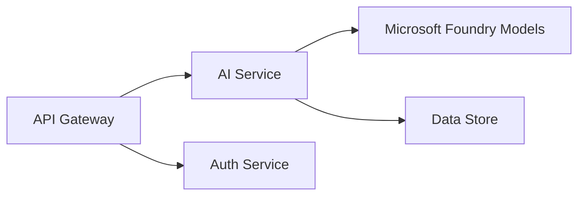
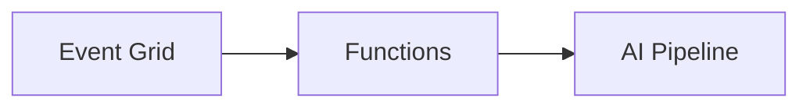

# अध्याय ८: उत्पादन र उद्यम प्रतिमानहरू

**📚 पाठ्यक्रम**: [AZD शुरुवातकर्ताहरूका लागि](../../README.md) | **⏱️ अवधिः** २-३ घण्टा | **⭐ जटिलता**: उन्नत

---

## अवलोकन

यो अध्यायले उद्यम तयार परिनियोजन प्रतिमानहरू, सुरक्षा कडाइ, निगरानी, र उत्पादन AI कार्यभारहरूको लागि लागत अनुकूलन समेट्छ।

यो एक वास्तुकला सन्दर्भ हो, पूर्ण तवरले परिनियोजन योग्य उत्पादन टेम्पलेट होइन। उदाहरणहरूले तपाईंको आफ्नै अनुप्रयोगमा आपूर्ति र परीक्षण गर्न आवश्यक एकीकरण विवरणहरू छोड्छन्; चेकलिष्ट पढ्नाले उत्पादन तयार हुनु प्रमाणित गर्दैन।

> **रिलिज समीक्षा (२०२६-११-०४):** AI CLI मार्गनिर्देशनलाई `azd 1.37.2`, एजेन्टहरू `1.0.0-beta.23`, र मूल्याङ्कनहरू `1.0.0-beta.2` कागजात/स्रोतसँग जाँचिएको थियो। अनुकूलता आवश्यकताहरू र स्थानान्तरण विवरणहरूका लागि [रिलिज परिवर्तन र सुधारहरू](production-ai-practices.md#recent-release-changes-and-fixes) हेर्नुहोस्; यो प्रत्यक्ष परिनियोजन प्रमाणीकरण होइन।

## सिकाइ लक्ष्यहरू

यो अध्याय पूरा गर्दा, तपाईं:
- बहु-क्षेत्रीय लचकदार अनुप्रयोगहरू परिनियोजन गर्नु हुनेछ
- उद्यम सुरक्षा प्रतिमानहरू कार्यान्वयन गर्नु हुनेछ
- व्यापक निगरानी कन्फिगर गर्नु हुनेछ
- ठूलो स्तरमा लागत अनुकूलन गर्नु हुनेछ
- AZD सँग CI/CD पाइपलाइन सेटअप गर्नु हुनेछ

---

## 📚 पाठहरू

| # | पाठ | विवरण | समय |
|---|--------|-------------|------|
| 1 | [उत्पादन AI अभ्यासहरू](production-ai-practices.md) | उद्यम परिनियोजन प्रतिमानहरू | ९० मिनेट |

---

## 🚀 उत्पादन जाँचसूची

- [ ] लचकताको लागि बहु-क्षेत्रीय परिनियोजन
- [ ] प्रमाणीकरणका लागि प्रबन्धित पहिचान (कुञ्जीहरू छैनन्)
- [ ] निगरानीका लागि एप्लिकेशन इनसाइट्स
- [ ] लागत बजेट र सूचना सूचनाहरू कन्फिगर गरिएका
- [ ] सुरक्षा स्क्यानिङ सक्षम गरिएको
- [ ] CI/CD पाइपलाइन एकीकरण
- [ ] प्रकोप रिकभरी योजना

---

## 🏗️ वास्तुकला प्रतिमानहरू

### प्रतिमान १: माइक्रोसर्भिसेज AI



### प्रतिमान २: इभेन्ट-ड्राइभन AI



---

## 🔐 सुरक्षा उत्तम अभ्यासहरू

```bicep
// Illustrative properties from different resources, NOT a standalone Bicep file.
// Attach identity to the application host:
identity: {
  type: 'SystemAssigned'
}

// AI account properties (also require private endpoints, DNS and app connectivity):
properties: {
  publicNetworkAccess: 'Disabled'
  networkAcls: {
    defaultAction: 'Deny'
  }
}
```

---

## 💰 लागत अनुकूलन

| रणनीति | मुख्य प्रतिबन्ध |
|----------|---------|
| शून्यमा स्केल गर्नु (कन्टेनर एप्स) | उपयुक्त ट्रिगर आवश्यक; अन्य सेवाहरूले अझै लागत लगाउँछन् |
| विकासको लागि उपभोग स्तर प्रयोग गर्नु | चयन गरिएको सेवा मूल्य र कार्यभार तुलना गर्नुहोस् |
| अनुसूचित स्केलिङ | समर्थित पूर्वाधार/स्वचालनबाट स्केल गर्नुहोस् |
| आरक्षण/प्रबन्धित क्षमता | मात्र समर्थन गरिएको बेला; प्रतिबद्धताले निष्क्रिय लागत बढाउन सक्छ |

मान्य आरम्भ मिति, बिलिङ दायराको साथ [पूर्ण बजेट स्रोत प्रतिमान](production-ai-practices.md#2-cost-monitoring-and-budgets) प्रयोग गर्नुहोस्, प्राप्तकर्ता र अनुमतिहरू सहित। बजेटले सूचना पठाउँछ; खर्च सीमा निर्धारण गर्दैन। बचत मापन गरिएको प्रयोगमा निर्भर गर्दछ र प्रतिशत सुनिश्चित छैन।

---

## 📊 निगरानी सेटअप

```bash
# Open the Application Insights logs view (requires configured monitoring)
azd monitor --logs

# Check Application Insights
azd monitor --overview

# View metrics
az monitor metrics list --resource <resource-id>
```

---

## 🔗 नेभिगेसन

| दिशा | अध्याय |
|-----------|---------|
| **अघिल्लो** | [अध्याय ७: समस्या समाधान](../chapter-07-troubleshooting/README.md) |
| **पाठ्यक्रम पूरा** | [पाठ्यक्रम गृह](../../README.md) |

---

## 📖 सम्बन्धित स्रोतहरू

- [AI एजेन्टहरू गाइड](../chapter-02-ai-development/agents.md)
- [एप्लिकेशन इनसाइट्स](../chapter-06-pre-deployment/application-insights.md)
- [बहु-एजेन्ट समाधानहरू](../chapter-05-multi-agent/README.md)
- [माइक्रोसर्भिसेज उदाहरण](../../examples/microservices/README.md)

---

<!-- CO-OP TRANSLATOR DISCLAIMER START -->
**अस्वीकरण**:
यो दस्तावेज़ AI अनुवाद सेवा [Co-op Translator](https://github.com/Azure/co-op-translator) प्रयोग गरेर अनुवाद गरिएको हो। हामी सही हुन प्रयास गर्छौं, तर कृपया जानकार हुनुस् कि स्वचालित अनुवादमा त्रुटिहरू वा अशुद्धताहरू हुन सक्छन्। मूल दस्तावेज़ यसको मूल भाषामा आधिकारिक स्रोत मानिनुपर्छ। महत्वपूर्ण जानकारीका लागि व्यावसायिक मानव अनुवाद सिफारिस गरिन्छ। यस अनुवादको प्रयोगबाट उत्पन्न कुनै पनि गलत बुझाइ वा त्रुटिको लागि हामी जिम्मेवार छैनौं।
<!-- CO-OP TRANSLATOR DISCLAIMER END -->