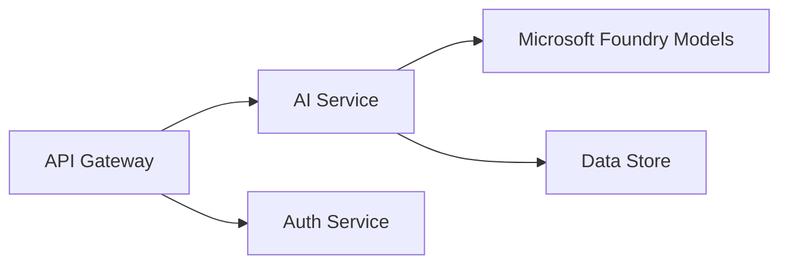
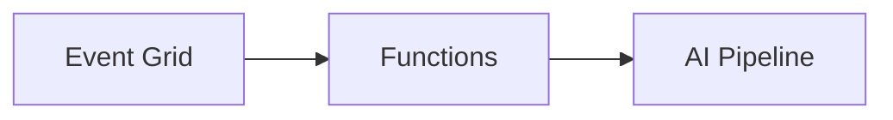

# अध्याय ८: उत्पादन र उद्यम ढाँचाहरू

**📚 पाठ्यक्रम**: [AZD लागि शुरुवातीहरू](../../README.md) | **⏱️ अवधि**: २-३ घण्टा | **⭐ जटिलता**: उन्नत

---

## अवलोकन

यो अध्यायले उद्यम-तयार परिनियोजन ढाँचाहरू, सुरक्षा कडा बनाउने, अनुगमन, र उत्पादन AI कार्यभारहरूको लागि लागत अनुकूलन समेट्छ।

यो एक वास्तुकला सन्दर्भ हो, पूर्ण रूपमा लागू गर्न मिल्ने उत्पादन टेम्प्लेट होइन। उदाहरणहरूले समामेलन विवरणहरू छोड्छन् जुन तपाईंले आफ्नो अनुप्रयोगमा आपूर्ति र परीक्षण गर्नुपर्ने हुन्छ; चेकलिस्ट पढ्नु उत्पादन तयारी प्रमाणित गर्दैन।

> **Foundry GA अपडेट (२०२६-११-०९):** Foundry कार्यप्रवाहका लागि `azd >= 1.37.0` र सामान्य रूपमा उपलब्ध `microsoft.foundry` 1.0 बन्डल प्रयोग गर्नुहोस्; मूल्याङ्कनहरू अलगसँग इन्स्टल गरिन्छन्। हेर्नुहोस् [रिलिज स्कोप र माइग्रेशन](production-ai-practices.md#recent-release-changes-and-fixes) र [प्रमाणित पाइलट उदाहरण](production-ai-practices.md#cicd-pipeline-configuration)। यो दस्तावेज समीक्षा हो, प्रत्यक्ष परिनियोजन प्रमाणीकरण वा वैकल्पिक पूर्वावलोकन सुविधाहरूको सामान्य GA स्थिति होइन।

## सिकाइ उद्देश्यहरू

यो अध्याय पूरा गरेर, तपाईं:
- बहु-क्षेत्र प्रतिरोधी अनुप्रयोगहरू परिनियोजन गर्नुहोस्
- उद्यम सुरक्षा ढाँचाहरू कार्यान्वयन गर्नुहोस्
- व्यापक अनुगमन सेटअप गर्नुहोस्
- लागतहरू स्केलमा अनुकूलित गर्नुहोस्
- AZD सँग CI/CD पाइपलाइनहरू सेटअप गर्नुहोस्

---

## 📚 पाठहरू

| # | पाठ | विवरण | समय |
|---|--------|-------------|------|
| १ | [उत्पादन AI अभ्यासहरू](production-ai-practices.md) | उद्यम परिनियोजन ढाँचाहरू | ९० मिनेट |

---

## 🚀 उत्पादन चेकलिस्ट

- [ ] बहु-क्षेत्र परिनियोजन प्रतिरोधका लागि
- [ ] प्रमाणिकरणका लागि प्रबन्धित पहिचान (कुञ्जीहरू बिना)
- [ ] अनुगमनका लागि अनुप्रयोग इनसाइट्स
- [ ] लागत बजेट र चेतावनी कन्फिगर गरिएको
- [ ] सुरक्षा स्क्यानिङ सक्षम गरिएको
- [ ] CI/CD पाइपलाइन समामेलन
- [ ] विपत्ति पुनःप्राप्ति योजना

---

## 🏗️ वास्तुकला ढाँचाहरू

### ढाँचा १: माइक्रोसर्भिस AI



### ढाँचा २: घटना-चालित AI



---

## 🔐 सुरक्षा उत्तम अभ्यासहरू

```bicep
// Illustrative properties from different resources, NOT a standalone Bicep file.
// Attach identity to the application host:
identity: {
  type: 'SystemAssigned'
}

// AI account properties (also require private endpoints, DNS and app connectivity):
properties: {
  publicNetworkAccess: 'Disabled'
  networkAcls: {
    defaultAction: 'Deny'
  }
}
```

---

## 💰 लागत अनुकूलन

| रणनीति | मुख्य प्रतिबन्ध |
|----------|---------|
| शून्यसम्म स्केल (कन्टेनर एप्स) | उपयुक्त ट्रिगर आवश्यक छ; अन्य सेवाहरू अझै लागत लाग्छ |
| विकासका लागि खपत स्तरहरू प्रयोग गर्नुहोस् | चयन गरिएको सेवा मूल्य निर्धारण र कार्यभार तुलना गर्नुहोस् |
| अनुसूचित स्केलिंग | समर्थित पूर्वाधार/स्वचालन मार्फत स्केल गर्नुहोस् |
| आरक्षण/प्रावधानित क्षमता | केवल जब समर्थित हुन्छ; प्रतिबद्धताहरूले निष्क्रिय लागत बढाउन सक्छ |

वैध सुरु मिति, बिलिङ स्कोप, प्राप्तकर्ता, र अनुमति सहित [पूर्ण बजेट स्रोत ढाँचा](production-ai-practices.md#2-cost-monitoring-and-budgets) प्रयोग गर्नुहोस्। बजेटले चेतावनीहरू पठाउँछ; यसले खर्च सीमित गर्दैन। बचतहरू मापन गरिएको उपयोगिता अनुसार निर्भर गर्दछ र ग्यारेन्टी गरिएको प्रतिशतहरू होइनन्।

---

## 📊 अनुगमन सेटअप

```bash
# Open the Application Insights logs view (requires configured monitoring)
azd monitor --logs

# Check Application Insights
azd monitor --overview

# View metrics
az monitor metrics list --resource <resource-id>
```

---

## 🔗 नेभिगेसन

| दिशा | अध्याय |
|-----------|---------|
| **अघिल्लो** | [अध्याय ७: समस्या समाधान](../chapter-07-troubleshooting/README.md) |
| **पाठ्यक्रम समाप्त** | [पाठ्यक्रम गृह पृष्ठ](../../README.md) |

---

## 📖 सम्बन्धित स्रोतहरू

- [AI एजेन्टहरूको मार्गदर्शक](../chapter-02-ai-development/agents.md)
- [अनुप्रयोग इनसाइट्स](../chapter-06-pre-deployment/application-insights.md)
- [बहु-एजेन्ट समाधानहरू](../chapter-05-multi-agent/README.md)
- [माइक्रोसर्भिस उदाहरण](../../examples/microservices/README.md)

---

<!-- CO-OP TRANSLATOR DISCLAIMER START -->
**अस्वीकरण**:
यो दस्तावेज़ AI अनुवाद सेवा [Co-op Translator](https://github.com/Azure/co-op-translator) प्रयोग गरेर अनुवाद गरिएको हो। हामी सही हुन प्रयास गर्छौं, तर कृपया जानकार हुनुस् कि स्वचालित अनुवादमा त्रुटिहरू वा अशुद्धताहरू हुन सक्छन्। मूल दस्तावेज़ यसको मूल भाषामा आधिकारिक स्रोत मानिनुपर्छ। महत्वपूर्ण जानकारीका लागि व्यावसायिक मानव अनुवाद सिफारिस गरिन्छ। यस अनुवादको प्रयोगबाट उत्पन्न कुनै पनि गलत बुझाइ वा त्रुटिको लागि हामी जिम्मेवार छैनौं।
<!-- CO-OP TRANSLATOR DISCLAIMER END -->