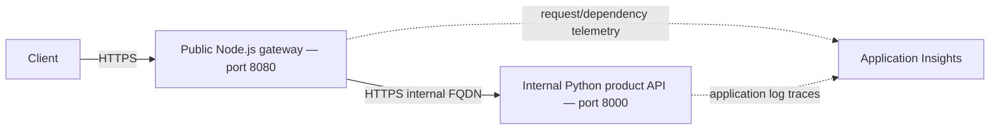

# दुई-सेवा माइक्रोसर्भिसहरू — Azure Container Apps

**स्तर:** मध्यम · **समय:** सेटअप सहित ४५–६० मिनेट

यो सिकाइ नमूना **Node.js API Gateway** र **पढ्न मात्र Python Product Service** कार्यान्वयन गर्छ। स्रोत, Dockerfiles, Bicep, र azd कन्फिगरेसन समावेश छन्।

यो उत्पादन-सक्षम प्रणाली होइन।

## तपाईंले के सिक्नुहुनेछ

- दुई सेवाहरू स्वतन्त्र रूपमा डिप्लॉय गर्नुहोस्।
- HTTPS मार्फत आन्तरिक ब्याकएण्ड FQDN प्रयोग गर्नुहोस्।
- सफल, फेला नपरे, र सेवा अनुपलब्ध प्रतिक्रियाहरू जाँच गर्नुहोस्।
- टेलिमेट्री र स्वतन्त्र स्केलिङ सीमाहरू बुझ्नुहोस्।



उत्पादन क्याटलगमा पाँच निश्चित उत्पादनहरू मेमोरीमा छन्। त्यहाँ **POST, PUT, वा DELETE ह्यान्डलरहरू छैनन्**, डाटाबेस, सेवा बस, अर्डर/प्रयोगकर्ता/सूचना सेवा, C#, वा Go कोड छैन। ती भविष्यको विकास विचारहरू हुन्, समावेश गरिएको सुविधा होइनन्।
गेटवेले प्रयोगकर्ताहरूलाई प्रमाणीकृत गर्दैन; आन्तरिक इनग्रेशले एप्लिकेशन प्राधिकरणको विकल्प होईन।

गेटवेले प्रयोगकर्ताहरूलाई प्रमाणित गर्दैन; आन्तरिक इन्ग्रेस अनुप्रयोग प्राधिकरणको प्रतिस्थापन होईन।
अनुप्रयोग प्राधिकरणको लागि प्रतिस्थापन होइन।

## पूर्वआवश्यकताहरू

पहिले [एकल Flask API](../../../../../examples/container-app/simple-flask-api) पूरा गर्नुहोस्।
एक वर्तमान स्थिर azd (समीक्षा समयमा प्रकाशित संस्करण: 1.37.2), Azure CLI,
र Docker स्थापना गर्नुहोस् जसमा डिमन चलिरहेको छ। तपाईंलाई Azure सदस्यता, स्रोत
सिर्जना अनुमति, र Container Apps क्षेत्रीय कोटा आवश्यक छ।

```bash
azd version
az version
docker info
azd auth login
az login
```

दुबै CLI उपकरणहरूमा समान सदस्यता प्रयोग गर्नुहोस्। तलका आदेशहरू Bash प्रयोग गर्छन्।

## परिनियोजन र प्रमाणीकरण गर्नुहोस्

रिपोजिटरी शिरबाट:

```bash
cd examples/container-app/microservices
azd env new microservices-demo
azd up
GATEWAY_URL=$(azd env get-value API_GATEWAY_URL)
RG_NAME=$(azd env get-value AZURE_RESOURCE_GROUP)
GATEWAY_NAME=$(azd env get-value API_GATEWAY_NAME)
PRODUCT_NAME=$(azd env get-value PRODUCT_SERVICE_NAME)

curl --fail-with-body "${GATEWAY_URL}/health"
curl --fail-with-body "${GATEWAY_URL}/api/products"
curl --fail-with-body "${GATEWAY_URL}/api/products/1"
curl -i "${GATEWAY_URL}/api/products/999"
```

**सफलता:** health 200; सूची 200 संग **पाँच** उत्पादनहरू; उत्पादन 1 एक ल्यापटप हो
जसको मूल्य 999.99 छ र स्टक 50 छ; अज्ञात उत्पादनले 404 फर्काउँछ।
विवरणहरू प्रतिक्रियाहरूमा समावेश छन्; समय स्ट्याम्पहरू फरक फरक हुन सक्छन्।

प्रारम्भिक प्रावधानले पोर्ट 80 मा सार्वजनिक hello-world इमेजहरू प्रयोग गर्छ ताकि यो खाली दर्ताखाना
बाट अवस्थित नभएका इमेजहरू तान्न नदियोस्। सेवा-विशिष्ट Bicep मोड्युलहरू
र प्यारामिटर फाइलहरूले तिनीहरूलाई निर्माण गरिएको इमेजहरू र एप पोर्ट/प्रोबहरूको साथ
`azd deploy` मा प्रतिस्थापन गर्छ। मुख्य प्यारामिटरहरूले प्रकाशित इमेज नामहरू पछि प्रावधानको लागि कायम राख्छन्।

## सेवा र नेटवर्किङ

| सेवा | खुला अन्तबिन्दुहरू | पूर्वनिर्धारित स्रोतहरू |
|---|---|---|
| Gateway | GET `/`, `/health`, `/api/products`, `/api/products/:id` | १ vCPU, २ GiB, २–२० प्रतिलिपिहरू |
| Product | GET `/`, `/health`, `/products`, `/products/<id>` | ०.५ vCPU, १ GiB, १–१० प्रतिलिपिहरू |

उत्पादन इन्ग्रेससँग `external: false` र `allowInsecure: false` छन्। Bicep ले
`PRODUCT_SERVICE_URL=https://<actual-internal-fqdn>` गेटवेमा इन्जेक्ट गर्छ। HTTP ले
रिडाइरेक्ट गर्नेछ; HTTPS कन्फिगर गरिएको इन्ग्रेससँग मेल खान्छ। छोटो DNS नामले
**वास्तविक Container App नाम** लाई मेल खानु पर्छ, तर्कसंगत सेवा कुञ्जी `product-service` होइन।
आफ्नो ल्यापटपबाट आन्तरिक URL मा सिधै कल गर्ने प्रयास नगर्नुहोस्।

गेटवेमा उत्पादन कलहरूको लागि पाँच सेकेन्डको टाइमआउट छ। हराएको उत्पादन ID हरू
404 को रूपमा प्रचार गर्नुहोस्; ट्रान्सपोर्ट असफलताहरू/अरू ब्याकएन्ड असफलताहरू 503 फर्काउँछन्। गेटवे
`/health` ले केवल गेटवे जाँच गर्छ, ब्याकएन्ड उपलब्धता होइन।

## फाइलहरू र कन्फिगरेसन

```text
azure.yaml
infra/main.bicep
infra/main.parameters.json
infra/abbreviations.json
infra/core/container-apps-environment.bicep
infra/core/monitor.bicep
infra/app/api-gateway.bicep
infra/app/api-gateway.parameters.json
infra/app/product-service.bicep
infra/app/product-service.parameters.json
src/api-gateway/{app.js,package.json,Dockerfile}
src/product-service/{main.py,requirements.txt,Dockerfile}
```

स्केलिंग, CPU/मेमोरी, पोर्टहरू, र प्रोबहरू `infra/app/*.bicep` मा सेट गरिएका छन्। ती
फाइलहरू परिवर्तन गर्नुहोस् र इन्फ्रास्ट्रक्चर लागू गर्न र पुन: डिप्लोय गर्न `azd up` चलाउनुहोस्। यस नमूनामा कुनै
`GATEWAY_MAX_REPLICAS` वातावरण-परिवर्ती प्यारामिटर छैन।

केवल कोड परिवर्तनहरूको लागि:

```bash
azd deploy product-service
azd deploy api-gateway
```

नोड इमेजले नोड 22 प्रयोग गर्छ; पायथन इमेजले पायथन 3.11 प्रयोग गर्छ। दुवैले
`0.0.0.0` मा बाँधिन्छन्। इन्ग्रेस/प्रोबहरूले पोर्ट 8080 (गेटवे) र 8000 (उत्पादन) क्रमशः प्रयोग गर्छन्।

## Docker सँग स्थानीय विकास

यस उदाहरण डाइरेक्टरीबाट चलाउनुहोस्। प्रयोगकर्ता-परिभाषित नेटवर्क प्रयोग गर्नुहोस्, **नभएर `localhost`
एउटा कन्टेनरबाट अर्कोमा पुग्न**:

```bash
docker network create azd-microservices-demo
docker build -t local-product ./src/product-service
docker build -t local-gateway ./src/api-gateway
docker run -d --name azd-product --network azd-microservices-demo local-product
docker run -d --name azd-gateway --network azd-microservices-demo \
  -p 8080:8080 -e PRODUCT_SERVICE_URL=http://azd-product:8000 local-gateway
curl --fail-with-body http://localhost:8080/api/products
```

अपेक्षित: पाँच उत्पादनहरू। HTTP केवल स्थानीय Docker नेटवर्कका लागि प्रयोग गरिएको छ।

```bash
docker stop azd-product azd-gateway
docker rm azd-product azd-gateway
docker network rm azd-microservices-demo
```

## अनुगमन

```bash
az containerapp logs show --name "$GATEWAY_NAME" --resource-group "$RG_NAME" --follow
# In a separate terminal:
az containerapp logs show --name "$PRODUCT_NAME" --resource-group "$RG_NAME" --tail 100
```

`azd monitor --logs` पोर्टल दृश्य खोल्छ; यसले टर्मिनल लगहरू स्ट्रिम गर्दैन।
Node SDK ले गेटवे अनुरोधहरू/आश्रितताहरू सङ्कलन गर्दछ। Python को `AzureLogHandler`
**लग ट्रेसेस** निर्यात गर्दछ, स्वतः Flask अनुरोधहरू, SQL आश्रितता, वा पूर्ण
वितरित ट्रेसेस होइन। OpenCensus एउटा पुरानो SDK हो; यस नमुनालाई विस्तार गर्दा Azure Monitor OpenTelemetry
मन पराउनुहोस्।

Application Insights Logs मा, अनुरोधहरू उत्पन्न गर्नुहोस् र निरीक्षण गर्नुहोस्:

```kusto
requests
| where timestamp > ago(1h)
| where name contains "products"
| summarize RequestCount=count(), AvgDuration=avg(duration) by bin(timestamp, 5m)
```

Python अनुप्रयोग सन्देशहरूको लागि:

```kusto
traces
| where timestamp > ago(1h)
| where message contains "products"
| project timestamp, message, severityLevel
```

खाने ढिलाइ र नमूना लिन अनुमति दिनुहोस्; ठ्याक्कै अनुरोध संख्या वा सुनिश्चित विलम्बता अपेक्षा नगर्नुहोस्।
कुनै कस्टम सूचनाहरू वा ड्यासबोर्डहरू कन्फिगर गरिएको छैन।

## व्यावहारिक अभ्यासहरू

### अभ्यास १: सूची परिमार्जन गर्नुहोस्

**सुरुवाती बिन्दु:** `src/product-service/main.py`।
**लक्ष्य:** स्वतन्त्र सेवा कार्यान्वयन पुष्टि गर्नुहोस्।
फिक्स्ड `products` सूचीमा ल्यापटपको स्टक ५० बाट ४९ मा परिवर्तन गर्नुहोस्, चलाउनुहोस्
`azd deploy product-service`, त्यसपछि `${GATEWAY_URL}/api/products/1` अनुरोध गर्नुहोस्।

**सफलता मापदण्ड / समाधान:** HTTP 200 सँग `"stock":49`। ५० पुनर्स्थापना गरी पुनःप्रक्षेपण गर्नुहोस्।
**सामान्य समस्या:** सूचीको मालिक सेवा सट्टा गेटवे सम्पादन गर्नु।
यसले स्रोत डेटा परिवर्तन गर्छ, स्थायी सूचीकरण डेटाबेस होइन।

### अभ्यास २: प्रतिलिपि कन्फिगरेसन जाँच्नुहोस्

**सुरु गर्ने बिन्दु:** `infra/app/product-service.bicep`।
**लक्ष्यः** अटोस्केलिङमा अनुमान नगरी पूर्वाधार परिवर्तन अवलोकन गर्नुहोस्।
`minReplicas: 1` लाई `minReplicas: 2` मा परिवर्तन गर्नुहोस्, `azd up` चलाउनुहोस्, त्यसपछि:

```bash
az containerapp show --name "$PRODUCT_NAME" --resource-group "$RG_NAME" \
  --query properties.template.scale -o json
```

**सफलता मापदण्डहरू:** कन्फिगर गरिएको न्यूनतम २ हो र अधिकतम १० नै रहन्छ।
न्यूनतम १ फर्काउनुहोस् र `azd up` चलाउनुहोस्।
**साझा समस्या:** मात्र `azd deploy` ले अप्रासंगिक साझा
पूर्वाधारमा परिवर्तनहरू लागू गर्दैन। असफलता सिमुलेसनको लागि `maxReplicas` लाई शून्यमा नराख्नुहोस्।
यसले कन्फिगरेसन सत्यापित गर्दछ, लोड-परीक्षा वा ग्यारेन्टी गरिएको तुरुन्त प्रतिलिपि सङ्ख्या होइन।

### अभ्यास ३: स्थानीय रूपमा अनुपलब्ध-सेवा ह्यान्डलिङ परीक्षण गर्नुहोस्

**सुरूवात बिन्दु:** माथिका दुबै स्थानीय Docker कन्टेनरहरू चलिरहेका छन्।
**लक्ष्य:** ब्याकएन्ड असफलता र हराएको उत्पादनलाई फरक गर्न।
केवल उत्पादन कन्टेनर रोक्नुहोस्:

```bash
docker stop azd-product
curl -i http://localhost:8080/api/products
docker start azd-product
curl --fail-with-body http://localhost:8080/api/products
```

**सफलता मापदण्ड:** रोकिएको बेला, गेटवेले 503 फर्काउँछ
`"error":"Product service unavailable"` सँग; पुनः सुरु भएपछि, सूचीले 200 फर्काउँछ।
आवश्यक भएमा छोटो स्टार्टअप ढिलाइ पछि पुन: प्रयास गर्नुहोस्।
**साझा समस्या:** गेटवे रोक्नुले फरक असफलता परीक्षण गर्दछ (HTTP प्रतिक्रिया छैन)।

## लागत र उत्पादनको अन्तरहरू

पूर्वनिर्धारित न्यूनतम प्रतिकृतिहरूले कम्प्युट चलाउन राख्छ। रजिस्ट्री र अनुगमनले पनि
शुल्क लगाउँछन्। मान्य गरिएको निश्चित $५०/महिना कुल छैन: क्षेत्रीय CPU/मेमोरी,
प्रतिलिपि घण्टा, अनुरोधहरू, रजिस्ट्री, र लग सञ्चयनलाई
[Azure मूल्य निर्धारण क्यालकुलेटर](https://azure.microsoft.com/pricing/calculator/) मा अनुमान लगाउनुहोस्।
सिकाइ स्रोतहरू तुरुन्तै मेट्नुहोस्।

उत्पादन कार्यमा प्रमाणीकरण/अधिकार, सीमित प्रबन्धित पहिचानहरू,
स्थायी डाटा, इनपुट/प्रतिक्रिया प्रमाणीकरण, समर्थित अवलोकन उपकरणहरू,
लोड/असफलता परीक्षण, CI/CD, चेतावनीहरू, र पुनर्प्राप्ति प्रक्रिया समावेश छन्। अर्डर सेवा,
क्यू वा डेटाबेस थप्नु अलग कार्यान्वयन कार्य हो, यहाँ उपलब्ध समाप्त अभ्यास वा सुविधा होइन।


## समस्या समाधान र सफाइ

- **पहिलो प्राविजनको क्रममा छवि फेला परेन:** बुटस्ट्र्यापले सार्वजनिक छवि प्रयोग गर्नुपर्छ;
  मुख्य छवि प्यारामिटर पूर्वनिर्धारणहरू र डिप्लोयमेन्ट मोड्युल म्यापिङहरू जाँच गर्नुहोस्।
- **503 उत्पादनहरू:** उत्पादन लगहरू, छवि संस्करण, र इन्जेक्ट गरिएको आन्तरिक HTTPS URL जाँच गर्नुहोस्।
- **404 अप्रत्याशित पथ:** उत्पादन API पढ्न मात्र हो; मार्ग जाँच गर्नुहोस्, अवस्थित नभएको CRUD ह्यान्डलर होइन।
- **टेलिमेट्री छैन:** रनटाइम कनेक्शन स्ट्रिङहरू देखाउने बिना निरीक्षण गर्नुहोस् र
  स्वीकृति ढिलाइ अनुमति दिनुहोस्। Python अनुरोध तालिकाहरू यसको लग ह्यान्डलरले भरिंदैनन्।

यस नमुना निर्देशिका बाट:

```bash
azd down
```

मेट्ने प्रम्प्टहरू समीक्षा गर्नुहोस् र समर्पित स्रोत समूह हटाइएको छ कि छैन जाँच गर्नुहोस्।

[अघिल्लो: Flask API](../../../../../examples/container-app/simple-flask-api) · [अर्को: डेटाबेस एप्](../../../../../examples/database-app) ·
[AI विकास](../../../docs/chapter-02-ai-development/README.md) ·
[पाठ्यक्रम गृह](../../../README.md) · [समस्या रिपोर्ट गर्नुहोस्](https://github.com/microsoft/AZD-for-beginners/issues)

---

<!-- CO-OP TRANSLATOR DISCLAIMER START -->
**अस्वीकरण**:
यो दस्तावेज़ AI अनुवाद सेवा [Co-op Translator](https://github.com/Azure/co-op-translator) प्रयोग गरेर अनुवाद गरिएको हो। हामी सही हुन प्रयास गर्छौं, तर कृपया जानकार हुनुस् कि स्वचालित अनुवादमा त्रुटिहरू वा अशुद्धताहरू हुन सक्छन्। मूल दस्तावेज़ यसको मूल भाषामा आधिकारिक स्रोत मानिनुपर्छ। महत्वपूर्ण जानकारीका लागि व्यावसायिक मानव अनुवाद सिफारिस गरिन्छ। यस अनुवादको प्रयोगबाट उत्पन्न कुनै पनि गलत बुझाइ वा त्रुटिको लागि हामी जिम्मेवार छैनौं।
<!-- CO-OP TRANSLATOR DISCLAIMER END -->