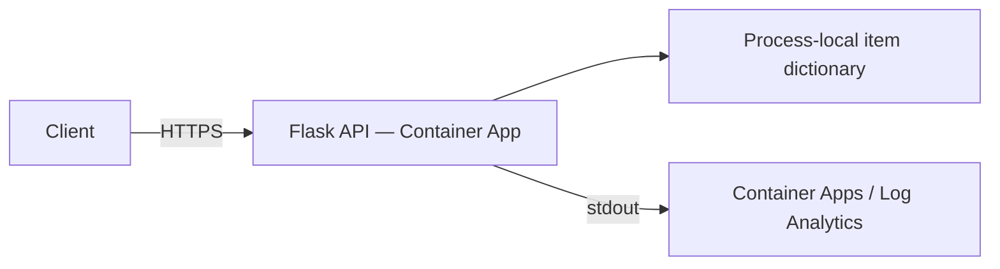

# सरल Flask API — Azure Container Apps

**स्तर:** सुरु गर्ने · **समय:** ३०–४५ मिनेट सेटअप सहित

Azure Developer CLI (azd) सँग Python Flask CRUD API डिप्लोय गर्नुहोस्। स्रोत, Dockerfile,
Bicep, र डिप्लोयमेन्ट प्यारामिटरहरू समावेश छन्। यो एक **सीख्ने नमुना** हो, 
उत्पादन-तयार API होइन।

## तपाईंले के सिक्नुहुनेछ

- azd मार्फत कन्टेनर निर्माण र प्रकाशित गर्ने।
- इनग्रेश र लिभनेस/रेडिनेस प्रोबहरू कन्फिगर गर्ने।
- CRUD प्रतिक्रियाहरू जाँच्ने र एप्लिकेसन लगहरू निरीक्षण गर्ने।
- किन इन-मेमोरी डेटा दीर्घकालीन एप्लिकेसनहरूका लागि उपयुक्त हुँदैन बुझ्ने।



**महत्वपूर्ण:** वस्तुहरू एउटै प्रक्रिया भित्र राखिन्छन्। डिफ़ल्ट हो **एक Gunicorn कार्यकर्ता,
०–१ रप्लिका**, जानाजानी कामदार/रप्लिका बीच असंगत डेटा नहोस् भनेर।
वस्तुहरू रिस्टार्ट, संस्करण परिवर्तन, वा स्केल-टू-जीरो हुँदा हराउँछन्। रप्लिका बढाउँदा
साझा स्थायी भण्डारण आवश्यक छ। API मा कुनै प्रमाणीकरण वा प्राधिकरण छैन।

## पूर्व आवश्यकताहरू

- [हालको स्थिर azd](https://learn.microsoft.com/azure/developer/azure-developer-cli/install-azd)
  (समिक्षा समयमा प्रकाशित संस्करण: 1.37.2)।
- परीक्षणका लागि [Azure CLI](https://learn.microsoft.com/cli/azure/install-azure-cli)।
- Docker र यसको डिमन चलिरहेको हुनुपर्छ; यो डिफ़ल्ट स्थानीय छवि निर्माणको लागि आवश्यक छ।
- Azure सदस्यता, स्रोत सिर्जना अनुमति, र Container Apps क्षेत्रीय कोटा।
- तलका कमाण्डहरूका लागि Bash (वा समान PowerShell)।
- वैकल्पिक स्थानीय विकासका लागि Python 3.11।

```bash
azd version
az version
docker info
azd auth login
az login
```

CLI उपकरणहरूले अलग लगइन सत्रहरू राख्छन्। दुबैमा एउटै सदस्यता प्रयोग गर्नुहोस्।

## छिटो सुरूवात

रिपोजिटरीको मूलबाट:

```bash
cd examples/container-app/simple-flask-api
azd env new flask-demo
azd up
API_URL=$(azd env get-value API_ENDPOINT)
RG_NAME=$(azd env get-value AZURE_RESOURCE_GROUP)
API_NAME=$(azd env get-value API_NAME)
curl --fail-with-body "${API_URL}/health"
```

अपेक्षा गरिन्छ: HTTP 200 र JSON मा `"status":"healthy"`,
`"service":"simple-flask-api"`, र वर्तमान UTC टाइमस्ट्याम्प।
प्रावधान र छवि निर्माण सामान्यतया केही मिनेट लाग्छ; समय फरक हुन सक्छ।

प्रारम्भिक प्रावधानले सार्वजनिक hello-world छवि प्रयोग गर्दछ जुन पोर्ट ८० मा सुन्छ।
`azure.yaml` ले सेवा डिप्लोयमेन्टका लागि `infra/app/api.bicep` र त्यसको मिल्ने प्यारामिटर फाइल चयन गर्छ,
जसले छवि, इनग्रेश, र प्रोबहरू पोर्ट ८००० मा स्विच गर्छ।
ती डिप्लोयमेन्ट प्यारामिटरहरू नहटाउनुहोस्।

## CRUD जाँच गर्नुहोस्

त्यहि रप्लिका सक्रिय रहेको बेला तल क्रमबद्ध रूपमा चलाउनुहोस्:

```bash
# Create: HTTP 201; note the returned id (1 for a fresh process).
curl -i -X POST "${API_URL}/api/items" \
  -H "Content-Type: application/json" \
  -d '{"name":"Test Item","description":"My first item"}'

# Read list: HTTP 200, total 1 in a fresh process.
curl --fail-with-body "${API_URL}/api/items"

# Replace 1 if your create response returned another id.
curl --fail-with-body "${API_URL}/api/items/1"
curl -i -X PUT "${API_URL}/api/items/1" \
  -H "Content-Type: application/json" -d '{"name":"Updated Item"}'
curl -i -X DELETE "${API_URL}/api/items/1"
curl -i "${API_URL}/api/items/1"
```

सफलताको सर्त: POST 201, पढाइ/PUT 200, DELETE 204 बिना बडी, त्यसपछि हराएको वस्तु 404।
बिग्रिएको/गैर-वस्तु JSON वा खाली नामले 400 फर्काउँछ।
यदि वस्तु अनुरोध बीच हरायो भने, रिस्टार्ट वा स्केल-टू-जीरो जाँच गर्नुहोस्;
यो जानाजानी इन-मेमोरी सिमितता हो, स्थायीत्व होइन।

| अन्तिम बिन्दु | विधिहरू |
|---|---|
| `/` | GET — सेवा जानकारी |
| `/health` | GET — लिभनेस/रेडिनेस |
| `/api/items` | GET, POST |
| `/api/items/{id}` | GET, PUT, DELETE |

## लगहरू र कन्फिगुरेसन

```bash
az containerapp logs show --name "$API_NAME" --resource-group "$RG_NAME" --follow
```

अपेक्षित: Gunicorn सुरु, अनुरोध लगहरू, र एप्लिकेसन सन्देशहरू।
`azd monitor --logs` ले पोर्टल दृश्य खोल्छ; टर्मिनलमा स्ट्रिम गर्दैन।
एप्लिकेसन इनसाइट्स प्रावधान गरिएको छ तर **यो Flask कोडले यो उपकरणको प्रयोग गरेको छैन**;
stdout लगहरूको लागि Container Apps/Log Analytics प्रयोग गर्नुहोस्।

CPU/मेमोरी, रप्लिका सीमा, वा स्केल नियमहरूका लागि `infra/app/api.bicep` सम्पादन गर्नुहोस्, त्यसपछि
`azd up` चलाउनुहोस्। डिफ़ल्टहरू ०.५ vCPU, १ GiB, न्यूनतम ० / अधिकतम १ रप्लिका, र
HTTP थ्रेसहोल्ड ५० समकालीन अनुरोध। स्केल-टू-जीरोले चिसो-सुरुवात ढिलाइ थप्न सक्छ।

मनमाफिक `azd env set MAX_REPLICAS`, `API_KEY`, `LOG_LEVEL`, वा
`SCALE_TO_ZERO_TIMEOUT` मानहरू **यो टेम्प्लेट वा एप्लिकेसनमा जडित छैनन्**।
मान सेट गर्दा आफैं रनटाइम परिवेश चर हुँदैन।
छवि पोर्ट ८००० स्पष्ट रूपमा बाँध्छ; पोर्ट परिवर्तन गर्दा Dockerfile, Bicep इनग्रेश, र प्रोबहरू
एकसाथ अद्यावधिक गर्नुहोस्।

## फाइलहरू

```text
azure.yaml
infra/main.bicep
infra/main.parameters.json
infra/app/container-apps.bicep       # Environment, registry, monitoring
infra/app/api.bicep                  # App, ingress, probes, scale settings
infra/app/api.parameters.json        # Image and resource values for azd deploy
src/app.py
src/Dockerfile
src/requirements.txt
```

## स्थानीय विकास

यो उदाहरण निर्देशिकाबाट:

```bash
python -m venv .venv
source .venv/bin/activate  # PowerShell: .\.venv\Scripts\Activate.ps1
python -m pip install -r src/requirements.txt
python src/app.py
```

अर्को टर्मिनलमा `http://localhost:8000/health` र CRUD अन्तिम बिन्दुहरू परीक्षण गर्नुहोस्।
वा वास्तविक छवि बनाउनुहोस् र चलाउनुहोस्:

```bash
docker build -t flask-api:local ./src
docker run --rm -p 8000:8000 flask-api:local
```

पहिलो डिप्लोयमेन्ट पछि केवल कोड परिवर्तनका लागि `azd deploy api` चलाउनुहोस्।
Bicep परिवर्तनका लागि पुनः प्रावधान र डिप्लोय गर्न `azd up` चलाउनुहोस्।

## व्यावहारिक अभ्यासहरू

### 1. इनपुट अस्वीकृतिको मान्यता गर्नुहोस्

**सुरुवात बिन्दु:** डिप्लोय गरिएको API, माथि `API_URL`।
**लक्ष्य:** API अवैध JSON स्वरूप र हराएको नामलाई अस्वीकृत गर्छ भनी पुष्टि गर्नुहोस्।

```bash
curl -i -X POST "${API_URL}/api/items" \
  -H "Content-Type: application/json" -d '[]'
curl -i -X POST "${API_URL}/api/items" \
  -H "Content-Type: application/json" -d '{"name":""}'
```

**सफलता मापदण्ड / समाधान:** दुबैले ५०० नभई JSON त्रुटिसहित ४०० फर्काउने।
**सामान्य समस्या:** JSON कन्टेन्ट-टाइप हेडर छुटाउनु।

### २. एउटा पढ्न मात्र सकिने संस्करण अन्तिम बिन्दु थप्नुहोस्

**सुरुवात बिन्दु:** `src/app.py`। **लक्ष्य:** API विस्तार र पुन:डिप्लोय गर्नुहोस्।
यो `if __name__ == '__main__':` ब्लक भन्दा पहिले थप्नुहोस्:

```python
@app.route('/version', methods=['GET'])
def version():
    return jsonify({'version': '1.0.0'})
```

`azd deploy api` चलाउनुहोस्, त्यसपछि `curl --fail-with-body "${API_URL}/version"`।
**सफलता मापदण्ड:** HTTP 200 र `{"version":"1.0.0"}`।
**सामान्य समस्या:** परीक्षण गर्दा blocking `app.run()` कलपछि रूट राख्नु
संगै `python src/app.py`।

### ज्ञान जाँच बिन्दु

एक जना कार्यकर्ता किन टिकाउ डाटा का लागि अपर्याप्त हुन्छ? किनकि एक प्रक्रियाले
पुनः सुरु गर्दा आफ्नो शब्दकोश गुमाउँछ। उत्पादन संस्करणलाई लगातार साझा भण्डारण,
प्रमाणीकरण, प्राधिकरण, माइग्रेशनहरु, परीक्षणहरु, र सञ्चालन निगरानी चाहिन्छ।

## लागत र समस्या निदान

यो $0 तैनाती सुनिश्चित होइन: आधारभूत रजिष्ट्रि र लग भण्डारण/आयोजनमा
शुल्क लाग्न सक्छ जब एप कम्प्युट нुन्यमा छ। आफ्नो क्षेत्रको लागि
[मूल्य गणना गर्ने उपकरण](https://azure.microsoft.com/pricing/calculator/) प्रयोग गर्नुहोस्।

- **Docker निर्माण असफल:** पक्का गर्नुहोस् `docker info`, नेटवर्क पहुँच, र निर्भरता।
- **अस्वस्थ एप:** कन्सोल/प्रणाली लगहरू जाँच्नुहोस् र छवि पोर्ट, इन्ग्रेस,
  र प्राबहरू मिलेका छन्थ्यो कि जाँच गर्नुहोस्। फ्लास्क पोर्टमा प्लेसहोल्डरमा जाँच गर्नु हुँदैन।
- **403/अनुमतिहरू:** सदस्यता र स्रोत सिर्जना अनुमतिहरू पक्का गर्नुहोस्।
- **वस्तुहरू हराउँछन्:** in-memory अवस्था पुनः सुरु/शुन्यमा मात्रामा हुँदा रिसेट हुन्छ; टिकाउ व्यवहारका लागि
  एउटा डाटाबेस थप्नुहोस्।

## सफाई र अर्को कदमहरू

```bash
azd down
```

मेट्ने संकेत जाँच्नुहोस् र समर्पित स्रोत समूह हटाइएको छ कि छैन सुनिश्चित गर्नुहोस्।
असम्बन्धित डाटा भएको स्रोत समूहमा विनाशकारी सफाई नचाल्नुहोस्।

[अर्को: डाटाबेस एप](../../../../../examples/database-app) · [माइक्रोसर्भिसहरू](../../../../../examples/container-app/microservices) ·
[कन्टेनर अवलोकन](../README.md) · [पाठ्यक्रम गृह](../../../README.md) ·
[समस्या रिपोर्ट गर्नुहोस्](https://github.com/microsoft/AZD-for-beginners/issues)

---

<!-- CO-OP TRANSLATOR DISCLAIMER START -->
**अस्वीकरण**:
यो दस्तावेज़ AI अनुवाद सेवा [Co-op Translator](https://github.com/Azure/co-op-translator) प्रयोग गरेर अनुवाद गरिएको हो। हामी सही हुन प्रयास गर्छौं, तर कृपया जानकार हुनुस् कि स्वचालित अनुवादमा त्रुटिहरू वा अशुद्धताहरू हुन सक्छन्। मूल दस्तावेज़ यसको मूल भाषामा आधिकारिक स्रोत मानिनुपर्छ। महत्वपूर्ण जानकारीका लागि व्यावसायिक मानव अनुवाद सिफारिस गरिन्छ। यस अनुवादको प्रयोगबाट उत्पन्न कुनै पनि गलत बुझाइ वा त्रुटिको लागि हामी जिम्मेवार छैनौं।
<!-- CO-OP TRANSLATOR DISCLAIMER END -->